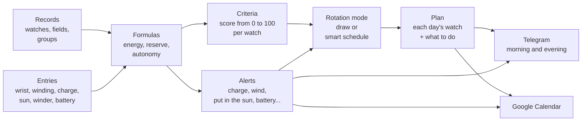

# ⌚ Relojoeiro — Relógios 2

🌐 [Português](README.md) · **English** · [中文](README.zh-CN.md) · [हिन्दी](README.hi.md) · [Español](README.es.md) · [Français](README.fr.md)

> **The smart rotation of a watch collection.** Every day it says which watch goes on the wrist, reminds you to wind,
> charge, put in the sun and change the battery, and makes the whole collection get worn, not just the favorite. Several
> people use the same system, each with their own collections, and share whatever they want.

**[▶ Try it now, without installing anything](https://servidor2.lucas.inf.br/relojoeiro/cadastro.php)**: create a demo account on the project's server (it lasts 30
days, already with a collection ready for you to add your watches).


[](#license)


<sub>The **Today** page with a demo collection of 8 watches (common models, six weeks of use entered through the API): the
watch of the day (the Casio, on the wrist since 7 am), what to do today, the smart schedule of the next days and, on the
right, the Tissot's panel, open next to the list (in Settings it can open floating, over the page).</sub>

| | |
|---|---|
| **[Why it exists](#why-this-exists)** · [The central idea](#the-central-idea-the-system-knows-nothing-about-watches) · [How it works](#how-it-works) · [A day with it](#a-day-with-relógios-2) | **[Try it in 1 minute](#try-it-in-1-minute)** · [The screens](#the-screens) · [The API](#the-api-one-door-for-everything) · [Installation](#installation) |
| [Several people](#several-people-accounts-collections-and-access) ·[Frequently asked questions](#frequently-asked-questions) · [How it is inside](#how-it-is-inside) | [How to contribute](#how-to-contribute) · [License](#license) |

---

## Why this exists

Anyone who collects watches knows the scene:

- **The favorite goes on the wrist every day**, and the one you bought with so much love has been in the drawer for two months.
- **The automatic stops** because nobody wore it over the weekend, and there you go setting the time, date and moon phase again.
- **The solar runs down in the dark** of the box, without you noticing.
- **The battery dies without warning**, right on the watch you wanted to wear today.
- **The smartwatch wakes up with no battery** on the day it was its turn.
- **The mechanical's service** ("every 5 years") and **the warranty** ("does it expire in March?") stay in your memory, that is,
  nowhere.

A spreadsheet solves half of it: it remembers, but it doesn't decide. **Relógios 2** decides. It knows how long each watch has
been idle, how much charge it has now, how much you like it and how much it has been worn compared with the rest. With that it
builds the plan for the next days, or the next two years, with the reminders already in the right place.

In the morning a Telegram message arrives: *"Today: Seiko 5. Wind the Orient (the reserve runs out at 3 pm)."*
In the evening, another: *"Tomorrow: Xiaomi Band. Charge before bed: it reaches 20% tomorrow at 2 pm."*
And Google Calendar has the Casio's battery change in November and the Tissot's service in 2027.

## The central idea: the system knows nothing about watches

This is the most important design decision, and it is what makes the system useful for any collection. **The code only has
mechanisms; all the knowledge about watches is data you register.**

It doesn't "know" that an automatic has a power reserve, or that a solar charges in the sun. All of that is written in
registered formulas, which you read, edit and test on screen:

```text
Remaining reserve of the mechanical =
  ACUMULA(0; reserva_horas; 1;                                  ← starts at 0, the maximum is the reserve, loses 1 h per hour
          "pulso";  carga_pulso_reserva / carga_pulso_horas;    ← each hour on the wrist recharges this much
          "winder"; winder_ganho;                               ← each hour on the winder, by the position's program
          "corda";  reserva_horas)                              ← winding fills it
```

Want to log a "strap change", an "ultrasonic bath" or a "water resistance" field? That's data. Want chronographs to weigh
differently in the draw? That's data. Want an alert to "change the leather strap every year"? Also.

The system comes with a complete initial set (smartwatch, automatic, hand-wound, battery and solar, with the formulas, the
alerts and the criteria of each one), which you adjust to your collection.


<sub>The record fields. Each one applies to a group and everything below it (the power reserve only on mechanicals, the
battery life only on battery watches), and the identifier is the name it has in the formulas.</sub>

---

## How it works



### The concepts, one by one

| Concept | What it is | Example |
|---|---|---|
| **Groups** (the tree) | The classification of the collection, in as many levels as you want. Everything registered in a group applies to it and to everything below it. | `Traditional › Mechanical › Automatic` |
| **Fields** | The data of each watch, defined by you: text, number, date, yes/no or list, with unit, default value and the value rules (the possible values, the minimum and the maximum, several values at once). | `reserva_horas = 40 h`, `data_pilha`, `funcoes = Data, GMT` |
| **Sections** | The record sections, created by you: each field sits in one of them, and the record, the dashboard, the passport and the reports show the fields grouped, in their order. | *Identification*, *Purchase*, *Construction*, *Energy* |
| **Units** | What goes after the number, registered by you: the symbol, the name and the conversion (the inch in millimetres). Fields, entry types and formulas pick the unit from the list, and the value can also appear in another unit. | `47 mm (1.85 pol)` |
| **Calibers** | The watch's movement, with what belongs to it: the manufacturer, the technical manual, the recommendations and the field values. A watch with a caliber uses its own value, otherwise the caliber's, otherwise the field's default. | `NH35`: 41 h power reserve, rate from −20 to +40 s/day |
| **Entry types** | What happens to a watch. It can be **instant** (winding, battery change), **with a value** (charge reading: 68%) or a **session** with start and end (on the wrist, on the winder, in the sun). | `sol`: a session that closes by itself at 6 pm if you forget |
| **Formulas** | Calculations over the fields and the entries. The same formula can have **one version per group**, and the one of the group closest to the watch applies. | `energia` is the battery on the smartwatch, the reserve on the mechanical, the light on the solar and the battery life on the quartz |
| **Alerts** | An expected date by formula, a lead time, a text and the entry that resolves the alert. | *"Wind the Orient: the reserve runs out at 3 pm"*, and the **Winding** button resolves it |
| **Charge limit** | The charge at which the watch needs attention: charge the smartwatch, put the solar in the sun, wind the mechanical. The alert only goes out when the charge reaches it. Each watch can have its own (field *"Alert when the charge reaches"*); empty, the general one in Settings applies. | smartwatch at 20% (the general one), the Samsung at 30% (its own) |
| **Criteria** | How each watch gets a score from 0 to 100 for the draw: weighted parameters, subparameters that measure a field or formula, and ranges that turn the value into a score. | *Time without use* (40%): 0 to 1 day scores 0, 30 days or more scores 100 |
| **Rotation modes** | The rules of the plan: the mode's type (one per week, week and weekend, by day of the week, random, smart schedule or custom), which group to choose from on each day, how many weeks ahead, the choice criterion and, underneath, the script the engine computes. | *"Smartwatch Monday to Friday, one traditional per day on the weekend"* |
| **Plan** | Each day's watch, with what to do (*charge first*, *wind*, *put on the winder*). | `Mon 10/06 · Xiaomi Band · charge before wearing` |

### The formula engine

Formulas are written like in a spreadsheet: numbers with a comma or a point, texts in quotes, `;` separating the arguments,
the operations `+ - * / ^` and the comparisons `= <> < <= > >=` (which give 1 or 0). An empty value propagates through the
calculation, and division by zero gives empty. The basics:

| Function | What it returns |
|---|---|
| `SE(condition; if true; if false)`, `E(...)`, `OU(...)`, `NAO(x)` | the logic: `E` gives 1 if all are true, `OU` if any is, `NAO` inverts |
| `MIN(...)`, `MAX(...)` | the smallest and the largest of the values (ignore the empty ones) |
| `LIMITA(x; min; max)`, `ARREDONDA(x; places)`, `ABS(x)` | x held in the range; rounded; without sign |
| `CONVERTER(x; "de"; "para")` | x in another unit of the same quantity, by the unit register: `CONVERTER(diametro; "mm"; "pol")`; empty when the two do not convert |
| `TEM(x; "valor")`, `ITENS(x)` | 1 if the multiple field has the value (case-insensitive): `TEM(funcoes; "Cronógrafo")`; how many values it has |
| `PADRAO(x; other)`, `VAZIO(x)`, `NADA()` | x, or the other if x is empty; 1 if x is empty; empty, on purpose (`SE(condition; NADA(); calculation)`) |
| `HOJE()`, `AGORA()` | today's date and the current instant, in days (now with the fraction of the day) |
| `DIAS_DESDE(date)`, `DIAS_ATE(date)`, `SOMA_MESES(date; months)` | days since and until a date (negative: already passed); the date plus months, by the calendar |
| `HORAS_USO()` | the hours of a day of use, by the wearing hours in Settings (7 am to 10 pm: 15) |
| `CONFIG("key")` | a number from Settings, like `CONFIG("sol_limiar")` |

And the ones that read each watch's history:

| Function | What it returns |
|---|---|
| `HORAS("pulso"; 30)` | hours on the wrist in the last 30 days |
| `CONTAR("pulso"; 30)` | how many days with use in the last 30 days |
| `DIAS_DESDE_ULTIMO("pulso")` | days since the last time on the wrist |
| `ULTIMO_VALOR("carga")` / `ULTIMA_DATA("pilha")` | the last reading / the date of the last entry |
| `HORAS_APOS("pulso"; "carga")` | hours on the wrist since the last charge reading |
| `ACUMULA(start; max; loss/h; "type"; effect; ...)` | a balance that runs through the history: loses with time and gains with each entry |
| `MEDIDO("uso")` / `MEDIDO("repouso")` | the real battery drain, measured by your charge readings |
| `EM_SESSAO("winder")` | 1 if the session is open now (the watch is on the winder) |
| `MEDIA_COLECAO("uso_30d")` | the average of a variable over the whole collection |

And the rotation ones (the modes' script; outside it, the day is the one of the moment of the calculation):

| Function | What it returns |
|---|---|
| `DIA_SEMANA()`, `SEMANA_DO_ANO()` | the weekday (1 Monday to 7 Sunday) and the week of the year (ISO) of the day being built |
| `NO_GRUPO("Tradicional › Quartzo")` | 1 if the watch is at that point of the tree or below (the name, the path or `#id`; `"todos"`: 1 for all) |
| `RELOGIO("Seiko SKX")` | 1 if it is that watch (by name or by id) |
| `CALIBRE("NH35")` | 1 if the watch has that caliber (by name or by id) |
| `WINDER_PROGRAMA("voltas_dia")`, `WINDER_POSICAO("campo")`, `WINDER("winder_marca")` | the calculation of the program of the winder position the watch is in (the turns per day, `"voltas_horario"`, `"voltas_anti_horario"`, `"minutos_girando"`, `"velocidade"`, `"vezes_dia"`, `"ciclo_minutos"`; inside `ACUMULA`, the position of each winder session), a field of that position and a field of its winder; outside a position, or with no program, empty (see [Winders](#winders)) |
| `ESCOLHIDO_HA(1)`, `VEZES_NO_PLANO(7)` | 1 if the watch was the plan's one n days ago (1: yesterday; -1: tomorrow, when it is already in the plan); how many days it had in the plan in the last n days |
| `ESCOLHA(n; a; b; c)` | the n-th of the values (only it is calculated): `ESCOLHA(DIA_SEMANA(); …)` gives one value per weekday |
| `SORTEIO()` | a number from 0 to 1, from the same RANDOM.ORG batch as the draws |

And the variable `nota_criterios`: the watch's score by the criteria, at the moment of the calculation.

On the **Definitions** page every formula has the **Test on all watches** button, which shows the result on each watch before
saving.

### Totals

Totals also belong to the formula engine, but they look at **all the watches shown at once** (the ones the filter of the
table on the Today page leaves). They are in the **Totals** tab of the **Definitions** page: each total has the table
**column** where it goes (or none), the **name**, the **expression**, the boxes **Show in the totals footer** and **Show on
the totals page**, the **width** of its box on the page (narrow or wide) and the **format** of the numbers (number, whole
number, with 2 decimals, money, percentage, date or days). Only the totals of a column go to the footer, under it; the
others, as many as you want, stay only on the **totals page** (menu **Collection**, or **See all totals** under the table,
which takes the same filter). Several totals in the same column go one under the other, in the order of the list (↑ ↓), and
**Test on all watches** shows the result before saving.

| Total function | What it gives |
|---|---|
| `CONTA()`, `CONTA(x)` | how many watches; how many have `x` filled in |
| `CONTA_SE(condição)` | how many pass the condition: `CONTA_SE(carga <= 20)` |
| `DISTINTOS(x)` | how many different values: `DISTINTOS(tipo)` |
| `SOMA(x)`, `MEDIA(x)`, `MEDIANA(x)`, `MENOR(x)`, `MAIOR(x)` | the usual calculation, with the ones that have `x` (for a date, the average is a date) |
| `QUEM_MAIOR(x)`, `QUEM_MENOR(x)` | the watch with the highest and the lowest value, with the value next to it |
| `AGRUPADO(chave; conta; limite)` | a small table: one row per value of the key and the total row; the `conta` (without it, `CONTA()`) goes in each row, done only with that row's watches, and in the total, with all of them; `limite` shows the ones that have the most and joins the rest in "others" |
| `FAIXAS(x; 25; 50; 75; 100)` | a small table by ranges ("up to 25", "26 to 50"...), the ones without `x` in "no value", and the total |

Inside them works everything that works in a formula (the fields, the formulas, `SE`, `DIAS_DESDE`...), calculated on each
watch, and also what each column of the table shows: `codigo`, `nome`, `tipo`, `estado`, `disponivel`, `em_uso`, `carga`,
`ultimo_uso`, `manutencao_data`, `manutencao_nome`, `encostado_data`, `avisos` (how many alerts it has) and `posse`. Outside
them, only numbers, texts and the functions that don't need a watch (`SE`, `MIN`, `ARREDONDA`, the arithmetic). The new
functions `MES(data)`, `ANO(data)` and `MES_ANO(data)` serve to group by month and by year, and also work in formulas.
Examples:

| Total | Expression |
|---|---|
| Available and unavailable | `AGRUPADO(SE(disponivel; "disponíveis"; "indisponíveis"))` |
| By type | `AGRUPADO(tipo)` |
| Charge ranges | `FAIXAS(carga; 25; 50; 75; 100)` |
| Idle for | `FAIXAS(DIAS_DESDE(ultimo_uso); 7; 30)` |
| What to do (the 3 that appear most and "others") | `AGRUPADO(manutencao_nome; CONTA(); 3)` |
| Purchases per month | `AGRUPADO(MES_ANO(data_compra))` |
| Value by type | `AGRUPADO(tipo; SOMA(valor_compra))` |
| The most expensive | `QUEM_MAIOR(valor_compra)` |
| Who has the most to do | `QUEM_MAIOR(avisos)` |

A new installation (and migration v31) already comes with a small table in each footer column and with the boxes of the
totals page; you change, delete or create your own.

### Each watch's score (criteria)

The criteria that come ready, for all watches:

| Parameter | Weight | Measures |
|---|---:|---|
| Time without use | 40 | days since the last time on the wrist: the longer it sits, the higher the score |
| Balance of use | 30 | use in the last 30 days compared with the collection's average: whoever was little used goes up |
| Preference | 20 | your score for the watch (0 to 100) |
| Novelty and value | 10 | how long ago it was bought and how much it cost (making the most of the investment) |

Each group, and even each watch, can have its own set. The smartwatch, for example, also weighs the **energy** (the charge
now and how many days it lasts), so as not to draw a watch that will die at noon. The **Criteria** page shows the whole
calculation of each score: each range, each weight and each point, and beside each criterion's score an arrow says which way
it pulls the final score: **↑** green (score above 50, the neutral point: pulls up), **↓** red (below 50: pulls down) or
**↔** brown (exactly 50, or no weight: neutral, pulls neither way).

The sets that come ready, in full. A parameter's score is the average of its subparameters' scores, by each one's weight; the
watch's score is the average of the parameters, by weight. Each subparameter reads a variable (a field or a formula) and gives
the score by the range the value falls in; a subparameter without a value (an empty field, a value outside every range) is
left out, and the others share its weight. Everything is edited on the **Criteria** page, and **Restore the initial criteria**
goes back to these.

**All watches**

| Parameter | Weight | Subparameter (the variable, the weight within the parameter) | The ranges: the value → the score |
|---|---:|---|---|
| Time without use | 40 | Days without use (`dias_sem_uso`) | 0 to 1 → 0; 1 to 3 → 30; 3 to 7 → 60; 7 to 14 → 80; 14 to 30 → 95; 30 or more → 100 |
| Balance of use | 30 | Use in the last 30 days, compared to the average (`uso_vs_media`) | 0 to 25 → 100; 25 to 60 → 80; 60 to 100 → 60; 100 to 140 → 35; 140 to 200 → 15; 200 or more → 0 |
| Preference | 20 | Your score for the watch (`preferencia`) | 0 to 20 → 0; 20 to 40 → 25; 40 to 60 → 50; 60 to 80 → 75; 80 to 100 → 100 |
| Novelty and value | 10 | Novelty: days since purchase (`dias_desde_compra`, 60) | 0 to 15 → 100; 15 to 45 → 80; 45 to 120 → 55; 120 to 365 → 40; 365 or more → 30 |
|  |  | Make the most of the investment: price paid (`valor_compra`, 40) | 0 to 300 → 30; 300 to 800 → 50; 800 to 1500 → 70; 1500 or more → 90 |

**Smartwatch**

| Parameter | Weight | Subparameter (the variable, the weight within the parameter) | The ranges: the value → the score |
|---|---:|---|---|
| Energy | 30 | Charge now (%) (`energia`, 50) | 0 to 15 → 0; 15 to 30 → 25; 30 to 50 → 55; 50 to 80 → 85; 80 to 100 → 100 |
|  |  | Days of use the charge lasts (`dias_de_carga`, 50) | 0 to 1 → 0; 1 to 2 → 30; 2 to 4 → 60; 4 to 7 → 85; 7 or more → 100 |
| Autonomy | 15 | Smartwatch autonomy (`autonomia_dias`) | 0 to 2 → 10; 2 to 4 → 40; 4 to 7 → 70; 7 to 14 → 90; 14 or more → 100 |
| Time without use | 25 | Days without use (`dias_sem_uso`) | 0 to 1 → 0; 1 to 3 → 30; 3 to 7 → 60; 7 to 14 → 80; 14 to 30 → 95; 30 or more → 100 |
| Balance of use | 15 | Use in the last 30 days, compared to the average (`uso_vs_media`) | 0 to 25 → 100; 25 to 60 → 80; 60 to 100 → 60; 100 to 140 → 35; 140 to 200 → 15; 200 or more → 0 |
| Preference | 10 | Your score for the watch (`preferencia`) | 0 to 20 → 0; 20 to 40 → 25; 40 to 60 → 50; 60 to 80 → 75; 80 to 100 → 100 |
| Novelty and value | 5 | Novelty: days since purchase (`dias_desde_compra`, 60) | 0 to 15 → 100; 15 to 45 → 80; 45 to 120 → 55; 120 to 365 → 40; 365 or more → 30 |
|  |  | Make the most of the investment: price paid (`valor_compra`, 40) | 0 to 300 → 30; 300 to 800 → 50; 800 to 1500 → 70; 1500 or more → 90 |

**Traditional › Mechanical**

| Parameter | Weight | Subparameter (the variable, the weight within the parameter) | The ranges: the value → the score |
|---|---:|---|---|
| Power reserve | 25 | Reserve now (%): empty, needs to run (`energia`) | 0 to 10 → 100; 10 to 30 → 85; 30 to 60 → 60; 60 to 90 → 35; 90 to 100 → 20 |
| Mechanical care | 15 | Stopped needs to run (lubrication) (`dias_sem_uso`, 50) | 0 to 7 → 20; 7 to 30 → 60; 30 to 90 → 90; 90 or more → 100 |
|  |  | Service up to date (`dias_ate_revisao`, 50) | 0 to 30 → 20; 30 to 180 → 60; 180 or more → 100 |
| Time without use | 25 | Days without use (`dias_sem_uso`) | 0 to 1 → 0; 1 to 3 → 30; 3 to 7 → 60; 7 to 14 → 80; 14 to 30 → 95; 30 or more → 100 |
| Balance of use | 20 | Use in the last 30 days, compared to the average (`uso_vs_media`) | 0 to 25 → 100; 25 to 60 → 80; 60 to 100 → 60; 100 to 140 → 35; 140 to 200 → 15; 200 or more → 0 |
| Preference | 10 | Your score for the watch (`preferencia`) | 0 to 20 → 0; 20 to 40 → 25; 40 to 60 → 50; 60 to 80 → 75; 80 to 100 → 100 |
| Novelty and value | 5 | Novelty: days since purchase (`dias_desde_compra`, 60) | 0 to 15 → 100; 15 to 45 → 80; 45 to 120 → 55; 120 to 365 → 40; 365 or more → 30 |
|  |  | Make the most of the investment: price paid (`valor_compra`, 40) | 0 to 300 → 30; 300 to 800 → 50; 800 to 1500 → 70; 1500 or more → 90 |

**Traditional › Quartz › Battery**

| Parameter | Weight | Subparameter (the variable, the weight within the parameter) | The ranges: the value → the score |
|---|---:|---|---|
| Battery life | 15 | Battery life (%) (`energia`) | 0 to 10 → 10; 10 to 30 → 50; 30 to 100 → 70 |
| Service | 10 | Service up to date (`dias_ate_revisao`) | 0 to 30 → 20; 30 to 180 → 60; 180 or more → 100 |
| Time without use | 35 | Days without use (`dias_sem_uso`) | 0 to 1 → 0; 1 to 3 → 30; 3 to 7 → 60; 7 to 14 → 80; 14 to 30 → 95; 30 or more → 100 |
| Balance of use | 25 | Use in the last 30 days, compared to the average (`uso_vs_media`) | 0 to 25 → 100; 25 to 60 → 80; 60 to 100 → 60; 100 to 140 → 35; 140 to 200 → 15; 200 or more → 0 |
| Preference | 10 | Your score for the watch (`preferencia`) | 0 to 20 → 0; 20 to 40 → 25; 40 to 60 → 50; 60 to 80 → 75; 80 to 100 → 100 |
| Novelty and value | 5 | Novelty: days since purchase (`dias_desde_compra`, 60) | 0 to 15 → 100; 15 to 45 → 80; 45 to 120 → 55; 120 to 365 → 40; 365 or more → 30 |
|  |  | Make the most of the investment: price paid (`valor_compra`, 40) | 0 to 300 → 30; 300 to 800 → 50; 800 to 1500 → 70; 1500 or more → 90 |

**Traditional › Quartz › Solar**

| Parameter | Weight | Subparameter (the variable, the weight within the parameter) | The ranges: the value → the score |
|---|---:|---|---|
| Light | 25 | Light charge (%) (`energia`) | 0 to 30 → 80; 30 to 70 → 65; 70 to 100 → 50 |
| Service | 10 | Service up to date (`dias_ate_revisao`) | 0 to 30 → 20; 30 to 180 → 60; 180 or more → 100 |
| Time without use | 30 | Days without use (`dias_sem_uso`) | 0 to 1 → 0; 1 to 3 → 30; 3 to 7 → 60; 7 to 14 → 80; 14 to 30 → 95; 30 or more → 100 |
| Balance of use | 20 | Use in the last 30 days, compared to the average (`uso_vs_media`) | 0 to 25 → 100; 25 to 60 → 80; 60 to 100 → 60; 100 to 140 → 35; 140 to 200 → 15; 200 or more → 0 |
| Preference | 10 | Your score for the watch (`preferencia`) | 0 to 20 → 0; 20 to 40 → 25; 40 to 60 → 50; 60 to 80 → 75; 80 to 100 → 100 |
| Novelty and value | 5 | Novelty: days since purchase (`dias_desde_compra`, 60) | 0 to 15 → 100; 15 to 45 → 80; 45 to 120 → 55; 120 to 365 → 40; 365 or more → 30 |
|  |  | Make the most of the investment: price paid (`valor_compra`, 40) | 0 to 300 → 30; 300 to 800 → 50; 800 to 1500 → 70; 1500 or more → 90 |

And there is a **rotation guarantee**: no watch sits idle for more than N days (21 by default). It applies **before** the
score: if some candidate has already passed the limit, it wins outright, the one idle the longest first. Only when nobody has
passed the limit does the score decide.

The idle days are the **Days without use** formula, which you can edit in Definitions: the days since the last time on the
wrist and, for a watch that has **never been worn**, the days since purchase (without a purchase date, 9999, the idlest of
all). So a watch bought yesterday doesn't jump the queue, and two never-worn ones don't tie: the one bought earlier has been
waiting longer.

So you are never left wondering, **each day of the plan keeps the reason for the choice**, in one sentence, and it appears
below the watch on the Today page and the Plan page: *"Rotation guarantee: never worn, in the collection for 38 days, beyond
the limit of 21 days without use"*, *"Draw by score, among 5 candidates: score 70.2, 16.4% chance"*, *"The highest score
(91.2). Stays 5 days in a row"*, *"Stays on the wrist: day 2 of 5 in a row"*, *"Chosen by hand"*.

### The rotation modes

The modes are on the **Rotation modes** page (menu **Rotation**). Each mode has a **type**, and the type's screen asks only
for what makes sense in it:

- **One per week**: a watch for the whole week, from its first to its last day (Monday to Sunday, or Sunday to Saturday: the week starts on
  the day chosen in the Settings, **The week starts**). You say where it comes from (the collection, a group or a fixed
  watch) and the choice criterion.
- **Week and weekend**: two stretches, Monday to Friday and Saturday and Sunday, each with its own group and with **one
  watch for the stretch** or **one per day**. The ready-made one: the smartwatch during the week, one traditional per day at
  the end of it. With the week starting on Sunday, Saturday and Sunday are still a single stretch (Saturday's watch stays
  on Sunday).
- **By day of the week**: one watch per day, and each weekday says where it comes from (a group, a fixed watch or none: free
  day).
- **Random every day**: one per day, all with the same chance, with no criterion or rotation guarantee.
- **Smart schedule**: plans the whole period at once, simulating the charge (see [below](#the-smart-schedule)).
- **Custom**: you write the script (see [The mode's script](#the-modes-script)).

In the first three, the **choice criterion** is the draw: by the **highest score**, by **draw by score** (the score becomes
the chance), **random** or by **queue** (whoever has been waiting the longest). With the **cycle** on, a watch only comes back
after all the candidates have had their turn in the week. The **Rotation mode** panel on the Today page chooses the mode, the
criterion and the rotation guarantee; **Apply mode** only marks: nothing in the plan changes until you click **Draw again**.

**Draw again** rebuilds what the mode drew and leaves the days chosen by hand and the free days as they are (the ones from
the Manual rotation, for example); the message says how many stayed (*"Left as they were: 7 free days..."*). With the
**Overwrite everything** box checked, everything the plan has from the start of the draw on goes away (from tomorrow, from
today or from the first day of the next week), by hand, free or drawn, and the mode builds everything again; the
confirmation warns you first, and the message says how many days by hand and free days were overwritten.

**What changed.** Every write that touches the plan (Draw again, the next week, replace with…, the manual rotation,
the periods, No watch today and erasing) shows, together with the message, what changed compared with the plan before: *"3
days changed; 11 kept the same watch."* and a little table with each day that changed (**Day**, **Before**, **After** and
the **Reason** for the new one). With the table, the box stays until you close it. Through the API, the response brings
`mudancas`.

**The weeks.** Outside the schedule, each mode says **how many weeks ahead** the plan comes built (1 to 8; the list shows the
weeks with their dates). The plan goes up to the last day of the last of them: Sunday, or Saturday with the week starting on
Sunday (with a single week, on the last day of the week the plan also brings the first of the next one, for the day-before
reminder), and the following week comes in when its turn comes. The week starts on the day chosen in the Settings (**The
week starts**: on Monday, the default, or on Sunday), and the cycle, the next week and the watch for the whole week count
from it. With more than one week,
**Draw again** also has **next week**: it comes out of the current mode, with the days still left this week counted as use,
as if you had already worn the watches in the plan (the use counts in the days without use and in the score; the charge does
not, because no one knows whether the watch will be charged). Each day is chosen this way, with the earlier days of the plan
already on the wrist, which is why Monday's watch does not come back on Tuesday just because it looks idle. The days chosen
by hand stay. On the smart schedule there is no next week: it already plans its own period.

### The mode's script

Underneath, every mode is a **script**: five lines the formula engine computes for each available watch, at the start of each
day of the plan, with the previous days already counted as use. The ready-made modes generate the script from their screens
(the page shows the generated script, read-only); in **Custom** you write your own, one line per name (`name = expression`,
in the same language as the formulas of the definitions; lines starting with `#` are comments; the other names are your own
variables):

| Line | What it says | If missing |
|---|---|---|
| `candidato` | 1: the watch enters that day's choice; 0: it does not | `1` (all) |
| `nota` | the watch's score on that day | `nota_criterios` (the score by the criteria) |
| `peso` | the chance in the draw. All 0: the highest score wins. All equal: all with the same chance. Otherwise, each weight is the chance | `0` |
| `dias` | how many days in a row the chosen one stays (as long as the following days are vacant and it is still a candidate) | `1` |
| `garantia` | 1: goes ahead of everyone (among several, the one idle the longest; tie: the one registered first) | whoever passed the rotation guarantee (`max_sem_uso`) in days without use |

**How the engine decides each day**, in this order: the script says who is a candidate; among the candidates, yesterday's watch
stays out, if there is another candidate (the only candidate repeats, and the reason says why); the cycle, if the mode uses
it, also only among the candidates; whoever has `garantia` wins outright; otherwise the `peso`. The chosen one stays
the `dias` the script gave, and the reason for the choice is saved in the plan. The same engine decides the **Draw this day
by** of each day's selector and the **Decide for me** of the manual rotation.

An example: mechanicals during the week, whatever the battery allows on the weekend, and whoever has been idle for more than
3 days with 100 times the chance of the others:

```
util      = DIA_SEMANA() <= 5
candidato = SE(util; NO_GRUPO("Mecânico"); 1)
peso      = SE(dias_sem_uso > 3; 100; 1)
dias      = SE(NO_GRUPO("Smartwatch"); dias_seguidos; 1)
```

The **Test on all watches** button computes the script on a day (today, or one of the next 13) and shows each line on each
watch and who would go. Besides the formula functions, the script has `DIA_SEMANA()` (1 Monday to 7 Sunday), `SEMANA_DO_ANO()`,
`NO_GRUPO("group")`, `RELOGIO("name")`, `ESCOLHIDO_HA(n)`, `VEZES_NO_PLANO(n)`, `ESCOLHA(n; a; b; …)` and `SORTEIO()` (the table in
[The formula engine](#the-formula-engine)) and the variable `nota_criterios`. Through the API: `recurso=roteiro` tests;
`recurso=modos`, `acao=salvar` with `tipo=personalizado` and `roteiro` saves.

**Where the draw comes from.** Every draw in the system (the fully random mode, the draw by score or by weight and the
script's `SORTEIO()` function) uses truly random numbers, from outside, in this order:

1. **[RANDOM.ORG](https://www.random.org/)**: randomness from atmospheric noise (it measures the variation of microwaves in the
   air and turns it into bits);
2. when it is down (or the day's quota is used up), **ANU QRNG**, the quantum generator of the Australian National University
   (it measures quantum fluctuations of light). The system uses the old address, `qrng.anu.edu.au/API/jsonI.php`, which answers
   without a key (the new one, `api.quantumnumbers.anu.edu.au`, requires an API key);
3. without both (no internet on the server, for example), **PHP's secure generator** (`random_int`, the operating system's:
   the equivalent of Python's `secrets`).

The numbers arrive in a batch (64 16-bit numbers per request), and each draw uses only what it needs, discarding what goes
beyond the last whole multiple of the range: every result has exactly the same chance. Each service has 4 seconds to answer;
if both fail, the system uses PHP's and doesn't try again for 10 minutes (so no page is left waiting). The reason of each
drawn day says where the number came from (*"Simple draw, among 4 candidates, all with the same chance (RANDOM.ORG)."*), and
**Settings** shows the last batch (the **Draws** box). What is secret doesn't use these services: the password salt and the
names of the document files keep using PHP's generator, because a number that travels over the internet is no good for
secrets.

### Erase the schedule

At the bottom of the **Plan** page (the main place: the **Erase the schedule** box, at the end of the page, after the day by
day) and in the **Rotation mode** box on the Today page (each below a line, like **Draw again**):

- **Erase a period**: **From** and **To**; one of the two can stay empty (only **From** erases from it to the end of the
  plan; only **To**, from tomorrow to it). The period's days leave the plan, from tomorrow on (the ones chosen by hand, the
  drawn ones and the free ones), and the rotation mode builds these days again, only them: the other days stay as they are (in the smart schedule too). The
  **Erase** button asks for confirmation.
- **Erase all**: clears the whole schedule, from tomorrow on: the days chosen by hand, the drawn ones and the free ones.
  Ticking **Including today**, it erases from today on (if another watch comes up for today, it becomes the one on the wrist
  from now on). Then the rotation mode builds the plan again, from scratch: up to the last day of the last of the mode's weeks (the
  following ones, when they come); in the smart schedule, the whole schedule. The schedule doesn't stay empty because the system always
  builds the missing days by the active mode; for days without a watch, mark *free* in the Manual rotation.

### The manual rotation

In the **Rotation mode** box on the Today page, the last option in the list is **Manual rotation**: you choose the watch for
each day of a period yourself (the holidays, a trip, a whole month). Set the start (**From**) and the end (**To**) and click
**OK**:

- the days appear **7 at a time**, with the date, the weekday, what the plan has on that day now and a selector;
- with more than 7 days, the pages are below: **‹ Previous**, **1 2 3 …**, **Next ›**. What you choose on one page is kept
  while you move through the others; nothing changes before saving;
- each day's selector has the available watches, **Decide for me**, the group **Draw this day by** (*the highest score*,
  *draw by score*, *random* or *queue*: the day is drawn when saving by that way, without yesterday's and tomorrow's, like
  Decide for me) and **No watch (free day)**. At the start, it shows the watch the day already has chosen by hand; a free day appears as free; and the rest (drawn or still without a watch), as
  *Decide for me*;
- **Save the manual rotation** saves the whole period: the days with a watch are chosen by hand, the *Decide for me* and the
  *Draw this day by* ones are decided right then by the system and are also saved (the reason for each one appears in the
  plan), and the free ones are left without a watch. If today is in the period and you chose another watch, it becomes the one on the wrist from now on;
- to erase a period's days (the rotation mode builds these days again) or erase everything, see
  [Erase the schedule](#erase-the-schedule).

Outside the period, the usual rotation mode still applies, and nothing outside it changes (in the smart schedule too). The days
chosen by hand stay even when you draw again or the cron builds the following week; in the smart schedule, **Draw again** and
the morning replan rebuild the schedule around them.

**The *Decide for me* criterion:**
1. the **criteria score** (the ones you define in **Criteria**: days without use, balance, preference, charge...), calculated
   at the start of each day, with the previous days of the period (the ones you chose and the ones it decided) already counted
   as use;
2. the **rotation guarantee** comes first: whoever passed the limit of days without use goes first, the one idle the longest
   before;
3. **yesterday's** and **tomorrow's** watch are left out, if there is another. So a watch doesn't repeat right next to the one
   you chose;
4. on a tie, the one registered first wins.

Today, with *Decide for me*, the watch already in the plan stays.

### The smart schedule

It is the most complete mode. Instead of drawing week by week, it **plans from 7 days to 2 years at once**, simulating day by
day:

1. it calculates each watch's score with that day's simulated state;
2. it chooses the watch by the highest score (the schedule's script: `peso = 0`); the smartwatch stays on the wrist for the
   days the battery lasts (up to 7: the `dias_seguidos` formula);
3. it simulates the use (the wrist session in the wearing hours) and its effect on everyone's charge and reserve;
4. it checks the alerts: if the chosen one will need charging or winding, it notes the action on the day (*"charge before
   wearing"*) and simulates the entry that resolves it;
5. it moves on to the next day.

Every morning the cron **replans from the real state**. If you wore another watch, forgot to charge or logged a different
reading than expected, the plan corrects itself. The days chosen by hand and the free ones stay; the drawn ones, from today on,
are drawn again.

What you change in a day or a period (changing a day's watch, sending a day back to the draw, drawing a period again or leaving
it free, choosing the watches of a period, the Manual rotation) **changes only it**: the other days keep the watch they have,
and only their *what to do* is redone (the simulated charge changes with the new period). **Draw again** and **Erase all**
rebuild the whole schedule.

The schedule **goes up to the mode's days** (from 7 to 730, on the Rotation modes page), counted from today (from tomorrow,
if today has already started on the wrist). Changed the active mode's days, from 7 to 30 or from 30 to 7: the end of the
schedule is dropped, and the next build (the Today page, the cron) already uses the new days (the schedule keeps how many days
it was generated with: another number in the mode, it is rebuilt whole). **Draw again** and **Erase all** always start a new
schedule with the mode's current days. **Erase a period** with only the start erases from it to the end of the plan and builds
again as far as the mode's days allow (the 30-day mode goes up to the 30th, counted from today).

### Consumption measured by the readings

The smartwatch's record says "lasts 5 days". Reality disagrees, and changes as the battery ages. That's why **each charge
reading you log is compared with the previous one**, and the interval between the two becomes a measurement: how much it
dropped, how many hours it spent on the wrist and how many off the wrist (stored, switched off), and how you marked each
reading (in use or at rest). The Settings' use hours count as wrist on their own, and your markings (*Put on*, *Took off*)
rule. A rise in the reading is a recharge: a new stretch begins. And an interval with another session in the middle (the
watch went to the charger) doesn't measure either: the measurement only knows how to separate wrist and stored.

**How to turn the measurements into the two consumptions (on the wrist and off the wrist) is your choice: there are five
engines.** All of them stay in the system; none deletes anything, and switching engines only changes the calculation (the
measurements are the same). The choice is made in three places, and the upper one overrides the lower ones:

| Level | Where it is chosen | What it does |
|---|---|---|
| 1. **The collection** | **Battery drain: how to calculate (applies to every watch)**, in Settings (`gasto_motor`) | applies to every watch in the collection. Empty (*Individual (on the watch or the group)*): the two levels below decide. |
| 2. **The watch** | the **How to calculate the battery drain** field (`gasto_motor`), in the watch's record | applies only to it. Empty: the group's. |
| 3. **The group** | the **default** of that same field (in **Records › Fields**: the field sits at the root, and applies to the watches from where it is downwards) | applies to the watches that didn't choose. Empty: engine 1. |

On a watch without charge readings (a mechanical, a solar), the choice does nothing. The **Battery consumption** box says which
engine did the calculation and where the choice came from (*Calculated by: By the marking: two separate rates — the
collection's choice, in Settings*).

| Engine | What it does |
|---|---|
| 1. **By the recorded hours (the original engine)** (`horas`) | the default. Each measurement is split by the wrist markings minute by minute (so many hours on the wrist, so many off), and the two consumptions come out together from all the measurements in the window, each one weighing the time it covers. It is the calculation the system has always done. |
| 2. **By the recorded hours, with readings and registration (robust)** (`robusto`) | the same hours, but the calculation is done on the readings, all with the same weight, the one that doesn't fit with the others weighs less and the record is the starting point (the three precautions below). Gives the uncertainty (±). |
| 3. **By the marking: two separate rates** (`marcacao`) | what you mark rules. The stretch between two readings marked **in use** measures the consumption on the wrist: the drop, divided by the whole time of the stretch (in days of use). The stretch between two marked **at rest** measures the consumption off the wrist, the same way. A stretch with one reading of each kind is left out of the calculation (there is no way to know how much of it was on the wrist). The two calculations **never cross**: the consumption in use comes only from the readings in use, and the one at rest only from the ones at rest; the recorded wrist doesn't enter. With the robust calculation on each side (the reading that doesn't fit weighs less; the record is the starting point), also with the uncertainty. |
| 4. **Registration only** (`cadastro`) | the record's *Decay in use* (or *Real battery life in use*) and *Decay stored* always apply. The measurements keep being made and stay in the history (the **Consumption measurements** table), but enter no calculation at all: `MEDIDO` gives empty. |
| 5. **By the registration formulas** (`formulas`) | whatever the `taxa_uso` and `taxa_repouso` formulas give applies, for you to build your own calculation in **Records › Formulas**. In them, `MEDIDO("uso")` and `MEDIDO("repouso")` are engine 3's calculation, and the **LEITURAS**, **QUEDA**, **DIAS_MEDIDOS**, **MEDIA_TAXA**, **MEDIANA_TAXA** and **ULTIMA_TAXA** functions give the pieces of the measurements by the marking (how many, the sum of the drops, the sum of the days, the average, the median and the last rate, of each kind, in the last N days or in the Settings' window): `MEDIANA_TAXA("uso")`, or `PADRAO(QUEDA("uso"; 30) / DIAS_MEDIDOS("uso"; 30); decaimento_uso)`. In the other engines the formulas also apply (the consumption comes from them); the difference is that this one says: the calculation is yours. |

**Which measurements enter** is another Settings choice, **Measured drain: count by**: **days** (the measurements of the last
so many days, 90 by default) or **readings** (the last so many measurements of each kind, in use and at rest, 20 by default).
With none in the window, the earlier ones enter. It applies to engines 1, 2, 3 and 5 (and to the formula functions without
the N of days).

Between two recharges, the charge drops in a straight line with the time on the wrist and the time stored:

```text
reading = charge at the start − consumption in use × days of use − consumption stored × days stored (+ the reading's error)
```

Consecutive readings, with no recharge in between, form a **stretch**. Each stretch has its own starting charge (which the
calculation finds out), and the two consumptions apply to all the stretches. In engine 2, with the readings in the window,
the system finds **the two consumptions together**: the ones that best explain all the readings. A night between two readings
(only off the wrist) pins down the consumption stored; the days on the wrist, already knowing that one, pin down the
consumption in use. Every measurement of 1 hour or more enters, even the one with no drop at all (it says the consumption is
small). The more readings, the more precise. In engine 3 the same calculation is done twice, once with only the readings in
use and once with only the ones at rest.

The robust calculation (engines 2 and 3) takes three precautions, each with a reason:

1. **The calculation is done on the readings, and they all weigh the same.** The error comes from the reading: the watch
   shows the charge in whole numbers, and its meter also errs a little. That error is the same in a reading taken 2 hours or
   2 weeks after the previous one, so no reading is worth more than another for covering more time. And, as the calculation
   looks at the readings (not at the drops), a wrong reading is a single point, instead of spoiling the two drops around it.
2. **The reading that doesn't fit with the others weighs less (robust regression).** After the calculation, the system sees
   how much it misses each reading by. The normal error comes from the readings themselves (never less than half a point);
   the reading that is much farther than normal comes to weigh less, and the farther it is the less it weighs, and the
   calculation is redone. It is not thrown away: it just weighs less. A common case: the **100% right after charging**, which
   many watches hold for a while when the real charge is already dropping.
3. **The record is the starting point.** The record's decay (or battery life) enters the calculation as the expected value,
   with a leeway of half of it. With few readings, the consumption stays near the record; with many, the readings rule. And,
   when the readings don't separate use from stored (only readings with the watch stored, for example), the consumption they
   don't measure stays the record's. To let you see how much the record still pulls, the **Battery consumption** box and
   **Where the calculation comes from** say what the readings alone would give (*readings alone would give 15.57% (1
   measurement): with few measurements, the record still pulls the calculation*); in engine 3, the box counts the measurements
   on each side (*by marking: 1 in use and 1 at rest*).

The result of these two engines comes with the **uncertainty** (± one standard deviation): *22.09% ± 1.48 per day of use*
means the consumption in use is, with good odds, between 20.6% and 23.6%. It shrinks as readings come in.

In the **Consumption measurements** table (in **Charge over time**), each measurement shows the marking of the two readings
(*in use → in use*) and says whether it enters the calculation: *yes*; *partly: weighs 31%*, with the reading that doesn't
fit well with the others (*the 100% reading doesn't fit well with the others: the calculation is off by 4.5 points on it*);
or *no* (outside the window, taken out of the calculation, the two readings marked differently in engine 3, or engine 4).
The reading's message also warns when the new reading doesn't fit with the others. Each row has the **Take out of the
calculation** button (or **Put in the calculation**), for when you know something the system doesn't: the measurement leaves
or comes back without deleting anything (applies in engines 1, 2, 3 and 5).

When logging the charge, you say how the watch was at the time of the reading: in the **Mark** box, **Log charge reading in
use** (on the wrist) or **Log charge reading at rest** (stored); in the *Log the charge* warning on the Today page, the **In
use** and **At rest** buttons. **The marking is stored in the reading** (the `estado` column; in earlier readings, and in
the ones a script logs without saying, what the recorded wrist said at that moment applies). It is what engine 3 uses, and
serves as a check for the others. If the system had the watch the other way at that moment (the use hours put it on the
wrist on their own, but it stayed stored; or a *Put on* was missing), the screen asks before saving: *For me, at that moment (19/10 10:13) the watch was on the wrist. This reading at rest looks incorrect. Do you want to
continue anyway?* Only the moment of the reading counts: what the watch did between the previous reading and this one does
not enter the question (the reading is a snapshot of that moment; the stretch between the two is the measurement's
calculation). **Continue** saves as you marked it (through the API, the response comes with
`confirmar: true` and the question, and the entry is only saved by sending it again with `confirmar=1`); nothing is blocked,
and the recorded wrist doesn't change: if it was wrong, fix it in **Correct or delete a marking**. The **Correct** box also
changes the marking of a reading already saved.

Both consumptions are in the **Battery consumption** box, on the watch's page:

- **Calculated by**: the engine that did the calculation and where the choice came from (the collection, the watch, the
  group, or the default).
- **On the wrist** and **Off the wrist (switched off)**: the consumption that counts in the calculation, in bold, with the
  uncertainty (± ..., in engines 2 and 3), and where it comes from (measured, with the record's next to it to compare, or only
  from the record, when there is no measurement yet or the engine is 4).
- Under each one, **in the record**: the record fields the record's consumption comes from (the *Decay in use*, the
  *Real battery life in use*, the *Decay when stored*), with the value and, when it was not entered, the *default* tag.
- **In the 90 days before those**: the two consumptions measured in the previous window. It is the comparison that shows the
  battery aging: if the consumption on the wrist went from 4.9% to 5.7%, it no longer holds the charge as it used to.

The same appears again, next to what is similar, in the **Watch data** box: in the **Record** table, under the entered decay
(and battery life), the **calculated from the readings** and what counts **in the calculation**; in the **Calculated now**
table, under the consumption formulas (*taxa_uso*, *taxa_repouso*), the measured and the record's. And each measurement, one by
one, is in **Charge over time › Consumption measurements**.

Measurements older than the window leave the calculation on their own. That's why the adjustment to ageing is automatic:
there's no need to touch the record. The record's "Decay in use" and "Decay stored" only apply while there is no measurement
(or always, in engine 4).

---

### Accuracy (the watch's rate)

Every watch gains or loses a little per day: that is the **rate**, in seconds per day (+ fast, − slow). The Relojoeiro
measures each watch's rate from the **time deviation readings**: how fast or slow it is compared with the correct time (the
server's, the same as the **Correct time** page). Two readings with time between them give the rate of that interval; the
watch's rate is the average of the intervals **weighted by time** (a 10-day interval weighs ten times a one-day one, and a
reading off by 1 second barely counts). The **Time setting** zeroes the deviation: the count starts again from it, at 0 s.

**Test the accuracy**, in the watch's **Mark** box: the correct time appears running, with the seconds. Put in the field the
time the watch will show in a moment (with the seconds) and press **Mark now** when the seconds hand reaches it; the system
compares it with the correct time of that instant. Also say **where it stayed** since the previous reading: on the wrist,
wrist and stored (as the rotation did), stored dial up or down, crown up, down, left or right, or in the winder: the rate of a
mechanical changes with the position, and the system separates the rate of each one. You can also type the deviation
directly, in seconds. The message tells the rate since the previous reading. The test shows on **traditional** watches (the *Time deviation* type applies to the Traditional group): a smartwatch sets its time by itself from the phone. To measure a smartwatch too, change the type's *Applies to* in **Definitions › Entry types**.

The rate varies with the position, the winding, the temperature and the use: the average of several days says more than a
single measurement. On a mechanical, one day between readings already measures well; on a quartz, which varies a few seconds
a month, wait weeks.

The **Accuracy** box shows the rate (and how much the measurements vary among themselves), the last one, the estimated
deviation now and the expected rate (the fields *Expected rate: from* and *to*); the wide box **Deviation over time** brings
the chart (each time setting restarts the line), the measurements and the rate in each position. The warnings **Set the time**
(the estimated deviation is going to pass the limit) and **Rate outside the expected** (the last measurement left the range,
or the watch's own history) are formulas, like the others. In formulas: `MARCHA(dias; "posição")`, `MARCHA_DP(dias; "posição")`,
`MARCHA_N(dias; "posição")`, `MARCHA_ULTIMA()` and `DESVIO_AGORA()`. Through the API: `recurso=precisao` (of one watch or the
collection summary) and `recurso=lancamento`, `acao=lancar`, `tipo=desvio`, with `valor` or `marca` (and `instante_ms`) and
`posicao`.

### Calibers

The **caliber** is the watch's movement: the NH35 of a Seiko, the ST2130 of a Sea-Gull, the 3159 module of a Casio. Many
things belong to the movement, not to the watch: the power reserve, the rate the manufacturer promises, whether it can be wound
by the crown. In the **Calibers** tab of the **Definitions** page, each caliber has the name, the manufacturer, the link to the
technical manual, the recommendations (*"wind by the crown: up to 40 turns"*) and the **field values** it defines. In the
watch's record, choose the **Caliber**: the watch then uses its values in the fields it left empty itself.

The order is: **the watch's value, otherwise the caliber's, otherwise the field's default** (the group's). Five watches with an
NH35 get the reserve and the expected rate at once; one of them, with a different reserve in its record, keeps its own. In
**Watch data**, a value that is not the watch's own carries a tag saying where it came from (*caliber* or *default*; an entered
value, no tag), and above the tables come
the caliber, the manual link and the recommendations. Deleting a caliber leaves its watches without a caliber (the deletion
says how many). In formulas, `CALIBRE("NH35")` gives 1 if the watch has that caliber. Through the API: `recurso=calibres` (the
list, with the values and the watches of each one), `recurso=calibres` with `acao=salvar` or `excluir`, and `recurso=relogio`,
`acao=salvar`, with `calibre_id`.

The **caliber's documents** (the technical manual in PDF, the service sheet, photos of the movement) live in the caliber
itself: in the Calibers tab, **Documents (N)** opens the caliber's **Documents** page (it also shows in the page's **Watch**
list, in the **Calibers** group), with the **Technical manual** category besides the others. They apply to every watch with
the caliber: they show in the caliber line of **Watch data** and in each watch's Documents page (*"From caliber NH35: …"*).
Deleting the caliber deletes its documents, with the files.

Which fields the caliber form shows is a choice: **only the movement ones** (the default) or **all the definition fields**,
in the **Fields in the form** list above the form, or in **Settings** (*Caliber form*). The movement ones are those checked
in the **Fields** tab (the *movement* box): the reserve, the charges, the expected rate, the deviation limit, crown winding,
autonomy, the decay rates, the service and the battery life come checked. A field the caliber already defines always shows,
so it can be removed. Through the API: `recurso=documentos` with `calibre=` (and `calibre_id` in `enviar`),
`recurso=config` with `calibre_campos` and `recurso=campos` with `calibre`.

### Units

Each tree has its own **unit register**, in the **Units** tab of the **Definitions** page: the **symbol** (what goes after
the number: `mm`, `h`, `dias`, `R$`), the **name** in full and the **conversion**. It comes with the common ones: length
(mm, cm, m, pol, pés), mass (g, kg, oz), time (s, min, h, dias, semanas, meses, anos), temperature (°C, °F), pressure (bar,
atm, hPa, psi), beats (bph, Hz) and the standalone ones (%, s/dia, ms, °, mAh, V, lux, R$). Fields, entry types and formulas
pick the unit **from this list** (the API refuses a symbol that is not registered), and changing a unit's symbol changes it
along in whatever uses it.

The conversion has one level: each unit converts into the **base** of its quantity, with the **factor** (1 pol = 25.4 mm;
1 h = 3600 s) and, only for temperature, the **zero** (°C = (°F − 32) × 5/9). Two units with the same base convert into each
other, and the formula `CONVERTER(x; "de"; "para")` does the math. **Also show in**: the value also appears in that unit in
the **Watch data** and in the **Passport** (the millimetre already shows the inches: *47 mm (1.85 pol)*). A unit in use
cannot be deleted (the deletion says who uses it); deleting a base takes along the units that convert into it. Through the
API: `recurso=unidades` (the list, with each one's conversion and use) and `recurso=unidades` with `acao=salvar` or
`excluir`.

### The value rules

Each field says which value it accepts, in the **Fields** tab of the **Definitions** page, and the API refuses what does not
follow it (the screen, the API, the import, the caliber):

- **Possible values** (one per line): in a **list**, they are the options, required; in **text** and **number**, when the
  field has them, the value must be one of them (the strap width: 18, 20, 22), and the record shows a menu. Written in
  lowercase also works: the definitions' spelling is kept.
- **Minimum** and **maximum**, number only (empty: no limit): the diameter from 20 to 60 mm. The range appears below the
  input, and the refusal says what it is (*must be from 20 to 60 mm*).
- **Several values**: the multiple field, like the watch's **functions** (date, GMT, chronograph). In the record, one box
  for each possible value; in Watch data, each one in a tag; in the passport, separated by commas. In the database, one per
  row (the `campo_valor_item` and `calibre_valor_item` tables), and in formulas it arrives with one per line:
  `TEM(funcoes; "GMT")` says whether it has it, and `ITENS(funcoes)`, how many.

Changing a field's type or rules checks the values already saved: whatever no longer follows is listed and the change waits
for you to fix it (stopping being multiple, for example, only when each watch has a single value). Through the API:
`recurso=campos` with `opcoes`, `minimo`, `maximo` and `multiplo`; on the watch, `valores[funcoes][]` once for each value.

### The construction and the accessories

A new register already brings each watch's **construction** (see [The construction](#the-construction)): the case material
and measurements, the crystal, the display, the lume, the crown, the case back and the functions. A tree that already
existed gets these fields on the update (migration v44), in the collection's language, without touching the ones it
already had with the same identifier.

**Accessories** also have fields, defined like the watch's, in the **Fields** tab of the **Definitions** page, with **For:
the accessories**: the **accessory type** the field applies to (or all) and, if relevant, the watch field it must match for
the accessory to **fit** the watch. A new register brings the strap ones: the **width** (which matches the watch's **lug
width**), the **material**, the **colour**, the **clasp** and the **quick release**. On the **Accessories** page, the form
asks for the fields of the chosen type, and the list shows the **Data** and where each one **Fits**: the loose 20 mm strap
shows as fitting every watch with a 20 mm lug width; on the dashboard, each watch's **Accessories** box also lists those of
other watches (or loose ones) that **fit it**. Sold and archived watches do not count.

### Winders

The **winder** (the box that turns automatics) has its own records, on the **Winders** page (in the **Collection** menu): each
winder with its **positions**, and each position with its **program**, the way the cradle turns. The winder's data are
**fields**, registered in the **Fields** tab of the **Definitions** page with **For: the winders**, like the watch fields; the
new setup already brings the **brand**, the **model**, the **manual link** and the **cushion limits** (the case up to so many
mm, the wrist from so much to so much cm and the weight up to so many g). The position can also have fields of its own
(**For: the winder positions**).

**Movements and programs.** A program is a **sequence of movements** that repeats. The **Movements** page (**Collection**
menu) holds the steps: each one with a **code**, the name, the **type** (**clockwise turn**, **counterclockwise turn** or
**stop**) and a single measure: the turn says **how many turns** it gives or **how long** it turns, never both; the stop only
has the time. On the **Programs** page (**Collection** menu) each program has the name, the **kind of record** (**by turns**:
the sequence's turns are in turns; **by time**: in time), whether it **runs all day** or **in blocks** (*on 3 h and off 9 h*),
the **cradle speed** and the **sequence**, the movement codes in order (*3, 1, 4, 1*: the same code can repeat, like the same
stop between the two turns). The cradle speed is **counted** (stick a bit of tape on the cradle and count the turns in 1
minute) or comes from the **turns per day the manual gives** for that mode: one or the other. **Nothing that is calculated
is typed**: each step's turns (or time), the cycle, how many times a day it runs, the time turning and the **turns per day**
(the TPD), in total and in each direction, show up below while you change things, to check. A program serves in as many
positions as you like, on any winder. For a winder that only gives the turns per day (the TPD switch: 650, 850...) there is
the helper **Build a sequence for N turns per day**: the turns, the speed and the direction, and it builds the turns and the
stops (it creates the missing movements); afterwards it is a program like the others. A movement that is in a program, or a
program that is in a position, cannot be deleted (take it out of there first).

On the watch side, the automatic gains three fields, which the caliber can also give: the **turns per day it needs** on the
winder (default 650) and whether it **winds turning clockwise** and **counterclockwise** (both, by default; the movement that
winds only in one direction marks only that one).

How much each hour on the winder charges comes from a formula, `winder_ganho` (**Formulas** tab of the Definitions), which
you adjust as you like. The new setup's adds up the program's turns per day **only in the directions in which the watch
winds** and compares them with the ones it needs (at most 1), times the proportion of the *On the winder* fields (the hours
and the reserve they give): in a 650-turn program, 325 in each direction, a watch that only winds clockwise gains half. With
no program in the position, or in a session that is not in a position (the old ones, from before the winders, or that of a
deleted winder), the *On the winder* fields apply, as before. In formulas, `WINDER_PROGRAMA("voltas_dia")` (and
`"voltas_horario"`, `"voltas_anti_horario"`, `"minutos_girando"`, `"velocidade"`, `"vezes_dia"`, `"ciclo_minutos"`) reads the
calculation of the position's program, `WINDER_POSICAO("campo")` a field of the position and `WINDER("winder_marca")` one of
the winder. `reserva_restante` uses `winder_ganho` in each winder session, with the program of the position it was in: a
watch that spent the night in a 650-turn position and the afternoon in a 1250-turn one gains each stretch by its own.
`winder_falta` gives the hours until it is full.

**The fixed place.** The position where you put a watch becomes **its place**. Taken off (to the wrist, stored...), the
cradle keeps **its photo, faded and with the red ring**, and the row says where it is (*"place of the Seiko 5 · out: on the
wrist"*), with the buttons **Put back** and **Free the place**. Putting it on the winder **from anywhere** (the watch panel,
the phone shortcut, the Today alert, the API) returns it to its place, if the position is on and free; with another watch
in it, or off, the system says why and putting on is done through the Winders page. Another watch put in the position takes
the place. **The cushion limits**: a watch whose case or weight (those of its record) is beyond what the winder holds gets a
warning on the position; it is only a warning, and **Got it, leave it** dismisses it for that watch on that winder. **The
winder's documents** (the manual, the receipt, the photos) work like the watch's: the card's **Documents (N)** opens the
Documents page on the winder.

On the page, one card per winder. At the top, the winder's **drawing**: the box with a round cradle per position, and in each
occupied cradle the watch's **photo** (or the initial of its name), with a green ring around it that is the **charge** and,
while the position is on, a light tick going round over it (whoever asks the device for less motion sees it still); the
cradle of the place of a watch that is out shows its photo faded, with the red ring; the free cradle is dashed, the off one is
faded, and clicking the photo opens the watch page. Below, the winder's **data** (label and value, with the *default* tag
where the field's default applies, and the manual link) and the **table of positions**, where each row is edited right
there: the **Program** (a menu with **— no program —** and the programs, with its calculation below), the position's
fields, if any, the **Watch** column (a menu with **— none —** and the watches that go on a winder), the **charge**, **what
each hour gives** and when it **fills up** ("full at 19:20"), and the row's **Save**. In Watch, **— none —** takes off
whoever is in the position (the place stays theirs); choosing another one **puts on** or **swaps**: whoever was there
leaves, and the chosen one, if it was in another position (or on the winder without a position, like those put on the
winder before it was registered), leaves it and enters this one. Each position's **Edit** opens the name, the order and
**on**; below, the forms of the winder (the name, the fields and, when creating, how many positions it starts with) and of
the position. A position that is off takes no watch, and with a watch inside it only turns off together with **— none —**.

**The winder is mandatory.** With no winder registered, there is no putting on or taking off the winder anywhere: on the watch panel, the **Put on the winder** of the **Mark** box only says so and leads to the **Winders** page; the alert that is resolved on the winder comes without a button; the phone shortcut and the API refuse. With a winder registered, the watch goes on the winder through the **Winders** page, chosen in the **Watch** of a position, or, if its place is free, from anywhere: on the panel, the button **Back to its place: Versa, Pos. 2**; in **Today is the day for**, the alert button; with no place (or with it taken), **Put on the winder ›** leads to the page. **Taking off** works everywhere: on the page (**— none —**), in the panel's **Take off the winder**, in the alert button, in the shortcut and in the API. The **period that has passed** on the winder (the Mark's *A period that has passed*) asks for the **position** where it was (without it, its place applies). A session left open in a collection without a winder (a winder deleted with the watch inside) can still be taken off. The state says where it is: *"On the winder · Office, Pos. 2"*. The winder's entry type is the one marked as **winder** in the **Entry types** tab (the new setup's *On the winder*). Deleting a position or a winder does not delete the sessions: they stay without the position, and their calculation goes back to the watch's fields. Through the API: `recurso=winders` (the winders, the positions with the program, the watch, the place and the limit warnings, and the watches and programs to choose), `recurso=programas` (the programs with the calculation, the movements; with `previa=1`, the calculation of a program without saving), the writes `winders` (`salvar`, `limite_ok`, `excluir`), `winder_posicoes` (`salvar`, with `programa_id` and `relogio_id`, which puts on, swaps or, with 0, takes off; `liberar`; `excluir`), `movimentos` (`salvar`, `excluir`) and `programas` (`salvar`, `montar`, `excluir`); in `lancamento`, the winder type's `iniciar` and `alternar` return it to its free place (with no place, they refuse), its `periodo` asks for `posicao_id`, and `encerrar` takes off.
A tree that already existed gets all this in the update (migration v47): each position's old program (the turns per day,
the directions and the cycle, which were position fields) becomes a program, with the manual's turns per day equal to the
previous ones (the charge stays the same; count the cradle speed and put it in the program), whoever is on the winder gets
the place, and the old fields go away.

### Record sections

A watch's fields are grouped into **sections**, the parts of the record: in the **Sections** tab of the **Definitions**
page you create your own, name them and put them in order (↑ and ↓), and in the **Fields** tab you choose each field's
section. A new register already comes with seven, and each ready-made field is already in its own: **Identification**,
**Purchase**, **Construction**, **Energy**, **Maintenance and accuracy**, **Rotation** and **Wishlist**.

The order applies everywhere: in **Edit record** each section is a group with its title (one with no visible field, like
Wishlist on a watch in the collection, disappears); in **Watch data** a title row separates each one; the **Passport** has
one card per section, and the Passport report, one part. Fields without a section (like the Note) come at the end,
ungrouped (in Watch data, under **Other**). Deleting a section does not delete the fields: they are left without a
section, at the end. Through the API: `recurso=cadastros` brings the `secoes` (with how many fields each one has), and
`recurso=secoes` writes (`salvar`, `ordem`, `excluir`); the field carries the `secao_id`.

### The lists that are definitions

What can be a definition is a definition: every choice list in the system is yours, with items you create, rename, reorder and
remove. Each item has the **identifier** (fixed: it's what gets saved and what the API and the formulas cite), the **name**, the
**order** and, depending on the list, **what it does** (the behavior: the only thing the code knows), a **text** and a
**color**. An item in use can't be removed, and what it does doesn't change (create another); the list is never left without
what the system needs.

| List | Where | What the item does or keeps |
|---|---|---|
| Watch statuses in the collection | Definitions › Lists | *In the collection* (goes into the rotation), *On loan* (of the collection, out of the rotation), *Wished* (the wishlist) or *Out of the collection* (Sold, Archived, Given away, Lost or stolen...) |
| Accessory types | Definitions › Lists | strap, box, case, tool, charger, part... |
| Ways of charging (the reserve test) | Definitions › Lists | the text is the unit of the measure (turns, h) |
| Power-reserve observations | Definitions › Lists | stopped, low-charge indicator, other observation... |
| Maintenance statuses | Maintenance › Lists | *In progress*, *Closes* (comes back and becomes a service) or *Cancels*; the text is the status alert; the color, the tag's |
| Service types | Maintenance › Lists | the text is the entry type the service also marks (revisao, pilha) |
| Water-resistance test results | Maintenance › Lists | *Passed* (proves the seal) or *Failed* |
| Workshop types | Maintenance › Lists | a regular workshop or *yourself, at home* |
| Contact types | Maintenance › Lists | *Phone* (calls), *WhatsApp* (opens the chat), *E-mail* (writes), *Web address* (opens) or *Text* |

Each new collection already comes with the complete lists (in its language). Through the API: `recurso=listas` (with
`pagina=cadastros` or `manutencao`) and `recurso=listas` with `acao=salvar` or `excluir`.

### Maintenance

The **Collection › Maintenance** menu is the place for maintenance, with four tabs: **In maintenance**, **Maintenances**,
**Workshops** and **Lists**. Without a registered maintenance, the watch goes nowhere: it's **Register a maintenance** that sends
it (also from the panel's **Maintenance** box). Choose the watch, the **workshop**, the **status**, the **service type** and, if
you like, the problem, the work order, the sending, the expected return, the quote, what went along (the box, the strap) and the
shipping documents.

On saving, the watch is **in maintenance**: unavailable for the rotation until it comes back (with the *in maintenance* tag on
the panel and the *In maintenance* state on the Today page), its open sessions close (on the wrist, in the sun, on the charger;
in the winder, the position becomes free), its days in the plan from tomorrow on are removed and drawn again, and the charge,
winding and battery alerts stop. If it was **today's watch**, today becomes free: with the Settings allowing today's watch to be
changed on the day itself, you choose another; without it, today stays without a watch. Changing the watch's availability
while it is at the workshop changes the one it comes back with.

The **status** moves along from the table row (the menu and **Change**), and each change goes into the **history**. The
statuses are a list of yours (Maintenance › Lists), and each one does one of three things: **in progress** (Sent, awaiting the
quote; Quote received; Approved, in service; Waiting for a part; Ready for pickup), **closes** (Picked up; Returned without
repair) or **cancels** (Cancelled). In one that closes, the watch **comes back** with the availability from before and the
maintenance **becomes a service** (the type, the quote as labour and its documents): complete what was done, the parts and
the cost in the watch's Services box. In one that cancels, it comes back without a service. The maintenance alerts: **Chase
the workshop** (the expected date has passed) and the **progress**, with the text of the current status (*Approve the quote*,
*Pick up at the workshop*); in formulas, `MANUTENCAO("previsao")`, `MANUTENCAO("dias")`, `MANUTENCAO("orcamento")` and
`MANUTENCAO()` (1 in maintenance).

The **workshops** have the address, the opening hours, the note and **as many contacts as you want**, each of one type
(landline, mobile, WhatsApp, e-mail, website, Instagram...: the Contact types list); in the table, the phone calls, WhatsApp
opens the chat and the e-mail writes. The workshop **Myself (at home)** is yours: the battery changed at home, the adjusted
strap. The reports: **In maintenance, by workshop** (with the contacts), **Maintenances in the period** and **Spending by
workshop**. Through the API: `recurso=manutencao` (the open ones, the maintenances with the filters `relogio`, `oficina`, `de`,
`ate`, the workshops and the summary), `recurso=oficinas`, and the writes `recurso=manutencao` (`salvar`, `situacao`,
`excluir`) and `recurso=oficinas` (`salvar`, `excluir`).

### Services and diagnostics

Every intervention on a watch goes in the panel's **Services and diagnostics** box (in the *Record and documents* section):
the date, the type (the service types: service, battery change, water-resistance test, regulation, polishing...), the workshop, what was done, the labour, the **parts replaced** (one per line, with the cost after the semicolon: *"Crown; 120.00"*),
the **water-resistance** test (the result, passed or failed, and the pressure in bar), the **rate before and after** measured by the
professional, the warranty, the note and the watch's documents that belong to the service (the invoice, the quote, the
photos). The cost of a service is the labour plus the parts, and the box adds up all of them. Every service is the return of a maintenance: one recorded directly in the box gets an already closed one at the chosen workshop (without it, yours, **Myself (at home)**).

The **declared water resistance** (the record field *Declared water resistance (manufacturer)*, in metres) is not today's
sealing: the box shows the two apart, the declared one and the **proven water resistance** from the last test, with the date.
Next to the rate the professional entered, the **rate measured by the system** from the time-deviation readings shows up (see
[Accuracy](#accuracy-the-watchs-rate)): the 60 days before the service and the 60 after.

The service type that marks an entry (the service and the battery change, in the initial definitions) also becomes the **Service** or **Battery change** entry on the service date: the usual alerts
(the next service, the battery) count it, without entering it twice. In formulas, `ULTIMO_SERVICO("revisao")` gives the date
of the last service of that type (`"estanqueidade"` also counts a test made during a service) and `CUSTO_SERVICOS(365)` what
the services cost in the last year; in totals, the variables `servicos` and `custo_servicos` (the ready-made total **Cost of
services** adds up the collection's). The **Passport** lists the services. Through the API: `recurso=servicos` (the list, with
a watch's summary) and `recurso=servicos` with `acao=salvar` or `excluir`.

### Declared, measured and estimated

Each technical item of the watch has three values, and the panel shows the three together, in a small table: the
**declared** (what the manufacturer, the caliber or the record says), the **last test** (the last measurement) and the
**estimate now** (what the system concludes from the measurements). One does not stand for the other: the caliber's "40 h"
is not your watch's reserve, and the manufacturer's "200 m" does not prove today's seal. The table appears:

- for the **rate**, in the **Accuracy** box: the expected rate, the last measurement and the time-weighted average;
- for the **power reserve** (the mechanical), in the **Measured reserve** box: the caliber's or the group's, the last test and
  the median of the tests;
- for the **energy reserve** (the solar), in the **Energy reserve** box: the record's and the last observation, with no
  estimate;
- for the **water resistance**, in the **Services and diagnostics** box: the declared one, the last water-resistance test and
  the seal it proves.

Below each table comes the **confidence**, by a single rule and with no made-up percentage: how many measurements there are,
the age of the last one and how much they vary (*"Confidence high: 3 tests, the last one 12 days ago, variation of ±1.1 h."*).
It is **high** with the minimum number of measurements (3 for the rate, 2 for the reserve, 1 for water resistance), the last
one within its validity (30 days for the rate, one year for the reserve and water resistance) and the variation within the
tolerance (for the rate, half the expected range, otherwise 5 s/day; for the reserve, 10% of the measurement); **medium**
with the last one up to three times the validity and the variation up to twice the tolerance; **low** otherwise. When it is
not high, the sentence says why.

**The reserve test** (the mechanical): fill it all the way (wind the crown until it stops, or a while on the winder or the
wrist), open **Start a reserve test** in the Measured reserve box, say when it was full and how (the turns of the crown, the
hours on the winder or the wrist) and leave the watch still, with no winding and off the wrist. When it stops, press
**Stopped** (the time can be corrected). The time from full to stopped is the **measured reserve**; with several tests the
**median** counts, and one wrong test does not pull the result. The caliber's value does not change: the button **Use N h in
this watch's record** saves the measurement in the watch's own record, which is what counts in the charge and autonomy
calculations (clearing the watch's value goes back to the caliber's). In formulas, `RESERVA_MEDIDA()` gives the median (empty
without a test) and `RESERVA_TESTES()` how many tests finished: `PADRAO(RESERVA_MEDIDA(); reserva_horas)` uses the
measurement and, without it, the record.

**The solar has no calibration**: an Eco-Drive takes months to run down, and recharging depends on light, which the system
does not measure; a number there would be false precision. The **Energy reserve** box keeps only **observations**: stopped,
the low charge indicator (the seconds hand jumping 2 by 2) or another note. Observations also work on the mechanical. The
smartwatch already measures the battery through the charge readings (the **Battery consumption** box, with the ± of each
consumption).

The **Passport** has the table. Through the API: `recurso=ficha` (the watch's `tecnico` and `reserva`), `recurso=reserva` (the
tests, the observations, the measurement and the table) and `recurso=reserva` with `acao=iniciar`, `parou`, `observar`,
`salvar`, `usar` or `excluir`.

### The timegrapher

Whoever has a **timegrapher** (the bench device that listens to the watch) keeps its measurements in the **Timegrapher** box,
in the Precision and rate section of the panel and of the Watch sheet. In each position the device shows the **rate** (s/day),
the balance **amplitude** (degrees), the **beat error** (ms), the **beats per hour** and the **lift angle**; whatever it does
not show stays empty. The positions are the device's: dial up or down, and crown up, down, left or right. The measurements of
the same day are a **session**: the box shows the last one, one row per position and the **average**, and the **rate
difference between the positions** (the largest minus the smallest), which says how much the position changes the rate.

Two ways to put in the measurements:

- **Record a measurement:** type what the device shows, position by position.
- **Import the device's CSV:** choose the file the timegrapher (or its app) exports. The system finds the separator (`;`, `,`
  or tab) and the columns by the header, in Portuguese or English (`date`, `time`, `position`, `rate`, `amplitude`,
  `beat error`, `bph`, `lift angle`, `notes`...); the positions by name or by the devices' abbreviations (`DU`, `DD`, `CU`,
  `CD`, `CL`, `CR`, or the hour that faces up: `3U`, `9U`, `6U`, `12U`). The date in `YYYY-MM-DD` or `DD/MM/YYYY`; without a
  date, the rows stay at the chosen instant. **Only check** shows what would go in, without saving. A row that cannot be
  understood stays out, with the reason, and a repeated one does not go in twice.

The system does not say what is good or bad (an amplitude of 220° is great in one watch and low in another): that is left to
the formulas and alerts of the definitions. `TIMEGRAPHER("amplitude")` gives the average of the last session (also `marcha`,
`erro_batida`, `bph`, `angulo`, `delta`, the difference between the positions, and `medicoes`), and `TIMEGRAPHER_DATA()` its
day: an alert with `SE(TIMEGRAPHER("amplitude") < 220; 1; 0)`, for example. The timegrapher measurements are kept apart from
the rate measured by the time deviation (the one in the Precision box): one is the watch on the bench, the other is it day to
day.

Through the API: `recurso=timegrapher` (with `relogio=<id>`: the session, the measurements and what the import understands),
and the write `recurso=timegrapher` with `acao=salvar`, `importar` (`csv` and, if you want, `conferir=1`) or `excluir`. The
**Passport** brings the measurements.

## Several people: accounts, collections and access

The system belongs to **several people**, each with their own **account**, and each account with **its own collections**. A
collection has its watches, history, plan, Settings, message destinations and calendars; what you see and save on any page
always belongs to the collection chosen in the **menu selector** (it shows up when there is more than one). The first user of
the installation is the **master**: they take care of the whole system.

| Concept | What it is |
|---|---|
| **Account** | the login, the password, the e-mail (to recover the password, receive invitations and notices), the language and the time zone. Each person takes care of their own in **My account** (menu **Account › My account**). |
| **Collection** | a named set of watches belonging to an **owner**. A person can have several ("My collection", "My father's"). It is born **with the starter set** (the groups, fields, formulas, alerts, criteria and modes ready, in the creator's language), **empty** (only the root of the tree) or **with a tree of yours that already exists**. |
| **Group tree** | the groups and their definitions (fields, entry types, formulas, alerts, document categories, group criteria). It belongs to the owner and can serve **several of their collections**: what changes in it applies to all. In **My account** you can copy, rename and delete the trees. |
| **Member** | someone who sees another person's collection (and uses it: marks, logs, changes the day). |
| **Everything of an owner** | someone who sees **all** of a person's collections, also the ones they create later. |
| **Master** | sees all collections, takes care of the accounts (**Users**), the backup and the migrations. |

**How someone gets into a collection that isn't theirs:**

- **Invitation:** in **Approvals**, the owner types the e-mail and chooses what the person will see (one collection, or
  everything of theirs). An e-mail goes out with a link (it lasts `CONVITE_DIAS` days, 7 without the line): whoever has no
  account creates one through the link, and whoever has one signs in and accepts. A **member's** invitation waits for the owner
  to approve. Without e-mail on the server, the link shows on the screen, to send however you like.
- **Request:** in **My account** (or right at sign-up), the person asks for access to a collection, or to everything of an
  owner, with a note, by the **code** the owner gave: the collection's (in the **Collections** table of **My account**) or the
  owner's (in **Your details**, for all their collections). No screen shows the list of accounts or collections, and the request
  shows only the code until the approval: whoever tries codes at random finds out no one's login. The owner gets an e-mail and
  approves or declines in **Approvals**; the person gets the answer by e-mail. Both request screens (Create account and My
  account) carry this step by step in the box **How to ask for access (and why by code)**, and **Your details** tells the
  owner how to give the code.
- **By the master:** in **Users**, **Give access**.

In **Approvals**, the owner also sees **who sees their collections** and removes someone's access; in **My account**, anyone
can **leave** a collection that isn't theirs. Unanswered invitations and requests go away by themselves after `CONVITE_DIAS`
days.

**The open sign-up** (the `cadastro.php` page, without login, with the **Create account** link): the person chooses the login,
the password, the e-mail, the language and how to start (a collection with the starter set, an empty one, or asking for access
to someone's, by the code the owner gave). An account created this way is a **demo** for `DEMO_DIAS` days (30 without the line): the menu shows **Demo: N
days**, an e-mail warns 7 days and 1 day before, and, once expired, the cron deletes the account with everything that is
theirs. The master **makes the account official** (or extends it) in **Users**. With `CADASTRO_ABERTO = false` in
`config.php`, sign-up closes: only those the master creates or who have an invitation get in. The page also has **Forgot my
password**: the link to choose a new password goes by e-mail and lasts 2 hours.

The access page (the one that appears when the browser's password prompt is cancelled) has **Try again**, **Create account**
and **Recover password** (`cadastro.php?esqueci=1`, the Forgot my password first).

**Never two accounts with the same login or e-mail.** You can sign in with the login or with the e-mail, so the same text
cannot lead to two accounts: a login that already exists (case-insensitive, without the spaces at the ends) is not created
again, one account's e-mail cannot be another's, and one account's login cannot be another's e-mail either. This holds on
every path (the master creating or changing in **Users**, the open sign-up, **My account**, the import of the previous
system), and the database guarantees it too: the `UNIQUE` of the login and of the e-mail (the collation is case-insensitive)
and the `ck_usuario_aparados` rule (no spaces at the ends; migration v40). Creating an account (`recurso=usuarios`,
`acao=salvar`) never touches one that already exists: the master changes another account's password with `acao=senha`.

The user and password fields of an outside service (your own e-mail server, CalDAV) and the login of **Create account** in
**Users** are read-only until clicked: the browser does not fill them in on its own with the saved login of whoever is using
it (in a user and password pair it ignores `autocomplete="off"`, and their login would end up saved in someone else's
account).

**The password** has the strength the master chooses in the **Settings**, in the **Passwords** card: the minimum length and
how many uppercase letters, lowercase letters, digits and symbols it needs, at least (the default: 8 characters, with 1 of
each). It applies to every new password: the account created, the change in **My account**, the new password by the
**Forgot my password** link, the master's in **Users**; existing ones keep working (`senha.php`, on the server, changes it without the strength).
Every place that sets a password also asks for **Confirm the password** and, while you type, shows what the API says about
it: each rule with ✓ or ✗, the confirmation and the **strength** (from very weak to strong, by the length and by how many
kinds of character it mixes). Through the API: `recurso=cadastro`, `acao=conferir_senha` (without login and saving nothing),
and `senha_confirmacao` in the password writes.

**The master's panel** (**Users**) shows each account with the e-mail, the role, the last access, when it expires, the
collections (with how many watches) and what else it sees, and the actions: **View as** (the whole system as that person sees
it, with a bar at the top and the button to go back), **Make official**, **Extend**, **Back to demo**, **Block**, **Edit** (the
login, the e-mail, the language, the role), **Change the password**, **Transfer the collection** (to another owner: the tree
goes along, or, if it serves other collections of the previous owner, the new owner gets a copy), **Give access** and
**Delete**. A common account left with nothing (no collection, no access, no request or invitation waiting) goes away by
itself.

**Deleting, anywhere, first tells you what goes along.** Deleting a collection, a tree, an account, a watch, a field, a
destination... first shows the list of what goes along (*"Goes along: 4 field values, 2 entries, 12 plan days..."*, with the
affected collections: a tree serves several) and only deletes after you confirm. The document files leave the disk at once.
Through the API, every deletion asks for `confirmar=1`.

## Each watch's record, field by field

Every watch has a **name**, a **group**, a **status in the collection**, **available** and a **photo**. The rest are **fields**, and which fields a watch has
depends on its **group**: everything registered in a group applies to it and to all the groups below. That's why "being
automatic" is not a separate flag: it is being in the **Automatic** group (or in a subgroup of it), and thereby inheriting the
wrist and winder fields.

```text
(all watches)             Note, Your score, Purchase, Warranty, Charge limit, Brand, Reference, Link
                          (only for wished ones: Target price, Wish priority)
├── Smartwatch            Real-use autonomy, Drain in use, Drain when stored, On the charger: hours to fill
└── Traditional           Last service, Service every
    ├── Mechanical        Power reserve, Can be wound by the crown
    │   ├── Automatic     On the wrist: hours / reserve, On the winder: hours / reserve, turns per day, winding direction
    │   └── Hand-wound    (nothing more: on the wrist it doesn't charge)
    └── Quartz
        ├── Battery       Last battery change, Battery life
        └── Solar         Energy reserve, Direct sun to fill, On the wrist: how much it charges
```

An empty field takes the record's **default** (the "empty" column in the tables below). In the record, the fields
appear grouped by the sections (see [Record sections](#record-sections)), not by the tree's groups. The fields, the groups and the
defaults are data, not code: you can change everything on the **Definitions** page, and create your own.

### The watch's basics

| Field | What it is |
|---|---|
| **Name** | how it appears everywhere: on screen, on Telegram and in the calendar. |
| **Group** | its place in the tree. It decides the fields, the formulas (a smartwatch's "charge" is the battery; a mechanical's, the power reserve) and the alerts it gets. |
| **Status in the collection** | An item of the **Watch statuses in the collection** list (Definitions › Lists): **In the collection** (the usual), **Wished** (the wishlist: not yours yet), **Lent** (it's yours, but someone else has it) or one that leaves the collection (**Sold**, **Archived**, **Given away**, **Lost or stolen** and the ones you create). Only what is in the collection goes into the rotation: in the other statuses the watch is unavailable, it leaves the draw, the schedule and the alerts, and, when it leaves the collection, its open sessions (on the wrist, in the sun, on the charger) close at once and its days in the plan from tomorrow on are removed and drawn again (today stays, but it no longer goes on the wrist by itself: change it in **change to…**). Its page, documents and history remain. The lent one stays in the table on the Today page (with the **Lent** state) and in the collection's value; the wished, sold and archived ones leave the table and appear on the **Wishlist** page (and in the watch page's selector, under **Outside the collection**). Going back to **In the collection**, it becomes available again. See [The wishlist](#the-wishlist). |
| **Available** | unticked, it leaves the rotation and the alerts (at the repairer, on a break), but the history stays. Out of the collection, it is always unticked (and the field disappears from the record). |
| **Keep a copy of all its documents in the database** | ticked, every file of the watch (the manual, the invoice, the photos, the videos) also goes to the database, as a backup. It only appears when the collection's Settings don't decide for all (**Copy of the documents in the database (applies to every watch)** empty). See [The watch's documents](#the-watchs-documents): it is the second of the three levels of the copy. |
| **Photo** | just for the screen. In the watch's detail (the panel, or the watch page), resting the mouse on the photo shows a summary of it (the name, the group and the code; the state and the charge; the score and the next day in the rotation; the purchase) and the reminder about the double-click. **Double-clicking** it, or the **Open photo** button below, opens the photo in a floating window, at its size (only in the detail: on the other photos, like the one in *Today is the day for* and the list thumbnails, the click opens the watch); one bigger than the screen appears scaled, without distortion, at the largest size that fits the monitor (and the browser window), with the real size and the scale below. It closes with the ×, with a click outside or with Esc. |
| **Accessories** | the straps, the box, the case, the tools, the charger, the parts: the **Accessories** box in the panel shows its own (the type, the name and the note), and the **Accessories** page adds and changes them (an accessory can belong to a watch or be loose, serving several). Each accessory has the fields of its type (the strap's width, material, colour and clasp), and the box also shows those of other watches, or loose ones, that **fit** it. See [The construction and the accessories](#the-construction-and-the-accessories). |
| **Documents** | the manual, the invoice (in PDF and XML), the souvenir photos, the videos and anything else. See [The watch's documents](#the-watchs-documents). |

### The watch's documents

Each watch keeps **as many files as you want**, of any type, each one in a **category**: the manual, the invoice in PDF, the
invoice XML, souvenir photos, videos, a spreadsheet, whatever. Each document has:

| Data | What it is |
|---|---|
| **Category** | where it goes. The ones that come ready: **Manual** (`manual`, any file), **Invoice** (`nota_fiscal`, PDF or image), **Invoice (XML)** (`nota_xml`, XML), **Photos** (`fotos`, images), **Videos** (`videos`, videos) and **Miscellaneous** (`diversos`, any file). They are data: create, rename or delete them in **Definitions → Document categories**. |
| **Title** | how it appears. Empty on upload: the file name. |
| **Date** | the document's date: the occasion of the photo, the day of the video, the date of the invoice. Optional. |
| **Description** | free text: *"at my cousin's wedding"*, *"the first strap change"*. Optional. |
| **The file** | any file, up to the server's limit (see [The size of uploads](#the-size-of-uploads-the-documents)). |

On the watch page, the **Documents** box shows how many the watch has in each category; each category, and the **Open the
documents** button, open that watch's **Documents** page in a new tab. There:

- **Upload files:** the category, the title, the date, the description and the files. You can choose **several at once** (a
  whole album): they go up one by one, with the progress in percent, and the title, the date and the description apply to all
  (afterwards each one is edited on its own). The category only accepts its types: a photo doesn't go into **Videos**.
- **One tab per category**, and **All**. Inside it, each file opens **by its type**, not by the category:
  - **Photos:** a gallery of thumbnails. A photo opens **full screen**, with the date and the description below; switch with
    the on-screen arrows, the keyboard arrows or by swiping on the phone. **▶ Slideshow** moves on by itself every 4 seconds
    (the space bar turns it on and off; Esc closes). The thumbnails are made by the browser on upload, so the gallery opens fast
    even with large photos.
  - **Videos:** the list, with a box on each and the **↑** and **↓** arrows to put them in order. **▶ Watch the ticked ones**
    plays the ticked ones one after the other, in the page's player, with **Previous** and **Next**. You can skip forward and
    back within the video.
  - **PDF:** **View here** opens the browser's PDF viewer inside the page; **Open in another tab** and **Download**.
  - **XML:** if it is an **NF-e** (the XML of the Brazilian electronic invoice), the page shows the summary: the issuer, the
    number, the series, the date, the value, the products and the access key. And the **Download the XML** button.
  - **Audio:** the player. **Any other file:** the **Download** button.
- **The ⋮ menu of each file:** each photo (in the corner of the thumbnail), each video in the list, each file card and the
  photo viewer itself have the **⋮** button, which opens **Open**, **Download**, **Edit** (a window over the page, with the
  title, the date, the category, the description and the copy in the database) and **Delete** (shows what goes along and asks
  for confirmation).
- At the top, the choice of watch: **All** shows the documents of the whole collection.

**Where the files are kept:** in a **server folder** (`DOCUMENTOS_PASTA` in `config.php`, outside the published folder), from
where the page serves them, **and, if you ask, also inside the database**, whole, as a backup (the `documento_parte` table, in
4 MB pieces: so a large video doesn't hit the limit of a MySQL command or PHP's memory). For what has the copy, **the database
backup is enough**: once the database is restored on a new server, with the folder empty, each file comes back to the folder by
itself when it is opened, or on the cron's next round. When recreating, the system checks the file against the SHA-256 kept at
upload; a file that doesn't match is not recreated. A document that lost the file **and** the copy in the database is lost:
the page warns, and the cron's evening round logs how many there are.

**What goes to the database: three levels**, and the higher one prevails over the lower ones:

| Level | Where it is chosen | What it does |
|---|---|---|
| 1. **The collection** | **Copy of the documents in the database (applies to every watch)**, in Settings (`documentos_copia`) | **All files**: **every** file, of every watch in the collection, also goes to the database. **No file**: **none** goes (not even what the watch or the file asks for). *Individual (on the watch or the file)* (empty): the two levels below decide. |
| 2. **The watch** | the **Keep a copy of all its documents in the database** box, in the watch's record (or the **Keep all of its in the database** button, on its Documents page) | ticked, every file of that watch goes to the database, the existing ones and the ones to come. |
| 3. **The file** | the **Keep a copy of these files in the database too** box, on upload, or **Keep a copy of this file in the database**, in edit | only that file goes to the database. |

**The screen only shows the choice of whoever decides:** with the Settings deciding (all or none), neither the watch's box nor
the files' box appears (the Documents page only says what the Settings order); with the watch keeping all, its files' box
doesn't appear (neither on upload nor in edit), only the **Only the ticked ones** button, to go back. Each owner chooses for
their own collection: the `DOCUMENTOS_COPIA_BANCO` of `config.php`, which applied to the whole server, no longer applies (if
it is still there, the Settings warn).

Ticked at a level and the file doesn't have the copy yet: on upload and in edit it goes right away; when ticking the watch, the
cron copies its files little by little. Unticked and nobody else asks: in edit the copy is removed right away, and through the
watch the cron removes it little by little; **the copy is only removed if the file in the folder is there and matches it**
(the SHA-256), so the document is never left without both. The documents that already had the copy before migration v17 were
marked on the file itself: nothing left the database.

The database grows by the size of the copied files: a 500 MB video is 500 MB more in the database and in its backup. On the
page, each file says where it is (only in the folder, in the folder and in the database, outside the folder) and who asked for
the copy (the Settings, the watch or the file itself).

**The cleanup, by the cron (every minute):** a file that disappeared from the folder, or was cut short (with a size different from the one uploaded: a copy or a sync that stopped halfway), comes back from the database; a document
that has the copy requested and doesn't yet have it in the database (the watch was just ticked, or a copy that failed) gets it,
and one that has the copy and nobody asks for it anymore loses it (if the file in the folder matches), up to 256 MB per
minute; the folder of a watch that no longer exists (`r<number>`) is deleted whole; and a file in the folder that belongs to no
document is deleted (only after 10 minutes, because an upload may be halfway). Everything it does goes into the log (**Cron
runs**). The copy is only made from the whole file: a cut one is refused. A copy made from an already cut file (before this rule) is cut too and doesn't bring the whole one back: the Documents page shows *cut short in the folder and in the database too* and the cron warns once a day; upload the file again and delete the old one. A document outside its owner's folder (`r<watch>`, `c<caliber>`, `w<winder>`) is moved to it: the winder's went to the folder of a watch that doesn't exist, which the cron deleted and recreated from the database every minute.

Deleting a document deletes the file and the copy in the database; deleting the watch (or the collection, the tree, the
account) deletes its documents, and the files leave the folder at once. Without the folder configured, the page says what is
missing and doesn't accept uploads.

The documents don't enter any calculation: they are for reference. The numbers the system uses (the power reserve, the
autonomy, the sun time to fill...) stay in the record's fields. A manual the manufacturer only publishes as a web page (Casio
does this) becomes a PDF through the browser itself: open the page and use **Print → Save as PDF**.

The previous system kept one manual per watch in its own database table (migration v13). Migration v16 moves each one to the
documents, in the **Manual** category (with the copy in the database), and deletes the table; the file comes back to the folder
by itself the next minute, through the cron (the same one that recovers a missing file).

### All watches

| Field | Empty | What it is and what it's for |
|---|---|---|
| **Note** `observacao` | | Free text. It doesn't enter any calculation. |
| **Your score for the watch (0 to 100)** `preferencia` | 50 | How much you like it. It goes into the *Preference* criterion (weight 20 in the set for all watches): a higher score, more chance in the draw. |
| **Purchase date** `data_compra` | | It goes into the *Novelty and value* criterion: the newly arrived watch goes up in the draw (up to 15 days: score 100; after a year: 30), so you enjoy the novelty. |
| **Price paid** (R$) `valor_compra` | | Also in the *Novelty and value* criterion (*make the most of the investment*): the more expensive one goes up a little (up to R$ 300: score 30; above R$ 1,500: 90). |
| **Where bought** `loja` | | Text, shown in the Purchase box. It doesn't enter any calculation. |
| **Warranty until** `garantia_ate` | | Date. The *"Warranty expiring"* alert goes out 30 days before. |
| **Brand** `marca` | | Text. It doesn't enter any calculation; it appears in the wishlist. |
| **Reference (the model)** `referencia` | | Text: the model, the manufacturer's reference. It appears in the wishlist. |
| **Link (the watch's page)** `link` | | The address of the watch's page (the store, the manufacturer). In the wishlist it becomes the **open the page** link (only those starting with `http://` or `https://`). |
| **Alert when the charge reaches** (%) `carga_minima` | the general one | This watch's **charge limit**: the point at which the alert to charge (smartwatch), put in the sun (solar) or wind/put on the winder (mechanical) goes out. Empty, the type's general one applies: on the smartwatch, the one in Settings (*"Charge when the estimated charge reaches"*, 20%); on the solar, the solar one in Settings (70%); on the mechanical, 0% (the reserve running out). See [The charge alerts](#the-charge-alerts). |

### The construction

Also for all watches, in the **Construction** section (with the value rules: the possible values, the range of the
measurements and the functions, several at once):

| Field | What it is |
|---|---|
| **Case material** `material_caixa` | a list: stainless steel, titanium, aluminium, bronze, ceramic, resin... |
| **Case diameter** `diametro`, **Thickness** `espessura` | in mm (from 10 to 80 and from 2 to 40); the diameter also shows in inches |
| **Lug to lug (length)** `alca_a_alca` | in mm: the length from one lug to the other, which tells whether it fits the wrist |
| **Lug width (strap width)** `entre_alcas` | in mm: the width of the strap that fits it. A strap with the same width shows that it **fits** it |
| **Weight** `peso` | in g |
| **Crystal** `vidro`, **Display** `mostrador`, **Lume** `luminescencia`, **Crown** `coroa`, **Case back** `fundo` | lists (sapphire, mineral, acrylic...; analogue, digital, ana-digi, screen; Super-LumiNova, tritium, backlight...; screw-down...; exhibition...) |
| **Dial colour** `cor_mostrador` | free text: *Blue (sunburst)* |
| **Functions** `funcoes` | several at once: date, day of the week, chronograph, GMT, world time, moon phase, alarm, compass, GPS... In formulas, `TEM(funcoes; "GMT")` |
| **Declared water resistance** `resistencia_agua_declarada` | in m: the manufacturer's (the water-resistance test is in the services) |

### The wishlist

A watch you want to buy enters the system as **Wished** (on the **Wishlist** page, the **New wish** button; or, in any watch's
record, the **Status in the collection**). It doesn't go into the rotation, the plan or the alerts; it has the page, the photo
and the documents like any other (the ad, the shop-window photo), and two more fields, which only appear on it (the field's
**only for wished ones** flag, on the Definitions page):

| Field | Empty | What it is and what it's for |
|---|---|---|
| **Target price (how much to pay at most)** (R$) `preco_alvo` | | How much you are willing to pay. The Wishlist page adds up the list's target prices. |
| **Wish priority** `prioridade_desejo` | | High, Medium or Low (the field's options: you can change them on the Definitions page). The list goes from the highest to the lowest; without a priority, at the end. |

In a wished watch's panel, instead of the day-to-day boxes (now, charge, score, plan, purchase, Mark), the **Wish** box appears:
the brand, the reference, the target price, the priority and the link. **Bought it?** On the Wishlist page, the **I bought it**
button puts the watch in the collection (available for the rotation) and opens its page, to fill in the purchase (the date,
the price, the store): the history starts there. The fields only for wished ones stay stored, but disappear from the record.
Through the API: `recurso=desejos` (the list) and `recurso=relogio`, `acao=salvar`, `posse=colecao` (the I bought it).

### Smartwatch

The smartwatch's "charge" is the battery, in %. The system doesn't read the watch's battery: it is **estimated** from the last
**charge reading** you logged, subtracting what it spent since then (on the wrist and stored) and adding what it charged on the
charger (the **On the charger** session). Without any reading, the charge is unknown.

| Field | Empty | What it is and what it's for |
|---|---|---|
| **Real-use autonomy** (days) `autonomia_dias` | 5 | How many **days of use** a full battery lasts in your real use (not the manufacturer's). It gives the in-use drain: 100 ÷ autonomy. With 1.5 days, the drain is 66.7% per day of use. It also decides how many days in a row it stays in the smart schedule (what the battery lasts, from 1 to 7). |
| **Drain in use** (% per day) `decaimento_uso` | 100 ÷ autonomy | The in-use drain, directly. Filled in, it replaces the calculation from the autonomy. |
| **Drain when stored** (% per day) `decaimento_repouso` | 0.1 | How much it loses turned off in the drawer. |
| **How to calculate the battery drain** `gasto_motor` | the group's | Which of the five engines of the [measured consumption](#consumption-measured-by-the-readings) does this watch's calculation (`horas`, `robusto`, `marcacao`, `cadastro` or `formulas`). Empty: the field's default (the group), else `horas`. The Settings' choice, when made, overrides it. |
| **On the charger: hours to fill, from empty** (h) `carga_carregador_horas` | 2 | How many hours on the charger take it from 0 to 100%. Each hour in the *On the charger* session adds 100 ÷ 2 = 50%, up to 100%. When it fills, the **Take off the charger** alert comes due. When taking it off, a charge reading sets the calculation right (it prevails). |

Two details that change the calculation:

- **"Day of use" is the wearing hours in Settings** (7 am to 10 pm: 15 hours), not 24 hours. Someone who wears it from 7 am to
  10 pm and has 66.7% per day of use spends 4.4% per hour on the wrist.
- **Your readings prevail.** When there are consumption measurements (see [Consumption measured by the readings](#consumption-measured-by-the-readings)),
  they replace the two drains. The order is: **the measured one, otherwise the entered one, otherwise the calculation from the
  autonomy**. The watch's panel shows which one applies and where it came from.

Example: the last reading was 89% at 11:58 pm yesterday, and since then it was stored for 1.9 days at 0.1% per day. The charge
now is 89 − 0.19 = **88.8%**. If you put it on the wrist now, at 66.7% per day of use, it reaches 20% in
(88.8 − 20) ÷ 66.7 = 1 day of use; stored, in (88.8 − 20) ÷ 0.1 = 688 days.

### Traditional (all that are not smartwatches)

| Field | Empty | What it is and what it's for |
|---|---|---|
| **Last service** `data_revisao` | | Date of the last service at the watchmaker. A more recent *Service* entry takes its place. |
| **Service every** (months) `intervalo_revisao_meses` | | The interval between services (a mechanical is usually every 4 or 5 years: 48 or 60). The *"Service"* alert goes out 30 days before and goes to the calendar. Empty: no alert. |
| **Expected rate: from** and **to** (s/day) `marcha_min`, `marcha_max` | | The rate range the manufacturer promises (an NH35: from −20 to +40 s/day; a common quartz: ±0.5 s/day, ±15 s/month). With it, the last measured rate outside the range shows in amber in the **Accuracy** box and triggers the *"Rate outside the expected"* warning. Empty: only the comparison with the watch's own history. See [Accuracy](#accuracy-the-watchs-rate). |
| **Set the time from** (s) `desvio_limite` | 60 | How fast or slow the watch may be before the *"Set the time"* warning. |

### Mechanical (automatic and hand-wound)

The mechanical's "charge" is the **remaining power reserve**, in hours (and in %, of the full reserve).

| Field | Empty | What it is and what it's for |
|---|---|---|
| **Power reserve** (h) `reserva_horas` | 40 | How long the watch **runs on its own, fully wound, until it stops**: its tank. It comes in the calibre's specification (*power reserve*): Orient F6922, ~40 h; Seiko 4R35, ~41 h; Tissot Powermatic 80, ~80 h. It is the watch's **100%**. Stopped (stored), the reserve loses **1 hour every hour**: full at 8 pm with 40 h of reserve, it stops at noon two days later. |
| **Can be wound by the crown** `corda_manual` | yes | Whether it can be wound by turning the crown. **Yes**: the watch has the **Winding** button (which fills the reserve) and gets the *"Wind"* alert. **No** (some older Seiko 5 and Orient): no winding button, and the alert is *"Put on the winder"*. Don't untick it on a watch in the Hand-wound group: the winder alert only exists in the Automatic group, and it would be left with no alert at all. |

### Automatic

The automatic has a **rotor** that turns with the arm's movement and winds it by itself. These fields say **how much winding
the arm (and the winder) gives**, as a proportion: *"so many hours here give me so many hours of reserve"*.

| Field | Empty | What it is and what it's for |
|---|---|---|
| **On the wrist: hours of use** `carga_pulso_horas` | 8 | A time of use on the arm... |
| **On the wrist: reserve those hours give** (h) `carga_pulso_reserva` | 36 | ...and how much reserve that time gives. With 8 h and 36 h: each hour on the wrist adds 36 ÷ 8 = **4.5 h** of reserve. |
| **On the winder: hours** `carga_winder_horas` | the wrist's | The same, on the winder (the box that turns the watch)... |
| **On the winder: reserve those hours give** (h) `carga_winder_reserva` | the wrist's | ...and how much reserve that time on the winder gives. With 4 h and 40 h: 10 h of reserve per hour on the winder. Empty, the wrist's proportion applies. |
| **On the winder: turns per day it needs** (TPD) `winder_tpd` | 650 | How many turns per day the movement needs on the winder. In a program that gives fewer turns (in the direction in which it winds), it gains its share of them (300 of 600: half); more does not go beyond full (see [Winders](#winders)). |
| **Winds turning clockwise** `corda_horario` and **counterclockwise** `corda_anti_horario` | yes | The directions in which the rotor winds. Only the program's turns in those directions count: in a program that only turns in the direction in which it does not wind, the winder does not charge. |

How the calculation goes, with the defaults (40 h reserve, 8 h on the wrist giving 36 h):

| What happened | Reserve |
|---|---|
| Stopped for days | 0 h (stopped) |
| Worn from 8 am to noon (4 h × 4.5) | 18 h |
| Stored from noon to 8 pm (−8 h) | 10 h |
| Worn all day, from 7 am to 10 pm (15 h × 4.5 = 67 h, but the maximum is the reserve) | 40 h (full) |
| Wound | 40 h (full) |

**Why two numbers instead of one?** Because that's how you notice it in practice: *"I wore it for a workday and it lasted
until the next afternoon"*. And because how much winding the arm gives depends on you: someone who moves the arm a lot winds
more, someone who sits all day winds less. It's worth adjusting to your use.

**How to find your numbers:**

- **Power reserve:** from the calibre's specification, or by measuring: wind it fully (or leave it well charged), leave it
  still and note how long it runs until it stops.
- **Wrist:** start with the watch stopped, wear it for some hours and note how many, take it off and note how long it still
  runs. Wore it 6 h and it ran 24 h more afterwards: register **6** and **24**.
- **Winder:** the same, with the watch stopped: X hours on the winder, take it off and see how long it runs. It depends on the
  position's program (the turns per day in the direction in which it winds).

### Hand-wound

It has no extra fields, and that's what sets it apart from the automatic: **on the wrist it doesn't charge**. The reserve only
goes down (1 h per hour, on the arm or in the drawer) and only fills with **winding**. The *"Wind"* alert goes out even with it
on the wrist.

### Quartz › Battery

The battery's "charge" is the **remaining life**, in % of the whole life.

| Field | Empty | What it is and what it's for |
|---|---|---|
| **Last battery change** `data_pilha` | | When the battery was changed. A more recent *Battery change* entry takes its place. |
| **Battery life** (months) `vida_pilha_meses` | 24 | How long a battery lasts in this watch. The battery is due at the last change + the life; the *"Change the battery"* alert goes out 30 days before and goes to the calendar. |

### Quartz › Solar

The solar's "charge" is the **light charge**, in %. As long as you haven't logged any session in the sun, it is unknown.

| Field | Empty | What it is and what it's for |
|---|---|---|
| **Energy reserve** (days) `reserva_dias` | 180 | How long it runs **in the dark**, from full until it stops (the specification says something like *"6 months of reserve"*). In the dark, it loses 100 ÷ 180 ≈ 0.56% per day. |
| **Direct sun to fill** (h) `carga_sol_horas` | 10 | How many hours of direct sun take it from empty to full. Each hour in the *In the sun* session adds 100 ÷ 10 = 10%. |
| **On the wrist: how much it charges, compared to direct sun** (%) `luz_pulso` | 25 | On the wrist the solar also charges, with daylight: this percentage of what it would gain in direct sun. With 25% and the sun filling it in 10 h, each hour on the wrist adds 2.5% (a 14-hour day on the wrist, 35%). 0: on the wrist the charge stays put. |

### The charge alerts

The charge alerts go out when the charge **reaches the watch's charge limit** (the *"Alert when the charge reaches"* field, or
the general one), and they look at the **current state**:

| Type | Alert | When it goes out | While it charges |
|---|---|---|---|
| Smartwatch | **Charge** | the battery reached the limit (20%) | — |
| Automatic that can be wound | **Wind** | half a day before the reserve reaches the limit (0%: stopping) | on the wrist or on the winder: no alert |
| Automatic without crown winding | **Put on the winder** | half a day before the reserve reaches the limit | on the wrist or on the winder: no alert |
| Hand-wound | **Wind** | half a day before the reserve reaches the limit | (it doesn't charge on the wrist: it alerts) |
| Solar | **Put in the sun** | the light reached the limit (70%) | in the sun: no alert |
| Battery | **Change the battery** | 30 days before the battery is due | — |

Each alert's date appears in the panel as **Next service**. On the smartwatch it is calculated by the consumption of the
current state: on the wrist, by the in-use consumption; stored, by the stored consumption. And the smart schedule, which
simulates the days of use, notes in the plan what to do beforehand (*"charge before wearing"*, *"wind"*) when the chosen watch
will reach the limit on its day.

All these alerts are data (the **Alerts** page, the *Watch alerts* part): the date formula, the lead time, the text and the entry that
resolves it. Also there are *"Enter the charge"* (asks for a reading after 3 days without any; it comes on, and the **3** in the
formula is the number of days) and *"Low charge"* (the stored smartwatch reaching the limit; it comes off, because *"Charge"*
already covers that case).

The alerts of the initial set, with the identifier (their name in the formulas, in Settings and in the API):

| Alert | Identifier | For whom | Resolved by |
|---|---|---|---|
| Charge | `carregar` | Smartwatch | a charge reading (on the charger, the alert doesn't appear) |
| Take off the charger *(goes out right away)* | `carregado` | Smartwatch | On the charger, closing (the button becomes **Took off the charger**). It comes due when the battery fills on the charger and goes via Telegram **in the minute it comes due**. |
| Enter the charge | `leitura` | Smartwatch | a charge reading |
| Low charge *(comes off)* | `carga_baixa` | Smartwatch | a charge reading |
| Wind | `corda` | Mechanical (with *Can be wound by the crown*) | Winding |
| Put on the winder | `winder` | Automatic (without crown winding) | On the winder |
| Put in the sun | `sol` | Solar | In the sun |
| Change the battery | `pilha` | Battery | Battery change |
| Service | `revisao` | Traditional | Service |
| Set the time | `acertar_hora` | Traditional | the Time setting. Falls due when the estimated deviation passes *Set the time from* (default 60 s), by the measured rate; warns 2 days before. |
| Rate outside the expected | `marcha_fora` | Traditional | a new deviation reading. Falls due at the reading whose rate left the *Expected rate* or, with 4 measurements or more, was far from the watch's own history (more than 3 times the variation, and at least 5 s/day). |
| Warranty expiring | `garantia` | all | (nothing: it only alerts) |
| Idle | `encostado` | all (those in the collection, available) | Put on the wrist. It comes due when the watch passes the limit of days without going on the wrist (Settings, **Idle alert: days without going on the wrist**, default 30), counted from the last time on the wrist (never worn, from the purchase date; without both, no alert). It does not take the next service or **What to do**: the table has its own **Idle** column, with how long is left or how long it is overdue. |

The alerts go in the morning alert. An alert marked **right away** (on the **Alerts** page, the *right away* box) also goes
via Telegram **in the minute it comes due**, only once, until it is resolved: that's how **Take off the charger** arrives when
the battery fills. In **Today is the day for**, the button is the one of the type that resolves it: *Put in the sun* with the
session closed, *Took off the charger* with it open, *Enter charge reading* with the value field (and, on a watch that goes on the wrist, the **In use** and **At
rest** buttons: how it was at the reading time).

Besides them, the message has two types that aren't data: the **day** (`dia`, today's watch, in the morning) and the **eve**
(`vespera`, tomorrow's, in the evening). Each custom event goes in as `ev<id>`.

---

### The entry types of the initial set

An entry is anything you mark on a watch. Each type applies to a group and to the ones below it.

| Type | Format | For whom | What it is |
|---|---|---|---|
| **On the wrist** (`pulso`) | session | all | the time on the wrist: **Put on** and **Took off**, or the wrist on its own in the wearing hours. Forgotten open, it closes at 10 pm. |
| **Charge reading** (`carga`) | value | Smartwatch | the charge the watch shows, in %. Each reading measures the consumption (see [Consumption measured by the readings](#consumption-measured-by-the-readings)). |
| **Winding** (`corda`) | instant | Mechanical (with *Can be wound by the crown*) | filled the power reserve. |
| **On the winder** (`winder`) | session | Automatic | the time on the winder: the reserve goes up by the position's program. Marked as **winder**: the winder is mandatory, and Put on is only through the Winders page, in a position (see [Winders](#winders)). |
| **In the sun** (`sol`) | session | Solar | the time in the sun: the light charge goes up. Forgotten open, it closes at 6 pm (Settings changes it). |
| **On the charger** (`carregador`) | session | Smartwatch | the time on the charger: the watch's state shows *On the charger*, the battery goes up by the *On the charger: hours to fill* field, the **Charge** alert goes away and, when it fills, **Take off the charger** comes. When taking it off, a charge reading sets the calculation right. |
| **Battery change** (`pilha`) | instant | Battery | new battery: the battery life starts over. |
| **Service** (`revisao`) | instant | Traditional | the service done: the count to the next one starts over. |
| **Time deviation** (`desvio`) | value (s) | Traditional | how fast (+) or slow (−) the watch is compared with the correct time, with the position it stayed in since the previous reading. Measures the rate (see [Accuracy](#accuracy-the-watchs-rate)). |
| **Time setting** (`acerto`) | instant | Traditional | the watch was set: the deviation goes back to 0 s and the rate count starts again from it. |
| **On the wrist**, **Winder** and **Sun** *(old mark, no duration)* (`pulso_antigo`, `winder_antigo`, `sol_antigo`) | instant | the same | the marks that came from the previous system, which kept only the moment and not the duration. They count as "worn", "filled on the winder" and "filled in the sun" at that moment. They are no longer logged from the screen. |

A **session** format has a start and an end (put on and take off); **instant** is a moment; **value** is a moment with a
number. A watch is in one place only: opening a session (wrist, winder, sun, charger) closes the other one that is open.

### The formulas of the initial set

The formulas turn the record and the history into numbers. The same formula can have one version per group, and the one of the
group closest to the watch applies. All of them are edited and tested in **Definitions**.

| Formula | What it calculates |
|---|---|
| `energia` (%) | the current charge, from 0 to 100. **Smartwatch:** it runs through the history since the last reading: the reading counts as it is; each hour on the wrist loses the in-use consumption ÷ 15 (the hours of a day of use), each hour on the charger gains 100 ÷ *hours to fill*, and the rest of the time loses the off consumption ÷ 24; always between 0 and 100. **Mechanical:** the remaining reserve ÷ the power reserve. **Solar:** the light charge (it loses in the dark by the energy reserve, gains in the sun by the sun time to fill, and on the wrist a part of that (*On the wrist: how much it charges*); without any sun marked, unknown). **Battery:** how much of the battery life is left. |
| `reserva_restante` (h) | **Mechanical:** the remaining power reserve. It loses 1 hour per hour; on the wrist the automatic gains by the *On the wrist* fields; on the winder, by `winder_ganho` of each session; winding (and the old marks) fills it. |
| `winder_ganho` | **Automatic:** how much reserve each hour on the winder gives. In a position with a program: the proportion of the *On the winder* fields times the program's turns per day in the directions in which it winds ÷ the ones it needs (at most 1; 0 if the program turns in none of those directions); with no program or outside a position, the proportion of the *On the winder* fields. |
| `winder_falta` (h) | **Automatic:** the hours left on the winder until it is full (the missing reserve ÷ `winder_ganho`); empty if it gains nothing there. |
| `taxa_uso`, `taxa_repouso` (% per day) | **Smartwatch:** the consumption on the wrist and off that apply: the one measured by the readings, otherwise the record's. |
| `dias_de_carga` (days) | **Smartwatch:** how many days of use the current charge lasts. |
| `dias_seguidos` (days) | **Smartwatch:** how many days in a row it stays in the smart schedule: what the full battery gives, from 1 to 7. |
| `limite_carga` (%) | the watch's charge limit: its field, otherwise the general one in Settings (on the solar, the solar one; on the mechanical, 0, the reserve running out). |
| `autonomia_prevista` (s) | how long it lasts full, by the record: the smartwatch's autonomy, the power reserve, the solar's energy reserve, the battery life. |
| `autonomia_atual` (s) | how long it lasts full, by the calculation: on the smartwatch, with the measured consumption; on the others, the same as the expected one. |
| `autonomia_restante` (s) | how long it still lasts in the regime in which each one runs down: the smartwatch in use, the mechanical stopped, the solar in the dark, the battery until the end of its life. |
| `dias_sem_uso` (days) | days since the last time on the wrist; never worn, since the purchase; without a purchase date, 9999. |
| `uso_30d` (days) | how many days with use in the last 30. |
| `uso_vs_media` (%) | the use in the last 30 days compared with the collection's average (100: at the average). |
| `dias_desde_compra` (days) | days since the purchase. |
| `dias_de_uso` (days) | on how many days the watch went on the wrist (the old marks too). |
| `custo_por_uso` (R$) | the price paid divided by the days of use: how much each use has cost so far (it appears in the **Purchase** box on the watch page). Without the price paid, or without any day of use, empty. |
| `dias_ate_revisao` (days) | **Traditional:** days until the next service (0: overdue), by the last service and the record's interval. |
| `marcha` (s/day) | **Traditional:** the measured rate, `MARCHA(0; "")`: how much the watch gains (+) or loses (−) per day, in the average of the measurements weighted by time. |
| `desvio_agora` (s) | **Traditional:** the estimated deviation now, `DESVIO_AGORA()`: the last reading (0 after a setting) plus the rate times the time since it. |

The autonomies come out in seconds in the API (`recurso=autonomia`) and in words on the watch page (the **Autonomy** box).

## Settings, option by option

The **Settings** page keeps the options **of the collection** (each collection has its own). In parentheses, each one's name in
the API (`recurso=config`, under the `config` key), for those who automate; the default of a new collection comes at the end of
each line.

### General

| Option | What it does |
|---|---|
| **Wearing hours, start and end** (`uso_inicio`, `uso_fim`) | the period of the day when a watch is on the wrist. It applies to the plan, the forecasts and the "day of use" of the measured consumption (7 am to 10 pm, 15 hours). Default: 07:00 and 22:00. |
| **Put on the wrist automatically** (`pulso_auto_inicio`) | the box next to the start: ticked, the watch of the day goes on the wrist by itself at the start of the wearing hours; unticked, only via **Put on**. If at that time it is somewhere else (on the charger, in the sun, on the winder), it waits for it to leave, and the period on the wrist starts when it left. Default: ticked. |
| **Take off the wrist automatically** (`pulso_auto_fim`) | the box next to the end: ticked, it comes off the wrist by itself at the end of the wearing hours (it is the "closes at" of the On the wrist type); unticked, only via **Took off**. Default: ticked. |
| **Morning round** (`horario_manha`) | the time when the cron sends the day's message (today's watch and the alerts) and rebuilds the plan from what happened. Default: 06:30. |
| **Evening round** (`horario_noite`) | the time of the eve's message: tomorrow's watch and what to prepare. Default: 20:00. |
| **A forgotten sun session closes at** (`sol_fim`, which saves the "closes at" of the In the sun type) | whoever put it in the sun and forgot the **Took off** has the session closed at this time. Default: 18:00. |
| **Take out of the sun automatically** (`sol_auto_fim`) | the checkbox next to the sun time: checked, the solar leaves the sun on its own at that time; unchecked, the sun session stays open until **Take out of the sun** (if forgotten, it keeps charging in the calculation), and the time stays saved for when the box is checked again. Default: checked. |
| **The week starts** (`semana_inicio`) | the first day of the rotation week: **On Monday** (`segunda`) or **On Sunday** (`domingo`). The plan of the [rotation modes](#the-rotation-modes) comes built up to the last day of the week (Sunday or Saturday), and the cycle, the next week and the watch for the whole week count from it; it applies to the next draws (what is already in the plan stays; **Draw again** rebuilds it). The `SEMANA_DO_ANO()` function of the formulas is still the ISO week. Default: Monday. |
| **Change today's watch on the same day** (`trocar_hoje`) | unticked (the default), today's watch stays: the **change to…** and the **choose…** of today, **Wearing today**, **Draw again** *including today*, **No watch today** and the **Including today** of Delete everything don't show, in the Manual rotation today stays fixed, and **Draw again** applies from tomorrow even with the day not yet started (the API refuses what would change today's): tomorrow's watch is chosen by today. Ticked, today's is also changed on the same day, and the new one becomes the one on the wrist from now on. The wrist markings (**Put on** and **Took off**) stay free in both cases. Default: unticked. |
| **Charge limit** (`carga_limiar`) | the charge (%) at which the alerts say to charge or wind; a watch's **Charge limit** field takes its place. From 1 to 99. Default: 20. |
| **Solar limit** (`sol_limiar`) | the charge (%) at which the solar should go into the sun. From 1 to 99. Default: 70. |
| **Forecast limit** (`previsao_limite`) | the charge (%) that the smartwatch forecast uses for "reaches the limit in...". From 0 to 100. Default: 20. |
| **Rotation guarantee** (`max_sem_uso`) | no watch goes more than these days without use: the one that does goes ahead of all. 0 turns it off. Default: 21. |
| **Idle alert: days without going on the wrist** (`encostado_dias`) | after how many days without going on the wrist a watch in the collection gets the **Idle** alert (in **Today is the day for**: *Idle*, *"the limit of days without going on the wrist was due 2d ago, 10/11/2026 18:00"*). From 1 to 3650. Default: 30. The alert is turned off in **Definitions › Alerts**. |
| **Battery drain: how to calculate (applies to every watch)** (`gasto_motor`) | which of the five engines of the [consumption measured by the readings](#consumption-measured-by-the-readings) does the calculation, for every watch in the collection: **1. By the recorded hours (the original engine)**, **2. ... (robust)**, **3. By the marking: two separate rates**, **4. Registration only** or **5. By the registration formulas**. Default: empty (*Individual (on the watch or the group)*: each watch's **How to calculate the battery drain** field, else its default, else engine 1). |
| **Measured drain: count by** (`medicao_base`) | what enters the measured consumption's calculation: **Days** (`dias`, the measurements of the last so many days) or **Readings** (`leituras`, the last so many measurements of each kind, in use and at rest). Default: days. |
| **Measured drain: average of the last (days)** (`medicao_janela_dias`) | the measured consumption's window, counting by days: older measurements leave the calculation. From 1 to 3650. Default: 90. |
| **Measured drain: last readings (of each kind)** (`medicao_janela_leituras`) | the window counting by readings: how many measurements of each kind enter. From 2 to 1000. Default: 20. |
| **Copy of the documents in the database (applies to every watch)** (`documentos_copia`) | for the whole collection: **All files** (`todos`), **No file** (`nenhum`) or empty (*Individual (on the watch or the file)*). It is the first of the three levels of the copy (see [The watch's documents](#the-watchs-documents)). Default: empty. |
| **System address** (`url_sistema`) | the address that the `{link}` placeholder puts in the messages and in the calendar, and the one of the links in the e-mails, the ICS and the Outlook return. It belongs to the whole system: only the master changes it. Default: empty (the address the page was opened from). |
| **Next days: show up to** (`proximos_por_pagina`) and **Plan: show up to** (`plano_por_pagina`) | how many days the **Next days** on the Today page and the **Day by day** on the Plan page show at a time (from 1 to 366). Beyond that, the page navigator appears below: **<** (previous), the numbers (the first, the last and up to two on each side of the current one, with … in the gaps) and **>** (next); resting the mouse on it, the tip says *Previous*, *Next* or *Page N*. Default: 7 and 31. |
| **Page refresh interval** (`atualizar_segundos`) | how often, in seconds, **Today** (with the watch open in the panel), the **Watch page**, the **Plan**, the **Totals** and the **History** read everything again by themselves, without reloading: from 1 to 86400; **0** turns it off; empty, 60. Negative or above that, Settings refuses it. See [The pages refresh by themselves](#the-pages-refresh-by-themselves). |
| **Time zone (whoever has not chosen another in My account)** (`fuso`) | the collection's time zone: that of whoever has not chosen their own in **My account**, and that of its cron, messages and calendars (see [The time zone](#the-time-zone)). Empty: the system's (the `FUSO` of `config.php`). |
| **Exact time clock** (`hora_relogio`) | the dial of the **Exact time** page: *Analog and digital (side by side)* (the default), *Analog*, *Digital* or *Ana-digi (the digital display inside the analog one)*. |
| **Default language** (`idioma`) | the collection's language: the one of the screens for whoever hasn't chosen their own (in the menu selector or in **My account**; see [The languages](#the-languages)) and the one of the messages and calendars without a language of their own: Portuguese, English, Chinese, Hindi, Spanish or French. Default: the one of whoever created the collection. |
| **Open the watch on the Today page** (`painel_modo`) | **Next to the list** (`lado`): the clicked watch opens in a panel on the right, and the list stays in view. **In a large floating window** (`flutuante`): it opens in the middle of the screen, over the page, with the background darkened and the boxes side by side; it closes with the ×, Esc or a click outside. On the phone, both cover the whole screen. Default: next to the list. |
| **Highlight at the top of the Today page** (`destaque_hoje`) | **The watch of the day** (`dia`): the big box at the top of the Today page shows the watch of the day (the plan's), with until when it stays and why it came up. **The watch on the wrist now** (`pulso`): it shows the watch that is on the wrist, even if it isn't the day's (with *on the wrist now* and, below, *Watch of the day: …*, which opens the day's); with more than one on the wrist, the last one put on; with none on the wrist, the day's stays, with the notice *No watch on the wrist now*. The data below (state, charge, the Put on/Took off the wrist button, the photo) are those of the highlighted watch. Under the photo, a little two-cell table says what is there: **Of the day** | **On the wrist**. The cell that applies lights up with a ✓ (blue *Of the day*, green *On the wrist*) and the other stays dim; the watch of the day on the wrist lights both. Resting the mouse on it, the sentence of why (*On the wrist now; the watch of the day is another.*...). Default: the watch of the day. |
| **Little watch in the bar** (`relojinho_modo`) | the little watch in the corner of the bar and in the tab has 24 models, one for each hour of the day. **Normal** (`hora`): each hour has its own (at 0 the Classic, at 16 the Digital, at 23 the Futuristic). **Random** (`aleatorio`): each hour draws one of the 24, and it may repeat. **Random without repetition** (`sem_repeticao`): the 24 shuffled, each appears once in the day. The draw is the day's: the same on every page and device, and another the next day. Default: normal. |

On the page, each option is on one line, with the name on the left and the field on the right, in boxes (Daily routine,
Limits and calculations, Screens, Cron, Draws and the summary **Alerts, reminders and messages**, with the way to the **Alerts** page); the **Save settings** button is on a bar fixed at the
bottom of the screen.

### Messages and calendars

Everything the system reminds you of is together on the **Alerts** page (in the menu), in three parts: the **watch alerts** (the ones it
works out by itself from each watch's data: wind, charge, change the battery...), the **reminders** (the custom events, below)
and **Where they go**, the summary of the destinations and the calendars, which have pages of their own:

- **Destinations** (`destinos.php`): where the collection's messages go, each with its own language and its own time zone (of the times in the text). Each destination is a **webhook** (an HTTP request:
  Telegram, n8n, Home Assistant, any bridge), an **e-mail** (through the e-mail server of the collection's owner, in My account, otherwise through the one in `config.php`) or **Web Push** (the
  notifications on the phone and in the browser of someone who sees the collection). Each has the name, **On**, the
  **language**, the **default message** (with the placeholders `{acao}`, `{relogio}`, `{motivo}`, `{carga}`, `{ate}`,
  `{link}`...; the **Insert placeholder** button shows them all) and **What it receives**: each type of alert (the watch of the
  day, the eve, each alert in the definitions and each custom event), with **Customize**, which opens that alert's own text on
  that destination. **Send a test**, **Send the morning one now** and **Send the night one now** test right away, and **How it
  goes out today** shows the text of each time.
- **Calendars** (`agendas.php`): **Google Calendar**, a **CalDAV** (Nextcloud, **iCloud**, Fastmail), **Outlook** (Microsoft
  365, Outlook.com) or an **ICS link** (an address to subscribe to in any calendar app, even Google and Outlook). Each has the
  name, **On**, **Events up to how many days ahead** (30 on a new one), the language, the **event template** (the first line is
  the title; the rest, the description) and **What it receives**. **Sync now**, **Create a test event** (10 minutes from now)
  and **Remove the test event**; below, **What has to be in it now**. The system creates, updates and deletes only the events
  it created itself; the ones already past stay, as history.

The passwords, keys and tokens of the calendars and the webhook headers are **encrypted in the database** and never go back to
the screen. How to set up each service on the server: see [Destinations and calendars on the
server](#destinations-and-calendars-on-the-server).

**Reminders** (the custom events, on the **Alerts** page): your own reminders (clean the straps, review the collection), with a name, when they fire
(once, every day, on weekdays, on a day of the month or every N days), the time and, if you want, a watch. The table shows
each one with **Goes to** (the destinations and calendars that receive it); a new event already goes to all destinations.

### What the system keeps by itself

These don't appear as options: the system notes them for itself, and the API shows them. (The rotation mode in use isn't
here: it is the `ativo` column of the `modo` table, and it is changed on the Today page.) In the collection (the `config`
table):

| Key | What it is |
|---|---|
| `escala_fim`, `escala_gerada` | until which day the smart schedule goes and when it was generated. |
| `ultima_manha`, `ultima_noite` | the day of the last morning and evening round (so as not to run twice). |
| `na_hora_enviados` | the "right away" alerts that already went and are still due (`relogio_id:aviso`): they don't go again; they leave the list when they stop being due. |

And of the whole system (the `sistema` table):

| Key | What it is |
|---|---|
| `cron_ultima_execucao`, `cron_erro`, `cron_registro` | when the cron ran, the last error (empty: none) and the log of the last round with activity. |
| `backup_ultima` | when the last backup was made. |
| `aleatorio_ultima`, `aleatorio_fora` | the source of the last batch of random numbers and since when the outside services have failed. |
| `url_sistema`, `idioma` | the system address and the installation language. |
| `demo_avisos` | the demo account expiry notices already sent (so as not to send them twice). |
| `migracao_v25` | the mark that migration v25 (the move to several people) was applied. |

## A day with Relógios 2

| When | What happens |
|---|---|
| **06:30** | The cron does the morning round: replans the schedule, syncs Google Calendar and sends the Telegram with the watch of the day and the alerts. |
| **07:00** | The wearing hours start: the system opens by itself the **on the wrist** session of the watch of the day (origin `rodizio`). |
| **During the day** | You open the **Today** page and resolve the alerts with a tap (*Winding*, *Charge*, *Put in the sun*). If you switched watches, click **Wear the...** and the plan adjusts. |
| **20:00** | The evening round sends the Telegram: *"Tomorrow: ... Prepare: charge tonight."* |
| **22:00** | End of the wearing hours: the wrist session closes. A session forgotten open also closes by itself at the time registered in the type. |
| **Every minute** | The cron checks whether any day of the plan is still to be built and fires the custom events at the set minute. |

**Putting on and taking off the wrist automatically is optional**, each end with its own box, next to the wearing hours in
**Settings**:

| Box | Ticked (the default) | Unticked |
|---|---|---|
| **put on the wrist automatically** (next to *"from"*) | at 7 am the watch of the day goes on the wrist | it only goes on via **Put on the wrist** |
| **take off the wrist automatically** (next to *"until"*) | at 10 pm it comes off the wrist, even if forgotten | it only comes off via **Took off the wrist**: forgotten, it keeps counting as on the wrist |

The watch of the day's **Put on the wrist** and **Took off the wrist** are in today's box Those of any watch are at the top of its panel, below
the name: **Wrist** and a single button, **Put on** when it isn't on the wrist and **Take off** when it is (it marks now); for
another time, use the panel's **Mark** box. And what was marked always counts: a *Took off* at 9 pm ends the use at 9 pm, and a *Put on* at
6:30 am starts at 6:30 am, with the boxes ticked or not. Either way, the wearing hours still apply to what is a forecast: the
plan, the schedule and how long the charge will last in the next days.

---
## Try it in 1 minute

**Without installing:** create a demo account at
[servidor2.lucas.inf.br/relojoeiro](https://servidor2.lucas.inf.br/relojoeiro/cadastro.php) (it lasts 30 days; the account is born
with a collection and the starter set, and only you see what you add to it).

**On your machine:** all you need is PHP 8.1+ with the `sqlite3` extension: no web server and no database server.

```sh
git clone https://github.com/Challado/relojoeiro.git && cd relojoeiro
cp config.exemplo.php config.php
```

In `config.php`, change two lines to use SQLite (the database file sits next to the folder):

```php
define("DB_TIPO", "sqlite");
define("DB_ARQUIVO", __DIR__ . "/../relogios.sqlite");
```

```sh
php instalar.php --lingua=en  # the structure and the initial set (in English)
php -S localhost:8000         # the server (leave it running) and open http://localhost:8000
# in another terminal, the first user (the master), through the API with the API_TOKEN from config.php:
curl -H "X-Api-Token: your-token" --data-urlencode recurso=usuarios --data-urlencode acao=salvar --data-urlencode login=you \
  --data-urlencode senha=Your-password-1 --data-urlencode senha_confirmacao=Your-password-1 http://localhost:8000/api.php
```

Register some watches in **Today → New watch**. To build the schedule without waiting for the cron, run `php cron.php --forcar`.

> PHP's built-in server (`php -S`) is only for trying it out: it serves any file in the folder, including `config.php`. For
> real use, follow the [Installation](#installation).

---

## The screens

**The little watch.** At the left corner of the menu bar, on every screen, there is a small watch with the right time, seconds
ticking: a click on it opens the **Right time**, and resting the mouse shows the model and the time. The same watch is the
browser tab's icon (the *favicon*), redone every minute: the tab shows the time, even with the page hidden. There are 24
kinds of watch, all different, drawn on the fly, one for each hour of the day: Classic, Diver, Pilot, Field, Smartwatch,
Tank, Blue sports, Chronograph, Skeleton, Solar, Vintage, GMT, Octagonal (luxury sports), Moon phase (today's moon),
Calendar (with the date and a milanese strap), Bauhaus, Digital (the liquid crystal display), Pocket (with bow and chain,
Roman numerals), Regulator (the hours in a subdial), Single hand, Tourbillon (the turning cage on show), Jewel (diamond
bezel), Wood and, the 24th, the **Futuristic**: no strap, stuck to the skin (the skin-colored
edge with circuits), the silver pebble-shaped case and, on the round dial with rings of light, an AI's little face that
blinks, with the date, the time, the heart, the signal and the "voice" bars; on the sides, two floating holograms. Which one shows at each hour is the
**Little watch in the bar** setting: normal (each hour has its own: at 0 the Classic, at 16 the Digital, at 23 the
Futuristic), random (one drawn every hour, may repeat) or random without repetition (the 24 shuffled, each once a day).


<sub>The collection table, on the Today page: type, state, charge or reserve now, last time on the wrist, next service, what
to do and the Idle column, with filters on each column and the total spent on the collection.</sub>


<sub>A watch's history: each stretch on the wrist, at rest or on the winder, and each charge reading, with the time and the
percentage in each state.</sub>


<sub>On the phone: the menu is folded into a bar, the tables become cards and sheets, each value in a small box with its name, nothing loose (nothing goes beyond the width of the screen, and no
field disappears: each watch card brings the table's 12 columns) and the watch's panel opens full screen; the device's "back"
closes the panel.</sub>

**Phone, tablet and computer**, with the same look:

| Screen | How it looks |
|---|---|
| up to 900 px (phone, and tablet upright) | the menu folded into a bar, the tables as cards, the watch full screen, the fields with 16 px text (the iPhone doesn't zoom in when tapping) |
| from 901 to 1199 px (tablet lying down, small notebook) | the menu in the bar; the watch opened "next to the list" slides over from the right, with the background darkened, instead of squeezing the list |
| 1200 px or more (computer) | the panel next to the list (or the floating window, according to Settings) |

**The same information on all of them.** The watch table always has the 12 columns (code, watch, type, state, charge, last
worn, next service, in, what to do, idle, bought on and value), the 11 filters and sorting by any column, on the computer, the tablet
and the phone; nothing is hidden for lack of space (the only exception is on purpose: with the **Warn when a watch becomes
idle** box unchecked in Settings, the Idle column and its filter disappear at every size). When the whole table fits the width it really has (with or without the
panel open next to it), it appears as a table, and a cell's text wraps only if it needs to. When it doesn't fit, each watch
becomes a card with the same 12 fields, in the same order, each with the column name above it (in two columns on the phone, in
five on the tablet), the headings become the **Sort by** buttons and all the filters stay, with the name above. The switch is
measured with the real data (a long name or a large value count), not by the width of the screen. The **Next days** also show
all the days of the schedule on any screen.

**The menu** gathers the pages by subject: **Today**, **Alerts** and **Exact time** on their own (the everyday ones); **Rotation**
(Plan, Rotation modes, Selection criteria), **Collection** (Gallery, Watch page, Accessories, Winders, Programs, Movements, Wishlist, Statistics, Totals, Groups), **System**
(Settings, Definitions, Cron runs and, only for the master, Users) and **Account** (My account, Approvals), each group with the
little arrow that opens its list in one click (another click, a click outside or Esc closes it); and **Help**. The group of the
open page is underlined. On the phone, the collapsed menu opens with the groups already open, each with its name on top. Open, it never goes past the height of the
screen: it scrolls inside down to the last item (the language), and the page behind stays still. The menu has,
on the right, what belongs to whoever is signed in: the **collection selector** (with more than one; other
people's with the owner's name), **Approvals (N)** when there are requests or invitations waiting, **Demo: N days** on the demo
account and the language. The master viewing the system as another person sees a bar at the top, **Viewing as...**, with the
button to go back.

**Each watch's state** says where it is now: **In use** (green, on the wrist), the name of the open session when it is
somewhere else, like **In the sun**, **On the winder** or **On the charger** (orange), **At rest** (red, stored) and
**Unavailable** (grey, out of rotation and stored) or **Lent** (grey: with someone else). The **State** filter has each one of
them. In the panel, the state comes with since when (*"In the sun since 09:12"*). Any session-format entry type you register
comes in here by its name.

**The explanations.** What explains a page does not stay in the middle of it, pushing the fields: it stays in a **drawer**
that slides in from the right. The **ⓘ** next to a label or a title opens the drawer right at its explanation; the
**Explanations** button, in the page title, opens them all. In the drawer, the **search** at the top filters the
explanations, and it closes on the **×**, on **Esc** or with a click outside. The **Where each thing is changed** of
Definitions, Winders, Programs, Movements, Accessories, Groups, Alerts, Rotation modes, Selection criteria and the watch's
**Edit record** is one of them: a table that says what is changed there and what is changed on another page, with the link to
it (the value of a field on a watch, in Edit record; the name, the type and the possible values of the field, in
**Definitions › Fields**; the groups, in **Collection › Groups**; and so on). On Today, the drawer also brings the
explanations of the open watch panel.

**Separated by Applies to.** In **Definitions › Fields**, **Entry types** and **Formulas**, the rows come in sub-panels that
collapse, one per **Applies to**: all watches together in the first, then each group in tree order (and, for the fields,
the accessories by type, the winders and the winder positions). For a formula, the Applies to is its version for that point
of the tree. A closed sub-panel also stays closed on that device.

| Page | What it's for |
|---|---|
| **Today** (`index.php`) | The main screen. It shows at the top the watch of the day (or, according to Settings, the one on the wrist now; with the **No watch today** button, and, on a free day, **Watch-free today** with **choose…**), today's alerts (overdue and soon) with the button that resolves each one, the next days of the plan ("Show up to" days at a time, with the pages below) and the rotation mode, which is changed right there (with **Erase a period** and **Erase all**) (and, in it, the **Manual rotation**: the watches of a period, day by day; see [The manual rotation](#the-manual-rotation)). Below is the collection table, with filters and sorting by type, state, charge, last worn, next service, purchase date and value, and in the footer the totals of each column, in aligned small tables, counting only the watches the filter leaves (see [Totals](#totals)), with **See all totals**. Clicking a watch opens its **panel**: next to the list or in a large floating window, as set in Settings (**Open the watch on the Today page**). |
| **Plan** (`plano.php`) | The whole plan, from today to the end (in the smart schedule, one or two years), month by month: each day's watch, the reminder and **change to…**. It filters by period (30 days, 90, one year, two, all) and by watch; the day by day comes "Show up to" days at a time (Settings), with the pages below (**<**, the numbers, **>**); and it shows how many days each watch has in the period, the percentage and its next day. To choose the watches for a period, day by day, it leads to the **Manual rotation** (on the Today page). At the bottom, **Erase the schedule**: **Erase a period** (the days go and the mode builds them again) and **Erase all** (see [Erase the schedule](#erase-the-schedule)). |
| **Panel / Watch page** (`ficha.php`) | Everything about a watch: at the top, below the name, the **Wrist** shortcut (the **Put on** or **Take off** button); then, boxes aligned on a grid (each box with each item's label on the left and the value on the right): photo, state now (*"At rest since 21:40"*, *"In the sun since 09:12"*), charge, score with the calculation, next entry in the plan, battery forecast, the battery consumption on the wrist and off (the measured one and the record's), the last readings, the recent timeline, the **Purchase** box (the price paid, the store, the warranty and the **cost per use**: the price paid divided by the days of use), the **Documents** box (how many in each category, and the link to the Documents page), the **Mark** box and the complete, editable record (with the **Status in the collection**). On a **Wished** watch, instead of the day-to-day boxes, the **Wish** box (the brand, the reference, the target price, the priority and the link) and the documents; on a lent, sold or archived one, the status mark next to the state. On the watch page, the selector has the watches in the collection and, separately, those **Outside the collection**. **Mark** is a single menu, *What do you want to mark?*: put on or take off the wrist, the winder, the sun or the charger, winding, battery change, charge reading, a period that has passed or fix a mark; below appear only the fields for that. In the Today page panel opened beside the list, **Open the watch page ↗** (next to the name) opens the watch page in a new tab (in the floating window and on the phone, which already show the watch large, the button does not show); **Edit record** sits right below the photo, before the boxes. The boxes sit in sections of the same subject, one below the other: **Use and rotation** (now, rotation, maintenance and Mark), **Charge and autonomy** (forecast, battery drain, autonomy and the charge chart), **Accuracy and rate** (only on traditional watches with the test), **Record and documents** (purchase, documents, accessories and the watch data) and **Timeline** (the history); the buttons at the top, one per section, take you straight to each one, without scrolling around. From the menu, **Collection › Watch page** opens the page of the first watch, and the selector at the top switches watches. The **Services and diagnostics** box (in the Record and documents section) keeps the services, the water-resistance tests, the parts and the cost (see [Services and diagnostics](#services-and-diagnostics)). A long note (and the long text of the fields in the data) shows only its beginning, with the **+** that shows the rest and the **−** that folds it back. |
| **Wishlist** (`desejos.php`) | The **wishlist**: the wished watches, from the highest priority to the lowest, each with the photo, the brand and the reference, the priority, the target price, the group, the link to its page and the **I bought it** button (puts it in the collection and opens its page, to fill in the purchase), with the sum of the target prices; the **New wish** button; and, below, **Outside the collection**: the lent, sold and archived ones, with **Back to the collection**. On the Today page, the **Wishlist (N)** button next to **New watch** leads to it (only when there is one). See [The wishlist](#the-wishlist). |
| **Statistics** (`estatisticas.php`) | The collection's use in a period (**From**, **To**; the shortcuts 30 days, 90 days, 1 year and since the beginning; default: the last 90 days): the summary (days with a watch on the wrist, hours on the wrist and per day, watches worn and unworn, the average cost per use and the collection's value, the most and the least worn); **Each watch**, from the most worn to the least: days of use, hours, each one's share (with the bar), the cost per use, how many days since it last went on the wrist and the trend (↑ wearing more, ↓ wearing less, → stable: the second half of the period compared to the first); the **By day of the week** and **By month** charts (the hours on the wrist); and **The collection**: the watches divided by group, brand, purchase year, status and each list field (like Style), with how many, the share and the hours of each part. Through the API: `recurso=estatisticas`. |
| **Totals** (`totais.php`, menu **Collection**) | The totals page: the totals marked for it (the **Totals** tab of Definitions), each in a box, narrow or wide, in the order of the definitions: the small table with the total row, the number, or the watch with the value. It opens from **See all totals** under the table on the Today page, with the same filter (*Counting 12 of 17 watches*, with **Count all**), or from the menu, with all of them. Through the API: `recurso=totais&parte=pagina`. See [Totals](#totals). |
| **Accessories** (`acessorios.php`) | The straps, boxes, cases, tools, chargers, parts and anything else: the list (the name, the type, the watch it belongs to, or *loose*, and the note), with the **Watch** filter (all, the loose ones or those of a watch; the panel's **Accessories** box opens it already filtered), **Edit** and **Delete** on each one, and below the form (**New accessory**: name, type, watch or *loose (serves several)* and note). Deleting a watch leaves its accessories loose. Through the API: `recurso=acessorios` (the list) and the `acessorios` write (`salvar`, `excluir`). Each one shows the **Data** (the fields of its type) and where it **Fits** (see [The construction and the accessories](#the-construction-and-the-accessories)); the form asks for the fields of the chosen type. |
| **Maintenance** (`manutencao.php`, **Collection** menu) | The watch at the workshop, from going to coming back, in four tabs: **In maintenance** (the ones at the workshop now, with the status, the expected date and the alert; the menu to change the status; **Register a maintenance**, which sends the watch, and, when editing one, the history), **Maintenances** (all of them, with the filters and the cost), **Workshops** (with the contacts) and **Lists** (the statuses, the service types, the water-resistance results, the workshop and contact types). See [Maintenance](#maintenance). |
| **Winders** (`winders.php`) | The winders and the positions of each one: one card per winder, with its **drawing** (one cradle per position, with the photo of the watch in it and the charge ring), the data and the table of positions, editable in the row (the **program**, one field per column; the **Watch**, with **— none —** to take off and the watches to put on or swap; the **charge**, **what each hour gives** and when it **fills up**; the **Save**), **Edit** the position (the name, the order, on), **New position**, **Edit the winder** and **Delete the winder**; below, the forms (**New winder**: the name, how many positions it starts with, the winder's fields and the note) and the position's (the name, the order, on, the program). See [Winders](#winders). Through the API: `recurso=winders` and the writes `winders` and `winder_posicoes`. |
| **Gallery** (`galeria.php`) | The collection in photos, by group: each watch with the photo (the link to its page), the name, the brand and the reference, the purchase year and price and the days of use; at the top, how many, the total value and how many have a photo. **Also those outside the collection** shows the wished, sold and archived ones (with the status mark). **Print**: on paper, four per row, without the menu. Through the API: `recurso=galeria`. |
| **Passport** (`passaporte.php`) | A watch's sheet to print or save as PDF (the **Passport** button in the panel's Documents box): the photo, the name, the brand and the reference, the group and the status; the **Purchase**; the **Use** (the first and the last time on the wrist, the hours on the wrist, the days of use and the cost per use); the filled-in **Record**; the **Services** (each type of mark, how many times and the last one; the services and battery changes); the **Accessories**; the **Documents**; and the **Upcoming alerts**. **Print**: only the data comes out on paper. Through the API: `recurso=passaporte`. With any service, also the **Services and diagnostics** (the workshop, the cost, the water resistance and the rate before and after). |
| **Reports** (`relatorios.php`) | The single door of the reports: the menu with all of them (by group), the chosen one's fields (the watch, the period, the options) and **Generate the report**; the report on screen, on paper (**Print**) and as a spreadsheet (**Download the spreadsheet (CSV)**). See [Reports](#reports). |
| **Exact time** (`hora.php`) | The server's time to set the watches, in your time zone: the clock chosen in Settings (**Exact time clock**): the analog (steel case, light dial with the indices, the numerals 12, 6 and 9, the date window at 3, lance hands with a lume strip and the red seconds hand with counterweight), the digital (a dark case with a liquid crystal display: the weekday and the date, the big time with the faded "88:88:88" behind, the UTC and the moon phase), the ana-digi (the digital display inside the analog dial) or both, side by side; they move second by second, set by the API (discounting the request time; below, how far the device's clock is fast or slow), with the date in words, the UTC time and the time zone (and where it came from); the **Time zone and UTC** boxes (the time zone, the offset, Zulu time, the military letter of the time zone, like *P (Papa)*, and the date-time group, *131433P OCT 26*), **Calendar** (day of the year, ISO week, quarter, Julian day, Unix) and **Moon** (the phase, the age, the illuminated part and the next full and new moons, by the mean cycle: it can be off by a day); and **How to set it**. It reads the API again every minute. Through the API: `recurso=hora_certa`. |
| **Documents** (`documentos.php`) | The documents of a watch (or of all), opened from the watch page: uploading several files, one tab per category, the full-screen photo gallery with a slideshow, the videos in sequence in the chosen order, the PDF viewer, the summary of the NF-e from the XML, and download for the rest. See [The watch's documents](#the-watchs-documents). |
| **History** (`historico.php`) | A watch's timeline: in use by the rotation, in use outside the plan (on the wrist without being the watch of the day), on the winder, in the sun, at rest, and each winding, charge and battery change. It shows how much time and what percentage it spent in each state, with a period and state filter. |
| **Alerts** (`avisos.php`) | Everything the system reminds you of, in one place: the **watch alerts** (the definition: the date formula, the lead time, the text, the entry that resolves it, *right away*...), the **reminders** (the custom events, with a time and a repetition) and **Where they go** (the message destinations and the calendars, with the links to their pages). See [Messages and calendars](#messages-and-calendars). |
| **Settings** (`configuracao.php`) | The collection's options (the times, the limits, the screens, the language), the cron status, the summary of the alerts, the reminders and the messages (with the way to the **Alerts** page), the **Backup** (master only: the folder's backups, with **Download** and **Restore**, and **Make a backup now**) and the button that applies the database migrations. See [Settings, option by option](#settings-option-by-option). |
| **Destinations** (`destinos.php`, opened from the Alerts page) | Where the collection's messages go: each webhook, e-mail or Web Push, with the message, the language, what it receives, the tests and how it goes out today. See [Messages and calendars](#messages-and-calendars). |
| **Calendars** (`agendas.php`, opened from the Alerts page) | The collection's calendars (Google, CalDAV, Outlook, ICS link), with the event template, what it receives, the sync, the test event and what has to be in it now. |
| **Rotation modes** (`modos.php`, menu **Rotation**) | The rotation modes: the table (the active mode marked, the type, the criterion, the weeks and where it chooses from) with **Edit**, **Activate** and **Delete**, and a mode's form, with its type's screen: the name and the type; where to choose from (per stretch or per weekday), the schedule's period or the hand-written script with **Test on all watches**; the weeks ahead (with the list of weeks); the choice criterion and the cycle; and, in the ready-made types, the generated script (read-only, with **copy this script** to a Custom one). See [The rotation modes](#the-rotation-modes). |
| **Criteria** (`criterios.php`) | The criteria sets per place (all watches, a group or a watch), with parameters, subparameters, ranges and each watch's score with the calculation open. It has **Restore the initial criteria**. |
| **Groups** (`grupos.php`) | The tree: create, rename, move, sort, delete (what belonged to the group goes to the one above) and choose each watch's group. |
| **Definitions** (`cadastros.php`) | Fields, entry types, formulas (with **Test**), the totals (the **Totals** tab: see [Totals](#totals)), the calibers (the **Calibers** tab: see [Calibers](#calibers)), the record sections (the **Sections** tab: see [Record sections](#record-sections)), the units (the **Units** tab: see [Units](#units)) and the document categories: everything the system uses that isn't code (the alerts are on the **Alerts** page, and the rotation modes on **Rotation modes**). |
| **Cron runs** (`execucoes.php`) | What the cron did in each round, how long it took and the errors, with filters. |
| **My account** (`conta.php`, menu **Account › My account**) | The collections you see (open, create, rename, delete, leave), your group trees (copy, rename, delete), asking for access to someone's collection (by the code the owner gave), your data (your code, the e-mail, the language, the interface mode, the password), the **app on the phone** (remember this device, install, the remembered devices), the **API tokens** (for your scripts), the **notifications on this device** (Web Push), the **sending of your e-mails** (through the system's server or your own: Gmail, Outlook) and deleting the account. See [Several people](#several-people-accounts-collections-and-access) and [The app on the phone](#the-app-on-the-phone). |
| **Approvals** (`aprovacoes.php`) | The access requests to your collections (approve, decline), the invitations members made that wait for you, **Invite** (by e-mail), the invitations you made and who sees your collections (remove access). The menu shows **Approvals (N)** when something is waiting. |
| **Users** (`usuarios.php`, master only) | The accounts panel: each one with what it has and the actions (view as, make official, extend, block, edit, change the password, transfer a collection, give access, delete) and creating an account. |
| **Create account** (`cadastro.php`, without login) | The open sign-up: the new account (with a collection, or asking for access), the invitation that arrived by e-mail and **Forgot my password**. |
| **Help** (`ajuda.php`) | This guide inside the system: the central idea, how it works, each watch's record field by field, the charge alerts, the screens and the frequently asked questions (the same sections of the README, read from it; the API returns the same text in `recurso=manual`). |

### Reports

The **Reports** page (in the menu, after **Collection**) is the single door to every report in the system: a menu with the
reports, by group, the chosen one's fields (the watch, the period, the options) and **Generate the report**. The report comes
out on screen and ready for paper (**Print**; the browser's "Save as PDF" keeps the file) and as a spreadsheet (**Download
the spreadsheet (CSV)**, which Excel and LibreOffice open with the accents). The address keeps the choice
(`relatorios.php?tipo=servicos&relogio=3`): the link opens the report already generated, and the other screens point to it
(the **Report** of the history, the statistics, the plan, the alerts, the wishes, the accessories and the gallery, and of the
services, precision and timegrapher panels of the watch panel).

| Group | Report | What it brings |
|---|---|---|
| Collection | **Collection inventory** | the watches (only those in the collection, or all), with the group, the brand, the reference, the status, the year and value of purchase and the days of use; the total value |
| Collection | **Watch passport** | a watch's whole record: who it is, the purchase, the use, the registration, the maintenance, the services, the declared, measured and estimated, the power reserve tests, the timegrapher, the accessories, the documents and the next alerts |
| Collection | **Collection costs** | the amount paid, the services (how many and how much), the total, the days of use and the cost of each use, by watch and summed |
| Collection | **Wish list** | the wanted watches by priority, with the target price and the link, the sum of the prices, and those that left the collection |
| Collection | **Accessories** | each watch's accessories and the loose ones, and how many of each type, with the data and where each one fits |
| Collection | **Documents** | the documents of each watch and caliber, with the category, the date, the file and the size |
| Use and rotation | **Timeline** | what each watch did in the period, stretch by stretch, and the time in each state |
| Use and rotation | **Use in the period** | the statistics: days with a watch, hours, the most and least used, each watch, by weekday and by month |
| Use and rotation | **Rotation plan** | each day's watch, with the reason, and how many days each one has |
| Use and rotation | **Alerts** | the alerts now, from the overdue to the most distant, and how many of each status |
| Use and rotation | **Criteria scores** | the order of the watches by score and each one's calculation, parameter by parameter |
| Maintenance and precision | **Services and diagnostics** | each service in the period, with the watch, the workshop, the parts, the cost, the water resistance and the rate before and after; the summed cost and by type |
| Maintenance and precision | **In maintenance, by workshop** | the watches at the workshop now, by workshop, with the status, the expected date, the quote and the contacts |
| Maintenance and precision | **Maintenances in the period** | each maintenance in the period: the watch, the workshop, the type, the status, the sending, the return, the days and the cost |
| Maintenance and precision | **Spending by workshop** | how much each workshop cost in the period, how many maintenances and the days at the workshop |
| Maintenance and precision | **Precision and rate** | each watch's rate; with a watch, the whole calculation and each measured interval |
| Maintenance and precision | **Timegrapher** | the measurements; with a watch, also the last session |
| Maintenance and precision | **Measured power reserve** | the power reserve tests and the energy observations |
| Maintenance and precision | **Calibers** | the calibers, the manufacturer, the watches and the documents of each one |
| System | **Totals** | the totals of the totals page, each one with the result |
| System | **Cron runs** | the latest runs: when, how long it took and what it did |

The API builds them (`recurso=relatorios`): without `tipo`, the catalog (each report with the group, the name, the
description and the parameters, and the watches); with `tipo` and its parameters, the ready report, in a single format for all
(the title, the subtitle, the summary, the sections as a table or pairs, the footer), already in text, in the language of whoever
asks; `csv=1` returns the spreadsheet. Each report is built on what the API itself answers to the screen (the same resource,
with the same access rules): it never says something different from the screen, and whoever does not see a watch does not see
it in the report.

### Basic and advanced mode

Each person chooses in **My account › Your data › Interface mode**:

- **Basic:** the day to day. Registering the watches, marking the use, following the maintenance and choosing a ready-made
  rotation (on Today). Out of the menu go the **Rotation modes**, the **Choice criteria**, the **Totals**, the **Groups**, the
  **Definitions** and the **Cron runs**; and out of the screens go the technical parts: the *Where the calculation comes from*
  of the Forecast, the tables of the consumption and rate measurements, the *Calculated now* of the Watch data, the *see the
  calculation* of the score and the fields of the consumption engine in Settings.
- **Advanced:** all of that, plus the formulas, the scripts, the criteria, the simulations and the totals.

The engine is exactly the same in both: only what the screens show changes, and the API decides what stays out (the menu
of `recurso=conta&parte=menu` brings `nivel` and `ocultos`). An advanced page opened by its address keeps working, with a
strip at the top and the **Use the advanced mode** button. Whoever already had an account stays in advanced; the account
created by the open sign-up starts in basic.

### The pages refresh by themselves

**Today** (with the watch open in the panel), the **Watch page**, the **Plan**, the **Totals** and the **History** read
everything again by themselves, without reloading, at the **Page refresh interval** of Settings (in seconds: from 1 to
86400; 0 turns it off; default 60): the charge that keeps dropping, the autonomy, the last reading, the alerts, the
counters ("2h 10min ago", "in 3d"), the watch of the day, the totals. All the values of the page come together from the
API, and nothing is left half updated; but the
screen does not flicker: only what changed changes (a number, a text, a row that came in or went out), and the photos are
not downloaded or drawn again (the photo only changes when someone changes the photo). Only with the tab visible (coming back to it, it refreshes
right away), without moving you on the page, and never on top of someone who is working: with a text field in focus,
something changed and not saved in a form, a write in progress or, on Today, the rotation mode box open, it waits for the
next round.

### The languages

The screens speak six languages: **Portuguese** (the original), **English**, **Chinese** (simplified), **Hindi**, **Spanish**
and **French**. Each person chooses theirs in the selector at the end of the menu (PT, EN, 中文, हिं, ES, FR); the choice stays
in their browser (the `lingua` cookie, for a year) and doesn't change anyone else's. Whoever has never chosen follows the default, and follows it when it changes (the cookie written automatically is marked as automatic); only a choice in the selector pins the language. Saving another language in **Settings** (the default) or in **My account** (the account's) releases the selector's choice: the page opens again in the language that now applies. Whoever hasn't chosen yet sees the
installation's **default language** (Settings › General); without a default, the browser's (if it is one of the six),
otherwise Portuguese. Dates and numbers follow the language: 13/10/2026 and 1.234,56 in Portuguese, 10/13/2026 and 1,234.56
in English, 2026-10-13 in Chinese.

All text goes through a function, `t("the text in Portuguese")`, in PHP (the API, the cron, the scripts) and in the screens'
JavaScript: the Portuguese is the key, and each language has **a single file**, `textos/<language>.php` (`textos/en.php`,
`textos/es.php`...), with the text in Portuguese => the translation, divided into parts (`telas`, `api`, and those of the
documentation). PHP loads the file once and `t()` works everywhere; the screens get the `telas` part from the API
(`recurso=textos`), which also gives the language, the locale, the formats and the system's languages. A text with changing
parts takes parameters, `t("Excluir {1}?", {1: nome})`, replaced after the translation, in the order the language requires.

What is missing in a language comes out in Portuguese, so nothing stops in use. To find what is missing:

- `php testes/textos.php` checks all the files against the code, at once, including the messages that almost never appear:
  the file, the part and the missing text (`textos/en.php · telas: falta "Excluir este relógio"`), what is left over and the
  different parameter. It also checks the lists that are translated when used, `t(LISTA[...])`: each name in them has to
  be in the code as `tk("...")`, otherwise it would come out in Portuguese in every language. The parity test and GitHub
  run the same on every push.
- With `define("TEXTOS_ESTRITO", true);` in `config.php` (for whoever is translating), the missing translation **stops with
  an error** in the API and the cron (*Falta a tradução em en (textos/en.php): "..."*), and on the screens it appears between
  ⟦ ⟧, with the error in the browser console.

**To add a new language** (German, for example), nothing in the code changes:

1. A line in `LINGUAS`, in [`textos/funcoes.php`](textos/funcoes.php): the code (`de`), the name in the language itself
   (`Deutsch`), the menu's short form (`DE`), the locale (`de-DE`), the date with and without the year (`d.m.Y` and `d.m`, with
   `d`, `m` and `Y`) and the number separators (the decimal `,` and the thousands `.`). The menu selector, Settings, the API
   and `Accept-Language` accept the language right away.
2. The dictionaries: `php testes/textos.php --faltam telas > faltam.json` lists the texts (in Portuguese) the language doesn't
   have yet; translate them in a JSON `{"the text in Portuguese": "the translation", ...}`, keeping the parameters in braces,
   and merge with `php testes/textos.php --juntar de telas traducao.json`, which writes `textos/de.php` in the code's order
   (the same for the other parts: `api`, `ajuda`...). Or write directly in `textos/de.php`, copying another language's.
3. `php testes/textos.php` must finish with nothing missing (the parity test checks the same), and
   `LINGUA=de testes/paridade.sh --layout sqlite` checks the screens in the new language: longer texts can break a button.
   With `TESTE_ESTRITO=1` in front, the whole test script (all the writes, reads and cron rounds) runs in that language in
   strict mode, and any missing translation appears in the script's log.

The API messages (what each write answers, the errors, the texts of the queries) come out in the request's language; the
cron's (Telegram, the calendar and the log of the runs) in the installation's default language. What is saved in the
database, like the reason for each day of the plan, stays in the language of whoever saved it.

The initial set (the groups, the fields, the entry types, the formulas, the alerts, the modes, the criteria, the categories
and the default messages that come with the installation) comes out in the installation's language: `php instalar.php
--lingua=en`, or the installation through the API with `lingua=en`, saves these names in English and makes English the
default (the `cadastro` part of `textos/<language>.php`; `testes/textos.php` finds the texts by installing `schema.sql` in a
temporary SQLite). An installation that already exists doesn't change.

This help (the README sections that the **Help** page shows) has each language's whole translation in
`textos/manual/<language>.md`, which starts with the origin: `<!-- origem: ... -->`, the mark of the version of the original
it translates. `php testes/textos.php --manual` gives the original with the current mark, the starting point of a new
translation; when the README changes, `php testes/textos.php` flags the translations that fell behind, and until they are
redone they still apply (in strict mode, they stop with an error). Translated headings end with the original's anchor,
`{#a-ideia-central}`, and the links from one section to another work in every language. The documentation for programmers (the API help, `recurso=ajuda`, and the rebuild, `recurso=reconstrucao`) comes out in the language of the request: the Portuguese goes through `t()`, and the translation is in the `ajuda` and `reconstrucao` parts of `textos/<language>.php`.

The names you register (groups, fields, entry types, alerts, modes, the watches) stay as you wrote them.

---

### The time zone

There are two clocks in the system, and it helps to know which one rules what:

- **The collection's clock** rules the rotation: the plan's day, the watch of the day, the "today only", the wearing hours
  (the wrist that goes on and off by itself), the cron's morning and night rounds, the schedule, the rotation guarantee and
  the statistics by day. It is the collection's time zone (Settings › Screens, **Time zone**); empty, the system's (the
  `FUSO` of `config.php`, else PHP's). It does not depend on who is looking: the plan is one, by date, for every member.
- **Your time zone** rules what you see and type: the Exact time, the entries (the "when" you type and what the history
  shows), the alerts, the measurements. It is chosen in **My account › Your data**, **Time zone**: **The collection's** (the
  default, for whoever has not chosen anything), **The browser's** (the time zone of the device you enter from, which the
  pages send to the API; for whoever travels) or a fixed time zone from the list (every one PHP knows, with the current
  offset: *America/Sao Paulo (UTC−03:00)*). The **Exact time** page says which one is in effect and where it came from. The
  master chooses anyone's in **Users**.

In the database, everything stays in the system's time zone: the database layer converts the dates with time when reading
and writing, for whoever is in another zone. So two people in different countries share the same collection and each sees
every time in their own: the wrist put on at 10:00 in New York shows as 11:00 for whoever is in São Paulo, and for both the
watch of the day is the same. A date alone (the plan's day, the purchase date) is a calendar day, the same in every zone.

Messages and calendars have the time zone of whoever receives them: each destination (Telegram, e-mail, Web Push) and each
calendar has its own **Time zone (of the times in the text)**, as they already have a language; empty, the collection's.
Only the text changes ("reaches 0% at 00:36"); the event's instant in the calendar was already right in every zone (Google
and Outlook receive the zone, the ICS goes in UTC).

Through the API: `recurso=conta` (`acao=alterar`, `fuso=` a name, `navegador` or empty), `recurso=config` (`fuso=`),
`recurso=destinos` and `recurso=agendas` (`fuso=`); in every account response, the zone in effect, where it came from and
the list (`fuso`, `fusos[]`). A script of whoever chose "The browser's" sends `fuso_pedido=` (without it, the collection's
applies).
## The API: one door for everything

`api.php` is the **only back end**. The pages are just the screen: each one's JavaScript calls the API and builds the HTML,
without doing any calculation (the summaries, percentages, totals and statuses, like the Plan summary and the cron status, come
ready from the API; the screen keeps only what is its own: filtering, sorting and adding up what the table's filters leave in
view). That's why **everything the screen does, a script can do too**: automations, phone shortcuts, Home Assistant
integration, a widget.

The API also does what comes before and around the screens: it **installs the database** (`recurso=instalacao`), **creates
the first user** (`recurso=usuarios`, with the token), **imports the previous system** (`recurso=importacao`), the **open
sign-up** (`recurso=cadastro`, without login), the **accounts** (`conta`, `colecoes`, `acessos`, `convites`, `pedidos`,
`aprovacoes`) and does the **pages' login** (`recurso=entrar`: when the login drops with the page already open, the API asks for the user and password and sends them
back to the page; on opening, the page itself already asks, before sending anything).
The command-line scripts (`instalar.php` and `importar.php`) are shortcuts: they call the same API operations. `senha.php` is
the exception on purpose: it changes an account's password through the server, without the Configuração's strength (whoever
has the server in hand decides), which the API does not do.

Outside the API there is only the **cron** (`cron.php`, the system's clock: it builds the plan, opens and closes the day's
session, sends the messages, syncs the calendars, fires the events and looks after the documents' copies), which uses the
same functions the API uses; what can be asked for on demand has an action in the API (the destinations' `testar`, the
calendars' `sincronizar`, `resortear`...), and what it did shows in `recurso=cron`.

**Authentication:** the site login (HTTP Basic), a **personal token** (created in **My account**, it works as your login), the key of a **remembered device** (the cookie of the app on the phone) or
the server token (the `API_TOKEN`, it works as the master), in the `X-Api-Token` header or in `?token=...`. **The
collection:** `colecao=<id>` (without it, the one in the menu selector, otherwise your first one); one you don't see answers
404. **Deleting** asks for `confirmar=1`: without it, the response (409) says what would go along and nothing is deleted.
**Format:** JSON by default, or XML with `formato=xml`. **Language:** `lingua=en` (or the `Accept-Language` header): the
messages, the help and the rebuild come in that language.

```sh
# everything in the system, without the photos
curl -u user:password "http://server/relojoeiro/api.php?foto=nao"

# what the Today page shows
curl -H "X-Api-Token: $TOKEN" "http://server/relojoeiro/api.php?recurso=hoje"

# the watches that run out in the next 24 hours, only the name and when
curl -u user:password -g "http://server/relojoeiro/api.php?recurso=autonomia&f[relogios][acaba_em_segundos][ate]=86400&mostrar[relogios]=nome,acaba_em_datacomtz"

# log a charge reading (and measure the consumption); estado=uso or repouso: how it was at the reading time (optional)
curl -u user:password -d recurso=lancamento -d acao=lancar -d relogio_id=10 -d tipo=carga -d valor=68 -d estado=repouso http://server/relojoeiro/api.php

# put it in the sun now... and take it out later
curl -u user:password -d recurso=lancamento -d acao=iniciar  -d relogio_id=4 -d tipo=sol http://server/relojoeiro/api.php
curl -u user:password -d recurso=lancamento -d acao=encerrar -d relogio_id=4 -d tipo=sol http://server/relojoeiro/api.php

# test a formula on two watches, without saving
curl -u user:password -G "http://server/relojoeiro/api.php" -d recurso=calcular --data-urlencode "expressao=energia * 2" -d relogio=10,12
```

**Queries** (`GET`, with `recurso=`):

| Resource | Returns |
|---|---|
| *(none)* | everything stored: the tree, the fields, the entry types, the formulas, the alerts, the watches (with the values, the calculated formulas, the alerts, the entries, the forecast, the photo and the documents' data), the document categories, the modes, the plan, the settings, the events, the calendar, the criteria, the cron, the users (with the password hash: the password doesn't exist in the system) and the migrations. `foto=nao` leaves the photos out. |
| `hoje` | what the Today page shows: the watch of the day, the alerts, the next days, the modes, the collection table and its totals (how many watches, available, in use and the price paid) |
| `ficha` | what a watch's panel shows (`relogio=<id>`; without it, just a new watch's record): now, charge, score, forecast, battery consumption, how many documents in each category, recent marks, record |
| `proximos` | the Today page's Next days, one page (`pagina=`, `por_pagina=`; without it, the "Show up to" in Settings), with the free days in between |
| `rodizio_manual` | the Manual rotation: the days of a period (`de=`, `ate=`) 7 at a time (`pagina=`), each with what the plan has now and the selector's starting choice (the watch chosen by hand, `livre` or `auto`: Decide for me), the available watches and the Decide for me criterion |
| `plano` | the saved plan, day by day, with the reason for each choice, the period summary as the Plan page shows it (how many days each watch has, the percentage, the next day, how many by hand, who was left without a day) and the `dia_a_dia` one page at a time (`pagina=`, `por_pagina=`, `relogio=`). `de=` and `ate=` (YYYY-MM-DD; without them, the whole plan) or `dias=N` (the next N days; `dias=todos`, from today to the end) |
| `avisos` | the alerts of all watches, from the most urgent to the furthest away |
| `previsao` | the battery forecast of the watches with charge readings (`relogio=` one id or several separated by commas; without it, all) |
| `autonomia` | how long each watch lasts, in seconds, trimmed for outside systems (`relogio=` one id or several; without it, all) |
| `historico` | a watch's timeline, with the time in each state. `relogio=` (one id or several; `relogio_id` also works; without it, all), `de=` and `ate=` (date, or date and time: the stretch that crosses the period comes in), `estado=` (`rodizio`, `pulso`, `repouso`, `marca` or a session type like `winder` and `sol`; one or several; `linha_estado` also works), `ordem=` (`desc`, the default, or `asc`), `limite=` (default 100, maximum 1000) and `pagina=` |
| `criterios` | the criteria sets and each watch's score with the calculation |
| `eventos`, `destinos`, `agendas` | the custom events; the message destinations, with what each one receives and today's preview; the calendars, with what has to be in each one |
| `ics` | the calendar of an ICS link calendar (without login, by the link's key) |
| `config`, `cron` | the collection's settings (with the summary of the destinations and calendars and the cron status: never ran, stopped or running); the cron runs, with the period's summary. In `cron`: `de=` and `ate=` (date, or date and time), `situacao=` (`atividade`, the default; `erro`, `nada` or `todas`), `busca=` (text in the log), `limite=` (default 100, maximum 1000) and `pagina=`; each also works with `cron_` in front (`cron_de`...) |
| `arvore`, `cadastros` | the groups; everything the Definitions page shows |
| `unidades` | the tree's units (the **Units** tab of Definitions), in the order of the quantities, each one with the conversion as text and how many fields, types and formulas use it |
| `calcular` | the result of a formula (`expressao=`) on the watches (`relogio=` one id or several; without it, all), without saving, with the parts of the calculation; a badly written formula: 400 with the errors |
| `foto` | a watch's photo (`relogio=<id>`): the image, not JSON |
| `documentos` | a watch's documents (`relogio=<id>`; without it, all of them), with the categories, the NF-e summary of each XML, the folder and the limit |
| `servicos` | the services and diagnostics (`relogio=<id>`, with the summary: the declared water resistance, the proven one, how many and the total cost; without it, everyone's), with the parts, the cost, the water resistance and the rate before and after |
| `manutencao` | maintenance: the open ones, the maintenances (`relogio`, `oficina`, `de`, `ate`), the workshops with the contacts, the summary and the maintenance lists |
| `oficinas` | the workshops, with the contacts, and the workshop and contact types |
| `listas` | the lists that are definitions (`pagina=cadastros` or `manutencao`), with what each item does and how many times it is in use |
| `reserva` | the measured reserve (`relogio=<id>`: the mechanical watch's reserve tests, the energy observations, the measurement, which is the median of the tests, and the declared, measured and estimated table with the confidence; without it, the tests and observations of all) |
| `timegrapher` | the timegrapher measurements (`relogio=<id>`: the last session, with the average of each quantity and the difference between the positions, the measurements and what the CSV import understands; without it, everyone's) |
| `winders` | the collection's winders (the **Winders** page): each one with the data, the note, how many documents and the positions, and each position with the program (the turns per day, in total and in each direction), whether it is on, the watch that is in it now (the charge, what each hour gives, when it fills up, the photo), the fixed place (whose it is and whether it is out) and the cushion limit warnings; the winder and position fields, the watches that can go on a winder (with the position they are in and whether they are on the winder without a position) and the programs to choose |
| `programas` | the winders' programs (the **Programs** page): each one with the kind of record, the cradle speed (or the manual's turns per day), whether it runs all day or in blocks, the sequence, the whole calculation (each step, the cycle, the times per day, the time turning, the turns per day in each direction) and the positions that use it; the movements (the **Movements** page) with the programs that use each one. `previa=1` with the program's fields: only the calculation, without saving |
| `relatorios` | the reports, through a single door: without `tipo`, the catalog (each report with the group, the name, the description and the parameters, and the watches); with `tipo` (`colecao`, `passaporte`, `custos`, `desejos`, `acessorios`, `documentos`, `historico`, `estatisticas`, `plano`, `avisos`, `criterios`, `servicos`, `precisao`, `timegrapher`, `reserva`, `calibres`, `totais`, `cron`) and its parameters (`relogio`, `de`, `ate`, `posse`, `situacao`), the ready report (title, subtitle, summary, sections as table or pairs, footer, already in text); `csv=1`: the spreadsheet |
| `documento` | a document's file (`id=<id>`): to show (image, video, audio, PDF, text) or to download (the rest, or with `baixar=1`); `mini=1` is the photo's thumbnail. It serves pieces (Range), so the video can skip ahead |
| `usuarios`, `migracoes` | the master: the accounts panel, each with what it has and the password hash (to migrate with the same password: see [The users and the passwords](#the-users-and-the-passwords)); the others, only their own account; the migrations still to apply |
| `conta`, `colecoes`, `aprovacoes` | My account (the collections, the trees, the requests, the tokens, the remembered devices, the Web Push devices, the own e-mail server; `parte=menu`: only the menu's part); the collections and the trees; the Approvals page |
| `manifest`, `sw` | the app on the phone, no login: the manifest (JSON; with the remembered device's cookie, the `start_url` already gets in) and the *service worker* (JavaScript). See [The app on the phone](#the-app-on-the-phone) |
| `cadastro` | the open sign-up, without login: whether it is open and the invitation (`convite=<token>`); no list of accounts or collections (the access request is by the code the owner gave) |
| `instalacao` | the installation status: the database, whether it is empty, installed and up to date, how many users and the next step. It also answers with the database empty, with the token |
| `backup` | the database backup: whether it is on, whether the folder works, how many are kept, the last one and the folder's copies; `arquivo=` downloads one |
| `importacao` | what the import of the previous system uses: the old database server (without the password), whether PHP has MySQL and whether this database already has watches |
| `entrar` | the pages' login: without a login, 401 (the browser asks for the user and password); with a login, it goes back to the `volta=` page (302) or says who logged in |
| `ajuda` | the whole documentation: each query, each write, each field of each response and the engine's functions |
| `manual` (or `ajuda&parte=manual`) | the text of the **Help** page (the sections of this README for users: from the central idea to the frequently asked questions), in markdown, whole and section by section, with each one's title, level and anchor, and already in HTML with the table of contents (the Help page is built from it) |
| `reconstrucao` (or `ajuda&parte=reconstrucao`) | the script to **rewrite the whole system from scratch** (see [Rewrite the system from scratch](#rewrite-the-system-from-scratch)) |
| `codigo` (or `ajuda&parte=codigo`) | **the system's code as it is now**, read from disk at that moment: each file with the layer, what it is, the language, the size, the lines, the SHA-256 and the date, and what is left out on purpose (`nao_mostrados`). `arquivo=<name>` brings the content (an image in base64; for a page, also the HTML the browser receives); `cru=1` brings the raw file, without JSON, to read in the browser; `conteudo=1` brings all of them (see [Rewrite the system from scratch](#rewrite-the-system-from-scratch)) |

**Writes** (`POST`, with `recurso=` and `acao=`), all with the same validations and messages as the screen:

| Resource | Actions |
|---|---|
| `relogio` | `salvar` (create or change), `excluir` (with the documents), `foto`, `remover_foto` |
| `documentos` | `enviar` (one or several files, with the category, the title, the date, the description and, for a photo, the thumbnail), `alterar`, `excluir` |
| `servicos` | `salvar` (the date, the type, the maintenance or the workshop, the labour, the parts, the water resistance, the rate before and after, the warranty and the documents; the type that marks an entry also becomes the entry), `excluir` |
| `manutencao` | `salvar` (registering sends the watch to the workshop), `situacao` (the one that closes becomes a service), `excluir` |
| `oficinas` | `salvar` (with the contacts), `excluir` (only the one without maintenances) |
| `listas` | `salvar` (an item: the identifier, the name, the order, what it does, the text, the color), `excluir` (only when not in use) |
| `reserva` | `iniciar` (when it was full and how), `parou`, `observar` (stopped, low charge, note; also on the solar), `salvar`, `usar` (the median goes to the watch's record), `excluir` |
| `timegrapher` | `salvar` (a measurement: the position, the rate, the amplitude, the beat error, the beats per hour, the angle), `importar` (the device's CSV; `conferir=1`: without saving), `excluir` |
| `winders`, `winder_posicoes` | `salvar` (the winder: the name, the fields, such as the manual link and the cushion limits, the note and, when creating, how many positions; the position: the name, the order, on, the `programa_id` and `relogio_id`, the watch that stays in it and gets the place: puts on, swaps or, with 0, takes off), `limite_ok` (the winder: a watch's limit warning does not come back), `liberar` (the position: it stops being the place of whoever it was), `excluir` (the sessions left in them remain, without the position) |
| `movimentos`, `programas` | `salvar` (the movement: the name, the type and the turns or the time; the program: the name, the kind of record, the speed or the manual's turns per day, all day or the blocks and the sequence of codes; it only saves if the calculation closes), `montar` (the program: the helper, by the turns per day, the speed and the direction), `excluir` (what is in use does not go) |
| `documento_categorias` | `nova`, `alterar`, `excluir` (only without documents) |
| `secoes` | the record sections: `salvar` (the name; `id=0` creates at the end), `ordem` (`direcao=sobe` or `desce`), `excluir` (its fields are left without a section, at the end) |
| `unidades` | `salvar` (the symbol, the name, the base and the factor, the zero and the also-show-in; the new symbol is carried to whatever uses it), `excluir` (only without use; takes along the units that convert into it) |
| `lancamento` | `lancar` (winding, charge, battery...), `iniciar` and `encerrar` (put on and take off the wrist, the sun, the charger; the winder, putting on is through the Winders page, `winder_posicoes`, unless the watch has its place free: then it goes back there), `alternar` (closes the session if it is open, opens it if it is closed: a single button on the phone; on the winder, it only opens back to the place), `periodo` (a period that has passed; on the winder, with the position, `posicao_id`; on the wrist of the watch of the day it is rotation use, and the stretches of the same type it touches, like a Put on left open, become one), `alterar`, `excluir`, `medicao` (a consumption measurement goes into or out of the calculation: `id`, `usada` 1 or 0). In all of them, `relogio_id=hoje` is the watch of the day |
| `rodizio` | `usando` (I'm wearing this one today), `trocar_dia` (a day's watch), `periodo` (the watches of a period, in order: `de`, `ate`, `relogio_ids[]`, `dias_cada`), `periodo_sortear` (erases the period's days and the mode builds them again; only `de`: to the end of the plan; only `ate`: from tomorrow to it), `periodo_livre` (erases and leaves the days free, without a draw; the same dates), `manual` (the Manual rotation: `de`, `ate`, `dias[YYYY-MM-DD]` = the watch id, `auto` or `livre`), `apagar_tudo` (the whole schedule from tomorrow on goes away; `hoje=1`: from today on; the mode builds the plan again), `resortear`, `resortear_hoje`, `proxima_semana`, `modo` (change the mode) |
| `modos` | `salvar`, `ativar`, `excluir` |
| `arvore` | `novo`, `renomear`, `mover`, `ordem`, `excluir` (groups) and `relogios` (each watch's group) |
| `campos`, `avisos`, `lancamento_tipos` | `novo`, `alterar`, `excluir` (and `ordem` in the fields; the field with the value rules: `opcoes`, `minimo`, `maximo`, `multiplo`) |
| `formulas` | `nova`, `alterar`, `excluir` |
| `criterios` | `conjunto_criar`, `conjunto_excluir`, `param_novo`, `param_excluir`, `param_pesos`, `sub_novo`, `sub_excluir`, `sub_medida`, `sub_mover`, `sub_pesos`, `faixas`, `ordem`, `restaurar` |
| `config` | `salvar`, `evento_salvar`, `evento_excluir` |
| `destinos` | `salvar` (webhook, e-mail or Web Push, with what it receives), `testar` (`qual=`: text, morning or night), `excluir` |
| `agendas` | `salvar` (Google, CalDAV, Outlook or ICS), `sincronizar`, `teste_criar`, `teste_remover`, `novo_link` (ICS), `outlook_conectar`, `excluir` |
| `usuarios` | `salvar` (with the `senha`, or with another system's `senha_hash`; the first user, with the token, is the master) and, master only: `alterar`, `oficializar`, `prorrogar`, `voltar_demo`, `bloquear`, `transferir`, `dar_acesso`, `excluir` |
| `conta` | `alterar` (e-mail, language, `nivel`: the interface mode, password), `token_criar`, `token_revogar`, `aparelho_lembrar` (the app on the phone: this device's key in a cookie, which gets in without the password), `aparelho_esquecer`, `push_inscrever`, `push_cancelar`, `push_testar`, `smtp_salvar` (the own e-mail server; `proprio=0` goes back to the system's), `smtp_testar`, `excluir`; master only: `email_testar`, `vapid_gerar` |
| `colecoes` | `criar`, `renomear`, `excluir`, `arvore_copiar`, `arvore_renomear`, `arvore_excluir` |
| `acessos`, `convites`, `pedidos` | `remover`, `sair`; `convidar`, `aprovar`, `recusar`, `reenviar`, `cancelar`, `aceitar`; `pedir`, `aprovar`, `recusar`, `cancelar` |
| `cadastro` | without login: `criar_conta`, `esqueci_senha`, `nova_senha` |
| `migracoes` | `aplicar` |
| `instalacao` | `instalar` (only on an empty database, with the token) |
| `backup` | `fazer` (a backup now), `restaurar` (`arquivo=`: takes the database back to that copy, first keeping one of what is there now) |
| `importacao` | `importar` (`banco=` the old database's name; `substituir=1` when this database already has watches; stopped halfway, nothing is saved) |

**Error responses** say the reason: `{"erro": "..."}` in queries, and `{"ok": false, "mensagem", "erros": [...]}` (one error
per reason) in a refused write:

| Code | When |
|---|---|
| `400` | write refused by the validations (the errors say why), or a badly written formula in `calcular` |
| `302` | `recurso=entrar` with the right login and `volta=`: it goes to the page |
| `401` | without the token or the site login, or with them wrong; without any user (or with the database empty), the response says what to do (`sem_usuarios` and `como`) |
| `403` | the backup and the migrations, by someone who isn't the master |
| `404` | unknown resource (the response brings the list of resources), the collection you don't see, or the watch, the photo, the document (or its file) or the `README.md` (in `manual`) that doesn't exist, or a file that doesn't come out through `codigo` (with `o_que_ver` for what is left out on purpose, like `config.php`) |
| `409` | a deletion without `confirmar=1` (with `impacto`: what would go along; nothing was deleted); the account with no collection at all (`sem_colecao`); or the database refused the write: a record another one still uses, a repeated value, or a value outside the database's validation rules (the rule's name comes along) |
| `413` | the upload went beyond the server's PHP limit (`post_max_size`): a file too big |
| `500` | system stopped (the `API_TOKEN` or the `FUSO` in `config.php` invalid) or an internal error |
| `503` | database out of date (only `recurso=migracoes` answers, and the `migracoes`/`aplicar` write; and `manual` and `codigo`, which don't use the database), empty database (before the installation only `instalacao` answers, and `manual` and `codigo`) or database down |

### The users and the passwords

The password isn't stored anywhere: only its **hash** is, made by PHP's `password_hash` (bcrypt). The hash has 60 characters,
`$2y$12$...`: the `$2y$`, the cost (12 means 2¹² rounds), the salt (22 characters, drawn for each password) and the result
(31). The hash doesn't turn back into a password: at login, the system calculates the bcrypt of the typed password with the
salt and cost in the hash and compares (`password_verify`). The same password gives different hashes each time, and all of
them match.

**To take the users to another system**, take each one's login and `senha_hash` (`recurso=usuarios`, by the master) and, there, check the
typed password against the hash with the language's bcrypt: each one logs in with the same password as always. `$2y$` (PHP)
and `$2b$` (the other languages) are the same calculation; if the library refuses `$2y$`, change the start to `$2b$`. **To
bring users from another system**, send the hash from there: `recurso=usuarios`, `acao=salvar`, `login` and `senha_hash`
(bcrypt `$2y$`, `$2b$` or `$2a$`, or argon2).

| Language | Check the password | Make the hash |
|---|---|---|
| PHP | `password_verify($senha, $hash)` | `password_hash($senha, PASSWORD_DEFAULT)` |
| Python (`pip install bcrypt`) | `bcrypt.checkpw(senha.encode(), hash.encode())` | `bcrypt.hashpw(senha.encode(), bcrypt.gensalt()).decode()` |
| Node (`npm install bcryptjs`) | `require("bcryptjs").compareSync(senha, hash)` | `require("bcryptjs").hashSync(senha, 12)` |
| Java (Spring Security) | `new BCryptPasswordEncoder().matches(senha, hash)` | `new BCryptPasswordEncoder().encode(senha)` |
| C# (BCrypt.Net-Next) | `BCrypt.Net.BCrypt.Verify(senha, hash)` | `BCrypt.Net.BCrypt.HashPassword(senha)` |

```sh
# the catalog: each one's login and hash
curl -u user:password "http://server/relojoeiro/api.php?recurso=usuarios"

# bring a user from another system, with the password they already had
curl -u user:password --data-urlencode recurso=usuarios --data-urlencode acao=salvar --data-urlencode login=maria \
     --data-urlencode 'senha_hash=$2b$12$...' http://server/relojoeiro/api.php
```

**Generic filters** work on any list of any response:

| Parameter | Does |
|---|---|
| `incluir=relogios,plano` / `excluir=motor` | only these parts, or all but these |
| `f[lista][campo]=v` | equal to `v` (or to one of several: `v1,v2`) |
| `f[lista][campo][de]=` / `[ate]=` | range of numbers or dates |
| `f[lista][campo][contem]=` / `[diferente]=` / `[vazio]=1` | text, exclusion, empty |
| `busca[lista]=texto` | the text in any field |
| `ordem[lista]=-campo` | sorts (the `-` reverses) |
| `limite[lista]=20&pagina[lista]=2` | pagination |
| `mostrar[lista]=id,nome` | only these fields |

Nested fields work with a dot, like `formulas.energia.valor`, `campos.loja.valor` and `compra.valor`. Texts are compared
ignoring case and accents.

📖 **The complete documentation** (each query, each write with an example and the dictionary of every field of the responses)
is in the header of [`api.php`](api.php) and in the API itself: `api.php?recurso=ajuda` (in the request's language). The
dictionary has a single source, the help's; the header's is generated from it (`php testes/dicionario.php --gravar`).

---

## Installation

**Requirements:** PHP 8.1+ with `curl` and `openssl` (the webhooks, the e-mail, Web Push, the calendars and the encrypted secrets), a web server (nginx or Apache), cron
and **one of these databases**, each through its PHP extension:

| Database | PHP extension | Version | When to choose it |
|---|---|---|---|
| **SQLite** | `sqlite3` | 3.35+ (tested on 3.53) | the simplest: a single file, no database server. More than enough for a personal collection, even on a Raspberry Pi |
| **MySQL / MariaDB** | `mysqli` | with utf8mb4 (tested on MariaDB 11.4) | your hosting already has it, or you already use it |
| **PostgreSQL** | `pgsql` | 12+, with ICU, the default (tested on 18) | you already have a Postgres running |
| **Firebird** | `pdo_firebird` | 3.0+ (tested on 3.0.11, with PHP 8.4) | you already have a Firebird running |

The system behaves the same on all four. This is checked by the parity test ([`testes/`](testes/)), which runs the same script
on the four databases and compares everything the API returns.

```sh
# 1. the code
git clone https://github.com/Challado/relojoeiro.git /var/www/relojoeiro
cd /var/www/relojoeiro

# 2. the settings: the database (DB_TIPO), the API token, the time zone, the documents folder and, if you want, the e-mail,
#    Web Push, Outlook and the open sign-up rules (see the config.php table, below)
cp config.exemplo.php config.php
nano config.php
#    the documents folder (DOCUMENTOS_PASTA), outside the published folder, writable by the PHP user:
#    mkdir -p /var/lib/relogios2/documentos && chown www-data /var/lib/relogios2/documentos

# 3. the empty database (only on MySQL, Postgres and Firebird; SQLite creates the file by itself)
#    MySQL:    mysql -u root -p -e "CREATE DATABASE relogios2 CHARACTER SET utf8mb4 COLLATE utf8mb4_unicode_ci"
#    Postgres: createdb -U postgres relogios2
#    Firebird: echo "CREATE DATABASE 'localhost:/var/lib/firebird/3.0/data/relogios2.fdb' USER 'SYSDBA' PASSWORD '...'
#                    PAGE_SIZE 16384 DEFAULT CHARACTER SET UTF8;" | isql-fb -q

# 4. the installation: the structure and the initial set, translated to the database in config.php
php instalar.php --lingua=en
#    the initial set comes in that language, and it becomes the installation's default (without --lingua: Portuguese)
#    or through the API, with the token from config.php (the language: lingua=en, as in any request):
#    curl -H "X-Api-Token: $TOKEN" -d recurso=instalacao -d acao=instalar -d lingua=en http://server/relojoeiro/api.php

# 5. the first user, the master, with their collection: through the API, with the token (like any account: the password
#    strength, the confirmation, the unique login and e-mail)
curl -H "X-Api-Token: $TOKEN" --data-urlencode recurso=usuarios --data-urlencode acao=salvar --data-urlencode login=your_login \
  --data-urlencode senha=... --data-urlencode senha_confirmacao=... http://server/relojoeiro/api.php
#    forgot someone's password (or yours) and the server does not send e-mail? On the server, without the strength:
#    php senha.php your_login new_password      (without the two: the menu with the users, and the password asked hidden)

# 6. the cron, every minute (it is silent: it writes nothing and sends no e-mail)
( crontab -l; echo "* * * * * php /var/www/relojoeiro/cron.php" ) | crontab -
```

`cron.php` has two options, to run by hand: `--forcar` runs the morning and the evening rounds now, even if they already ran
today (it builds the schedule, sends the messages and syncs the calendar, if they are on), and `-v` shows on screen the log it
saves (the same as the Cron runs page). E.g.: `php cron.php --forcar -v`.

On SQLite, put the database file (`DB_ARQUIVO`) **outside the folder the web server publishes**, in a folder the PHP user can
write to (SQLite creates the `-wal` and `-shm` files next to it).

On Firebird, the database has to be created in **UTF8** (the `DEFAULT CHARACTER SET UTF8` above). PHP needs the
`pdo_firebird` extension: on Debian and Ubuntu, the `php8.4-interbase` package (its old name) and the Firebird client
(`libfbclient2`), which comes along; in `php.ini`, `extension=pdo_firebird`. The server, the `firebird3.0-server` package (or
the installer from the Firebird site). In `config.php`, `DB_NOME` is the path of the `.fdb` file **on the database server** (or
an alias from `databases.conf`), and `DB_USUARIO`/`DB_SENHA` a Firebird user (`SYSDBA` or one created for the system).

**7. The web server.** Over the web only the pages, `api.php` and what they load (`estilo.css`, the `.js`, the images) may
open. Everything else stays blocked: the core (`lib.php`, `banco.php`, `operacoes.php`), `config.php`, the cron, the
command-line scripts, the tests, the `.sql`, `.json`, `.md` and `.sqlite` files, and everything starting with a dot, including
the `.git` folder, which comes along with `git clone`. The project brings this ready for both servers:

- **Apache:** the [`.htaccess`](.htaccess) already comes in the folder and works by itself. The folder only needs
  `AllowOverride All` in the Apache configuration, the default on almost every hosting; without it, `.htaccess` is ignored and
  nothing is blocked. It also makes the site login work when PHP runs through FastCGI (PHP-FPM, most hostings), in which case
  Apache wouldn't pass the password on to PHP.
- **nginx:** copy the block from [`nginx-relogios.conf`](nginx-relogios.conf) into your site's `server` (adjust `/relojoeiro/`
  and the PHP-FPM address). It also brings `client_max_body_size 512m`, for uploading documents (see
  [The size of uploads](#the-size-of-uploads-the-documents)).

To check, open `https://your-server/relojoeiro/config.php` and `https://your-server/relojoeiro/.git/config`: both have to give
**403**.

**8. Open it in the browser** and log in with the user you created. The initial set is already there: register your watches
in **Today → New watch**, choose each one's group and fill in the fields. In **My account**, enter your e-mail. Other people
get in through **Create account** (`cadastro.php`), through an invitation of yours, or the master creates the account in
**Users**.

### The `config.php`

| Constant | What for |
|---|---|
| `DB_TIPO` | the database: `mysql` (the default, also for MariaDB), `pgsql`, `sqlite` or `firebird` |
| `DB_HOST`, `DB_PORTA`, `DB_NOME`, `DB_USUARIO`, `DB_SENHA` | the database server (MySQL, Postgres and Firebird); `DB_PORTA` 0 is the default port. On Firebird, `DB_NOME` is the path of the `.fdb` file on the server (e.g. `/var/lib/firebird/3.0/data/relogios2.fdb`) or an alias from `databases.conf`, and an empty `DB_HOST` opens the file directly, without a server (embedded Firebird) |
| `DB_ARQUIVO` | the database file (SQLite), outside the published folder |
| `API_TOKEN` | **required**, with 10 characters or more. Without it the whole system stops and says why. |
| `FUSO` | the system's time zone, like `America/Sao_Paulo`. Empty or missing: PHP's (`date.timezone` in php.ini). It is the time zone of the dates the database saves and of whoever has not chosen another; each collection (Settings) and each person (My account) can choose their own (see [The time zone](#the-time-zone)) |
| `SEGREDO_CHAVE` | optional: the key that encrypts in the database the CalDAV passwords, the Google keys, the Outlook tokens, the webhook headers and the passwords of the own e-mail servers. Without it, the `API_TOKEN` (changing the key loses the stored secrets: just type them again) |
| `MSG_TITULO` | the title of the messages (the webhooks' `{titulo}`, the e-mail subject, the Web Push title). Default: Relógios |
| `MSG_ENDPOINT`, `MSG_DESTINATARIO` | only for migration v25: the old message API (Telegram) becomes the collection's first webhook destination |
| `CADASTRO_ABERTO`, `DEMO_DIAS`, `CONVITE_DIAS` | optional: the open sign-up (`false`: closed, only with an invitation; without the line, open), the demo account days (default 30; `0`: the account is born official) and the days an invitation or a request waits (default 7) |
| `EMAIL_METODO`, `EMAIL_REMETENTE`, `SMTP_HOST`, `SMTP_PORTA`, `SMTP_SEGURANCA`, `SMTP_USUARIO`, `SMTP_SENHA` | the e-mail: `smtp` (the given server; the security `tls`, the default, `ssl` or `nenhuma`) or `mail` (PHP's `mail()`), and the sender. Without any, no e-mail goes out |
| `IMAP_HOST`, `IMAP_PORTA`, `IMAP_SEGURANCA`, `IMAP_USUARIO`, `IMAP_SENHA`, `IMAP_PASTA_ENVIADOS` | optional: a copy of each e-mail sent in the account's Sent folder |
| `POP_HOST`, `POP_PORTA`, `POP_SEGURANCA`, `POP_USUARIO`, `POP_SENHA` | optional: only for the e-mail test to check the mailbox via POP3 |
| `VAPID_PUBLICA`, `VAPID_PRIVADA`, `VAPID_ASSUNTO` | Web Push: the key pair (the master generates it in **My account**) and the subject (`mailto:...`) |
| `OUTLOOK_CLIENTE_ID`, `OUTLOOK_CLIENTE_SEGREDO` | the application registered with Microsoft, for the Outlook calendars (see below) |
| `DOCUMENTOS_PASTA` | the folder of the documents' files (the manual, the invoice, photos, videos), **outside the published folder**, writable by the PHP user. Without it, the Documents page says it is missing and doesn't accept uploads. E.g.: `define("DOCUMENTOS_PASTA", "/var/lib/relogios2/documentos");` |
| `BACKUP_PASTA`, `BACKUP_MANTER`, `BACKUP_DOCUMENTOS` | optional: the database backup (see [Backup](#backup)). The folder, **outside the published folder** (without it, there is no automatic backup); how many are kept (default 7); and whether it takes the content of the documents stored in the database (default: no). |
| `BACKUP_ATIVO` | optional: `false` turns the backup off: no automatic copy, no **Make a backup now** and no **Backup** box in Settings (not even the warning that the folder is missing). Without it: on |
| `DOCUMENTOS_LIMITE` | optional: the largest document accepted, in bytes. Without it, 100 MB (`104857600`); `0` or `-1`, no system limit. `MANUAL_LIMITE`, the old name, still works when it doesn't exist. PHP's and nginx's limits still apply (see [The size of uploads](#the-size-of-uploads-the-documents)). E.g.: `define("DOCUMENTOS_LIMITE", 524288000);` for 500 MB |
| `ANTIGO_HOST`, `ANTIGO_PORTA`, `ANTIGO_USUARIO`, `ANTIGO_SENHA` | optional, only for `importar.php` with this system on Postgres, SQLite or Firebird: where the previous system's MySQL is |
| `ALEATORIO_RANDOMORG_URL`, `ALEATORIO_ANU_URL` | optional, only for tests: the addresses of the random number sources (`https://www.random.org/integers/` and `https://qrng.anu.edu.au/API/jsonI.php`). Changed, the draws ask a test server for the numbers |
| `GOOGLE_TOKEN_URL`, `GOOGLE_API_URL`, `OUTLOOK_LOGIN_URL`, `OUTLOOK_GRAPH_URL` | optional, only for tests: the Google and Microsoft addresses the calendars use. Changed, the sync talks to a test server |
| `TEXTOS_ESTRITO` | optional, for whoever is translating: `true` makes a missing translation stop with an error (see [The languages](#the-languages)) |

The system reads the `config.php` in its folder. A server environment variable, `RELOGIOS_CONFIG`, points to another file
instead: it is what the parity test uses (`testes/paridade.sh`, with [`testes/config.teste.php`](testes/config.teste.php)), to
run without touching the real `config.php`. On a normal installation, don't set it.

### Destinations and calendars on the server

Each collection creates its destinations and calendars on the **Destinations** and **Calendars** pages. What needs setting up
on the server:

- **Telegram (a webhook):** create a bot with @BotFather (it gives the token) and find your `chat_id` (send the bot a message
  and open `https://api.telegram.org/bot<token>/getUpdates`). In **Destinations**, a webhook: method `GET` or `POST`, address
  `https://api.telegram.org/bot<token>/sendMessage`, the fields `chat_id` = the number and `text` = `{mensagem}`. Any other
  bridge (n8n, Home Assistant, your own address) works the same: the system sends `{titulo}` and `{mensagem}` where you put
  them, and considers it sent if the response is 2xx. Long messages are split into parts.
- **E-mail:** the SMTP server in `config.php` (`SMTP_HOST`, the port, the security, the user and the password; on Gmail and
  Outlook, an app password) and the `EMAIL_REMETENTE`; or `EMAIL_METODO = "mail"`, with a sendmail on the server. With
  `IMAP_*`, each e-mail sent gets a copy in Sent. The master tests it in **My account › E-mail server**: the box shows what the system read from `config.php` (the method, the sender, SMTP, IMAP and POP; the passwords only as *set* or not) and points out what is wrong or missing (no `EMAIL_METODO`, a port that does not match the security, an empty password, PHP without `openssl`...). **Test the connections** signs in to SMTP, to IMAP (and checks the Sent folder) and to POP without sending anything; **Send a test e-mail** really sends one to the address you type. Then come the result of each part and the **conversation with the servers**, line by line (without the password), to find where it stopped.
- **Your own e-mail server:** by default, the e-mails each person sends (the e-mail destinations of their collections, the
  invitations, the access requests and the answers to them) go out through the system's server. Whoever prefers uses their
  own, in **My account › Sending my e-mails**: **My server (SMTP)**, the server, the port, the security, the user, the
  password and the sender (on Gmail: `smtp.gmail.com`, 587, TLS, your e-mail and an app password; on Outlook:
  `smtp-mail.outlook.com`, 587, TLS). The password is stored encrypted in the database and is not shown again (left blank,
  it keeps the stored one); **Send a test e-mail** checks it. **The system's server** goes back to the default. Whoever is
  not the master only uses servers on the internet, nothing on the server's network; the copy in Sent (`IMAP_*`) is only for
  the system's server.
- **Web Push:** the site has to open over **https**. The master generates the keys in **My account › Web Push keys** and copies
  the two lines into `config.php`. Then each person turns on the notifications on their device, in **My account** (on the
  iPhone, first add the site to the home screen), and a Web Push destination sends to the devices of whoever it points to.
- **Google Calendar:** in Google Cloud, create a **service account** and download the JSON key; share your calendar with the
  service account's e-mail, with permission to change events; in **Calendars**, paste the key's JSON (it stays encrypted in
  the database) and the calendar ID. Only the master can, instead of the JSON, give the path of a file on the server.
- **CalDAV (Nextcloud, iCloud, Fastmail):** the calendar address, the user and the password. On **iCloud**, an **app-specific
  password** (appleid.apple.com › App-Specific Passwords) and the calendar address at `caldav.icloud.com`.
- **Outlook:** register an application in the Microsoft portal (**Entra ID › App registrations**), with the
  `Calendars.ReadWrite` permission and the redirect address `https://<your server>/relojoeiro/api.php?recurso=outlook_retorno`
  (the Calendars page shows the exact address); put the ID and the secret in `config.php` (`OUTLOOK_CLIENTE_ID` and
  `OUTLOOK_CLIENTE_SEGREDO`). In **Calendars**, **Connect to Outlook** takes you to Microsoft's page and comes back connected.
  Without the application, use an ICS link: Outlook subscribes to it.
- **ICS link:** nothing to set up. The calendar gives a secret link to subscribe to in any app (Google: **Other calendars ›
  From URL**; Outlook: **Subscribe from web**; iPhone: **Subscribed calendar**); **Change the link** turns off the previous one.

Outside the master's collections, the addresses someone types (webhook, CalDAV) must be on the internet: the system refuses
those of the server's own network (`127.0.0.1`, `192.168.x`...), so nobody uses the server to probe its network.

### The size of uploads (the documents)

Each document goes up in one upload (several files chosen together go up one at a time), and three server limits can refuse a
big file before the system does. The system accepts up to **100 MB** per file; `DOCUMENTOS_LIMITE` in `config.php` changes
that (in bytes; `0` or `-1`: no system limit). For phone videos, think about 500 MB:

| Where | The limit | The default | For 500 MB |
|---|---|---|---|
| `php.ini` | `upload_max_filesize` (the file) and `post_max_size` (the whole upload) | 2M and 8M | `upload_max_filesize = 500M` and `post_max_size = 512M` |
| nginx | `client_max_body_size` | 1m | `512m` (already in [`nginx-relogios.conf`](nginx-relogios.conf)) |
| `config.php` | `DOCUMENTOS_LIMITE` | 100 MB | `524288000` |

The file goes straight to the documents folder; the copy in the database goes in 4 MB pieces, read one at a time: PHP's
`memory_limit` and MySQL's `max_allowed_packet` (16 MB or more) don't limit the file size. The Documents page shows the limit
that really applies (the system's, or less because of `php.ini`; with no limit at all, "of any size"). A file above it is
refused with the size message; an upload above `post_max_size` comes back with code `413` and the server's limit. On Apache
there is no limit to touch, besides `php.ini`.

### Database updates

After updating the code, if there is a new migration (`migracao_v*.sql`), the API answers `503` and the **Settings** page
shows the button to apply it (only the master applies it). The cron also stops and logs the reason, instead of running
halfway. On a new installation, `schema.sql` already brings the structure of all the migrations, and the initial set comes
from `modelo.json`, when the first user is created.

**Migration v25 (several people)** remakes the whole database: it first keeps a copy of everything in
`relojoeiro-antes-da-v25.jsonl.gz` (in the `BACKUP_PASTA`, or in the temporary folder), creates the new structure and returns
each record in the new form, with the same numbers (the watches, the documents and the entries keep their usual ids). The
oldest user becomes the master and the owner of the collection and of the tree; the others, members of the collection.
Telegram (`MSG_ENDPOINT`) becomes the first webhook destination, and Google Calendar, the first calendar. If it stops
halfway, the same button redoes it from the copy.

`schema.sql` and each migration are **a single file for the four databases**: the structure (`CREATE TABLE`, `ALTER TABLE`) is
written in MySQL's dialect, and [`banco.php`](banco.php) translates it to Postgres, SQLite and Firebird (`AUTO_INCREMENT`,
`ENUM`, `TINYINT`, `DATETIME`, the `INDEX` inside the table, `AFTER` and `MODIFY COLUMN`, which on SQLite rebuilds the table).
The data (`INSERT`, `UPDATE`) goes in SQL common to all four: no `GROUP_CONCAT`, `IF()` or `FIND_IN_SET`. `INSERT IGNORE`,
`REPLACE INTO`, `NOW()`, `LEAST`, `GREATEST`, `LENGTH`, `DATE()`, `<=>`, `LIMIT`/`OFFSET`, `SELECT` without `FROM`, the
multi-row `INSERT` and `CONCAT` are allowed (`CONCAT` without a NULL argument: on Postgres NULL becomes empty text, on MySQL
the result becomes NULL). Migrations v2 to v8 are from before that and exist only to update old MySQL databases: a Postgres,
SQLite or Firebird database is already born at the current version.

Two commands that don't exist like this in any database, `banco.php` understands and does each one's way:

| Command | What it does |
|---|---|
| `ALTER TABLE t ALTER FOREIGN KEY (coluna) REFERENCES outra(id) ON DELETE CASCADE` (or `SET NULL`) | replaces the column's foreign key (or creates it, if there was none). On MySQL, Postgres and Firebird, it looks up the old key's name in the catalog, drops it and creates the new one (on Firebird, in a transaction); on SQLite, it rebuilds the table. |
| `ALTER TABLE t DROP COLUMN coluna` | drops the column along with its foreign key and indexes (SQLite rebuilds the table; Firebird also drops first the rules that use the column). |
| `ALTER TABLE t ADD CONSTRAINT nome CHECK (condição)` | the named validation rule; if one with that name already exists, it is replaced. The existing rows have to meet the new rule, otherwise the database refuses and the previous rule stays (on Postgres and Firebird, in a transaction; on MySQL, the new one goes in first under a temporary name; on SQLite, the table is rebuilt in a transaction). |

And, so a migration that stopped halfway can run again from the same button: `ADD COLUMN` of a column that already exists and
`ADD INDEX` with the name of an index that already exists do nothing.

A migration can also have a **PHP step**, for what the SQL common to all four can't do (v16 splits a field's options text, one
per line, into rows of the `campo_opcao` table; v20, on MySQL/MariaDB, converts to `utf8mb4_unicode_ci` the tables created in
another collation). It runs right after the SQL, from the Settings button, and also in `instalar.php`.

### Differences between the databases you may notice

- **The order of texts on MySQL/MariaDB:** every table is born in `utf8mb4_unicode_ci`, whatever the database's default.
  MariaDB comes with `utf8mb4_general_ci`, which sorts differently from the other databases (it puts `dias_desde_compra`
  before `dias_de_carga`); an old installation created that way is converted by migration v20.
- **Case and accents:** as on MySQL, "Relógio" and "RELOGIO" are the same name, in search, in sorting and at login. On
  Postgres, this comes from an ICU collation (`ci`) that `instalar.php` creates. On SQLite, from a PHP function; that's why, in
  an outside program (the `sqlite3` command line, DB Browser), sorting or comparing those columns gives the error "no such
  collation sequence: ci". Reading and exporting work normally. On Firebird, from the `UNICODE_CI_AI` collation, on all text
  columns.
- **On Firebird:**
  - long texts (`TEXT` in `schema.sql`: the formulas, the messages, the cron log) go up to **8191 characters** (on MySQL,
    65535 bytes), because they become `VARCHAR(8191)` (the text `BLOB` comes back empty as null in PHP); free text with no limit
    (`LONGTEXT`: a service's note) becomes the text `BLOB`;
  - index and rule names over 31 characters keep only part of the full name's md5 at the end, and the `no` table is a reserved
    word: in an outside program (`isql-fb`, FlameRobin), write `"NO"`, in quotes and in capitals;
  - the multi-column unique key where one column can be empty becomes a unique index on an expression, because on Firebird
    two rows with the same value and the other column empty count as repeated (on MySQL, they don't);
  - the time of `NOW()` comes from PHP (Firebird has no per-connection time zone), in the `FUSO` from `config.php`, like the
    others.
- **The column order** of a migration with `AFTER` only applies on MySQL: on the others the new column goes to the end of the
  table (only the order of the keys in the API's JSON changes).
- **The ids** may skip different numbers on each database (MySQL reserves ids in blocks in some `INSERT ... SELECT`).

### Coming from the previous system

`php importar.php <old_database>` (or, through the API, `recurso=importacao`, `acao=importar`, `banco=<old_database>`) brings
the tree, the watches, the photos, the users, the fields and the whole history (converted into entries), in a single
transaction: if it stops halfway, nothing is saved. With `--substituir` (in the API, `substituir=1`), it first erases what
already exists in this database. [`PORTE.md`](PORTE.md) records, item by item, how each behavior of the old system was ported.

---

## Frequently asked questions

**Do I need to log everything by hand?**
No. The use of the watch of the day is logged by itself, in the wearing hours. You only log what the system has no way of
knowing: winding, the smartwatch's charge reading, the sun, the winder, the battery change and the day you wore another watch.
And each alert already comes with the button that resolves it.

**Is there an app for the phone?**
There is, with no store: the site itself installs as an app (an icon, full screen, no password asked, with the notifications).
See [The app on the phone](#the-app-on-the-phone): three steps in **My account**.

**Where do I keep the watch's manual, invoice and photos?**
On its **Documents** page (from the watch page: **Open the documents**). Choose the category (Manual, Invoice, Invoice (XML),
Photos, Videos, Miscellaneous), the files, and upload. The photos become a gallery with a slideshow, the videos play in
sequence, the PDF opens in the viewer and the invoice XML shows the summary. A manual that only exists as a web page becomes a
PDF through the browser (**Print → Save as PDF**).

**Can my wife (or a friend) see my collection?**
Yes. In **Approvals**, **Invite**: her e-mail and what she will see (one collection, or everything of yours). She gets a link:
without an account, she creates one through it; with an account, she signs in and accepts. Or she asks for access herself (in
**My account**, or right at sign-up) with the code you give her: yours (in **My account › Your details**, for all your
collections) or a collection's (in the **Collections** table); and you approve. To remove the access later: **Approvals › Who sees your collections**.

**Can I have more than one collection?**
Yes: **My account › New collection**. It can use a group tree you already have (the definitions are shared: a new field applies
to both) or start with its own. The menu selector switches collections.

**I created the account through sign-up: will it disappear?**
The open sign-up account is a demo for 30 days (the server's `DEMO_DIAS`). An e-mail warns 7 days and 1 day before; to keep
it, ask the administrator to make it official. Once expired, it goes with its collections.

**Why did this watch come up, and not another one?**
Look below its name, on the **Today** or the **Plan** page: each day comes with the reason for the choice. If it is
*"Rotation guarantee"*, it had been idle beyond the limit (or had never been worn and has been in the collection longer than
the limit) and went ahead of all, whatever the score; drawing again gives the same result as long as it isn't worn. If it is
*"Draw by score"*, the sentence gives the score and the chance it had. A day without a reason was saved before the system kept
it: draw again for it to appear.

**What if I don't want to wear the drawn watch?**
In **Next days** (on the Today page) or on the **Plan** page, each day has **change to…**: choose the watch and click
**Change**. Today, it becomes the one on the wrist from now on; on an upcoming day, only that day changes, and it is marked
*by hand*. In the smart schedule, the plan is rebuilt from the changed day (the charging and winding reminders of the following
days adjust). On a day chosen by hand, the same list has **draw again**. You can also **Draw again** from today or from
tomorrow, or build **next week** on any day; with **Overwrite everything** checked, the days chosen by hand and the free
ones also go away and are drawn again.

**Today isn't changed on the same day**, unless the Settings allow it (**Change today's watch on the same day**, unticked by
default): on today, instead of **change to…**, it shows *today stays (change from tomorrow)*, and what you change applies from
tomorrow on. Want to wear another watch today anyway? Mark its **Put on the wrist**: the use is recorded, and the plan doesn't
change.

The same list has the group **Draw this day by**: *the highest score*, *draw by score*, *random, all with the same chance*
or *queue: the longest without use*. Only that day is drawn on the spot, by that way, among the watches of the active mode's
block that covers the day (no block: among all the available ones), without the watch the day had; the rotation guarantee
comes first (except on random), and the previous days of the plan count as use. The day stays *by hand*, with the reason
*"Drawn by hand (the highest score): …"*, which is why Draw again and the cron respect it; **draw again** gives the day back
to the mode. Today, the drawn watch goes to the wrist from now on. Through the API: `recurso=rodizio`, `acao=trocar_dia`,
`relogio_id=sortear:<way>` (`inteligente`, `ponderado`, `aleatorio` or `fifo`).

**What if today I don't want to wear any watch?**
In the watch of the day box, at the top of the Today page, **No watch today** (it asks for confirmation): the day is left
**free**, with no watch and no draw, like the plan's free days. If the watch of the day was already on the wrist through the
rotation, it comes off now (the time it was already worn counts as use; what hadn't even started doesn't count), and no watch
goes on the wrist by itself today. The other days don't change. Changed your mind? The box now shows **Watch-free today** with
**choose…**: the chosen watch goes on the wrist from now on; or **Draw again** *including today*, in the rotation mode. Through
the API: `recurso=rodizio`, `acao=sem_relogio`. Only with the same-day change turned on in the Settings (**Change today's watch on the same day**).

**What if I want to choose the watches for a period myself?**
In the **Rotation mode** box on the Today page, choose **Manual rotation**, set the start and the end and click **OK**: the
days appear 7 at a time (with the pages below), and on each one you choose the watch, **Decide for me**, a way of **Draw this
day by** or **No watch (free day)**. **Save the manual rotation** saves everything. See [The manual rotation](#the-manual-rotation). These days stay even when
you draw again or build the next week. (Through the API, there is also the `periodo` action, which rotates a list of watches
in order, N days in a row each.)

**I didn't like what came up in a period. How do I erase it?**
At the bottom of the **Plan** page (or in the **Rotation mode** box on the Today page), in **Erase a period**: set the start,
the end or both (only the start: from it to the end of the plan; only the end: from tomorrow to it) and click **Erase**. The
days leave the plan (the ones chosen by hand, the drawn ones and the free ones) and the rotation mode builds these days again.
It applies from tomorrow on (today already has the watch on the wrist: for it, the rotation mode's **Draw again** or the
**change to…**). To leave days without a watch, mark *free* in the Manual rotation: they show as *free: choose by hand*,
neither the draw nor the schedule puts a watch on them, each one is chosen in the day's own **choose…**, and **↺ draw again**
returns the day to the draw. On a free day that arrives, there is no watch of the day: the automatic wrist doesn't put any,
and you choose. To start over from scratch: **Erase all** (with **Including today**, today too). See [Erase the
schedule](#erase-the-schedule).

**The watch is on the charger (or in the sun): what shows?**
The state shows where it is (*On the charger since 06:30*). On the smartwatch, the battery goes up by the *On the charger:
hours to fill* field; when it fills, the **Take off the charger** alert goes out right away via Telegram and appears in
**Today is the day for** with the **Took off the charger** button. With the automatic wrist on, the watch of the day waits to
leave the charger before going on the wrist.

**I forgot to mark Took off (or Put on).**
In the watch's panel, in the **Mark** box, choose from the menu what happened (*Take off the wrist*, *Take off the winder*...)
and fill in the time. It already comes with the browser's time, and follows the clock while the page is open: untouched, it
counts as now (the exact instant, with the seconds); changed, the time you set counts (yesterday at 22:30), and it stops
moving. Just fix what changed (the time, the day), without choosing everything again. Erased, it is also now. If what was
marked is wrong, choose **Fix or delete a mark**: a second menu lists everything logged in the last 14 days, and below appear
that mark's fields (the start and the end of a session; the time and the value of a reading). Change what is wrong and click
**Save**, or **Delete**. Fixing the wrist also fixes the consumption measurements that go through that stretch: a night that
counted as on the wrist because of a forgotten Took off no longer pushes the in-use consumption up.

**A watch is at the repairer.**
Untick **Available** in the record. It leaves the draw and the collection's averages, but the history stays.

**I have a type of watch the system doesn't know (a kinetic, a pocket watch...).**
Create a group for it, the fields, the entry types and a version of the `energia` formula in that group. The alerts and
criteria of the groups above still apply, and you override only what is different.

**The automatic can't be wound by the crown.**
Untick the **Can be wound by the crown** field: the alert becomes **Put on the winder** instead of **Wind**, and the schedule
simulates a night on the winder to resolve it.

**Can I use only the API, without the screens?**
Yes. The screens use exactly the same API.

---

## The app on the phone

The system installs as an **app** on the phone and the tablet, with no store at all (it is a PWA: the site itself, with a
manifest and a *service worker*): an icon on the home screen, opening full screen, getting in without asking for the password
and receiving the notifications. Everything is done in **My account › App on the phone**, on the device where you want the
app, in three steps:

1. **Remember this device.** The button stores in the browser a key for that device only (a cookie, valid for one year), and
   the system starts getting in through it, without asking for the password. Only on that device: each one has its own key,
   and the table **The remembered devices** shows them all (the name, since when, the last use), with **Forget** on each.
   Changing the password forgets them all.
2. **Install.** On Android (Chrome), the **Install the app** button appears right there; otherwise, in the browser menu,
   **Install app** (or **Add to home screen**). On the iPhone and the iPad, in Safari: **Share › Add to Home Screen**. The
   installed app opens already logged in: the manifest carries the remembered device's key, and it becomes the app's cookie
   (on the iPhone the app does not share Safari's cookies; that is why step 1 comes first).
3. **Turn on the notifications.** In the **Notifications on this device** box, right below: the watch of the day, the day
   before and the alerts arrive as device notifications (Web Push; on the iPhone, only from inside the installed app). What
   arrives is chosen on the **Alerts** page, in **Destinations** (see [Messages and calendars](#messages-and-calendars)).

The app is the site: the same screens, updated by themselves at each opening (nothing to download from a store). The *service
worker* keeps the stylesheet, the scripts, the icons and the language texts, to open fast; the pages and the data always come
from the network (the pages, directly: the *service worker* stays out of the way, and the login's password prompt appears), and without network the **No connection** page appears, with **Try again**. Through the API:
`recurso=manifest` and `recurso=sw` (no login), and `recurso=conta` with `acao=aparelho_lembrar` (the cookie) and
`acao=aparelho_esquecer`. Whoever prefers a one-tap shortcut, without opening anything, has the next section.

## Mark from the phone, with one tap

Everything the screen marks, the API marks, so a shortcut on the phone's home screen does **Put on**, **Took off** or **On the
charger** without opening the site. Two things in the API exist for this: `acao=alternar` (opens the session if it is closed,
closes it if it is open: a single button to put on and take off) and `relogio_id=hoje` (the watch of the day, without needing
to know its number). The response brings the `mensagem` ready to show (*"Xiaomi Band 8: On the wrist since 10/12 07:19."*).

The request is always the same, changing only the type (`pulso`, `carregador`, `sol`; `winder` takes off and puts back in the watch's place, if it is free: the first putting on the winder is through the Winders page) and the watch:

```text
POST https://your-server/relojoeiro/api.php
header  X-Api-Token: <the API_TOKEN from config.php>
body    recurso=lancamento&acao=alternar&relogio_id=hoje&tipo=pulso
```

- **iPhone (Shortcuts app):** new shortcut, action **Get Contents of URL**: the address of `api.php`, method **POST**, in
  **Headers** the `X-Api-Token`, in **Request Body** the **Form** type with the fields `recurso`, `acao`, `relogio_id` and
  `tipo`. Then **Get Dictionary Value** (key `mensagem`) and **Show Notification** with it. Add the shortcut to the Home Screen;
  one for the wrist, another for the charger.
- **Android:** the **HTTP Shortcuts** app (free) does the same: POST method, the header, the form fields and "show the
  response" as a notification; each shortcut becomes an icon on the home screen.
- **Home Assistant:** a `rest_command` with the same request, called by a button, by an NFC tag on the watch box, or by the
  charger's smart plug (on: `iniciar` on the charger; off: `encerrar`).
- **For a watch that isn't the watch of the day,** replace `hoje` with its number (the `id`, on the watch page or in the API at
  `recurso=hoje&mostrar[relogios]=id,nome`). A charge reading is `acao=lancar&tipo=carga&valor=68`.

The token gives access to everything: keep it only on the phone (with screen lock) and change `API_TOKEN` if the device is
lost.

## Backup

With `BACKUP_PASTA` in `config.php` (a server folder **outside the published folder**, writable by PHP), the cron makes **one
copy of the whole database per day**, in the evening round, and keeps the newest `BACKUP_MANTER` (default 7): with each new
copy, the oldest ones go away. A folder inside the published one is refused (anyone could download the database through the
browser).

- **The file** is `relojoeiro-AAAA-MM-DD-HHMMSS.jsonl.gz`: compressed JSON Lines, one line per record, **the same on all four
  databases**. A copy from MySQL goes back into PostgreSQL, SQLite or Firebird, as long as the system is on the same version
  (the same last migration).
- **The documents:** the files are already in their folder, and their copy inside the database (which can be large) only goes
  into the backup with `BACKUP_DOCUMENTOS = true`. Without it, when restoring, the documents come back without the copy in the
  database and the cron redoes the requested one.
- **In Settings**, under **Backup**: the folder's copies (when, the size, with or without documents), **Download** (keep one
  off the server now and then), **Restore** and **Make a backup now**.
- **Restore** brings the whole database back to that copy: before, the system keeps a copy of what is there now (you can go
  back); then, in a single step, it replaces all the records with the copy's. If something fails halfway, nothing changes.
- **To change databases** (from SQLite to MySQL, for example): install the new database, apply the migrations, put the copy in
  the backups folder and restore.
- **Through the API:** `recurso=backup` (the status and the copies; `arquivo=` downloads one), and the `fazer` and `restaurar`
  writes.
- **What was deleted stays in the earlier backups.** Deleting an account, a collection or a watch removes everything from
  the database and the files from the folder at once, but the backups made before keep what was there, until they leave by
  the `BACKUP_MANTER` rule (7 days, without the line). To remove it for good, also delete the old backups from the folder.
- **To turn it off** (another routine already copies the database, or it is a test installation): `define("BACKUP_ATIVO", false);`
  in `config.php`. The cron makes no copy, the `fazer` write is refused and the **Backup** box disappears from Settings, along
  with the warning that the folder is missing.

## Rewrite the system from scratch

Whoever wants to rewrite Relojoeiro, in another language, another database or another framework, and arrive at the same
system, asks the API for the script: `api.php?recurso=reconstrucao` (the same as `api.php?recurso=ajuda&parte=reconstrucao`).
It brings:

| Part | What it has |
|---|---|
| `o_que_e`, `como_usar` | what the system does and how to read the script (and where the rest is: the API, the initial set, this README, the tests) |
| `secoes` | the principles (the system knows nothing about watches, everything through the API, fail-safe, the database that defends itself, the four databases, time in days), the architecture, **the build order** (from the database to acceptance, in 14 steps) and the rules of each part: tree and fields, entries and timeline, the formula engine, alerts, measured consumption and autonomy, criteria and score, rotation modes, plan and smart schedule, automatic wrist, cron, messages, calendar and events, documents, screens (phone, tablet and computer), security and tests |
| `telas` | **the visual specification, screen by screen**, for the rewrite to reproduce the same interface (not a similar one): the look with the exact values (the colors in hexadecimal, the fonts, the height of fields and buttons, each component: card, box, label and value pairs, table, tags, charge bar, tabs, save bar), the widths and what changes on the phone, the tablet and the computer, the common behavior (save, confirm, no login, outdated database, photos); the menu in order; and each page with the address, what it reads and writes in the API and the parts from top to bottom, with each table (the columns), each form (the fields with label, type, default and limits), each button (the text and what it sends to the API) and each message, word for word. And the screenshots in `docs/telas/` |
| `modelo_de_dados` | **read from the database in use itself**, at that moment: each table with what it keeps, the columns (type, empty, default), the primary key, the foreign keys (and what happens on delete), the unique keys, the indexes and the validation rules. It never falls behind the installed version |
| `listas` | the code's lists, also read at that moment: the formula functions (with the arguments and whether they read the history), the field types, the entry formats, the event repetitions, the weekdays, the message placeholders, the channels, the migrations and the `config.php` constants |
| `codigo` | the list of the system's files (the same as `recurso=codigo`, without the content); and each page in `telas` says its files (`codigo`) |

The API contract (each query, each write and each field) is in `recurso=ajuda`, and the knowledge about watches (the fields,
the formulas, the alerts, the criteria and the modes that come ready) is in `schema.sql` and in the `cadastros` and `criterios`
resources: the script points to them. Acceptance is `testes/cenario.php`: the rewrite must give the same answers.

And the real code, as it is now, comes out through `recurso=codigo`, read from disk at the moment of the request (so it never
falls behind a change): the CSS, the JavaScript, each page (and the HTML it delivers to the browser, already assembled), the
API, the core, the database and the migrations, the server, the tests and the screenshots. To read in the browser, a raw file:

```
api.php?recurso=codigo                                   the list: each file with the layer, what it is, the size and the SHA-256
api.php?recurso=codigo&arquivo=estilo.css&cru=1          the CSS, raw
api.php?recurso=codigo&arquivo=hoje.js&cru=1             the JavaScript of the Today page, raw
api.php?recurso=codigo&arquivo=index.php&html=1&cru=1    the HTML the Today page delivers to the browser
api.php?recurso=codigo&conteudo=1&f[arquivos][camada]=tela   everything that is screen, at once, in JSON
```

Only the system's files come out (those in the repository). What is left out on purpose comes in `nao_mostrados`, each one
with the reason and what to look at instead: `config.php` (it has the passwords: instead, `config.exemplo.php` and the
constants explained in the rebuild), the Google key, the database (the model is in the rebuild and the data in the API), the
documents folder and the users' passwords (only the hash exists).
## How it is inside

- **Plain PHP 8.1+, with SQLite, MySQL/MariaDB, PostgreSQL or Firebird.** No framework, no Composer and no dependencies, to
  run on any hosting with PHP. Each database through its PHP extension (`sqlite3`, `mysqli`, `pgsql`, `pdo_firebird`); the
  system's SQL is written only once and [`banco.php`](banco.php) translates what changes from one database to another.
- **Its own formula engine**, with parsing, history functions, versions per group and dependencies between formulas.
- **Simulation:** the schedule and the forecasts simulate future entries and recalculate the formulas day by day, without
  saving anything.
- **Front end in plain HTML and JavaScript.** Each PHP page only delivers the skeleton; its `.js` calls the API and builds
  the screen. **Nothing goes out before the login:** the page checks the user and the password on the server before the first
  line (`pagina_login()`, in `lib.php`, called by `topo()`) and, without them, answers 401 with the browser's password prompt,
  with no menu or skeleton (if the person cancels, only "Sign in" shows, with the links **Try again** and **Create account**).
  The login works for the page and the API at the same time (the same realm). Only **Create account** and, before any user
  exists, the installation pages pass without a login. The scripts
  carry the file's date in the URL, so the browser cache doesn't serve an old version.
- **Silent and traceable cron:** it runs every minute, writes nothing to the output and logs each run in the database
  (without activity, 7 days; with activity or an error, 1 year). A fatal error goes to the database or, if not even the
  database answers, to a temporary file.
- **Loss-proof documents:** each file stays in the folder and, if asked (by the system, by the watch or by the file), whole,
  in the database; the cron recreates what disappears, copies what is missing and cleans up what is left over (see
  [The watch's documents](#the-watchs-documents)).
- **A database that defends itself:** relational and normalized, with foreign keys and validation rules (`CHECK`,
  `NOT NULL`, `UNIQUE`) on all four databases: a wrong write is refused by the database itself (see
  [The database model](#the-database-model)).
- **Fail-safe:** without a valid token or with the database out of date, the system stops and explains why, instead of running
  halfway.
- **Several people, separated by the database:** each request applies to one collection, and the database layer rewrites
  each query to see only it (and its tree); no screen or resource needs to remember to filter. A collection you don't see
  answers 404, as if it didn't exist.
- **Six languages:** every text goes through `t()`, with the Portuguese as the key and one file per language
  (see [The languages](#the-languages)).

### The database model

The database is relational and normalized (since migration v16; since v25, in 60 tables): each thing in a table, each link
between tables a **foreign key**, and no list stored as text inside a field. The accounts (`usuario`), the collections
(`colecao`, with the owner and the tree's root), the members (`colecao_usuario`), the access to everything of an owner
(`acesso_dono`), the invitations, the requests, the tokens, the Web Push devices, the destinations (`destino` and one table
per type) and the calendars (`agenda` and one table per type). The tree (`no`) has the root with the owner and the groups
pointing to the one above; its definitions (fields, types, formulas, alerts, categories) point to a group of the tree; what
belongs to the collection (watches, modes, plan, events, settings, accessories) points to the collection. The optional links
became one-row tables (an accessory's watch, a block's fixed watch, a plan day's block). Deleting directly in the database
leaves nothing dangling:

| The link | When the parent is deleted | Where |
|---|---|---|
| required (the row doesn't exist without the parent) | **goes along** (`ON DELETE CASCADE`) | an account takes its collections and trees; a collection takes the watches, the modes, the plan, the destinations and the calendars; a tree takes the collections that use it; a group takes the groups inside it, the watches, the fields, the entry types, the formulas and its alerts; a watch takes the entries, the values, the photos, the documents, the plan and its own criteria; an entry takes the consumption measurement; and so on |
| optional (the column accepts empty) | **the link is undone** (`ON DELETE SET NULL`) | a custom event's watch, a mode block's group and fixed watch, a plan day's block, the entry type that resolves an alert, an accessory's watch (the accessory becomes loose) |

On screen (**Groups**, Delete), deleting a group still first passes what was its own (the groups inside, the watches, the
fields, the types, the formulas and the alerts) to the group above; the cascade applies to whoever deletes directly in the
database.

The lists became tables: the days of a mode block (`modo_bloco_dia`) and of a weekly event (`evento_dia`), the file types a
document category accepts (`documento_categoria_aceita`), the options of a list field (`campo_opcao`) and, for each
destination and each calendar, what they receive (`destino_aviso`, `destino_evento`, `agenda_aviso`, `agenda_evento`). The
mode in use is the mode's `ativo` column, and the consumption measurement reaches the watch through the entry that closed it.
The `config` table keeps only each collection's loose values, and `sistema`, those of the whole system.

Four references stay **by name**, on purpose: the formulas and the criteria cite fields and formulas by identifier (it is
the text you write, like `HORAS("pulso"; 30)`); `destino_aviso` and `agenda_aviso` cite the alert by identifier, because
an alert can have several versions (one per group) and the choice applies to all of them (when an alert's last version is
deleted, the system deletes its rows along with it); and fields, entry types and formulas cite the unit by its symbol, its
key in the tree (the system checks that it exists and carries the new symbol along when it changes).

**The database validates what it stores** (since migration v17), with standard SQL features, and not only the system: a
wrong write is refused wherever it comes from (the screen, the API, someone editing the database directly). The API answers
`409`, with the name of the broken rule in the detail.

| Feature | What it guarantees |
|---|---|
| `NOT NULL` | what is required is filled in (the origin of each entry and of each plan day, for example) |
| `CHECK` | each value within what is valid. There are 54 rules, each with a name (`ck_<table>_<what>`) |
| closed lists (`ENUM`, which on the other databases becomes `CHECK ... IN`) | the values a column accepts: the entry type's format, the event's repetition, the origin of the entry (`manual`, `rodizio`, `importado`) and of the plan day (`sorteio`, `manual`)... |
| `UNIQUE` | what can't repeat: the identifier of a field, of a type, of a category; a document's file; **at most one mode in use** |
| `FOREIGN KEY` | the links (above) |

The `CHECK` rules, by subject:

| Subject | The database refuses |
|---|---|
| Texts | name, identifier, title, alert text, formula and settings key empty or only spaces |
| Yes/no marks | any value other than 0 and 1 (available, active, exclusive, measures consumption, used, sends, copy in the database, only for wished ones...) |
| Watches | an empty status in the collection (the identifier of an item of the list; the available one outside the collection is refused by the save) |
| Entry types | exclusive session outside the session format; "measures consumption" outside the value format; "closes at" outside the session format |
| Entries and measurements | end before start; measured consumption (rate) outside 0 to 100%; negative hours |
| Alerts | lead time outside 0 to 3650 days; simulated hours in the schedule outside 0 to 48 |
| Criteria | weight outside 0 to 100%; score outside 0 to 100; a criteria set of a group **and** of a watch at the same time; a range that is neither numeric (with "from") nor a category; negative "from"; "to" that doesn't go beyond "from" |
| Rotation modes | smart schedule outside 7 to 730 days; weekday outside 1 to 7 |
| Custom events | what the repetition doesn't use (the day of the month outside monthly, the interval outside "every N days", the date outside "once" and "every N days") and the lack of what it uses; day of the month outside 1 to 31; interval outside 1 to 3650 days; weekday outside 1 to 7 |
| Accessories | empty name; a type outside the list (`pulseira`, `caixa`, `estojo`, `ferramenta`, `carregador`, `peca`, `outro`) |
| Documents | zero size; SHA-256 that doesn't have 64 characters; a database copy part below -1 (-1 is the thumbnail) |
| Watch photo | a type that isn't an image |
| Cron runs | end before start; negative duration |

**At most one mode in use:** the mode's `ativo` mark is 1 on the one in use and empty (`NULL`) on the others, and the column
has a unique key. Standard SQL allows repeating empty in a unique key, but not 1: two modes in use, the database refuses.

Two rules were left out because of MySQL 8, which doesn't accept `CHECK` on the `id` column (auto-increment) nor on a
foreign key column with `ON DELETE SET NULL`: "a group is not its own parent" (the system checks it, and also checks the
bigger cycles, which no `CHECK` reaches) and the ones for the optional links.

### Files

| File | What it is |
|---|---|
| [`api.php`](api.php) | the API, the door for every read and write (the authentication, the format, the order of the resources, the filters, the response), with the complete documentation in the header |
| [`api/`](api/) | the API's big resources, one file each (`hoje.php`, `ficha.php`, `configuracao.php`, `desejos.php`, `estatisticas.php`, `hora_certa.php`, `passaporte.php`, `galeria.php`, `relatorios.php`, `unidades.php`, `ajuda.php`...), plus its functions (`funcoes.php`, with the reports' `api_ler`) and the writes (`escrita.php`): they run inside `api.php`, and opened directly they do nothing (`.htaccess` and `nginx-relogios.conf` block the folder) |
| [`lib.php`](lib.php) | the core: login, tree, formula engine, alerts, criteria, rotation, schedule, documents |
| [`colecoes.php`](colecoes.php) | the collections in the core: the request's scope, `modelo.json`, the encrypted secrets, the `sistema` table, migration v25 and the impact of deletions |
| [`alertas.php`](alertas.php) | the destinations (webhook, e-mail, Web Push) and the calendars (Google, CalDAV, Outlook, ICS) |
| [`contas.php`](contas.php) | the accounts: the open sign-up, My account, the collections and the trees, the invitations, the requests, the tokens and the master's panel |
| [`banco.php`](banco.php) | the database: the connection to MySQL, Postgres, SQLite or Firebird, and the translation of SQL from one to another |
| [`operacoes.php`](operacoes.php) | the rules of each write: validations and messages |
| [`cron.php`](cron.php) | the plan, the day's session, the morning and evening rounds, the events, the calendar and the documents' upkeep |
| `index.php`, `plano.php`, `desejos.php`, `estatisticas.php`, `hora.php`, `acessorios.php`, `winders.php`, `programas.php`, `movimentos.php`, `galeria.php`, `passaporte.php`, `ficha.php`, `documentos.php`, `historico.php`, `avisos.php`, `modos.php`, `configuracao.php`, `destinos.php`, `agendas.php`, `criterios.php`, `grupos.php`, `cadastros.php`, `execucoes.php`, `conta.php`, `aprovacoes.php`, `usuarios.php`, `cadastro.php` | the pages (only the skeleton; `cadastro.php` is the public one) |
| `relojinho.js` | the little watch of the bar and the favicon: 24 kinds of watch drawn in canvas, with the right time, one per hour (in order, drawn or without repeating) |
| `sw.js`, `offline.html`, `icone-*.png` | the app on the phone: the *service worker* (served by `recurso=sw`, with the version in front: the screens' cache, the no-connection page and the Web Push), the **No connection** page and the icons (192, 512 and 180 px) |
| `ajuda.php` | the help page: only the skeleton; `ajuda.js` asks the API for the text (`recurso=manual`: the README's sections for users, already in HTML, converted in `lib.php`) |
| [`pagina.php`](pagina.php) | the top with the menu and the end of the pages ; `topo()` checks the login before sending anything (`pagina_login()`) |
| `api.js`, `hoje.js`, `painel.js`, `tabela.js`, `foto.js`, ... | the screens, built in the browser from the API |
| [`estilo.css`](estilo.css) | the look |
| [`textos/`](textos/) | the languages: `funcoes.php` (the `t()` function, the list of languages, the request's language, each language's dates and numbers) and one file per language (`en.php`, `zh-CN.php`, `hi.php`, `es.php`, `fr.php`: the Portuguese text => the translation, by part); opened directly they do nothing |
| [`schema.sql`](schema.sql) | the database structure (only the structure: no data) |
| [`modelo.json`](modelo.json) | the starter set of a new collection (groups, fields, types, formulas, alerts, criteria, categories, modes, messages), with no fixed codes |
| `migracao_v2.sql` … `migracao_v24.sql` | the migrations, applied from the Settings page |
| [`config.exemplo.php`](config.exemplo.php) | the template for `config.php` |
| [`instalar.php`](instalar.php) | installs `schema.sql` on the database in `config.php`, any of them (the same as `recurso=instalacao`) |
| [`senha.php`](senha.php) | changes an account's password from the server's command line, without the Configuração's strength: `php senha.php <login> <password>`; without the two, the menu with the users and the password asked twice, hidden (creating an account is through the API or the screens) |
| [`importar.php`](importar.php) | imports the data of the previous system (the same as `recurso=importacao`) |
| [`reconstrucao.php`](reconstrucao.php) | the script to rewrite the system from scratch (the API's `recurso=reconstrucao`) |
| [`.htaccess`](.htaccess) | the protection of the internal files on Apache (and the site login with PHP through FastCGI) |
| [`nginx-relogios.conf`](nginx-relogios.conf) | the nginx block that protects the internal files |
| [`testes/`](testes/) | the parity test: the same script through the API on each database, and the comparer of the responses; the layout check of all the screens, from phone to computer, and of the mirror between the watch page and the Today panel (the same order of sections and boxes) (`layout.cjs`; `LINGUA=en` checks in a language); the scroll check: at each screen size, each page scrolls to the end, the open menu down to the last item (without the page behind moving) and the Explanations drawer down to the last explanation (`rolagem.cjs`); the check of updating an old database: a database installed by an earlier version, with data, moves to the current one through the migrations (`migracao.sh`); the rotation-mode simulation: each mode lived day by day, with the clock moved forward artificially, checked against the rules of this README (`simulacao.sh`); the check of the languages' dictionaries (`textos.php`); the assembly of each language's README (`readme.php`); and the architecture check (`arquitetura.php`: the rules the code has to follow) |
| [`docs/telas/`](docs/telas/) | the screenshots of this README |
| `README.md`, `README.en.md`, `README.zh-CN.md`, `README.hi.md`, `README.es.md`, `README.fr.md` | this README: the original, in Portuguese, and the other languages. These aren't edited by hand: [`testes/readme.php`](testes/readme.php) assembles each one by joining the translated manual (`textos/manual/<language>.md`, the sections the Help shows) and the translated rest (`textos/readme/<language>.md`: the beginning, Try it, the API, the Installation, How it is inside, How to contribute and the License) |
| [`PORTE.md`](PORTE.md) | the record of the port of the previous version |

---

## How to contribute

Improvements are welcome, and the way is always this repository:

1. For a big change, **open an issue first** and say what you intend: it avoids work that won't go in.
2. Fork it on GitHub, create a branch and make the change. The fork is only for preparing the proposal (see the
   [license](#license)).
3. **Follow the code's way:** plain PHP and JavaScript, no dependencies, comments and messages in Portuguese (the
   translations go in `textos/`). What is knowledge about watches goes into the starter set (`modelo.json`), not into the code.
4. Changed the database? Create a `migracao_vN.sql` and register it in `$MIGRACOES` in `lib.php`: the structure in MySQL's
   dialect, the data in SQL common to the four databases (see [Database updates](#database-updates)).
   `testes/migracao.sh` checks the path of those who already use it: a database from the previous version, with data, goes
   through the migrations to the current one (GitHub runs it, on the four databases, on every push).
5. Changed the API? **Explain each new field** in the help's dictionary: the `"campos"` of `recurso=ajuda`, in `api/ajuda.php`
   (the resource's section, with the field's path as the key). It is the single source: the dictionary in the header of
   `api.php` is generated from it, with `php testes/dicionario.php --gravar` (don't write in the header by hand).
6. **Run the parity test** ([`testes/`](testes/)) on the four databases before sending (GitHub also runs it, on every push to
   `main`: the parity test, the update of an old database, the documentation, the rotation-mode simulation, the layout and the scrolling, in [`.github/workflows/testes.yml`](.github/workflows/testes.yml);
   the result shows in the **Actions** tab and in the ✓ / ✗ next to each commit): `testes/paridade.sh`, with the databases
   up, has to end with `Tudo igual.` It also checks the documentation: the header is what the help generates, and every field
   of the responses is explained. It checks the architecture ([`testes/arquitetura.php`](testes/arquitetura.php), which GitHub
   also runs in a quick step, without a database): the pages only build the skeleton, the screens' network is only the API,
   the database is only touched by the core, the API and the cron, the internal files are blocked over the web, every action
   and every `config.php` constant is documented, and the other rules listed at the top of the file. And it fails if PHP gives
   any warning (Warning, Notice, Deprecated) during the round. Touched the screens? Also run the layout check (`testes/paridade.sh --layout sqlite`):
   `0 problemas`; and the scroll check (`testes/paridade.sh --rolagem sqlite`): `A rolagem confere`. Changed the
   rotation? Run the mode simulation (`testes/simulacao.sh`, with `faketime` installed): `Os 19 modos conferem`.
7. **Every new text goes through `t()`** (`api.js` and `textos/funcoes.php` have the function), with the Portuguese as the key
   and the parameters in braces: `t("Excluir {1}?", {1: nome})`, never `"Excluir " + nome + "?"`. No text written straight into the screens or the API: GitHub checks it in two ways. Rule 11 of `testes/arquitetura.php` rejects a quoted text that goes to the screen outside `t()` (what is deliberately not translated, such as the brand, goes in `fixo("...")`), and `LINGUA=zh-CN testes/paridade.sh --textos sqlite` opens every screen with the whole system in Chinese and flags any word in Latin letters that is neither the user's data nor from the dictionary. Then translate it in the
   five files in `textos/` and run `php testes/textos.php` (the parity test runs it too): it has to end with nothing missing.
   Changed the README? Its translations carry the mark of the version they translate (the first line of
   `textos/manual/<language>.md` and of `textos/readme/<language>.md`), and `php testes/textos.php` flags the one that fell
   behind: translate the changed passage, put the new mark (`php testes/textos.php --manual` and
   `php testes/readme.php --original` give the original with it) and run `php testes/readme.php`, which assembles the
   `README.<language>.md` files again.
8. Open the pull request saying what changes for the user and how you tested it.

---

## License

Relojoeiro is **source-available**, not free software: the code is in view, but it has an owner and rules of use. In short
(what counts is the text of [`LICENSE`](LICENSE), in Portuguese):

| ✅ You may | ❌ You may not |
|---|---|
| install and use it for yourself, your family or your company | create a new project based on this code, in whole or in part, nor rewritten in another language |
| change the code of your installation | distribute the code, original or changed, outside this repository |
| propose improvements by pull request here | offer the system as a service to other people |
| fork it on GitHub to prepare those proposals | keep a fork as a separate project |

For any other use, ask for authorization through GitHub ([Challado](https://github.com/Challado)).

> 💡 **Contribute, don't copy.** Being a Relojoeiro contributor is much better than forking: your improvement goes in for
> everyone, with your name in the history, and you run no risk at all. A fork that becomes a project of its own violates the
> license, and the rights to this code are defended: takedown requests on the platforms, lawsuits with damages and even
> criminal action (Brazilian Law 9.609/98 treats the violation of software copyright as a crime). Even someone who thinks
> they are right may have to defend themselves, and that costs time and lawyers. **When in doubt, ask first:** the answer is
> free, the argument afterwards isn't.

---

<p align="center"><sub>Made for those who have more watches than wrists. ⌚</sub></p>
