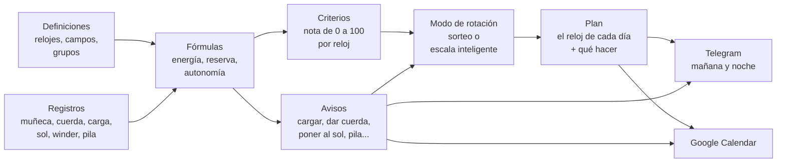

# ⌚ Relojoeiro — Relógios 2

🌐 [Português](README.md) · [English](README.en.md) · [中文](README.zh-CN.md) · [हिन्दी](README.hi.md) · **Español** · [Français](README.fr.md)

> **La rotación inteligente de una colección de relojes.** Cada día dice qué reloj va a la muñeca, recuerda dar cuerda,
> cargar, poner al sol y cambiar la pila, y hace que se use toda la colección, y no solo el favorito. Varias personas usan
> el mismo sistema, cada una con sus colecciones, y comparten lo que quieran.

**[▶ Pruébelo ahora, sin instalar nada](https://servidor2.lucas.inf.br/relojoeiro/cadastro.php)**: cree una cuenta de demostración en el servidor del proyecto
(vale 30 días, ya con una colección lista para que registre sus relojes).


[](#licencia)


<sub>La página **Hoy** con una colección de demostración de 8 relojes (modelos comunes, seis semanas de uso registradas por la
API): el del día (el Casio, en la muñeca desde las 7 h), qué hacer hoy, la escala inteligente de los próximos días y, a la
derecha, el panel del Tissot, abierto al lado (en la Configuración puede abrirse flotante, sobre la página).</sub>

| | |
|---|---|
| **[Por qué existe](#por-qué-existe-esto)** · [La idea central](#la-idea-central-el-sistema-no-sabe-nada-de-relojes) · [Cómo funciona](#cómo-funciona) · [Un día con él](#un-día-con-relógios-2) | **[Pruébelo en 1 minuto](#pruébelo-en-1-minuto)** · [Las pantallas](#las-pantallas) · [La API](#la-api-una-sola-puerta-para-todo) · [Instalación](#instalación) |
| [Varias personas](#varias-personas-cuentas-colecciones-y-acceso) ·[Preguntas frecuentes](#preguntas-frecuentes) · [Cómo es por dentro](#cómo-es-por-dentro) | [Cómo contribuir](#cómo-contribuir) · [Licencia](#licencia) |

---

## Por qué existe esto

Quien colecciona relojes conoce la escena:

- **El favorito va a la muñeca todos los días**, y aquel que compró con tanto cariño lleva dos meses en el cajón.
- **El automático se para** porque nadie lo usó el fin de semana, y ahí va usted a poner otra vez la hora, la fecha y la fase
  de la luna.
- **El solar se descarga en la oscuridad** de la caja, sin que usted se dé cuenta.
- **La pila se acaba sin aviso**, justo en el reloj que quería usar hoy.
- **El smartwatch amanece sin batería** el día en que le tocaba.
- **La revisión del mecánico** ("cada 5 años") y **la garantía** ("¿vence en marzo?") quedan en la memoria, es decir, en
  ninguna parte.

Una hoja de cálculo resuelve la mitad: recuerda, pero no decide. **Relógios 2** decide. Sabe cuánto tiempo lleva parado cada
reloj, cuánta carga tiene ahora, cuánto le gusta y cuánto se ha usado en relación con el resto. Con eso arma el plan de los
próximos días, o de los próximos dos años, con los recordatorios ya en su sitio.

Por la mañana llega un mensaje por Telegram: *"Hoy: Seiko 5. Dar cuerda al Orient (la reserva se acaba a las 15 h)."*
Por la noche llega otro: *"Mañana: Xiaomi Band. Cargar antes de dormir: llega al 20% mañana a las 14 h."*
Y en Google Calendar están el cambio de pila del Casio en noviembre y la revisión del Tissot en 2027.

## La idea central: el sistema no sabe nada de relojes

Esta es la decisión de diseño más importante, y es lo que hace que el sistema sirva para cualquier colección. **El código solo
tiene mecanismos; todo el conocimiento sobre relojes son datos que usted registra.**

No "sabe" que un automático tiene reserva de marcha, ni que un solar se carga al sol. Todo eso está escrito en fórmulas
registradas, que usted lee, edita y prueba en pantalla:

```text
Reserva que le queda al mecánico =
  ACUMULA(0; reserva_horas; 1;                                  ← empieza en 0, el máximo es la reserva, pierde 1 h por hora
          "pulso";  carga_pulso_reserva / carga_pulso_horas;    ← cada hora en la muñeca recarga tanto
          "winder"; winder_ganho;                               ← cada hora en el winder, según el programa de la posición
          "corda";  reserva_horas)                              ← dar cuerda la llena
```

¿Quiere registrar el "cambio de correa", un "baño ultrasónico" o un campo "resistencia al agua"? Son datos. ¿Quiere que los
cronógrafos pesen distinto en el sorteo? Son datos. ¿Quiere un aviso de "cambiar la correa de cuero cada año"? También.

El sistema ya trae un conjunto inicial completo (smartwatch, automático, cuerda manual, pila y solar, con las fórmulas, los
avisos y los criterios de cada uno), que usted ajusta a su colección.


<sub>Los campos de las definiciones. Cada uno se aplica a un grupo y a todo lo que está debajo (la reserva de marcha solo en
los mecánicos, la vida de la pila solo en los de pila), y el identificador es el nombre que tiene en las fórmulas.</sub>

---

## Cómo funciona



### Los conceptos, uno por uno

| Concepto | Qué es | Ejemplo |
|---|---|---|
| **Grupos** (el árbol) | La clasificación de la colección, en tantos niveles como quiera. Todo lo registrado en un grupo vale para él y para todo lo que está debajo. | `Tradicional › Mecánico › Automático` |
| **Campos** | Los datos de cada reloj, definidos por usted: texto, número, fecha, sí/no o lista, con unidad, valor por defecto y las reglas del valor (los valores posibles, el mínimo y el máximo, varios valores a la vez). | `reserva_horas = 40 h`, `data_pilha`, `funcoes = Data, GMT` |
| **Secciones** | Las secciones de la ficha, creadas por usted: cada campo queda en una de ellas, y la ficha, el panel, el pasaporte y los informes muestran los campos agrupados, en su orden. | *Identificación*, *Compra*, *Construcción*, *Energía* |
| **Unidades** | Lo que va después del número, registrado por usted: el símbolo, el nombre y la conversión (la pulgada en milímetros). Los campos, los tipos de registro y las fórmulas eligen la unidad de la lista, y el valor puede aparecer también en otra unidad. | `47 mm (1,85 pol)` |
| **Calibres** | El movimiento del reloj, con lo que es suyo: el fabricante, el manual técnico, las recomendaciones y los valores de los campos. El reloj con un calibre usa su propio valor, si no el del calibre, si no el predeterminado del campo. | `NH35`: reserva de 41 h, marcha de −20 a +40 s/día |
| **Tipos de registro** | Lo que le pasa a un reloj. Puede ser **instantáneo** (cuerda, cambio de pila), **con valor** (lectura de carga: 68%) o una **sesión** con inicio y fin (en la muñeca, en el winder, al sol). | `sol`: una sesión que se cierra sola a las 18 h si usted se olvida |
| **Fórmulas** | Cálculos sobre los campos y los registros. La misma fórmula puede tener **una versión por grupo**, y vale la del grupo más cercano al reloj. | `energia` es la batería en el smartwatch, la reserva en el mecánico, la luz en el solar y la vida de la pila en el cuarzo |
| **Avisos** | Una fecha prevista por fórmula, una antelación, un texto y el registro que resuelve el aviso. | *"Dar cuerda al Orient: la reserva se acaba a las 15 h"*, y el botón **Cuerda** lo resuelve |
| **Límite de carga** | La carga en la que el reloj necesita atención: cargar el smartwatch, poner el solar al sol, dar cuerda al mecánico. El aviso solo sale cuando la carga llega a él. Cada reloj puede tener el suyo (campo *"Avisar cuando la carga llegue a"*); vacío, vale el general de la Configuración. | smartwatch al 20% (el general), el Samsung al 30% (el suyo) |
| **Criterios** | Cómo cada reloj recibe una nota de 0 a 100 para el sorteo: parámetros con peso, subparámetros que miden un campo o una fórmula, y rangos que convierten el valor en nota. | *Tiempo sin uso* (40%): de 0 a 1 día da 0, 30 días o más da 100 |
| **Modos de rotación** | Las reglas del plan: el tipo del modo (uno por semana, semana y fin de semana, por día de la semana, aleatorio, escala inteligente o personalizado), de qué grupo elegir cada día, cuántas semanas adelante, el criterio de elección y, por debajo, el guion que el motor calcula. | *"Smartwatch de lunes a viernes, un tradicional por día el fin de semana"* |
| **Plan** | El reloj de cada día, con qué hacer (*cargar antes*, *dar cuerda*, *poner en el winder*). | `lun 10/06 · Xiaomi Band · cargar antes de usar` |

### El motor de fórmulas

Las fórmulas se escriben como en una hoja de cálculo: números con coma o punto, textos entre comillas, `;` separando los
argumentos, las operaciones `+ - * / ^` y las comparaciones `= <> < <= > >=` (que dan 1 o 0). Un valor vacío se propaga por
la cuenta, y la división por cero da vacío. Lo básico:

| Función | Qué devuelve |
|---|---|
| `SE(condición; si sí; si no)`, `E(...)`, `OU(...)`, `NAO(x)` | la lógica: `E` da 1 si todas son verdaderas, `OU` si alguna lo es, `NAO` invierte |
| `MIN(...)`, `MAX(...)` | el menor y el mayor de los valores (ignoran los vacíos) |
| `LIMITA(x; mín; máx)`, `ARREDONDA(x; decimales)`, `ABS(x)` | x sujeto al rango; redondeado; sin signo |
| `CONVERTER(x; "de"; "para")` | x en otra unidad de la misma magnitud, según el registro de unidades: `CONVERTER(diametro; "mm"; "pol")`; vacío cuando las dos no se convierten |
| `TEM(x; "valor")`, `ITENS(x)` | 1 si el campo múltiple tiene el valor (sin diferencia de mayúsculas): `TEM(funcoes; "Cronógrafo")`; cuántos valores tiene |
| `PADRAO(x; otro)`, `VAZIO(x)`, `NADA()` | x, o el otro si x está vacío; 1 si x está vacío; vacío, a propósito (`SE(condición; NADA(); cuenta)`) |
| `HOJE()`, `AGORA()` | la fecha de hoy y el instante actual, en días (ahora con la fracción del día) |
| `DIAS_DESDE(fecha)`, `DIAS_ATE(fecha)`, `SOMA_MESES(fecha; meses)` | días desde y hasta una fecha (negativo: ya pasó); la fecha más meses, por el calendario |
| `HORAS_USO()` | las horas de un día de uso, por el horario de uso de la Configuración (de 7 a 22 h: 15) |
| `QUANDO_ENERGIA(limite; dias)` | la primera fecha en que la energía llega al límite, en 1 a 366 días (predeterminado 366), respetando las sesiones y el gasto medido inicial; vacío si no llega o faltan datos |
| `CONFIG("clave")` | un número de la Configuración, como `CONFIG("sol_limiar")` |

Y las que leen el historial de cada reloj:

| Función | Qué devuelve |
|---|---|
| `HORAS("pulso"; 30)` | horas en la muñeca en los últimos 30 días |
| `CONTAR("pulso"; 30)` | cuántos días con uso en los últimos 30 días |
| `DIAS_DESDE_ULTIMO("pulso")` | días desde la última vez en la muñeca |
| `ULTIMO_VALOR("carga")` / `ULTIMA_DATA("pilha")` | la última lectura / la fecha del último registro |
| `HORAS_APOS("pulso"; "carga")` | horas en la muñeca desde la última lectura de carga |
| `ACUMULA(inicio; máx; pérdida/h; "tipo"; efecto; ...)` | un saldo que recorre el historial: pierde con el tiempo y gana con cada registro |
| `MEDIDO("uso")` / `MEDIDO("repouso")` | el consumo real de la batería, medido por sus lecturas de carga |
| `EM_SESSAO("winder")` | 1 si la sesión está abierta ahora (el reloj está en el winder) |
| `MEDIA_COLECAO("uso_30d")` | el promedio de una variable en toda la colección |

Y las de la rotación (el guion de los modos; fuera de él, el día es el del instante del cálculo):

| Función | Qué devuelve |
|---|---|
| `DIA_SEMANA()`, `SEMANA_DO_ANO()` | el día de la semana (1 lunes a 7 domingo) y la semana del año (ISO) del día que se está armando |
| `NO_GRUPO("Tradicional › Quartzo")` | 1 si el reloj está en ese punto del árbol o debajo (el nombre, la ruta o `#id`; `"todos"`: 1 para todos) |
| `RELOGIO("Seiko SKX")` | 1 si es ese reloj (por el nombre o por el id) |
| `CALIBRE("NH35")` | 1 si el reloj tiene ese calibre (por el nombre o por el id) |
| `WINDER_PROGRAMA("voltas_dia")`, `WINDER_POSICAO("campo")`, `WINDER("winder_marca")` | el cálculo del programa de la posición del winder en que está el reloj (las vueltas por día, `"voltas_horario"`, `"voltas_anti_horario"`, `"minutos_girando"`, `"velocidade"`, `"vezes_dia"`, `"ciclo_minutos"`; dentro del `ACUMULA`, la posición de cada sesión en el winder), un campo de esa posición y un campo de su winder; fuera de una posición, o sin programa, vacío (vea [Los winders](#los-winders)) |
| `ESCOLHIDO_HA(1)`, `VEZES_NO_PLANO(7)` | 1 si el reloj fue el del plan hace n días (1: ayer; -1: mañana, cuando ya está en el plan); cuántos días tuvo en el plan en los últimos n días |
| `ESCOLHA(n; a; b; c)` | el n-ésimo de los valores (solo ese se calcula): `ESCOLHA(DIA_SEMANA(); …)` da un valor por día de la semana |
| `SORTEIO()` | un número de 0 a 1, del mismo lote de RANDOM.ORG de los sorteos |

Y la variable `nota_criterios`: la nota del reloj por los criterios, en el instante del cálculo.

En la página **Definiciones** cada fórmula tiene el botón **Probar en todos los relojes**, que muestra el resultado en cada
reloj antes de guardar.

### Los totales

Los totales también son del motor de fórmulas, pero miran **todos los relojes mostrados a la vez** (los que deja el filtro
de la tabla de la página Hoy). Están en la pestaña **Totales** de la página **Definiciones**: cada total tiene la **columna**
de la tabla donde va (o ninguna), el **nombre**, la **expresión**, las casillas **Mostrar en el pie de totales** y **Mostrar
en la página de totales**, el **ancho** del cuadro en la página (estrecho o ancho) y el **formato** de los números (número,
entero, con 2 decimales, dinero, porcentaje, fecha o días). Solo los totales de una columna van al pie, debajo de ella; los
otros, cuantos quieras, quedan solo en la **página de totales** (menú **Colección**, o **Ver todos los totales** debajo de la
tabla, que lleva el mismo filtro). Varios totales en la misma columna van uno debajo del otro, en el orden de la lista
(↑ ↓), y **Probar en todos los relojes** muestra el resultado antes de guardar.

| Función de total | Qué da |
|---|---|
| `CONTA()`, `CONTA(x)` | cuántos relojes; cuántos tienen `x` rellenado |
| `CONTA_SE(condição)` | cuántos cumplen la condición: `CONTA_SE(carga <= 20)` |
| `DISTINTOS(x)` | cuántos valores distintos: `DISTINTOS(tipo)` |
| `SOMA(x)`, `MEDIA(x)`, `MEDIANA(x)`, `MENOR(x)`, `MAIOR(x)` | la cuenta de siempre, con los que tienen `x` (de una fecha, la media es una fecha) |
| `QUEM_MAIOR(x)`, `QUEM_MENOR(x)` | el reloj del mayor y del menor valor, con el valor al lado |
| `AGRUPADO(chave; conta; limite)` | una tablita: una fila por valor de la clave y la fila de total; la `conta` (sin ella, `CONTA()`) va en cada fila, hecha solo con los relojes de ella, y en el total, con todos; `limite` muestra las que más tienen y junta el resto en "otros" |
| `FAIXAS(x; 25; 50; 75; 100)` | una tablita por rangos ("hasta 25", "26 a 50"...), los sin `x` en "sin valor", y el total |

Dentro de ellas vale todo lo que vale en una fórmula (los campos, las fórmulas, `SE`, `DIAS_DESDE`...), calculado en cada
reloj, y también lo que muestra cada columna de la tabla: `codigo`, `nome`, `tipo`, `estado`, `disponivel`, `em_uso`,
`carga`, `ultimo_uso`, `manutencao_data`, `manutencao_nome`, `encostado_data`, `avisos` (cuántos avisos tiene) y `posse`.
Fuera de ellas, solo números, textos y las funciones que no necesitan un reloj (`SE`, `MIN`, `ARREDONDA`, las cuentas). Las
funciones nuevas `MES(data)`, `ANO(data)` y `MES_ANO(data)` sirven para agrupar por mes y por año, y valen también en las
fórmulas. Ejemplos:

| Total | Expresión |
|---|---|
| Disponibles y no disponibles | `AGRUPADO(SE(disponivel; "disponíveis"; "indisponíveis"))` |
| Por tipo | `AGRUPADO(tipo)` |
| Rangos de carga | `FAIXAS(carga; 25; 50; 75; 100)` |
| Parado hace | `FAIXAS(DIAS_DESDE(ultimo_uso); 7; 30)` |
| Qué hacer (los 3 que más aparecen y "otros") | `AGRUPADO(manutencao_nome; CONTA(); 3)` |
| Compras por mes | `AGRUPADO(MES_ANO(data_compra))` |
| Valor por tipo | `AGRUPADO(tipo; SOMA(valor_compra))` |
| El más caro | `QUEM_MAIOR(valor_compra)` |
| Quién tiene más cosas por hacer | `QUEM_MAIOR(avisos)` |

Una instalación nueva (y la migración v31) ya viene con una tablita en cada columna del pie y con los cuadros de la página de
totales; tú cambias, borras o creas los tuyos.

### La nota de cada reloj (criterios)

Los criterios que vienen listos, para todos los relojes:

| Parámetro | Peso | Mide |
|---|---:|---|
| Tiempo sin uso | 40 | días desde la última vez en la muñeca: cuanto más parado, mayor la nota |
| Equilibrio de uso | 30 | uso en los últimos 30 días comparado con el promedio de la colección: el poco usado sube |
| Preferencia | 20 | su nota para el reloj (0 a 100) |
| Novedad y valor | 10 | hace cuánto se compró y cuánto costó (aprovechar la inversión) |

Cada grupo, e incluso cada reloj, puede tener su propio conjunto. El smartwatch, por ejemplo, también pesa la **energía** (la
carga ahora y cuántos días aguanta), para no sortear un reloj que se va a apagar al mediodía. La página **Criterios** muestra
la cuenta entera de cada nota: cada rango, cada peso y cada punto, y al lado de la nota de cada criterio una flecha dice hacia
dónde empuja la nota final: **↑** verde (nota por encima de 50, el neutro: empuja hacia arriba), **↓** roja (por debajo de 50:
empuja hacia abajo) o **↔** marrón (50 exacto, o sin peso: neutro, no empuja hacia ningún lado).

Los conjuntos que vienen listos, completos. La nota de un parámetro es el promedio de las notas de sus subparámetros, por el
peso de cada uno; la nota del reloj es el promedio de los parámetros, por peso. Cada subparámetro lee una variable (un campo
o una fórmula) y da la nota según el rango en que cae el valor; el subparámetro sin valor (un campo vacío, un valor fuera de
todo rango) queda fuera, y los demás se reparten su peso. Todo se edita en la página **Criterios**, y **Restaurar los criterios
iniciales** vuelve a estos.

**Todos los relojes**

| Parámetro | Peso | Subparámetro (la variable, el peso dentro del parámetro) | Los rangos: el valor → la nota |
|---|---:|---|---|
| Tiempo sin uso | 40 | Días sin uso (`dias_sem_uso`) | 0 a 1 → 0; 1 a 3 → 30; 3 a 7 → 60; 7 a 14 → 80; 14 a 30 → 95; 30 o más → 100 |
| Equilibrio de uso | 30 | Uso en los últimos 30 días, comparado con la media (`uso_vs_media`) | 0 a 25 → 100; 25 a 60 → 80; 60 a 100 → 60; 100 a 140 → 35; 140 a 200 → 15; 200 o más → 0 |
| Preferencia | 20 | Su nota para el reloj (`preferencia`) | 0 a 20 → 0; 20 a 40 → 25; 40 a 60 → 50; 60 a 80 → 75; 80 a 100 → 100 |
| Novedad y valor | 10 | Novedad: días desde la compra (`dias_desde_compra`, 60) | 0 a 15 → 100; 15 a 45 → 80; 45 a 120 → 55; 120 a 365 → 40; 365 o más → 30 |
|  |  | Aprovechar la inversión: valor pagado (`valor_compra`, 40) | 0 a 300 → 30; 300 a 800 → 50; 800 a 1500 → 70; 1500 o más → 90 |

**Smartwatch**

| Parámetro | Peso | Subparámetro (la variable, el peso dentro del parámetro) | Los rangos: el valor → la nota |
|---|---:|---|---|
| Energía | 30 | Carga ahora (%) (`energia`, 50) | 0 a 15 → 0; 15 a 30 → 25; 30 a 50 → 55; 50 a 80 → 85; 80 a 100 → 100 |
|  |  | Días de uso que aguanta la carga (`dias_de_carga`, 50) | 0 a 1 → 0; 1 a 2 → 30; 2 a 4 → 60; 4 a 7 → 85; 7 o más → 100 |
| Autonomía | 15 | Autonomía del smartwatch (`autonomia_dias`) | 0 a 2 → 10; 2 a 4 → 40; 4 a 7 → 70; 7 a 14 → 90; 14 o más → 100 |
| Tiempo sin uso | 25 | Días sin uso (`dias_sem_uso`) | 0 a 1 → 0; 1 a 3 → 30; 3 a 7 → 60; 7 a 14 → 80; 14 a 30 → 95; 30 o más → 100 |
| Equilibrio de uso | 15 | Uso en los últimos 30 días, comparado con la media (`uso_vs_media`) | 0 a 25 → 100; 25 a 60 → 80; 60 a 100 → 60; 100 a 140 → 35; 140 a 200 → 15; 200 o más → 0 |
| Preferencia | 10 | Su nota para el reloj (`preferencia`) | 0 a 20 → 0; 20 a 40 → 25; 40 a 60 → 50; 60 a 80 → 75; 80 a 100 → 100 |
| Novedad y valor | 5 | Novedad: días desde la compra (`dias_desde_compra`, 60) | 0 a 15 → 100; 15 a 45 → 80; 45 a 120 → 55; 120 a 365 → 40; 365 o más → 30 |
|  |  | Aprovechar la inversión: valor pagado (`valor_compra`, 40) | 0 a 300 → 30; 300 a 800 → 50; 800 a 1500 → 70; 1500 o más → 90 |

**Tradicional › Mecánico**

| Parámetro | Peso | Subparámetro (la variable, el peso dentro del parámetro) | Los rangos: el valor → la nota |
|---|---:|---|---|
| Reserva de marcha | 25 | Reserva ahora (%): vacía, necesita funcionar (`energia`) | 0 a 10 → 100; 10 a 30 → 85; 30 a 60 → 60; 60 a 90 → 35; 90 a 100 → 20 |
| Cuidado mecánico | 15 | Parado necesita funcionar (lubricación) (`dias_sem_uso`, 50) | 0 a 7 → 20; 7 a 30 → 60; 30 a 90 → 90; 90 o más → 100 |
|  |  | Revisión al día (`dias_ate_revisao`, 50) | 0 a 30 → 20; 30 a 180 → 60; 180 o más → 100 |
| Tiempo sin uso | 25 | Días sin uso (`dias_sem_uso`) | 0 a 1 → 0; 1 a 3 → 30; 3 a 7 → 60; 7 a 14 → 80; 14 a 30 → 95; 30 o más → 100 |
| Equilibrio de uso | 20 | Uso en los últimos 30 días, comparado con la media (`uso_vs_media`) | 0 a 25 → 100; 25 a 60 → 80; 60 a 100 → 60; 100 a 140 → 35; 140 a 200 → 15; 200 o más → 0 |
| Preferencia | 10 | Su nota para el reloj (`preferencia`) | 0 a 20 → 0; 20 a 40 → 25; 40 a 60 → 50; 60 a 80 → 75; 80 a 100 → 100 |
| Novedad y valor | 5 | Novedad: días desde la compra (`dias_desde_compra`, 60) | 0 a 15 → 100; 15 a 45 → 80; 45 a 120 → 55; 120 a 365 → 40; 365 o más → 30 |
|  |  | Aprovechar la inversión: valor pagado (`valor_compra`, 40) | 0 a 300 → 30; 300 a 800 → 50; 800 a 1500 → 70; 1500 o más → 90 |

**Tradicional › Cuarzo › Pila**

| Parámetro | Peso | Subparámetro (la variable, el peso dentro del parámetro) | Los rangos: el valor → la nota |
|---|---:|---|---|
| Vida de la pila | 15 | Vida de la pila (%) (`energia`) | 0 a 10 → 10; 10 a 30 → 50; 30 a 100 → 70 |
| Revisión | 10 | Revisión al día (`dias_ate_revisao`) | 0 a 30 → 20; 30 a 180 → 60; 180 o más → 100 |
| Tiempo sin uso | 35 | Días sin uso (`dias_sem_uso`) | 0 a 1 → 0; 1 a 3 → 30; 3 a 7 → 60; 7 a 14 → 80; 14 a 30 → 95; 30 o más → 100 |
| Equilibrio de uso | 25 | Uso en los últimos 30 días, comparado con la media (`uso_vs_media`) | 0 a 25 → 100; 25 a 60 → 80; 60 a 100 → 60; 100 a 140 → 35; 140 a 200 → 15; 200 o más → 0 |
| Preferencia | 10 | Su nota para el reloj (`preferencia`) | 0 a 20 → 0; 20 a 40 → 25; 40 a 60 → 50; 60 a 80 → 75; 80 a 100 → 100 |
| Novedad y valor | 5 | Novedad: días desde la compra (`dias_desde_compra`, 60) | 0 a 15 → 100; 15 a 45 → 80; 45 a 120 → 55; 120 a 365 → 40; 365 o más → 30 |
|  |  | Aprovechar la inversión: valor pagado (`valor_compra`, 40) | 0 a 300 → 30; 300 a 800 → 50; 800 a 1500 → 70; 1500 o más → 90 |

**Tradicional › Cuarzo › Solar**

| Parámetro | Peso | Subparámetro (la variable, el peso dentro del parámetro) | Los rangos: el valor → la nota |
|---|---:|---|---|
| Luz | 25 | Carga de luz (%) (`energia`) | 0 a 30 → 80; 30 a 70 → 65; 70 a 100 → 50 |
| Revisión | 10 | Revisión al día (`dias_ate_revisao`) | 0 a 30 → 20; 30 a 180 → 60; 180 o más → 100 |

Y existe una **garantía de rotación**: ningún reloj pasa más de N días parado (21 por defecto). Vale **antes** de la nota: si
algún candidato ya pasó el límite, gana directamente, primero el que lleva más tiempo parado. Solo cuando nadie pasó el
límite decide la nota.

Los días parado son la fórmula **Días sin uso**, que puede editar en Definiciones: los días desde la última vez en la muñeca
y, para un reloj que **nunca se usó**, los días desde la compra (sin fecha de compra, 9999, el más parado de todos). Así un
reloj comprado ayer no se cuela en la fila, y dos nunca usados no empatan: lleva más tiempo esperando el que se compró antes.

Para que nunca quede con la duda, **cada día del plan guarda el motivo de la elección**, en una frase, y aparece debajo del
reloj en la página Hoy y en la página Plan: *"Garantía de rotación: nunca usado, en la colección hace 38 días, más allá del
límite de 21 días sin uso"*, *"Sorteo por la nota, entre 5 candidatos: nota 70,2, 16,4% de probabilidad"*, *"La mayor nota
(91,2). Se queda 5 días seguidos"*, *"Sigue en la muñeca: día 2 de 5 seguidos"*, *"Elegido a mano"*.
### Los modos de rotación

Los modos están en la página **Modos de rotación** (menú **Rotación**). Cada modo tiene un **tipo**, y la pantalla del tipo
pide solo lo que tiene sentido en él:

- **Uno por semana**: un reloj para toda la semana, del primer al último día de ella (de lunes a domingo, o de domingo a sábado: la
  semana empieza el día elegido en la Configuración, **La semana empieza**). Usted dice de dónde sale (la colección, un
  grupo o un reloj fijo) y el criterio de elección.
- **Semana y fin de semana**: dos tramos, de lunes a viernes y el sábado y domingo, cada uno con su grupo y con **un reloj
  para el tramo** o **uno por día**. El que viene listo: el smartwatch en la semana, un tradicional por día al final de ella.
  Con la semana empezando el domingo, el sábado y el domingo siguen siendo un solo tramo (el reloj del sábado se queda el
  domingo).
- **Por día de la semana**: un reloj por día, y cada día de la semana dice de dónde sale (un grupo, un reloj fijo o ninguno:
  día libre).
- **Aleatorio todos los días**: uno por día, todos con la misma probabilidad, sin criterio ni garantía de rotación.
- **Escala inteligente**: planifica todo el período de una vez, simulando la carga (vea [más abajo](#la-escala-inteligente)).
- **Personalizado**: usted escribe el guion (vea [El guion del modo](#el-guion-del-modo)).

En los tres primeros, el **criterio de elección** es el sorteo: por la **mayor nota**, por **sorteo por la nota** (la nota se
vuelve probabilidad), **aleatorio** o por **fila** (el que lleva más tiempo esperando). Con el **ciclo** activado, un reloj
solo vuelve después de que todos los candidatos hayan pasado en la semana. El cuadro **Modo de rotación** de la página Hoy
elige el modo, el criterio y la garantía de rotación; **Aplicar modo** solo marca: nada del plan cambia hasta que haga clic en
**Sortear de nuevo** (menos lo que el modo anterior sorteó después del fin de las semanas del nuevo, como los días de la
escala de 30 días, que sale ya en el próximo montaje).

**Sortear de nuevo** rehace lo que el modo sorteó y deja como están los días elegidos a mano y los días libres (los de la
Rotación manual, por ejemplo); el mensaje dice cuántos quedaron (*"Quedaron como estaban: 7 días libres..."*). Con la
casilla **Sobrescribir todo** marcada, sale todo lo que el plan tiene desde el comienzo del sorteo en adelante (desde mañana,
desde hoy o desde el primer día de la próxima semana), a mano, libre o sorteado, y el modo arma todo de nuevo; la
confirmación avisa antes, y el mensaje dice cuántos días a mano y libres fueron sobrescritos.

El Sortear de nuevo va hasta el fin de las semanas del modo, o hasta el fin de la **próxima semana**, si usted la armó. Al
volver de otro modo, lo que él sorteó después de eso (los 30 días de la escala, por ejemplo) sale y no vuelve. **Borrar todo** quita también la
próxima semana armada. Después del fin, solo quedan los días seguidos del reloj que empezó hasta él (el smartwatch se queda
los días de la batería); si un día en medio de ellos cambia, lo que quedaba de la racha sale.

**Lo que cambió.** Toda escritura que toca el plan (el Sortear de nuevo, la próxima semana, el cambiar por…, la rotación
manual, los periodos, el Sin reloj hoy y el borrar) muestra, junto con el mensaje, lo que cambió respecto al plan de antes:
*"3 días cambiaron; 11 se quedaron con el mismo reloj."* y una tablita con cada día que cambió (**Día**, **Antes**,
**Después** y el **Motivo** del nuevo). Con la tablita, la caja se queda hasta que la cierres. Por la API, la respuesta trae
`mudancas`.

**Las semanas.** Fuera de la escala, cada modo dice **cuántas semanas adelante** viene armado el plan (1 a 8; la lista muestra
las semanas con las fechas). El plan llega hasta el último día de la última de ellas: el domingo, o el sábado con la semana
empezando el domingo (con una sola semana, el último día de la semana el plan trae también el primero de la siguiente, para
el aviso de la víspera), y la semana siguiente entra cuando le llega el turno. Con **El último día de la semana, los modos por semana arman** en *La semana siguiente entera*, en la Configuración, el último día de la semana las semanas del modo ya cuentan desde la semana que viene, y viene armada entera. La semana empieza el día elegido en la
Configuración (**La semana empieza**: el lunes, el predeterminado, o el domingo), y el ciclo, la próxima semana y el reloj
para toda la semana cuentan desde ella. Con más de una semana,
**Sortear de nuevo** tiene también **la próxima semana**: sale con el modo actual, con los días que aún faltan de esta semana
contados como uso, como si ya hubiera usado los relojes del plan (el uso cuenta en los días sin uso y en la nota; la carga no,
porque no se sabe si el reloj se va a cargar). Cada día se elige así, con los anteriores del plan ya en la muñeca, y por eso el
reloj del lunes no vuelve el martes solo por parecer parado. Los días elegidos a mano se quedan. En la escala inteligente no hay
próxima semana: ya planifica su propio período.

### El guion del modo

Por debajo, todo modo es un **guion**: cinco líneas que el motor de fórmulas calcula para cada reloj disponible, al comienzo de
cada día del plan, con los días anteriores ya contados como uso. Los modos listos generan el guion de sus pantallas (la página
muestra el guion generado, solo lectura); en **Personalizado** usted escribe el suyo, una línea por nombre (`nombre = expresión`,
en el mismo lenguaje de las fórmulas de las definiciones; las líneas que empiezan con `#` son comentarios; los otros nombres son
variables suyas):

| Línea | Qué dice | Si falta |
|---|---|---|
| `candidato` | 1: el reloj entra en la elección de ese día; 0: no | `1` (todos) |
| `nota` | la nota del reloj ese día | `nota_criterios` (la nota por los criterios) |
| `peso` | la probabilidad en el sorteo. Todos 0: gana la mayor nota. Todos iguales: todos con la misma probabilidad. Si no, cada peso es la probabilidad | `0` |
| `dias` | cuántos días seguidos se queda el elegido (mientras los días siguientes estén vacíos y siga siendo candidato) | `1` |
| `garantia` | 1: pasa delante de todos (entre varios, el que lleva más tiempo parado; empate: el registrado primero) | quien pasó de la garantía de rotación (`max_sem_uso`) en días sin uso |

**Cómo decide el motor cada día**, en este orden: el guion dice quién es candidato; entre los candidatos, el reloj de ayer
queda fuera, si hay otro candidato (el único candidato repite, y el motivo dice por qué); el ciclo, si el modo lo usa, también
solo entre los candidatos; quien tiene `garantia` gana directamente; si no, el `peso`. El elegido se queda los `dias` que
el guion dio, y el motivo de la elección queda grabado en el plan. El mismo motor decide el **Sortear este día por** del
selector de cada día y el **Decide por mí** de la rotación manual.

Un ejemplo: mecánicos en la semana, lo que dé la batería el fin de semana, y quien lleva más de 3 días parado con 100 veces la
probabilidad de los demás:

```
util      = DIA_SEMANA() <= 5
candidato = SE(util; NO_GRUPO("Mecânico"); 1)
peso      = SE(dias_sem_uso > 3; 100; 1)
dias      = SE(NO_GRUPO("Smartwatch"); dias_seguidos; 1)
```

El botón **Probar en todos los relojes** calcula el guion en un día (hoy, o uno de los próximos 13) y muestra cada línea en cada
reloj y quién saldría. Además de las funciones de las fórmulas, el guion tiene `DIA_SEMANA()` (1 lunes a 7 domingo),
`SEMANA_DO_ANO()`, `NO_GRUPO("grupo")`, `RELOGIO("nombre")`, `ESCOLHIDO_HA(n)`, `VEZES_NO_PLANO(n)`, `ESCOLHA(n; a; b; …)` y
`SORTEIO()` (la tabla en [El motor de fórmulas](#el-motor-de-fórmulas)) y la variable `nota_criterios`. Por la API:
`recurso=roteiro` prueba; `recurso=modos`, `acao=salvar` con `tipo=personalizado` y `roteiro` graba.

**De dónde sale el sorteo.** Todo sorteo del sistema (el modo totalmente aleatorio, el sorteo por la nota o por el peso y la
función `SORTEIO()` del guion) usa números realmente aleatorios, de fuera, en este orden:

1. **[RANDOM.ORG](https://www.random.org/)**: azar del ruido atmosférico (mide la variación de las microondas en el aire y la
   convierte en bits);
2. cuando está caído (o se agotó la cuota del día), **ANU QRNG**, el generador cuántico de la Universidad Nacional de
   Australia (mide fluctuaciones cuánticas de la luz). El sistema usa la dirección antigua, `qrng.anu.edu.au/API/jsonI.php`,
   que responde sin clave (la nueva, `api.quantumnumbers.anu.edu.au`, exige una clave de API);
3. sin ambos (sin internet en el servidor, por ejemplo), el **generador seguro de PHP** (`random_int`, el del sistema
   operativo: el equivalente al `secrets` de Python).

Los números llegan en lote (64 números de 16 bits por petición), y cada sorteo usa solo lo que necesita, descartando lo que
pasa del último múltiplo entero del rango: todo resultado tiene exactamente la misma probabilidad. Cada servicio tiene 4
segundos para responder; si los dos fallan, el sistema usa el de PHP y no vuelve a intentarlo durante 10 minutos (así ninguna
página se queda esperando). El motivo de cada día sorteado dice de dónde vino el número (*"Sorteo simple, entre 4 candidatos,
todos con la misma probabilidad (RANDOM.ORG)."*), y la **Configuración** muestra el último lote (el cuadro **Sorteos**). Lo que
es secreto no usa estos servicios: la sal de las contraseñas y los nombres de los archivos de los documentos siguen usando el
generador de PHP, porque un número que viaja por internet no sirve para secretos.

### Borrar la programación

Al pie de la página **Plan** (el lugar principal: el cuadro **Borrar la programación**, al final de la página, después del día
a día) y en el cuadro **Modo de rotación** de la página Hoy (cada uno debajo de una línea, como **Sortear de nuevo**):

- **Borrar un período**: **Desde** y **Hasta**; uno de los dos puede quedar vacío (solo **Desde** borra desde él hasta el
  final del plan; solo **Hasta**, desde mañana hasta él). Los días del período salen del plan, de mañana en adelante (los
  elegidos a mano, los sorteados y los libres), y el modo de rotación vuelve a montar esos días, solo ellos: los demás días quedan como están (también en la escala
  inteligente). El botón **Borrar** pide confirmación.
- **Borrar todo**: limpia toda la programación, de mañana en adelante: los días elegidos a mano, los sorteados y los libres.
  Marcando **Incluyendo hoy**, borra de hoy en adelante (si sale otro reloj para hoy, pasa a ser el de la muñeca desde ese
  momento). Después el modo de rotación vuelve a armar el plan, desde cero: hasta el último día de la última de las semanas del modo (las
  siguientes, cuando lleguen); en la escala inteligente, toda la escala. La programación no queda vacía porque el
  sistema siempre arma los días que faltan con el modo activo; para días sin reloj, marque *libre* en la Rotación manual.

### La rotación manual

En el cuadro **Modo de rotación** de la página Hoy, la última opción de la lista es **Rotación manual**: usted mismo elige el
reloj de cada día de un período (las vacaciones, un viaje, un mes entero). Ponga el inicio (**Desde**) y el fin (**Hasta**) y
haga clic en **OK**:

- los días aparecen **de 7 en 7**, con la fecha, el día de la semana, lo que el plan tiene ese día ahora y un selector;
- con más de 7 días, las páginas están debajo: **‹ Anterior**, **1 2 3 …**, **Siguiente ›**. Lo que elige en una página se
  conserva mientras recorre las demás; nada cambia antes de guardar;
- el selector de cada día tiene los relojes disponibles, **Decide por mí**, el grupo **Sortear este día por** (*la mayor
  nota*, *sorteo por la nota*, *aleatorio* o *fila*: el día se sortea al guardar por esa forma, sin el de ayer ni el de mañana,
  como el Decide por mí) y **Sin reloj (día libre)**. Al principio, muestra el reloj que el día ya tiene elegido a mano; un día libre aparece como libre; y el resto (sorteado o todavía sin reloj),
  como *Decide por mí*;
- **Guardar la rotación manual** guarda todo el período: los días con reloj quedan elegidos a mano, los de *Decide por mí* y los de
  *Sortear este día por* los decide el sistema en ese momento y también se guardan (el motivo de cada uno aparece en el
  plan), y los libres quedan sin reloj. Si hoy está en el período y usted eligió otro reloj, pasa a ser el de la muñeca desde ese momento;
- para borrar los días de un período (el modo de rotación vuelve a montar esos días) o borrarlo todo, vea
  [Borrar la programación](#borrar-la-programación).

Fuera del período, sigue valiendo el modo de rotación de siempre, y nada fuera de él cambia (también en la escala inteligente).
Los días elegidos a mano se mantienen aunque sortee de nuevo o el cron arme la semana siguiente; en la escala inteligente, el
**Sortear de nuevo** y la replanificación de la mañana rehacen la escala alrededor de ellos.

**El criterio del *Decide por mí*:**
1. la **nota de los criterios** (los que usted define en **Criterios**: días sin uso, equilibrio, preferencia, carga...),
   calculada al inicio de cada día, con los días anteriores del período (los que usted eligió y los que él decidió) ya
   contados como uso;
2. la **garantía de rotación** va primero: el que pasó el límite de días sin uso va antes, primero el que lleva más tiempo
   parado;
3. el reloj de **ayer** y el de **mañana** quedan fuera, si hay otro. Así un reloj no se repite justo al lado del que usted
   eligió;
4. en caso de empate, gana el registrado primero.

Hoy, con *Decide por mí*, se queda el reloj que ya está en el plan.

### La escala inteligente

Es el modo más completo. En lugar de sortear semana a semana, **planifica de 7 días a 2 años de una vez**, simulando día a
día:

1. calcula la nota de cada reloj con el estado simulado de ese día;
2. elige el reloj por la mayor nota (el guion de la escala: `peso = 0`); el smartwatch se queda en la muñeca los días que
   aguanta la batería (hasta 7: la fórmula `dias_seguidos`);
3. simula el uso (la sesión en la muñeca en el horario de uso) y su efecto en la carga y la reserva de todos;
4. comprueba los avisos: si el elegido va a necesitar carga o cuerda, anota la acción en el día (*"cargar antes de usar"*) y
   simula el registro que la resuelve;
5. pasa al día siguiente.

Cada mañana el cron **vuelve a planificar desde el estado real**. Si usó otro reloj, se olvidó de cargar o registró una lectura
distinta de la prevista, el plan se corrige. Los días elegidos a mano y los libres se mantienen; los sorteados, de hoy en
adelante, se sortean de nuevo.

Lo que cambia en un día o en un período (cambiar el reloj de un día, devolver un día al sorteo, sortear de nuevo o dejar libre
un período, elegir los relojes de un período, la Rotación manual) **cambia solo eso**: los demás días se quedan con el reloj que
tienen, y solo se rehace su *qué hacer* (la carga simulada cambia con el período nuevo). El **Sortear de nuevo** y el **Borrar
todo** rehacen la escala entera.

La escala **va hasta los días del modo** (de 7 a 730, en la página Modos de rotación), contados desde hoy (desde mañana, si el
día de hoy ya empezó en la muñeca; con **La escala inteligente empieza** en *Siempre hoy*, en la Configuración, hoy es siempre el 1.er día, y la escala de 7 días va hasta dentro de 6). Con **La escala inteligente cierra** en *Al final de la semana*, el período va en semanas enteras, según **La semana empieza**: la de una semana, un martes, va hasta el domingo (con la semana empezando el lunes), y el último día de la semana arma la semana siguiente entera; en *Al final del mes*, en meses enteros (la de un mes va hasta el último día del mes). Cuando el período termina, la siguiente empieza el día después de su último día, con los días del modo enteros (de 7 en 7, sin perder ni repetir un día), con las dos opciones. ¿Cambió los días del modo activo, de 7 a 30 o de 30 a 7? El fin de la escala se quita, y el
próximo montaje (la página Hoy, el cron) ya monta con los días nuevos (la escala guarda con cuántos días se generó: otro número
en el modo, se rehace entera). **Sortear de nuevo** y **Borrar todo** siempre empiezan una escala nueva con los días actuales
del modo. **Borrar un período** solo con el comienzo borra desde él hasta el final del plan y vuelve a montar hasta donde los
días del modo dejan (el modo de 30 días va hasta el 30.º, contado desde hoy).

### Consumo medido por las lecturas

La ficha del smartwatch dice "dura 5 días". La realidad discrepa, y cambia conforme la batería envejece. Por eso, **cada
lectura de carga que usted lanza se compara con la anterior**, y el intervalo entre las dos se vuelve una medición: cuánto
cayó, cuántas horas pasó en la muñeca y cuántas fuera de la muñeca (guardado, apagado), y cómo usted marcó cada lectura (en
uso o en reposo). El horario de uso de la Configuración cuenta como muñeca por sí solo, y sus marcaciones (*Puso*, *Quitó*)
mandan. Una subida en la lectura es recarga: empieza un tramo nuevo. Y un intervalo con otra sesión en medio (el reloj fue al
cargador) tampoco mide: la medición solo sabe separar muñeca y guardado.

**Cómo transformar las mediciones en los dos consumos (en la muñeca y fuera de la muñeca) es elección suya: hay cinco
motores.** Todos quedan en el sistema; ninguno borra nada, y cambiar de motor solo cambia la cuenta (las mediciones son las
mismas). La elección se hace en tres lugares, y el de arriba vale sobre los de abajo:

| Nivel | Dónde se elige | Qué hace |
|---|---|---|
| 1. **La colección** | **Gasto de batería: cómo calcular (válido para todos los relojes)**, en la Configuración (`gasto_motor`) | vale para todos los relojes de la colección. Vacío (*Individual (en el reloj o en el grupo)*): deciden los dos niveles de abajo. |
| 2. **El reloj** | el campo **Cómo calcular el gasto de batería** (`gasto_motor`), en la ficha del reloj | vale solo para él. Vacío: el del grupo. |
| 3. **El grupo** | el **predeterminado** de ese mismo campo (en **Registros › Campos**: el campo está en la raíz, y vale para los relojes de donde está hacia abajo) | vale para los relojes que no eligieron. Vacío: el motor 1. |

En un reloj sin lectura de carga (un mecánico, un solar), la elección no hace nada. El cuadro **Consumo de la batería** dice
qué motor hizo la cuenta y de dónde vino la elección (*Calculado por: Por la marcación: dos tasas separadas — la elección de
la colección, en la Configuración*).

| Motor | Qué hace |
|---|---|
| 1. **Por las horas registradas (el motor original)** (`horas`) | el predeterminado. Cada medición se divide por las marcaciones de muñeca minuto a minuto (tantas horas en la muñeca, tantas fuera), y los dos consumos salen juntos de todas las mediciones de la ventana, cada una pesando el tiempo que cubre. Es la cuenta que el sistema siempre hizo. |
| 2. **Por las horas registradas, con lecturas y registro (robusto)** (`robusto`) | las mismas horas, pero la cuenta se hace en las lecturas, todas con el mismo peso, la que no encaja con las otras pesa menos y la ficha es el punto de partida (los tres cuidados de abajo). Da la incertidumbre (±). |
| 3. **Por la marcación: dos tasas separadas** (`marcacao`) | lo que usted marca manda. El tramo entre dos lecturas marcadas **en uso** mide el consumo en la muñeca: la caída, dividida por el tiempo entero del tramo (en días de uso). El tramo entre dos marcadas **en reposo** mide el consumo fuera de la muñeca, del mismo modo. Un tramo con una lectura de cada tipo queda fuera de la cuenta (no hay cómo saber cuánto de él fue en la muñeca). Las dos cuentas **nunca se cruzan**: el consumo en uso sale solo de las lecturas en uso, y el en reposo, solo de las en reposo; la muñeca registrada no entra. Con la cuenta robusta en cada lado (la lectura que no encaja pesa menos; la ficha es el punto de partida), también con la incertidumbre. |
| 4. **Solo el registro** (`cadastro`) | el *Decaimiento en uso* (o la *Autonomía en uso real*) y el *Decaimiento guardado* de la ficha valen siempre. Las mediciones siguen haciéndose y quedan en el historial (la tabla **Mediciones del consumo**), pero no entran en ninguna cuenta: `MEDIDO` da vacío. |
| 5. **Por las fórmulas del registro** (`formulas`) | vale lo que den las fórmulas `taxa_uso` y `taxa_repouso`, para que usted monte su propia cuenta en **Registros › Fórmulas**. En ellas, `MEDIDO("uso")` y `MEDIDO("repouso")` son la cuenta del motor 3, y las funciones **LEITURAS**, **QUEDA**, **DIAS_MEDIDOS**, **MEDIA_TAXA**, **MEDIANA_TAXA** y **ULTIMA_TAXA** dan las piezas de las mediciones por la marcación (cuántas, la suma de las caídas, la suma de los días, la media, la mediana y la última tasa, de cada tipo, en los últimos N días o en la ventana de la Configuración): `MEDIANA_TAXA("uso")`, o `PADRAO(QUEDA("uso"; 30) / DIAS_MEDIDOS("uso"; 30); decaimento_uso)`. En los otros motores las fórmulas también valen (de ellas sale el consumo); la diferencia es que este dice: la cuenta es suya. |

**Qué mediciones entran** es otra elección de la Configuración, **Gasto medido: contar por**: **días** (las mediciones de los
últimos tantos días, 90 por defecto) o **lecturas** (las últimas tantas mediciones de cada tipo, en uso y en reposo, 20 por
defecto). Sin ninguna en la ventana, entran las de antes. Vale para los motores 1, 2, 3 y 5 (y para las funciones de las
fórmulas sin el N de días).

Entre dos recargas, la carga cae en línea recta con el tiempo en la muñeca y el tiempo guardado:

```text
lectura = carga del comienzo − consumo en uso × días de uso − consumo guardado × días guardado (+ el error de la lectura)
```

Lecturas seguidas, sin recarga en medio, forman un **tramo**. Cada tramo tiene la carga de su comienzo (que la cuenta
descubre), y los dos consumos valen para todos los tramos. En el motor 2, con las lecturas de la ventana, el sistema halla
**los dos consumos juntos**: los que mejor explican todas las lecturas. Una noche entre dos lecturas (solo fuera de la muñeca)
ajusta el consumo guardado; los días en la muñeca, sabiendo ya ese, ajustan el consumo en uso. Entra toda medición de 1 hora o
más, hasta la sin caída ninguna (dice que el consumo es pequeño). Cuantas más lecturas, más preciso. En el motor 3 la misma
cuenta se hace dos veces, una solo con las lecturas en uso y otra solo con las en reposo.

La cuenta robusta (los motores 2 y 3) tiene tres cuidados, cada uno con un motivo:

1. **La cuenta se hace en las lecturas, y todas pesan igual.** El error viene de la lectura: el reloj muestra la carga en
   números enteros, y su medidor también se equivoca un poco. Ese error es el mismo en una lectura hecha 2 horas o 2 semanas
   después de la anterior, así que ninguna lectura vale más que otra por cubrir más tiempo. Y, como la cuenta mira las
   lecturas (y no las caídas), una lectura errada es un punto solo, en vez de estropear las dos caídas a su alrededor.
2. **La lectura que no encaja con las otras pesa menos (regresión robusta).** Después de la cuenta, el sistema ve cuánto se
   equivoca en cada lectura. El error normal sale de las propias lecturas (nunca menos de medio punto); la lectura que queda
   bastante más lejos que lo normal pasa a pesar menos, y tanto menos cuanto más lejos está, y la cuenta se rehace. No se
   tira: solo pesa menos. Un caso común: el **100% justo después de cargar**, que muchos relojes mantienen un tiempo mientras
   la carga de verdad ya está cayendo.
3. **La ficha es el punto de partida.** El decaimiento (o la autonomía) de la ficha entra en la cuenta como el valor
   esperado, con un margen de la mitad de él. Con pocas lecturas, el consumo queda cerca de la ficha; con muchas, las lecturas
   mandan. Y, cuando las lecturas no separan el uso del guardado (solo lecturas con el reloj guardado, por ejemplo), el consumo
   que ellas no miden queda el de la ficha. Para que usted vea cuánto tira todavía la ficha, el cuadro **Consumo de la
   batería** y **De dónde sale la cuenta** dicen lo que darían solo las lecturas (*solo las lecturas darían 15,57% (1
   medición): con pocas mediciones, la ficha todavía tira de la cuenta*); en el motor 3, el cuadro cuenta las mediciones de
   cada lado (*por la marca: 1 en uso y 1 en reposo*).

El resultado de esos dos motores viene con la **incertidumbre** (± una desviación estándar): *22,09% ± 1,48 por día de uso*
quiere decir que el consumo en uso está, con buena probabilidad, entre 20,6% y 23,6%. Disminuye conforme entran lecturas.

En la tabla **Mediciones del consumo** (en **Carga a lo largo del tiempo**), cada medición muestra la marcación de las dos
lecturas (*en uso → en uso*) y dice si entra en la cuenta: *sí*; *en parte: pesa 31%*, con la lectura que no encaja bien con
las otras (*la lectura de 100% no encaja bien con las otras: la cuenta se equivoca 4,5 puntos en ella*); o *no* (fuera de la
ventana, quitada de la cuenta, las dos lecturas marcadas de maneras distintas en el motor 3, o el motor 4). El mensaje de la
lectura también avisa cuando la lectura nueva no encaja con las otras. Cada línea tiene el botón **Quitar de la cuenta** (o
**Poner en la cuenta**), para cuando usted sabe algo que el sistema no sabe: la medición sale o vuelve sin borrar nada (vale
en los motores 1, 2, 3 y 5).

Al informar la carga, usted dice cómo estaba el reloj a la hora de la lectura: en el cuadro **Marcar**, **Informar lectura de
carga en uso** (en la muñeca) o **Informar lectura de carga en reposo** (guardado); en el aviso *Informar la carga* de la
página Hoy, los botones **En uso** y **En reposo**. **La marcación queda grabada en la lectura** (la columna `estado`; en las
lecturas de antes, y en las que un script lanza sin decir, vale lo que la muñeca registrada decía en ese instante). Es lo que
el motor 3 usa, y sirve de comprobación para los otros. Si el sistema tenía el reloj de otra manera en ese instante (el
horario de uso lo puso en la muñeca por sí solo, pero quedó guardado; o faltó un *Puso*), la pantalla pregunta antes de
grabar: *Para mí, en ese instante (19/10 10:13) el reloj estaba en la muñeca. Esta lectura en reposo parece incorrecta. ¿Desea
continuar de todos modos?* Solo cuenta el instante de la lectura: lo que el reloj hizo entre la lectura anterior y esta no
entra en la pregunta (la lectura es una foto de ese instante; el tramo entre las dos es la cuenta de la medición). **Continuar** graba como usted
marcó (por la API, la respuesta viene con `confirmar: true` y la pregunta, y el lanzamiento solo se graba enviándolo de nuevo
con `confirmar=1`); nada se impide, y la muñeca registrada no cambia: si estaba errada, corríjala en **Corregir o borrar una
marcación**. El cuadro **Corregir** también cambia la marcación de una lectura ya grabada.

Los dos consumos están en el cuadro **Consumo de la batería**, en la página del reloj:

- **Calculado por**: el motor que hizo la cuenta y de dónde vino la elección (la colección, el reloj, el grupo, o el
  predeterminado).
- **En la muñeca** y **Fuera de la muñeca (apagado)**: el consumo que vale en la cuenta, en negrita, con la incertidumbre
  (± ..., en los motores 2 y 3), y de dónde viene (medido, con el de la ficha al lado para comparar, o solo de la ficha,
  cuando todavía no hay medición o el motor es el 4).
- Debajo de cada uno, **en la ficha**: los campos de donde sale el consumo de la ficha (el *Decaimiento en uso*, la
  *Autonomía en uso real*, el *Decaimiento guardado*), con el valor y, cuando no es el indicado, la etiqueta *predeterminado*.
- **En los 90 días anteriores a esos**: los dos consumos medidos en la ventana anterior. Es la comparación que muestra la
  batería envejeciendo: si el consumo en la muñeca pasó del 4,9% al 5,7%, ya no aguanta la carga como antes.

Lo mismo aparece de nuevo, junto a lo parecido, en el cuadro **Datos del reloj**: en la tabla **Ficha**, debajo del
decaimiento (y de la autonomía) indicado, lo **calculado por las lecturas** y lo que vale **en la cuenta**; en la tabla
**Calculado ahora**, debajo de las fórmulas del consumo (*taxa_uso*, *taxa_repouso*), el medido y el de la ficha. Y cada
medición, una por una, está en **Carga a lo largo del tiempo › Mediciones del consumo**.

Las mediciones más antiguas que la ventana salen solas de la cuenta. Por eso el ajuste al envejecimiento es automático: no hace
falta tocar la ficha. El "Consumo en uso" y el "Consumo guardado" de la ficha solo valen mientras no hay medición (o siempre,
en el motor 4).

---

### La previsión de descarga

La proyección mantiene el gasto medido al inicio: el envejecimiento de una medición durante la proyección no hace que la batería recupere carga. Las consultas históricas siguen usando la ventana de la fecha consultada. La búsqueda encuentra el primer cruce del límite o del cero, por tramos de las sesiones, con precisión de hasta un minuto. Un futuro sin datos no se presenta como autonomía superior a un año.

El aviso predeterminado **Cargar** usa `QUANDO_ENERGIA(limite_carga; 366)`, el mismo cálculo de la ficha, respetando el fin de las sesiones. La migración v50 solo actualiza la expresión predeterminada conocida de la v49; los avisos personalizados se conservan.

`precisa` sigue limitado al 100%. Si incluso una carga completa se agota antes de terminar los días consecutivos, `recarga_no_bloco` es verdadero y el texto avisa que hay que recargar durante el período. `carregar_antes` trata de la carga necesaria al entrar; por sí solo no garantiza que una carga cubra el bloque.

La confianza alta exige una lectura de hasta dos días, al menos tres mediciones que separen los gastos, tasas estimadas con las mediciones y una desviación estándar de hasta la mitad de cada tasa. Es baja con una lectura de más de siete días, datos necesarios ausentes o desviación estándar igual o superior a la tasa; en los demás casos, media. `confianca_motivos` explica las limitaciones. Una lectura reciente por sí sola no demuestra que la fecha futura sea precisa.

Los resultados numéricos no finitos, como `10 ^ 1000`, dan vacío (`null`), como la división por cero. `PADRAO` puede ofrecer un valor alternativo. Si otro resultado inválido impide la serialización, la API responde un error JSON con HTTP 500, nunca un cuerpo vacío con HTTP 200.

### La precisión (la marcha del reloj)

Todo reloj adelanta o atrasa un poco por día: es la **marcha**, en segundos por día (+ adelanta, − atrasa). El Relojoeiro
mide la marcha de cada reloj por las **lecturas del desvío de la hora**: cuánto está adelantado o atrasado respecto a la hora
exacta (la del servidor, la misma de la página **Hora exacta**). Dos lecturas con tiempo entre ellas dan la marcha de ese
intervalo; la marcha del reloj es la media de los intervalos **ponderada por el tiempo** (un intervalo de 10 días pesa diez
veces el de un día, y una lectura errada por 1 segundo casi no pesa). El **Ajuste de la hora** pone el desvío en cero: la
cuenta recomienza desde él, de 0 s.

**Probar la precisión**, en el cuadro **Marcar** del reloj: la hora exacta aparece andando, con los segundos. Ponga en el
campo la hora que el reloj va a mostrar dentro de poco (con los segundos) y pulse **Marcar ahora** cuando la aguja de los
segundos llegue a ella; el sistema la compara con la hora exacta de ese instante. Diga también **dónde estuvo** desde la
lectura anterior: en el pulso, pulso y guardado (como hizo la rotación), guardado con la esfera hacia arriba o hacia abajo,
con la corona hacia arriba, hacia abajo, a la izquierda o a la derecha, o en el winder: la marcha de un mecánico cambia con la
posición, y el sistema separa la marcha de cada una. También se puede escribir el desvío directamente, en segundos. El
mensaje dice la marcha desde la lectura anterior. La prueba aparece en los relojes **tradicionales** (el tipo *Desvío de la hora* vale para el grupo Tradicional): el smartwatch ajusta la hora solo por el celular. Para medir también un smartwatch, cambie el *Vale para* del tipo en **Definiciones › Tipos de registro**.

La marcha varía con la posición, la cuerda, la temperatura y el uso: la media de varios días dice más que una sola medición.
En un mecánico, un día entre las lecturas ya mide bien; en un cuarzo, que varía pocos segundos al mes, espere semanas.

El cuadro **Precisión** muestra la marcha (y cuánto varían las mediciones entre sí), la última, el desvío estimado ahora y la
marcha esperada (los campos *Marcha esperada: de* y *hasta*); el cuadro ancho **Desvío a lo largo del tiempo** trae el
gráfico (cada ajuste recomienza la línea), las mediciones y la marcha en cada posición. Los avisos **Ajustar la hora** (el
desvío estimado va a pasar del límite) y **Marcha fuera de lo esperado** (la última medición salió del rango, o del historial
del propio reloj) son fórmulas, como los demás. En las fórmulas: `MARCHA(dias; "posição")`, `MARCHA_DP(dias; "posição")`,
`MARCHA_N(dias; "posição")`, `MARCHA_ULTIMA()` y `DESVIO_AGORA()`. Por la API: `recurso=precisao` (de un reloj o el resumen de
la colección) y `recurso=lancamento`, `acao=lancar`, `tipo=desvio`, con `valor` o `marca` (y `instante_ms`) y `posicao`.

### Los calibres

El **calibre** es el movimiento del reloj: el NH35 de un Seiko, el ST2130 de un Sea-Gull, el módulo 3159 de un Casio. Muchas
cosas son del movimiento, no del reloj: la reserva de marcha, la marcha que promete el fabricante, si admite cuerda por la
corona. En la pestaña **Calibres** de la página **Definiciones**, cada calibre tiene el nombre, el fabricante, el enlace del
manual técnico, las recomendaciones (*"dar cuerda por la corona: hasta 40 vueltas"*) y los **valores de los campos** que
define. En la ficha del reloj, elija el **Calibre**: el reloj pasa a usar sus valores en los campos que él mismo dejó vacíos.

El orden es: **el valor del reloj, si no el del calibre, si no el predeterminado del campo** (el del grupo). Cinco relojes con
NH35 reciben la reserva y la marcha esperada de una vez; uno de ellos, con otra reserva en su ficha, se queda con la suya. En
los **Datos del reloj**, el valor que no es el del reloj lleva al lado una etiqueta de dónde vino (*calibre* o *predeterminado*; el
indicado, sin etiqueta), y encima de las tablas
aparecen el calibre, el enlace del manual y las recomendaciones. Eliminar un calibre deja sus relojes sin calibre (la
eliminación dice cuántos). En las fórmulas, `CALIBRE("NH35")` da 1 si el reloj tiene ese calibre. Por la API:
`recurso=calibres` (la lista, con los valores y los relojes de cada uno), `recurso=calibres` con `acao=salvar` o `excluir`, y
`recurso=relogio`, `acao=salvar`, con `calibre_id`.

Los **documentos del calibre** (el manual técnico en PDF, la ficha de servicio, las fotos del movimiento) quedan en el propio
calibre: en la pestaña Calibres, **Documentos (N)** abre la página **Documentos** del calibre (también aparece en la lista
**Reloj** de la página, en el grupo **Calibres**), con la categoría **Manual técnico** además de las otras. Valen para todos
los relojes con el calibre: aparecen en la línea del calibre de los **Datos del reloj** y en la página Documentos de cada uno
(*"Del calibre NH35: …"*). Eliminar el calibre borra sus documentos, con los archivos.

Qué campos muestra el formulario del calibre es una elección: **solo los del movimiento** (el predeterminado) o **todos los
campos de la ficha**, en la lista **Campos en el formulario**, encima del formulario, o en la **Configuración** (*Formulario
del calibre*). Los del movimiento son los marcados en la pestaña **Campos** (la casilla *del movimiento*): ya vienen marcados
la reserva, las cargas, la marcha esperada, el límite del desvío, la cuerda por la corona, la autonomía, los decaimientos, la
revisión y la vida de la pila. Un campo que el calibre ya define aparece siempre, para poder quitarlo. Por la API:
`recurso=documentos` con `calibre=` (y `calibre_id` en `enviar`), `recurso=config` con `calibre_campos` y `recurso=campos`
con `calibre`.

### Las unidades

Cada árbol tiene su **registro de unidades**, en la pestaña **Unidades** de la página **Definiciones**: el **símbolo** (lo
que va después del número: `mm`, `h`, `dias`, `R$`), el **nombre** completo y la **conversión**. Ya viene con las de uso
común: longitud (mm, cm, m, pol, pés), masa (g, kg, oz), tiempo (s, min, h, dias, semanas, meses, anos), temperatura (°C,
°F), presión (bar, atm, hPa, psi), pulsaciones (bph, Hz) y las sueltas (%, s/dia, ms, °, mAh, V, lux, R$). Los campos, los
tipos de registro y las fórmulas eligen la unidad **de esa lista** (la API rechaza un símbolo que no está registrado), y
cambiar el símbolo de una unidad lo cambia también en quien la usa.

La conversión es de un nivel: cada unidad se convierte en la **base** de su magnitud, con el **factor** (1 pol = 25,4 mm;
1 h = 3600 s) y, solo en la temperatura, el **cero** (°C = (°F − 32) × 5/9). Dos unidades con la misma base se convierten
entre sí, y la fórmula `CONVERTER(x; "de"; "para")` hace la cuenta. **Mostrar también en**: el valor aparece también en esa
unidad en los **Datos del reloj** y en el **Pasaporte** (el milímetro ya viene mostrando las pulgadas: *47 mm (1,85 pol)*).
Una unidad en uso no se elimina (la eliminación dice quién la usa); eliminar una base se lleva las que se convierten en
ella. Por la API: `recurso=unidades` (la lista, con la conversión y el uso de cada una) y `recurso=unidades` con
`acao=salvar` o `excluir`.

### Las reglas del valor

Cada campo dice qué valor acepta, en la pestaña **Campos** de la página **Definiciones**, y la API rechaza lo que no lo sigue
(la pantalla, la API, la importación, el calibre):

- **Valores posibles** (uno por línea): en la **lista**, son las opciones, obligatorias; en el **texto** y el **número**,
  cuando el campo los tiene, el valor tiene que ser uno de ellos (el ancho de la correa: 18, 20, 22), y la ficha muestra un
  menú. Escrito en minúsculas también vale: queda lo escrito en las definiciones.
- **Mínimo** y **máximo**, solo en el número (vacío: sin límite): el diámetro de 20 a 60 mm. El rango aparece debajo de la
  entrada, y el rechazo dice cuál es (*tiene que ser de 20 a 60 mm*).
- **Varios valores**: el campo múltiple, como las **funciones** del reloj (fecha, GMT, cronógrafo). En la ficha, una
  casilla para cada valor posible; en los Datos del reloj, cada uno en una etiqueta; en el pasaporte, separados por comas. En
  la base de datos, uno por fila (las tablas `campo_valor_item` y `calibre_valor_item`), y en las fórmulas llega con uno por
  línea: `TEM(funcoes; "GMT")` dice si lo tiene, e `ITENS(funcoes)`, cuántos.

Cambiar el tipo o las reglas de un campo comprueba los valores ya grabados: lo que ya no las sigue se lista y el cambio
espera a que usted lo corrija (dejar de ser múltiple, por ejemplo, solo cuando cada reloj tiene un solo valor). Por la API:
`recurso=campos` con `opcoes`, `minimo`, `maximo` y `multiplo`; en el reloj, `valores[funcoes][]` una vez por cada valor.

### La construcción y los accesorios

El registro nuevo ya trae la **construcción** de cada reloj (vea [La construcción](#la-construcción)): el material y las
medidas de la caja, el cristal, la esfera, la luminiscencia, la corona, el fondo y las funciones. Un árbol que ya existía
gana esos campos en la actualización (la migración v44), en el idioma de la colección, sin tocar los que ya tenía con el
mismo identificador.

Los **accesorios** también tienen campos, registrados como los del reloj, en la pestaña **Campos** de la página
**Definiciones**, con **Para: los accesorios**: el **tipo de accesorio** en que vale el campo (o todos) y, si es el caso, el
campo del reloj con el que tiene que coincidir para que el accesorio **sirva** en el reloj. El registro nuevo trae los de
la correa: el **ancho** (que coincide con el **entre asas** del reloj), el **material**, el **color**, el **cierre** y la
**liberación rápida**. En la página **Accesorios**, el formulario pide los campos del tipo elegido, y la lista muestra los
**Datos** y dónde **Sirve** cada uno: la correa suelta de 20 mm aparece sirviendo en todos los relojes de entre asas 20; en
el panel, el cuadro **Accesorios** de cada reloj lista también los de otros relojes (o sueltos) que **sirven en él**. Los
vendidos y archivados no entran en esa cuenta.

### Los winders

El **winder** (la caja que gira los automáticos) tiene registro propio, en la página **Winders** (en el menú **Colección**):
cada winder con sus **posiciones**, y cada posición con su **programa**, la manera en que gira la cuna. Los datos del winder
son **campos**, registrados en la pestaña **Campos** de la página **Definiciones** con **Para: los winders**, como los de los
relojes; el registro nuevo ya trae la **marca**, el **modelo**, el **enlace del manual** y los **límites de la almohadilla**
(la caja hasta tantos mm, la muñeca de tanto a tanto cm y el peso hasta tantos g). La posición también puede tener campos
propios (**Para: las posiciones de los winders**).

**Los movimientos y los programas.** Un programa es una **secuencia de movimientos** que se repite. En la página
**Movimientos** (menú **Colección**) están los pasos: cada uno con un **código**, el nombre, el **tipo** (**giro horario**,
**giro antihorario** o **parada**) y una sola medida: el giro dice **cuántas vueltas** da o **cuánto tiempo** gira, nunca las
dos; la parada solo tiene el tiempo. En la página **Programas** (menú **Colección**) cada programa tiene el nombre, el **tipo
de registro** (**por vueltas**: los giros de la secuencia son en vueltas; **por tiempo**: en tiempo), si **funciona todo el
día** o **en bloques** (*enciende 3 h y para 9 h*), la **velocidad de la cuna** y la **secuencia**, los códigos de los
movimientos en orden (*3, 1, 4, 1*: el mismo código puede repetirse, como la misma parada entre los dos giros). La velocidad
de la cuna es **contada** (pegue un trocito de cinta en la cuna y cuente las vueltas en 1 minuto) o sale de las **vueltas por
día que dice el manual** para ese modo: una u otra. **Nada de lo que se calcula se escribe**: las vueltas de cada paso (o el
tiempo), el ciclo, cuántas veces al día se repite, el tiempo girando y las **vueltas por día** (el TPD), en total y en cada
sentido, aparecen debajo mientras usted cambia, para comprobar. Un programa sirve en cuantas posiciones quiera, en cualquier
winder. Para el winder que solo dice las vueltas por día (la llave TPD: 650, 850...) está el ayudante **Montar una secuencia
para N vueltas por día**: las vueltas, la velocidad y el sentido, y él monta los giros y las paradas (crea los movimientos que
faltan); después es un programa como los demás. Un movimiento que está en un programa, o un programa que está en una
posición, no se elimina (quítelo de ahí antes).

Del lado del reloj, el automático gana tres campos, que el calibre también puede dar: las **rotaciones por día que pide** en
el winder (por defecto 650) y si **da cuerda girando en sentido horario** y **antihorario** (los dos, por defecto; el
movimiento que solo da cuerda en un sentido marca solo ese).

Cuánto carga cada hora en el winder sale de una fórmula, la `winder_ganho` (pestaña **Fórmulas** de las Definiciones), que
usted ajusta como quiera. La del registro nuevo suma las vueltas por día del programa **solo en los sentidos en que el reloj
da cuerda** y las compara con las que pide (como máximo 1), por la proporción de los campos *En el winder* (las horas y la
reserva que dan): en un programa de 650 vueltas, 325 en cada sentido, el reloj que solo da cuerda en el horario gana la
mitad. Sin programa en la posición, o en una sesión que no está en una posición (las antiguas, de antes de los winders, o la
de un winder eliminado), valen los campos *En el winder*, como antes. En las fórmulas, `WINDER_PROGRAMA("voltas_dia")` (y
`"voltas_horario"`, `"voltas_anti_horario"`, `"minutos_girando"`, `"velocidade"`, `"vezes_dia"`, `"ciclo_minutos"`) lee el
cálculo del programa de la posición, `WINDER_POSICAO("campo")` un campo de la posición y `WINDER("winder_marca")` uno del
winder. La `reserva_restante` usa la `winder_ganho` en cada sesión en el winder, con el programa de la posición en que
estuvo: un reloj que pasó la noche en una posición de 650 vueltas y la tarde en una de 1250 gana cada tramo según el suyo.
La `winder_falta` da las horas hasta que se llena.

**El lugar fijo.** La posición en que usted pone un reloj pasa a ser **su lugar**. Quitado (a la muñeca, guardado...), la
cuna sigue con **su foto, tenue y con el aro rojo**, y la fila dice dónde está (*"lugar del Seiko 5 · fuera: en la
muñeca"*), con los botones **Volver a poner** y **Liberar el lugar**. Poner en el winder **desde cualquier lugar** (el panel
del reloj, el atajo del móvil, el aviso de Hoy, la API) lo devuelve a su lugar, si la posición está encendida y libre; con
otro reloj en ella, o apagada, el sistema dice por qué y el poner queda para la página Winders. Otro reloj puesto en la
posición se queda con el lugar. **Los límites de la almohadilla**: el reloj cuya caja o peso (los de su registro) pasa de lo
que el winder aguanta recibe un aviso en la posición; es solo un aviso, y el **Ya lo sé, déjalo así** lo descarta para ese
reloj en ese winder. **Los documentos del winder** (el manual, la factura, las fotos) funcionan como los del reloj: el
**Documentos (N)** de la tarjeta abre la página Documentos en el winder.

En la página, una tarjeta por winder. Arriba, el **dibujo** del winder: la caja con una cuna redonda por posición, y en cada
cuna ocupada la **foto** del reloj (o la inicial del nombre), con un anillo verde alrededor que es la **carga** y,
mientras la posición está encendida, una rayita clara girando sobre él (quien pide menos movimiento en el aparato lo ve
quieto); la cuna del lugar de quien está fuera muestra su foto tenue, con el aro rojo; la libre es punteada, la apagada queda
tenue, y el clic en la foto abre la ficha. Debajo, los **datos** del winder (etiqueta y valor, con la etiqueta *por defecto*
donde vale el valor por defecto del campo, y el enlace del manual) y la **tabla de las posiciones**, en la que cada fila se
edita ahí mismo: el **Programa** (un menú con **— sin programa —** y los programas, con su cálculo debajo), los campos de la
posición, si los hay, la columna **Reloj** (un menú con **— ninguno —** y los relojes que van a un winder), la **carga**,
**cuánto da cada hora** y cuándo se **llena** ("lleno a las 19:20"), y el **Guardar** de la fila. En Reloj, **— ninguno —**
quita a quien está en la posición (el lugar sigue siendo suyo); elegir otro **pone** o **cambia**: quien estaba sale, y el
elegido, si estaba en otra posición (o en el winder sin posición, como los que fueron al winder antes de registrarlo), sale
de ahí y entra en esta. El **Editar** de cada posición abre el nombre, el orden y **encendida**; debajo, los formularios del
winder (el nombre, los campos y, al crear, cuántas posiciones ya trae) y de la posición. La posición apagada no recibe reloj,
y con un reloj dentro solo se apaga junto con **— ninguno —**.

**El winder es obligatorio.** Sin ningún winder registrado, no hay poner ni quitar del winder en ningún lugar: en el panel del reloj, el **Poner en el winder** del cuadro **Marcar** solo dice eso y lleva a la página **Winders**; el aviso que se resuelve en el winder viene sin botón; el atajo del móvil y la API rechazan. Con winder registrado, el reloj va al winder por la página **Winders**, elegido en el **Reloj** de una posición, o, si tiene su lugar libre, desde cualquier lugar: en el panel, el botón **Vuelve a su lugar: Versa, Pos. 2**; en **Hoy toca**, el botón del aviso; sin lugar (o con él ocupado), el **Poner en el winder ›** lleva a la página. **Quitar** vale en todas partes: en la página (**— ninguno —**), en el **Quitar del winder** del panel, en el botón del aviso, en el atajo y en la API. El **período que ya pasó** en el winder (el *Un período que ya pasó* de Marcar) pide la **posición** donde estuvo (sin ella, vale su lugar). La sesión que quedó abierta en una colección sin winder (un winder eliminado con el reloj dentro) todavía se puede quitar. El estado dice dónde está: *"En el winder · Oficina, Pos. 2"*. El tipo de registro del winder es el marcado como **winder** en la pestaña **Tipos de registro** (el *En el winder* del registro nuevo). Eliminar una posición o un winder no borra las sesiones: quedan sin la posición, y su cálculo vuelve a los campos del reloj. Por la API: `recurso=winders` (los winders, las posiciones con el programa, el reloj, el lugar y los avisos de límite, y los relojes y los programas para elegir), `recurso=programas` (los programas con el cálculo, los movimientos; con `previa=1`, el cálculo de un programa sin guardar), las escrituras `winders` (`salvar`, `limite_ok`, `excluir`), `winder_posicoes` (`salvar`, con `programa_id` y `relogio_id`, que pone, cambia o, con 0, quita; `liberar`; `excluir`), `movimentos` (`salvar`, `excluir`) y `programas` (`salvar`, `montar`, `excluir`); en `lancamento`, el `iniciar` y el `alternar` del tipo del winder lo devuelven al lugar libre (sin lugar, rechazan), su `periodo` pide `posicao_id`, y el `encerrar` quita.
Un árbol que ya existía gana todo esto en la actualización (la migración v47): el programa antiguo de cada posición (las
rotaciones por día, los sentidos y el ciclo, que eran campos de la posición) se vuelve un programa, con las vueltas por día
del manual iguales a las de antes (la carga sigue igual; cuente la velocidad de la cuna y póngala en el programa), quien está
en el winder gana el lugar, y los campos antiguos salen.

### Las secciones de la ficha

Los campos del reloj quedan agrupados en **secciones**, las partes de la ficha: en la pestaña **Secciones** de la página
**Definiciones** usted crea las suyas, les da nombre y las ordena (↑ y ↓), y en la pestaña **Campos** elige la sección de
cada campo. El registro nuevo ya viene con siete, y cada campo listo ya está en la suya: **Identificación**, **Compra**,
**Construcción**, **Energía**, **Mantenimiento y precisión**, **Rotación** y **Deseo**.

El orden vale en todas partes: en **Editar ficha** cada sección es un grupo con su título (la que no tiene ningún campo
visible, como Deseo en un reloj de la colección, desaparece); en los **Datos del reloj** una línea de título separa cada
una; el **Pasaporte** tiene una tarjeta por sección, y el informe Pasaporte, un apartado. Los campos sin sección (como la
Observación) van al final, sueltos (en los Datos del reloj, en **Otros**). Eliminar una sección no borra los campos: quedan
sin sección, al final. Por la API: `recurso=cadastros` trae las `secoes` (con cuántos campos tiene cada una), y
`recurso=secoes` graba (`salvar`, `ordem`, `excluir`); el campo lleva el `secao_id`.

### Las listas que son registro

Lo que puede ser registro es registro: toda lista de elección del sistema es tuya, con ítems que creas, renombras, reordenas
y quitas. Cada ítem tiene el **identificador** (fijo: es lo que queda guardado y lo que la API y las fórmulas citan), el
**nombre**, el **orden** y, según la lista, **lo que hace** (el comportamiento: lo único que conoce el código), un **texto** y un
**color**. El ítem en uso no sale, y lo que hace no cambia (crea otro); la lista nunca se queda sin lo que el sistema necesita.

| Lista | Dónde | Lo que el ítem hace o guarda |
|---|---|---|
| Situaciones del reloj en la colección | Definiciones › Listas | *En la colección* (entra en la rotación), *Prestado* (de la colección, fuera de la rotación), *Deseado* (la lista de deseos) o *Fuera de la colección* (Vendido, Archivado, Regalado, Perdido o robado...) |
| Tipos de accesorio | Definiciones › Listas | correa, caja, estuche, herramienta, cargador, pieza... |
| Formas de cargar (la prueba de la reserva) | Definiciones › Listas | el texto es la unidad de la medida (vueltas, h) |
| Observaciones de la reserva | Definiciones › Listas | se detuvo, indicador de carga baja, otra observación... |
| Situaciones del mantenimiento | Mantenimiento › Listas | *En curso*, *Cierra* (vuelve y se convierte en servicio) o *Cancela*; el texto es el aviso de la situación; el color, el de la etiqueta |
| Tipos de servicio | Mantenimiento › Listas | el texto es el tipo de registro que el servicio marca también (revisao, pilha) |
| Resultados de la prueba de estanqueidad | Mantenimiento › Listas | *Aprobado* (comprueba la estanqueidad) o *Reprobado* |
| Tipos de taller | Mantenimiento › Listas | un taller común o *tú mismo, en casa* |
| Tipos de contacto | Mantenimiento › Listas | *Teléfono* (llama), *WhatsApp* (abre la conversación), *E-mail* (escribe), *Dirección en internet* (abre) o *Texto* |

Cada colección nueva ya viene con las listas completas (en su idioma). Por la API: `recurso=listas` (con `pagina=cadastros` o
`manutencao`) y `recurso=listas` con `acao=salvar` o `excluir`.

### El mantenimiento

El menú **Colección › Mantenimiento** es el lugar del mantenimiento, con cuatro pestañas: **En mantenimiento**,
**Mantenimientos**, **Talleres** y **Listas**. Sin mantenimiento registrado, el reloj no va a ninguna parte: es **Registrar un
mantenimiento** lo que lo manda (también desde el cuadro **Mantenimiento** del panel). Elige el reloj, el **taller**, la
**situación**, el **tipo de servicio** y, si quieres, el problema, la orden de servicio, el envío, la previsión de vuelta, el
presupuesto, lo que fue junto (la caja, la correa) y los documentos del envío.

Al guardar, el reloj queda **en mantenimiento**: no disponible para la rotación hasta volver (con la etiqueta *en
mantenimiento* en el panel y el estado *En mantenimiento* en la página Hoy), sus sesiones abiertas se cierran (en la muñeca, al
sol, en el cargador; en el winder, la posición queda libre), sus días en el plan de mañana en adelante salen y se sortean de
nuevo, y los avisos de carga, cuerda y pila se detienen. Si era el **reloj de hoy**, hoy queda libre: con la Configuración
dejando cambiar el reloj de hoy el mismo día, eliges otro; sin ella, hoy queda sin reloj. Cambiar el disponible del reloj
mientras está en el taller cambia el de la vuelta.

La **situación** avanza desde la fila de la tabla (el menú y **Cambiar**), y cada cambio queda en la **historia**. Las
situaciones son una lista tuya (Mantenimiento › Listas), y cada una hace una de tres cosas: **en curso** (Enviado, esperando
presupuesto; Presupuesto recibido; Aprobado, en servicio; Esperando pieza; Listo para retirar), **cierra** (Retirado; Devuelto
sin reparación) o **cancela** (Cancelado). En la que cierra, el reloj **vuelve** con la disponibilidad de antes y el
mantenimiento **se convierte en un servicio** (el tipo, el presupuesto como mano de obra y sus documentos): completa lo que se
hizo, las piezas y el costo en el cuadro Servicios del reloj. En la que cancela, vuelve sin servicio. Los avisos del
mantenimiento: **Reclamar al taller** (la previsión pasó) y el **avance**, con el texto de la situación actual (*Aprobar el
presupuesto*, *Retirar en el taller*); en las fórmulas, `MANUTENCAO("previsao")`, `MANUTENCAO("dias")`,
`MANUTENCAO("orcamento")` y `MANUTENCAO()` (1 en mantenimiento).

Los **talleres** tienen la dirección, el horario, la observación y **cuantos contactos quieras**, cada uno de un tipo
(teléfono fijo, celular, WhatsApp, e-mail, sitio web, Instagram...: la lista Tipos de contacto); en la tabla, el teléfono
llama, el WhatsApp abre la conversación y el e-mail escribe. El taller **Yo mismo (en casa)** es el tuyo: la pila cambiada en
casa, la correa ajustada. Los informes: **En mantenimiento, por taller** (con los contactos), **Mantenimientos en el período** y
**Gasto por taller**. Por la API: `recurso=manutencao` (los abiertos, los mantenimientos con los filtros `relogio`, `oficina`,
`de`, `ate`, los talleres y el resumen), `recurso=oficinas`, y las escrituras `recurso=manutencao` (`salvar`, `situacao`,
`excluir`) y `recurso=oficinas` (`salvar`, `excluir`).

### Los servicios y diagnósticos

Cada intervención en un reloj queda en el cuadro **Servicios y diagnósticos** del panel (en la sección *Ficha y documentos*):
la fecha, el tipo (los tipos de servicio: revisión, cambio de pila, prueba de estanqueidad, regulación, pulido...), el taller, qué se hizo, la mano de obra, las **piezas cambiadas** (una por línea, con el costo después del punto y coma:
*"Corona; 120,00"*), la prueba de **estanqueidad** (el resultado, aprobado o reprobado, y la presión en bar), la **marcha antes y después**
que midió el profesional, la garantía, la observación y los documentos del reloj que son del servicio (la factura, el
presupuesto, las fotos). El costo del servicio es la mano de obra más las piezas, y el cuadro suma el de todos. Todo servicio es la vuelta de un mantenimiento: el registrado directo en el cuadro recibe uno ya cerrado en el taller elegido (sin él, el tuyo, **Yo mismo (en casa)**).

La **resistencia al agua declarada** (el campo *Resistencia al agua declarada (del fabricante)* de la ficha, en metros) no es
la hermeticidad de hoy: el cuadro muestra las dos por separado, la declarada y la **estanqueidad comprobada** en la última
prueba, con la fecha. Al lado de la marcha que informó el profesional aparece la **medida por el sistema** en las lecturas del
desvío de la hora (vea [La precisión](#la-precisión-la-marcha-del-reloj)): la de los 60 días antes del servicio y la de los 60
después.

El tipo de servicio que marca un registro (la revisión y el cambio de pila, en el registro inicial) se convierte también en el registro **Revisión** o **Cambio de pila** en la fecha del
servicio: los avisos de siempre (la próxima revisión, la pila) cuentan el servicio, sin registrarlo dos veces. En las fórmulas,
`ULTIMO_SERVICO("revisao")` da la fecha del último servicio de ese tipo (`"estanqueidade"` cuenta también la prueba hecha en
una revisión) y `CUSTO_SERVICOS(365)` cuánto costaron los servicios en el último año; en los totales, las variables
`servicos` y `custo_servicos` (el total listo **Costo de los servicios** suma el de la colección). El **Pasaporte** trae los
servicios. Por la API: `recurso=servicos` (la lista, con el resumen de un reloj) y `recurso=servicos` con `acao=salvar` o
`excluir`.

### Declarado, medido y estimado

Cada información técnica del reloj tiene tres valores, y el panel muestra los tres juntos, en una tablita: el **declarado**
(lo que dice el fabricante, el calibre o el registro), la **última prueba** (la última medición) y la **estimación actual**
(lo que el sistema concluye de las mediciones). Uno no vale por el otro: las "40 h" del calibre no son la reserva de su
reloj, y los "200 m" del fabricante no comprueban el sellado de hoy. La tabla aparece:

- en la **marcha**, en el cuadro **Precisión**: la marcha esperada, la última medición y el promedio ponderado por el tiempo;
- en la **reserva de marcha** (el mecánico), en el cuadro **Reserva medida**: la del calibre o del grupo, la última prueba y
  la mediana de las pruebas;
- en la **reserva de energía** (el solar), en el cuadro **Reserva de energía**: la del registro y la última observación, sin
  estimación;
- en la **resistencia al agua**, en el cuadro **Servicios y diagnósticos**: la declarada, la última prueba de estanqueidad y
  el sellado que ella comprueba.

Debajo de cada tabla viene la **confianza**, por una sola regla y sin porcentaje inventado: cuántas mediciones hay, la edad
de la última y cuánto varían (*"Confianza alta: 3 pruebas, la última hace 12 días, variación de ±1,1 h."*). Es **alta** con
el mínimo de mediciones (3 en la marcha, 2 en la reserva, 1 en la estanqueidad), la última dentro de la validez (30 días en
la marcha, un año en la reserva y en la estanqueidad) y la variación hasta la tolerancia (en la marcha, la mitad del rango
esperado, si no 5 s/día; en la reserva, el 10% de la medida); **media** con la última hasta tres veces la validez y la
variación hasta el doble de la tolerancia; **baja** en el resto. Cuando no es alta, la frase dice por qué.

**La prueba de la reserva** (el mecánico): llénelo hasta el final (la cuerda por la corona hasta trabar, o un tiempo en el
winder o en la muñeca), abra **Empezar una prueba de la reserva** en el cuadro Reserva medida, diga cuándo quedó lleno y cómo
(las vueltas de la corona, las horas en el winder o en la muñeca) y deje el reloj quieto, sin cuerda ni muñeca. Cuando se
detenga, pulse **Se detuvo** (la hora se puede corregir). El tiempo de lleno hasta detenido es la **reserva medida**; con
varias pruebas vale la **mediana**, y una prueba errada no tira de la cuenta. El valor del calibre no cambia: el botón **Usar
N h en el registro de este reloj** guarda la medida en el registro del propio reloj, que es lo que vale en las cuentas de la
carga y de la autonomía (borrar el valor del reloj vuelve al del calibre). En las fórmulas, `RESERVA_MEDIDA()` da la mediana
(vacío sin prueba) y `RESERVA_TESTES()` cuántas pruebas terminaron: `PADRAO(RESERVA_MEDIDA(); reserva_horas)` usa la medida
y, sin ella, el registro.

**En el solar no hay calibración**: un Eco-Drive tarda meses en descargarse, y la recarga depende de la luz, que el sistema
no mide; un número ahí sería falsa precisión. El cuadro **Reserva de energía** guarda solo las **observaciones**: se detuvo,
el indicador de carga baja (el segundero saltando de 2 en 2) u otra nota. Las observaciones valen también en el mecánico. El
smartwatch ya mide la batería por las lecturas de carga (el cuadro **Gasto de la batería**, con el ± de cada gasto).

El **Pasaporte** trae la tabla. Por la API: `recurso=ficha` (el `tecnico` y la `reserva` del reloj), `recurso=reserva` (las
pruebas, las observaciones, la medida y la tabla) y `recurso=reserva` con `acao=iniciar`, `parou`, `observar`, `salvar`,
`usar` o `excluir`.

### El timegrapher

Quien tiene un **timegrapher** (el aparato de banco que escucha el reloj) guarda sus mediciones en el cuadro **Timegrapher**,
en la sección Precisión y marcha del panel y de la Ficha. En cada posición el aparato muestra la **marcha** (s/día), la
**amplitud** del volante (grados), el **error de latido** (ms), los **latidos por hora** y el **ángulo de levantamiento**; lo que
no muestra queda vacío. Las posiciones son las del aparato: esfera hacia arriba o hacia abajo, y la corona hacia arriba, hacia
abajo, a la izquierda o a la derecha. Las mediciones del mismo día son una **sesión**: el cuadro muestra la última, una línea
por posición y el **promedio**, y la **diferencia de marcha entre las posiciones** (la mayor menos la menor), que dice cuánto
cambia la marcha con la posición.

Dos maneras de poner las mediciones:

- **Registrar una medición:** escribir lo que muestra el aparato, posición por posición.
- **Importar el CSV del aparato:** elegir el archivo que exporta el timegrapher (o su aplicación). El sistema encuentra el
  separador (`;`, `,` o tabulación) y las columnas por el encabezado, en portugués o en inglés (`date`, `time`, `position`,
  `rate`, `amplitude`, `beat error`, `bph`, `lift angle`, `notes`...); las posiciones por el nombre o por las siglas de los
  aparatos (`DU`, `DD`, `CU`, `CD`, `CL`, `CR`, o la hora que queda arriba: `3U`, `9U`, `6U`, `12U`). La fecha en `AAAA-MM-DD`
  o `DD/MM/AAAA`; sin fecha, las líneas quedan en el instante elegido. **Solo comprobar** muestra lo que entraría, sin grabar.
  La línea que no se entiende queda fuera, con el motivo, y la repetida no entra dos veces.

El sistema no dice qué es bueno o malo (una amplitud de 220° es excelente en un reloj y baja en otro): eso queda para las
fórmulas y los avisos del registro. `TIMEGRAPHER("amplitude")` da el promedio de la última sesión (también `marcha`,
`erro_batida`, `bph`, `angulo`, `delta`, la diferencia entre las posiciones, y `medicoes`), y `TIMEGRAPHER_DATA()` su día: un
aviso con `SE(TIMEGRAPHER("amplitude") < 220; 1; 0)`, por ejemplo. Las mediciones del timegrapher quedan aparte de la marcha
medida por el desvío de la hora (la del cuadro Precisión): una es el reloj en el banco, la otra es él en el día a día.

Por la API: `recurso=timegrapher` (con `relogio=<id>`: la sesión, las mediciones y lo que entiende la importación), y la
escritura `recurso=timegrapher` con `acao=salvar`, `importar` (`csv` y, si quiere, `conferir=1`) o `excluir`. El
**Pasaporte** trae las mediciones.

## Varias personas: cuentas, colecciones y acceso

El sistema es de **varias personas**, cada una con su **cuenta**, y cada cuenta con **sus colecciones**. Una colección tiene sus
relojes, el historial, el plan, la Configuración, los destinos de los mensajes y los calendarios; lo que se ve y lo que se
guarda en cualquier página es siempre de la colección elegida en el **selector del menú** (aparece cuando hay más de una). El
primer usuario de la instalación es el **master**: cuida de todo el sistema.

| Concepto | Qué es |
|---|---|
| **Cuenta** | el usuario, la contraseña, el correo (para recuperar la contraseña, recibir las invitaciones y los avisos), el idioma y el huso horario. Cada uno cuida de la suya en **Mi cuenta** (menú **Cuenta › Mi cuenta**). |
| **Colección** | un conjunto de relojes de un **dueño**, con nombre. Una persona puede tener varias ("Mi colección", "Los de mi padre"). Nace **con el conjunto inicial** (los grupos, campos, fórmulas, avisos, criterios y modos listos, en el idioma de quien la crea), **vacía** (solo la raíz del árbol) o **con un árbol suyo que ya existe**. |
| **Árbol de grupos** | los grupos y sus definiciones (campos, tipos de registro, fórmulas, avisos, categorías de documentos, criterios de los grupos). Es del dueño y puede servir a **varias colecciones suyas**: lo que cambia en él vale para todas. En **Mi cuenta** se pueden copiar, renombrar y eliminar los árboles. |
| **Miembro** | quien ve una colección de otra persona (y la usa: marca, registra, cambia el día). |
| **Todo de un dueño** | quien ve **todas** las colecciones de alguien, también las que cree después. |
| **Master** | ve todas las colecciones, cuida de las cuentas (**Usuarios**), de la copia de seguridad y de las migraciones. |

**Cómo entra alguien en una colección que no es suya:**

- **Invitación:** en **Aprobaciones**, el dueño escribe el correo y elige lo que va a ver (una colección, o todo lo suyo). Sale
  un correo con un enlace (vale `CONVITE_DIAS` días, 7 sin la línea): quien no tiene cuenta la crea por el enlace, y quien
  tiene entra y acepta. La invitación de un **miembro** espera que el dueño la apruebe. Sin correo en el servidor, el enlace
  aparece en la pantalla, para enviarlo como quiera.
- **Solicitud:** en **Mi cuenta** (o ya en el registro), la persona pide acceso a una colección, o a todo lo de un dueño, con un
  mensaje, por el **código** que pasó el dueño: el de la colección (en la tabla **Colecciones** de **Mi cuenta**) o el del dueño
  (en **Tus datos**, para todas sus colecciones). Ninguna pantalla muestra la lista de cuentas ni de colecciones, y la solicitud
  solo muestra el código hasta la aprobación: quien prueba códigos al azar no descubre el usuario de nadie. El dueño recibe un
  correo y aprueba o rechaza en **Aprobaciones**; la persona recibe la respuesta por correo. Las dos pantallas de solicitud
  (Crear cuenta y Mi cuenta) traen este paso a paso en el cuadro **Cómo pedir acceso (y por qué por el código)**, y **Tus
  datos** explica al dueño cómo pasar el código.
- **Por el master:** en **Usuarios**, **Dar acceso**.

En **Aprobaciones**, el dueño ve también **quién ve sus colecciones** y le quita el acceso a alguien; en **Mi cuenta**, cada uno
puede **salir** de una colección que no es suya. Invitaciones y solicitudes sin respuesta se van solas después de
`CONVITE_DIAS` días.

**El registro abierto** (la página `cadastro.php`, sin login, con el enlace **Crear cuenta**): la persona elige el usuario, la
contraseña, el correo, el idioma y cómo empieza (una colección con el conjunto inicial, una vacía, o pedir acceso a la de
alguien, por el código que pasó el dueño). La cuenta creada así es **de demostración** por `DEMO_DIAS` días (30 sin la línea): el menú muestra **Demo: N días**,
un correo avisa 7 días y 1 día antes y, vencida, el cron borra la cuenta con todo lo que es suyo. El master **hace oficial la
cuenta** (o la prorroga) en **Usuarios**. Con `CADASTRO_ABERTO = false` en el `config.php`, el registro se cierra: solo entra
quien el master crea o quien tiene una invitación. La página tiene también **Olvidé la contraseña**: el enlace para elegir una
contraseña nueva va por correo y vale 2 horas.

La página de acceso (la que aparece cuando se cancela el pedido de contraseña del navegador) trae **Intentar de nuevo**,
**Crear cuenta** y **Recuperar contraseña** (`cadastro.php?esqueci=1`, el Olvidé la contraseña primero).

**Nunca dos cuentas con el mismo usuario o correo.** Se puede entrar por el usuario o por el correo, así que el mismo texto
no puede llevar a dos cuentas: el usuario que ya existe (sin distinguir mayúsculas, sin los espacios de los extremos) no se
crea de nuevo, el correo de una cuenta no puede ser el de otra, y el usuario de una tampoco puede ser el correo de otra.
Vale en todo camino (el master creando o cambiando en **Usuarios**, el registro abierto, **Mi cuenta**, la importación del
sistema anterior), y la base lo garantiza también: el `UNIQUE` del usuario y el del correo (la collation no distingue
mayúsculas) y la regla `ck_usuario_aparados` (sin espacios en los extremos; migración v40). Crear la cuenta
(`recurso=usuarios`, `acao=salvar`) nunca toca una que ya existe: la contraseña de otra cuenta la cambia el master con
`acao=senha`.

Los campos de usuario y contraseña de un servicio de fuera (el servidor de correo propio, el CalDAV) y el usuario de **Crear
cuenta** en **Usuarios** quedan solo de lectura hasta el clic: el navegador no los rellena solo con el usuario guardado de
quien lo está usando (en un par usuario y contraseña ignora el `autocomplete="off"`, y su usuario acabaría grabado en la
cuenta de otra persona).

**La contraseña** tiene la fuerza que el master elige en la **Configuración**, en la tarjeta **Contraseñas**: el tamaño
mínimo y cuántas letras mayúsculas, minúsculas, números y símbolos necesita tener, como mínimo (el predeterminado: 8
caracteres, con 1 de cada). Vale para toda contraseña nueva: la cuenta creada, el cambio en **Mi cuenta**, la contraseña
nueva por el enlace del **Olvidé la contraseña**, la del master en **Usuarios**; las que ya
existen siguen valiendo (el `senha.php`, en el servidor, la cambia sin ella). Todo lugar que define una contraseña pide también el **Confirmar la contraseña** y, mientras
usted escribe, muestra lo que dice la API: cada regla con ✓ o ✗, la confirmación y la **fuerza** (de muy débil a fuerte,
por el tamaño y por cuántos tipos de carácter mezcla). Por la API: `recurso=cadastro`, `acao=conferir_senha` (sin inicio
de sesión y sin guardar nada), y `senha_confirmacao` en las grabaciones de contraseña.

**El panel del master** (**Usuarios**) muestra cada cuenta con el correo, el papel, el último acceso, cuándo vence, las
colecciones (con cuántos relojes) y qué más ve, y las acciones: **Ver como** (todo el sistema como lo ve esa persona, con una
franja arriba y el botón para volver), **Hacer oficial**, **Prorrogar**, **Volver a demo**, **Bloquear**, **Cambiar** (el
usuario, el correo, el idioma, el papel), **Cambiar la contraseña**, **Transferir la colección** (a otro dueño: el árbol va
junto o, si sirve a otras colecciones del dueño anterior, el nuevo dueño recibe una copia), **Dar acceso** y **Eliminar**. Una
cuenta común que se queda sin nada (sin colección, sin acceso, sin solicitud ni invitación esperando) sale sola.

**Eliminar, en cualquier lugar, avisa antes de lo que sale junto.** Eliminar una colección, un árbol, una cuenta, un reloj, un
campo, un destino... muestra antes la lista de lo que va junto (*"Sale junto: 4 valores de campo, 2 registros, 12 días del
plan..."*, con las colecciones afectadas: un árbol sirve a varias) y solo borra después de que usted confirme. Los archivos de
los documentos salen del disco en el momento. Por la API, toda eliminación pide `confirmar=1`.

## La ficha de cada reloj, campo por campo

Todo reloj tiene **nombre**, **grupo**, **situación en la colección**, **disponible** y **foto**. El resto son **campos**, y qué campos tiene
un reloj depende de su **grupo**: todo lo registrado en un grupo vale para él y para todos los grupos de debajo. Por eso "ser
automático" no es una marca aparte: es estar en el grupo **Automático** (o en un subgrupo suyo), y con eso heredar los campos
de muñeca y de winder.

```text
(todos los relojes)       Observación, Su nota, Compra, Garantía, Límite de carga, Marca, Referencia, Enlace
                          (solo en los deseados: Precio objetivo, Prioridad del deseo)
├── Smartwatch            Autonomía en uso real, Consumo en uso, Consumo guardado, En el cargador: horas para llenar
└── Tradicional           Última revisión, Revisión cada
    ├── Mecánico          Reserva de marcha, Acepta cuerda por la corona
    │   ├── Automático    En la muñeca: horas / reserva, En el winder: horas / reserva, rotaciones por día, sentido de la cuerda
    │   └── Cuerda manual (nada más: en la muñeca no carga)
    └── Cuarzo
        ├── Pila          Último cambio de pila, Vida de la pila
        └── Solar         Reserva de energía, Sol directo para llenar, En la muñeca: cuánto carga
```

Un campo vacío toma el **predeterminado** de la ficha (la columna "vacío" de las tablas de abajo). En la ficha, los
campos aparecen agrupados por las secciones (vea [Las secciones de la ficha](#las-secciones-de-la-ficha)), no por los grupos
del árbol. Los campos, los grupos y
los predeterminados son datos, no código: puede cambiarlo todo en la página **Definiciones**, y crear los suyos.

### Lo básico del reloj

| Campo | Qué es |
|---|---|
| **Nombre** | cómo aparece en todas partes: en pantalla, en Telegram y en el calendario. |
| **Grupo** | su lugar en el árbol. Decide los campos, las fórmulas (la "carga" de un smartwatch es la batería; la de un mecánico, la reserva de marcha) y los avisos que recibe. |
| **Situación en la colección** | Un ítem de la lista **Situaciones del reloj en la colección** (Definiciones › Listas): **En la colección** (lo de siempre), **Deseado** (la lista de deseos: todavía no es suyo), **Prestado** (es suyo, pero lo tiene otra persona) o uno que sale de la colección (**Vendido**, **Archivado**, **Regalado**, **Perdido o robado** y los que crees). Solo lo que está en la colección entra en la rotación: en las otras situaciones el reloj queda no disponible, sale del sorteo, de la escala y de los avisos, y, al salir de la colección, sus sesiones abiertas (en la muñeca, al sol, en el cargador) se cierran en el acto y sus días en el plan de mañana en adelante se quitan y se sortean de nuevo (hoy se queda, pero ya no va a la muñeca solo: cámbielo en **cambiar por…**). La ficha, los documentos y el historial se quedan. El prestado sigue en la tabla de la página Hoy (con el estado **Prestado**) y en el valor de la colección; el deseado, el vendido y el archivado salen de la tabla y aparecen en la página **Deseos** (y en el selector de la ficha, en **Fuera de la colección**). Al volver a **En la colección**, vuelve a estar disponible. Vea [La lista de deseos](#la-lista-de-deseos). |
| **Disponible** | desmarcado, sale de la rotación y de los avisos (en el relojero, en una pausa), pero el historial se queda. Fuera de la colección, está siempre desmarcado (y el campo desaparece de la ficha). |
| **Guardar una copia de todos sus documentos en la base** | marcado, todo archivo del reloj (el manual, la factura, las fotos, los videos) va también a la base de datos, como copia de seguridad. Solo aparece cuando la Configuración de la colección no decide por todos (**Copia de los documentos en la base (válido para todos los relojes)** vacía). Vea [Los documentos del reloj](#los-documentos-del-reloj): es el segundo de los tres niveles de la copia. |
| **Foto** | solo para la pantalla. En el detalle del reloj (el panel, o la ficha), al detener el ratón sobre la foto aparece un resumen suyo (el nombre, el grupo y el código; el estado y la carga; la nota y el próximo día en la rotación; la compra) y el recordatorio del doble clic. Con **doble clic** en ella, o con el botón **Abrir foto** de debajo, la foto se abre en una ventana flotante, a su tamaño (solo en el detalle: en las otras fotos, como la de *Hoy toca* y las miniaturas de la lista, el clic abre el reloj); una mayor que la pantalla aparece a escala, sin deformar, en el mayor tamaño que cabe en el monitor (y en la ventana del navegador), con el tamaño real y la escala debajo. Se cierra con la ×, con un clic fuera o con Esc. |
| **Accesorios** | las correas, la caja, el estuche, las herramientas, el cargador, las piezas: el cuadro **Accesorios** del panel muestra los suyos (el tipo, el nombre y la observación), y la página **Accesorios** los añade y los cambia (un accesorio puede ser de un reloj o suelto, sirviendo a varios). Cada accesorio tiene los campos de su tipo (el ancho, el material, el color y el cierre de la correa), y el cuadro muestra también los de otros relojes, o sueltos, que **sirven** en él. Vea [La construcción y los accesorios](#la-construcción-y-los-accesorios). |
| **Documentos** | el manual, la factura (en PDF y XML), las fotos de recuerdo, los videos y lo que sea. Vea [Los documentos del reloj](#los-documentos-del-reloj). |
### Los documentos del reloj

Cada reloj guarda **tantos archivos como quiera**, de cualquier tipo, cada uno en una **categoría**: el manual, la factura en
PDF, el XML de la factura, fotos de recuerdo, videos, una hoja de cálculo, lo que sea. Cada documento tiene:

| Dato | Qué es |
|---|---|
| **Categoría** | dónde va. Las que vienen listas: **Manual** (`manual`, cualquier archivo), **Factura** (`nota_fiscal`, PDF o imagen), **Factura (XML)** (`nota_xml`, XML), **Fotos** (`fotos`, imágenes), **Vídeos** (`videos`, videos) y **Varios** (`diversos`, cualquier archivo). Son datos: créelas, renómbrelas o elimínelas en **Definiciones → Categorías de documentos**. |
| **Título** | cómo aparece. Vacío al enviar: el nombre del archivo. |
| **Fecha** | la fecha del documento: la ocasión de la foto, el día del video, la fecha de la factura. Opcional. |
| **Descripción** | texto libre: *"en la boda de mi primo"*, *"el primer cambio de correa"*. Opcional. |
| **El archivo** | cualquier archivo, hasta el límite del servidor (vea [El tamaño de los envíos](#el-tamaño-de-los-envíos-los-documentos)). |

En la ficha del reloj, el cuadro **Documentos** muestra cuántos tiene el reloj en cada categoría; cada categoría, y el botón
**Abrir los documentos**, abren la página **Documentos** de ese reloj en una pestaña nueva. Allí:

- **Enviar archivos:** la categoría, el título, la fecha, la descripción y los archivos. Puede elegir **varios a la vez** (un
  álbum entero): suben uno a uno, con el progreso en porcentaje, y el título, la fecha y la descripción valen para todos
  (después cada uno se edita por separado). La categoría solo acepta sus tipos: una foto no entra en **Vídeos**.
- **Una pestaña por categoría**, y **Todos**. Dentro, cada archivo se abre **según su tipo**, no según la categoría:
  - **Fotos:** una galería de miniaturas. Una foto se abre **a pantalla completa**, con la fecha y la descripción debajo; se
    cambia con las flechas de la pantalla, las del teclado o deslizando en el móvil. **▶ Presentación** avanza sola cada 4
    segundos (la barra espaciadora la activa y la detiene; Esc cierra). Las miniaturas las hace el navegador al enviar, así
    que la galería se abre rápido incluso con fotos grandes.
  - **Vídeos:** la lista, con una casilla en cada uno y las flechas **↑** y **↓** para ponerlos en orden. **▶ Ver los
    marcados** reproduce los marcados uno tras otro, en el reproductor de la página, con **Anterior** y **Siguiente**. Se
    puede adelantar y retroceder dentro del video.
  - **PDF:** **Ver aquí** abre el visor de PDF del navegador dentro de la página; **Abrir en otra pestaña** y **Descargar**.
  - **XML:** si es una **NF-e** (el XML de la factura electrónica brasileña), la página muestra el resumen: el emisor, el
    número, la serie, la fecha, el valor, los productos y la clave de acceso. Y el botón **Descargar el XML**.
  - **Audio:** el reproductor. **Cualquier otro archivo:** el botón **Descargar**.
- **El menú ⋮ de cada archivo:** cada foto (en la esquina de la miniatura), cada vídeo de la lista, cada tarjeta de archivo y
  el propio visor de fotos tienen el botón **⋮**, que abre **Abrir**, **Descargar**, **Editar** (una ventana sobre la página,
  con el título, la fecha, la categoría, la descripción y la copia en la base de datos) y **Eliminar** (muestra lo que sale
  junto y pide la confirmación).
- Arriba, la elección del reloj: **Todos** muestra los documentos de toda la colección.

**Dónde quedan los archivos:** en una **carpeta del servidor** (el `DOCUMENTOS_PASTA` del `config.php`, fuera de la carpeta
publicada), desde donde la página los sirve, **y, si usted lo pide, también dentro de la base de datos**, enteros, como copia
de seguridad (la tabla `documento_parte`, en trozos de 4 MB: así un video grande no choca con el límite de un comando de MySQL
ni con la memoria de PHP). Para lo que tiene la copia, **basta la copia de seguridad de la base**: restaurada la base en un
servidor nuevo, con la carpeta vacía, cada archivo vuelve solo a la carpeta cuando se abre, o en la siguiente vuelta del cron.
Al recrear, el sistema compara el archivo con el SHA-256 guardado al enviar; un archivo que no coincide no se recrea. Un
documento que perdió el archivo **y** la copia en la base está perdido: la página avisa, y la vuelta de la noche del cron
registra cuántos hay.

**Qué va a la base: tres niveles**, y el de arriba prevalece sobre los de abajo:

| Nivel | Dónde se elige | Qué hace |
|---|---|---|
| 1. **La colección** | **Copia de los documentos en la base (válido para todos los relojes)**, en la Configuración (`documentos_copia`) | **Todos los archivos**: **todo** archivo, de todo reloj de la colección, va también a la base. **Ningún archivo**: **ninguno** va (ni lo que pidan el reloj o el archivo). *Individual (en el reloj o en el archivo)* (vacío): deciden los dos niveles de abajo. |
| 2. **El reloj** | la casilla **Guardar una copia de todos sus documentos en la base**, en la ficha del reloj (o el botón **Guardar todos en la base**, en su página Documentos) | marcada, todo archivo de ese reloj va a la base, los que ya existen y los que vengan. |
| 3. **El archivo** | la casilla **Guardar una copia de estos archivos también en la base**, al enviar, o **Guardar una copia de este archivo en la base**, al editar | solo ese archivo va a la base. |

**La pantalla solo muestra la elección de quien decide:** con la Configuración decidiendo (todos o ninguno), no aparece ni la
casilla del reloj ni la de los archivos (la página Documentos solo dice lo que ordena la Configuración); con el reloj
guardando todos, la casilla de sus archivos no aparece (ni al enviar ni al editar), solo el botón **Solo los marcados**, para
volver atrás. Cada dueño elige para su colección: el `DOCUMENTOS_COPIA_BANCO` del `config.php`, que valía para el servidor
entero, ya no vale (si todavía está ahí, la Configuración avisa).

Marcado en un nivel y el archivo todavía no tiene la copia: al enviar y al editar va enseguida; al marcar el reloj, el cron
copia sus archivos poco a poco. Desmarcado y nadie más lo pide: al editar la copia se quita enseguida, y por el reloj el cron
la quita poco a poco; **la copia solo se quita si el archivo de la carpeta está allí y coincide con ella** (el SHA-256), para
que el documento nunca se quede sin las dos. Los documentos que ya tenían la copia antes de la migración v17 quedaron marcados
en el propio archivo: nada salió de la base.

La base crece con el tamaño de los archivos copiados: un video de 500 MB son 500 MB más en la base y en su copia de seguridad.
En la página, cada archivo dice dónde está (solo en la carpeta, en la carpeta y en la base, fuera de la carpeta) y quién pidió
la copia (la Configuración, el reloj o el propio archivo).

**La limpieza, por el cron (cada minuto):** el archivo que desapareció de la carpeta, o quedó cortado (con un tamaño distinto del enviado: una copia o una sincronización que se detuvo a medias), vuelve de la base; el documento que tiene
la copia pedida y todavía no la tiene en la base (el reloj recién marcado, o una copia que falló) la recibe, y el que tiene la
copia y ya nadie la pide la pierde (si el archivo de la carpeta coincide), hasta 256 MB por minuto; la carpeta de un reloj que
ya no existe (`r<número>`) se borra entera; y un archivo de la carpeta que no pertenece a ningún documento se borra (solo
después de 10 minutos, porque un envío puede estar a medias). Todo lo que hace queda en el registro (**Ejecuciones del cron**). La copia solo se hace del archivo entero: el cortado se rechaza. La copia que se hizo de un archivo ya cortado (antes de esta regla) también está cortada y no trae el entero de vuelta: la página Documentos muestra *cortado en la carpeta y también en la base de datos* y el cron avisa una vez al día; envía el archivo de nuevo y elimina el antiguo. El documento fuera de la carpeta de su dueño (`r<reloj>`, `c<calibre>`, `w<winder>`) se lleva a ella: los del winder iban a la carpeta de un reloj que no existe, que el cron borraba y recreaba desde la base de datos cada minuto.

Eliminar un documento borra el archivo y la copia en la base de datos; eliminar el reloj (o la colección, el árbol, la cuenta)
borra sus documentos, y los archivos salen de la carpeta en el momento. Sin la carpeta configurada, la página avisa de lo que
falta y no acepta envíos.

Los documentos no entran en ningún cálculo: son de consulta. Los números que usa el sistema (la reserva de marcha, la
autonomía, el tiempo de sol para llenar...) siguen en los campos de la ficha. Un manual que el fabricante solo publica como
página web (Casio lo hace) se convierte en PDF con el propio navegador: abra la página y use **Imprimir → Guardar como PDF**.

El sistema anterior guardaba un manual por reloj en una tabla propia de la base (migración v13). La migración v16 pasa cada uno
a los documentos, en la categoría **Manual** (con la copia en la base), y borra la tabla; el archivo vuelve solo a la carpeta
en el minuto siguiente, por el cron (el mismo que recupera un archivo que falta).

### Todos los relojes

| Campo | Vacío | Qué es y para qué sirve |
|---|---|---|
| **Observación** `observacao` | | Texto libre. No entra en ningún cálculo. |
| **Su nota para el reloj (0 a 100)** `preferencia` | 50 | Cuánto le gusta. Entra en el criterio *Preferencia* (peso 20 en el conjunto de todos los relojes): nota más alta, más probabilidad en el sorteo. |
| **Fecha de compra** `data_compra` | | Entra en el criterio *Novedad y valor*: el reloj recién llegado sube en el sorteo (hasta 15 días: nota 100; después de un año: 30), para que disfrute la novedad. |
| **Valor pagado** (R$) `valor_compra` | | También en el criterio *Novedad y valor* (*aprovechar la inversión*): el más caro sube un poco (hasta R$ 300: nota 30; por encima de R$ 1.500: 90). |
| **Dónde lo compró** `loja` | | Texto, mostrado en el cuadro Compra. No entra en ningún cálculo. |
| **Garantía hasta** `garantia_ate` | | Fecha. El aviso *"Garantía venciendo"* sale 30 días antes. |
| **Marca** `marca` | | Texto. No entra en ningún cálculo; aparece en la lista de deseos. |
| **Referencia (el modelo)** `referencia` | | Texto: el modelo, la referencia del fabricante. Aparece en la lista de deseos. |
| **Enlace (la página del reloj)** `link` | | La dirección de la página del reloj (la tienda, el fabricante). En la lista de deseos se convierte en el enlace **abrir la página** (solo los que empiezan por `http://` o `https://`). |
| **Avisar cuando la carga llegue a** (%) `carga_minima` | el general | El **límite de carga** de este reloj: el punto en que sale el aviso de cargar (smartwatch), poner al sol (solar) o dar cuerda/poner en el winder (mecánico). Vacío, vale el general del tipo: en el smartwatch, el de la Configuración (*"Cargar cuando la carga estimada llegue a"*, 20%); en el solar, el del solar en la Configuración (70%); en el mecánico, 0% (la reserva acabándose). Vea [Los avisos de carga](#los-avisos-de-carga). |

### La construcción

También para todos los relojes, en la sección **Construcción** (con las reglas del valor: los valores posibles, el rango de
las medidas y las funciones, que son varias a la vez):

| Campo | Qué es |
|---|---|
| **Material de la caja** `material_caixa` | una lista: acero inoxidable, titanio, aluminio, bronce, cerámica, resina... |
| **Diámetro de la caja** `diametro`, **Grosor** `espessura` | en mm (de 10 a 80 y de 2 a 40); el diámetro aparece también en pulgadas |
| **De asa a asa (largo)** `alca_a_alca` | en mm: el largo de un asa a la otra, lo que dice si cabe en la muñeca |
| **Entre asas (ancho de la correa)** `entre_alcas` | en mm: el ancho de la correa que sirve en él. La correa con el mismo ancho muestra que **sirve** en él |
| **Peso** `peso` | en g |
| **Cristal** `vidro`, **Esfera** `mostrador`, **Luminiscencia** `luminescencia`, **Corona** `coroa`, **Fondo** `fundo` | listas (zafiro, mineral, acrílico...; analógico, digital, anadigi, pantalla; Super-LumiNova, tritio, retroiluminación...; roscada...; transparente...) |
| **Color de la esfera** `cor_mostrador` | texto libre: *Azul (sunburst)* |
| **Funciones** `funcoes` | varias a la vez: fecha, día de la semana, cronógrafo, GMT, hora mundial, fase lunar, alarma, brújula, GPS... En las fórmulas, `TEM(funcoes; "GMT")` |
| **Resistencia al agua declarada** `resistencia_agua_declarada` | en m: la del fabricante (la prueba de estanqueidad está en los servicios) |

### La lista de deseos

Un reloj que quiere comprar entra en el sistema como **Deseado** (en la página **Deseos**, el botón **Nuevo deseo**; o, en la
ficha de cualquier reloj, la **Situación en la colección**). No entra en la rotación, en el plan ni en los avisos; tiene la
ficha, la foto y los documentos como cualquier otro (el anuncio, la foto del escaparate), y dos campos más, que solo aparecen
en él (la marca **solo en los deseados** del campo, en la página Definiciones):

| Campo | Vacío | Qué es y para qué sirve |
|---|---|---|
| **Precio objetivo (hasta cuánto pagar)** (R$) `preco_alvo` | | Cuánto está dispuesto a pagar. La página Deseos suma los precios objetivo de la lista. |
| **Prioridad del deseo** `prioridade_desejo` | | Alta, Media o Baja (las opciones del campo: puede cambiarlas en la página Definiciones). La lista va de la más alta a la más baja; sin prioridad, al final. |

En el panel de un reloj deseado, en lugar de los cuadros del día a día (ahora, carga, nota, plan, compra, Marcar), aparece el
cuadro **Deseo**: la marca, la referencia, el precio objetivo, la prioridad y el enlace. **¿Lo compró?** En la página Deseos,
el botón **Lo compré** pone el reloj en la colección (disponible para la rotación) y abre su ficha, para completar la compra
(la fecha, el valor, la tienda): el historial empieza ahí. Los campos solo de deseados quedan guardados, pero desaparecen de la
ficha. Por la API: `recurso=desejos` (la lista) y `recurso=relogio`, `acao=salvar`, `posse=colecao` (el Lo compré).

### Smartwatch

La "carga" del smartwatch es la batería, en %. El sistema no lee la batería del reloj: la **estima** a partir de la última
**lectura de carga** que usted registró, restando lo que gastó desde entonces (en la muñeca y guardado) y sumando lo que cargó
en el cargador (la sesión **En el cargador**). Sin ninguna lectura, la carga es desconocida.

| Campo | Vacío | Qué es y para qué sirve |
|---|---|---|
| **Autonomía en uso real** (días) `autonomia_dias` | 5 | Cuántos **días de uso** dura una batería llena en su uso real (no la del fabricante). Da el consumo en uso: 100 ÷ autonomía. Con 1,5 días, el consumo es del 66,7% por día de uso. También decide cuántos días seguidos se queda en la escala inteligente (lo que aguanta la batería, de 1 a 7). |
| **Consumo en uso** (% por día) `decaimento_uso` | 100 ÷ autonomía | El consumo en uso, directo. Rellenado, sustituye al cálculo por la autonomía. |
| **Consumo guardado** (% por día) `decaimento_repouso` | 0,1 | Cuánto pierde apagado en el cajón. |
| **Cómo calcular el gasto de batería** `gasto_motor` | el del grupo | Cuál de los cinco motores del [consumo medido](#consumo-medido-por-las-lecturas) hace la cuenta de este reloj (`horas`, `robusto`, `marcacao`, `cadastro` o `formulas`). Vacío: el predeterminado del campo (el grupo), si no `horas`. La elección de la Configuración, cuando se hace, vale por encima. |
| **En el cargador: horas para llenar, desde vacío** (h) `carga_carregador_horas` | 2 | Cuántas horas en el cargador lo llevan del 0 al 100%. Cada hora en la sesión *En el cargador* suma 100 ÷ 2 = 50%, hasta el 100%. Cuando se llena, vence el aviso **Quitar del cargador**. Al quitarlo, una lectura de carga pone la cuenta en su sitio (prevalece). |

Dos detalles que cambian la cuenta:

- **"Día de uso" es el horario de uso de la Configuración** (de 7 a 22 h: 15 horas), no 24 horas. Quien lo usa de 7 a 22 h y
  tiene 66,7% por día de uso gasta 4,4% por hora en la muñeca.
- **Sus lecturas prevalecen.** Cuando hay mediciones de consumo (vea [Consumo medido por las lecturas](#consumo-medido-por-las-lecturas)),
  sustituyen a los dos consumos. El orden es: **el medido, si no el introducido, si no el cálculo por la autonomía**. El panel
  del reloj muestra cuál vale y de dónde vino.

Ejemplo: la última lectura fue 89% a las 23:58 de ayer, y desde entonces estuvo guardado 1,9 días a 0,1% por día. La carga
ahora es 89 − 0,19 = **88,8%**. Si se lo pone ahora, a 66,7% por día de uso, llega al 20% en (88,8 − 20) ÷ 66,7 = 1 día de
uso; guardado, en (88,8 − 20) ÷ 0,1 = 688 días.

### Tradicional (todos los que no son smartwatch)

| Campo | Vacío | Qué es y para qué sirve |
|---|---|---|
| **Última revisión** `data_revisao` | | Fecha de la última revisión en el relojero. Un registro *Revisión* más reciente ocupa su lugar. |
| **Revisión cada** (meses) `intervalo_revisao_meses` | | El intervalo entre revisiones (un mecánico suele ser cada 4 o 5 años: 48 o 60). El aviso *"Revisión"* sale 30 días antes y va al calendario. Vacío: sin aviso. |
| **Marcha esperada: de** y **hasta** (s/día) `marcha_min`, `marcha_max` | | El rango de marcha que promete el fabricante (un NH35: de −20 a +40 s/día; un cuarzo común: ±0,5 s/día, ±15 s/mes). Con él, la última marcha medida fuera del rango sale en ámbar en el cuadro **Precisión** y dispara el aviso *"Marcha fuera de lo esperado"*. Vacío: solo la comparación con el historial del propio reloj. Vea [La precisión](#la-precisión-la-marcha-del-reloj). |
| **Ajustar la hora a partir de** (s) `desvio_limite` | 60 | Cuánto puede estar adelantado o atrasado el reloj antes del aviso *"Ajustar la hora"*. |

### Mecánico (automático y cuerda manual)

La "carga" del mecánico es la **reserva de marcha que queda**, en horas (y en %, de la reserva llena).

| Campo | Vacío | Qué es y para qué sirve |
|---|---|---|
| **Reserva de marcha** (h) `reserva_horas` | 40 | Cuánto tiempo **funciona solo, con la cuerda llena, hasta pararse**: su depósito. Viene en la especificación del calibre (*power reserve*): Orient F6922, ~40 h; Seiko 4R35, ~41 h; Tissot Powermatic 80, ~80 h. Es el **100%** del reloj. Parado (guardado), la reserva pierde **1 hora por hora**: lleno a las 20 h con 40 h de reserva, se para a mediodía dos días después. |
| **Acepta cuerda por la corona** `corda_manual` | sí | Si se le puede dar cuerda girando la corona. **Sí**: el reloj tiene el botón **Cuerda** (que llena la reserva) y recibe el aviso *"Dar cuerda"*. **No** (algunos Seiko 5 y Orient antiguos): sin botón de cuerda, y el aviso es *"Poner en el winder"*. No lo desmarque en un reloj del grupo Cuerda manual: el aviso del winder solo existe en el grupo Automático, y se quedaría sin ningún aviso. |

### Automático

El automático tiene un **rotor** que gira con el movimiento del brazo y le da cuerda solo. Estos campos dicen **cuánta cuerda
dan el brazo (y el winder)**, como proporción: *"tantas horas aquí me dan tantas horas de reserva"*.

| Campo | Vacío | Qué es y para qué sirve |
|---|---|---|
| **En la muñeca: horas de uso** `carga_pulso_horas` | 8 | Un tiempo de uso en el brazo... |
| **En la muñeca: reserva que dan esas horas** (h) `carga_pulso_reserva` | 36 | ...y cuánta reserva da ese tiempo. Con 8 h y 36 h: cada hora en la muñeca suma 36 ÷ 8 = **4,5 h** de reserva. |
| **En el winder: horas** `carga_winder_horas` | el de la muñeca | Lo mismo, en el winder (la caja que hace girar el reloj)... |
| **En el winder: reserva que dan esas horas** (h) `carga_winder_reserva` | el de la muñeca | ...y cuánta reserva da ese tiempo en el winder. Con 4 h y 40 h: 10 h de reserva por hora en el winder. Vacío, vale la proporción de la muñeca. |
| **En el winder: rotaciones por día que pide** (TPD) `winder_tpd` | 650 | Cuántas rotaciones por día necesita el movimiento en el winder. En un programa que da menos vueltas (en el sentido en que da cuerda), gana la parte de ellas (300 de 600: la mitad); más, no pasa del lleno (vea [Los winders](#los-winders)). |
| **Da cuerda girando en sentido horario** `corda_horario` y **antihorario** `corda_anti_horario` | sí | Los sentidos en que el rotor da cuerda. Solo cuentan las vueltas del programa en esos sentidos: en un programa que solo gira en el sentido en que no da cuerda, el winder no carga. |

Cómo va la cuenta, con los predeterminados (reserva de 40 h, 8 h en la muñeca dando 36 h):

| Qué pasó | Reserva |
|---|---|
| Parado varios días | 0 h (parado) |
| Usado de 8 h a 12 h (4 h × 4,5) | 18 h |
| Guardado de 12 h a 20 h (−8 h) | 10 h |
| Usado el día entero, de 7 a 22 h (15 h × 4,5 = 67 h, pero el máximo es la reserva) | 40 h (lleno) |
| Se le dio cuerda | 40 h (lleno) |

**¿Por qué dos números en lugar de uno?** Porque así lo percibe en la práctica: *"lo usé un día de trabajo y aguantó hasta la
tarde siguiente"*. Y porque cuánta cuerda da el brazo depende de usted: quien mueve mucho el brazo da más cuerda, quien pasa el
día sentado da menos. Vale la pena ajustarlo a su uso.

**Cómo encontrar sus números:**

- **Reserva de marcha:** de la especificación del calibre, o midiendo: dele cuerda completa (o déjelo bien cargado), déjelo
  quieto y anote cuánto tiempo funciona hasta pararse.
- **Muñeca:** empiece con el reloj parado, úselo unas horas y anote cuántas, quíteselo y anote cuánto tiempo sigue funcionando.
  Lo usó 6 h y funcionó 24 h más después: registre **6** y **24**.
- **Winder:** lo mismo, con el reloj parado: X horas en el winder, quítelo y vea cuánto funciona. Depende del programa
  de la posición (las vueltas por día en el sentido en que da cuerda).

### Cuerda manual

No tiene campos de más, y es eso lo que lo diferencia del automático: **en la muñeca no carga**. La reserva solo baja (1 h por
hora, en el brazo o en el cajón) y solo se llena con **cuerda**. El aviso *"Dar cuerda"* sale incluso con él en la muñeca.

### Cuarzo › Pila

La "carga" de la pila es la **vida que queda**, en % de la vida entera.

| Campo | Vacío | Qué es y para qué sirve |
|---|---|---|
| **Último cambio de pila** `data_pilha` | | Cuándo se cambió la pila. Un registro *Cambio de pila* más reciente ocupa su lugar. |
| **Vida de la pila** (meses) `vida_pilha_meses` | 24 | Cuánto dura una pila en este reloj. La pila vence en el último cambio + la vida; el aviso *"Cambiar la pila"* sale 30 días antes y va al calendario. |

### Cuarzo › Solar

La "carga" del solar es la **carga de luz**, en %. Mientras no haya registrado ninguna sesión al sol, es desconocida.

| Campo | Vacío | Qué es y para qué sirve |
|---|---|---|
| **Reserva de energía** (días) `reserva_dias` | 180 | Cuánto tiempo funciona **a oscuras**, de lleno hasta pararse (la especificación dice algo como *"6 meses de reserva"*). A oscuras, pierde 100 ÷ 180 ≈ 0,56% por día. |
| **Sol directo para llenar** (h) `carga_sol_horas` | 10 | Cuántas horas de sol directo lo llevan de vacío a lleno. Cada hora en la sesión *Al sol* suma 100 ÷ 10 = 10%. |
| **En la muñeca: cuánto carga, comparado con el sol directo** (%) `luz_pulso` | 25 | En la muñeca el solar también carga, con la luz del día: este porcentaje de lo que ganaría al sol directo. Con 25% y el sol llenándolo en 10 h, cada hora en la muñeca suma 2,5% (un día de 14 horas en la muñeca, 35%). 0: en la muñeca la carga se queda quieta. |
### Los avisos de carga

Los avisos de carga salen cuando la carga **llega al límite de carga del reloj** (el campo *"Avisar cuando la carga llegue
a"*, o el general), y miran el **estado actual**:

| Tipo | Aviso | Cuándo sale | Mientras carga |
|---|---|---|---|
| Smartwatch | **Cargar** | la batería llegó al límite (20%) | — |
| Automático que acepta cuerda | **Dar cuerda** | medio día antes de que la reserva llegue al límite (0%: pararse) | en la muñeca o en el winder: sin aviso |
| Automático sin cuerda por la corona | **Poner en el winder** | medio día antes de que la reserva llegue al límite | en la muñeca o en el winder: sin aviso |
| Cuerda manual | **Dar cuerda** | medio día antes de que la reserva llegue al límite | (no carga en la muñeca: avisa) |
| Solar | **Poner al sol** | la luz llegó al límite (70%) | al sol: sin aviso |
| Pila | **Cambiar la pila** | 30 días antes del vencimiento de la pila | — |

La fecha de cada aviso aparece en el panel como **Próximo mantenimiento**. En el smartwatch se calcula por el consumo del
estado actual: en la muñeca, por el consumo en uso; guardado, por el consumo guardado. Y la escala inteligente, que simula los
días de uso, anota en el plan qué hacer antes (*"cargar antes de usar"*, *"dar cuerda"*) cuando el reloj elegido vaya a llegar
al límite en su día.

Todos estos avisos son datos (la página **Avisos**, la parte *Avisos de los relojes*): la fórmula de la fecha, la antelación, el texto y el
registro que lo resuelve. También están *"Anotar la carga"* (pide una lectura tras 3 días sin ninguna; viene activado, y el
**3** de la fórmula es el número de días) y *"Carga baja"* (el smartwatch guardado llegando al límite; viene desactivado,
porque *"Cargar"* ya cubre ese caso).

Los avisos del conjunto inicial, con el identificador (su nombre en las fórmulas, en la Configuración y en la API):

| Aviso | Identificador | Para quién | Lo resuelve |
|---|---|---|---|
| Cargar | `carregar` | Smartwatch | una lectura de carga (en el cargador, el aviso no aparece) |
| Quitar del cargador *(sale en el acto)* | `carregado` | Smartwatch | En el cargador, cerrando (el botón pasa a ser **Lo quité del cargador**). Vence cuando la batería se llena en el cargador y sale por Telegram **en el minuto en que vence**. |
| Anotar la carga | `leitura` | Smartwatch | una lectura de carga |
| Carga baja *(viene desactivado)* | `carga_baixa` | Smartwatch | una lectura de carga |
| Dar cuerda | `corda` | Mecánico (con *Acepta cuerda por la corona*) | Cuerda |
| Poner en el winder | `winder` | Automático (sin cuerda por la corona) | En el winder |
| Poner al sol | `sol` | Solar | Al sol |
| Cambiar la pila | `pilha` | Pila | Cambio de pila |
| Revisión | `revisao` | Tradicional | Revisión |
| Ajustar la hora | `acertar_hora` | Tradicional | el Ajuste de la hora. Vence cuando el desvío estimado pasa de *Ajustar la hora a partir de* (por defecto 60 s), por la marcha medida; avisa 2 días antes. |
| Marcha fuera de lo esperado | `marcha_fora` | Tradicional | una nueva lectura del desvío. Vence en la lectura cuya marcha salió de la *Marcha esperada* o, con 4 mediciones o más, quedó lejos del historial del propio reloj (más de 3 veces la variación, y como mínimo 5 s/día). |
| Garantía venciendo | `garantia` | todos | (nada: solo avisa) |
| Arrinconado | `encostado` | todos (los de la colección, disponibles) | En la muñeca. Vence cuando el reloj pasa el límite de días sin ir a la muñeca (Configuración, **Aviso Arrinconado: días sin ir a la muñeca**, predeterminado 30), contados desde la última vez en la muñeca (nunca usado, desde la fecha de compra; sin ambas, sin aviso). No entra en el próximo mantenimiento ni en **Qué hacer**: la tabla tiene la columna **Arrinconado**, con cuánto falta o cuánto pasó. |

Los avisos van en el aviso de la mañana. Un aviso marcado **en el acto** (en la página **Avisos**, la casilla *en el
acto*) también sale por Telegram **en el minuto en que vence**, una sola vez, hasta que se resuelve: así llega el **Quitar del
cargador** cuando la batería se llena. En **Hoy toca**, el botón es el del tipo que lo resuelve: *Poner al sol* con la sesión
cerrada, *Lo quité del cargador* con ella abierta, *Anotar lectura de carga* con el campo del valor (y, en el reloj que va a la muñeca, los botones **En uso**
y **En reposo**: cómo estaba a la hora de la lectura).

Además de ellos, el mensaje tiene dos tipos que no son datos: el **día** (`dia`, el reloj de hoy, por la mañana) y la
**víspera** (`vespera`, el de mañana, por la noche). Cada evento personalizado entra como `ev<id>`.

---

### Los tipos de registro del conjunto inicial

Un registro es todo lo que usted marca en un reloj. Cada tipo vale para un grupo y para los de debajo.

| Tipo | Formato | Para quién | Qué es |
|---|---|---|---|
| **En la muñeca** (`pulso`) | sesión | todos | el tiempo en la muñeca: **Me lo puse** y **Me lo quité**, o la muñeca sola en el horario de uso. Olvidada abierta, se cierra a las 22 h. |
| **Lectura de carga** (`carga`) | valor | Smartwatch | la carga que muestra el reloj, en %. Cada lectura mide el consumo (vea [Consumo medido por las lecturas](#consumo-medido-por-las-lecturas)). |
| **Cuerda** (`corda`) | instantáneo | Mecánico (con *Acepta cuerda por la corona*) | llenó la reserva de marcha. |
| **En el winder** (`winder`) | sesión | Automático | el tiempo en el winder: la reserva sube según el programa de la posición. Marcado como **winder**: el winder es obligatorio, y el Poner es solo por la página Winders, en una posición (vea [Los winders](#los-winders)). |
| **Al sol** (`sol`) | sesión | Solar | el tiempo al sol: la carga de luz sube. Olvidada abierta, se cierra a las 18 h (la Configuración lo cambia). |
| **En el cargador** (`carregador`) | sesión | Smartwatch | el tiempo en el cargador: el estado del reloj muestra *En el cargador*, la batería sube según el campo *En el cargador: horas para llenar*, el aviso **Cargar** desaparece y, cuando se llena, llega el **Quitar del cargador**. Al quitarlo, una lectura de carga pone la cuenta en su sitio. |
| **Cambio de pila** (`pilha`) | instantáneo | Pila | pila nueva: la vida de la pila vuelve a empezar. |
| **Revisión** (`revisao`) | instantáneo | Tradicional | la revisión hecha: la cuenta hasta la siguiente vuelve a empezar. |
| **Desvío de la hora** (`desvio`) | valor (s) | Tradicional | cuánto está el reloj adelantado (+) o atrasado (−) respecto a la hora exacta, con la posición en que estuvo desde la lectura anterior. Mide la marcha (vea [La precisión](#la-precisión-la-marcha-del-reloj)). |
| **Ajuste de la hora** (`acerto`) | instantáneo | Tradicional | se ajustó el reloj: el desvío vuelve a 0 s y la cuenta de la marcha recomienza desde él. |
| **En la muñeca**, **Winder** y **Sol** *(marca antigua, sin duración)* (`pulso_antigo`, `winder_antigo`, `sol_antigo`) | instantáneo | los mismos | las marcas que vinieron del sistema anterior, que guardaba solo el momento y no la duración. Cuentan como "usado", "llenó en el winder" y "llenó al sol" en ese momento. Ya no se registran desde la pantalla. |

Un formato **sesión** tiene inicio y fin (ponerse y quitarse); **instantáneo** es un momento; **valor** es un momento con un
número. Un reloj está en un solo lugar: abrir una sesión (muñeca, winder, sol, cargador) cierra la otra que esté abierta.

### Las fórmulas del conjunto inicial

Las fórmulas convierten la ficha y el historial en números. La misma fórmula puede tener una versión por grupo, y vale la del
grupo más cercano al reloj. Todas se editan y se prueban en **Definiciones**.

| Fórmula | Qué calcula |
|---|---|
| `energia` (%) | la carga ahora, de 0 a 100. **Smartwatch:** recorre el historial desde la última lectura: la lectura vale tal cual; cada hora en la muñeca pierde el consumo en uso ÷ 15 (las horas de un día de uso), cada hora en el cargador gana 100 ÷ *horas para llenar*, y el resto del tiempo pierde el consumo apagado ÷ 24; siempre entre 0 y 100. **Mecánico:** la reserva que queda ÷ la reserva de marcha. **Solar:** la carga de luz (pierde a oscuras según la reserva de energía, gana al sol según el tiempo de sol para llenar, y en la muñeca una parte de eso (*En la muñeca: cuánto carga*); sin ningún sol marcado, desconocida). **Pila:** cuánto queda de la vida de la pila. |
| `reserva_restante` (h) | **Mecánico:** la reserva de marcha que queda. Pierde 1 hora por hora; en la muñeca el automático gana según los campos *En la muñeca*; en el winder, según la `winder_ganho` de cada sesión; la cuerda (y las marcas antiguas) la llena. |
| `winder_ganho` | **Automático:** cuánta reserva da cada hora en el winder. En una posición con programa: la proporción de los campos *En el winder* por las vueltas por día del programa en los sentidos en que da cuerda ÷ las que pide (como máximo 1; 0 si el programa no gira en ninguno de esos sentidos); sin programa o fuera de una posición, la proporción de los campos *En el winder*. |
| `winder_falta` (h) | **Automático:** las horas que faltan en el winder para llenarse (la reserva que falta ÷ la `winder_ganho`); vacía si ahí no gana nada. |
| `taxa_uso`, `taxa_repouso` (% por día) | **Smartwatch:** el consumo en la muñeca y fuera que valen: el medido por las lecturas, si no el de la ficha. |
| `dias_de_carga` (días) | **Smartwatch:** cuántos días de uso aguanta la carga actual. |
| `dias_seguidos` (días) | **Smartwatch:** cuántos días seguidos se queda en la escala inteligente: lo que da la batería llena, de 1 a 7. |
| `limite_carga` (%) | el límite de carga del reloj: su campo, si no el general de la Configuración (en el solar, el del solar; en el mecánico, 0, la reserva acabándose). |
| `autonomia_prevista` (s) | cuánto dura lleno, según la ficha: la autonomía del smartwatch, la reserva de marcha, la reserva de energía del solar, la vida de la pila. |
| `autonomia_atual` (s) | cuánto dura lleno, según el cálculo: en el smartwatch, con el consumo medido; en los demás, igual que la prevista. |
| `autonomia_restante` (s) | cuánto aguanta todavía en el régimen en que cada uno se descarga: el smartwatch en uso, el mecánico parado, el solar a oscuras, la pila hasta el final de su vida. |
| `dias_sem_uso` (días) | días desde la última vez en la muñeca; nunca usado, desde la compra; sin fecha de compra, 9999. |
| `uso_30d` (días) | cuántos días con uso en los últimos 30. |
| `uso_vs_media` (%) | el uso en los últimos 30 días comparado con el promedio de la colección (100: en el promedio). |
| `dias_desde_compra` (días) | días desde la compra. |
| `dias_de_uso` (días) | en cuántos días el reloj fue a la muñeca (las marcas antiguas también). |
| `custo_por_uso` (R$) | el valor pagado dividido por los días de uso: cuánto ha costado cada uso hasta ahora (aparece en el cuadro **Compra** de la ficha). Sin el valor pagado, o sin ningún día de uso, vacío. |
| `dias_ate_revisao` (días) | **Tradicional:** días hasta la próxima revisión (0: atrasada), por la última revisión y el intervalo de la ficha. |
| `marcha` (s/día) | **Tradicional:** la marcha medida, `MARCHA(0; "")`: cuánto adelanta (+) o atrasa (−) el reloj por día, en la media de las mediciones ponderada por el tiempo. |
| `desvio_agora` (s) | **Tradicional:** el desvío estimado ahora, `DESVIO_AGORA()`: la última lectura (0 después de un ajuste) más la marcha por el tiempo desde ella. |

Las autonomías salen en segundos en la API (`recurso=autonomia`) y en palabras en la ficha (el cuadro **Autonomía**).

## La Configuración, opción por opción

La página **Configuración** guarda las opciones **de la colección** (cada colección tiene las suyas). Entre paréntesis, el
nombre de cada una en la API (`recurso=config`, en la clave `config`), para quien automatiza; el valor por defecto de una
colección nueva va al final de cada línea.

### General

| Opción | Qué hace |
|---|---|
| **Horario de uso, inicio y fin** (`uso_inicio`, `uso_fim`) | el período del día en que un reloj está en la muñeca. Vale para el plan, las previsiones y el "día de uso" del consumo medido (de 7 a 22 h, 15 horas). Predeterminado: 07:00 y 22:00. |
| **Poner en la muñeca solo** (`pulso_auto_inicio`) | la casilla al lado del inicio: marcada, el reloj del día va solo a la muñeca al inicio del horario de uso; desmarcada, solo con **Me lo puse**. Si a esa hora está en otro lugar (en el cargador, al sol, en el winder), espera a que salga, y el período en la muñeca empieza cuando salió. Predeterminado: marcada. |
| **Quitar de la muñeca solo** (`pulso_auto_fim`) | la casilla al lado del fin: marcada, sale solo de la muñeca al final del horario de uso (es el "se cierra a las" del tipo En la muñeca); desmarcada, solo con **Me lo quité**. Predeterminado: marcada. |
| **Vuelta de la mañana** (`horario_manha`) | la hora en que el cron envía el mensaje del día (el reloj de hoy y los avisos) y rehace el plan con lo que pasó. Predeterminado: 06:30. |
| **Vuelta de la noche** (`horario_noite`) | la hora del mensaje de la víspera: el reloj de mañana y qué preparar. Predeterminado: 20:00. |
| **La sesión de sol olvidada se cierra a las** (`sol_fim`, que guarda el "se cierra a las" del tipo Al sol) | a quien lo puso al sol y olvidó el **Lo quité**, la sesión se le cierra a esta hora. Predeterminado: 18:00. |
| **Sacar del sol solo** (`sol_auto_fim`) | la casilla al lado de la hora del sol: marcada, el solar sale del sol solo a esa hora; desmarcada, la sesión al sol queda abierta hasta **Sacar del sol** (olvidada, sigue cargando en la cuenta), y la hora queda guardada para cuando la casilla se marque de nuevo. Predeterminado: marcada. |
| **La semana empieza** (`semana_inicio`) | el primer día de la semana de la rotación: **El lunes** (`segunda`) o **El domingo** (`domingo`). El plan de los [modos de rotación](#los-modos-de-rotación) viene armado hasta el último día de la semana (el domingo o el sábado), y el ciclo, la próxima semana y el reloj para toda la semana cuentan desde ella; vale para los próximos sorteos (lo que ya está en el plan se queda; **Sortear de nuevo** lo rehace). La función `SEMANA_DO_ANO()` de las fórmulas sigue siendo la semana ISO. Predeterminado: lunes. |
| **La escala inteligente empieza** (`escala_inicio`) | desde dónde la [escala inteligente](#la-escala-inteligente) cuenta los días del modo: **Mañana, si el día de hoy ya empezó en la muñeca** (`amanha`, el predeterminado: el día de hoy que ya empezó queda fuera de la cuenta, y la escala de 7 días va de mañana hasta dentro de 7, con el día de la semana de hoy apareciendo de nuevo al final) o **Siempre hoy** (`hoje`: hoy es el 1.er día, y la escala de 7 días va hasta dentro de 6). El reloj de hoy que ya empezó en la muñeca no cambia en ninguno de los dos casos. ¿Lo cambió? El fin de la escala se quita, y el próximo armado (la página Hoy, el cron) rehace la escala contando desde el nuevo primer día. |
| **La escala inteligente cierra** (`escala_periodo`) | dónde termina el período de la [escala inteligente](#la-escala-inteligente): **En los días corridos del período** (`corridos`, el predeterminado: los días del modo contados desde su primer día; la de una semana, un martes, va hasta el martes siguiente), **Al final de la semana (semanas enteras)** (`semana`: los días ÷ 7, redondeado; la de una semana va hasta el último día de la semana, según **La semana empieza**, y el último día de la semana arma la semana siguiente entera) o **Al final del mes (meses enteros)** (`mes`: los días ÷ 30,4, redondeado; la de un mes va hasta el último día del mes, la de medio año hasta el fin del 6.º mes contando el actual; el último día del mes, hasta el fin del mes siguiente; con menos de 4 semanas, como al final de la semana). Cuando el período termina, el siguiente empieza el día después del fin, de la misma forma. ¿Lo cambió (o cambió la semana, cerrando en la semana o en el mes)? El fin de la escala se quita, y el próximo armado rehace la escala. |
| **El último día de la semana, los modos por semana arman** (`semana_ultimo_dia`) | en los modos que planean por semana (fuera de la escala): **Solo el día siguiente** (`dia_seguinte`, el predeterminado: el último día de la semana el plan trae el día de mañana, y la semana siguiente entra entera el día en que empieza) o **La semana siguiente entera** (`semana_seguinte`: el último día de la semana, las semanas del modo cuentan desde la semana que viene, que viene armada entera; con la semana empezando el lunes, el domingo el plan trae de lunes a domingo). La lista de las semanas de la página Modos de rotación sigue la elección. |
| **Cambiar el reloj de hoy el mismo día** (`trocar_hoje`) | desmarcada (lo predeterminado), el reloj de hoy se queda: el **cambiar por…** y el **elegir…** del día de hoy, el **Usando hoy**, el **Sortear de nuevo** *incluyendo hoy*, el **Sin reloj hoy** y el **Incluyendo hoy** de Borrar todo no aparecen, en la Rotación manual el día de hoy queda fijo, y el **Sortear de nuevo** vale a partir de mañana aunque el día aún no haya empezado (la API rechaza lo que cambiaría el de hoy): el reloj de mañana se elige hasta hoy. Marcada, el de hoy también se cambia el mismo día, y el nuevo pasa a ser el de la muñeca desde ese momento. Las marcaciones de la muñeca (**Puso** y **Quitó**) siguen libres en los dos casos. Predeterminado: desmarcada. |
| **Límite de carga** (`carga_limiar`) | la carga (%) en la que los avisos dicen cargar o dar cuerda; el campo **Límite de carga** de un reloj ocupa su lugar. De 1 a 99. Predeterminado: 20. |
| **Límite del solar** (`sol_limiar`) | la carga (%) en la que el solar debe ir al sol. De 1 a 99. Predeterminado: 70. |
| **Límite de la previsión** (`previsao_limite`) | la carga (%) que usa la previsión del smartwatch para "llega al límite en...". De 0 a 100. Predeterminado: 20. El aviso Cargar convierte la tasa por día de uso en días naturales y no prevé fechas más allá de 366 días. La previsión detallada busca el instante del límite con una precisión de hasta un minuto. `chega_limite_em` incluye la fecha y la hora en formato `AAAA-MM-DD HH:MM:SS`. |
| **Decimales de los pesos** (`sorteio_casas`) | de 0 a 8, predeterminado 2, en Configuración › Sorteos. Los pesos se redondean antes del sorteo; si todos los positivos se vuelven cero, se usan los pesos originales. El peso cero no participa. |
| **Garantía de rotación** (`max_sem_uso`) | ningún reloj pasa más de estos días sin uso: el que pasa va delante de todos. 0 la desactiva. Predeterminado: 21. |
| **Aviso Arrinconado: días sin ir a la muñeca** (`encostado_dias`) | tras cuántos días sin ir a la muñeca un reloj de la colección recibe el aviso **Arrinconado** (en **Hoy toca**: *Arrinconado*, *"el límite de días sin ir a la muñeca venció hace 2d, 10/11/2026 18:00"*). De 1 a 3650. Predeterminado: 30. El aviso se desactiva en **Definiciones › Avisos**. |
| **Gasto de batería: cómo calcular (válido para todos los relojes)** (`gasto_motor`) | cuál de los cinco motores del [consumo medido por las lecturas](#consumo-medido-por-las-lecturas) hace la cuenta, para todos los relojes de la colección: **1. Por las horas registradas (el motor original)**, **2. ... (robusto)**, **3. Por la marcación: dos tasas separadas**, **4. Solo el registro** o **5. Por las fórmulas del registro**. Predeterminado: vacío (*Individual (en el reloj o en el grupo)*: el campo **Cómo calcular el gasto de batería** de cada reloj, si no su predeterminado, si no el motor 1). |
| **Gasto medido: contar por** (`medicao_base`) | lo que entra en la cuenta del consumo medido: **Días** (`dias`, las mediciones de los últimos tantos días) o **Lecturas** (`leituras`, las últimas tantas mediciones de cada tipo, en uso y en reposo). Predeterminado: días. |
| **Gasto medido: media de los últimos (días)** (`medicao_janela_dias`) | la ventana del consumo medido, contando por días: las mediciones más antiguas salen de la cuenta. De 1 a 3650. Predeterminado: 90. |
| **Gasto medido: últimas lecturas (de cada tipo)** (`medicao_janela_leituras`) | la ventana contando por lecturas: cuántas mediciones de cada tipo entran. De 2 a 1000. Predeterminado: 20. |
| **Copia de los documentos en la base (válido para todos los relojes)** (`documentos_copia`) | para toda la colección: **Todos los archivos** (`todos`), **Ningún archivo** (`nenhum`) o vacío (*Individual (en el reloj o en el archivo)*). Es el primero de los tres niveles de la copia (vea [Los documentos del reloj](#los-documentos-del-reloj)). Predeterminado: vacío. |
| **Dirección del sistema** (`url_sistema`) | la dirección que el marcador `{link}` pone en los mensajes y en el calendario, y la de los enlaces de los correos, del ICS y del retorno de Outlook. Es de todo el sistema: solo el master la cambia. Por defecto: vacía (la dirección por la que se abrió la página). |
| **Próximos días: mostrar hasta** (`proximos_por_pagina`) y **Plan: mostrar hasta** (`plano_por_pagina`) | cuántos días muestran a la vez los **Próximos días** de la página Hoy y el **Día a día** de la página Plan (de 1 a 366). Pasado eso, aparece el paginador debajo: **<** (anterior), los números (el primero, el último y hasta dos a cada lado del actual, con … en los huecos) y **>** (siguiente); al detener el ratón encima, la ayuda dice *Anterior*, *Siguiente* o *Página N*. Predeterminado: 7 y 31. |
| **Intervalo de actualización de las páginas** (`atualizar_segundos`) | cada cuántos segundos **Hoy** (con el reloj abierto en el panel), la **Ficha**, el **Plan**, los **Totales** y el **Historial** leen todo de nuevo solos, sin recargar: de 1 a 86400; **0** lo apaga; vacío, 60. Negativo o por encima de eso, la Configuración lo rechaza. Vea [Las páginas se actualizan solas](#las-páginas-se-actualizan-solas). |
| **Huso horario (quien no eligió otro en Mi cuenta)** (`fuso`) | el huso horario de la colección: el de quien no eligió el suyo en **Mi cuenta**, y el del cron, los mensajes y las agendas de ella (vea [El huso horario](#el-huso-horario)). Vacío: el del sistema (el `FUSO` del `config.php`). |
| **Reloj de la Hora exacta** (`hora_relogio`) | la esfera de la página **Hora exacta**: *Analógico y digital (uno al lado del otro)* (el predeterminado), *Analógico*, *Digital* o *Anadigi (el visor digital dentro del analógico)*. |
| **Idioma predeterminado** (`idioma`) | el idioma de la colección: el de las pantallas para quien no eligió el suyo (en el selector del menú o en **Mi cuenta**; vea [Los idiomas](#los-idiomas)) y el de los mensajes y los calendarios sin idioma propio: portugués, inglés, chino, hindi, español o francés. Por defecto: el de quien creó la colección. |
| **Abrir el reloj en la página Hoy** (`painel_modo`) | **Al lado de la lista** (`lado`): el reloj pulsado se abre en un panel a la derecha, y la lista sigue a la vista. **En una ventana flotante, grande** (`flutuante`): se abre en el centro de la pantalla, sobre la página, con el fondo oscurecido y los cuadros lado a lado; se cierra con la ×, Esc o un clic fuera. En el móvil, los dos ocupan toda la pantalla. Predeterminado: al lado de la lista. |
| **Destacado arriba de la página Hoy** (`destaque_hoje`) | **El reloj del día** (`dia`): el cuadro grande de arriba de la página Hoy muestra el reloj del día (el del plan), con hasta cuándo se queda y por qué salió. **El reloj en la muñeca ahora** (`pulso`): muestra el reloj que está en la muñeca, aunque no sea el del día (con *en la muñeca ahora* y, debajo, *Reloj del día: …*, que abre el del día); con más de uno en la muñeca, el último puesto; sin ninguno en la muñeca, se queda el del día, con el aviso *Ningún reloj en la muñeca ahora*. Los datos de debajo (estado, carga, el botón Me lo puse/Me lo quité, la foto) son los del reloj destacado. Debajo de la foto, una tablita de dos casillas dice qué hay ahí: **Del día** | **En la muñeca**. La casilla que vale se enciende con un ✓ (azul *Del día*, verde *En la muñeca*) y la otra queda apagada; el reloj del día en la muñeca enciende las dos. Al detener el ratón sobre ella, la frase del porqué (*En la muñeca ahora; el reloj del día es otro.*...). Predeterminado: el reloj del día. |
| **Relojito de la barra** (`relojinho_modo`) | el relojito de la esquina de la barra y de la pestaña tiene 24 modelos, uno para cada hora del día. **Normal** (`hora`): cada hora tiene el suyo (a las 0 el Clásico, a las 16 el Digital, a las 23 el Futurista). **Aleatorio** (`aleatorio`): cada hora sortea uno de los 24, y puede repetir. **Aleatorio sin repetición** (`sem_repeticao`): los 24 barajados, cada uno aparece una vez en el día. El sorteo es del día: el mismo en toda página y aparato, y otro al día siguiente. Predeterminado: normal. |

En la página, cada opción está en una línea, con el nombre a la izquierda y el campo a la derecha, en recuadros (Rutina del
día, Límites y cálculos, Pantallas, Cron, Sorteos y el resumen **Avisos, recordatorios y mensajes**, con el camino a la página **Avisos**); el botón **Guardar configuración** está en una barra
fija al pie de la pantalla.

### Mensajes y calendarios

Todo lo que el sistema recuerda está junto en la página **Avisos** (en el menú), en tres partes: los **avisos de los relojes** (los que
calcula solo con los datos de cada uno: dar cuerda, cargar, cambiar la pila...), los **recordatorios** (los eventos
personalizados, abajo) y **Adónde van**, el resumen de los destinos y los calendarios, que tienen páginas propias:

- **Destinos** (`destinos.php`): adónde van los mensajes de la colección, cada uno con su idioma y su huso horario (de las horas en el texto). Cada destino es un **webhook** (una petición HTTP:
  Telegram, n8n, Home Assistant, cualquier puente), un **correo** (por el servidor de correo del dueño de la colección, en Mi cuenta, si no por el del `config.php`) o el **Web Push**
  (las notificaciones en el móvil y en el navegador de alguien que ve la colección). Cada uno tiene el nombre, **Activo**, el
  **idioma**, el **mensaje por defecto** (con los marcadores `{acao}`, `{relogio}`, `{motivo}`, `{carga}`, `{ate}`,
  `{link}`...; el botón **Insertar marcador** los muestra todos) y **Lo que recibe**: cada tipo de aviso (el reloj del día, la
  víspera, cada aviso de las definiciones y cada evento personalizado), con **Personalizar**, que abre el texto propio de ese
  aviso en ese destino. **Enviar una prueba**, **Enviar el de la mañana ahora** y **Enviar el de la noche ahora** prueban en el
  momento, y **Cómo sale hoy** muestra el texto de cada horario.
- **Calendarios** (`agendas.php`): **Google Calendar**, un **CalDAV** (Nextcloud, **iCloud**, Fastmail), **Outlook**
  (Microsoft 365, Outlook.com) o un **enlace ICS** (una dirección para suscribirse en cualquier app de calendario, incluso en
  Google y Outlook). Cada uno tiene el nombre, **Activo**, **Eventos hasta cuántos días adelante** (30 en uno nuevo), el
  idioma, la **plantilla del evento** (la primera línea es el título; el resto, la descripción) y **Lo que recibe**.
  **Sincronizar ahora**, **Crear evento de prueba** (dentro de 10 minutos) y **Quitar evento de prueba**; debajo, **Lo que
  tiene que estar en él ahora**. El sistema crea, actualiza y borra solo los eventos que él mismo creó; los que ya pasaron se
  quedan, como historial.

Las contraseñas, las claves y los tokens de los calendarios y las cabeceras de los webhooks quedan **cifrados en la base de
datos** y nunca vuelven a la pantalla. Cómo configurar cada servicio en el servidor: vea [Destinos y calendarios en el
servidor](#destinos-y-calendarios-en-el-servidor).

**Recordatorios** (los eventos personalizados, en la página **Avisos**): recordatorios suyos (limpiar las correas, revisar la colección), con nombre,
cuándo se disparan (una vez, todos los días, en días de la semana, en un día del mes o cada N días), la hora y, si quiere, un
reloj. La tabla muestra cada uno con **Va a** (los destinos y los calendarios que lo reciben); un evento nuevo ya va a todos
los destinos.

### Lo que el sistema guarda solo

Estas no aparecen como opción: el sistema las anota para sí mismo, y la API las muestra. (El modo de rotación en uso no está
aquí: es la columna `ativo` de la tabla `modo`, y se cambia en la página Hoy.) En la colección (la tabla `config`):

| Clave | Qué es |
|---|---|
| `escala_fim`, `escala_gerada` | hasta qué día llega la escala inteligente y cuándo se generó. |
| `ultima_manha`, `ultima_noite` | el día de la última ronda de la mañana y de la noche (para no ejecutarla dos veces). |
| `na_hora_enviados` | los avisos "en el momento" que ya salieron y siguen vencidos (`relogio_id:aviso`): no vuelven a salir; dejan la lista cuando dejan de vencer. |

Y de todo el sistema (la tabla `sistema`):

| Clave | Qué es |
|---|---|
| `cron_ultima_execucao`, `cron_erro`, `cron_registro` | cuándo se ejecutó el cron, el último error (vacío: ninguno) y el registro de la última ronda con actividad. |
| `backup_ultima` | cuándo se hizo la última copia de seguridad. |
| `aleatorio_ultima`, `aleatorio_fora` | la fuente del último lote de números aleatorios y desde cuándo fallan los servicios de fuera. |
| `url_sistema`, `idioma` | la dirección del sistema y el idioma de la instalación. |
| `demo_avisos` | los avisos de vencimiento de la cuenta de demostración que ya salieron (para no enviarlos dos veces). |
| `migracao_v25` | la marca de que se aplicó la migración v25 (el paso a varias personas). |

## Un día con Relógios 2

| Cuándo | Qué pasa |
|---|---|
| **06:30** | El cron hace la vuelta de la mañana: vuelve a planificar la escala, sincroniza Google Calendar y envía el Telegram con el reloj del día y los avisos. |
| **07:00** | Empieza el horario de uso: el sistema abre solo la sesión **en la muñeca** del reloj del día (origen `rodizio`). |
| **Durante el día** | Usted abre la página **Hoy** y resuelve los avisos con un toque (*Cuerda*, *Cargar*, *Poner al sol*). Si cambió de reloj, haga clic en **Usar el...** y el plan se ajusta. |
| **20:00** | La vuelta de la noche envía el Telegram: *"Mañana: ... Prepare: cargar esta noche."* |
| **22:00** | Fin del horario de uso: la sesión de muñeca se cierra. Una sesión olvidada abierta también se cierra sola a la hora registrada en el tipo. |
| **Cada minuto** | El cron comprueba si falta armar algún día del plan y dispara los eventos personalizados en el minuto marcado. |

**Ponerse y quitarse de la muñeca solo es opcional**, cada extremo con su casilla, al lado del horario de uso en la
**Configuración**:

| Casilla | Marcada (el predeterminado) | Desmarcada |
|---|---|---|
| **poner en la muñeca solo** (al lado de *"de"*) | a las 7 h el reloj del día va a la muñeca | solo va con **Me lo puse** |
| **quitar de la muñeca solo** (al lado de *"hasta"*) | a las 22 h sale de la muñeca, aunque se olvide | solo sale con **Me lo quité**: olvidado, sigue contando como en la muñeca |

El **Me lo puse** y el **Me lo quité** del reloj del día están en el cuadro de hoy Los de cualquier reloj están arriba en su panel, debajo
del nombre: **Muñeca** y un solo botón, **Poner** cuando no está en la muñeca y **Quitar** cuando está (marca ahora); para
otra hora, use el cuadro **Marcar** del panel. Y lo marcado siempre vale: un *Me lo quité* a las 21 h termina el uso a las 21 h, y un *Me lo puse*
a las 6:30 empieza a las 6:30, con las casillas marcadas o no. Sea como sea, el horario de uso sigue valiendo para lo que es
previsión: el plan, la escala y cuánto va a durar la carga en los próximos días.

---
## Pruébelo en 1 minuto

**Sin instalar:** cree una cuenta de demostración en
[servidor2.lucas.inf.br/relojoeiro](https://servidor2.lucas.inf.br/relojoeiro/cadastro.php) (vale 30 días; la cuenta nace con una
colección y el conjunto inicial, y solo usted ve lo que registre en ella).

**En su máquina:** solo necesita PHP 8.1+ con la extensión `sqlite3`: sin servidor web y sin servidor de base de datos.

```sh
git clone https://github.com/Challado/relojoeiro.git && cd relojoeiro
cp config.exemplo.php config.php
```

En el `config.php`, cambie dos líneas para usar SQLite (el archivo de la base queda al lado de la carpeta):

```php
define("DB_TIPO", "sqlite");
define("DB_ARQUIVO", __DIR__ . "/../relogios.sqlite");
```

```sh
php instalar.php --lingua=es  # la estructura y el conjunto inicial (en español)
php -S localhost:8000         # el servidor (déjelo corriendo) y abra http://localhost:8000
# en otra terminal, el primer usuario (el master), por la API con el API_TOKEN del config.php:
curl -H "X-Api-Token: su-token" --data-urlencode recurso=usuarios --data-urlencode acao=salvar --data-urlencode login=usted \
  --data-urlencode senha=Su-clave-1 --data-urlencode senha_confirmacao=Su-clave-1 http://localhost:8000/api.php
```

Registre algunos relojes en **Hoy → Nuevo reloj**. Para armar la escala sin esperar al cron, ejecute `php cron.php --forcar`.

> El servidor integrado de PHP (`php -S`) es solo para probar: entrega cualquier archivo de la carpeta, incluso el
> `config.php`. Para usarlo de verdad, siga la [Instalación](#instalación).

---

## Las pantallas

**El relojito.** En la esquina izquierda de la barra del menú, en toda pantalla, hay un reloj pequeño con la hora exacta, los
segundos andando: un clic en él abre la **Hora exacta**, y al detener el ratón aparece el modelo y la hora. El mismo reloj es
el ícono de la pestaña del navegador (el *favicon*), rehecho cada minuto: la pestaña muestra la hora, aun con la página
escondida. Son 24 tipos de reloj, todos distintos, dibujados al momento, uno para cada hora del día: Clásico, Buceador,
Aviador, Militar, Smartwatch, Tanque, Deportivo azul, Cronógrafo, Esqueleto, Solar, Vintage, GMT, Octogonal (deportivo de
lujo), Fases lunares (la luna de hoy), Calendario (con la fecha y pulsera milanesa), Bauhaus, Digital (la pantalla de
cristal líquido), De bolsillo (con argolla y cadena, numerales romanos), Regulador (las horas en una subesfera), Aguja
única, Tourbillon (la jaula girando a la vista), Joya (bisel de brillantes), Madera y, el 24º, el **Futurista**: sin pulsera, pegado a la piel (el borde color piel
con circuitos), la caja plateada en forma de guijarro y, en la esfera redonda con anillos de luz, la carita de una IA que
parpadea, con la fecha, la hora, el corazón, la señal y las barritas de la "voz"; a los lados, dos hologramas flotando. Cuál aparece en cada hora es la Configuración **Relojito de la barra**: normal (cada
hora tiene el suyo: a las 0 el Clásico, a las 16 el Digital, a las 23 el Futurista), aleatorio (uno sorteado cada hora,
puede repetir) o aleatorio sin repetición (los 24 barajados, cada uno una vez al día).


<sub>La tabla de la colección, en la página Hoy: tipo, estado, carga o reserva ahora, última vez en la muñeca, próximo
mantenimiento, qué hacer y la columna Arrinconado, con filtros en cada columna y el total gastado en la colección.</sub>


<sub>El historial de un reloj: cada tramo en la muñeca, en reposo o en el winder, y cada lectura de carga, con el tiempo y el
porcentaje en cada estado.</sub>


<sub>En el móvil: el menú se pliega en una barra, las tablas se vuelven tarjetas y fichas, cada dato en una casilla con su nombre, sin nada suelto (nada pasa del ancho de la pantalla, y
ningún campo desaparece: cada tarjeta de reloj trae las 12 columnas de la tabla) y el panel del reloj se abre a pantalla
completa; el "atrás" del aparato cierra el panel.</sub>

**Móvil, tableta y ordenador**, con el mismo aspecto:

| Pantalla | Cómo queda |
|---|---|
| hasta 900 px (móvil, y tableta en vertical) | el menú plegado en una barra, las tablas en tarjetas, el reloj a pantalla completa, los campos con texto de 16 px (el iPhone no hace zoom al tocar) |
| de 901 a 1199 px (tableta en horizontal, portátil pequeño) | el menú en la barra; el reloj abierto "al lado de la lista" se desliza desde la derecha, con el fondo oscurecido, en lugar de apretar la lista |
| 1200 px o más (ordenador) | el panel al lado de la lista (o la ventana flotante, según la Configuración) |

**La misma información en todos.** La tabla de relojes siempre tiene las 12 columnas (código, reloj, tipo, estado, carga,
último uso, próximo mantenimiento, en, qué hacer, arrinconado, comprado el y valor), los 11 filtros y la ordenación por cualquier columna, en
el ordenador, la tableta y el móvil; nada se esconde por falta de espacio (la única excepción es a propósito: con la casilla
**Avisar cuando un reloj queda arrinconado** desmarcada en la Configuración, la columna Arrinconado y su filtro desaparecen en
todos los tamaños). Cuando la tabla entera cabe en el ancho que
realmente tiene (con o sin el panel abierto al lado), aparece como tabla, y el texto de una celda solo se parte si hace falta.
Cuando no cabe, cada reloj se vuelve una tarjeta con los mismos 12 campos, en el mismo orden, cada uno con el nombre de la
columna encima (en dos columnas en el móvil, en cinco en la tableta), los encabezados se vuelven los botones **Ordenar por** y
todos los filtros se quedan, con el nombre encima. El cambio se mide con los datos reales (un nombre largo o un valor grande
cuentan), no por el ancho de la pantalla. Los **Próximos días** también muestran todos los días de la programación en
cualquier pantalla.

**El menú** agrupa las páginas por tema: **Hoy**, **Avisos** y **Hora exacta** sueltos (los de todos los días); **Rotación**
(Plan, Modos de rotación, Criterios de elección), **Colección** (Galería, Ficha, Accesorios, Winders, Programas, Movimientos, Deseos, Estadísticas, Totales, Grupos), **Sistema**
(Configuración, Definiciones, Ejecuciones del cron y, solo para el master, Usuarios) y **Cuenta** (Mi cuenta, Aprobaciones), cada
grupo con la flechita que abre su lista con un clic (otro clic, un clic fuera o Esc la cierra); y **Ayuda**. El grupo de la página
abierta queda subrayado. En el móvil, el menú recogido se abre con los grupos ya abiertos, cada uno con su nombre arriba. Abierto, nunca pasa de la altura de la
pantalla: se desplaza por dentro hasta el último elemento (el idioma), y la página de detrás se queda quieta. El menú
tiene, a la derecha, lo que es de quien entró: el **selector de colección** (con más de una; las de otros con el
nombre del dueño), **Aprobaciones (N)** cuando hay solicitudes o invitaciones esperando, **Demo: N días** en la cuenta de
demostración y el idioma. El master viendo el sistema como otra persona ve una franja arriba, **Viendo como...**, con el botón
para volver.

**El estado de cada reloj** dice dónde está ahora: **En uso** (verde, en la muñeca), el nombre de la sesión abierta cuando
está en otro lugar, como **Al sol**, **En el winder** o **En el cargador** (naranja), **En reposo** (rojo, guardado) y **No
disponible** (gris, fuera de la rotación y guardado) o **Prestado** (gris: con otra persona). El filtro **Estado** tiene cada
uno de ellos. En el panel, el estado viene con desde cuándo (*"Al sol desde 09:12"*). Todo tipo de registro de formato sesión
que usted registre entra aquí con su nombre.

**Las explicaciones.** Lo que explica una página no queda en medio de ella, empujando los campos: queda en un **cajón** que
se desliza desde la derecha. El **ⓘ** al lado de una etiqueta o de un título abre el cajón ya en su explicación; el botón
**Explicaciones**, en el título de la página, las abre todas. En el cajón, la **búsqueda** de arriba filtra las
explicaciones, y se cierra en la **×**, con **Esc** o con un clic fuera. El **Dónde se cambia cada cosa** de Definiciones,
Winders, Programas, Movimientos, Accesorios, Grupos, Avisos, Modos de rotación, Criterios de elección y del **Editar
registro** del reloj es una de ellas: una tabla que dice qué se cambia ahí y qué se cambia en otra página, con el enlace a
ella (el valor de un campo en un reloj, en Editar registro; el nombre, el tipo y los valores posibles del campo, en
**Definiciones › Campos**; los grupos, en **Colección › Grupos**; y así sucesivamente). En Hoy, el cajón trae también las
explicaciones del panel del reloj abierto.

**Separado por el Vale para.** En **Definiciones › Campos**, **Tipos de registro** y **Fórmulas**, las filas vienen en
subpantallas que se recogen, una por **Vale para**: todos los relojes juntos en la primera, después cada grupo en el orden
del árbol (y, en los campos, los accesorios por tipo, los winders y las posiciones de los winders). En la fórmula, el Vale
para es su versión para ese punto del árbol. La subpantalla cerrada también queda cerrada en ese aparato.

| Página | Para qué sirve |
|---|---|
| **Hoy** (`index.php`) | La pantalla principal. Muestra arriba el reloj del día (o, según la Configuración, el que está en la muñeca ahora; con el botón **Sin reloj hoy**, y, en un día libre, **Hoy sin reloj** con el **elegir…**), los avisos de hoy (atrasados y próximos) con el botón que resuelve cada uno, los próximos días del plan (de "Mostrar hasta" en "Mostrar hasta" días, con las páginas debajo) y el modo de rotación, que se cambia ahí mismo (con **Borrar un período** y **Borrar todo**) (y, en él, la **Rotación manual**: los relojes de un período, día a día; vea [La rotación manual](#la-rotación-manual)). Debajo está la tabla de la colección, con filtros y ordenación por tipo, estado, carga, último uso, próximo mantenimiento, fecha y valor de compra, y en el pie los totales de cada columna, en tablitas alineadas, contando solo los relojes que deja el filtro (vea [Los totales](#los-totales)), con **Ver todos los totales**. Hacer clic en un reloj abre su **panel**: al lado de la lista o en una ventana flotante grande, según la Configuración (**Abrir el reloj en la página Hoy**). |
| **Plan** (`plano.php`) | El plan entero, de hoy hasta el final (en la escala inteligente, uno o dos años), mes a mes: el reloj de cada día, el recordatorio y el **cambiar por…**. Filtra por período (30 días, 90, un año, dos, todo) y por reloj; el día a día viene de "Mostrar hasta" en "Mostrar hasta" días (la Configuración), con las páginas debajo (**<**, los números, **>**); y muestra cuántos días tiene cada reloj en el período, el porcentaje y su próximo día. Para elegir los relojes de un período, día a día, lleva a la **Rotación manual** (en la página Hoy). Al pie, **Borrar la programación**: **Borrar un período** (los días salen y el modo los vuelve a montar) y **Borrar todo** (vea [Borrar la programación](#borrar-la-programación)). |
| **Panel / Ficha** (`ficha.php`) | Todo sobre un reloj: arriba, debajo del nombre, el atajo **Muñeca** (el botón **Poner** o **Quitar**); después, cuadros alineados en una cuadrícula (cada cuadro con la etiqueta de cada dato a la izquierda y el valor a la derecha): foto, estado ahora (*"En reposo desde 21:40"*, *"Al sol desde 09:12"*), carga, nota con la cuenta, próxima entrada en el plan, previsión de la batería, el consumo de la batería en la muñeca y fuera (el medido y el de la ficha), las últimas lecturas, la línea de tiempo reciente, el cuadro **Compra** (el valor pagado, la tienda, la garantía y el **costo por uso**: el valor pagado dividido por los días de uso), el cuadro **Documentos** (cuántos en cada categoría, y el enlace a la página Documentos), el cuadro **Marcar** y la ficha completa, editable (con la **Situación en la colección**). En un reloj **Deseado**, en lugar de los cuadros del día a día, el cuadro **Deseo** (la marca, la referencia, el precio objetivo, la prioridad y el enlace) y los documentos; en uno prestado, vendido o archivado, la marca de la situación al lado del estado. En la página de la ficha, el selector trae los relojes de la colección y, aparte, los de **Fuera de la colección**. El **Marcar** es un solo menú, *¿Qué quiere marcar?*: poner o quitar de la muñeca, del winder, del sol o del cargador, cuerda, cambio de pila, lectura de carga, un período que ya pasó o corregir una marca; debajo aparecen solo los campos de eso. En el panel de la página Hoy abierto al lado de la lista, **Abrir la ficha ↗** (al lado del nombre) abre la ficha en una pestaña nueva (en la ventana flotante y en el celular, que ya muestran el reloj grande, el botón no aparece); **Editar ficha** queda justo debajo de la foto, antes de los cuadros. Los cuadros quedan en secciones del mismo asunto, una debajo de otra: **Uso y rotación** (ahora, rotación, mantenimientos y Marcar), **Carga y autonomía** (previsión, gasto de la batería, autonomía y el gráfico de la carga), **Precisión y marcha** (solo en los tradicionales con la prueba), **Ficha y documentos** (compra, documentos, accesorios y los datos del reloj) y **Línea de tiempo** (el historial); los botones de arriba, uno por sección, llevan directo a cada una, sin desplazarse buscando. Desde el menú, **Colección › Ficha** abre la ficha del primer reloj, y el selector de arriba cambia de reloj. El cuadro **Servicios y diagnósticos** (en la sección Ficha y documentos) guarda las revisiones, las pruebas de estanqueidad, las piezas y el costo (vea [Los servicios y diagnósticos](#los-servicios-y-diagnósticos)). La observación larga (y el texto largo de los campos en los datos) aparece solo al principio, con el **+** que muestra el resto y el **−** que la recoge. |
| **Deseos** (`desejos.php`) | La **lista de deseos**: los relojes deseados, de la prioridad más alta a la más baja, cada uno con la foto, la marca y la referencia, la prioridad, el precio objetivo, el grupo, el enlace a su página y el botón **Lo compré** (lo pone en la colección y abre la ficha, para completar la compra), con la suma de los precios objetivo; el botón **Nuevo deseo**; y, debajo, **Fuera de la colección**: los prestados, vendidos y archivados, con **Volver a la colección**. En la página Hoy, el botón **Deseos (N)** al lado de **Nuevo reloj** lleva a ella (solo cuando hay alguno). Vea [La lista de deseos](#la-lista-de-deseos). |
| **Estadísticas** (`estatisticas.php`) | El uso de la colección en un período (**Desde**, **Hasta**; los atajos 30 días, 90 días, 1 año y desde el principio; predeterminado: los últimos 90 días): el resumen (días con reloj en la muñeca, horas en la muñeca y por día, relojes usados y sin uso, el costo por uso medio y el valor de la colección, el más y el menos usado); **Cada reloj**, del más usado al menos: días de uso, horas, la parte de cada uno (con la barra), el costo por uso, cuántos días hace que fue a la muñeca y la tendencia (↑ usando más, ↓ usando menos, → estable: la segunda mitad del período comparada con la primera); los gráficos **Por día de la semana** y **Por mes** (las horas en la muñeca); y **La colección**: los relojes divididos por grupo, marca, año de compra, situación y cada campo de lista (como Estilo), con cuántos, la parte y las horas de cada parte. Por la API: `recurso=estatisticas`. |
| **Totales** (`totais.php`, menú **Colección**) | La página de totales: los totales marcados para ella (la pestaña **Totales** de las Definiciones), cada uno en un cuadro, estrecho o ancho, en el orden de las definiciones: la tablita con la fila de total, el número, o el reloj con el valor. Se abre desde **Ver todos los totales** debajo de la tabla de la página Hoy, con el mismo filtro (*Contando 12 de 17 relojes*, con **Contar todos**), o desde el menú, con todos. Por la API: `recurso=totais&parte=pagina`. Ver [Los totales](#los-totales). |
| **Accesorios** (`acessorios.php`) | Las correas, cajas, estuches, herramientas, cargadores, piezas y lo que sea: la lista (el nombre, el tipo, el reloj al que pertenece, o *suelto*, y la observación), con el filtro **Reloj** (todos, los sueltos o los de un reloj; el cuadro **Accesorios** del panel la abre ya filtrada), **Editar** y **Eliminar** en cada uno, y debajo el formulario (**Nuevo accesorio**: nombre, tipo, reloj o *suelto (sirve a varios)* y observación). Eliminar un reloj deja sus accesorios sueltos. Por la API: `recurso=acessorios` (la lista) y la escritura `acessorios` (`salvar`, `excluir`). Cada uno muestra los **Datos** (los campos de su tipo) y dónde **Sirve** (vea [La construcción y los accesorios](#la-construcción-y-los-accesorios)); el formulario pide los campos del tipo elegido. |
| **Mantenimiento** (`manutencao.php`, menú **Colección**) | El reloj en el taller, de la ida a la vuelta, en cuatro pestañas: **En mantenimiento** (los que están en el taller ahora, con la situación, la previsión y el aviso; el menú para cambiar la situación; **Registrar un mantenimiento**, que manda el reloj, y, editando uno, la historia), **Mantenimientos** (todos, con los filtros y el costo), **Talleres** (con los contactos) y **Listas** (las situaciones, los tipos de servicio, los resultados de la estanqueidad, los tipos de taller y de contacto). Ver [El mantenimiento](#el-mantenimiento). |
| **Winders** (`winders.php`) | Los winders y las posiciones de cada uno: una tarjeta por winder, con su **dibujo** (una cuna por posición, con la foto del reloj que está en ella y el anillo de la carga), los datos y la tabla de las posiciones, editable en la fila (el **programa**, un campo por columna; el **Reloj**, con **— ninguno —** para quitar y los relojes para poner o cambiar; la **carga**, **cuánto da cada hora** y cuándo se **llena**; el **Guardar**), **Editar** la posición (el nombre, el orden, encendida), **Nueva posición**, **Editar el winder** y **Eliminar el winder**; abajo, el registro (**Nuevo winder**: el nombre, cuántas posiciones ya trae, los campos del winder y la observación) y el de la posición (el nombre, el orden, encendida, el programa). Vea [Los winders](#los-winders). Por la API: `recurso=winders` y las escrituras `winders` y `winder_posicoes`. |
| **Galería** (`galeria.php`) | La colección en fotos, por grupo: cada reloj con la foto (el enlace a la ficha), el nombre, la marca y la referencia, el año y el valor de compra y los días de uso; arriba, cuántos, el valor total y cuántos tienen foto. **También los de fuera de la colección** muestra los deseados, vendidos y archivados (con la marca de la situación). **Imprimir**: en papel, cuatro por fila, sin el menú. Por la API: `recurso=galeria`. |
| **Pasaporte** (`passaporte.php`) | La hoja de un reloj para imprimir o guardar en PDF (el botón **Pasaporte** del cuadro Documentos del panel): la foto, el nombre, la marca y la referencia, el grupo y la situación; la **Compra**; el **Uso** (la primera y la última vez en la muñeca, las horas en la muñeca, los días de uso y el costo por uso); la **Ficha** rellenada; los **Mantenimientos** (cada tipo de marca, cuántas veces y la última; las revisiones y los cambios de pila); los **Accesorios**; los **Documentos**; y los **Próximos avisos**. **Imprimir**: en el papel salen solo los datos. Por la API: `recurso=passaporte`. Con algún servicio, también los **Servicios y diagnósticos** (el taller, el costo, la estanqueidad y la marcha antes y después). |
| **Informes** (`relatorios.php`) | La puerta única de los informes: el menú con todos (por grupo), los campos del elegido (el reloj, el período, las opciones) y **Generar el informe**; el informe en la pantalla, en el papel (**Imprimir**) y en una planilla (**Descargar la planilla (CSV)**). Vea [Los informes](#los-informes). |
| **Hora exacta** (`hora.php`) | La hora del servidor para poner en hora los relojes, en tu huso horario: el reloj elegido en la Configuración (**Reloj de la Hora exacta**): el analógico (caja de acero, esfera clara con los índices, los numerales 12, 6 y 9, la ventanilla de la fecha en el 3, agujas en lanza con franja luminosa y la de los segundos roja con contrapeso), el digital (una caja oscura con visor de cristal líquido: el día de la semana y la fecha, la hora grande con los "88:88:88" apagados detrás, el UTC y la fase de la luna), el anadigi (el visor digital dentro de la esfera analógica) o los dos, uno al lado del otro; andan segundo a segundo, ajustados por la API (descontando el tiempo de la petición; debajo, cuánto adelanta o atrasa el reloj del aparato), con la fecha en palabras, la hora UTC y el huso (y de dónde viene); los cuadros **Zona horaria y UTC** (la zona, el desfase, la hora Zulu, la letra militar de la zona, como *P (Papa)*, y el grupo fecha-hora, *131433P OCT 26*), **Calendario** (día del año, semana ISO, trimestre, día juliano, Unix) y **Luna** (la fase, la edad, la parte iluminada y las próximas lunas llena y nueva, por el ciclo medio: puede variar un día); y **Cómo ponerlo en hora**. Vuelve a leer la API cada minuto. Por la API: `recurso=hora_certa`. |
| **Documentos** (`documentos.php`) | Los documentos de un reloj (o de todos), abiertos desde la ficha: envío de varios archivos, una pestaña por categoría, la galería de fotos a pantalla completa con presentación, los videos en secuencia en el orden elegido, el visor de PDF, el resumen de la NF-e a partir del XML, y descarga para el resto. Vea [Los documentos del reloj](#los-documentos-del-reloj). |
| **Historial** (`historico.php`) | La línea de tiempo de un reloj: en uso por la rotación, en uso fuera del plan (en la muñeca sin ser el reloj del día), en el winder, al sol, en reposo, y cada cuerda, carga y cambio de pila. Muestra cuánto tiempo y qué porcentaje pasó en cada estado, con filtro de período y de estado. |
| **Avisos** (`avisos.php`) | Todo lo que el sistema recuerda, en un solo lugar: los **avisos de los relojes** (la definición: la fórmula de la fecha, la antelación, el texto, el registro que lo resuelve, *en el acto*...), los **recordatorios** (los eventos personalizados, con hora y repetición) y **Adónde van** (los destinos de los mensajes y los calendarios, con los enlaces a sus páginas). Vea [Mensajes y calendarios](#mensajes-y-calendarios). |
| **Configuración** (`configuracao.php`) | Las opciones de la colección (los horarios, los límites, las pantallas, el idioma), la situación del cron, el resumen de los avisos, los recordatorios y los mensajes (con el camino a la página **Avisos**), la **Copia de seguridad** (solo el master: las copias de la carpeta, con **Descargar** y **Restaurar**, y **Hacer una copia ahora**) y el botón que aplica las migraciones de la base de datos. Vea [La Configuración, opción por opción](#la-configuración-opción-por-opción). |
| **Destinos** (`destinos.php`, abierta desde la página Avisos) | Adónde van los mensajes de la colección: cada webhook, correo o Web Push, con el mensaje, el idioma, lo que recibe, las pruebas y cómo sale hoy. Vea [Mensajes y calendarios](#mensajes-y-calendarios). |
| **Calendarios** (`agendas.php`, abierta desde la página Avisos) | Los calendarios de la colección (Google, CalDAV, Outlook, enlace ICS), con la plantilla del evento, lo que recibe, la sincronización, el evento de prueba y lo que tiene que estar en él ahora. |
| **Modos de rotación** (`modos.php`, menú **Rotación**) | Los modos de rotación: la tabla (el modo activo marcado, el tipo, el criterio, las semanas y de dónde elige) con **Editar**, **Activar** y **Eliminar**, y el formulario de un modo, con la pantalla de su tipo: el nombre y el tipo; de dónde elegir (por tramo o por día de la semana), el período de la escala o el guion escrito a mano con **Probar en todos los relojes**; las semanas adelante (con la lista de las semanas); el criterio de elección y el ciclo; y, en los tipos listos, el guion generado (solo lectura, con **copiar este guion** a un Personalizado). Vea [Los modos de rotación](#los-modos-de-rotación). |
| **Criterios** (`criterios.php`) | Los conjuntos de criterios por lugar (todos los relojes, un grupo o un reloj), con parámetros, subparámetros, rangos y la nota de cada reloj con la cuenta abierta. Tiene **Restaurar los criterios iniciales**. |
| **Grupos** (`grupos.php`) | El árbol: crear, renombrar, mover, ordenar, eliminar (lo que era del grupo pasa al de arriba) y elegir el grupo de cada reloj. |
| **Definiciones** (`cadastros.php`) | Campos, tipos de registro, fórmulas (con **Probar**), los totales (la pestaña **Totales**: vea [Los totales](#los-totales)), los calibres (la pestaña **Calibres**: vea [Los calibres](#los-calibres)), las secciones de la ficha (la pestaña **Secciones**: vea [Las secciones de la ficha](#las-secciones-de-la-ficha)), las unidades (la pestaña **Unidades**: vea [Las unidades](#las-unidades)) y las categorías de documentos: todo lo que el sistema usa que no es código (los avisos están en la página **Avisos**, y los modos de rotación, en **Modos de rotación**). |
| **Ejecuciones del cron** (`execucoes.php`) | Qué hizo el cron en cada vuelta, cuánto tardó y los errores, con filtros. |
| **Mi cuenta** (`conta.php`, menú **Cuenta › Mi cuenta**) | Las colecciones que ve (abrir, crear, renombrar, eliminar, salir), sus árboles de grupos (copiar, renombrar, eliminar), pedir acceso a la colección de alguien (por el código que pasó el dueño), sus datos (su código, el correo, el idioma, el modo de la interfaz, la contraseña), la **aplicación en el celular** (recordar este aparato, instalar, los aparatos recordados), los **tokens de API** (para sus scripts), las **notificaciones en este aparato** (el Web Push), el **envío de sus correos** (por el servidor del sistema o por el suyo: Gmail, Outlook) y eliminar la cuenta. Vea [Varias personas](#varias-personas-cuentas-colecciones-y-acceso) y [La aplicación en el celular](#la-aplicación-en-el-celular). |
| **Aprobaciones** (`aprovacoes.php`) | Las solicitudes de acceso a sus colecciones (aprobar, rechazar), las invitaciones que hicieron los miembros y le esperan, **Invitar** (por correo), las invitaciones que hizo y quién ve sus colecciones (quitar el acceso). El menú muestra **Aprobaciones (N)** cuando hay algo esperando. |
| **Usuarios** (`usuarios.php`, solo el master) | El panel de las cuentas: cada una con lo que tiene y las acciones (ver como, hacer oficial, prorrogar, bloquear, cambiar, cambiar la contraseña, transferir una colección, dar acceso, eliminar) y crear una cuenta. |
| **Crear cuenta** (`cadastro.php`, sin login) | El registro abierto: la cuenta nueva (con una colección, o pidiendo acceso), la invitación que llegó por correo y **Olvidé la contraseña**. |
| **Ayuda** (`ajuda.php`) | Esta guía dentro del sistema: la idea central, cómo funciona, la ficha de cada reloj campo por campo, los avisos de carga, las pantallas y las preguntas frecuentes (las mismas secciones del README, leídas de él; la API devuelve el mismo texto en `recurso=manual`). |

### Los informes

La página **Informes** (en el menú, después de la **Colección**) es la puerta única de todo informe del sistema: un menú con
los informes, por grupo, los campos del elegido (el reloj, el período, las opciones) y **Generar el informe**. El informe sale
en la pantalla y listo para el papel (**Imprimir**; el "Guardar como PDF" del navegador guarda el archivo) y en una planilla
(**Descargar la planilla (CSV)**, que Excel y LibreOffice abren con los acentos). La dirección guarda la elección
(`relatorios.php?tipo=servicos&relogio=3`): el enlace abre el informe ya generado, y las otras pantallas apuntan a él (el
**Informe** del historial, de las estadísticas, del plan, de los avisos, de los deseos, de los accesorios y de la galería, y de
los cuadros de servicios, precisión y timegrapher del panel).

| Grupo | Informe | Qué trae |
|---|---|---|
| Colección | **Inventario de la colección** | los relojes (solo los de la colección, o todos), con el grupo, la marca, la referencia, la situación, el año y el valor de la compra y los días de uso; el valor sumado |
| Colección | **Pasaporte del reloj** | la ficha entera de un reloj: quién es, la compra, el uso, el registro, los mantenimientos, los servicios, lo declarado, medido y estimado, las pruebas de la reserva, el timegrapher, los accesorios, los documentos y los próximos avisos |
| Colección | **Costos de la colección** | el valor pagado, los servicios (cuántos y cuánto), el total, los días de uso y el costo de cada uso, por reloj y sumados |
| Colección | **Lista de deseos** | los deseados por prioridad, con el precio objetivo y el enlace, la suma de los precios, y los que salieron de la colección |
| Colección | **Accesorios** | los accesorios de cada reloj y los sueltos, y cuántos de cada tipo, con los datos y dónde sirve cada uno |
| Colección | **Documentos** | los documentos de cada reloj y calibre, con la categoría, la fecha, el archivo y el tamaño |
| Uso y rotación | **Línea del tiempo** | lo que cada reloj hizo en el período, tramo a tramo, y el tiempo en cada estado |
| Uso y rotación | **Uso en el período** | las estadísticas: días con reloj, horas, el más y el menos usado, cada reloj, por día de la semana y por mes |
| Uso y rotación | **Plan de la rotación** | el reloj de cada día, con el motivo, y cuántos días tiene cada uno |
| Uso y rotación | **Avisos** | los avisos de ahora, del atrasado al más lejano, y cuántos de cada situación |
| Uso y rotación | **Notas de los criterios** | el orden de los relojes por la nota y la cuenta de cada uno, parámetro por parámetro |
| Mantenimiento y precisión | **Servicios y diagnósticos** | cada servicio en el período, con el reloj, el taller, las piezas, el costo, la estanqueidad y la marcha antes y después; el costo sumado y por tipo |
| Mantenimiento y precisión | **En mantenimiento, por taller** | los relojes en el taller ahora, por taller, con la situación, la previsión, el presupuesto y los contactos |
| Mantenimiento y precisión | **Mantenimientos en el período** | cada mantenimiento del período: el reloj, el taller, el tipo, la situación, el envío, la vuelta, los días y el costo |
| Mantenimiento y precisión | **Gasto por taller** | cuánto costó cada taller en el período, cuántos mantenimientos y los días en el taller |
| Mantenimiento y precisión | **Precisión y marcha** | la marcha de cada reloj; con un reloj, la cuenta entera y cada intervalo medido |
| Mantenimiento y precisión | **Timegrapher** | las mediciones; con un reloj, también la última sesión |
| Mantenimiento y precisión | **Reserva medida** | las pruebas de la reserva y las observaciones de la energía |
| Mantenimiento y precisión | **Calibres** | los calibres, el fabricante, los relojes y los documentos de cada uno |
| Sistema | **Totales** | los totales de la página de totales, cada uno con el resultado |
| Sistema | **Ejecuciones del cron** | las últimas ejecuciones: cuándo, cuánto tardó y qué hizo |

Quien los arma es la API (`recurso=relatorios`): sin `tipo`, el catálogo (cada informe con el grupo, el nombre, la
descripción y los parámetros, y los relojes); con `tipo` y sus parámetros, el informe listo, en un formato único para todos (el
título, el subtítulo, el resumen, las secciones en tabla o en pares, el pie), ya en texto, en el idioma de quien pide; `csv=1`
devuelve la planilla. Cada informe se arma sobre lo que la propia API responde a la pantalla (el mismo recurso, con las mismas
reglas de acceso): nunca dice otra cosa que la pantalla, y quien no ve un reloj no lo ve en el informe.

### El modo básico y el avanzado

Cada persona elige en **Mi cuenta › Sus datos › Modo de la interfaz**:

- **Básico:** el día a día. Registrar los relojes, marcar el uso, seguir el mantenimiento y elegir una rotación lista (en
  Hoy). Salen del menú los **Modos de rotación**, los **Criterios de elección**, los **Totales**, los **Grupos**, las
  **Definiciones** y las **Ejecuciones del cron**; y salen de las pantallas las partes técnicas: el *De dónde viene la cuenta*
  de la Previsión, las tablas de las mediciones del gasto y de la marcha, el *Calculado ahora* de los Datos del reloj, el
  *ver la cuenta* de la nota y los campos del motor del gasto en la Configuración.
- **Avanzado:** todo eso, también las fórmulas, los guiones, los criterios, las simulaciones y los totales.

El motor es rigurosamente el mismo en los dos: cambia solo lo que muestran las pantallas, y quien decide lo que queda fuera
es la API (el menú de `recurso=conta&parte=menu` trae `nivel` y `ocultos`). Una página del avanzado abierta por la dirección
sigue funcionando, con una franja arriba y el botón **Usar el modo avanzado**. Quien ya tenía cuenta sigue en el avanzado; la
cuenta creada por el registro abierto empieza en el básico.

### Las páginas se actualizan solas

**Hoy** (con el reloj abierto en el panel), la **Ficha**, el **Plan**, los **Totales** y el **Historial** leen todo de
nuevo solos, sin recargar, en el **Intervalo de actualización de las páginas** de la Configuración (en segundos: de 1 a
86400; 0 lo apaga; por defecto 60): la carga que va bajando, la autonomía, la última lectura, los avisos, los contadores
("hace 2h 10min", "en 3d"), el reloj del día, los totales. Todos los valores de la página vienen juntos de la API, y
nada queda a medio actualizar; pero la pantalla no parpadea: solo cambia lo que cambió (un número, un texto, una fila
que entró o salió), y las fotos no se descargan ni se dibujan de nuevo (la foto solo cambia cuando alguien la cambia). Solo con la pestaña visible (al volver a ella, se
actualiza enseguida), sin moverle de su lugar en la página y nunca encima de quien está trabajando: con un campo de texto
con el foco, algo cambiado y sin guardar en un formulario, una grabación en curso o, en Hoy, el cuadro del modo de
rotación abierto, queda para la próxima vuelta.

### Los idiomas

Las pantallas hablan seis idiomas: **portugués** (el original), **inglés**, **chino** (simplificado), **hindi**, **español** y
**francés**. Cada persona elige el suyo en el selector al final del menú (PT, EN, 中文, हिं, ES, FR); la elección queda en su
navegador (la cookie `lingua`, durante un año) y no cambia la de nadie más. Quien nunca eligió sigue el predeterminado, y lo acompaña cuando cambia (la cookie grabada sola se marca como automática); solo la elección en el selector fija el idioma. Guardar otro idioma en **Configuración** (el predeterminado) o en **Mi cuenta** (el de la cuenta) suelta la elección del selector: la página se abre de nuevo en el idioma que vale ahora. Quien todavía no eligió ve el **idioma
predeterminado** de la instalación (Configuración › General); sin predeterminado, el del navegador (si es uno de los seis), si
no portugués. Fechas y números siguen el idioma: 13/10/2026 y 1.234,56 en portugués, 10/13/2026 y 1,234.56 en inglés,
2026-10-13 en chino.

Todo texto pasa por una función, `t("el texto en portugués")`, en el PHP (la API, el cron, los scripts) y en el JavaScript de
las pantallas: el portugués es la clave, y cada idioma tiene **un único archivo**, `textos/<idioma>.php` (`textos/en.php`,
`textos/es.php`...), con el texto en portugués => la traducción, dividido en partes (`telas`, `api`, y las de la
documentación). El PHP carga el archivo una vez y `t()` funciona en todas partes; las pantallas reciben la parte `telas` de la
API (`recurso=textos`), que también da el idioma, el locale, los formatos y los idiomas del sistema. Un texto con partes que
cambian lleva parámetros, `t("Excluir {1}?", {1: nome})`, sustituidos después de la traducción, en el orden que pida el idioma.

Lo que falta en un idioma sale en portugués, así que nada se detiene en el uso. Para encontrar lo que falta:

- `php testes/textos.php` confronta todos los archivos con el código, de una vez, incluso los mensajes que casi nunca
  aparecen: el archivo, la parte y el texto que falta (`textos/en.php · telas: falta "Excluir este relógio"`), lo que sobra y
  el parámetro distinto. Comprueba también las listas que salen traducidas en el uso, `t(LISTA[...])`: cada nombre de ellas
  tiene que estar en el código como `tk("...")`, si no saldría en portugués en todo idioma. La prueba de paridad y GitHub
  hacen lo mismo en cada push.
- Con `define("TEXTOS_ESTRITO", true);` en el `config.php` (para quien está traduciendo), la traducción que falta **se detiene
  con un error** en la API y en el cron (*Falta a tradução em en (textos/en.php): "..."*), y en las pantallas aparece entre
  ⟦ ⟧, con el error en la consola del navegador.

**Para añadir un idioma nuevo** (alemán, por ejemplo), nada del código cambia:

1. Una línea en `LINGUAS`, en [`textos/funcoes.php`](textos/funcoes.php): el código (`de`), el nombre en el propio idioma
   (`Deutsch`), la forma corta del menú (`DE`), el locale (`de-DE`), la fecha con y sin el año (`d.m.Y` y `d.m`, con `d`, `m`
   e `Y`) y los separadores de número (el decimal `,` y el de miles `.`). El selector del menú, la Configuración, la API y el
   `Accept-Language` aceptan el idioma enseguida.
2. Los diccionarios: `php testes/textos.php --faltam telas > faltam.json` lista los textos (en portugués) que el idioma todavía
   no tiene; tradúzcalos en un JSON `{"el texto en portugués": "la traducción", ...}`, manteniendo los parámetros entre
   llaves, y junte con `php testes/textos.php --juntar de telas traducao.json`, que escribe `textos/de.php` en el orden del
   código (lo mismo para las otras partes: `api`, `ajuda`...). O escriba directamente en `textos/de.php`, copiando el de otro
   idioma.
3. `php testes/textos.php` debe terminar sin nada que falte (la prueba de paridad comprueba lo mismo), y
   `LINGUA=de testes/paridade.sh --layout sqlite` comprueba las pantallas en el idioma nuevo: textos más largos pueden romper
   un botón. Con `TESTE_ESTRITO=1` delante, todo el guion de prueba (todas las escrituras, lecturas y vueltas del cron) corre
   en ese idioma en modo estricto, y cualquier traducción que falte aparece en el registro del guion.

Los mensajes de la API (lo que responde cada escritura, los errores, los textos de las consultas) salen en el idioma de la
petición; los del cron (Telegram, el calendario y el registro de las ejecuciones), en el idioma predeterminado de la
instalación. Lo que se guarda en la base, como el motivo de cada día del plan, queda en el idioma de quien lo guardó.

El conjunto inicial (los grupos, los campos, los tipos de registro, las fórmulas, los avisos, los modos, los criterios, las
categorías y los mensajes predeterminados que vienen con la instalación) sale en el idioma de la instalación: `php
instalar.php --lingua=en`, o la instalación por la API con `lingua=en`, guarda esos nombres en inglés y deja el inglés como
predeterminado (la parte `cadastro` de `textos/<idioma>.php`; `testes/textos.php` encuentra los textos instalando el
`schema.sql` en un SQLite temporal). Una instalación que ya existe no cambia.

Esta ayuda (las secciones del README que muestra la página **Ayuda**) tiene la traducción entera de cada idioma en
`textos/manual/<idioma>.md`, que empieza por el origen: `<!-- origem: ... -->`, la marca de la versión del original que
traduce. `php testes/textos.php --manual` da el original con la marca actual, el punto de partida de una traducción nueva;
cuando el README cambia, `php testes/textos.php` señala las traducciones que se quedaron atrás, y hasta que se rehagan siguen
valiendo (en el modo estricto, se detienen con un error). Los títulos traducidos terminan con el ancla del original,
`{#a-ideia-central}`, y los enlaces de una sección a otra funcionan en todos los idiomas. La documentación para quien programa (la ayuda de la API, `recurso=ajuda`, y la reconstrucción, `recurso=reconstrucao`) sale en el idioma del pedido: el portugués pasa por `t()`, y la traducción queda en las partes `ajuda` y `reconstrucao` de `textos/<idioma>.php`.

Los nombres que usted registra (grupos, campos, tipos de registro, avisos, modos, los relojes) quedan como usted los escribió.

---
### El huso horario

Hay dos relojes en el sistema, y conviene saber cuál manda en qué:

- **El reloj de la colección** manda en el rodaje: el día del plan, el reloj del día, el "solo hoy", el horario de uso (el
  reloj que entra y sale de la muñeca solo), las rondas de la mañana y de la noche del cron, la escala, la garantía de
  rotación y las estadísticas por día. Es el huso de la colección (Configuración › Pantallas, **Huso horario**); vacío, el del
  sistema (el `FUSO` del `config.php`, si no el de PHP). No depende de quién está mirando: el plan es uno solo, por fecha,
  para todos los miembros.
- **Tu huso** manda en lo que ves y escribes: la Hora exacta, los registros (el "cuándo" que escribes y lo que muestra el
  historial), los avisos, las mediciones. Se elige en **Mi cuenta › Tus datos**, **Huso horario**: **El de la colección** (el
  predeterminado, para quien no eligió nada), **El del navegador** (el huso del aparato desde el que entras, que las páginas
  mandan a la API; sirve para quien viaja) o un huso fijo de la lista (todos los que PHP conoce, con el desplazamiento de
  ahora: *America/Sao Paulo (UTC−03:00)*). La página **Hora exacta** dice cuál está valiendo y de dónde vino. El master elige
  el de cualquiera en **Usuarios**.

En la base de datos, todo queda en el huso del sistema: la capa de la base convierte las fechas con hora al leer y al
guardar, para quien está en otro huso. Así dos personas en países distintos comparten la misma colección y cada una ve cada
hora en el suyo: el reloj puesto en la muñeca a las 10:00 en Nueva York aparece a las 11:00 para quien está en São Paulo, y
para los dos el reloj del día es el mismo. La fecha sola (el día del plan, la fecha de la compra) es un día del calendario,
igual en todo huso.

Los mensajes y las agendas tienen el huso de quien recibe: cada destino (Telegram, correo, Web Push) y cada agenda tiene su
**Huso horario (de las horas en el texto)**, como ya tienen el idioma; vacío, el de la colección. Cambia solo el texto ("llega
a 0% a las 00:36"); el instante del evento en el calendario ya era correcto en cualquier huso (Google y Outlook reciben el
huso, el ICS va en UTC).

Por la API: `recurso=conta` (`acao=alterar`, `fuso=` un nombre, `navegador` o vacío), `recurso=config` (`fuso=`),
`recurso=destinos` y `recurso=agendas` (`fuso=`); en cada respuesta de la cuenta, el huso en vigor, de dónde vino y la lista
(`fuso`, `fusos[]`). Un script de quien eligió "El del navegador" manda `fuso_pedido=` (sin él, vale el de la colección).
## La API: una sola puerta para todo

El `api.php` es el **único back-end**. Las páginas son solo la pantalla: el JavaScript de cada una llama a la API y arma el
HTML, sin hacer cuentas (los resúmenes, los porcentajes, los totales y las situaciones, como el resumen del Plan y la
situación del cron, vienen listos de la API; en la pantalla queda solo lo que es suyo: filtrar, ordenar y sumar lo que los
filtros de la tabla dejan a la vista). Por eso, **todo lo que hace la pantalla, también lo hace un script**: automatizaciones,
atajos en el móvil, integración con Home Assistant, un widget.

La API hace también lo que viene antes y alrededor de las pantallas: **instala la base de datos** (`recurso=instalacao`),
**crea el primer usuario** (`recurso=usuarios`, con el token), **importa el sistema anterior** (`recurso=importacao`), el
**registro abierto** (`recurso=cadastro`, sin login), las **cuentas** (`conta`, `colecoes`, `acessos`, `convites`, `pedidos`,
`aprovacoes`) y hace el **login de las páginas** (`recurso=entrar`: cuando el login se cae con la página ya abierta, la API pide el usuario y la
contraseña y lo devuelve a la página; al abrir, la propia página ya los pide, antes de enviar nada). Los
scripts de línea de comandos (`instalar.php` e `importar.php`) son atajos: llaman a las mismas operaciones de la API. El
`senha.php` es la excepción a propósito: cambia la contraseña de una cuenta por el servidor, sin la fuerza de la
Configuración (quien tiene el servidor en la mano decide), lo que la API no hace.

Fuera de la API solo queda el **cron** (`cron.php`, el reloj del sistema: monta el plan, abre y cierra la sesión del día,
envía los mensajes, sincroniza los calendarios, dispara los eventos y cuida de las copias de los documentos), que usa las
mismas funciones que usa la API; lo que se puede pedir en el momento tiene acción en la API (el `testar` de los destinos, el
`sincronizar` de los calendarios, el `resortear`...), y lo que hizo aparece en `recurso=cron`.

**Autenticación:** el login del sitio (HTTP Basic), un **token personal** (creado en **Mi cuenta**, vale como su login), la clave de un **aparato recordado** (la cookie de la aplicación en el celular) o el
token del servidor (el `API_TOKEN`, vale como el master), en la cabecera `X-Api-Token` o en `?token=...`. **La colección:**
`colecao=<id>` (sin él, la del selector del menú, si no la primera suya); una que usted no ve responde 404. **Eliminar** pide
`confirmar=1`: sin él, la respuesta (409) dice lo que saldría junto y no se borra nada.
**Formato:** JSON por defecto, o XML con `formato=xml`. **Idioma:** `lingua=es` (o la cabecera `Accept-Language`): los
mensajes, la ayuda y la reconstrucción salen en ese idioma.

```sh
# todo lo que está en el sistema, sin las fotos
curl -u usuario:contraseña "http://servidor/relojoeiro/api.php?foto=nao"

# lo que muestra la página Hoy
curl -H "X-Api-Token: $TOKEN" "http://servidor/relojoeiro/api.php?recurso=hoje"

# los relojes que se acaban en las próximas 24 horas, solo el nombre y cuándo
curl -u usuario:contraseña -g "http://servidor/relojoeiro/api.php?recurso=autonomia&f[relogios][acaba_em_segundos][ate]=86400&mostrar[relogios]=nome,acaba_em_datacomtz"

# registrar una lectura de carga (y medir el consumo); estado=uso o repouso: cómo estaba a la hora de la lectura (opcional)
curl -u usuario:contraseña -d recurso=lancamento -d acao=lancar -d relogio_id=10 -d tipo=carga -d valor=68 -d estado=repouso http://servidor/relojoeiro/api.php

# poner al sol ahora... y quitarlo después
curl -u usuario:contraseña -d recurso=lancamento -d acao=iniciar  -d relogio_id=4 -d tipo=sol http://servidor/relojoeiro/api.php
curl -u usuario:contraseña -d recurso=lancamento -d acao=encerrar -d relogio_id=4 -d tipo=sol http://servidor/relojoeiro/api.php

# probar una fórmula en dos relojes, sin guardar
curl -u usuario:contraseña -G "http://servidor/relojoeiro/api.php" -d recurso=calcular --data-urlencode "expressao=energia * 2" -d relogio=10,12
```

**Consultas** (`GET`, con `recurso=`):

| Recurso | Devuelve |
|---|---|
| *(ninguno)* | todo lo guardado: el árbol, los campos, los tipos de registro, las fórmulas, los avisos, los relojes (con los valores, las fórmulas calculadas, los avisos, los registros, la previsión, la foto y los datos de los documentos), las categorías de los documentos, los modos, el plan, la configuración, los eventos, el calendario, los criterios, el cron, los usuarios (con el hash de la contraseña: la contraseña no existe en el sistema) y las migraciones. `foto=nao` deja fuera las fotos. |
| `hoje` | lo que muestra la página Hoy: el reloj del día, los avisos, los próximos días, los modos, la tabla de la colección y sus totales (cuántos relojes, disponibles, en uso y el valor pagado) |
| `ficha` | lo que muestra el panel de un reloj (`relogio=<id>`; sin él, solo la ficha de un reloj nuevo): ahora, carga, nota, previsión, consumo de la batería, cuántos documentos en cada categoría, marcas recientes, ficha |
| `proximos` | los Próximos días de la página Hoy, una página (`pagina=`, `por_pagina=`; sin él, el "Mostrar hasta" de la Configuración), con los días libres en medio |
| `rodizio_manual` | la Rotación manual: los días de un período (`de=`, `ate=`) de 7 en 7 (`pagina=`), cada uno con lo que el plan tiene ahora y la elección de partida del selector (el reloj elegido a mano, `livre` o `auto`: Decide por mí), los relojes disponibles y el criterio del Decide por mí |
| `plano` | el plan guardado, día a día, con el motivo de cada elección, el resumen del período como lo muestra la página Plan (cuántos días tiene cada reloj, el porcentaje, el próximo día, cuántos a mano, quién se quedó sin día) y el `dia_a_dia` una página cada vez (`pagina=`, `por_pagina=`, `relogio=`). `de=` y `ate=` (AAAA-MM-DD; sin ellos, el plan entero) o `dias=N` (los próximos N días; `dias=todos`, de hoy hasta el final) |
| `avisos` | los avisos de todos los relojes, del más urgente al más lejano |
| `previsao` | la previsión de la batería de los relojes con lectura de carga (`relogio=` un id o varios separados por comas; sin él, todos) |
| `autonomia` | cuánto dura cada reloj, en segundos, resumido para sistemas externos (`relogio=` un id o varios; sin él, todos) |
| `historico` | la línea de tiempo de un reloj, con el tiempo en cada estado. `relogio=` (un id o varios; `relogio_id` también vale; sin él, todos), `de=` y `ate=` (fecha, o fecha y hora: entra el tramo que cruza el período), `estado=` (`rodizio`, `pulso`, `repouso`, `marca` o un tipo de sesión como `winder` y `sol`; uno o varios; `linha_estado` también vale), `ordem=` (`desc`, el predeterminado, o `asc`), `limite=` (predeterminado 100, máximo 1000) y `pagina=` |
| `criterios` | los conjuntos de criterios y la nota de cada reloj con la cuenta |
| `eventos`, `destinos`, `agendas` | los eventos personalizados; los destinos de los mensajes, con lo que recibe cada uno y la vista previa de hoy; los calendarios, con lo que tiene que estar en cada uno |
| `ics` | el calendario de un calendario de tipo enlace ICS (sin login, por la clave del enlace) |
| `config`, `cron` | la configuración de la colección (con el resumen de los destinos y de los calendarios y la situación del cron: nunca se ejecutó, detenido o funcionando); las ejecuciones del cron, con el resumen del período. En `cron`: `de=` y `ate=` (fecha, o fecha y hora), `situacao=` (`atividade`, por defecto; `erro`, `nada` o `todas`), `busca=` (texto en el registro), `limite=` (por defecto 100, máximo 1000) y `pagina=`; cada uno vale también con `cron_` delante (`cron_de`...) |
| `arvore`, `cadastros` | los grupos; todo lo que muestra la página Definiciones |
| `unidades` | las unidades del árbol (la pestaña **Unidades** de Definiciones), en el orden de las magnitudes, cada una con la conversión en texto y cuántos campos, tipos y fórmulas la usan |
| `calcular` | el resultado de una fórmula (`expressao=`) en los relojes (`relogio=` un id o varios; sin él, todos), sin guardar, con las partes de la cuenta; fórmula mal escrita: 400 con los errores |
| `foto` | la foto de un reloj (`relogio=<id>`): la imagen, no JSON |
| `documentos` | los documentos de un reloj (`relogio=<id>`; sin él, de todos), con las categorías, el resumen de la NF-e de cada XML, la carpeta y el límite |
| `servicos` | los servicios y diagnósticos (`relogio=<id>`, con el resumen: la resistencia declarada, la estanqueidad comprobada, cuántos y el costo sumado; sin él, los de todos), con las piezas, el costo, la estanqueidad y la marcha antes y después |
| `manutencao` | el mantenimiento: los abiertos, los mantenimientos (`relogio`, `oficina`, `de`, `ate`), los talleres con los contactos, el resumen y las listas del mantenimiento |
| `oficinas` | los talleres, con los contactos, y los tipos de taller y de contacto |
| `listas` | las listas que son registro (`pagina=cadastros` o `manutencao`), con lo que hace cada ítem y cuántas veces está en uso |
| `reserva` | la reserva medida (`relogio=<id>`: las pruebas de la reserva del mecánico, las observaciones de la energía, la medida, que es la mediana de las pruebas, y la tabla declarado, medido y estimado con la confianza; sin él, las pruebas y las observaciones de todos) |
| `timegrapher` | las mediciones del timegrapher (`relogio=<id>`: la última sesión, con el promedio de cada magnitud y la diferencia entre las posiciones, las mediciones y lo que entiende la importación del CSV; sin él, las de todos) |
| `winders` | los winders de la colección (la página **Winders**): cada uno con los datos, la observación, cuántos documentos y las posiciones, y cada posición con el programa (las vueltas por día, en total y en cada sentido), si está encendida, el reloj que está en ella ahora (la carga, cuánto da cada hora, cuándo se llena, la foto), el lugar fijo (de quién es y si está fuera) y los avisos de límite de la almohadilla; los campos del winder y de la posición, los relojes que pueden ir a un winder (con la posición en que están y si están en el winder sin posición) y los programas para elegir |
| `programas` | los programas de los winders (la página **Programas**): cada uno con el tipo de registro, la velocidad de la cuna (o las vueltas por día del manual), si funciona todo el día o en bloques, la secuencia, el cálculo entero (cada paso, el ciclo, las veces por día, el tiempo girando, las vueltas por día en cada sentido) y las posiciones que lo usan; los movimientos (la página **Movimientos**) con los programas que usan cada uno. `previa=1` con los campos del programa: solo el cálculo, sin guardar |
| `relatorios` | los informes, por una puerta sola: sin `tipo`, el catálogo (cada informe con el grupo, el nombre, la descripción y los parámetros, y los relojes); con `tipo` (`colecao`, `passaporte`, `custos`, `desejos`, `acessorios`, `documentos`, `historico`, `estatisticas`, `plano`, `avisos`, `criterios`, `servicos`, `precisao`, `timegrapher`, `reserva`, `calibres`, `totais`, `cron`) y sus parámetros (`relogio`, `de`, `ate`, `posse`, `situacao`), el informe listo (título, subtítulo, resumen, secciones en tabla o en pares, pie, ya en texto); `csv=1`: la planilla |
| `documento` | el archivo de un documento (`id=<id>`): para mostrar (imagen, video, audio, PDF, texto) o para descargar (el resto, o con `baixar=1`); `mini=1` es la miniatura de la foto. Atiende trozos (Range), para que el video avance |
| `usuarios`, `migracoes` | el master: el panel de las cuentas, cada una con lo que tiene y el hash de la contraseña (para migrar con la misma contraseña: vea [Los usuarios y las contraseñas](#los-usuarios-y-las-contraseñas)); los demás, solo su propia cuenta; las migraciones que faltan aplicar |
| `conta`, `colecoes`, `aprovacoes` | Mi cuenta (las colecciones, los árboles, las solicitudes, los tokens, los aparatos recordados, los aparatos del Web Push, el servidor de correo propio; `parte=menu`: solo lo del menú); las colecciones y los árboles; la página Aprobaciones |
| `manifest`, `sw` | la aplicación en el celular, sin login: el manifiesto (JSON; con la cookie del aparato recordado, el `start_url` ya entra) y el *service worker* (JavaScript). Vea [La aplicación en el celular](#la-aplicación-en-el-celular) |
| `cadastro` | el registro abierto, sin login: si está abierto y la invitación (`convite=<token>`); ninguna lista de cuentas ni de colecciones (la solicitud de acceso es por el código que pasó el dueño) |
| `instalacao` | la situación de la instalación: la base, si está vacía, instalada y al día, cuántos usuarios y el próximo paso. Responde también con la base vacía, con el token |
| `backup` | la copia de seguridad de la base: si está activada, si la carpeta sirve, cuántas se guardan, la última y las copias de la carpeta; `arquivo=` descarga una |
| `importacao` | lo que usa la importación del sistema anterior: el servidor de la base antigua (sin la contraseña), si PHP tiene MySQL y si esta base ya tiene relojes |
| `entrar` | el login de las páginas: sin login, 401 (el navegador pide el usuario y la contraseña); con login, vuelve a la página de `volta=` (302) o dice quién entró |
| `ajuda` | la documentación entera: cada consulta, cada escritura, cada campo de cada respuesta y las funciones del motor |
| `manual` (o `ajuda&parte=manual`) | el texto de la página **Ayuda** (las secciones de este README para quien usa: de la idea central a las preguntas frecuentes), en markdown, entero y sección por sección, con el título, el nivel y el ancla de cada una, y ya en HTML con el índice (la página Ayuda se arma con él) |
| `reconstrucao` (o `ajuda&parte=reconstrucao`) | el guion para **reescribir el sistema entero desde cero** (vea [Reescribir el sistema desde cero](#reescribir-el-sistema-desde-cero)) |
| `codigo` (o `ajuda&parte=codigo`) | **el código del sistema tal como está ahora**, leído del disco en el momento: cada archivo con la capa, qué es, el lenguaje, el tamaño, las líneas, el SHA-256 y la fecha, y lo que queda fuera a propósito (`nao_mostrados`). `arquivo=<nombre>` trae el contenido (la imagen en base64; en una página, también el HTML que recibe el navegador); `cru=1` trae el archivo puro, sin JSON, para leer en el navegador; `conteudo=1` los trae todos (vea [Reescribir el sistema desde cero](#reescribir-el-sistema-desde-cero)) |

**Escrituras** (`POST`, con `recurso=` y `acao=`), todas con las mismas validaciones y mensajes de la pantalla:

| Recurso | Acciones |
|---|---|
| `relogio` | `salvar` (crear o cambiar), `excluir` (con los documentos), `foto`, `remover_foto` |
| `documentos` | `enviar` (uno o varios archivos, con la categoría, el título, la fecha, la descripción y, en una foto, la miniatura), `alterar`, `excluir` |
| `servicos` | `salvar` (la fecha, el tipo, el mantenimiento o el taller, la mano de obra, las piezas, la estanqueidad, la marcha antes y después, la garantía y los documentos; el tipo que marca un registro se convierte también en el registro), `excluir` |
| `manutencao` | `salvar` (registrar manda el reloj al taller), `situacao` (la que cierra se convierte en servicio), `excluir` |
| `oficinas` | `salvar` (con los contactos), `excluir` (solo el que no tiene mantenimientos) |
| `listas` | `salvar` (un ítem: el identificador, el nombre, el orden, lo que hace, el texto, el color), `excluir` (solo fuera de uso) |
| `reserva` | `iniciar` (cuándo quedó lleno y cómo), `parou`, `observar` (se detuvo, carga baja, nota; también en el solar), `salvar`, `usar` (la mediana va al registro del reloj), `excluir` |
| `timegrapher` | `salvar` (una medición: la posición, la marcha, la amplitud, el error de latido, los latidos por hora, el ángulo), `importar` (el CSV del aparato; `conferir=1`: sin grabar), `excluir` |
| `winders`, `winder_posicoes` | `salvar` (el winder: el nombre, los campos, como el enlace del manual y los límites de la almohadilla, la observación y, al crear, cuántas posiciones; la posición: el nombre, el orden, encendida, el `programa_id` y `relogio_id`, el reloj que queda en ella y gana el lugar: pone, cambia o, con 0, quita), `limite_ok` (el winder: el aviso de límite de un reloj no vuelve), `liberar` (la posición: deja de ser el lugar de quien era), `excluir` (las sesiones que quedaron en ellos siguen, sin la posición) |
| `movimentos`, `programas` | `salvar` (el movimiento: el nombre, el tipo y las vueltas o el tiempo; el programa: el nombre, el tipo de registro, la velocidad o las vueltas por día del manual, todo el día o los bloques y la secuencia de los códigos; solo guarda si el cálculo cierra), `montar` (el programa: el ayudante, por las vueltas por día, la velocidad y el sentido), `excluir` (lo que está en uso no sale) |
| `documento_categorias` | `nova`, `alterar`, `excluir` (solo sin documentos) |
| `secoes` | las secciones de la ficha: `salvar` (el nombre; `id=0` crea al final), `ordem` (`direcao=sobe` o `desce`), `excluir` (sus campos quedan sin sección, al final) |
| `unidades` | `salvar` (el símbolo, el nombre, la base y el factor, el cero y el mostrar también en; el símbolo nuevo pasa a quien lo usa), `excluir` (solo sin uso; se lleva las que se convierten en ella) |
| `lancamento` | `lancar` (cuerda, carga, pila...), `iniciar` y `encerrar` (poner y quitar de la muñeca, del sol, del cargador; del winder, poner es por la página Winders, `winder_posicoes`, salvo que el reloj tenga su lugar libre: entonces vuelve ahí), `alternar` (cierra la sesión si está abierta, la abre si está cerrada: un solo botón en el móvil; en el winder, solo abre de vuelta al lugar), `periodo` (un período que ya pasó; en el winder, con la posición, `posicao_id`; en la muñeca del reloj del día es uso de la rotación, y los tramos del mismo tipo con los que se toca, como el Poner que quedó abierto, se vuelven uno), `alterar`, `excluir`, `medicao` (una medición del consumo entra o sale de la cuenta: `id`, `usada` 1 o 0). En todas, `relogio_id=hoje` es el reloj del día |
| `rodizio` | `usando` (estoy usando este hoy), `trocar_dia` (el reloj de un día), `periodo` (los relojes de un período, en orden: `de`, `ate`, `relogio_ids[]`, `dias_cada`), `periodo_sortear` (borra los días del período y el modo los vuelve a montar; solo `de`: hasta el final del plan; solo `ate`: desde mañana hasta él), `periodo_livre` (borra y deja los días libres, sin sorteo; las mismas fechas), `manual` (la Rotación manual: `de`, `ate`, `dias[AAAA-MM-DD]` = el id del reloj, `auto` o `livre`), `apagar_tudo` (toda la programación de mañana en adelante se va; `hoje=1`: de hoy en adelante; el modo arma el plan de nuevo), `resortear`, `resortear_hoje`, `proxima_semana`, `modo` (cambiar el modo) |
| `modos` | `salvar`, `ativar`, `excluir` |
| `arvore` | `novo`, `renomear`, `mover`, `ordem`, `excluir` (grupos) y `relogios` (el grupo de cada reloj) |
| `campos`, `avisos`, `lancamento_tipos` | `novo`, `alterar`, `excluir` (y `ordem` en los campos; el campo con las reglas del valor: `opcoes`, `minimo`, `maximo`, `multiplo`) |
| `formulas` | `nova`, `alterar`, `excluir` |
| `criterios` | `conjunto_criar`, `conjunto_excluir`, `param_novo`, `param_excluir`, `param_pesos`, `sub_novo`, `sub_excluir`, `sub_medida`, `sub_mover`, `sub_pesos`, `faixas`, `ordem`, `restaurar` |
| `config` | `salvar`, `evento_salvar`, `evento_excluir` |
| `destinos` | `salvar` (webhook, correo o Web Push, con lo que recibe), `testar` (`qual=`: texto, mañana o noche), `excluir` |
| `agendas` | `salvar` (Google, CalDAV, Outlook o ICS), `sincronizar`, `teste_criar`, `teste_remover`, `novo_link` (ICS), `outlook_conectar`, `excluir` |
| `usuarios` | `salvar` (con la `senha`, o con el `senha_hash` de otro sistema; el primer usuario, con el token, es el master) y, solo el master: `alterar`, `oficializar`, `prorrogar`, `voltar_demo`, `bloquear`, `transferir`, `dar_acesso`, `excluir` |
| `conta` | `alterar` (correo, idioma, `nivel`: el modo de la interfaz, contraseña), `token_criar`, `token_revogar`, `aparelho_lembrar` (la aplicación en el celular: la clave de este aparato en una cookie, que entra sin la contraseña), `aparelho_esquecer`, `push_inscrever`, `push_cancelar`, `push_testar`, `smtp_salvar` (el servidor de correo propio; `proprio=0` vuelve al del sistema), `smtp_testar`, `excluir`; solo el master: `email_testar`, `vapid_gerar` |
| `colecoes` | `criar`, `renomear`, `excluir`, `arvore_copiar`, `arvore_renomear`, `arvore_excluir` |
| `acessos`, `convites`, `pedidos` | `remover`, `sair`; `convidar`, `aprovar`, `recusar`, `reenviar`, `cancelar`, `aceitar`; `pedir`, `aprovar`, `recusar`, `cancelar` |
| `cadastro` | sin login: `criar_conta`, `esqueci_senha`, `nova_senha` |
| `migracoes` | `aplicar` |
| `instalacao` | `instalar` (solo en una base vacía, con el token) |
| `backup` | `fazer` (una copia de seguridad ahora), `restaurar` (`arquivo=`: devuelve la base a esa copia, guardando antes una de lo que hay ahora) |
| `importacao` | `importar` (`banco=` el nombre de la base antigua; `substituir=1` cuando esta base ya tiene relojes; si se detuvo a medias, no queda nada guardado) |

**Las respuestas de error** dicen el motivo: `{"erro": "..."}` en las consultas, y `{"ok": false, "mensagem", "erros": [...]}`
(un error por motivo) en una escritura rechazada:

| Código | Cuándo |
|---|---|
| `400` | escritura rechazada por las validaciones (los errores dicen por qué), o una fórmula mal escrita en el `calcular` |
| `302` | `recurso=entrar` con el login correcto y `volta=`: va a la página |
| `401` | sin el token ni el login del sitio, o con ellos equivocados; sin ningún usuario (o con la base vacía), la respuesta dice qué hacer (`sem_usuarios` y `como`) |
| `403` | la copia de seguridad y las migraciones, por quien no es el master |
| `404` | recurso desconocido (la respuesta trae la lista de los recursos), la colección que usted no ve, o el reloj, la foto, el documento (o su archivo) o el `README.md` (en el `manual`) que no existe, o un archivo que no sale por el `codigo` (con `o_que_ver` en lo que queda fuera a propósito, como el `config.php`) |
| `409` | una eliminación sin `confirmar=1` (con `impacto`: lo que saldría junto; no se borró nada); la cuenta sin ninguna colección (`sem_colecao`); o la base de datos rechazó la escritura: un registro que otro todavía usa, un valor repetido, o un valor fuera de las reglas de validación de la base (viene el nombre de la regla) |
| `413` | el envío pasó del límite del PHP del servidor (`post_max_size`): un archivo demasiado grande |
| `500` | sistema parado (el `API_TOKEN` o el `FUSO` del `config.php` inválido) o un error interno |
| `503` | base desactualizada (solo responde `recurso=migracoes`, y la escritura `migracoes`/`aplicar`; y el `manual` y el `codigo`, que no usan la base), base vacía (antes de la instalación solo responde `instalacao`, y el `manual` y el `codigo`) o base caída |

### Los usuarios y las contraseñas

La contraseña no queda guardada en ninguna parte: queda solo su **hash**, hecho por el `password_hash` de PHP (bcrypt). El
hash tiene 60 caracteres, `$2y$12$...`: el `$2y$`, el costo (12 quiere decir 2¹² rondas), la sal (22 caracteres, sorteada para
cada contraseña) y el resultado (31). El hash no se deshace en contraseña: en el login, el sistema calcula el bcrypt de la
contraseña escrita con la sal y el costo que están en el hash y compara (`password_verify`). La misma contraseña da hashes
distintos cada vez, y todos coinciden.

**Para llevar los usuarios a otro sistema**, lleve el login y el `senha_hash` de cada uno (`recurso=usuarios`, por el master) y, allí,
compruebe la contraseña escrita contra el hash con el bcrypt del lenguaje: cada uno entra con la misma contraseña de siempre.
`$2y$` (PHP) y `$2b$` (los otros lenguajes) son el mismo cálculo; si la biblioteca rechaza el `$2y$`, cambie el comienzo por
`$2b$`. **Para traer usuarios de otro sistema**, envíe el hash de allí: `recurso=usuarios`, `acao=salvar`, `login` y
`senha_hash` (bcrypt `$2y$`, `$2b$` o `$2a$`, o argon2).

| Lenguaje | Comprobar la contraseña | Hacer el hash |
|---|---|---|
| PHP | `password_verify($senha, $hash)` | `password_hash($senha, PASSWORD_DEFAULT)` |
| Python (`pip install bcrypt`) | `bcrypt.checkpw(senha.encode(), hash.encode())` | `bcrypt.hashpw(senha.encode(), bcrypt.gensalt()).decode()` |
| Node (`npm install bcryptjs`) | `require("bcryptjs").compareSync(senha, hash)` | `require("bcryptjs").hashSync(senha, 12)` |
| Java (Spring Security) | `new BCryptPasswordEncoder().matches(senha, hash)` | `new BCryptPasswordEncoder().encode(senha)` |
| C# (BCrypt.Net-Next) | `BCrypt.Net.BCrypt.Verify(senha, hash)` | `BCrypt.Net.BCrypt.HashPassword(senha)` |

```sh
# el catálogo: login y hash de cada uno
curl -u usuario:contraseña "http://servidor/relojoeiro/api.php?recurso=usuarios"

# traer un usuario de otro sistema, con la contraseña que ya tenía
curl -u usuario:contraseña --data-urlencode recurso=usuarios --data-urlencode acao=salvar --data-urlencode login=maria \
     --data-urlencode 'senha_hash=$2b$12$...' http://servidor/relojoeiro/api.php
```

**Filtros genéricos** funcionan en cualquier lista de cualquier respuesta:

| Parámetro | Hace |
|---|---|
| `incluir=relogios,plano` / `excluir=motor` | solo esas partes, o todas menos esas |
| `f[lista][campo]=v` | igual a `v` (o a uno de varios: `v1,v2`) |
| `f[lista][campo][de]=` / `[ate]=` | rango de números o fechas |
| `f[lista][campo][contem]=` / `[diferente]=` / `[vazio]=1` | texto, exclusión, vacío |
| `busca[lista]=texto` | el texto en cualquier campo |
| `ordem[lista]=-campo` | ordena (el `-` invierte) |
| `limite[lista]=20&pagina[lista]=2` | paginación |
| `mostrar[lista]=id,nome` | solo esos campos |

Los campos anidados funcionan con punto, como `formulas.energia.valor`, `campos.loja.valor` y `compra.valor`. Los textos se
comparan sin distinguir mayúsculas ni acentos.

📖 **La documentación completa** (cada consulta, cada escritura con ejemplo y el diccionario de todos los campos de las
respuestas) está en la cabecera del [`api.php`](api.php) y en la propia API: `api.php?recurso=ajuda` (en el idioma de la
petición). El diccionario tiene una sola fuente, el de la ayuda; el de la cabecera se genera a partir de él
(`php testes/dicionario.php --gravar`).

---

## Instalación

**Requisitos:** PHP 8.1+ con `curl` y `openssl` (los webhooks, el correo, el Web Push, los calendarios y los secretos cifrados), un servidor web (nginx o Apache), el cron y
**una de estas bases de datos**, cada una por su extensión de PHP:

| Base | Extensión de PHP | Versión | Cuándo elegirla |
|---|---|---|---|
| **SQLite** | `sqlite3` | 3.35+ (probado en 3.53) | la más simple: un solo archivo, sin servidor de base. Sobra para una colección personal, incluso en una Raspberry Pi |
| **MySQL / MariaDB** | `mysqli` | con utf8mb4 (probado en MariaDB 11.4) | su hosting ya la tiene, o usted ya la usa |
| **PostgreSQL** | `pgsql` | 12+, con ICU, el predeterminado (probado en 18) | ya tiene un Postgres funcionando |
| **Firebird** | `pdo_firebird` | 3.0+ (probado en 3.0.11, con PHP 8.4) | ya tiene un Firebird funcionando |

El sistema se comporta igual en las cuatro. Lo comprueba la prueba de paridad ([`testes/`](testes/)), que ejecuta el mismo
guion en las cuatro bases y compara todo lo que devuelve la API.

```sh
# 1. el código
git clone https://github.com/Challado/relojoeiro.git /var/www/relojoeiro
cd /var/www/relojoeiro

# 2. la configuración: la base de datos (DB_TIPO), el token de la API, el huso horario, la carpeta de los documentos y, si
#    quiere, el correo, el Web Push, Outlook y las reglas del registro abierto (vea la tabla del config.php, abajo)
cp config.exemplo.php config.php
nano config.php
#    la carpeta de los documentos (DOCUMENTOS_PASTA), fuera de la carpeta publicada, con escritura para el usuario de PHP:
#    mkdir -p /var/lib/relogios2/documentos && chown www-data /var/lib/relogios2/documentos

# 3. la base vacía (solo en MySQL, Postgres y Firebird; SQLite crea el archivo solo)
#    MySQL:    mysql -u root -p -e "CREATE DATABASE relogios2 CHARACTER SET utf8mb4 COLLATE utf8mb4_unicode_ci"
#    Postgres: createdb -U postgres relogios2
#    Firebird: echo "CREATE DATABASE 'localhost:/var/lib/firebird/3.0/data/relogios2.fdb' USER 'SYSDBA' PASSWORD '...'
#                    PAGE_SIZE 16384 DEFAULT CHARACTER SET UTF8;" | isql-fb -q

# 4. la instalación: la estructura y el conjunto inicial, traducidos para la base del config.php
php instalar.php --lingua=es
#    el conjunto inicial sale en ese idioma, que pasa a ser el predeterminado de la instalación (sin --lingua: portugués)
#    o por la API, con el token del config.php (el idioma: lingua=es, como en cualquier petición):
#    curl -H "X-Api-Token: $TOKEN" -d recurso=instalacao -d acao=instalar -d lingua=es http://servidor/relojoeiro/api.php

# 5. el primer usuario, el master, con su colección: por la API, con el token (como cualquier cuenta: la fuerza de la
#    contraseña, la confirmación, el usuario y el correo únicos)
curl -H "X-Api-Token: $TOKEN" --data-urlencode recurso=usuarios --data-urlencode acao=salvar --data-urlencode login=su_login \
  --data-urlencode senha=... --data-urlencode senha_confirmacao=... http://servidor/relojoeiro/api.php
#    ¿olvidó la contraseña de alguien (o la suya) y el servidor no manda correo? En el servidor, sin la fuerza:
#    php senha.php su_login clave_nueva      (sin los dos: el menú con los usuarios, y la contraseña pedida sin aparecer)

# 6. el cron, cada minuto (es mudo: no escribe nada y no envía correo)
( crontab -l; echo "* * * * * php /var/www/relojoeiro/cron.php" ) | crontab -
```

El `cron.php` tiene dos opciones, para ejecutarlo a mano: `--forcar` ejecuta la vuelta de la mañana y la de la noche ahora,
aunque ya se hayan ejecutado hoy (arma la escala, envía los mensajes y sincroniza el calendario, si están activados), y `-v`
muestra en pantalla el registro que guarda (el mismo de la página Ejecuciones del cron). Ej.: `php cron.php --forcar -v`.

En SQLite, ponga el archivo de la base (`DB_ARQUIVO`) **fuera de la carpeta que publica el servidor web**, en una carpeta en
la que el usuario de PHP pueda escribir (SQLite crea a su lado los archivos `-wal` y `-shm`).

En Firebird, la base tiene que crearse en **UTF8** (el `DEFAULT CHARACTER SET UTF8` de arriba). PHP necesita la extensión
`pdo_firebird`: en Debian y Ubuntu, el paquete `php8.4-interbase` (su nombre antiguo) y el cliente de Firebird
(`libfbclient2`), que viene junto; en el `php.ini`, `extension=pdo_firebird`. El servidor, el paquete `firebird3.0-server` (o
el instalador del sitio de Firebird). En el `config.php`, `DB_NOME` es la ruta del archivo `.fdb` **en el servidor de la
base** (o un alias del `databases.conf`), y `DB_USUARIO`/`DB_SENHA` un usuario de Firebird (el `SYSDBA` o uno creado para el
sistema).

**7. El servidor web.** Por la web solo pueden abrirse las páginas, el `api.php` y lo que cargan (`estilo.css`, los `.js`, las
imágenes). Todo lo demás queda bloqueado: el núcleo (`lib.php`, `banco.php`, `operacoes.php`), el `config.php`, el cron, los
scripts de línea de comandos, las pruebas, los archivos `.sql`, `.json`, `.md` y `.sqlite`, y todo lo que empieza por punto,
incluida la carpeta `.git`, que viene con el `git clone`. El proyecto trae esto listo para los dos servidores:

- **Apache:** el [`.htaccess`](.htaccess) ya viene en la carpeta y funciona solo. La carpeta solo necesita `AllowOverride All`
  en la configuración de Apache, el predeterminado de casi todo hosting; sin él, el `.htaccess` se ignora y nada queda
  bloqueado. También hace funcionar el login del sitio cuando PHP corre por FastCGI (PHP-FPM, la mayoría de los hostings),
  caso en el que Apache no le pasaría la contraseña a PHP.
- **nginx:** copie el bloque del [`nginx-relogios.conf`](nginx-relogios.conf) dentro del `server` de su sitio (ajuste
  `/relojoeiro/` y la dirección de PHP-FPM). También trae el `client_max_body_size 512m`, para el envío de los documentos (vea
  [El tamaño de los envíos](#el-tamaño-de-los-envíos-los-documentos)).

Para comprobarlo, abra `https://su-servidor/relojoeiro/config.php` y `https://su-servidor/relojoeiro/.git/config`: los dos
tienen que dar **403**.

**8. Ábralo en el navegador** y entre con el usuario creado. El conjunto inicial ya está ahí: registre sus relojes en
**Hoy → Nuevo reloj**, elija el grupo de cada uno y rellene los campos. En **Mi cuenta**, ponga su correo. Las demás personas
entran por **Crear cuenta** (`cadastro.php`), por una invitación suya, o el master crea la cuenta en **Usuarios**.

### El `config.php`

| Constante | Para qué |
|---|---|
| `DB_TIPO` | la base: `mysql` (el predeterminado, vale para MariaDB), `pgsql`, `sqlite` o `firebird` |
| `DB_HOST`, `DB_PORTA`, `DB_NOME`, `DB_USUARIO`, `DB_SENHA` | el servidor de la base (MySQL, Postgres y Firebird); `DB_PORTA` 0 es el puerto predeterminado. En Firebird, `DB_NOME` es la ruta del archivo `.fdb` en el servidor (ej.: `/var/lib/firebird/3.0/data/relogios2.fdb`) o un alias del `databases.conf`, y `DB_HOST` vacío abre el archivo directo, sin servidor (el Firebird embebido) |
| `DB_ARQUIVO` | el archivo de la base (SQLite), fuera de la carpeta publicada |
| `API_TOKEN` | **obligatorio**, con 10 caracteres o más. Sin él el sistema entero se detiene y dice por qué. |
| `FUSO` | la zona horaria del sistema, como `America/Sao_Paulo`. Vacío o ausente: la de PHP (`date.timezone` en el php.ini). Es el huso de las fechas que guarda la base y el de quien no eligió otro; cada colección (Configuración) y cada persona (Mi cuenta) puede elegir el suyo (vea [El huso horario](#el-huso-horario)) |
| `SEGREDO_CHAVE` | opcional: la clave que cifra en la base las contraseñas del CalDAV, las claves de Google, los tokens de Outlook, las cabeceras de los webhooks y las contraseñas de los servidores de correo propios. Sin ella, el `API_TOKEN` (cambiar la clave pierde los secretos guardados: basta con escribirlos de nuevo) |
| `MSG_TITULO` | el título de los mensajes (el `{titulo}` de los webhooks, el asunto del correo, el título del Web Push). Por defecto: Relógios |
| `MSG_ENDPOINT`, `MSG_DESTINATARIO` | solo para la migración v25: la API de mensajes antigua (Telegram) se convierte en el primer destino webhook de la colección |
| `CADASTRO_ABERTO`, `DEMO_DIAS`, `CONVITE_DIAS` | opcionales: el registro abierto (`false`: cerrado, solo con invitación; sin la línea, abierto), los días de la cuenta de demostración (por defecto 30; `0`: la cuenta ya nace oficial) y los días que espera una invitación o una solicitud (por defecto 7) |
| `EMAIL_METODO`, `EMAIL_REMETENTE`, `SMTP_HOST`, `SMTP_PORTA`, `SMTP_SEGURANCA`, `SMTP_USUARIO`, `SMTP_SENHA` | el correo: `smtp` (el servidor indicado; la seguridad `tls`, por defecto, `ssl` o `nenhuma`) o `mail` (el `mail()` de PHP), y el remitente. Sin ninguno, no sale ningún correo |
| `IMAP_HOST`, `IMAP_PORTA`, `IMAP_SEGURANCA`, `IMAP_USUARIO`, `IMAP_SENHA`, `IMAP_PASTA_ENVIADOS` | opcionales: una copia de cada correo enviado en la carpeta Enviados de la cuenta |
| `POP_HOST`, `POP_PORTA`, `POP_SEGURANCA`, `POP_USUARIO`, `POP_SENHA` | opcionales: solo para que la prueba del correo revise el buzón por POP3 |
| `VAPID_PUBLICA`, `VAPID_PRIVADA`, `VAPID_ASSUNTO` | el Web Push: el par de claves (el master lo genera en **Mi cuenta**) y el asunto (`mailto:...`) |
| `OUTLOOK_CLIENTE_ID`, `OUTLOOK_CLIENTE_SEGREDO` | la aplicación registrada en Microsoft, para los calendarios de Outlook (vea abajo) |
| `DOCUMENTOS_PASTA` | la carpeta de los archivos de los documentos (el manual, la factura, fotos, videos), **fuera de la carpeta publicada**, con permiso de escritura para el usuario de PHP. Sin ella, la página Documentos avisa que falta y no acepta envíos. Ej.: `define("DOCUMENTOS_PASTA", "/var/lib/relogios2/documentos");` |
| `BACKUP_PASTA`, `BACKUP_MANTER`, `BACKUP_DOCUMENTOS` | opcionales: la copia de seguridad de la base (vea [Copia de seguridad](#copia-de-seguridad)). La carpeta, **fuera de la carpeta publicada** (sin ella, no hay copia automática); cuántas se guardan (predeterminado 7); y si lleva el contenido de los documentos guardado en la base (predeterminado: no). |
| `BACKUP_ATIVO` | opcional: `false` desactiva la copia de seguridad: sin copia automática, sin **Hacer una copia ahora** y sin el cuadro **Copia de seguridad** en la Configuración (ni el aviso de que falta la carpeta). Sin ella: activada |
| `DOCUMENTOS_LIMITE` | opcional: el mayor documento aceptado, en bytes. Sin ella, 100 MB (`104857600`); `0` o `-1`, sin límite del sistema. `MANUAL_LIMITE`, el nombre antiguo, todavía vale cuando ella no existe. El límite de PHP y el de nginx siguen valiendo (vea [El tamaño de los envíos](#el-tamaño-de-los-envíos-los-documentos)). Ej.: `define("DOCUMENTOS_LIMITE", 524288000);` para 500 MB |
| `ANTIGO_HOST`, `ANTIGO_PORTA`, `ANTIGO_USUARIO`, `ANTIGO_SENHA` | opcionales, solo para el `importar.php` con este sistema en Postgres, SQLite o Firebird: dónde está el MySQL del sistema anterior |
| `ALEATORIO_RANDOMORG_URL`, `ALEATORIO_ANU_URL` | opcionales, solo para pruebas: las direcciones de las fuentes de los números aleatorios (`https://www.random.org/integers/` y `https://qrng.anu.edu.au/API/jsonI.php`). Cambiadas, los sorteos piden los números a un servidor de prueba |
| `GOOGLE_TOKEN_URL`, `GOOGLE_API_URL`, `OUTLOOK_LOGIN_URL`, `OUTLOOK_GRAPH_URL` | opcionales, solo para pruebas: las direcciones de Google y de Microsoft que usan los calendarios. Cambiadas, la sincronización habla con un servidor de prueba |
| `TEXTOS_ESTRITO` | opcional, para quien está traduciendo: `true` hace que la traducción que falta se detenga con un error (vea [Los idiomas](#los-idiomas)) |

El sistema lee el `config.php` de su carpeta. Una variable de entorno del servidor, `RELOGIOS_CONFIG`, apunta a otro archivo en
su lugar: es lo que usa la prueba de paridad (`testes/paridade.sh`, con el [`testes/config.teste.php`](testes/config.teste.php)),
para ejecutarse sin tocar el `config.php` de verdad. En una instalación normal, no la defina.

### Destinos y calendarios en el servidor

Cada colección crea sus destinos y sus calendarios en las páginas **Destinos** y **Calendarios**. Lo que necesita
configuración en el servidor:

- **Telegram (un webhook):** cree un bot con @BotFather (él da el token) y averigüe su `chat_id` (envíe un mensaje al bot y
  abra `https://api.telegram.org/bot<token>/getUpdates`). En **Destinos**, un webhook: método `GET` o `POST`, dirección
  `https://api.telegram.org/bot<token>/sendMessage`, los campos `chat_id` = el número y `text` = `{mensagem}`. Cualquier otro
  puente (n8n, Home Assistant, su propia dirección) funciona igual: el sistema envía `{titulo}` y `{mensagem}` donde usted los
  puso, y lo da por enviado si la respuesta es 2xx. Los mensajes largos se dividen en partes.
- **Correo:** el servidor SMTP en el `config.php` (`SMTP_HOST`, el puerto, la seguridad, el usuario y la contraseña; en Gmail
  y en Outlook, una contraseña de aplicación) y el `EMAIL_REMETENTE`; o `EMAIL_METODO = "mail"`, con un sendmail en el
  servidor. Con el `IMAP_*`, cada correo enviado recibe una copia en Enviados. El master lo prueba en **Mi cuenta › Servidor
  de correo**: el cuadro muestra lo que el sistema leyó del `config.php` (el método, el remitente, el SMTP, el IMAP y el POP; las
  contraseñas solo como *definida* o no) y señala lo que está mal o falta (sin el `EMAIL_METODO`, el puerto que no combina con la
  seguridad, la contraseña vacía, el PHP sin `openssl`...). **Probar las conexiones** entra en el SMTP, en el IMAP (y revisa la
  carpeta Enviados) y en el POP sin enviar nada; **Enviar un correo de prueba** envía de verdad a la dirección que ponga. Después
  aparecen el resultado de cada parte y la **conversación con los servidores**, línea por línea (sin la contraseña), para
  encontrar dónde se detuvo.
- **Su propio servidor de correo:** por defecto, los correos que cada persona envía (los destinos de correo de sus
  colecciones, las invitaciones, las solicitudes de acceso y las respuestas a ellas) salen por el servidor del sistema. Quien
  prefiera usa el suyo, en **Mi cuenta › Envío de mis correos**: **Mi servidor (SMTP)**, el servidor, el puerto, la
  seguridad, el usuario, la contraseña y el remitente (en Gmail: `smtp.gmail.com`, 587, TLS, su correo y una contraseña de
  aplicación; en Outlook: `smtp-mail.outlook.com`, 587, TLS). La contraseña queda cifrada en la base y no aparece de nuevo
  (en blanco, mantiene la guardada); **Enviar un correo de prueba** lo comprueba. **El servidor del sistema** vuelve al
  predeterminado. Quien no es el master solo usa servidores de internet, nada de la red del servidor; la copia en Enviados
  (el `IMAP_*`) es solo del servidor del sistema.
- **Web Push:** el sitio tiene que abrirse por **https**. El master genera las claves en **Mi cuenta › Claves del Web Push** y
  copia las dos líneas al `config.php`. Después, cada persona activa las notificaciones en su aparato, en **Mi cuenta** (en el
  iPhone, primero añada el sitio a la pantalla de inicio), y un destino Web Push envía a los aparatos de quien él apunta.
- **Google Calendar:** en Google Cloud, cree una **cuenta de servicio** y descargue la clave JSON; comparta su calendario con
  el correo de la cuenta de servicio, con permiso para cambiar eventos; en **Calendarios**, pegue el JSON de la clave (queda
  cifrado en la base) y el ID del calendario. Solo el master puede, en lugar del JSON, indicar la ruta de un archivo en el
  servidor.
- **CalDAV (Nextcloud, iCloud, Fastmail):** la dirección del calendario, el usuario y la contraseña. En **iCloud**, una
  **contraseña de aplicación** (appleid.apple.com › Contraseñas de aplicación) y la dirección del calendario en
  `caldav.icloud.com`.
- **Outlook:** registre una aplicación en el portal de Microsoft (**Entra ID › Registros de aplicaciones**), con el permiso
  `Calendars.ReadWrite` y la dirección de retorno `https://<su servidor>/relojoeiro/api.php?recurso=outlook_retorno` (la
  página Calendarios muestra la dirección exacta); ponga el ID y el secreto en el `config.php` (`OUTLOOK_CLIENTE_ID` y
  `OUTLOOK_CLIENTE_SEGREDO`). En **Calendarios**, **Conectar con Outlook** lleva a la página de Microsoft y vuelve conectado.
  Sin la aplicación, use un enlace ICS: Outlook se suscribe a él.
- **Enlace ICS:** nada que configurar. El calendario da un enlace secreto para suscribirse en cualquier app (Google: **Otros
  calendarios › Desde URL**; Outlook: **Suscribirse desde la web**; iPhone: **Calendario suscrito**); **Cambiar el enlace**
  desactiva el anterior.

Fuera de las colecciones del master, las direcciones que alguien escribe (webhook, CalDAV) tienen que ser de internet: el
sistema rechaza las de la red del propio servidor (`127.0.0.1`, `192.168.x`...), para que nadie use el servidor para sondear
su red.

### El tamaño de los envíos (los documentos)

Cada documento sube en un envío (varios archivos elegidos juntos suben uno por vez), y tres límites del servidor pueden
rechazar un archivo grande antes que el sistema. El sistema acepta hasta **100 MB** por archivo; el `DOCUMENTOS_LIMITE` del
`config.php` lo cambia (en bytes; `0` o `-1`: sin límite del sistema). Para videos del móvil, piense en unos 500 MB:

| Dónde | El límite | El predeterminado | Para 500 MB |
|---|---|---|---|
| `php.ini` | `upload_max_filesize` (el archivo) y `post_max_size` (el envío entero) | 2M y 8M | `upload_max_filesize = 500M` y `post_max_size = 512M` |
| nginx | `client_max_body_size` | 1m | `512m` (ya viene en el [`nginx-relogios.conf`](nginx-relogios.conf)) |
| `config.php` | `DOCUMENTOS_LIMITE` | 100 MB | `524288000` |

El archivo va directo a la carpeta de los documentos; la copia en la base va en trozos de 4 MB, leídos uno cada vez: el
`memory_limit` de PHP y el `max_allowed_packet` de MySQL (16 MB o más) no limitan el tamaño del archivo. La página
Documentos muestra el límite que vale de verdad (el del sistema, o menos por el `php.ini`; sin ningún límite, "de cualquier
tamaño"). Un archivo por encima de él se rechaza con el mensaje del tamaño; un envío por encima del `post_max_size` vuelve con
el código `413` y el límite del servidor. En Apache no hay límite que tocar, además del `php.ini`.

### Actualizaciones de la base

Después de actualizar el código, si hay una migración nueva (`migracao_v*.sql`), la API responde `503` y la página
**Configuración** muestra el botón para aplicarla (solo el master la aplica). El cron también se detiene y registra el motivo,
en vez de ejecutarse a medias. En una instalación nueva, el `schema.sql` ya trae la estructura de todas las migraciones, y el
conjunto inicial viene del `modelo.json`, cuando se crea el primer usuario.

**La migración v25 (varias personas)** rehace toda la base de datos: guarda antes una copia de todo en
`relojoeiro-antes-da-v25.jsonl.gz` (en la `BACKUP_PASTA`, o en la carpeta temporal), crea la estructura nueva y devuelve cada
registro en la forma nueva, con los mismos números (los relojes, los documentos y los registros siguen con su id de siempre).
El usuario más antiguo pasa a ser el master y el dueño de la colección y del árbol; los demás, miembros de la colección.
Telegram (`MSG_ENDPOINT`) pasa a ser el primer destino webhook, y Google Calendar, el primer calendario. Si se detiene a
medias, el mismo botón lo rehace a partir de la copia.

El `schema.sql` y cada migración son **un solo archivo para las cuatro bases**: la estructura (`CREATE TABLE`, `ALTER TABLE`)
se escribe en el dialecto de MySQL, y el [`banco.php`](banco.php) la traduce para Postgres, SQLite y Firebird
(`AUTO_INCREMENT`, `ENUM`, `TINYINT`, `DATETIME`, los `INDEX` dentro de la tabla, el `AFTER` y el `MODIFY COLUMN`, que en
SQLite rehace la tabla). Los datos (`INSERT`, `UPDATE`) van en SQL común a las cuatro: nada de `GROUP_CONCAT`, `IF()` o
`FIND_IN_SET`. `INSERT IGNORE`, `REPLACE INTO`, `NOW()`, `LEAST`, `GREATEST`, `LENGTH`, `DATE()`, `<=>`, `LIMIT`/`OFFSET`, el
`SELECT` sin `FROM`, el `INSERT` de varias filas y `CONCAT` están permitidos (el `CONCAT` sin argumento NULL: en Postgres el
NULL se vuelve texto vacío, en MySQL el resultado se vuelve NULL). Las migraciones v2 a v8 son de antes de esto y existen solo
para actualizar bases MySQL antiguas: una base Postgres, SQLite o Firebird ya nace en la versión actual.

Dos comandos que no existen así en ninguna base, el `banco.php` los entiende y los hace a la manera de cada una:

| Comando | Qué hace |
|---|---|
| `ALTER TABLE t ALTER FOREIGN KEY (coluna) REFERENCES outra(id) ON DELETE CASCADE` (o `SET NULL`) | cambia la clave externa de la columna (o la crea, si no había). En MySQL, Postgres y Firebird, busca en el catálogo el nombre de la clave antigua, la borra y crea la nueva (en Firebird, en una transacción); en SQLite, rehace la tabla. |
| `ALTER TABLE t DROP COLUMN coluna` | borra la columna junto con su clave externa y sus índices (SQLite rehace la tabla; Firebird borra antes también las reglas que usan la columna). |
| `ALTER TABLE t ADD CONSTRAINT nome CHECK (condição)` | la regla de validación, con nombre; si ya existe una con él, se cambia. Las filas que ya existen tienen que cumplir la regla nueva, si no la base la rechaza y sigue la regla de antes (en Postgres y Firebird, en una transacción; en MySQL, la nueva entra antes con un nombre provisional; en SQLite, la tabla se rehace en una transacción). |

Y, para que una migración que se detuvo a medias pueda ejecutarse de nuevo con el mismo botón: el `ADD COLUMN` de una columna
que ya existe y el `ADD INDEX` con el nombre de un índice que ya existe no hacen nada.

Una migración puede tener también un **paso en PHP**, para lo que el SQL común a las cuatro no hace (la v16 parte el texto de
las opciones de un campo, una por línea, en filas de la tabla `campo_opcao`; la v20, en MySQL/MariaDB, pasa a
`utf8mb4_unicode_ci` las tablas creadas en otra collation). Se ejecuta justo después del SQL, con el botón de la
Configuración, y también en el `instalar.php`.

### Diferencias entre las bases que puede notar

- **El orden de los textos en MySQL/MariaDB:** toda tabla nace en `utf8mb4_unicode_ci`, sea cual sea el predeterminado de la
  base. MariaDB viene con `utf8mb4_general_ci`, que ordena distinto de las otras bases (pone `dias_desde_compra` antes de
  `dias_de_carga`); una instalación antigua creada así la convierte la migración v20.
- **Mayúsculas y acentos:** como en MySQL, "Relógio" y "RELOGIO" son el mismo nombre, en la búsqueda, en el orden y en el
  login. En Postgres, esto viene de una collation ICU (`ci`) que crea el `instalar.php`. En SQLite, de una función de PHP; por
  eso, en un programa externo (el `sqlite3` de la línea de comandos, DB Browser), ordenar o comparar esas columnas da el error
  "no such collation sequence: ci". Leer y exportar funciona normalmente. En Firebird, de la collation `UNICODE_CI_AI`, en
  todas las columnas de texto.
- **En Firebird:**
  - los textos largos (`TEXT` en el `schema.sql`: las fórmulas, los mensajes, el registro del cron) llegan hasta **8191
    letras** (en MySQL, 65535 bytes), porque se vuelven `VARCHAR(8191)` (el `BLOB` de texto vuelve vacío como nulo en PHP); el texto libre, sin
    límite (`LONGTEXT`: la observación de un servicio), se vuelve el `BLOB` de texto;
  - los nombres de índice y de regla de más de 31 letras quedan solo con un trozo del md5 del nombre entero al final, y la
    tabla `no` es palabra reservada: en un programa externo (`isql-fb`, FlameRobin), escriba `"NO"`, entre comillas y en
    mayúsculas;
  - la clave única de varias columnas en la que una puede quedar vacía se convierte en un índice único de una expresión,
    porque en Firebird dos filas con el mismo valor y la otra columna vacía cuentan como repetidas (en MySQL, no);
  - la hora del `NOW()` viene de PHP (Firebird no tiene zona horaria por conexión), en el `FUSO` del `config.php`, como en
    las otras.
- **El orden de las columnas** de una migración con `AFTER` solo vale en MySQL: en las otras la columna nueva va al final de la
  tabla (cambia solo el orden de las claves en el JSON de la API).
- **Los ids** pueden saltar números distintos en cada base (MySQL reserva ids en bloque en algunos `INSERT ... SELECT`).

### Viniendo del sistema anterior

`php importar.php <base_antigua>` (o, por la API, `recurso=importacao`, `acao=importar`, `banco=<base_antigua>`) trae el
árbol, los relojes, las fotos, los usuarios, los campos y todo el historial (convertido en registros), en una sola
transacción: si se detiene a medias, no queda nada guardado. Con `--substituir` (en la API, `substituir=1`), borra antes lo
que ya existe en esta base. El [`PORTE.md`](PORTE.md) registra, punto por punto, cómo se portó cada comportamiento del sistema
antiguo.

---

## Preguntas frecuentes

**¿Tengo que registrarlo todo a mano?**
No. El uso del reloj del día se registra solo, en el horario de uso. Usted solo registra lo que el sistema no tiene cómo
saber: la cuerda, la lectura de carga del smartwatch, el sol, el winder, el cambio de pila y el día en que usó otro reloj. Y
cada aviso ya viene con el botón que lo resuelve.

**¿Hay aplicación para el celular?**
Sí, sin tienda: el propio sitio se instala como aplicación (un ícono, pantalla completa, sin pedir la contraseña, con las
notificaciones). Vea [La aplicación en el celular](#la-aplicación-en-el-celular): tres pasos en **Mi cuenta**.

**¿Dónde guardo el manual, la factura y las fotos del reloj?**
En su página **Documentos** (desde la ficha: **Abrir los documentos**). Elija la categoría (Manual, Factura, Factura (XML),
Fotos, Vídeos, Varios), los archivos, y envíe. Las fotos se convierten en una galería con presentación, los videos se
reproducen en secuencia, el PDF se abre en el visor y el XML de la factura muestra el resumen. Un manual que solo existe como
página web se convierte en PDF con el navegador (**Imprimir → Guardar como PDF**).

**¿Mi esposa (o un amigo) puede ver mi colección?**
Puede. En **Aprobaciones**, **Invitar**: su correo y lo que va a ver (una colección, o todo lo suyo). Recibe un enlace: sin
cuenta, crea una con él; con cuenta, entra y acepta. O ella misma pide acceso (en **Mi cuenta**, o ya en el registro) con el
código que usted le pasa: el suyo (en **Mi cuenta › Tus datos**, para todas sus colecciones) o el de una colección (en la tabla
**Colecciones**); y usted aprueba. Para quitar el acceso después: **Aprobaciones › Quién ve tus colecciones**.

**¿Se puede tener más de una colección?**
Sí: **Mi cuenta › Nueva colección**. Puede usar un árbol de grupos que usted ya tiene (las definiciones son comunes: un campo
nuevo vale en las dos) o empezar con el suyo propio. El selector del menú cambia de colección.

**Creé la cuenta por el registro: ¿va a desaparecer?**
La cuenta del registro abierto es de demostración por 30 días (el `DEMO_DIAS` del servidor). Un correo avisa 7 días y 1 día
antes; para seguir, pida al administrador que la haga oficial. Vencida, sale con sus colecciones.

**¿Por qué salió este reloj, y no otro?**
Mire debajo de su nombre, en la página **Hoy** o en la **Plan**: cada día viene con el motivo de la elección. Si es
*"Garantía de rotación"*, llevaba parado más del límite (o nunca se usó y está en la colección hace más que el límite) y pasó
delante de todos, sea cual sea la nota; sortear de nuevo da lo mismo mientras no se use. Si es *"Sorteo por la nota"*, la
frase da la nota y la probabilidad que tenía. Un día sin motivo se guardó antes de que el sistema lo guardara: sortee de nuevo
para que aparezca.

**¿Y si no quiero usar el reloj sorteado?**
En **Próximos días** (en la página Hoy) o en la página **Plan**, cada día tiene el **cambiar por…**: elija el reloj y haga clic
en **Cambiar**. Hoy, pasa a ser el de la muñeca desde ese momento; en un día próximo, solo cambia ese día, y queda marcado
*a mano*. En la escala inteligente, el plan se rehace a partir del día cambiado (los recordatorios de carga y cuerda de los días
siguientes se ajustan). En un día elegido a mano, la misma lista tiene **volver a sortear**. También puede **Sortear de nuevo**
desde hoy o desde mañana, o armar **la próxima semana** cualquier día; con **Sobrescribir todo** marcado, los días elegidos a
mano y los libres también salen y se sortean de nuevo.

**El día de hoy no se cambia el mismo día**, a menos que la Configuración lo permita (**Cambiar el reloj de hoy el mismo
día**, desmarcada por defecto): en el día de hoy, en lugar del **cambiar por…**, aparece *hoy se queda (cambio a partir de
mañana)*, y lo que usted cambia vale de mañana en adelante. ¿Quiere usar otro reloj hoy de todos modos? Marque su **Puso en la
muñeca**: el uso queda registrado, y el plan no cambia.

La misma lista tiene el grupo **Sortear este día por**: *la mayor nota*, *sorteo por la nota*, *aleatorio, todos con la misma
probabilidad* o *fila: el más tiempo sin uso*. Solo ese día se sortea en el momento, por esa forma, entre los relojes del bloque
del modo activo que cubre el día (sin bloque, entre todos los disponibles), sin el reloj que tenía el día; la garantía de
rotación va por delante (menos en el aleatorio), y los días anteriores del plan cuentan como uso. El día queda *a mano*, con el
motivo *"Sorteado a mano (la mayor nota): …"*, y por eso el Sortear de nuevo y el cron lo respetan; **volver a sortear**
devuelve el día al modo. Hoy, el sorteado pasa a la muñeca desde ese momento. Por la API: `recurso=rodizio`, `acao=trocar_dia`,
`relogio_id=sortear:<forma>` (`inteligente`, `ponderado`, `aleatorio` o `fifo`).

**¿Y si hoy no quiero usar ningún reloj?**
En el cuadro del reloj del día, arriba de la página Hoy, **Sin reloj hoy** (pide confirmación): el día queda **libre**, sin
reloj y sin sorteo, como los días libres del plan. Si el reloj del día ya estaba en la muñeca por la rotación, sale en ese
momento (el tiempo que ya se usó cuenta como uso; lo que ni había empezado no cuenta), y ningún reloj va solo a la muñeca hoy.
Los demás días no cambian. ¿Cambió de idea? El cuadro pasa a mostrar **Hoy sin reloj** con el **elegir…**: el reloj elegido va
a la muñeca desde ese momento; o **Sortear de nuevo** *incluyendo hoy*, en el modo de rotación. Por la API:
`recurso=rodizio`, `acao=sem_relogio`. Solo con el cambio el mismo día activado en la Configuración (**Cambiar el reloj de hoy el mismo día**).

**¿Y si quiero elegir yo los relojes de un período?**
En el cuadro **Modo de rotación** de la página Hoy, elija **Rotación manual**, ponga el inicio y el fin y haga clic en **OK**:
los días aparecen de 7 en 7 (con las páginas debajo), y en cada uno elige el reloj, **Decide por mí**, una forma de **Sortear
este día por** o **Sin reloj (día libre)**. **Guardar la rotación manual** lo guarda todo. Vea [La rotación manual](#la-rotación-manual). Esos días se mantienen
aunque sortee de nuevo o arme la semana siguiente. (Por la API existe también la acción `periodo`, que rota una lista de
relojes en orden, N días seguidos cada uno.)

**No me gustó lo que salió en un período. ¿Cómo lo borro?**
Al pie de la página **Plan** (o en el cuadro **Modo de rotación** de la página Hoy), en **Borrar un período**: ponga el
inicio, el final o los dos (solo el inicio: desde él hasta el final del plan; solo el final: desde mañana hasta él) y haga
clic en **Borrar**. Los días salen del plan (los elegidos a mano, los sorteados y los libres) y el modo de rotación vuelve a
montar esos días. Vale de mañana en adelante (hoy ya tiene el reloj en la muñeca: para él, el **Sortear de nuevo** del modo
de rotación o el **cambiar por…**). Para dejar días sin reloj, marque *libre* en la Rotación manual: aparecen como *libre:
elija a mano*, ni el sorteo ni la escala les ponen reloj, cada uno se elige en el **elegir…** del propio día y **↺ volver a
sortear** devuelve el día al sorteo. En un día libre que llega, no hay reloj del día: la muñeca automática no pone ninguno, y
usted elige. Para empezar de cero: **Borrar todo** (con **Incluyendo hoy**, también hoy). Vea [Borrar la
programación](#borrar-la-programación).

**El reloj está en el cargador (o al sol): ¿qué aparece?**
El estado muestra dónde está (*En el cargador desde 06:30*). En el smartwatch, la batería sube según el campo *En el cargador:
horas para llenar*; cuando se llena, el aviso **Quitar del cargador** sale en el acto por Telegram y aparece en **Hoy toca** con
el botón **Lo quité del cargador**. Con la muñeca automática activada, el reloj del día espera a salir del cargador antes de ir
a la muñeca.

**Olvidé marcar Me lo quité (o Me lo puse).**
En el panel del reloj, en el cuadro **Marcar**, elija en el menú lo que pasó (*Quitar de la muñeca*, *Quitar del winder*...) y
rellene la hora. Ya viene con la hora del navegador, y sigue el reloj mientras la página está abierta: sin tocarla, vale ahora
(el instante exacto, con los segundos); cambiada, vale la hora que usted puso (ayer a las 22:30), y deja de moverse. Corrija
solo lo que cambió (la hora, el día), sin elegirlo todo de nuevo. Borrada, también es ahora. Si lo marcado está mal, elija
**Corregir o eliminar una marca**: un segundo menú lista todo lo registrado en los últimos 14 días, y debajo aparecen los campos
de esa marca (el inicio y el fin de una sesión; la hora y el valor de una lectura). Cambie lo que está mal y haga clic en
**Guardar**, o **Eliminar**. Corregir la muñeca corrige también las mediciones de consumo que pasan por ese tramo: una noche
que contó como muñeca por un Me lo quité olvidado deja de empujar el consumo en uso hacia arriba.

**Un reloj está en el relojero.**
Desmarque **Disponible** en la ficha. Sale del sorteo y de los promedios de la colección, pero el historial se queda.

**Tengo un tipo de reloj que el sistema no conoce (un kinetic, uno de bolsillo...).**
Cree un grupo para él, los campos, los tipos de registro y una versión de la fórmula `energia` en ese grupo. Los avisos y
criterios de los grupos de arriba siguen valiendo, y usted solo sobrescribe lo que es diferente.

**El automático no acepta cuerda por la corona.**
Desmarque el campo **Acepta cuerda por la corona**: el aviso pasa a ser **Poner en el winder** en lugar de **Dar cuerda**, y la
escala simula una noche en el winder para resolverlo.

**¿Puedo usar solo la API, sin las pantallas?**
Sí. Las pantallas usan exactamente la misma API.

---

## La aplicación en el celular

El sistema se instala como **aplicación** en el celular y la tablet, sin tienda ninguna (es una PWA: el propio sitio, con un
manifiesto y un *service worker*): un ícono en la pantalla de inicio, abriendo a pantalla completa, entrando sin pedir la
contraseña y recibiendo las notificaciones. Todo se hace en **Mi cuenta › Aplicación en el celular**, en el aparato donde
quiere la aplicación, en tres pasos:

1. **Recordar este aparato.** El botón graba en el navegador una clave solo de ese aparato (una cookie, válida por un año), y
   el sistema pasa a entrar por ella, sin pedir la contraseña. Solo en ese aparato: cada uno tiene su clave, y la tabla **Los
   aparatos recordados** las muestra todas (el nombre, desde cuándo, el último uso), con **Olvidar** en cada una. Cambiar la
   contraseña los olvida todos.
2. **Instalar.** En Android (Chrome), el botón **Instalar la aplicación** aparece ahí mismo; si no, en el menú del navegador,
   **Instalar aplicación** (o **Añadir a la pantalla de inicio**). En el iPhone y el iPad, en Safari: **Compartir › Añadir a
   pantalla de inicio**. La aplicación instalada abre ya entrando: el manifiesto lleva la clave del aparato recordado, y ella
   se vuelve la cookie de la aplicación (en el iPhone la aplicación no comparte las cookies de Safari; por eso el paso 1 viene
   antes).
3. **Activar las notificaciones.** En el cuadro **Notificaciones en este aparato**, justo abajo: el reloj del día, la víspera
   y los avisos llegan como notificación del aparato (el Web Push; en el iPhone, solo desde dentro de la aplicación
   instalada). Lo que llega se elige en la página **Avisos**, en **Destinos** (vea [Mensajes y agendas](#mensajes-y-calendarios)).

La aplicación es el sitio: las mismas pantallas, actualizadas solas a cada apertura (nada que descargar de una tienda). El
*service worker* guarda el estilo, los scripts, los íconos y los textos del idioma, para abrir rápido; las páginas y los datos
vienen siempre de la red (las páginas, directo: el *service worker* no se mete, y aparece el pedido de contraseña del login), y sin red aparece la página **Sin conexión**, con **Intentar de nuevo**. Por la API:
`recurso=manifest` y `recurso=sw` (sin login), y `recurso=conta` con `acao=aparelho_lembrar` (la cookie) y
`acao=aparelho_esquecer`. Quien prefiere un atajo de un solo toque, sin abrir nada, tiene la sección siguiente.

## Marcar desde el móvil, con un toque

Todo lo que marca la pantalla lo marca la API, así que un atajo en la pantalla de inicio del móvil hace **Me lo puse**, **Me
lo quité** o **En el cargador** sin abrir el sitio. Dos cosas de la API existen para esto: `acao=alternar` (abre la sesión si
está cerrada, la cierra si está abierta: un solo botón para ponerse y quitarse) y `relogio_id=hoje` (el reloj del día, sin
necesidad de saber su número). La respuesta trae el `mensagem` listo para mostrar (*"Xiaomi Band 8: En la muñeca desde 10/12
07:19."*).

La petición es siempre la misma, cambiando solo el tipo (`pulso`, `carregador`, `sol`; el `winder` quita y vuelve a poner en el lugar del reloj, si está libre: el primer poner en el winder es por la página Winders) y el reloj:

```text
POST https://su-servidor/relojoeiro/api.php
cabecera  X-Api-Token: <el API_TOKEN del config.php>
cuerpo    recurso=lancamento&acao=alternar&relogio_id=hoje&tipo=pulso
```

- **iPhone (app Atajos):** atajo nuevo, acción **Obtener contenido de URL**: la dirección del `api.php`, método **POST**, en
  **Encabezados** el `X-Api-Token`, en **Cuerpo de la solicitud** el tipo **Formulario** con los campos `recurso`, `acao`,
  `relogio_id` y `tipo`. Después **Obtener valor de diccionario** (clave `mensagem`) y **Mostrar notificación** con él. Añada
  el atajo a la pantalla de inicio; uno para la muñeca, otro para el cargador.
- **Android:** la app **HTTP Shortcuts** (gratuita) hace lo mismo: método POST, la cabecera, los campos del formulario y
  "mostrar la respuesta" como notificación; cada atajo se vuelve un icono en la pantalla de inicio.
- **Home Assistant:** un `rest_command` con la misma petición, llamado por un botón, por una etiqueta NFC en la caja del reloj,
  o por el enchufe inteligente del cargador (encendido: `iniciar` en el cargador; apagado: `encerrar`).
- **Para un reloj que no es el del día,** cambie `hoje` por su número (el `id`, en la ficha o en la API en
  `recurso=hoje&mostrar[relogios]=id,nome`). Una lectura de carga es `acao=lancar&tipo=carga&valor=68`.

El token da acceso a todo: guárdelo solo en el móvil (con bloqueo de pantalla) y cambie el `API_TOKEN` si pierde el aparato.

## Copia de seguridad

Con `BACKUP_PASTA` en el `config.php` (una carpeta del servidor **fuera de la carpeta publicada**, con escritura para el PHP),
el cron hace **una copia de toda la base por día**, en la vuelta de la noche, y guarda las `BACKUP_MANTER` más nuevas (7 por
defecto): con cada copia nueva, las más antiguas se van. Una carpeta dentro de la publicada se rechaza (cualquiera podría
descargar la base por el navegador).

- **El archivo** es `relojoeiro-AAAA-MM-DD-HHMMSS.jsonl.gz`: JSON Lines comprimido, una línea por registro, **igual en las
  cuatro bases**. Una copia de MySQL vuelve en PostgreSQL, SQLite o Firebird, siempre que el sistema esté en la misma versión
  (la misma última migración).
- **Los documentos:** los archivos ya están en su carpeta, y su copia dentro de la base (que puede ser grande) solo entra en la
  copia de seguridad con `BACKUP_DOCUMENTOS = true`. Sin eso, al restaurar, los documentos vuelven sin la copia en la base y el
  cron rehace la pedida.
- **En la Configuración**, en **Copia de seguridad**: las copias de la carpeta (cuándo, el tamaño, con o sin documentos),
  **Descargar** (guarde una fuera del servidor de vez en cuando), **Restaurar** y **Hacer una copia ahora**.
- **Restaurar** devuelve toda la base a esa copia: antes, el sistema guarda una copia de lo que hay ahora (se puede volver);
  después, de una sola vez, sustituye todos los registros por los de la copia. Si algo falla a medias, nada cambia.
- **Para cambiar de base** (de SQLite a MySQL, por ejemplo): instale la base nueva, aplique las migraciones, ponga la copia en
  la carpeta de copias y restaure.
- **Por la API:** `recurso=backup` (el estado y las copias; `arquivo=` descarga una), y las escrituras `fazer` y `restaurar`.
- **Lo que se eliminó sigue en las copias de antes.** Eliminar una cuenta, una colección o un reloj quita todo de la base de
  datos y los archivos de la carpeta en el momento, pero las copias de seguridad hechas antes guardan lo que había, hasta que
  salgan por la regla del `BACKUP_MANTER` (7 días, sin la línea). Para quitarlo del todo, borre también las copias viejas de
  la carpeta.
- **Para desactivarla** (otra rutina ya copia la base, o es una instalación de prueba): `define("BACKUP_ATIVO", false);` en el
  `config.php`. El cron no hace copia, la escritura `fazer` se rechaza y el cuadro **Copia de seguridad** desaparece de la
  Configuración, junto con el aviso de que falta la carpeta.

Antes de restaurar, el sistema comprueba el gzip completo, el JSON, las tablas, las columnas y los valores binarios. En las copias nuevas también comprueba la cantidad de registros de cada tabla; las copias antiguas válidas se siguen aceptando. Una copia rechazada en esta comprobación no cambia la base ni la lista de copias. El encabezado de las copias nuevas contiene `verificacao=1`, y cada tabla contiene `registros`.

## Reescribir el sistema desde cero

Quien quiera reescribir Relojoeiro, en otro lenguaje, otra base u otro framework, y llegar al mismo sistema, pide el guion a la
API: `api.php?recurso=reconstrucao` (lo mismo que `api.php?recurso=ajuda&parte=reconstrucao`). Trae:

| Parte | Qué tiene |
|---|---|
| `o_que_e`, `como_usar` | qué hace el sistema y cómo leer el guion (y dónde está el resto: la API, el conjunto inicial, este README, las pruebas) |
| `secoes` | los principios (el sistema no sabe nada de relojes, todo por la API, a prueba de fallos, la base que se defiende sola, las cuatro bases, el tiempo en días), la arquitectura, **el orden de construcción** (de la base a la aceptación, en 14 pasos) y las reglas de cada parte: árbol y campos, registros y línea de tiempo, el motor de fórmulas, avisos, consumo medido y autonomía, criterios y nota, modos de rotación, plan y escala inteligente, muñeca automática, cron, mensajes, calendario y eventos, documentos, pantallas (móvil, tableta y ordenador), seguridad y pruebas |
| `telas` | **la especificación visual, pantalla por pantalla**, para que la reescritura reproduzca la misma interfaz (no una parecida): el aspecto con los valores exactos (los colores en hexadecimal, las fuentes, la altura de campos y botones, cada componente: tarjeta, cuadro, pares etiqueta y valor, tabla, etiquetas, barra de carga, pestañas, barra de guardar), los anchos y qué cambia en el móvil, la tableta y el ordenador, el comportamiento común (guardar, confirmar, sin login, base desactualizada, fotos); el menú en orden; y cada página con la dirección, lo que lee y escribe en la API y las partes de arriba abajo, con cada tabla (las columnas), cada formulario (los campos con etiqueta, tipo, predeterminado y límites), cada botón (el texto y lo que envía a la API) y cada mensaje, palabra por palabra. Y las capturas en `docs/telas/` |
| `modelo_de_dados` | **leído de la propia base en uso**, en ese momento: cada tabla con lo que guarda, las columnas (tipo, vacío, predeterminado), la clave primaria, las claves externas (y qué pasa al eliminar), las únicas, los índices y las reglas de validación. Nunca se queda atrás de la versión instalada |
| `listas` | las listas del código, también leídas en ese momento: las funciones de las fórmulas (con los argumentos y si leen el historial), los tipos de campo, los formatos de registro, las repeticiones de eventos, los días de la semana, los marcadores de los mensajes, los canales, las migraciones y las constantes del `config.php` |
| `codigo` | la lista de los archivos del sistema (la misma de `recurso=codigo`, sin el contenido); y cada página de `telas` dice sus archivos (`codigo`) |

El contrato de la API (cada consulta, cada escritura y cada campo) está en `recurso=ajuda`, y el conocimiento sobre relojes (los
campos, las fórmulas, los avisos, los criterios y los modos que vienen listos) está en el `schema.sql` y en los recursos
`cadastros` y `criterios`: el guion apunta a ellos. La aceptación es el `testes/cenario.php`: la reescritura debe dar las mismas
respuestas.

Y el código real, tal como está ahora, sale por `recurso=codigo`, leído del disco en el momento de la petición (así nunca se
queda atrás de un cambio): el CSS, el JavaScript, cada página (y el HTML que entrega al navegador, ya montado), la API, el
núcleo, la base y las migraciones, el servidor, las pruebas y las capturas. Para leer en el navegador, un archivo en bruto:

```
api.php?recurso=codigo                                   la lista: cada archivo con la capa, qué es, el tamaño y el SHA-256
api.php?recurso=codigo&arquivo=estilo.css&cru=1          el CSS, en bruto
api.php?recurso=codigo&arquivo=hoje.js&cru=1             el JavaScript de la página Hoy, en bruto
api.php?recurso=codigo&arquivo=index.php&html=1&cru=1    el HTML que la página Hoy entrega al navegador
api.php?recurso=codigo&conteudo=1&f[arquivos][camada]=tela   todo lo que es pantalla, de una vez, en JSON
```

Solo salen los archivos del sistema (los del repositorio). Lo que queda fuera a propósito viene en `nao_mostrados`, cada uno con
el motivo y qué mirar en su lugar: el `config.php` (tiene las contraseñas: en su lugar, el `config.exemplo.php` y las
constantes explicadas en la reconstrucción), la clave de Google, la base de datos (el modelo está en la reconstrucción y los
datos en la API), la carpeta de documentos y las contraseñas de los usuarios (solo existe el hash).
## Cómo es por dentro

- **PHP 8.1+ puro, con SQLite, MySQL/MariaDB, PostgreSQL o Firebird.** Sin framework, sin Composer y sin dependencias, para
  funcionar en cualquier hosting con PHP. Cada base por su extensión de PHP (`sqlite3`, `mysqli`, `pgsql`, `pdo_firebird`); el
  SQL del sistema se escribe una sola vez y el [`banco.php`](banco.php) traduce lo que cambia de una base a otra.
- **Motor de fórmulas propio**, con análisis sintáctico, funciones de historial, versiones por grupo y dependencias entre
  fórmulas.
- **Simulación:** la escala y las previsiones simulan registros futuros y recalculan las fórmulas día a día, sin guardar nada.
- **Front-end en HTML y JavaScript puros.** Cada página PHP solo entrega el esqueleto; su `.js` llama a la API y arma la
  pantalla. **Nada sale antes del login:** la página comprueba el usuario y la contraseña en el servidor antes de la primera
  línea (`pagina_login()`, en `lib.php`, llamada por `topo()`) y, sin ellos, responde 401 con el pedido de contraseña del
  navegador, sin menú ni esqueleto (si la persona cancela, solo aparece "Entrar", con los enlaces **Intentar de nuevo** y
  **Crear cuenta**). El login vale para la página y para la API al mismo tiempo (el mismo realm). Solo pasan sin login **Crear
  cuenta** y, antes de que exista algún usuario, las páginas de la instalación. Los scripts llevan la fecha del
  archivo en la URL, para que la caché del navegador no sirva una versión antigua.
- **Cron mudo y rastreable:** se ejecuta cada minuto, no escribe en la salida y registra cada ejecución en la base (sin
  actividad, 7 días; con actividad o error, 1 año). Un error fatal va a la base o, si ni la base responde, a un archivo
  temporal.
- **Documentos a prueba de pérdidas:** cada archivo queda en la carpeta y, si se pide (por el sistema, por el reloj o por el
  archivo), entero, en la base; el cron recrea lo que desaparece, copia lo que falta y limpia lo que sobra (vea
  [Los documentos del reloj](#los-documentos-del-reloj)).
- **Una base que se defiende:** relacional y normalizada, con claves externas y reglas de validación (`CHECK`, `NOT NULL`,
  `UNIQUE`) en las cuatro bases: una escritura errónea la rechaza la propia base (vea [El modelo de la base](#el-modelo-de-la-base)).
- **A prueba de fallos:** sin token válido o con la base desactualizada, el sistema se detiene y explica el motivo, en lugar de
  ejecutarse a medias.
- **Varias personas, separadas por la base de datos:** cada petición vale en una colección, y la capa de la base reescribe cada
  consulta para ver solo esa colección (y su árbol); ninguna pantalla o recurso necesita acordarse de filtrar. Una colección
  que usted no ve responde 404, como si no existiera.
- **Seis idiomas:** todo texto pasa por `t()`, con el portugués como clave y un archivo por idioma (vea
  [Los idiomas](#los-idiomas)).

### El modelo de la base

La base de datos es relacional y normalizada (desde la migración v16; desde la v25, en 60 tablas): cada cosa en una tabla,
cada vínculo entre tablas una **clave foránea**, y ninguna lista guardada como texto dentro de un campo. Las cuentas
(`usuario`), las colecciones (`colecao`, con el dueño y la raíz del árbol), los miembros (`colecao_usuario`), el acceso a todo
de un dueño (`acesso_dono`), las invitaciones, las solicitudes, los tokens, los aparatos del Web Push, los destinos (`destino`
y una tabla por tipo) y los calendarios (`agenda` y una tabla por tipo). El árbol (`no`) tiene la raíz con el dueño y los
grupos apuntando al de arriba; sus definiciones (campos, tipos, fórmulas, avisos, categorías) apuntan a un grupo del árbol; lo
que es de la colección (relojes, modos, plan, eventos, configuración, accesorios) apunta a la colección. Los vínculos
opcionales se convirtieron en tablas de una fila (el reloj de un accesorio, el reloj fijo de un bloque, el bloque de un día
del plan). Borrar directamente en la base no deja nada suelto:

| El vínculo | Al borrar el de arriba | Dónde |
|---|---|---|
| obligatorio (la fila no existe sin la de arriba) | **desaparece junto** (`ON DELETE CASCADE`) | una cuenta se lleva sus colecciones y sus árboles; una colección se lleva los relojes, los modos, el plan, los destinos y los calendarios; un árbol se lleva las colecciones que lo usan; un grupo se lleva los grupos de dentro, los relojes, los campos, los tipos de registro, las fórmulas y sus avisos; un reloj se lleva los registros, los valores, las fotos, los documentos, el plan y sus criterios propios; un registro se lleva la medición del gasto; y así sucesivamente |
| opcional (la columna acepta vacío) | **el vínculo se deshace** (`ON DELETE SET NULL`) | el reloj de un evento personalizado, el grupo y el reloj fijo de un bloque de modo, el bloque de un día del plan, el tipo de registro que resuelve un aviso, el reloj de un accesorio (el accesorio queda suelto) |

Por la pantalla (**Grupos**, Eliminar), borrar un grupo sigue pasando antes lo que era suyo (los grupos de dentro, los
relojes, los campos, los tipos, las fórmulas y los avisos) al grupo de arriba; la cascada vale para quien borra directamente en
la base.

Las listas se convirtieron en tablas: los días de un bloque de modo (`modo_bloco_dia`) y de un evento semanal (`evento_dia`),
los tipos de archivo que acepta una categoría de documentos (`documento_categoria_aceita`), las opciones de un campo de lista
(`campo_opcao`) y, para cada destino y cada calendario, lo que reciben (`destino_aviso`, `destino_evento`, `agenda_aviso`,
`agenda_evento`). El modo en uso es la columna `ativo` del modo, y la medición del gasto llega al reloj por el registro que la
cerró. La tabla `config` guarda solo los valores sueltos de cada colección, y la `sistema`, los de todo el sistema.

Cuatro referencias van **por el nombre**, a propósito: las fórmulas y los criterios citan campos y fórmulas por el
identificador (es el texto que usted escribe, como `HORAS("pulso"; 30)`); el `destino_aviso` y el `agenda_aviso` citan el
aviso por el identificador, porque un aviso puede tener varias versiones (una por grupo) y la elección vale para todas
(cuando se borra la última versión de un aviso, el sistema borra junto sus filas); y el campo, el tipo de registro y la
fórmula citan la unidad por el símbolo, su clave en el árbol (el sistema comprueba que existe y lleva el símbolo nuevo
cuando cambia).

**La base valida lo que guarda** (desde la migración v17), con los recursos del SQL estándar, y no solo el sistema: una
escritura errónea se rechaza venga de donde venga (la pantalla, la API, alguien tocando la base directamente). La API responde
`409`, con el nombre de la regla rota en el detalle.

| Recurso | Qué garantiza |
|---|---|
| `NOT NULL` | lo obligatorio está rellenado (el origen de cada registro y de cada día del plan, por ejemplo) |
| `CHECK` | cada valor dentro de lo que vale. Son 54 reglas, cada una con nombre (`ck_<tabla>_<qué>`) |
| listas cerradas (`ENUM`, que en las otras bases se vuelve `CHECK ... IN`) | los valores que acepta una columna: el formato del tipo de registro, la repetición del evento, el origen del registro (`manual`, `rodizio`, `importado`) y del día del plan (`sorteio`, `manual`)... |
| `UNIQUE` | lo que no puede repetirse: el identificador de un campo, de un tipo, de una categoría; el archivo de un documento; **como máximo un modo en uso** |
| `FOREIGN KEY` | los vínculos (arriba) |

Las reglas `CHECK`, por tema:

| Tema | La base rechaza |
|---|---|
| Textos | nombre, identificador, título, texto de aviso, fórmula y clave de la configuración vacíos o solo con espacios |
| Marcas sí/no | cualquier valor distinto de 0 y 1 (disponible, activo, exclusiva, mide el consumo, usada, envía, copia en la base, solo en los deseados...) |
| Relojes | una situación en la colección vacía (el identificador de un ítem de la lista; el disponible fuera de la colección lo rechaza el guardado) |
| Tipos de registro | sesión exclusiva fuera del formato sesión; "mide el consumo" fuera del formato con valor; "se cierra a las" fuera del formato sesión |
| Registros y mediciones | fin antes del inicio; consumo medido (tasa) fuera de 0 a 100%; horas negativas |
| Avisos | antelación fuera de 0 a 3650 días; horas simuladas en la escala fuera de 0 a 48 |
| Criterios | peso fuera de 0 a 100%; nota fuera de 0 a 100; un conjunto de criterios de un grupo **y** de un reloj a la vez; un rango que no es ni numérico (con "desde") ni de categoría; "desde" negativo; "hasta" que no pasa del "desde" |
| Modos de rotación | escala inteligente fuera de 7 a 730 días; día de la semana fuera de 1 a 7 |
| Eventos personalizados | lo que la repetición no usa (el día del mes fuera del mensual, el intervalo fuera de "cada N días", la fecha fuera de "una vez" y de "cada N días") y la falta de lo que usa; día del mes fuera de 1 a 31; intervalo fuera de 1 a 3650 días; día de la semana fuera de 1 a 7 |
| Accesorios | nombre vacío; un tipo fuera de la lista (`pulseira`, `caixa`, `estojo`, `ferramenta`, `carregador`, `peca`, `outro`) |
| Documentos | tamaño cero; SHA-256 que no tiene 64 caracteres; parte de la copia en la base por debajo de -1 (la -1 es la miniatura) |
| Foto del reloj | un tipo que no es imagen |
| Ejecuciones del cron | fin antes del inicio; duración negativa |

**Como máximo un modo en uso:** la marca `ativo` del modo es 1 en el que está en uso y vacía (`NULL`) en los otros, y la
columna tiene clave única. El SQL estándar deja repetir el vacío en una clave única, pero no el 1: dos modos en uso, la base
lo rechaza.

Dos reglas quedaron fuera por culpa de MySQL 8, que no acepta `CHECK` en la columna `id` (autoincremento) ni en una columna de
clave externa con `ON DELETE SET NULL`: "un grupo no es padre de sí mismo" (el sistema lo comprueba, y comprueba también los
ciclos mayores, que ningún `CHECK` alcanza) y las de los vínculos opcionales.

### Archivos

| Archivo | Qué es |
|---|---|
| [`api.php`](api.php) | la API, la puerta de toda lectura y escritura (la autenticación, el formato, el orden de los recursos, los filtros, la respuesta), con la documentación completa en la cabecera |
| [`api/`](api/) | los recursos grandes de la API, un archivo cada uno (`hoje.php`, `ficha.php`, `configuracao.php`, `desejos.php`, `estatisticas.php`, `hora_certa.php`, `passaporte.php`, `galeria.php`, `relatorios.php`, `unidades.php`, `ajuda.php`...), más sus funciones (`funcoes.php`, con el `api_ler` de los informes) y las escrituras (`escrita.php`): se ejecutan dentro del `api.php`, y abiertos directamente no hacen nada (el `.htaccess` y el `nginx-relogios.conf` bloquean la carpeta) |
| [`lib.php`](lib.php) | el núcleo: login, árbol, motor de fórmulas, avisos, criterios, rotación, escala, documentos |
| [`colecoes.php`](colecoes.php) | las colecciones en el núcleo: el alcance de la petición, el `modelo.json`, los secretos cifrados, la tabla `sistema`, la migración v25 y el impacto de las eliminaciones |
| [`alertas.php`](alertas.php) | los destinos (webhook, correo, Web Push) y los calendarios (Google, CalDAV, Outlook, ICS) |
| [`contas.php`](contas.php) | las cuentas: el registro abierto, Mi cuenta, las colecciones y los árboles, las invitaciones, las solicitudes, los tokens y el panel del master |
| [`banco.php`](banco.php) | la base: la conexión con MySQL, Postgres, SQLite o Firebird, y la traducción del SQL de una a otra |
| [`operacoes.php`](operacoes.php) | las reglas de cada escritura: validaciones y mensajes |
| [`cron.php`](cron.php) | el plan, la sesión del día, las vueltas de la mañana y de la noche, los eventos, el calendario y el mantenimiento de los documentos |
| `index.php`, `plano.php`, `desejos.php`, `estatisticas.php`, `hora.php`, `acessorios.php`, `winders.php`, `programas.php`, `movimentos.php`, `galeria.php`, `passaporte.php`, `ficha.php`, `documentos.php`, `historico.php`, `avisos.php`, `modos.php`, `configuracao.php`, `destinos.php`, `agendas.php`, `criterios.php`, `grupos.php`, `cadastros.php`, `execucoes.php`, `conta.php`, `aprovacoes.php`, `usuarios.php`, `cadastro.php` | las páginas (solo el esqueleto; `cadastro.php` es la pública) |
| `relojinho.js` | el relojito de la barra y del favicon: 24 tipos de reloj dibujados en canvas, con la hora exacta, uno por hora (en orden, sorteado o sin repetir) |
| `sw.js`, `offline.html`, `icone-*.png` | la aplicación en el celular: el *service worker* (entregado por `recurso=sw`, con la versión delante: el caché de las pantallas, la página sin conexión y el Web Push), la página **Sin conexión** y los íconos (192, 512 y 180 px) |
| `ajuda.php` | la página de ayuda: solo el esqueleto; el `ajuda.js` pide el texto a la API (`recurso=manual`: las secciones del README para quien usa, ya en HTML, convertidas en el `lib.php`) |
| [`pagina.php`](pagina.php) | la parte de arriba con el menú y el final de las páginas ; `topo()` comprueba el login antes de enviar nada (`pagina_login()`) |
| `api.js`, `hoje.js`, `painel.js`, `tabela.js`, `foto.js`, ... | las pantallas, armadas en el navegador a partir de la API |
| [`estilo.css`](estilo.css) | el aspecto |
| [`textos/`](textos/) | los idiomas: `funcoes.php` (la función `t()`, la lista de los idiomas, el idioma de la petición, las fechas y los números de cada idioma) y un archivo por idioma (`en.php`, `zh-CN.php`, `hi.php`, `es.php`, `fr.php`: el texto en portugués => la traducción, por parte); abiertos directamente no hacen nada |
| [`schema.sql`](schema.sql) | la estructura de la base de datos (solo la estructura: sin datos) |
| [`modelo.json`](modelo.json) | el conjunto inicial de una colección nueva (grupos, campos, tipos, fórmulas, avisos, criterios, categorías, modos, mensajes), sin códigos fijos |
| `migracao_v2.sql` … `migracao_v24.sql` | las migraciones, aplicadas por la página Configuración |
| [`config.exemplo.php`](config.exemplo.php) | el modelo del `config.php` |
| [`instalar.php`](instalar.php) | instala el `schema.sql` en la base del `config.php`, cualquiera de ellas (lo mismo que `recurso=instalacao`) |
| [`senha.php`](senha.php) | cambia la contraseña de una cuenta por la línea de comandos del servidor, sin la fuerza de la Configuración: `php senha.php <login> <contraseña>`; sin los dos, el menú con los usuarios y la contraseña pedida dos veces, sin aparecer (crear cuenta es por la API o por las pantallas) |
| [`importar.php`](importar.php) | importa los datos del sistema anterior (lo mismo que `recurso=importacao`) |
| [`reconstrucao.php`](reconstrucao.php) | el guion para reescribir el sistema desde cero (el `recurso=reconstrucao` de la API) |
| [`.htaccess`](.htaccess) | la protección de los archivos internos en Apache (y el login del sitio con PHP por FastCGI) |
| [`nginx-relogios.conf`](nginx-relogios.conf) | el bloque de nginx que protege los archivos internos |
| [`testes/`](testes/) | la prueba de paridad: el mismo guion por la API en cada base, y el comparador de las respuestas; la comprobación del diseño de todas las pantallas, del móvil al ordenador, y del espejo entre la ficha y el panel de Hoy (el mismo orden de secciones y cuadros) (`layout.cjs`; `LINGUA=en` comprueba en un idioma); la del desplazamiento: en cada tamaño de pantalla, cada página se desplaza hasta el final, el menú abierto hasta el último elemento (sin que se mueva la página de detrás) y el cajón Explicaciones hasta la última explicación (`rolagem.cjs`); la de la actualización de una base antigua: la base instalada por una versión anterior, con datos, pasa a la actual por las migraciones (`migracao.sh`); la simulación de los modos de rotación: cada modo vivido día a día, con el reloj adelantado de mentira, comprobado contra las reglas de este README (`simulacao.sh`); la de los diccionarios de los idiomas (`textos.php`); el armado del README de cada idioma (`readme.php`); y la comprobación de la arquitectura (`arquitetura.php`: las reglas que el código tiene que seguir) |
| [`docs/telas/`](docs/telas/) | las capturas de pantalla de este README |
| `README.md`, `README.en.md`, `README.zh-CN.md`, `README.hi.md`, `README.es.md`, `README.fr.md` | este README: el original, en portugués, y los otros idiomas. No se editan a mano: el [`testes/readme.php`](testes/readme.php) arma cada uno juntando el manual traducido (`textos/manual/<idioma>.md`, las secciones que muestra la Ayuda) y el resto traducido (`textos/readme/<idioma>.md`: el comienzo, Pruébelo, la API, la Instalación, Cómo es por dentro, Cómo contribuir y la Licencia) |
| [`PORTE.md`](PORTE.md) | el registro del porte de la versión anterior |

---

La regresión `php testes/previsao.php` cubre la primera descarga, recarga durante la rotación, confianza, salida JSON y migración v50.

Las regresiones `php testes/backup.php` y `php testes/motores.php` usan bases SQLite nuevas y desechables. Comprueban que una copia no válida preserve la base, que las copias antiguas válidas se restauren y que los pesos extremos y las previsiones de carga funcionen. También se ejecutan en el trabajo de arquitectura del CI; las regresiones del navegador siguen en el trabajo de diseño.

## Cómo contribuir

Las mejoras son bienvenidas, y el camino es siempre este repositorio:

1. Para un cambio grande, **abra una issue antes** y cuente lo que pretende: evita trabajo que no va a entrar.
2. Haga un fork en GitHub, cree una rama y haga el cambio. El fork sirve solo para preparar la propuesta (vea la
   [licencia](#licencia)).
3. **Siga la manera del código:** PHP y JavaScript puros, sin dependencias, comentarios y mensajes en portugués (las
   traducciones van en `textos/`). Lo que es conocimiento sobre relojes va al conjunto inicial (`modelo.json`), no al código.
4. ¿Cambió la base? Cree una `migracao_vN.sql` y regístrela en `$MIGRACOES` en el `lib.php`: la estructura en el dialecto de
   MySQL, los datos en SQL común a las cuatro bases (vea [Actualizaciones de la base](#actualizaciones-de-la-base)).
   El `testes/migracao.sh` comprueba el camino de quien ya lo usa: una base de la versión anterior, con datos, pasa por las
   migraciones a la actual (GitHub lo ejecuta, en las cuatro bases, en cada push).
5. ¿Cambió la API? **Explique cada campo nuevo** en el diccionario de la ayuda: el `"campos"` del `recurso=ajuda`, en el
   `api/ajuda.php` (la sección del recurso, con la ruta del campo como clave). Es la fuente única: el diccionario de la
   cabecera del `api.php` se genera a partir de él, con `php testes/dicionario.php --gravar` (no escriba en la cabecera a
   mano).
6. **Ejecute la prueba de paridad** ([`testes/`](testes/)) en las cuatro bases antes de enviar (GitHub también la ejecuta, en
   cada push al `main`: la prueba de paridad, la actualización de una base antigua, la documentación, la simulación de los modos de rotación, el diseño y el desplazamiento, en
   [`.github/workflows/testes.yml`](.github/workflows/testes.yml); el resultado aparece en la pestaña **Actions** y en el ✓ / ✗
   al lado de cada commit): `testes/paridade.sh`, con las bases en marcha, tiene que terminar con `Tudo igual.` También
   comprueba la documentación: la cabecera es lo que genera la ayuda, y todo campo de las respuestas está explicado. Comprueba la arquitectura ([`testes/arquitetura.php`](testes/arquitetura.php), que GitHub
   ejecuta también en un paso rápido, sin base): las páginas solo arman el esqueleto, la red de las pantallas es solo la API,
   la base solo la tocan el núcleo, la API y el cron, los archivos internos quedan bloqueados por la web, toda acción y toda
   constante del `config.php` están documentadas, y las otras reglas listadas al comienzo del archivo. Y falla si PHP da
   cualquier aviso (Warning, Notice, Deprecated) durante la vuelta. ¿Tocó las
   pantallas? Ejecute también la comprobación del diseño (`testes/paridade.sh --layout sqlite`): `0 problemas`; y la del desplazamiento
   (`testes/paridade.sh --rolagem sqlite`): `A rolagem confere`. ¿Cambió la
   rotación? Ejecute la simulación de los modos (`testes/simulacao.sh`, con `faketime` instalado): `Os 19 modos conferem`.
7. **Todo texto nuevo pasa por `t()`** (el `api.js` y el `textos/funcoes.php` tienen la función), con el portugués como clave
   y los parámetros entre llaves: `t("Excluir {1}?", {1: nome})`, nunca `"Excluir " + nome + "?"`. Ningún texto escrito directamente en las pantallas ni en la API: GitHub lo comprueba de dos formas. La regla 11 de `testes/arquitetura.php` rechaza el texto entre comillas que va a la pantalla fuera de `t()` (lo que no se traduce a propósito, como la marca, va en `fixo("...")`), y `LINGUA=zh-CN testes/paridade.sh --textos sqlite` abre todas las pantallas con el sistema entero en chino y señala cualquier palabra en letra latina que no sea un dato de quien lo usa ni venga del diccionario. Después, tradúzcalo en los
   cinco archivos de `textos/` y ejecute `php testes/textos.php` (la prueba de paridad también lo ejecuta): tiene que terminar
   sin nada que falte. ¿Cambió el README? Sus traducciones llevan la marca de la versión que traducen (la primera línea de
   `textos/manual/<idioma>.md` y de `textos/readme/<idioma>.md`), y `php testes/textos.php` señala la que se quedó atrás:
   traduzca el trozo cambiado, ponga la marca nueva (`php testes/textos.php --manual` y `php testes/readme.php --original` dan
   el original con ella) y ejecute `php testes/readme.php`, que arma de nuevo los `README.<idioma>.md`.
8. Abra el pull request contando qué cambia para quien usa y cómo lo probó.

---

## Licencia

Relojoeiro es **código fuente disponible**, no software libre: el código está a la vista, pero tiene dueño y reglas de uso. En
resumen (lo que vale es el texto del [`LICENSE`](LICENSE), en portugués):

| ✅ Puede | ❌ No puede |
|---|---|
| instalarlo y usarlo para usted, su familia o su empresa | crear un proyecto nuevo basado en este código, en todo o en parte, ni reescrito en otro lenguaje |
| cambiar el código de su instalación | distribuir el código, original o cambiado, fuera de este repositorio |
| proponer mejoras por pull request aquí | ofrecer el sistema como servicio a otras personas |
| hacer fork en GitHub para preparar esas propuestas | mantener un fork como proyecto aparte |

Para cualquier otro uso, pida autorización por GitHub ([Challado](https://github.com/Challado)).

> 💡 **Contribuya, no copie.** Ser contribuidor de Relojoeiro es mucho mejor que hacer un fork: su mejora entra para todos,
> con su nombre en el historial, y no corre ningún riesgo. En cambio, un fork que se vuelve proyecto propio viola la licencia,
> y los derechos sobre este código se defienden: petición de retirada en las plataformas, acción judicial con indemnización e
> incluso acción penal (la Ley brasileña 9.609/98 trata la violación del derecho de autor de software como delito). Incluso
> quien cree tener razón puede tener que defenderse, y eso cuesta tiempo y abogados. **Ante la duda, pregunte antes:** la
> respuesta es gratis, la discusión después no.

---

<p align="center"><sub>Hecho para quien tiene más relojes que muñecas. ⌚</sub></p>
