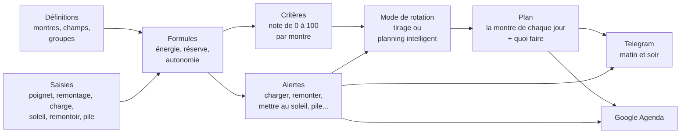

# ⌚ Relojoeiro — Relógios 2

🌐 [Português](README.md) · [English](README.en.md) · [中文](README.zh-CN.md) · [हिन्दी](README.hi.md) · [Español](README.es.md) · **Français**

> **La rotation intelligente d'une collection de montres.** Chaque jour, il dit quelle montre va au poignet, rappelle de
> remonter, de charger, de mettre au soleil et de changer la pile, et fait porter toute la collection, pas seulement la
> préférée. Plusieurs personnes utilisent le même système, chacune avec ses collections, et partagent ce qu'elles veulent.

**[▶ Essayez maintenant, sans rien installer](https://servidor2.lucas.inf.br/relojoeiro/cadastro.php)** : créez un compte de démonstration sur le serveur du
projet (valable 30 jours, déjà avec une collection prête pour enregistrer vos montres).


[](#licence)


<sub>La page **Aujourd'hui** avec une collection de démonstration de 8 montres (des modèles courants, six semaines de port
saisies par l'API) : celle du jour (la Casio, au poignet depuis 7 h), quoi faire aujourd'hui, le planning intelligent des
prochains jours et, à droite, le panneau de la Tissot, ouvert à côté (dans la Configuration, il peut s'ouvrir en fenêtre
flottante, par-dessus la page).</sub>

| | |
|---|---|
| **[Pourquoi il existe](#pourquoi-cela-existe)** · [L'idée centrale](#lidée-centrale--le-système-ne-sait-rien-des-montres) · [Comment ça marche](#comment-ça-marche) · [Une journée avec lui](#une-journée-avec-relógios-2) | **[Essayez en 1 minute](#essayez-en-1-minute)** · [Les écrans](#les-écrans) · [L'API](#lapi--une-seule-porte-pour-tout) · [Installation](#installation) |
| [Plusieurs personnes](#plusieurs-personnes--comptes-collections-et-accès) ·[Questions fréquentes](#questions-fréquentes) · [Comment c'est à l'intérieur](#comment-cest-à-lintérieur) | [Comment contribuer](#comment-contribuer) · [Licence](#licence) |

---

## Pourquoi cela existe

Qui collectionne les montres connaît la scène :

- **La préférée va au poignet tous les jours**, et celle que vous avez achetée avec tant d'amour dort dans le tiroir depuis
  deux mois.
- **L'automatique s'arrête** parce que personne ne l'a portée le week-end, et vous voilà à régler à nouveau l'heure, la date
  et la phase de lune.
- **La solaire se décharge dans le noir** de la boîte, sans que vous le remarquiez.
- **La pile s'épuise sans prévenir**, justement sur la montre que vous vouliez porter aujourd'hui.
- **La smartwatch se réveille sans batterie** le jour où c'était son tour.
- **La révision de la mécanique** (« tous les 5 ans ») et **la garantie** (« elle expire en mars ? ») restent dans la mémoire,
  c'est-à-dire nulle part.

Un tableur règle la moitié du problème : il se souvient, mais il ne décide pas. **Relógios 2** décide. Il sait depuis combien
de temps chaque montre est au repos, quelle charge elle a maintenant, à quel point vous l'aimez et combien elle a été portée
par rapport aux autres. Avec cela, il construit le plan des prochains jours, ou des deux prochaines années, avec les rappels
déjà au bon endroit.

Le matin arrive un message sur Telegram : *« Aujourd'hui : Seiko 5. Remonter l'Orient (la réserve s'épuise à 15 h). »*
Le soir, un autre : *« Demain : Xiaomi Band. Charger avant de dormir : elle atteint 20 % demain à 14 h. »*
Et Google Agenda contient le changement de pile de la Casio en novembre et la révision de la Tissot en 2027.

## L'idée centrale : le système ne sait rien des montres

C'est la décision de conception la plus importante, et c'est ce qui rend le système utile pour n'importe quelle collection.
**Le code n'a que des mécanismes ; toute la connaissance sur les montres, ce sont des données que vous enregistrez.**

Il ne « sait » pas qu'une automatique a une réserve de marche, ni qu'une solaire se recharge au soleil. Tout cela est écrit
dans des formules enregistrées, que vous lisez, modifiez et testez à l'écran :

```text
Réserve restante de la mécanique =
  ACUMULA(0; reserva_horas; 1;                                  ← commence à 0, le maximum est la réserve, perd 1 h par heure
          "pulso";  carga_pulso_reserva / carga_pulso_horas;    ← chaque heure au poignet recharge d'autant
          "winder"; winder_ganho;                               ← chaque heure sur le remontoir, selon le programme de la position
          "corda";  reserva_horas)                              ← le remontage la remplit
```

Vous voulez noter le « changement de bracelet », un « bain à ultrasons » ou un champ « étanchéité » ? Ce sont des données.
Vous voulez que les chronographes pèsent autrement dans le tirage ? Ce sont des données. Une alerte pour « changer le
bracelet en cuir chaque année » ? Aussi.

Le système arrive avec un ensemble initial complet (smartwatch, automatique, remontage manuel, pile et solaire, avec les
formules, les alertes et les critères de chacune), que vous ajustez à votre collection.


<sub>Les champs des définitions. Chacun s'applique à un groupe et à tout ce qui est en dessous (la réserve de marche
seulement sur les mécaniques, la durée de vie de la pile seulement sur les montres à pile), et l'identifiant est son nom dans
les formules.</sub>

---

## Comment ça marche



### Les concepts, un par un

| Concept | Ce que c'est | Exemple |
|---|---|---|
| **Groupes** (l'arbre) | Le classement de la collection, sur autant de niveaux que vous voulez. Tout ce qui est enregistré dans un groupe vaut pour lui et pour tout ce qui est en dessous. | `Traditionnelle › Mécanique › Automatique` |
| **Champs** | Les données de chaque montre, définies par vous : texte, nombre, date, oui/non ou liste, avec unité, valeur par défaut et les règles de valeur (les valeurs possibles, le minimum et le maximum, plusieurs valeurs à la fois). | `reserva_horas = 40 h`, `data_pilha`, `funcoes = Data, GMT` |
| **Sections** | Les sections de la fiche, créées par vous : chaque champ se trouve dans l'une d'elles, et la fiche, le tableau de bord, le passeport et les rapports montrent les champs regroupés, dans leur ordre. | *Identification*, *Achat*, *Construction*, *Énergie* |
| **Unités** | Ce qui vient après le nombre, enregistré par vous : le symbole, le nom et la conversion (le pouce en millimètres). Les champs, les types de saisie et les formules choisissent l'unité dans la liste, et la valeur peut aussi apparaître dans une autre unité. | `47 mm (1,85 pol)` |
| **Calibres** | Le mouvement de la montre, avec ce qui lui appartient : le fabricant, le manuel technique, les recommandations et les valeurs des champs. La montre avec un calibre utilise sa propre valeur, sinon celle du calibre, sinon la valeur par défaut du champ. | `NH35` : réserve de 41 h, marche de −20 à +40 s/jour |
| **Types de saisie** | Ce qui arrive à une montre. Cela peut être **instantané** (remontage, changement de pile), **avec une valeur** (relevé de charge : 68 %) ou une **session** avec début et fin (au poignet, sur le remontoir, au soleil). | `sol` : une session qui se ferme seule à 18 h si vous oubliez |
| **Formules** | Des calculs sur les champs et les saisies. Une même formule peut avoir **une version par groupe**, et c'est celle du groupe le plus proche de la montre qui s'applique. | `energia` est la batterie sur la smartwatch, la réserve sur la mécanique, la lumière sur la solaire et la durée de vie de la pile sur la quartz |
| **Alertes** | Une date prévue par formule, une avance, un texte et la saisie qui résout l'alerte. | *« Remonter l'Orient : la réserve s'épuise à 15 h »*, et le bouton **Remontage** la résout |
| **Seuil de charge** | La charge à laquelle la montre demande de l'attention : charger la smartwatch, mettre la solaire au soleil, remonter la mécanique. L'alerte ne part que lorsque la charge l'atteint. Chaque montre peut avoir le sien (champ *« Alerter quand la charge atteint »*) ; vide, c'est celui de la Configuration qui s'applique. | smartwatch à 20 % (le général), la Samsung à 30 % (le sien) |
| **Critères** | Comment chaque montre reçoit une note de 0 à 100 pour le tirage : des paramètres pondérés, des sous-paramètres qui mesurent un champ ou une formule, et des tranches qui transforment la valeur en note. | *Temps sans usage* (40 %) : de 0 à 1 jour donne 0, 30 jours ou plus donne 100 |
| **Modes de rotation** | Les règles du plan : le type du mode (une par semaine, semaine et week-end, par jour de la semaine, aléatoire, planning intelligent ou personnalisé), dans quel groupe choisir chaque jour, combien de semaines en avant, le critère de choix et, en dessous, le scénario que le moteur calcule. | *« Smartwatch du lundi au vendredi, une traditionnelle par jour le week-end »* |
| **Plan** | La montre de chaque jour, avec quoi faire (*charger avant*, *remonter*, *mettre sur le remontoir*). | `lun 10/06 · Xiaomi Band · charger avant de porter` |

### Le moteur de formules

Les formules s'écrivent comme dans un tableur : nombres avec virgule ou point, textes entre guillemets, `;` pour séparer les
arguments, les opérations `+ - * / ^` et les comparaisons `= <> < <= > >=` (qui donnent 1 ou 0). Une valeur vide se propage
dans le calcul, et la division par zéro donne vide. L'essentiel :

| Fonction | Ce qu'elle renvoie |
|---|---|
| `SE(condition; si vrai; si faux)`, `E(...)`, `OU(...)`, `NAO(x)` | la logique : `E` donne 1 si toutes sont vraies, `OU` si l'une l'est, `NAO` inverse |
| `MIN(...)`, `MAX(...)` | la plus petite et la plus grande des valeurs (ignorent les vides) |
| `LIMITA(x; min; max)`, `ARREDONDA(x; décimales)`, `ABS(x)` | x maintenu dans l'intervalle ; arrondi ; sans signe |
| `CONVERTER(x; "de"; "para")` | x dans une autre unité de la même grandeur, selon le registre des unités : `CONVERTER(diametro; "mm"; "pol")` ; vide quand les deux ne se convertissent pas |
| `TEM(x; "valor")`, `ITENS(x)` | 1 si le champ multiple a la valeur (sans tenir compte des majuscules) : `TEM(funcoes; "Cronógrafo")` ; combien de valeurs il a |
| `PADRAO(x; autre)`, `VAZIO(x)`, `NADA()` | x, ou l'autre si x est vide ; 1 si x est vide ; vide, exprès (`SE(condition; NADA(); calcul)`) |
| `HOJE()`, `AGORA()` | la date du jour et l'instant actuel, en jours (maintenant avec la fraction du jour) |
| `DIAS_DESDE(date)`, `DIAS_ATE(date)`, `SOMA_MESES(date; mois)` | jours depuis et jusqu'à une date (négatif : déjà passée) ; la date plus des mois, selon le calendrier |
| `HORAS_USO()` | les heures d'une journée de port, selon l'horaire de port de la Configuration (de 7 h à 22 h : 15) |
| `CONFIG("clé")` | un nombre de la Configuration, comme `CONFIG("sol_limiar")` |

Et celles qui lisent l'historique de chaque montre :

| Fonction | Ce qu'elle renvoie |
|---|---|
| `HORAS("pulso"; 30)` | heures au poignet sur les 30 derniers jours |
| `CONTAR("pulso"; 30)` | combien de jours portés sur les 30 derniers jours |
| `DIAS_DESDE_ULTIMO("pulso")` | jours depuis la dernière fois au poignet |
| `ULTIMO_VALOR("carga")` / `ULTIMA_DATA("pilha")` | le dernier relevé / la date de la dernière saisie |
| `HORAS_APOS("pulso"; "carga")` | heures au poignet depuis le dernier relevé de charge |
| `ACUMULA(début; max; perte/h; "type"; effet; ...)` | un solde qui parcourt l'historique : il baisse avec le temps et monte à chaque saisie |
| `MEDIDO("uso")` / `MEDIDO("repouso")` | la consommation réelle de la batterie, mesurée par vos relevés de charge |
| `EM_SESSAO("winder")` | 1 si la session est ouverte en ce moment (la montre est sur le remontoir) |
| `MEDIA_COLECAO("uso_30d")` | la moyenne d'une variable sur toute la collection |

Et celles de la rotation (le scénario des modes ; en dehors, le jour est celui de l'instant du calcul) :

| Fonction | Ce qu'elle renvoie |
|---|---|
| `DIA_SEMANA()`, `SEMANA_DO_ANO()` | le jour de la semaine (1 lundi à 7 dimanche) et la semaine de l'année (ISO) du jour en cours de montage |
| `NO_GRUPO("Tradicional › Quartzo")` | 1 si la montre est à ce point de l'arbre ou en dessous (le nom, le chemin ou `#id` ; `"todos"` : 1 pour toutes) |
| `RELOGIO("Seiko SKX")` | 1 si c'est cette montre (par le nom ou par l'id) |
| `CALIBRE("NH35")` | 1 si la montre a ce calibre (par le nom ou par l'id) |
| `WINDER_PROGRAMA("voltas_dia")`, `WINDER_POSICAO("campo")`, `WINDER("winder_marca")` | le calcul du programme de la position du remontoir où est la montre (les tours par jour, `"voltas_horario"`, `"voltas_anti_horario"`, `"minutos_girando"`, `"velocidade"`, `"vezes_dia"`, `"ciclo_minutos"` ; dans l'`ACUMULA`, la position de chaque session sur le remontoir), un champ de cette position et un champ de son remontoir ; hors d'une position, ou sans programme, vide (voir [Les remontoirs](#les-remontoirs)) |
| `ESCOLHIDO_HA(1)`, `VEZES_NO_PLANO(7)` | 1 si la montre était celle du plan il y a n jours (1 : hier ; -1 : demain, quand elle est déjà dans le plan) ; combien de jours elle a eus dans le plan dans les n derniers jours |
| `ESCOLHA(n; a; b; c)` | le n-ième des valeurs (lui seul est calculé) : `ESCOLHA(DIA_SEMANA(); …)` donne une valeur par jour de la semaine |
| `SORTEIO()` | un nombre de 0 à 1, du même lot RANDOM.ORG que les tirages |

Et la variable `nota_criterios` : la note de la montre selon les critères, à l'instant du calcul.

Sur la page **Définitions**, chaque formule a le bouton **Tester sur toutes les montres**, qui montre le résultat sur chaque
montre avant d'enregistrer.

### Les totaux

Les totaux appartiennent aussi au moteur de formules, mais ils regardent **toutes les montres affichées à la fois** (celles
que laisse le filtre du tableau de la page Aujourd'hui). Ils sont dans l'onglet **Totaux** de la page **Définitions** :
chaque total a la **colonne** du tableau où il va (ou aucune), le **nom**, l'**expression**, les cases **Afficher dans le
pied des totaux** et **Afficher sur la page des totaux**, la **largeur** de son cadre sur la page (étroit ou large) et le
**format** des nombres (nombre, entier, avec 2 décimales, argent, pourcentage, date ou jours). Seuls les totaux d'une colonne
vont dans le pied, sous elle ; les autres, autant que vous voulez, restent seulement sur la **page des totaux** (menu
**Collection**, ou **Voir tous les totaux** sous le tableau, qui garde le même filtre). Plusieurs totaux dans la même
colonne vont l'un sous l'autre, dans l'ordre de la liste (↑ ↓), et **Tester sur toutes les montres** montre le résultat
avant d'enregistrer.

| Fonction de total | Ce qu'elle donne |
|---|---|
| `CONTA()`, `CONTA(x)` | combien de montres ; combien ont `x` rempli |
| `CONTA_SE(condição)` | combien passent la condition : `CONTA_SE(carga <= 20)` |
| `DISTINTOS(x)` | combien de valeurs différentes : `DISTINTOS(tipo)` |
| `SOMA(x)`, `MEDIA(x)`, `MEDIANA(x)`, `MENOR(x)`, `MAIOR(x)` | le calcul habituel, avec celles qui ont `x` (pour une date, la moyenne est une date) |
| `QUEM_MAIOR(x)`, `QUEM_MENOR(x)` | la montre de la plus grande et de la plus petite valeur, avec la valeur à côté |
| `AGRUPADO(chave; conta; limite)` | un petit tableau : une ligne par valeur de la clé et la ligne de total ; le `conta` (sans lui, `CONTA()`) va dans chaque ligne, calculé seulement avec ses montres, et dans le total, avec toutes ; `limite` montre celles qui en ont le plus et regroupe le reste dans "autres" |
| `FAIXAS(x; 25; 50; 75; 100)` | un petit tableau par tranches ("jusqu'à 25", "26 à 50"...), celles sans `x` dans "sans valeur", et le total |

À l'intérieur, tout ce qui marche dans une formule marche (les champs, les formules, `SE`, `DIAS_DESDE`...), calculé sur
chaque montre, ainsi que ce que montre chaque colonne du tableau : `codigo`, `nome`, `tipo`, `estado`, `disponivel`,
`em_uso`, `carga`, `ultimo_uso`, `manutencao_data`, `manutencao_nome`, `encostado_data`, `avisos` (combien d'alertes elle a)
et `posse`. À l'extérieur, seulement des nombres, des textes et les fonctions qui n'ont pas besoin d'une montre (`SE`,
`MIN`, `ARREDONDA`, les calculs). Les nouvelles fonctions `MES(data)`, `ANO(data)` et `MES_ANO(data)` servent à regrouper
par mois et par année, et marchent aussi dans les formules. Exemples :

| Total | Expression |
|---|---|
| Disponibles et indisponibles | `AGRUPADO(SE(disponivel; "disponíveis"; "indisponíveis"))` |
| Par type | `AGRUPADO(tipo)` |
| Tranches de charge | `FAIXAS(carga; 25; 50; 75; 100)` |
| À l'arrêt depuis | `FAIXAS(DIAS_DESDE(ultimo_uso); 7; 30)` |
| Quoi faire (les 3 qui apparaissent le plus et "autres") | `AGRUPADO(manutencao_nome; CONTA(); 3)` |
| Achats par mois | `AGRUPADO(MES_ANO(data_compra))` |
| Valeur par type | `AGRUPADO(tipo; SOMA(valor_compra))` |
| La plus chère | `QUEM_MAIOR(valor_compra)` |
| Celle qui a le plus à faire | `QUEM_MAIOR(avisos)` |

Une installation neuve (et la migration v31) arrive déjà avec un petit tableau dans chaque colonne du pied et avec les
cadres de la page des totaux ; vous changez, supprimez ou créez les vôtres.

### La note de chaque montre (critères)

Les critères fournis, pour toutes les montres :

| Paramètre | Poids | Mesure |
|---|---:|---|
| Temps sans usage | 40 | jours depuis la dernière fois au poignet : plus elle reste au repos, plus la note est haute |
| Équilibre d'usage | 30 | usage sur les 30 derniers jours comparé à la moyenne de la collection : la moins portée monte |
| Préférence | 20 | votre note pour la montre (0 à 100) |
| Nouveauté et valeur | 10 | depuis quand elle a été achetée et combien elle a coûté (rentabiliser l'investissement) |

Chaque groupe, et même chaque montre, peut avoir son propre ensemble. La smartwatch, par exemple, pèse aussi l'**énergie** (la
charge actuelle et combien de jours elle tient), pour ne pas tirer une montre qui va s'éteindre à midi. La page **Critères**
montre tout le calcul de chaque note : chaque tranche, chaque poids et chaque point, et à côté de la note de chaque critère
une flèche dit vers où il tire la note finale : **↑** verte (note au-dessus de 50, le neutre : tire vers le haut), **↓** rouge
(sous 50 : tire vers le bas) ou **↔** marron (50 pile, ou sans poids : neutre, ne tire d'aucun côté).

Les ensembles fournis, en entier. La note d'un paramètre est la moyenne des notes de ses sous-paramètres, selon le poids de
chacun ; la note de la montre est la moyenne des paramètres, selon leur poids. Chaque sous-paramètre lit une variable (un champ
ou une formule) et donne la note selon la tranche où tombe la valeur ; un sous-paramètre sans valeur (un champ vide, une valeur
hors de toute tranche) est laissé de côté, et les autres se partagent son poids. Tout se modifie sur la page **Critères**, et
**Restaurer les critères initiaux** revient à ceux-ci.

**Toutes les montres**

| Paramètre | Poids | Sous-paramètre (la variable, le poids dans le paramètre) | Les tranches : la valeur → la note |
|---|---:|---|---|
| Temps sans usage | 40 | Jours sans usage (`dias_sem_uso`) | 0 à 1 → 0; 1 à 3 → 30; 3 à 7 → 60; 7 à 14 → 80; 14 à 30 → 95; 30 ou plus → 100 |
| Équilibre d'usage | 30 | Usage sur les 30 derniers jours, comparé à la moyenne (`uso_vs_media`) | 0 à 25 → 100; 25 à 60 → 80; 60 à 100 → 60; 100 à 140 → 35; 140 à 200 → 15; 200 ou plus → 0 |
| Préférence | 20 | Votre note pour la montre (`preferencia`) | 0 à 20 → 0; 20 à 40 → 25; 40 à 60 → 50; 60 à 80 → 75; 80 à 100 → 100 |
| Nouveauté et valeur | 10 | Nouveauté : jours depuis l'achat (`dias_desde_compra`, 60) | 0 à 15 → 100; 15 à 45 → 80; 45 à 120 → 55; 120 à 365 → 40; 365 ou plus → 30 |
|  |  | Rentabiliser l'investissement : prix payé (`valor_compra`, 40) | 0 à 300 → 30; 300 à 800 → 50; 800 à 1500 → 70; 1500 ou plus → 90 |

**Smartwatch**

| Paramètre | Poids | Sous-paramètre (la variable, le poids dans le paramètre) | Les tranches : la valeur → la note |
|---|---:|---|---|
| Énergie | 30 | Charge maintenant (%) (`energia`, 50) | 0 à 15 → 0; 15 à 30 → 25; 30 à 50 → 55; 50 à 80 → 85; 80 à 100 → 100 |
|  |  | Jours d'usage que tient la charge (`dias_de_carga`, 50) | 0 à 1 → 0; 1 à 2 → 30; 2 à 4 → 60; 4 à 7 → 85; 7 ou plus → 100 |
| Autonomie | 15 | Autonomie de la smartwatch (`autonomia_dias`) | 0 à 2 → 10; 2 à 4 → 40; 4 à 7 → 70; 7 à 14 → 90; 14 ou plus → 100 |
| Temps sans usage | 25 | Jours sans usage (`dias_sem_uso`) | 0 à 1 → 0; 1 à 3 → 30; 3 à 7 → 60; 7 à 14 → 80; 14 à 30 → 95; 30 ou plus → 100 |
| Équilibre d'usage | 15 | Usage sur les 30 derniers jours, comparé à la moyenne (`uso_vs_media`) | 0 à 25 → 100; 25 à 60 → 80; 60 à 100 → 60; 100 à 140 → 35; 140 à 200 → 15; 200 ou plus → 0 |
| Préférence | 10 | Votre note pour la montre (`preferencia`) | 0 à 20 → 0; 20 à 40 → 25; 40 à 60 → 50; 60 à 80 → 75; 80 à 100 → 100 |
| Nouveauté et valeur | 5 | Nouveauté : jours depuis l'achat (`dias_desde_compra`, 60) | 0 à 15 → 100; 15 à 45 → 80; 45 à 120 → 55; 120 à 365 → 40; 365 ou plus → 30 |
|  |  | Rentabiliser l'investissement : prix payé (`valor_compra`, 40) | 0 à 300 → 30; 300 à 800 → 50; 800 à 1500 → 70; 1500 ou plus → 90 |

**Traditionnelle › Mécanique**

| Paramètre | Poids | Sous-paramètre (la variable, le poids dans le paramètre) | Les tranches : la valeur → la note |
|---|---:|---|---|
| Réserve de marche | 25 | Réserve maintenant (%) : vide, elle doit tourner (`energia`) | 0 à 10 → 100; 10 à 30 → 85; 30 à 60 → 60; 60 à 90 → 35; 90 à 100 → 20 |
| Soin mécanique | 15 | À l'arrêt, elle doit tourner (lubrification) (`dias_sem_uso`, 50) | 0 à 7 → 20; 7 à 30 → 60; 30 à 90 → 90; 90 ou plus → 100 |
|  |  | Révision à jour (`dias_ate_revisao`, 50) | 0 à 30 → 20; 30 à 180 → 60; 180 ou plus → 100 |
| Temps sans usage | 25 | Jours sans usage (`dias_sem_uso`) | 0 à 1 → 0; 1 à 3 → 30; 3 à 7 → 60; 7 à 14 → 80; 14 à 30 → 95; 30 ou plus → 100 |
| Équilibre d'usage | 20 | Usage sur les 30 derniers jours, comparé à la moyenne (`uso_vs_media`) | 0 à 25 → 100; 25 à 60 → 80; 60 à 100 → 60; 100 à 140 → 35; 140 à 200 → 15; 200 ou plus → 0 |
| Préférence | 10 | Votre note pour la montre (`preferencia`) | 0 à 20 → 0; 20 à 40 → 25; 40 à 60 → 50; 60 à 80 → 75; 80 à 100 → 100 |
| Nouveauté et valeur | 5 | Nouveauté : jours depuis l'achat (`dias_desde_compra`, 60) | 0 à 15 → 100; 15 à 45 → 80; 45 à 120 → 55; 120 à 365 → 40; 365 ou plus → 30 |
|  |  | Rentabiliser l'investissement : prix payé (`valor_compra`, 40) | 0 à 300 → 30; 300 à 800 → 50; 800 à 1500 → 70; 1500 ou plus → 90 |

**Traditionnelle › Quartz › Pile**

| Paramètre | Poids | Sous-paramètre (la variable, le poids dans le paramètre) | Les tranches : la valeur → la note |
|---|---:|---|---|
| Durée de vie de la pile | 15 | Vie de la pile (%) (`energia`) | 0 à 10 → 10; 10 à 30 → 50; 30 à 100 → 70 |
| Révision | 10 | Révision à jour (`dias_ate_revisao`) | 0 à 30 → 20; 30 à 180 → 60; 180 ou plus → 100 |
| Temps sans usage | 35 | Jours sans usage (`dias_sem_uso`) | 0 à 1 → 0; 1 à 3 → 30; 3 à 7 → 60; 7 à 14 → 80; 14 à 30 → 95; 30 ou plus → 100 |
| Équilibre d'usage | 25 | Usage sur les 30 derniers jours, comparé à la moyenne (`uso_vs_media`) | 0 à 25 → 100; 25 à 60 → 80; 60 à 100 → 60; 100 à 140 → 35; 140 à 200 → 15; 200 ou plus → 0 |
| Préférence | 10 | Votre note pour la montre (`preferencia`) | 0 à 20 → 0; 20 à 40 → 25; 40 à 60 → 50; 60 à 80 → 75; 80 à 100 → 100 |
| Nouveauté et valeur | 5 | Nouveauté : jours depuis l'achat (`dias_desde_compra`, 60) | 0 à 15 → 100; 15 à 45 → 80; 45 à 120 → 55; 120 à 365 → 40; 365 ou plus → 30 |
|  |  | Rentabiliser l'investissement : prix payé (`valor_compra`, 40) | 0 à 300 → 30; 300 à 800 → 50; 800 à 1500 → 70; 1500 ou plus → 90 |

**Traditionnelle › Quartz › Solaire**

| Paramètre | Poids | Sous-paramètre (la variable, le poids dans le paramètre) | Les tranches : la valeur → la note |
|---|---:|---|---|
| Lumière | 25 | Charge lumineuse (%) (`energia`) | 0 à 30 → 80; 30 à 70 → 65; 70 à 100 → 50 |
| Révision | 10 | Révision à jour (`dias_ate_revisao`) | 0 à 30 → 20; 30 à 180 → 60; 180 ou plus → 100 |

Et il existe une **garantie de rotation** : aucune montre ne reste plus de N jours au repos (21 par défaut). Elle s'applique
**avant** la note : si un candidat a déjà dépassé la limite, il gagne directement, celui au repos depuis le plus longtemps
d'abord. Ce n'est que lorsque personne n'a dépassé la limite que la note décide.

Les jours au repos sont la formule **Jours sans usage**, que vous pouvez modifier dans Définitions : les jours depuis la
dernière fois au poignet et, pour une montre **jamais portée**, les jours depuis l'achat (sans date d'achat, 9999, la plus au
repos de toutes). Ainsi une montre achetée hier ne passe pas devant tout le monde, et deux jamais portées ne sont pas à égalité :
celle achetée plus tôt attend depuis plus longtemps.

Pour que vous ne restiez jamais dans le doute, **chaque jour du plan garde la raison du choix**, en une phrase, qui apparaît
sous la montre sur la page Aujourd'hui et sur la page Plan : *« Garantie de rotation : jamais portée, dans la collection
depuis 38 jours, au-delà de la limite de 21 jours sans usage »*, *« Tirage selon la note, parmi 5 candidates : note 70,2,
16,4 % de chances »*, *« La meilleure note (91,2). Reste 5 jours de suite »*, *« Reste au poignet : jour 2 de 5 de suite »*,
*« Choisie à la main »*.
### Les modes de rotation

Les modes sont dans la page **Modes de rotation** (menu **Rotation**). Chaque mode a un **type**, et l'écran du type ne
demande que ce qui a du sens pour lui :

- **Une par semaine** : une montre pour toute la semaine, du premier au dernier jour (du lundi au dimanche, ou du dimanche au
  samedi : la semaine commence le jour choisi dans la Configuration, **La semaine commence**). Vous dites d'où elle vient
  (la collection, un groupe ou une montre fixe) et le critère de choix.
- **Semaine et week-end** : deux tranches, du lundi au vendredi et le samedi et dimanche, chacune avec son groupe et avec
  **une montre pour la tranche** ou **une par jour**. Celui qui est fourni : la smartwatch en semaine, une traditionnelle par
  jour à la fin de celle-ci. Avec la semaine commençant le dimanche, le samedi et le dimanche restent une seule tranche
  (la montre du samedi reste le dimanche).
- **Par jour de la semaine** : une montre par jour, et chaque jour de la semaine dit d'où elle vient (un groupe, une montre
  fixe ou aucune : jour libre).
- **Aléatoire chaque jour** : une par jour, toutes avec la même chance, sans critère ni garantie de rotation.
- **Planning intelligent** : planifie toute la période d'un coup, en simulant la charge (voir [plus bas](#le-planning-intelligent)).
- **Personnalisé** : vous écrivez le scénario (voir [Le scénario du mode](#le-scénario-du-mode)).

Dans les trois premiers, le **critère de choix** est le tirage : par la **meilleure note**, par **tirage selon la note** (la
note devient la chance), **au hasard** ou par **file d'attente** (celle qui attend depuis le plus longtemps). Avec le **cycle**
activé, une montre ne revient qu'après le passage de toutes les candidates dans la semaine. Le cadre **Mode de rotation** de
la page Aujourd'hui choisit le mode, le critère et la garantie de rotation ; **Appliquer le mode** ne fait que marquer : rien
du plan ne change tant que vous ne cliquez pas sur **Refaire le tirage** (sauf ce que le mode précédent a tiré après la fin
des semaines du nouveau, comme les jours du planning de 30 jours, qui part dès la construction suivante).

**Refaire le tirage** refait ce que le mode a tiré et laisse tels quels les jours choisis à la main et les jours libres (ceux
de la Rotation manuelle, par exemple) ; le message dit combien sont restés (*« Restés tels quels : 7 jours libres... »*). Avec
la case **Tout écraser** cochée, tout ce que le plan contient à partir du début du tirage disparaît (à partir de demain,
d'aujourd'hui ou du premier jour de la semaine prochaine), à la main, libre ou tiré, et le mode remonte tout ; la
confirmation prévient avant, et le message dit combien de jours à la main et de jours libres ont été écrasés.

Refaire le tirage va jusqu'à la fin des semaines du mode, ou jusqu'à la fin de la **semaine prochaine**, si vous l'avez
montée. En revenant d'un autre mode, ce qu'il a tiré après (les 30 jours du planning, par exemple) part et ne revient pas. **Tout effacer** retire aussi la
semaine prochaine montée. Après la fin, seuls restent les jours consécutifs de la montre qui a commencé jusqu'à elle (la
montre connectée reste les jours de sa batterie) ; si un jour au milieu change, ce qui restait de la série part.

**Ce qui a changé.** Toute écriture qui touche au plan (le Tirer à nouveau, la semaine suivante, le remplacer par…, la
rotation manuelle, les périodes, le Pas de montre aujourd'hui et l'effacement) montre, avec le message, ce qui a changé par
rapport au plan d'avant : *« 3 jours ont changé ; 11 ont gardé la même montre. »* et un petit tableau avec chaque jour qui a
changé (**Jour**, **Avant**, **Après** et le **Motif** de la nouvelle). Avec le tableau, la boîte reste jusqu'à ce que vous
la fermiez. Par l'API, la réponse apporte `mudancas`.

**Les semaines.** Hors planning, chaque mode dit **combien de semaines en avant** le plan arrive monté (1 à 8 ; la liste montre
les semaines avec les dates). Le plan va jusqu'au dernier jour de la dernière d'entre elles : le dimanche, ou le samedi avec la
semaine commençant le dimanche (avec une seule semaine, le dernier jour de la semaine le plan apporte aussi le premier de la
suivante, pour le rappel de la veille), et la semaine suivante entre quand son tour arrive. Avec **Le dernier jour de la semaine, les modes par semaine construisent** sur *Toute la semaine suivante*, dans la Configuration, le dernier jour de la semaine les semaines du mode comptent déjà à partir de la semaine prochaine, qui arrive construite entière. La semaine commence le jour
choisi dans la Configuration (**La semaine commence** : le lundi, par défaut, ou le dimanche), et le cycle, la semaine
prochaine et la montre pour toute la semaine se comptent à partir d'elle. Avec plus d'une
semaine, **Refaire le tirage** a aussi **la semaine prochaine** : elle sort selon le mode actuel, avec les jours qui restent
cette semaine comptés comme utilisation, comme si vous aviez déjà porté les montres du plan (l'utilisation compte dans les
jours sans utilisation et dans la note ; la charge non, parce qu'on ne sait pas si la montre sera chargée). Chaque jour est
choisi ainsi, avec les jours précédents du plan déjà au poignet, et c'est pourquoi la montre du lundi ne revient pas le mardi
juste parce qu'elle semble arrêtée. Les jours choisis à la main restent. Dans le planning intelligent il n'y a pas de semaine
prochaine : il planifie déjà sa propre période.

### Le scénario du mode

En dessous, tout mode est un **scénario** : cinq lignes que le moteur de formules calcule pour chaque montre disponible, au
début de chaque jour du plan, avec les jours précédents déjà comptés comme utilisation. Les modes prêts génèrent le scénario de
leurs écrans (la page montre le scénario généré, en lecture seule) ; dans **Personnalisé** vous écrivez le vôtre, une ligne
par nom (`nom = expression`, dans la même langue que les formules des définitions ; les lignes qui commencent par `#` sont des
commentaires ; les autres noms sont vos propres variables) :

| Ligne | Ce qu'elle dit | Si elle manque |
|---|---|---|
| `candidato` | 1 : la montre entre dans le choix de ce jour ; 0 : non | `1` (toutes) |
| `nota` | la note de la montre ce jour-là | `nota_criterios` (la note selon les critères) |
| `peso` | la chance au tirage. Toutes à 0 : la meilleure note gagne. Toutes égales : toutes avec la même chance. Sinon, chaque poids est la chance | `0` |
| `dias` | combien de jours de suite la montre choisie reste (tant que les jours suivants sont vacants et qu'elle reste candidate) | `1` |
| `garantia` | 1 : passe devant toutes (parmi plusieurs, la plus longtemps inutilisée ; égalité : celle enregistrée en premier) | celle qui a dépassé la garantie de rotation (`max_sem_uso`) en jours sans utilisation |

**Comment le moteur décide chaque jour**, dans cet ordre : le scénario dit qui est candidate ; parmi les candidates, la montre
d'hier reste dehors, s'il y a une autre candidate (la seule candidate se répète, et le motif dit pourquoi) ; le cycle, si le
mode l'utilise, lui aussi seulement parmi les candidates ; celle qui a `garantia` gagne directement ; sinon le `peso`. La montre
choisie reste les `dias` que le scénario a donnés, et le motif du choix est enregistré dans le plan. Le même moteur décide le
**Tirer ce jour au sort par** du sélecteur de chaque jour et le **Décider pour moi** de la rotation manuelle.

Un exemple : des mécaniques en semaine, ce que la batterie permet le week-end, et celle qui est arrêtée depuis plus de 3 jours
avec 100 fois la chance des autres :

```
util      = DIA_SEMANA() <= 5
candidato = SE(util; NO_GRUPO("Mecânico"); 1)
peso      = SE(dias_sem_uso > 3; 100; 1)
dias      = SE(NO_GRUPO("Smartwatch"); dias_seguidos; 1)
```

Le bouton **Tester sur toutes les montres** calcule le scénario sur un jour (aujourd'hui, ou l'un des 13 suivants) et montre
chaque ligne sur chaque montre et qui sortirait. En plus des fonctions des formules, le scénario a `DIA_SEMANA()` (1 lundi à
7 dimanche), `SEMANA_DO_ANO()`, `NO_GRUPO("groupe")`, `RELOGIO("nom")`, `ESCOLHIDO_HA(n)`, `VEZES_NO_PLANO(n)`,
`ESCOLHA(n; a; b; …)` et `SORTEIO()` (le tableau dans [Le moteur de formules](#le-moteur-de-formules)) et la variable
`nota_criterios`. Par l'API : `recurso=roteiro` teste ; `recurso=modos`, `acao=salvar` avec `tipo=personalizado` et `roteiro`
enregistre.

**D'où vient le tirage.** Tout tirage du système (le mode entièrement aléatoire, le tirage selon la note ou selon le poids et
la fonction `SORTEIO()` du scénario) utilise des nombres vraiment aléatoires, venus de l'extérieur, dans cet ordre :

1. **[RANDOM.ORG](https://www.random.org/)** : du hasard tiré du bruit atmosphérique (il mesure la variation des micro-ondes
   dans l'air et la transforme en bits) ;
2. quand il est en panne (ou que le quota du jour est épuisé), **ANU QRNG**, le générateur quantique de l'Université
   nationale australienne (il mesure des fluctuations quantiques de la lumière). Le système utilise l'ancienne adresse,
   `qrng.anu.edu.au/API/jsonI.php`, qui répond sans clé (la nouvelle, `api.quantumnumbers.anu.edu.au`, exige une clé d'API) ;
3. sans les deux (pas d'internet sur le serveur, par exemple), le **générateur sécurisé de PHP** (`random_int`, celui du
   système d'exploitation : l'équivalent du `secrets` de Python).

Les nombres arrivent par lot (64 nombres de 16 bits par requête), et chaque tirage n'utilise que ce dont il a besoin, en
écartant ce qui dépasse le dernier multiple entier de l'intervalle : chaque résultat a exactement la même chance. Chaque
service a 4 secondes pour répondre ; si les deux échouent, le système utilise celui de PHP et ne réessaie pas pendant 10
minutes (ainsi aucune page ne reste à attendre). La raison de chaque jour tiré dit d'où vient le nombre (*« Tirage simple,
parmi 4 candidates, toutes avec la même chance (RANDOM.ORG). »*), et la **Configuration** montre le dernier lot (le cadre
**Tirages**). Ce qui est secret n'utilise pas ces services : le sel des mots de passe et les noms des fichiers des documents
continuent d'utiliser le générateur de PHP, car un nombre qui voyage sur internet ne convient pas aux secrets.

### Effacer la programmation

En bas de la page **Plan** (l'endroit principal : le cadre **Effacer la programmation**, à la fin de la page, après le jour
par jour) et dans le cadre **Mode de rotation** de la page Aujourd'hui (chacun sous une ligne, comme **Refaire le tirage**) :

- **Effacer une période** : **De** et **À** ; l'un des deux peut rester vide (seulement **De** efface de lui jusqu'à la fin
  du plan ; seulement **À**, de demain jusqu'à lui). Les jours de la période quittent le plan, à partir de demain (ceux
  choisis à la main, ceux tirés et les libres), et le mode de rotation refait ces jours, eux seuls : les autres jours restent tels quels (dans le planning intelligent
  aussi). Le bouton **Effacer** demande confirmation.
- **Tout effacer** : vide toute la programmation, à partir de demain : les jours choisis à la main, les tirés et les libres.
  En cochant **Y compris aujourd'hui**, il efface à partir d'aujourd'hui (si une autre montre sort pour aujourd'hui, elle
  devient celle au poignet dès maintenant). Ensuite le mode de rotation reconstruit le plan, de zéro : jusqu'au dernier jour de la
  dernière des semaines du mode (les suivantes, quand elles arrivent) ; dans le planning intelligent, tout le planning.
  La programmation ne reste pas vide car le système construit toujours les jours manquants avec le mode actif ; pour des
  jours sans montre, cochez *libre* dans la Rotation manuelle.

### La rotation manuelle

Dans le cadre **Mode de rotation** de la page Aujourd'hui, la dernière option de la liste est **Rotation manuelle** : vous
choisissez vous-même la montre de chaque jour d'une période (les vacances, un voyage, un mois entier). Indiquez le début
(**De**) et la fin (**À**) et cliquez sur **OK** :

- les jours apparaissent **7 par 7**, avec la date, le jour de la semaine, ce que le plan prévoit ce jour-là et un sélecteur ;
- au-delà de 7 jours, les pages sont en dessous : **‹ Précédent**, **1 2 3 …**, **Suivant ›**. Ce que vous choisissez sur
  une page est conservé pendant que vous parcourez les autres ; rien ne change avant d'enregistrer ;
- le sélecteur de chaque jour contient les montres disponibles, **Décider pour moi**, le groupe **Tirer ce jour au sort
  par** (*la meilleure note*, *tirage selon la note*, *aléatoire* ou *file* : le jour est tiré au sort à l'enregistrement
  selon ce mode, sans celle d'hier ni celle de demain, comme Décider pour moi) et **Sans montre (jour libre)**. Au départ,
  il montre la montre que le jour a déjà choisie à la main ; un jour libre apparaît comme libre ; et le reste (tiré
  ou encore sans montre), comme *Décider pour moi* ;
- **Enregistrer la rotation manuelle** enregistre toute la période : les jours avec une montre sont choisis à la main, ceux
  en *Décider pour moi* et ceux en *Tirer ce jour au sort par* sont décidés sur-le-champ par le système et enregistrés
  aussi (la raison de chacun apparaît dans le plan), et les libres restent sans montre. Si aujourd'hui fait partie de la période et que vous avez choisi une autre
  montre, elle devient celle au poignet dès maintenant ;
- pour effacer les jours d'une période (le mode de rotation refait ces jours) ou tout effacer, voir
  [Effacer la programmation](#effacer-la-programmation).

Hors de la période, le mode de rotation habituel s'applique toujours, et rien en dehors d'elle ne change (dans le planning
intelligent aussi). Les jours choisis à la main restent même quand vous refaites le tirage ou que le cron construit la semaine
suivante ; dans le planning intelligent, **Refaire le tirage** et la replanification du matin refont le planning autour d'eux.

**Le critère de *Décider pour moi* :**
1. la **note des critères** (ceux que vous définissez dans **Critères** : jours sans usage, équilibre, préférence,
   charge...), calculée au début de chaque jour, avec les jours précédents de la période (ceux que vous avez choisis et ceux
   qu'il a décidés) déjà comptés comme usage ;
2. la **garantie de rotation** passe d'abord : celle qui a dépassé la limite de jours sans usage passe en premier, celle au
   repos depuis le plus longtemps avant ;
3. la montre d'**hier** et celle de **demain** sont écartées, s'il y en a une autre. Ainsi une montre ne se répète pas juste à
   côté de celle que vous avez choisie ;
4. en cas d'égalité, celle enregistrée en premier gagne.

Aujourd'hui, avec *Décider pour moi*, la montre déjà prévue dans le plan reste.

### Le planning intelligent

C'est le mode le plus complet. Au lieu de tirer semaine après semaine, il **planifie de 7 jours à 2 ans d'un coup**, en
simulant jour par jour :

1. il calcule la note de chaque montre avec l'état simulé de ce jour-là ;
2. il choisit la montre par la meilleure note (le scénario du planning : `peso = 0`) ; la smartwatch reste au poignet le
   nombre de jours que tient la batterie (jusqu'à 7 : la formule `dias_seguidos`) ;
3. il simule le port (la session au poignet pendant l'horaire de port) et son effet sur la charge et la réserve de toutes ;
4. il vérifie les alertes : si la montre choisie va avoir besoin d'une charge ou d'un remontage, il note l'action sur le jour
   (*« charger avant de porter »*) et simule la saisie qui la résout ;
5. il passe au jour suivant.

Chaque matin, le cron **replanifie à partir de l'état réel**. Si vous avez porté une autre montre, oublié de charger ou saisi
un relevé différent de celui prévu, le plan se corrige. Les jours choisis à la main et les libres restent ; les tirés, à partir
d'aujourd'hui, sont tirés à nouveau.

Ce que vous changez dans un jour ou une période (changer la montre d'un jour, rendre un jour au tirage, refaire le tirage d'une
période ou la laisser libre, choisir les montres d'une période, la Rotation manuelle) **ne change que lui** : les autres jours
gardent la montre qu'ils ont, et seul leur *quoi faire* est refait (la charge simulée change avec la nouvelle période).
**Refaire le tirage** et **Tout effacer** refont le planning entier.

Le planning **va jusqu'aux jours du mode** (de 7 à 730, sur la page Modes de rotation), comptés à partir d'aujourd'hui (de
demain, si la journée d'aujourd'hui a déjà commencé au poignet ; avec **Le planning intelligent commence** sur *Toujours aujourd'hui*, dans la Configuration, aujourd'hui est toujours le 1er jour, et le planning de 7 jours va jusqu'à dans 6 jours). Avec **Le planning intelligent se termine** sur *À la fin de la semaine*, la période va en semaines entières, selon **La semaine commence** : celui d'une semaine, un mardi, va jusqu'au dimanche (avec la semaine commençant le lundi), et le dernier jour de la semaine il construit toute la semaine suivante ; avec *À la fin du mois*, en mois entiers (celui d'un mois va jusqu'au dernier jour du mois). Quand la période se termine, la suivante commence le jour après son dernier jour, avec les jours du mode entiers (de 7 en 7, sans perdre ni répéter un jour), dans les deux choix. Vous avez changé les jours du mode actif, de 7 à 30 ou de 30 à
7 : la fin du planning est retirée, et la construction suivante (la page Aujourd'hui, le cron) utilise déjà les nouveaux jours
(le planning garde avec combien de jours il a été généré : un autre nombre dans le mode, il est refait en entier). **Refaire le
tirage** et **Tout effacer** commencent toujours un nouveau planning avec les jours actuels du mode. **Effacer une période**
avec seulement le début efface de lui jusqu'à la fin du plan et reconstruit aussi loin que les jours du mode le permettent (le
mode de 30 jours va jusqu'au 30e, compté à partir d'aujourd'hui).

### Consommation mesurée par les relevés

La fiche de la smartwatch dit « tient 5 jours ». La réalité n'est pas d'accord, et change à mesure que la batterie vieillit.
C'est pourquoi **chaque relevé de charge que vous saisissez est comparé au précédent**, et l'intervalle entre les deux devient
une mesure : de combien elle a baissé, combien d'heures elle a passées au poignet et combien hors du poignet (rangée, éteinte),
et comment vous avez marqué chaque relevé (en usage ou au repos). Les heures d'usage de la Configuration comptent comme
poignet d'elles-mêmes, et vos marquages (*Mis*, *Retiré*) font foi. Une hausse du relevé est une recharge : un nouveau
tronçon commence. Et un intervalle avec une autre session au milieu (la montre est allée au chargeur) ne mesure pas non
plus : la mesure ne sait séparer que poignet et rangé.

**Comment transformer les mesures en les deux consommations (au poignet et hors du poignet) est votre choix : il y a cinq
moteurs.** Tous restent dans le système ; aucun n'efface rien, et changer de moteur ne change que le calcul (les mesures sont
les mêmes). Le choix se fait à trois endroits, et celui du haut prime sur ceux du bas :

| Niveau | Où on le choisit | Ce qu'il fait |
|---|---|---|
| 1. **La collection** | **Consommation de la batterie : comment calculer (valable pour toutes les montres)**, dans la Configuration (`gasto_motor`) | vaut pour toutes les montres de la collection. Vide (*Individuelle (sur la montre ou le groupe)*) : les deux niveaux du dessous décident. |
| 2. **La montre** | le champ **Comment calculer la consommation de la batterie** (`gasto_motor`), sur la fiche de la montre | ne vaut que pour elle. Vide : celui du groupe. |
| 3. **Le groupe** | la **valeur par défaut** de ce même champ (dans **Fiches › Champs** : le champ est à la racine, et vaut pour les montres de là où il est vers le bas) | vaut pour les montres qui n'ont pas choisi. Vide : le moteur 1. |

Sur une montre sans relevé de charge (une mécanique, une solaire), le choix ne fait rien. Le cadre **Consommation de la
batterie** dit quel moteur a fait le calcul et d'où vient le choix (*Calculé par : Par le marquage : deux taux séparés — le
choix de la collection, dans la Configuration*).

| Moteur | Ce qu'il fait |
|---|---|
| 1. **Par les heures enregistrées (le moteur d'origine)** (`horas`) | le défaut. Chaque mesure est découpée par les marquages de poignet minute par minute (tant d'heures au poignet, tant hors), et les deux consommations sortent ensemble de toutes les mesures de la fenêtre, chacune pesant le temps qu'elle couvre. C'est le calcul que le système a toujours fait. |
| 2. **Par les heures enregistrées, avec relevés et fiche (robuste)** (`robusto`) | les mêmes heures, mais le calcul se fait sur les relevés, tous avec le même poids, celui qui ne colle pas avec les autres pèse moins et la fiche est le point de départ (les trois précautions ci-dessous). Donne l'incertitude (±). |
| 3. **Par le marquage : deux taux séparés** (`marcacao`) | ce que vous marquez fait foi. Le tronçon entre deux relevés marqués **en usage** mesure la consommation au poignet : la baisse, divisée par le temps entier du tronçon (en jours d'usage). Le tronçon entre deux relevés marqués **au repos** mesure la consommation hors du poignet, de la même façon. Un tronçon avec un relevé de chaque sorte reste hors du calcul (impossible de savoir quelle part a été au poignet). Les deux calculs **ne se croisent jamais** : la consommation en usage ne sort que des relevés en usage, et celle au repos que de ceux au repos ; le poignet enregistré n'entre pas. Avec le calcul robuste de chaque côté (le relevé qui ne colle pas pèse moins ; la fiche est le point de départ), aussi avec l'incertitude. |
| 4. **La fiche seulement** (`cadastro`) | la *Décroissance en usage* (ou l'*Autonomie réelle en usage*) et la *Décroissance rangée* de la fiche valent toujours. Les mesures continuent d'être faites et restent dans l'historique (le tableau **Mesures de la consommation**), mais n'entrent dans aucun calcul : `MEDIDO` donne vide. |
| 5. **Par les formules de la fiche** (`formulas`) | ce que donnent les formules `taxa_uso` et `taxa_repouso` vaut, pour que vous montiez votre propre calcul dans **Fiches › Formules**. Dans celles-ci, `MEDIDO("uso")` et `MEDIDO("repouso")` sont le calcul du moteur 3, et les fonctions **LEITURAS**, **QUEDA**, **DIAS_MEDIDOS**, **MEDIA_TAXA**, **MEDIANA_TAXA** et **ULTIMA_TAXA** donnent les pièces des mesures par le marquage (combien, la somme des baisses, la somme des jours, la moyenne, la médiane et le dernier taux, de chaque type, dans les N derniers jours ou dans la fenêtre de la Configuration) : `MEDIANA_TAXA("uso")`, ou `PADRAO(QUEDA("uso"; 30) / DIAS_MEDIDOS("uso"; 30); decaimento_uso)`. Dans les autres moteurs les formules valent aussi (c'est d'elles que sort la consommation) ; la différence est que celui-ci dit : le calcul est le vôtre. |

**Quelles mesures entrent** est un autre choix de la Configuration, **Consommation mesurée : compter par** : **jours** (les
mesures des tant derniers jours, 90 par défaut) ou **relevés** (les tant dernières mesures de chaque type, en usage et au
repos, 20 par défaut). Sans aucune dans la fenêtre, celles d'avant entrent. Vaut pour les moteurs 1, 2, 3 et 5 (et pour les
fonctions des formules sans le N de jours).

Entre deux recharges, la charge baisse en ligne droite avec le temps au poignet et le temps rangée :

```text
relevé = charge du début − consommation en usage × jours d'usage − consommation rangée × jours rangée (+ l'erreur du relevé)
```

Des relevés consécutifs, sans recharge entre eux, forment un **tronçon**. Chaque tronçon a sa charge de début (que le calcul
découvre), et les deux consommations valent pour tous les tronçons. Dans le moteur 2, avec les relevés de la fenêtre, le
système trouve **les deux consommations ensemble** : celles qui expliquent le mieux tous les relevés. Une nuit entre deux
relevés (seulement hors du poignet) cale la consommation rangée ; les jours au poignet, celle-ci étant connue, calent la
consommation en usage. Toute mesure de 1 heure ou plus entre, même celle sans aucune baisse (elle dit que la consommation est
petite). Plus il y a de relevés, plus c'est précis. Dans le moteur 3 le même calcul est fait deux fois, une seule avec les
relevés en usage et une seule avec ceux au repos.

Le calcul robuste (les moteurs 2 et 3) prend trois précautions, chacune avec une raison :

1. **Le calcul se fait sur les relevés, et tous pèsent pareil.** L'erreur vient du relevé : la montre affiche la charge en
   nombres entiers, et son capteur se trompe aussi un peu. Cette erreur est la même dans un relevé fait 2 heures ou 2 semaines
   après le précédent, donc aucun relevé ne vaut plus qu'un autre pour couvrir plus de temps. Et, comme le calcul regarde les
   relevés (et non les baisses), un relevé faux est un seul point, au lieu de gâcher les deux baisses autour de lui.
2. **Le relevé qui ne colle pas avec les autres pèse moins (régression robuste).** Après le calcul, le système voit de combien
   il se trompe sur chaque relevé. L'erreur normale sort des relevés eux-mêmes (jamais moins d'un demi-point) ; le relevé qui
   est bien plus loin que la normale se met à peser moins, et d'autant moins qu'il est loin, et le calcul se refait. Il n'est
   pas jeté : il pèse seulement moins. Un cas courant : les **100 % juste après la charge**, que beaucoup de montres gardent un
   moment alors que la vraie charge baisse déjà.
3. **La fiche est le point de départ.** La décroissance (ou l'autonomie) de la fiche entre dans le calcul comme valeur
   attendue, avec une marge de la moitié. Avec peu de relevés, la consommation reste près de la fiche ; avec beaucoup, les
   relevés font foi. Et, quand les relevés ne séparent pas l'usage du rangé (seulement des relevés avec la montre rangée, par
   exemple), la consommation qu'ils ne mesurent pas reste celle de la fiche. Pour que vous voyiez combien la fiche tire encore, le
   cadre **Consommation de la batterie** et **D'où vient le calcul** disent ce que donneraient les relevés seuls (*les relevés
   seuls donneraient 15,57 % (1 mesure) : avec peu de mesures, la fiche tire encore le calcul*) ; dans le moteur 3, le cadre
   compte les mesures de chaque côté (*par le marquage : 1 en usage et 1 au repos*).

Le résultat de ces deux moteurs vient avec l'**incertitude** (± un écart-type) : *22,09 % ± 1,48 par jour d'usage* veut dire
que la consommation en usage est, avec de bonnes chances, entre 20,6 % et 23,6 %. Elle diminue à mesure que des relevés
entrent.

Dans le tableau **Mesures de la consommation** (dans **Charge au fil du temps**), chaque mesure montre le marquage des deux
relevés (*en usage → en usage*) et dit si elle entre dans le calcul : *oui* ; *en partie : pèse 31 %*, avec le relevé qui ne
colle pas bien avec les autres (*le relevé de 100 % ne colle pas bien avec les autres : le calcul se trompe de 4,5 points sur
lui*) ; ou *non* (hors de la fenêtre, retirée du calcul, les deux relevés marqués différemment dans le moteur 3, ou le
moteur 4). Le message du relevé avertit aussi quand le nouveau relevé ne colle pas avec les autres. Chaque ligne a le bouton
**Retirer du calcul** (ou **Remettre dans le calcul**), pour quand vous savez quelque chose que le système ignore : la mesure
sort ou revient sans rien effacer (vaut dans les moteurs 1, 2, 3 et 5).

En saisissant la charge, vous dites comment était la montre au moment du relevé : dans le cadre **Marquer**, **Saisir un
relevé de charge en usage** (au poignet) ou **Saisir un relevé de charge au repos** (rangée) ; dans l'alerte *Saisir la
charge* de la page Aujourd'hui, les boutons **En usage** et **Au repos**. **Le marquage est enregistré dans le relevé** (la
colonne `estado` ; dans les relevés d'avant, et dans ceux qu'un script saisit sans le dire, c'est ce que le poignet enregistré
disait à cet instant qui vaut). C'est ce que le moteur 3 utilise, et cela sert de vérification pour les autres. Si le système
avait la montre autrement à cet instant (les heures d'usage l'ont mise au poignet d'elles-mêmes, mais elle est restée rangée ;
ou un *Mis* manquait), l'écran demande avant d'enregistrer : *Pour moi, à cet instant (19/10 10:13) la montre était au poignet. Ce relevé au repos semble incorrect. Voulez-vous
continuer quand même ?* Seul l'instant du relevé compte : ce que la montre a fait entre le relevé précédent et celui-ci
n'entre pas dans la question (le relevé est une photo de cet instant ; le tronçon entre les deux est le calcul de la mesure). **Continuer** enregistre comme vous avez marqué (par l'API, la réponse vient avec `confirmar:
true` et la question, et la saisie n'est enregistrée qu'en la renvoyant avec `confirmar=1`) ; rien n'est bloqué, et le
poignet enregistré ne change pas : s'il était faux, corrigez-le dans **Corriger ou supprimer un marquage**. Le cadre
**Corriger** change aussi le marquage d'un relevé déjà enregistré.

Les deux consommations sont dans le cadre **Consommation de la batterie**, sur la page de la montre :

- **Calculé par** : le moteur qui a fait le calcul et d'où vient le choix (la collection, la montre, le groupe, ou le
  défaut).
- **Au poignet** et **Hors du poignet (éteinte)** : la consommation qui compte dans le calcul, en gras, avec l'incertitude
  (± ..., dans les moteurs 2 et 3), et d'où elle vient (mesurée, avec celle de la fiche à côté pour comparer, ou seulement
  celle de la fiche, quand il n'y a pas encore de mesure ou que le moteur est le 4).
- Sous chacune, **dans la fiche** : les champs d'où vient la consommation de la fiche (la *Décroissance en usage*,
  l'*Autonomie réelle en usage*, la *Décroissance rangée*), avec la valeur et, quand elle n'a pas été indiquée, l'étiquette *par défaut*.
- **Dans les 90 jours précédents** : les deux consommations mesurées dans la fenêtre précédente. C'est la comparaison qui
  montre la batterie qui vieillit : si la consommation au poignet est passée de 4,9 % à 5,7 %, elle ne tient plus la charge
  comme avant.

La même chose apparaît à nouveau, à côté de ce qui est semblable, dans le cadre **Données de la montre** : dans le tableau
**Fiche**, sous la décroissance (et l'autonomie) indiquée, le **calculé par les lectures** et ce qui vaut **dans le calcul** ;
dans le tableau **Calculé maintenant**, sous les formules de la consommation (*taxa_uso*, *taxa_repouso*), la mesurée et celle
de la fiche. Et chaque mesure, une par une, est dans **Charge au fil du temps › Mesures de la consommation**.

Les mesures plus anciennes que la fenêtre sortent d'elles-mêmes du calcul. C'est pourquoi l'ajustement au vieillissement est
automatique : inutile de toucher à la fiche. La « Consommation en usage » et la « Consommation au repos » de la fiche ne
s'appliquent que tant qu'il n'y a pas de mesure (ou toujours, dans le moteur 4).

---

### La précision (la marche de la montre)

Toute montre avance ou retarde un peu par jour : c'est la **marche**, en secondes par jour (+ avance, − retarde). Le
Relojoeiro mesure la marche de chaque montre par les **lectures de l'écart de l'heure** : de combien elle avance ou retarde
par rapport à l'heure exacte (celle du serveur, la même que la page **Heure exacte**). Deux lectures avec du temps entre elles
donnent la marche de cet intervalle ; la marche de la montre est la moyenne des intervalles **pondérée par le temps** (un
intervalle de 10 jours pèse dix fois celui d'un jour, et une lecture fausse d'une seconde ne pèse presque rien). La **Remise
à l'heure** remet l'écart à zéro : le calcul recommence d'elle, à 0 s.

**Tester la précision**, dans le cadre **Marquer** de la montre : l'heure exacte apparaît en marche, avec les secondes.
Mettez dans le champ l'heure que la montre va afficher dans un instant (avec les secondes) et appuyez sur **Marquer
maintenant** quand l'aiguille des secondes l'atteint ; le système la compare à l'heure exacte de cet instant. Dites aussi
**où elle est restée** depuis la lecture précédente : au poignet, poignet et rangée (comme la rotation l'a fait), rangée
cadran vers le haut ou vers le bas, couronne vers le haut, vers le bas, à gauche ou à droite, ou dans le remontoir : la
marche d'une mécanique change avec la position, et le système sépare la marche de chacune. On peut aussi taper l'écart
directement, en secondes. Le message donne la marche depuis la lecture précédente. Le test apparaît sur les montres **traditionnelles** (le type *Écart de l'heure* vaut pour le groupe Traditionnelle) : la montre connectée se met à l'heure toute seule par le téléphone. Pour mesurer aussi une montre connectée, changez le *Vaut pour* du type dans **Définitions › Types de saisie**.

La marche varie avec la position, le remontage, la température et l'usage : la moyenne de plusieurs jours en dit plus
qu'une seule mesure. Sur une mécanique, un jour entre les lectures mesure déjà bien ; sur un quartz, qui varie de quelques
secondes par mois, attendez des semaines.

Le cadre **Précision** montre la marche (et de combien les mesures varient entre elles), la dernière, l'écart estimé
maintenant et la marche attendue (les champs *Marche attendue : de* et *à*) ; le cadre large **Écart au fil du temps** apporte
le graphique (chaque remise à l'heure recommence la ligne), les mesures et la marche dans chaque position. Les
avertissements **Remettre à l'heure** (l'écart estimé va dépasser la limite) et **Marche hors de l'attendu** (la dernière
mesure est sortie de la plage, ou de l'historique de la montre elle-même) sont des formules, comme les autres. Dans les
formules : `MARCHA(dias; "posição")`, `MARCHA_DP(dias; "posição")`, `MARCHA_N(dias; "posição")`, `MARCHA_ULTIMA()` et
`DESVIO_AGORA()`. Par l'API : `recurso=precisao` (d'une montre ou le résumé de la collection) et `recurso=lancamento`,
`acao=lancar`, `tipo=desvio`, avec `valor` ou `marca` (et `instante_ms`) et `posicao`.

### Les calibres

Le **calibre** est le mouvement de la montre : le NH35 d'une Seiko, le ST2130 d'une Sea-Gull, le module 3159 d'une Casio.
Beaucoup de choses appartiennent au mouvement, pas à la montre : la réserve de marche, la marche promise par le fabricant, le
remontage par la couronne. Dans l'onglet **Calibres** de la page **Définitions**, chaque calibre a le nom, le fabricant, le
lien du manuel technique, les recommandations (*« remonter par la couronne : jusqu'à 40 tours »*) et les **valeurs des
champs** qu'il définit. Dans la fiche de la montre, choisissez le **Calibre** : la montre utilise alors ses valeurs dans les
champs qu'elle a elle-même laissés vides.

L'ordre est : **la valeur de la montre, sinon celle du calibre, sinon la valeur par défaut du champ** (celle du groupe). Cinq
montres avec un NH35 reçoivent la réserve et la marche attendue d'un coup ; l'une d'elles, avec une autre réserve dans sa
fiche, garde la sienne. Dans les **Données de la montre**, la valeur qui n'est pas celle de la montre porte à côté une
étiquette disant d'où elle vient (*calibre* ou *par défaut* ; la valeur indiquée, sans étiquette), et au-dessus des tableaux apparaissent le calibre, le lien du manuel et les recommandations. Supprimer un
calibre laisse ses montres sans calibre (la suppression dit combien). Dans les formules, `CALIBRE("NH35")` donne 1 si la
montre a ce calibre. Par l'API : `recurso=calibres` (la liste, avec les valeurs et les montres de chacun), `recurso=calibres`
avec `acao=salvar` ou `excluir`, et `recurso=relogio`, `acao=salvar`, avec `calibre_id`.

Les **documents du calibre** (le manuel technique en PDF, la fiche de service, les photos du mouvement) restent dans le
calibre lui-même : dans l'onglet Calibres, **Documents (N)** ouvre la page **Documents** du calibre (il apparaît aussi dans la
liste **Montre** de la page, dans le groupe **Calibres**), avec la catégorie **Manuel technique** en plus des autres. Ils
valent pour toutes les montres avec ce calibre : ils apparaissent dans la ligne du calibre des **Données de la montre** et
dans la page Documents de chacune (*« Du calibre NH35 : … »*). Supprimer le calibre supprime ses documents, avec les fichiers.

Les champs que le formulaire du calibre montre sont un choix : **seulement ceux du mouvement** (par défaut) ou **tous les
champs de la fiche**, dans la liste **Champs dans le formulaire**, au-dessus du formulaire, ou dans la **Configuration**
(*Formulaire du calibre*). Ceux du mouvement sont ceux cochés dans l'onglet **Champs** (la case *du mouvement*) : la réserve,
les charges, la marche attendue, la limite de l'écart, le remontage par la couronne, l'autonomie, les décroissances, la
révision et la durée de la pile arrivent cochés. Un champ que le calibre définit déjà apparaît toujours, pour pouvoir
l'enlever. Par l'API : `recurso=documentos` avec `calibre=` (et `calibre_id` dans `enviar`), `recurso=config` avec
`calibre_campos` et `recurso=campos` avec `calibre`.

### Les unités

Chaque arbre a son **registre d'unités**, dans l'onglet **Unités** de la page **Définitions** : le **symbole** (ce qui vient
après le nombre : `mm`, `h`, `dias`, `R$`), le **nom** en toutes lettres et la **conversion**. Il vient avec les plus
courantes : longueur (mm, cm, m, pol, pés), masse (g, kg, oz), temps (s, min, h, dias, semanas, meses, anos), température
(°C, °F), pression (bar, atm, hPa, psi), alternances (bph, Hz) et les isolées (%, s/dia, ms, °, mAh, V, lux, R$). Les champs,
les types de saisie et les formules choisissent l'unité **dans cette liste** (l'API refuse un symbole non enregistré), et
changer le symbole d'une unité le change aussi chez qui l'utilise.

La conversion a un seul niveau : chaque unité se convertit dans la **base** de sa grandeur, avec le **facteur** (1 pol =
25,4 mm ; 1 h = 3600 s) et, seulement pour la température, le **zéro** (°C = (°F − 32) × 5/9). Deux unités de même base se
convertissent entre elles, et la formule `CONVERTER(x; "de"; "para")` fait le calcul. **Afficher aussi en** : la valeur
apparaît aussi dans cette unité dans les **Données de la montre** et dans le **Passeport** (le millimètre montre déjà les
pouces : *47 mm (1,85 pol)*). Une unité utilisée ne se supprime pas (la suppression dit qui l'utilise) ; supprimer une base
emporte celles qui se convertissent en elle. Par l'API : `recurso=unidades` (la liste, avec la conversion et l'usage de
chacune) et `recurso=unidades` avec `acao=salvar` ou `excluir`.

### Les règles de valeur

Chaque champ dit quelle valeur il accepte, dans l'onglet **Champs** de la page **Définitions**, et l'API refuse ce qui ne
la suit pas (l'écran, l'API, l'import, le calibre) :

- **Valeurs possibles** (une par ligne) : dans la **liste**, ce sont les options, obligatoires ; dans le **texte** et le
  **nombre**, quand le champ en a, la valeur doit être l'une d'elles (la largeur du bracelet : 18, 20, 22), et la fiche
  montre un menu. Écrit en minuscules, ça marche aussi : l'écriture des définitions est gardée.
- **Minimum** et **maximum**, seulement pour le nombre (vide : sans limite) : le diamètre de 20 à 60 mm. La plage apparaît
  sous la saisie, et le refus dit laquelle (*doit être de 20 à 60 mm*).
- **Plusieurs valeurs** : le champ multiple, comme les **fonctions** de la montre (date, GMT, chronographe). Dans la fiche,
  une case pour chaque valeur possible ; dans les Données de la montre, chacune dans une étiquette ; dans le passeport,
  séparées par des virgules. Dans la base, une par ligne (les tables `campo_valor_item` et `calibre_valor_item`), et dans les
  formules il arrive avec une par ligne : `TEM(funcoes; "GMT")` dit s'il l'a, et `ITENS(funcoes)`, combien.

Changer le type ou les règles d'un champ vérifie les valeurs déjà enregistrées : ce qui ne les suit plus est listé et le
changement attend que vous corrigiez (cesser d'être multiple, par exemple, seulement quand chaque montre a une seule valeur).
Par l'API : `recurso=campos` avec `opcoes`, `minimo`, `maximo` et `multiplo` ; sur la montre, `valores[funcoes][]` une fois
par valeur.

### La construction et les accessoires

Le registre neuf apporte déjà la **construction** de chaque montre (voir [La construction](#la-construction)) : la matière et
les mesures du boîtier, le verre, le cadran, la luminescence, la couronne, le fond et les fonctions. Un arbre qui existait
déjà reçoit ces champs à la mise à jour (la migration v44), dans la langue de la collection, sans toucher à ceux qu'il
avait déjà avec le même identifiant.

Les **accessoires** ont aussi des champs, enregistrés comme ceux de la montre, dans l'onglet **Champs** de la page
**Définitions**, avec **Pour : les accessoires** : le **type d'accessoire** où le champ vaut (ou tous) et, le cas échéant, le
champ de la montre auquel il doit correspondre pour que l'accessoire **aille** sur la montre. Le registre neuf apporte ceux
du bracelet : la **largeur** (qui correspond à l'**entre-cornes** de la montre), la **matière**, la **couleur**, le
**fermoir** et l'**attache rapide**. Sur la page **Accessoires**, le formulaire demande les champs du type choisi, et la
liste montre les **Données** et où chacun **Va** : le bracelet libre de 20 mm apparaît allant sur toutes les montres
d'entre-cornes 20 ; sur le tableau de bord, le cadre **Accessoires** de chaque montre liste aussi ceux d'autres montres (ou
libres) qui **vont sur elle**. Les montres vendues et archivées n'entrent pas dans ce calcul.

### Les remontoirs

Le **remontoir** (la boîte qui fait tourner les automatiques) a sa propre fiche, sur la page **Remontoirs** (dans le menu
**Collection**) : chaque remontoir avec ses **positions**, et chaque position avec son **programme**, la façon dont le berceau
tourne. Les données du remontoir sont des **champs**, enregistrés dans l'onglet **Champs** de la page **Définitions** avec
**Pour : les remontoirs**, comme ceux des montres ; la configuration initiale apporte déjà la **marque**, le **modèle**, le
**lien du manuel** et les **limites du coussin** (le boîtier jusqu'à tant de mm, le poignet de tant à tant de cm et le poids
jusqu'à tant de g). La position peut aussi avoir ses propres champs (**Pour : les positions des remontoirs**).

**Les mouvements et les programmes.** Un programme est une **séquence de mouvements** qui se répète. La page **Mouvements**
(menu **Collection**) contient les étapes : chacune avec un **code**, le nom, le **type** (**rotation horaire**, **rotation
antihoraire** ou **pause**) et une seule mesure : la rotation dit **combien de tours** elle fait ou **combien de temps** elle
tourne, jamais les deux ; la pause n'a que le temps. Sur la page **Programmes** (menu **Collection**), chaque programme a le
nom, le **type de saisie** (**par tours** : les rotations de la séquence sont en tours ; **par temps** : en temps), s'il
**fonctionne toute la journée** ou **par blocs** (*marche 3 h et s'arrête 9 h*), la **vitesse du berceau** et la
**séquence**, les codes des mouvements dans l'ordre (*3, 1, 4, 1* : le même code peut revenir, comme la même pause entre les
deux rotations). La vitesse du berceau est **comptée** (collez un petit bout de ruban sur le berceau et comptez les tours en 1
minute) ou vient des **tours par jour que donne le manuel** pour ce mode : l'une ou l'autre. **Rien de ce qui est calculé ne
se saisit** : les tours de chaque étape (ou le temps), le cycle, combien de fois par jour il tourne, le temps de rotation et
les **tours par jour** (le TPD), au total et dans chaque sens, s'affichent en dessous pendant que vous modifiez, pour
vérifier. Un programme sert dans autant de positions que vous voulez, sur n'importe quel remontoir. Pour le remontoir qui ne
donne que les tours par jour (le sélecteur TPD : 650, 850...), il y a l'assistant **Monter une séquence pour N tours par
jour** : les tours, la vitesse et le sens, et il monte les rotations et les pauses (il crée les mouvements qui manquent) ;
ensuite, c'est un programme comme les autres. Un mouvement qui est dans un programme, ou un programme qui est dans une
position, ne se supprime pas (retirez-le de là d'abord).

Côté montre, l'automatique gagne trois champs, que le calibre peut aussi donner : les **tours par jour qu'elle demande** sur
le remontoir (650 par défaut) et si elle **se remonte en tournant dans le sens horaire** et **antihoraire** (les deux, par
défaut ; le mouvement qui ne se remonte que dans un sens ne coche que celui-là).

Ce que charge chaque heure sur le remontoir vient d'une formule, `winder_ganho` (onglet **Formules** des Définitions), que
vous ajustez comme vous voulez. Celle de la configuration initiale additionne les tours par jour du programme **seulement
dans les sens où la montre se remonte** et les compare à ceux qu'elle demande (au plus 1), fois la proportion des champs
*Sur le remontoir* (les heures et la réserve qu'elles donnent) : dans un programme de 650 tours, 325 dans chaque sens, la
montre qui ne se remonte que dans le sens horaire gagne la moitié. Sans programme dans la position, ou dans une session qui
n'est pas dans une position (les anciennes, d'avant les remontoirs, ou celle d'un remontoir supprimé), valent les champs
*Sur le remontoir*, comme avant. Dans les formules, `WINDER_PROGRAMA("voltas_dia")` (et `"voltas_horario"`,
`"voltas_anti_horario"`, `"minutos_girando"`, `"velocidade"`, `"vezes_dia"`, `"ciclo_minutos"`) lit le calcul du programme de
la position, `WINDER_POSICAO("campo")` un champ de la position et `WINDER("winder_marca")` un du remontoir.
`reserva_restante` utilise `winder_ganho` dans chaque session sur le remontoir, avec le programme de la position où elle est
restée : une montre qui a passé la nuit dans une position de 650 tours et l'après-midi dans une de 1250 gagne chaque tronçon
selon le sien. `winder_falta` donne les heures jusqu'à ce qu'elle soit pleine.

**La place fixe.** La position où vous mettez une montre devient **sa place**. Retirée (au poignet, rangée...), le berceau
garde **sa photo, estompée et avec l'anneau rouge**, et la ligne dit où elle est (*« place de la Seiko 5 · dehors : au
poignet »*), avec les boutons **Remettre** et **Libérer la place**. La mettre sur le remontoir **de n'importe où** (le
panneau de la montre, le raccourci du téléphone, l'alerte d'Aujourd'hui, l'API) la ramène à sa place, si la position est
allumée et libre ; avec une autre montre dedans, ou éteinte, le système dit pourquoi et la mise se fait par la page
Remontoirs. Une autre montre mise dans la position prend la place. **Les limites du coussin** : la montre dont le boîtier ou
le poids (ceux de sa fiche) dépasse ce que le remontoir supporte reçoit un avertissement sur la position ; ce n'est qu'un
avertissement, et le **Je sais, laisse comme ça** l'écarte pour cette montre sur ce remontoir. **Les documents du
remontoir** (le manuel, la facture, les photos) marchent comme ceux de la montre : le **Documents (N)** de la carte ouvre la
page Documents sur le remontoir.

Sur la page, une carte par remontoir. En haut, le **dessin** du remontoir : la boîte avec un berceau rond par position, et
dans chaque berceau occupé la **photo** de la montre (ou l'initiale de son nom), avec un anneau vert autour qui est la
**charge** et, tant que la position est allumée, un petit trait clair qui tourne par-dessus (qui demande moins de mouvement à
l'appareil la voit immobile) ; le berceau de la place d'une montre qui est dehors montre sa photo estompée, avec l'anneau
rouge ; le berceau libre est en pointillés, l'éteint est estompé, et le clic sur la photo ouvre la fiche. En dessous, les
**données** du remontoir (libellé et valeur, avec l'étiquette *par défaut* là où vaut la valeur par défaut du champ, et le
lien du manuel) et le **tableau des positions**, où chaque ligne se modifie sur place : le **Programme** (un menu avec
**— sans programme —** et les programmes, avec son calcul en dessous), les champs de la position, s'il y en a, la colonne
**Montre** (un menu avec **— aucune —** et les montres qui vont sur un remontoir), la **charge**, **ce que donne chaque
heure** et quand elle est **pleine** (« pleine à 19:20 »), et l'**Enregistrer** de la ligne. Dans Montre, **— aucune —**
retire celle qui est dans la position (la place reste la sienne) ; en choisir une autre la **met** ou **échange** : celle qui
y était sort, et la choisie, si elle était dans une autre position (ou sur le remontoir sans position, comme celles mises sur
le remontoir avant qu'il soit enregistré), en sort et entre dans celle-ci. Le **Modifier** de chaque position ouvre le nom,
l'ordre et **allumée** ; en dessous, les formulaires du remontoir (le nom, les champs et, à la création, le nombre de
positions qu'il reçoit) et de la position. Une position éteinte ne reçoit pas de montre, et avec une montre dedans elle ne
s'éteint qu'avec **— aucune —**.

**Le remontoir est obligatoire.** Sans aucun remontoir enregistré, il n'y a ni mettre ni retirer du remontoir nulle part : sur le panneau de la montre, le **Mettre sur le remontoir** du cadre **Marquer** ne fait que le dire et mène à la page **Remontoirs** ; l'alerte qui se résout sur le remontoir vient sans bouton ; le raccourci du téléphone et l'API refusent. Avec un remontoir enregistré, la montre va sur le remontoir par la page **Remontoirs**, choisie dans la **Montre** d'une position, ou, si sa place est libre, de n'importe où : sur le panneau, le bouton **Retour à sa place : Versa, Pos. 2** ; dans **Aujourd'hui, c'est le jour de**, le bouton de l'alerte ; sans place (ou avec elle occupée), le **Mettre sur le remontoir ›** mène à la page. **Retirer** marche partout : sur la page (**— aucune —**), dans le **Retirer du remontoir** du panneau, dans le bouton de l'alerte, dans le raccourci et dans l'API. La **période passée** sur le remontoir (l'*Une période passée* de Marquer) demande la **position** où elle était (sans elle, vaut sa place). La session restée ouverte dans une collection sans remontoir (un remontoir supprimé avec la montre dedans) se retire encore. L'état dit où elle est : *« Sur le remontoir · Bureau, Pos. 2 »*. Le type d'entrée du remontoir est celui coché comme **remontoir** dans l'onglet **Types d'entrée** (le *Sur le remontoir* de la configuration initiale). Supprimer une position ou un remontoir n'efface pas les sessions : elles restent sans la position, et leur calcul revient aux champs de la montre. Par l'API : `recurso=winders` (les remontoirs, les positions avec le programme, la montre, la place et les avertissements de limite, et les montres et les programmes à choisir), `recurso=programas` (les programmes avec le calcul, les mouvements ; avec `previa=1`, le calcul d'un programme sans enregistrer), les écritures `winders` (`salvar`, `limite_ok`, `excluir`), `winder_posicoes` (`salvar`, avec `programa_id` et `relogio_id`, qui met, échange ou, avec 0, retire ; `liberar` ; `excluir`), `movimentos` (`salvar`, `excluir`) et `programas` (`salvar`, `montar`, `excluir`) ; dans `lancamento`, l'`iniciar` et l'`alternar` du type du remontoir la ramènent à sa place libre (sans place, ils refusent), son `periodo` demande `posicao_id`, et l'`encerrar` retire.
Un arbre qui existait déjà reçoit tout cela lors de la mise à jour (la migration v47) : l'ancien programme de chaque position
(les tours par jour, les sens et le cycle, qui étaient des champs de la position) devient un programme, avec les tours par
jour du manuel égaux à ceux d'avant (la charge reste la même ; comptez la vitesse du berceau et mettez-la dans le programme),
celle qui est sur le remontoir reçoit la place, et les anciens champs disparaissent.

### Les sections de la fiche

Les champs de la montre sont regroupés en **sections**, les parties de la fiche : dans l'onglet **Sections** de la page
**Définitions** vous créez les vôtres, leur donnez un nom et les ordonnez (↑ et ↓), et dans l'onglet **Champs** vous
choisissez la section de chaque champ. Le registre neuf en apporte déjà sept, et chaque champ prêt est déjà dans la sienne :
**Identification**, **Achat**, **Construction**, **Énergie**, **Entretien et précision**, **Rotation** et **Envie**.

L'ordre vaut partout : dans **Modifier la fiche** chaque section est un groupe avec son titre (celle qui n'a aucun champ
visible, comme Envie sur une montre de la collection, disparaît) ; dans les **Données de la montre** une ligne de titre
sépare chacune ; le **Passeport** a une carte par section, et le rapport Passeport, une partie. Les champs sans section
(comme l'Observation) viennent à la fin, libres (dans les Données de la montre, sous **Autres**). Supprimer une section ne
supprime pas les champs : ils restent sans section, à la fin. Par l'API : `recurso=cadastros` apporte les `secoes` (avec
combien de champs chacune a), et `recurso=secoes` enregistre (`salvar`, `ordem`, `excluir`) ; le champ porte le
`secao_id`.

### Les listes qui sont des définitions

Ce qui peut être une définition est une définition : chaque liste de choix du système est à vous, avec des éléments que vous
créez, renommez, réordonnez et supprimez. Chaque élément a l'**identifiant** (fixe : c'est ce qui est enregistré et ce que
l'API et les formules citent), le **nom**, l'**ordre** et, selon la liste, **ce qu'il fait** (le comportement : la seule chose
que le code connaît), un **texte** et une **couleur**. L'élément utilisé ne se supprime pas, et ce qu'il fait ne change pas
(créez-en un autre) ; la liste ne reste jamais sans ce dont le système a besoin.

| Liste | Où | Ce que l'élément fait ou garde |
|---|---|---|
| Statuts de la montre dans la collection | Définitions › Listes | *Dans la collection* (entre dans la rotation), *Prêtée* (de la collection, hors rotation), *Désirée* (la liste d'envies) ou *Hors de la collection* (Vendue, Archivée, Offerte, Perdue ou volée...) |
| Types d'accessoire | Définitions › Listes | bracelet, boîte, étui, outil, chargeur, pièce... |
| Façons de charger (le test de la réserve) | Définitions › Listes | le texte est l'unité de la mesure (tours, h) |
| Observations de la réserve | Définitions › Listes | arrêtée, indicateur de charge faible, autre observation... |
| Statuts de l'entretien | Entretien › Listes | *En cours*, *Clôt* (revient et devient un service) ou *Annule* ; le texte est l'alerte du statut ; la couleur, celle de l'étiquette |
| Types de service | Entretien › Listes | le texte est le type de saisie que le service marque aussi (revisao, pilha) |
| Résultats du test d'étanchéité | Entretien › Listes | *Réussi* (prouve l'étanchéité) ou *Échoué* |
| Types d'atelier | Entretien › Listes | un atelier ordinaire ou *vous-même, à la maison* |
| Types de contact | Entretien › Listes | *Téléphone* (appelle), *WhatsApp* (ouvre la conversation), *E-mail* (écrit), *Adresse internet* (ouvre) ou *Texte* |

Chaque nouvelle collection arrive déjà avec les listes complètes (dans sa langue). Par l'API : `recurso=listas` (avec
`pagina=cadastros` ou `manutencao`) et `recurso=listas` avec `acao=salvar` ou `excluir`.

### L'entretien

Le menu **Collection › Entretien** est le lieu de l'entretien, avec quatre onglets : **En entretien**, **Entretiens**,
**Ateliers** et **Listes**. Sans entretien enregistré, la montre ne va nulle part : c'est **Enregistrer un entretien** qui
l'envoie (aussi depuis le cadre **Entretien** du panneau). Choisissez la montre, l'**atelier**, le **statut**, le **type de
service** et, si vous voulez, le problème, le bon de réparation, l'envoi, le retour prévu, le devis, ce qui est parti avec (la
boîte, le bracelet) et les documents de l'envoi.

À l'enregistrement, la montre est **en entretien** : indisponible pour la rotation jusqu'au retour (avec l'étiquette *en
entretien* sur le panneau et l'état *En entretien* sur la page Aujourd'hui), ses sessions ouvertes se ferment (au poignet, au
soleil, sur le chargeur ; dans le remontoir, la position devient libre), ses jours dans le plan à partir de demain sortent et
sont tirés à nouveau, et les alertes de charge, de remontage et de pile s'arrêtent. Si c'était la **montre du jour**,
aujourd'hui devient libre : avec les Réglages qui permettent de changer la montre du jour le jour même, vous en choisissez une
autre ; sinon, aujourd'hui reste sans montre. Changer la disponibilité de la montre pendant qu'elle est à l'atelier change
celle du retour.

Le **statut** avance depuis la ligne du tableau (le menu et **Changer**), et chaque changement va dans l'**historique**. Les
statuts sont une liste à vous (Entretien › Listes), et chacun fait l'une de trois choses : **en cours** (Envoyé, en attente du
devis ; Devis reçu ; Approuvé, en cours ; En attente d'une pièce ; Prêt à récupérer), **clôt** (Récupéré ; Rendu sans
réparation) ou **annule** (Annulé). Dans celui qui clôt, la montre **revient** avec la disponibilité d'avant et l'entretien
**devient un service** (le type, le devis comme main-d'œuvre et ses documents) : complétez ce qui a été fait, les pièces et le
coût dans le cadre Services de la montre. Dans celui qui annule, elle revient sans service. Les alertes de l'entretien :
**Relancer l'atelier** (la date prévue est passée) et l'**avancement**, avec le texte du statut actuel (*Approuver le devis*,
*Récupérer à l'atelier*) ; dans les formules, `MANUTENCAO("previsao")`, `MANUTENCAO("dias")`, `MANUTENCAO("orcamento")` et
`MANUTENCAO()` (1 en entretien).

Les **ateliers** ont l'adresse, les horaires, la note et **autant de contacts que vous voulez**, chacun d'un type (téléphone
fixe, portable, WhatsApp, e-mail, site web, Instagram... : la liste Types de contact) ; dans le tableau, le téléphone appelle,
WhatsApp ouvre la conversation et l'e-mail écrit. L'atelier **Moi-même (à la maison)** est le vôtre : la pile changée à la
maison, le bracelet ajusté. Les rapports : **En entretien, par atelier** (avec les contacts), **Entretiens de la période** et
**Dépense par atelier**. Par l'API : `recurso=manutencao` (les ouverts, les entretiens avec les filtres `relogio`, `oficina`,
`de`, `ate`, les ateliers et le résumé), `recurso=oficinas`, et les écritures `recurso=manutencao` (`salvar`, `situacao`,
`excluir`) et `recurso=oficinas` (`salvar`, `excluir`).

### Les services et diagnostics

Chaque intervention sur une montre va dans le cadre **Services et diagnostics** du panneau (dans la section *Fiche et
documents*) : la date, le type (les types de service : révision, changement de pile, test d'étanchéité, réglage, polissage...), l'atelier, ce qui a été fait, la main-d'œuvre, les **pièces remplacées** (une par ligne, avec le coût après le
point-virgule : *« Couronne; 120,00 »*), le test d'**étanchéité** (le résultat, réussi ou échoué, et la pression en bar), la **marche avant
et après** mesurée par le professionnel, la garantie, l'observation et les documents de la montre qui appartiennent au service
(la facture, le devis, les photos). Le coût du service est la main-d'œuvre plus les pièces, et le cadre fait la somme de tous. Tout service est le retour d'un entretien : celui enregistré directement dans le cadre en reçoit un déjà clos dans l'atelier choisi (sans lui, le vôtre, **Moi-même (à la maison)**).

La **résistance à l'eau déclarée** (le champ *Résistance à l'eau déclarée (du fabricant)* de la fiche, en mètres) n'est pas
l'étanchéité d'aujourd'hui : le cadre montre les deux séparément, la déclarée et l'**étanchéité prouvée** au dernier test,
avec la date. À côté de la marche indiquée par le professionnel apparaît la **marche mesurée par le système** dans les
lectures de l'écart de l'heure (voir [La précision](#la-précision-la-marche-de-la-montre)) : celle des 60 jours avant le service et
celle des 60 après.

Le type de service qui marque une saisie (la révision et le changement de pile, dans les définitions initiales) devient aussi la saisie **Révision** ou **Changement de pile** à la date du service :
les alertes habituelles (la prochaine révision, la pile) comptent le service, sans le saisir deux fois. Dans les formules,
`ULTIMO_SERVICO("revisao")` donne la date du dernier service de ce type (`"estanqueidade"` compte aussi le test fait pendant une
révision) et `CUSTO_SERVICOS(365)` ce que les services ont coûté la dernière année ; dans les totaux, les variables `servicos`
et `custo_servicos` (le total prêt **Coût des services** fait la somme de la collection). Le **Passeport** reprend les
services. Par l'API : `recurso=servicos` (la liste, avec le résumé d'une montre) et `recurso=servicos` avec `acao=salvar` ou
`excluir`.

### Déclaré, mesuré et estimé

Chaque information technique de la montre a trois valeurs, et le panneau montre les trois ensemble, dans un petit tableau :
le **déclaré** (ce que disent le fabricant, le calibre ou la fiche), le **dernier test** (la dernière mesure) et
l'**estimation actuelle** (ce que le système conclut des mesures). L'un ne vaut pas pour l'autre : les « 40 h » du calibre ne
sont pas la réserve de votre montre, et les « 200 m » du fabricant ne prouvent pas l'étanchéité d'aujourd'hui. Le tableau
apparaît :

- pour la **marche**, dans le cadre **Précision** : la marche attendue, la dernière mesure et la moyenne pondérée par le
  temps ;
- pour la **réserve de marche** (la mécanique), dans le cadre **Réserve mesurée** : celle du calibre ou du groupe, le dernier
  test et la médiane des tests ;
- pour la **réserve d'énergie** (la solaire), dans le cadre **Réserve d'énergie** : celle de la fiche et la dernière
  observation, sans estimation ;
- pour l'**étanchéité**, dans le cadre **Services et diagnostics** : la déclarée, le dernier test d'étanchéité et
  l'étanchéité qu'il prouve.

Sous chaque tableau vient la **confiance**, par une seule règle et sans pourcentage inventé : combien de mesures il y a,
l'âge de la dernière et combien elles varient (*« Confiance haute : 3 tests, le dernier il y a 12 jours, variation de ±1,1
h. »*). Elle est **haute** avec le minimum de mesures (3 pour la marche, 2 pour la réserve, 1 pour l'étanchéité), la
dernière dans sa validité (30 jours pour la marche, un an pour la réserve et l'étanchéité) et la variation dans la
tolérance (pour la marche, la moitié de la plage attendue, sinon 5 s/jour ; pour la réserve, 10 % de la mesure) ;
**moyenne** avec la dernière jusqu'à trois fois la validité et la variation jusqu'au double de la tolérance ; **basse**
sinon. Quand elle n'est pas haute, la phrase dit pourquoi.

**Le test de la réserve** (la mécanique) : remontez-la à fond (la couronne jusqu'à la butée, ou un temps sur le remontoir ou
au poignet), ouvrez **Commencer un test de la réserve** dans le cadre Réserve mesurée, dites quand elle était pleine et
comment (les tours de couronne, les heures sur le remontoir ou au poignet) et laissez la montre immobile, sans remontage ni
poignet. Quand elle s'arrête, appuyez sur **Arrêtée** (l'heure peut être corrigée). Le temps de pleine à arrêtée est la
**réserve mesurée** ; avec plusieurs tests, c'est la **médiane** qui compte, et un test erroné ne tire pas le calcul. La
valeur du calibre ne change pas : le bouton **Utiliser N h dans la fiche de cette montre** enregistre la mesure dans la fiche
de la montre elle-même, qui est ce qui compte dans les calculs de la charge et de l'autonomie (effacer la valeur de la montre
revient à celle du calibre). Dans les formules, `RESERVA_MEDIDA()` donne la médiane (vide sans test) et `RESERVA_TESTES()`
combien de tests sont terminés : `PADRAO(RESERVA_MEDIDA(); reserva_horas)` utilise la mesure et, sans elle, la fiche.

**La solaire n'a pas de calibrage** : une Eco-Drive met des mois à se décharger, et la recharge dépend de la lumière, que le
système ne mesure pas ; un nombre là serait une fausse précision. Le cadre **Réserve d'énergie** ne garde que les
**observations** : arrêtée, l'indicateur de charge faible (l'aiguille des secondes qui saute de 2 en 2) ou une autre note.
Les observations valent aussi pour la mécanique. La montre connectée mesure déjà la batterie par les lectures de charge (le
cadre **Consommation de la batterie**, avec le ± de chaque consommation).

Le **Passeport** reprend le tableau. Par l'API : `recurso=ficha` (le `tecnico` et la `reserva` de la montre),
`recurso=reserva` (les tests, les observations, la mesure et le tableau) et `recurso=reserva` avec `acao=iniciar`, `parou`,
`observar`, `salvar`, `usar` ou `excluir`.

### Le timegrapher

Qui a un **timegrapher** (l'appareil d'établi qui écoute la montre) garde ses mesures dans le cadre **Timegrapher**, dans la
section Précision et marche du panneau et de la Fiche. Dans chaque position, l'appareil montre la **marche** (s/jour),
l'**amplitude** du balancier (degrés), l'**erreur de battement** (ms), les **alternances par heure** et l'**angle de levée** ; ce
qu'il ne montre pas reste vide. Les positions sont celles de l'appareil : cadran en haut ou en bas, et la couronne en haut, en
bas, à gauche ou à droite. Les mesures du même jour forment une **séance** : le cadre montre la dernière, une ligne par
position et la **moyenne**, et l'**écart de marche entre les positions** (la plus grande moins la plus petite), qui dit combien
la position change la marche.

Deux façons de saisir les mesures :

- **Enregistrer une mesure :** saisir ce que l'appareil montre, position par position.
- **Importer le CSV de l'appareil :** choisir le fichier que le timegrapher (ou son application) exporte. Le système trouve
  le séparateur (`;`, `,` ou tabulation) et les colonnes par l'en-tête, en portugais ou en anglais (`date`, `time`,
  `position`, `rate`, `amplitude`, `beat error`, `bph`, `lift angle`, `notes`...) ; les positions par le nom ou par les sigles
  des appareils (`DU`, `DD`, `CU`, `CD`, `CL`, `CR`, ou l'heure tournée vers le haut : `3U`, `9U`, `6U`, `12U`). La date en
  `AAAA-MM-JJ` ou `JJ/MM/AAAA` ; sans date, les lignes restent à l'instant choisi. **Seulement vérifier** montre ce qui
  entrerait, sans enregistrer. La ligne qui ne se comprend pas reste dehors, avec le motif, et la répétée n'entre pas deux fois.

Le système ne dit pas ce qui est bon ou mauvais (une amplitude de 220° est excellente pour une montre et basse pour une
autre) : cela reste aux formules et aux alertes des définitions. `TIMEGRAPHER("amplitude")` donne la moyenne de la dernière
séance (aussi `marcha`, `erro_batida`, `bph`, `angulo`, `delta`, l'écart entre les positions, et `medicoes`), et
`TIMEGRAPHER_DATA()` son jour : une alerte avec `SE(TIMEGRAPHER("amplitude") < 220; 1; 0)`, par exemple. Les mesures du
timegrapher restent à part de la marche mesurée par l'écart de l'heure (celle du cadre Précision) : l'une est la montre sur
l'établi, l'autre est elle au quotidien.

Par l'API : `recurso=timegrapher` (avec `relogio=<id>` : la séance, les mesures et ce que l'importation comprend), et
l'écriture `recurso=timegrapher` avec `acao=salvar`, `importar` (`csv` et, si vous voulez, `conferir=1`) ou `excluir`. Le
**Passeport** apporte les mesures.

## Plusieurs personnes : comptes, collections et accès

Le système appartient à **plusieurs personnes**, chacune avec son **compte**, et chaque compte avec **ses collections**. Une
collection a ses montres, l'historique, le plan, la Configuration, les destinations des messages et les agendas ; ce que l'on
voit et ce que l'on enregistre sur n'importe quelle page appartient toujours à la collection choisie dans le **sélecteur du
menu** (il apparaît quand il y en a plus d'une). Le premier utilisateur de l'installation est le **master** : il s'occupe de
tout le système.

| Notion | Ce que c'est |
|---|---|
| **Compte** | l'identifiant, le mot de passe, l'e-mail (pour récupérer le mot de passe, recevoir les invitations et les avis), la langue et le fuseau horaire. Chacun s'occupe du sien dans **Mon compte** (menu **Compte › Mon compte**). |
| **Collection** | un ensemble de montres d'un **propriétaire**, avec un nom. Une personne peut en avoir plusieurs (« Ma collection », « Celles de mon père »). Elle naît **avec l'ensemble initial** (les groupes, champs, formules, alertes, critères et modes prêts, dans la langue de qui la crée), **vide** (seulement la racine de l'arbre) ou **avec un de vos arbres qui existe déjà**. |
| **Arbre de groupes** | les groupes et leurs définitions (champs, types de saisie, formules, alertes, catégories de documents, critères des groupes). Il appartient au propriétaire et peut servir à **plusieurs de ses collections** : ce qui change en lui vaut pour toutes. Dans **Mon compte**, on peut copier, renommer et supprimer les arbres. |
| **Membre** | qui voit une collection d'une autre personne (et l'utilise : marque, saisit, change le jour). |
| **Tout d'un propriétaire** | qui voit **toutes** les collections de quelqu'un, aussi celles qu'il créera plus tard. |
| **Master** | voit toutes les collections, s'occupe des comptes (**Utilisateurs**), de la sauvegarde et des migrations. |

**Comment quelqu'un entre dans une collection qui n'est pas la sienne :**

- **Invitation :** dans **Approbations**, le propriétaire saisit l'e-mail et choisit ce que la personne verra (une collection,
  ou tout ce qui est à lui). Un e-mail part avec un lien (valable `CONVITE_DIAS` jours, 7 sans la ligne) : qui n'a pas de
  compte le crée par le lien, et qui en a un se connecte et accepte. L'invitation d'un **membre** attend l'approbation du
  propriétaire. Sans e-mail sur le serveur, le lien apparaît à l'écran, pour l'envoyer comme on veut.
- **Demande :** dans **Mon compte** (ou dès l'inscription), la personne demande l'accès à une collection, ou à tout ce qui est à
  un propriétaire, avec un mot, par le **code** donné par le propriétaire : celui de la collection (dans le tableau
  **Collections** de **Mon compte**) ou celui du propriétaire (dans **Vos données**, pour toutes ses collections). Aucun écran ne
  montre la liste des comptes ni des collections, et la demande ne montre que le code jusqu'à l'approbation : qui essaie des
  codes au hasard ne découvre l'identifiant de personne. Le propriétaire reçoit un e-mail et approuve ou refuse dans
  **Approbations** ; la personne reçoit la réponse par e-mail. Les deux écrans de demande (Créer un compte et Mon compte)
  donnent cette marche à suivre dans le cadre **Comment demander l'accès (et pourquoi par le code)**, et **Vos données**
  explique au propriétaire comment donner le code.
- **Par le master :** dans **Utilisateurs**, **Donner l'accès**.

Dans **Approbations**, le propriétaire voit aussi **qui voit ses collections** et retire l'accès à quelqu'un ; dans **Mon
compte**, chacun peut **quitter** une collection qui n'est pas la sienne. Les invitations et les demandes sans réponse partent
toutes seules après `CONVITE_DIAS` jours.

**L'inscription ouverte** (la page `cadastro.php`, sans identifiant, avec le lien **Créer un compte**) : la personne choisit
l'identifiant, le mot de passe, l'e-mail, la langue et comment elle commence (une collection avec l'ensemble initial, une vide,
ou demander l'accès à celle de quelqu'un, par le code donné par le propriétaire). Le compte ainsi créé est **en démonstration** pendant `DEMO_DIAS` jours (30 sans la
ligne) : le menu affiche **Démo : N jours**, un e-mail prévient 7 jours et 1 jour avant et, une fois expiré, le cron efface le
compte avec tout ce qui est à lui. Le master **rend le compte officiel** (ou le prolonge) dans **Utilisateurs**. Avec
`CADASTRO_ABERTO = false` dans le `config.php`, l'inscription ferme : n'entre que qui le master crée ou qui a une invitation.
La page a aussi le **Mot de passe oublié** : le lien pour choisir un nouveau mot de passe part par e-mail et vaut 2 heures.

La page d'accès (celle qui apparaît quand la demande de mot de passe du navigateur est annulée) propose **Réessayer**,
**Créer un compte** et **Récupérer le mot de passe** (`cadastro.php?esqueci=1`, le Mot de passe oublié d'abord).

**Jamais deux comptes avec le même identifiant ou e-mail.** On peut se connecter avec l'identifiant ou avec l'e-mail, donc
le même texte ne peut pas mener à deux comptes : l'identifiant qui existe déjà (sans distinguer les majuscules, sans les
espaces aux extrémités) n'est pas recréé, l'e-mail d'un compte ne peut pas être celui d'un autre, et l'identifiant de l'un ne
peut pas non plus être l'e-mail d'un autre. Cela vaut sur tous les chemins (le master qui crée ou modifie dans
**Utilisateurs**, l'inscription ouverte, **Mon compte**, l'importation du système précédent), et la base le garantit aussi :
le `UNIQUE` de l'identifiant et celui de l'e-mail (la collation ne distingue pas les majuscules) et la règle
`ck_usuario_aparados` (sans espaces aux extrémités ; migration v40). Créer le compte (`recurso=usuarios`, `acao=salvar`) ne
touche jamais à un compte existant : le mot de passe d'un autre compte, le master le change avec `acao=senha`.

Les champs d'utilisateur et de mot de passe d'un service externe (le serveur d'e-mail propre, le CalDAV) et l'identifiant de
**Créer un compte** dans **Utilisateurs** sont en lecture seule jusqu'au clic : le navigateur ne les remplit pas tout seul avec
l'identifiant enregistré de qui l'utilise (dans une paire utilisateur et mot de passe il ignore le `autocomplete="off"`, et
son identifiant finirait enregistré dans le compte de quelqu'un d'autre).

**Le mot de passe** a la force que le master choisit dans la **Configuration**, dans la carte **Mots de passe** : la longueur
minimale et combien de lettres majuscules, minuscules, chiffres et symboles il doit avoir, au minimum (par défaut : 8
caractères, avec 1 de chaque). Cela vaut pour tout nouveau mot de passe : le compte créé, le changement dans **Mon compte**,
le nouveau mot de passe par le lien du **Mot de passe oublié**, celui du master dans **Utilisateurs** ; ceux qui
existent déjà restent valables (le `senha.php`, sur le serveur, le change sans elle). Chaque endroit qui définit un mot de passe demande aussi le
**Confirmer le mot de passe** et, pendant que vous tapez, montre ce que dit l'API : chaque règle avec ✓ ou ✗, la
confirmation et la **force** (de très faible à forte, par la longueur et par combien de types de caractère il mélange). Par
l'API : `recurso=cadastro`, `acao=conferir_senha` (sans identifiant et sans rien enregistrer), et `senha_confirmacao` dans
les enregistrements de mot de passe.

**Le panneau du master** (**Utilisateurs**) montre chaque compte avec l'e-mail, le rôle, le dernier accès, quand il expire,
les collections (avec combien de montres) et ce qu'il voit d'autre, et les actions : **Voir en tant que** (tout le système tel
que cette personne le voit, avec une bande en haut et le bouton pour revenir), **Rendre officiel**, **Prolonger**, **Revenir en
démo**, **Bloquer**, **Modifier** (l'identifiant, l'e-mail, la langue, le rôle), **Changer le mot de passe**, **Transférer la
collection** (à un autre propriétaire : l'arbre part avec elle ou, s'il sert à d'autres collections de l'ancien propriétaire,
le nouveau propriétaire en reçoit une copie), **Donner l'accès** et **Supprimer**. Un compte ordinaire qui se retrouve sans
rien (sans collection, sans accès, sans demande ni invitation en attente) part tout seul.

**Supprimer, partout, prévient d'abord de ce qui part avec.** Supprimer une collection, un arbre, un compte, une montre, un
champ, une destination... montre d'abord la liste de ce qui part avec (*« Part avec : 4 valeurs de champ, 2 saisies, 12 jours
du plan... »*, avec les collections touchées : un arbre sert à plusieurs) et n'efface qu'après votre confirmation. Les fichiers
des documents quittent le disque aussitôt. Par l'API, toute suppression demande `confirmar=1`.

## La fiche de chaque montre, champ par champ

Chaque montre a un **nom**, un **groupe**, une **situation dans la collection**, **disponible** et une **photo**. Le reste, ce sont des **champs**, et les champs
qu'une montre possède dépendent de son **groupe** : tout ce qui est enregistré dans un groupe vaut pour lui et pour tous les
groupes en dessous. C'est pourquoi « être automatique » n'est pas une case à part : c'est être dans le groupe
**Automatique** (ou dans un de ses sous-groupes), et hériter ainsi des champs du poignet et du remontoir.

```text
(toutes les montres)      Observation, Votre note, Achat, Garantie, Seuil de charge, Marque, Référence, Lien
                          (seulement pour les désirées : Prix cible, Priorité de l'envie)
├── Smartwatch            Autonomie en usage réel, Consommation en usage, Consommation au repos, Sur le chargeur : heures pour remplir
└── Traditionnelle        Dernière révision, Révision tous les
    ├── Mécanique         Réserve de marche, Se remonte par la couronne
    │   ├── Automatique   Au poignet : heures / réserve, Sur le remontoir : heures / réserve, tours par jour, sens du remontage
    │   └── Remontage manuel (rien de plus : au poignet elle ne se charge pas)
    └── Quartz
        ├── Pile          Dernier changement de pile, Durée de vie de la pile
        └── Solaire       Réserve d'énergie, Soleil direct pour remplir, Au poignet : combien elle se charge
```

Un champ vide prend la valeur **par défaut** de la fiche (la colonne « vide » des tableaux ci-dessous). Dans la fiche,
les champs apparaissent regroupés par les sections (voir [Les sections de la fiche](#les-sections-de-la-fiche)), pas par les
groupes de l'arbre. Les champs, les groupes
et les valeurs par défaut sont des données, pas du code : vous pouvez tout changer sur la page **Définitions**, et créer les
vôtres.

### L'essentiel de la montre

| Champ | Ce que c'est |
|---|---|
| **Nom** | comment elle apparaît partout : à l'écran, sur Telegram et dans l'agenda. |
| **Groupe** | sa place dans l'arbre. Il décide des champs, des formules (la « charge » d'une smartwatch est la batterie ; celle d'une mécanique, la réserve de marche) et des alertes qu'elle reçoit. |
| **Situation dans la collection** | Un élément de la liste **Statuts de la montre dans la collection** (Définitions › Listes) : **Dans la collection** (le cas habituel), **Désirée** (la liste d'envies : pas encore à vous), **Prêtée** (elle est à vous, mais quelqu'un d'autre l'a) ou un qui sort de la collection (**Vendue**, **Archivée**, **Offerte**, **Perdue ou volée** et ceux que vous créez). Seul ce qui est dans la collection entre dans la rotation : dans les autres situations la montre est indisponible, elle sort du tirage, du planning et des alertes, et, quand elle quitte la collection, ses sessions ouvertes (au poignet, au soleil, sur le chargeur) se ferment aussitôt et ses jours dans le plan à partir de demain sont retirés et tirés de nouveau (aujourd'hui reste, mais elle ne va plus au poignet toute seule : changez-la dans **remplacer par…**). Sa fiche, ses documents et son historique restent. La prêtée reste dans le tableau de la page Aujourd'hui (avec l'état **Prêtée**) et dans la valeur de la collection ; la désirée, la vendue et l'archivée quittent le tableau et apparaissent sur la page **Envies** (et dans le sélecteur de la fiche, sous **Hors de la collection**). En revenant à **Dans la collection**, elle redevient disponible. Voir [La liste d'envies](#la-liste-denvies). |
| **Disponible** | décochée, elle sort de la rotation et des alertes (chez l'horloger, en pause), mais l'historique reste. Hors de la collection, elle est toujours décochée (et le champ disparaît de la fiche). |
| **Garder une copie de tous ses documents dans la base** | cochée, chaque fichier de la montre (le manuel, la facture, les photos, les vidéos) va aussi dans la base de données, comme sauvegarde. N'apparaît que quand la Configuration de la collection ne décide pas pour toutes (**Copie des documents dans la base (valable pour toutes les montres)** vide). Voir [Les documents de la montre](#les-documents-de-la-montre) : c'est le deuxième des trois niveaux de la copie. |
| **Photo** | seulement pour l'écran. Dans le détail de la montre (le panneau, ou la fiche), en posant la souris sur la photo, un résumé apparaît (le nom, le groupe et le code ; l'état et la charge ; la note et le prochain jour dans la rotation ; l'achat) ainsi que le rappel du double-clic. Un **double-clic** dessus, ou le bouton **Ouvrir la photo** en dessous, ouvre la photo dans une fenêtre flottante, à sa taille (seulement dans le détail : sur les autres photos, comme celle de *Aujourd'hui, c'est le jour de* et les vignettes de la liste, le clic ouvre la montre) ; une photo plus grande que l'écran apparaît à l'échelle, sans déformation, à la plus grande taille qui tient dans le moniteur (et dans la fenêtre du navigateur), avec la taille réelle et l'échelle en dessous. Elle se ferme avec le ×, d'un clic à l'extérieur ou avec Échap. |
| **Accessoires** | les bracelets, la boîte, l'étui, les outils, le chargeur, les pièces : le cadre **Accessoires** du panneau montre les siens (le type, le nom et l'observation), et la page **Accessoires** les ajoute et les modifie (un accessoire peut appartenir à une montre ou être indépendant, servant à plusieurs). Chaque accessoire a les champs de son type (la largeur, la matière, la couleur et le fermoir du bracelet), et le cadre montre aussi ceux d'autres montres, ou libres, qui **vont** sur elle. Voir [La construction et les accessoires](#la-construction-et-les-accessoires). |
| **Documents** | le manuel, la facture (en PDF et XML), les photos souvenirs, les vidéos et tout le reste. Voir [Les documents de la montre](#les-documents-de-la-montre). |
### Les documents de la montre

Chaque montre garde **autant de fichiers que vous voulez**, de tout type, chacun dans une **catégorie** : le manuel, la facture
en PDF, le XML de la facture, des photos souvenirs, des vidéos, un tableur, n'importe quoi. Chaque document a :

| Donnée | Ce que c'est |
|---|---|
| **Catégorie** | où il va. Celles fournies : **Manuel** (`manual`, tout fichier), **Facture** (`nota_fiscal`, PDF ou image), **Facture (XML)** (`nota_xml`, XML), **Photos** (`fotos`, images), **Vidéos** (`videos`, vidéos) et **Divers** (`diversos`, tout fichier). Ce sont des données : créez-les, renommez-les ou supprimez-les dans **Définitions → Catégories de documents**. |
| **Titre** | comment il apparaît. Vide à l'envoi : le nom du fichier. |
| **Date** | la date du document : l'occasion de la photo, le jour de la vidéo, la date de la facture. Facultative. |
| **Description** | texte libre : *« au mariage de mon cousin »*, *« le premier changement de bracelet »*. Facultative. |
| **Le fichier** | tout fichier, jusqu'à la limite du serveur (voir [La taille des envois](#la-taille-des-envois-les-documents)). |

Sur la fiche de la montre, le cadre **Documents** montre combien la montre en a dans chaque catégorie ; chaque catégorie, et le
bouton **Ouvrir les documents**, ouvrent la page **Documents** de cette montre dans un nouvel onglet. Là :

- **Envoyer des fichiers :** la catégorie, le titre, la date, la description et les fichiers. Vous pouvez en choisir
  **plusieurs à la fois** (un album entier) : ils montent un par un, avec la progression en pourcentage, et le titre, la date
  et la description valent pour tous (ensuite chacun se modifie séparément). La catégorie n'accepte que ses types : une photo
  n'entre pas dans **Vidéos**.
- **Un onglet par catégorie**, et **Tous**. Dedans, chaque fichier s'ouvre **selon son type**, pas selon la catégorie :
  - **Photos :** une galerie de vignettes. Une photo s'ouvre **en plein écran**, avec la date et la description en dessous ;
    on passe à la suivante avec les flèches de l'écran, celles du clavier ou en glissant sur le téléphone. **▶ Diaporama**
    avance tout seul toutes les 4 secondes (la barre d'espace le lance et l'arrête ; Échap ferme). Les vignettes sont faites
    par le navigateur à l'envoi, donc la galerie s'ouvre vite même avec de grandes photos.
  - **Vidéos :** la liste, avec une case sur chacune et les flèches **↑** et **↓** pour les mettre dans l'ordre. **▶ Regarder
    celles cochées** joue celles cochées l'une après l'autre, dans le lecteur de la page, avec **Précédent** et **Suivant**.
    On peut avancer et reculer dans la vidéo.
  - **PDF :** **Voir ici** ouvre le lecteur PDF du navigateur dans la page ; **Ouvrir dans un autre onglet** et
    **Télécharger**.
  - **XML :** si c'est une **NF-e** (le XML de la facture électronique brésilienne), la page montre le résumé : l'émetteur,
    le numéro, la série, la date, le montant, les produits et la clé d'accès. Et le bouton **Télécharger le XML**.
  - **Audio :** le lecteur. **Tout autre fichier :** le bouton **Télécharger**.
- **Le menu ⋮ de chaque fichier :** chaque photo (dans le coin de la miniature), chaque vidéo de la liste, chaque carte de
  fichier et la visionneuse de photos elle-même ont le bouton **⋮**, qui ouvre **Ouvrir**, **Télécharger**, **Modifier** (une
  fenêtre au-dessus de la page, avec le titre, la date, la catégorie, la description et la copie dans la base) et
  **Supprimer** (montre ce qui part avec et demande la confirmation).
- En haut, le choix de la montre : **Tous** montre les documents de toute la collection.

**Où sont gardés les fichiers :** dans un **dossier du serveur** (le `DOCUMENTOS_PASTA` du `config.php`, hors du dossier
publié), d'où la page les sert, **et, si vous le demandez, aussi dans la base de données**, entiers, en sauvegarde (la table
`documento_parte`, en morceaux de 4 Mo : ainsi une grande vidéo ne bute pas sur la limite d'une commande MySQL ni sur la
mémoire de PHP). Pour ce qui a la copie, **la sauvegarde de la base suffit** : la base restaurée sur un nouveau serveur, avec
le dossier vide, chaque fichier revient tout seul dans le dossier quand on l'ouvre, ou au prochain passage du cron. En le
recréant, le système compare le fichier au SHA-256 gardé à l'envoi ; un fichier qui ne correspond pas n'est pas recréé. Un
document qui a perdu le fichier **et** la copie dans la base est perdu : la page prévient, et le passage du soir du cron note
combien il y en a.

**Ce qui va dans la base : trois niveaux**, et celui du dessus l'emporte sur ceux du dessous :

| Niveau | Où on le choisit | Ce qu'il fait |
|---|---|---|
| 1. **La collection** | **Copie des documents dans la base (valable pour toutes les montres)**, dans la Configuration (`documentos_copia`) | **Tous les fichiers** : **tout** fichier, de toute montre de la collection, va aussi dans la base. **Aucun fichier** : **aucun** n'y va (pas même ce que demandent la montre ou le fichier). *Individuelle (sur la montre ou le fichier)* (vide) : les deux niveaux du dessous décident. |
| 2. **La montre** | la case **Garder une copie de tous ses documents dans la base**, sur la fiche de la montre (ou le bouton **Tout garder dans la base**, sur sa page Documents) | cochée, chaque fichier de cette montre va dans la base, ceux qui existent et ceux à venir. |
| 3. **Le fichier** | la case **Garder aussi une copie de ces fichiers dans la base**, à l'envoi, ou **Garder une copie de ce fichier dans la base**, en modification | seul ce fichier va dans la base. |

**L'écran ne montre que le choix de celui qui décide :** avec la Configuration qui décide (tous ou aucun), ni la case de la
montre ni celle des fichiers n'apparaissent (la page Documents dit seulement ce qu'ordonne la Configuration) ; avec la montre
qui garde tout, la case de ses fichiers n'apparaît pas (ni à l'envoi ni en modification), seulement le bouton **Seulement
ceux cochés**, pour revenir en arrière. Chaque propriétaire choisit pour sa collection : le `DOCUMENTOS_COPIA_BANCO` du
`config.php`, qui valait pour tout le serveur, ne vaut plus (s'il y est encore, la Configuration avertit).

Cochée à un niveau et le fichier n'a pas encore la copie : à l'envoi et en modification elle part tout de suite ; en cochant
la montre, le cron copie ses fichiers petit à petit. Décochée et personne d'autre ne la demande : en modification la copie est
retirée tout de suite, et par la montre le cron la retire petit à petit ; **la copie n'est retirée que si le fichier du
dossier est là et lui correspond** (le SHA-256), pour que le document ne reste jamais sans les deux. Les documents qui avaient
déjà la copie avant la migration v17 ont été marqués sur le fichier lui-même : rien n'est sorti de la base.

La base grossit de la taille des fichiers copiés : une vidéo de 500 Mo, c'est 500 Mo de plus dans la base et dans sa
sauvegarde. Sur la page, chaque fichier dit où il est (seulement dans le dossier, dans le dossier et dans la base, hors du
dossier) et qui a demandé la copie (la Configuration, la montre ou le fichier lui-même).

**Le nettoyage, par le cron (chaque minute) :** le fichier disparu du dossier, ou tronqué (avec une taille différente de celle envoyée : une copie ou une synchronisation arrêtée en cours de route), revient de la base ; le document dont la copie
est demandée et qui ne l'a pas encore dans la base (la montre vient d'être cochée, ou une copie qui a échoué) la reçoit, et
celui qui a la copie que plus personne ne demande la perd (si le fichier du dossier correspond), jusqu'à 256 Mo par minute ;
le dossier d'une montre qui n'existe plus (`r<numéro>`) est supprimé en entier ; et un fichier du dossier qui n'appartient à
aucun document est supprimé (seulement après 10 minutes, car un envoi peut être en cours). Tout ce qu'il fait va dans le
journal (**Exécutions du cron**). La copie n'est faite que du fichier complet : le tronqué est refusé. La copie faite d'un fichier déjà tronqué (avant cette règle) est tronquée elle aussi et ne ramène pas le fichier complet : la page Documents affiche *tronqué dans le dossier et aussi dans la base* et le cron prévient une fois par jour ; envoyez le fichier à nouveau et supprimez l'ancien. Le document hors du dossier de son propriétaire (`r<montre>`, `c<calibre>`, `w<remontoir>`) y est déplacé : ceux du remontoir allaient dans le dossier d'une montre qui n'existe pas, que le cron supprimait et recréait depuis la base chaque minute.

Supprimer un document supprime le fichier et la copie dans la base ; supprimer la montre (ou la collection, l'arbre, le compte)
supprime ses documents, et les fichiers quittent le dossier aussitôt. Sans le dossier configuré, la page signale ce qui manque
et n'accepte pas d'envois.

Les documents n'entrent dans aucun calcul : ils servent à consulter. Les nombres utilisés par le système (la réserve de
marche, l'autonomie, le temps de soleil pour remplir...) restent dans les champs de la fiche. Un manuel que le fabricant ne
publie que sous forme de page web (Casio le fait) devient un PDF avec le navigateur lui-même : ouvrez la page et utilisez
**Imprimer → Enregistrer au format PDF**.

L'ancien système gardait un manuel par montre dans une table à part de la base (migration v13). La migration v16 fait passer
chacun dans les documents, dans la catégorie **Manuel** (avec la copie dans la base), et supprime la table ; le fichier revient
tout seul dans le dossier la minute suivante, grâce au cron (le même qui récupère un fichier manquant).

### Toutes les montres

| Champ | Vide | Ce que c'est et à quoi ça sert |
|---|---|---|
| **Observation** `observacao` | | Texte libre. N'entre dans aucun calcul. |
| **Votre note pour la montre (0 à 100)** `preferencia` | 50 | À quel point vous l'aimez. Entre dans le critère *Préférence* (poids 20 dans l'ensemble de toutes les montres) : note plus haute, plus de chances au tirage. |
| **Date d'achat** `data_compra` | | Entre dans le critère *Nouveauté et valeur* : la montre qui vient d'arriver monte dans le tirage (jusqu'à 15 jours : note 100 ; après un an : 30), pour profiter de la nouveauté. |
| **Prix payé** (R$) `valor_compra` | | Aussi dans le critère *Nouveauté et valeur* (*rentabiliser l'investissement*) : la plus chère monte un peu (jusqu'à 300 R$ : note 30 ; au-dessus de 1 500 R$ : 90). |
| **Lieu d'achat** `loja` | | Texte, affiché dans le cadre Achat. N'entre dans aucun calcul. |
| **Garantie jusqu'au** `garantia_ate` | | Date. L'alerte *« Garantie qui expire »* part 30 jours avant. |
| **Marque** `marca` | | Texte. N'entre dans aucun calcul ; apparaît dans la liste d'envies. |
| **Référence (le modèle)** `referencia` | | Texte : le modèle, la référence du fabricant. Apparaît dans la liste d'envies. |
| **Lien (la page de la montre)** `link` | | L'adresse de la page de la montre (la boutique, le fabricant). Dans la liste d'envies, il devient le lien **ouvrir la page** (seulement ceux qui commencent par `http://` ou `https://`). |
| **Alerter quand la charge atteint** (%) `carga_minima` | le général | Le **seuil de charge** de cette montre : le point où part l'alerte pour charger (smartwatch), mettre au soleil (solaire) ou remonter/mettre sur le remontoir (mécanique). Vide, c'est le général du type qui s'applique : sur la smartwatch, celui de la Configuration (*« Charger quand la charge estimée atteint »*, 20 %) ; sur la solaire, celui de la solaire dans la Configuration (70 %) ; sur la mécanique, 0 % (la réserve qui s'épuise). Voir [Les alertes de charge](#les-alertes-de-charge). |

### La construction

Aussi pour toutes les montres, dans la section **Construction** (avec les règles de valeur : les valeurs possibles, la plage
des mesures et les fonctions, plusieurs à la fois) :

| Champ | Ce que c'est |
|---|---|
| **Matière du boîtier** `material_caixa` | une liste : acier inoxydable, titane, aluminium, bronze, céramique, résine... |
| **Diamètre du boîtier** `diametro`, **Épaisseur** `espessura` | en mm (de 10 à 80 et de 2 à 40) ; le diamètre apparaît aussi en pouces |
| **De corne à corne (longueur)** `alca_a_alca` | en mm : la longueur d'une corne à l'autre, qui dit si elle va au poignet |
| **Entre-cornes (largeur du bracelet)** `entre_alcas` | en mm : la largeur du bracelet qui va sur elle. Le bracelet de même largeur montre qu'il **va** sur elle |
| **Poids** `peso` | en g |
| **Verre** `vidro`, **Cadran** `mostrador`, **Luminescence** `luminescencia`, **Couronne** `coroa`, **Fond** `fundo` | des listes (saphir, minéral, acrylique... ; analogique, numérique, ana-digi, écran ; Super-LumiNova, tritium, rétroéclairage... ; vissée... ; transparent...) |
| **Couleur du cadran** `cor_mostrador` | texte libre : *Bleu (soleillé)* |
| **Fonctions** `funcoes` | plusieurs à la fois : date, jour de la semaine, chronographe, GMT, heure universelle, phase de lune, alarme, boussole, GPS... Dans les formules, `TEM(funcoes; "GMT")` |
| **Étanchéité déclarée** `resistencia_agua_declarada` | en m : celle du fabricant (le test d'étanchéité est dans les services) |

### La liste d'envies

Une montre que vous voulez acheter entre dans le système comme **Désirée** (sur la page **Envies**, le bouton **Nouvelle
envie** ; ou, sur la fiche de n'importe quelle montre, la **Situation dans la collection**). Elle n'entre ni dans la rotation,
ni dans le plan, ni dans les alertes ; elle a la fiche, la photo et les documents comme n'importe quelle autre (l'annonce, la
photo de la vitrine), et deux champs de plus, qui n'apparaissent que sur elle (la marque **seulement pour les désirées** du
champ, sur la page Définitions) :

| Champ | Vide | Ce que c'est et à quoi ça sert |
|---|---|---|
| **Prix cible (jusqu'à combien payer)** (R$) `preco_alvo` | | Combien vous êtes prêt à payer. La page Envies additionne les prix cibles de la liste. |
| **Priorité de l'envie** `prioridade_desejo` | | Haute, Moyenne ou Basse (les options du champ : vous pouvez les changer sur la page Définitions). La liste va de la plus haute à la plus basse ; sans priorité, à la fin. |

Dans le panneau d'une montre désirée, à la place des cadres du quotidien (maintenant, charge, note, plan, achat, Marquer),
apparaît le cadre **Envie** : la marque, la référence, le prix cible, la priorité et le lien. **Vous l'avez achetée ?** Sur la
page Envies, le bouton **Achetée** met la montre dans la collection (disponible pour la rotation) et ouvre sa fiche, pour
remplir l'achat (la date, le prix, la boutique) : l'historique commence là. Les champs réservés aux désirées restent
enregistrés, mais disparaissent de la fiche. Par l'API : `recurso=desejos` (la liste) et `recurso=relogio`, `acao=salvar`,
`posse=colecao` (le Achetée).

### Smartwatch

La « charge » de la smartwatch est la batterie, en %. Le système ne lit pas la batterie de la montre : il l'**estime** à
partir du dernier **relevé de charge** que vous avez saisi, en retirant ce qu'elle a consommé depuis (au poignet et rangée) et
en ajoutant ce qu'elle a chargé sur le chargeur (la session **Sur le chargeur**). Sans aucun relevé, la charge est inconnue.

| Champ | Vide | Ce que c'est et à quoi ça sert |
|---|---|---|
| **Autonomie en usage réel** (jours) `autonomia_dias` | 5 | Combien de **jours d'usage** dure une batterie pleine dans votre usage réel (pas celle du fabricant). Elle donne la consommation en usage : 100 ÷ autonomie. Avec 1,5 jour, la consommation est de 66,7 % par jour d'usage. Elle décide aussi combien de jours d'affilée elle reste dans le planning intelligent (ce que tient la batterie, de 1 à 7). |
| **Consommation en usage** (% par jour) `decaimento_uso` | 100 ÷ autonomie | La consommation en usage, directement. Remplie, elle remplace le calcul par l'autonomie. |
| **Consommation au repos** (% par jour) `decaimento_repouso` | 0,1 | Combien elle perd éteinte dans le tiroir. |
| **Comment calculer la consommation de la batterie** `gasto_motor` | celui du groupe | Lequel des cinq moteurs de la [consommation mesurée](#consommation-mesurée-par-les-relevés) fait le calcul de cette montre (`horas`, `robusto`, `marcacao`, `cadastro` ou `formulas`). Vide : la valeur par défaut du champ (le groupe), sinon `horas`. Le choix de la Configuration, quand il est fait, prime. |
| **Sur le chargeur : heures pour remplir, à vide** (h) `carga_carregador_horas` | 2 | Combien d'heures sur le chargeur la font passer de 0 à 100 %. Chaque heure dans la session *Sur le chargeur* ajoute 100 ÷ 2 = 50 %, jusqu'à 100 %. Quand elle est pleine, l'alerte **Retirer du chargeur** arrive à échéance. En la retirant, un relevé de charge remet le calcul d'aplomb (il l'emporte). |

Deux détails qui changent le calcul :

- **Le « jour d'usage » est l'horaire de port de la Configuration** (de 7 h à 22 h : 15 heures), pas 24 heures. Qui la porte
  de 7 h à 22 h avec 66,7 % par jour d'usage consomme 4,4 % par heure au poignet.
- **Vos relevés l'emportent.** Quand il y a des mesures de consommation (voir [Consommation mesurée par les relevés](#consommation-mesurée-par-les-relevés)),
  elles remplacent les deux consommations. L'ordre est : **la mesurée, sinon la saisie, sinon le calcul par l'autonomie**. Le
  panneau de la montre montre laquelle s'applique et d'où elle vient.

Exemple : le dernier relevé était de 89 % à 23 h 58 hier, et depuis elle est restée rangée 1,9 jour à 0,1 % par jour. La
charge actuelle est 89 − 0,19 = **88,8 %**. Si vous la mettez au poignet maintenant, à 66,7 % par jour d'usage, elle atteint
20 % en (88,8 − 20) ÷ 66,7 = 1 jour d'usage ; rangée, en (88,8 − 20) ÷ 0,1 = 688 jours.

### Traditionnelle (toutes celles qui ne sont pas des smartwatches)

| Champ | Vide | Ce que c'est et à quoi ça sert |
|---|---|---|
| **Dernière révision** `data_revisao` | | Date de la dernière révision chez l'horloger. Une saisie *Révision* plus récente prend sa place. |
| **Révision tous les** (mois) `intervalo_revisao_meses` | | L'intervalle entre révisions (une mécanique, c'est souvent tous les 4 ou 5 ans : 48 ou 60). L'alerte *« Révision »* part 30 jours avant et va dans l'agenda. Vide : pas d'alerte. |
| **Marche attendue : de** et **à** (s/jour) `marcha_min`, `marcha_max` | | La plage de marche que le fabricant promet (un NH35 : de −20 à +40 s/jour ; un quartz courant : ±0,5 s/jour, ±15 s/mois). Avec elle, la dernière marche mesurée hors de la plage apparaît en ambre dans le cadre **Précision** et déclenche l'avertissement *« Marche hors de l'attendu »*. Vide : seulement la comparaison avec l'historique de la montre elle-même. Voir [La précision](#la-précision-la-marche-de-la-montre). |
| **Remettre à l'heure à partir de** (s) `desvio_limite` | 60 | De combien la montre peut avancer ou retarder avant l'avertissement *« Remettre à l'heure »*. |

### Mécanique (automatique et remontage manuel)

La « charge » de la mécanique est la **réserve de marche restante**, en heures (et en %, de la réserve pleine).

| Champ | Vide | Ce que c'est et à quoi ça sert |
|---|---|---|
| **Réserve de marche** (h) `reserva_horas` | 40 | Combien de temps la montre **fonctionne seule, entièrement remontée, jusqu'à s'arrêter** : son réservoir. Cela figure dans la spécification du calibre (*power reserve*) : Orient F6922, ~40 h ; Seiko 4R35, ~41 h ; Tissot Powermatic 80, ~80 h. C'est le **100 %** de la montre. À l'arrêt (rangée), la réserve perd **1 heure par heure** : pleine à 20 h avec 40 h de réserve, elle s'arrête à midi deux jours plus tard. |
| **Se remonte par la couronne** `corda_manual` | oui | Si on peut la remonter en tournant la couronne. **Oui** : la montre a le bouton **Remontage** (qui remplit la réserve) et reçoit l'alerte *« Remonter »*. **Non** (certaines Seiko 5 et Orient anciennes) : pas de bouton de remontage, et l'alerte est *« Mettre sur le remontoir »*. Ne la décochez pas sur une montre du groupe Remontage manuel : l'alerte du remontoir n'existe que dans le groupe Automatique, et elle se retrouverait sans aucune alerte. |

### Automatique

L'automatique a un **rotor** qui tourne avec le mouvement du bras et la remonte toute seule. Ces champs disent **combien de
remontage donnent le bras (et le remontoir)**, en proportion : *« tant d'heures ici me donnent tant d'heures de réserve »*.

| Champ | Vide | Ce que c'est et à quoi ça sert |
|---|---|---|
| **Au poignet : heures d'usage** `carga_pulso_horas` | 8 | Un temps de port au bras... |
| **Au poignet : réserve que donnent ces heures** (h) `carga_pulso_reserva` | 36 | ...et combien de réserve ce temps donne. Avec 8 h et 36 h : chaque heure au poignet ajoute 36 ÷ 8 = **4,5 h** de réserve. |
| **Sur le remontoir : heures** `carga_winder_horas` | celui du poignet | La même chose, sur le remontoir (la boîte qui fait tourner la montre)... |
| **Sur le remontoir : réserve que donnent ces heures** (h) `carga_winder_reserva` | celui du poignet | ...et combien de réserve donne ce temps sur le remontoir. Avec 4 h et 40 h : 10 h de réserve par heure sur le remontoir. Vide, c'est la proportion du poignet qui s'applique. |
| **Sur le remontoir : tours par jour qu'elle demande** (TPD) `winder_tpd` | 650 | Combien de tours par jour le mouvement demande sur le remontoir. Dans un programme qui fait moins de tours (dans le sens où elle se remonte), elle en gagne la part (300 sur 600 : la moitié) ; plus, ne dépasse pas le plein (voir [Les remontoirs](#les-remontoirs)). |
| **Se remonte en tournant dans le sens horaire** `corda_horario` et **antihoraire** `corda_anti_horario` | oui | Les sens dans lesquels le rotor remonte. Seuls comptent les tours du programme dans ces sens : dans un programme qui ne tourne que dans le sens où elle ne se remonte pas, le remontoir ne charge pas. |

Comment se fait le calcul, avec les valeurs par défaut (réserve de 40 h, 8 h au poignet donnant 36 h) :

| Ce qui s'est passé | Réserve |
|---|---|
| À l'arrêt depuis des jours | 0 h (arrêtée) |
| Portée de 8 h à midi (4 h × 4,5) | 18 h |
| Rangée de midi à 20 h (−8 h) | 10 h |
| Portée toute la journée, de 7 h à 22 h (15 h × 4,5 = 67 h, mais le maximum est la réserve) | 40 h (pleine) |
| Remontée | 40 h (pleine) |

**Pourquoi deux nombres au lieu d'un ?** Parce que c'est ainsi qu'on le perçoit en pratique : *« je l'ai portée une journée de
travail et elle a tenu jusqu'au lendemain après-midi »*. Et parce que le remontage que donne le bras dépend de vous : qui bouge
beaucoup le bras remonte davantage, qui reste assis toute la journée remonte moins. Cela vaut la peine de l'ajuster à votre
usage.

**Comment trouver vos nombres :**

- **Réserve de marche :** dans la spécification du calibre, ou en mesurant : remontez-la à fond (ou laissez-la bien chargée),
  laissez-la immobile et notez combien de temps elle fonctionne jusqu'à s'arrêter.
- **Poignet :** commencez avec la montre arrêtée, portez-la quelques heures et notez combien, retirez-la et notez combien de
  temps elle fonctionne encore. Portée 6 h et elle a fonctionné 24 h de plus ensuite : enregistrez **6** et **24**.
- **Remontoir :** la même chose, avec la montre arrêtée : X heures sur le remontoir, retirez-la et voyez combien de temps elle
  fonctionne. Cela dépend du programme de la position (les tours par jour dans le sens où elle se remonte).

### Remontage manuel

Elle n'a pas de champs en plus, et c'est ce qui la distingue de l'automatique : **au poignet elle ne se charge pas**. La
réserve ne fait que baisser (1 h par heure, au bras ou dans le tiroir) et ne se remplit qu'avec le **remontage**. L'alerte
*« Remonter »* part même quand elle est au poignet.

### Quartz › Pile

La « charge » de la pile est la **durée de vie restante**, en % de la durée de vie totale.

| Champ | Vide | Ce que c'est et à quoi ça sert |
|---|---|---|
| **Dernier changement de pile** `data_pilha` | | Quand la pile a été changée. Une saisie *Changement de pile* plus récente prend sa place. |
| **Durée de vie de la pile** (mois) `vida_pilha_meses` | 24 | Combien de temps dure une pile dans cette montre. La pile arrive à échéance au dernier changement + la durée de vie ; l'alerte *« Changer la pile »* part 30 jours avant et va dans l'agenda. |

### Quartz › Solaire

La « charge » de la solaire est la **charge lumineuse**, en %. Tant que vous n'avez saisi aucune session au soleil, elle est
inconnue.

| Champ | Vide | Ce que c'est et à quoi ça sert |
|---|---|---|
| **Réserve d'énergie** (jours) `reserva_dias` | 180 | Combien de temps elle fonctionne **dans le noir**, de pleine jusqu'à s'arrêter (la spécification dit quelque chose comme *« 6 mois de réserve »*). Dans le noir, elle perd 100 ÷ 180 ≈ 0,56 % par jour. |
| **Soleil direct pour remplir** (h) `carga_sol_horas` | 10 | Combien d'heures de soleil direct la font passer de vide à pleine. Chaque heure dans la session *Au soleil* ajoute 100 ÷ 10 = 10 %. |
| **Au poignet : combien elle se charge, comparé au soleil direct** (%) `luz_pulso` | 25 | Au poignet, la solaire se charge aussi, avec la lumière du jour : ce pourcentage de ce qu'elle gagnerait au soleil direct. Avec 25 % et le soleil qui la remplit en 10 h, chaque heure au poignet ajoute 2,5 % (une journée de 14 heures au poignet, 35 %). 0 : au poignet la charge ne bouge pas. |
### Les alertes de charge

Les alertes de charge partent quand la charge **atteint le seuil de charge de la montre** (le champ *« Alerter quand la charge
atteint »*, ou le général), et elles regardent l'**état actuel** :

| Type | Alerte | Quand elle part | Pendant qu'elle se charge |
|---|---|---|---|
| Smartwatch | **Charger** | la batterie a atteint le seuil (20 %) | — |
| Automatique qui se remonte | **Remonter** | une demi-journée avant que la réserve atteigne le seuil (0 % : l'arrêt) | au poignet ou sur le remontoir : pas d'alerte |
| Automatique sans remontage par la couronne | **Mettre sur le remontoir** | une demi-journée avant que la réserve atteigne le seuil | au poignet ou sur le remontoir : pas d'alerte |
| Remontage manuel | **Remonter** | une demi-journée avant que la réserve atteigne le seuil | (elle ne se charge pas au poignet : elle alerte) |
| Solaire | **Mettre au soleil** | la lumière a atteint le seuil (70 %) | au soleil : pas d'alerte |
| Pile | **Changer la pile** | 30 jours avant l'échéance de la pile | — |

La date de chaque alerte apparaît dans le panneau comme **Prochain entretien**. Sur la smartwatch, elle est calculée par la
consommation de l'état actuel : au poignet, par la consommation en usage ; rangée, par la consommation au repos. Et le
planning intelligent, qui simule les jours de port, note dans le plan quoi faire avant (*« charger avant de porter »*,
*« remonter »*) quand la montre choisie va atteindre le seuil le jour prévu.

Toutes ces alertes sont des données (la page **Alertes**, la partie *Alertes des montres*) : la formule de la date, l'avance, le texte et la
saisie qui la résout. Il y a aussi *« Noter la charge »* (demande un relevé après 3 jours sans aucun ; activée par défaut, et
le **3** de la formule est le nombre de jours) et *« Charge faible »* (la smartwatch rangée qui atteint le seuil ; désactivée
par défaut, car *« Charger »* couvre déjà ce cas).

Les alertes de l'ensemble initial, avec l'identifiant (leur nom dans les formules, dans la Configuration et dans l'API) :

| Alerte | Identifiant | Pour qui | Résolue par |
|---|---|---|---|
| Charger | `carregar` | Smartwatch | un relevé de charge (sur le chargeur, l'alerte n'apparaît pas) |
| Retirer du chargeur *(part immédiatement)* | `carregado` | Smartwatch | Sur le chargeur, en fermant (le bouton devient **Retirée du chargeur**). Elle arrive à échéance quand la batterie se remplit sur le chargeur et part par Telegram **dans la minute où elle arrive à échéance**. |
| Noter la charge | `leitura` | Smartwatch | un relevé de charge |
| Charge faible *(désactivée par défaut)* | `carga_baixa` | Smartwatch | un relevé de charge |
| Remonter | `corda` | Mécanique (avec *Se remonte par la couronne*) | Remontage |
| Mettre sur le remontoir | `winder` | Automatique (sans remontage par la couronne) | Sur le remontoir |
| Mettre au soleil | `sol` | Solaire | Au soleil |
| Changer la pile | `pilha` | Pile | Changement de pile |
| Révision | `revisao` | Traditionnelle | Révision |
| Remettre à l'heure | `acertar_hora` | Traditionnelle | la Remise à l'heure. Échoit quand l'écart estimé dépasse *Remettre à l'heure à partir de* (par défaut 60 s), selon la marche mesurée ; avertit 2 jours avant. |
| Marche hors de l'attendu | `marcha_fora` | Traditionnelle | une nouvelle lecture de l'écart. Échoit à la lecture dont la marche est sortie de la *Marche attendue* ou, avec 4 mesures ou plus, s'est éloignée de l'historique de la montre elle-même (plus de 3 fois la variation, et au moins 5 s/jour). |
| Garantie qui expire | `garantia` | toutes | (rien : elle alerte seulement) |
| Délaissée | `encostado` | toutes (celles de la collection, disponibles) | Au poignet. Elle arrive à échéance quand la montre dépasse la limite de jours sans aller au poignet (Configuration, **Alerte Délaissée : jours sans aller au poignet**, 30 par défaut), comptés depuis la dernière fois au poignet (jamais portée, depuis la date d'achat ; sans les deux, pas d'alerte). Elle n'entre pas dans le prochain entretien ni dans **Quoi faire** : le tableau a la colonne **Délaissée**, avec combien il reste ou depuis combien c'est dépassé. |

Les alertes partent dans l'alerte du matin. Une alerte marquée **immédiate** (dans la page **Alertes**, la case
*immédiate*) part aussi par Telegram **dans la minute où elle arrive à échéance**, une seule fois, jusqu'à ce qu'elle soit
résolue : c'est ainsi qu'arrive le **Retirer du chargeur** quand la batterie est pleine. Dans **Aujourd'hui, c'est le jour
de**, le bouton est celui du type qui la résout : *Mettre au soleil* avec la session fermée, *Retirée du chargeur* avec la
session ouverte, *Noter le relevé de charge* avec le champ de la valeur (et, sur la montre qui va au poignet, les boutons
**En usage** et **Au repos** : comment elle était à l'heure de la lecture).

En plus d'elles, le message a deux types qui ne sont pas des données : le **jour** (`dia`, la montre d'aujourd'hui, le matin)
et la **veille** (`vespera`, celle de demain, le soir). Chaque événement personnalisé entre comme `ev<id>`.

---

### Les types de saisie de l'ensemble initial

Une saisie, c'est tout ce que vous marquez sur une montre. Chaque type vaut pour un groupe et pour ceux en dessous.

| Type | Format | Pour qui | Ce que c'est |
|---|---|---|---|
| **Au poignet** (`pulso`) | session | toutes | le temps au poignet : **Mise au poignet** et **Retirée du poignet**, ou le poignet automatique pendant l'horaire de port. Oubliée ouverte, elle se ferme à 22 h. |
| **Relevé de charge** (`carga`) | valeur | Smartwatch | la charge que la montre affiche, en %. Chaque relevé mesure la consommation (voir [Consommation mesurée par les relevés](#consommation-mesurée-par-les-relevés)). |
| **Remontage** (`corda`) | instantané | Mécanique (avec *Se remonte par la couronne*) | a rempli la réserve de marche. |
| **Sur le remontoir** (`winder`) | session | Automatique | le temps sur le remontoir : la réserve monte selon le programme de la position. Coché comme **remontoir** : le remontoir est obligatoire, et le Mettre se fait seulement par la page Remontoirs, dans une position (voir [Les remontoirs](#les-remontoirs)). |
| **Au soleil** (`sol`) | session | Solaire | le temps au soleil : la charge lumineuse monte. Oubliée ouverte, elle se ferme à 18 h (la Configuration le change). |
| **Sur le chargeur** (`carregador`) | session | Smartwatch | le temps sur le chargeur : l'état de la montre affiche *Sur le chargeur*, la batterie monte selon le champ *Sur le chargeur : heures pour remplir*, l'alerte **Charger** disparaît et, quand elle est pleine, arrive le **Retirer du chargeur**. En la retirant, un relevé de charge remet le calcul d'aplomb. |
| **Changement de pile** (`pilha`) | instantané | Pile | pile neuve : la durée de vie de la pile recommence. |
| **Révision** (`revisao`) | instantané | Traditionnelle | la révision faite : le compte jusqu'à la suivante recommence. |
| **Écart de l'heure** (`desvio`) | valeur (s) | Traditionnelle | de combien la montre avance (+) ou retarde (−) par rapport à l'heure exacte, avec la position où elle est restée depuis la lecture précédente. Mesure la marche (voir [La précision](#la-précision-la-marche-de-la-montre)). |
| **Remise à l'heure** (`acerto`) | instantané | Traditionnelle | la montre a été remise à l'heure : l'écart revient à 0 s et le calcul de la marche recommence d'elle. |
| **Au poignet**, **Remontoir** et **Soleil** *(ancien marquage, sans durée)* (`pulso_antigo`, `winder_antigo`, `sol_antigo`) | instantané | les mêmes | les marquages venus de l'ancien système, qui ne gardait que le moment et pas la durée. Ils comptent comme « portée », « remplie sur le remontoir » et « remplie au soleil » à ce moment-là. On ne les saisit plus depuis l'écran. |

Un format **session** a un début et une fin (mettre et retirer) ; **instantané** est un moment ; **valeur** est un moment avec
un nombre. Une montre n'est qu'à un seul endroit : ouvrir une session (poignet, remontoir, soleil, chargeur) ferme l'autre qui
est ouverte.

### Les formules de l'ensemble initial

Les formules transforment la fiche et l'historique en nombres. Une même formule peut avoir une version par groupe, et c'est
celle du groupe le plus proche de la montre qui s'applique. Toutes se modifient et se testent dans **Définitions**.

| Formule | Ce qu'elle calcule |
|---|---|
| `energia` (%) | la charge actuelle, de 0 à 100. **Smartwatch :** elle parcourt l'historique depuis le dernier relevé : le relevé vaut tel quel ; chaque heure au poignet retire la consommation en usage ÷ 15 (les heures d'une journée de port), chaque heure sur le chargeur ajoute 100 ÷ *heures pour remplir*, et le reste du temps retire la consommation éteinte ÷ 24 ; toujours entre 0 et 100. **Mécanique :** la réserve restante ÷ la réserve de marche. **Solaire :** la charge lumineuse (elle baisse dans le noir selon la réserve d'énergie, monte au soleil selon le temps de soleil pour remplir, et au poignet d'une partie de cela (*Au poignet : combien elle se charge*) ; sans aucun soleil marqué, inconnue). **Pile :** ce qui reste de la durée de vie de la pile. |
| `reserva_restante` (h) | **Mécanique :** la réserve de marche restante. Elle perd 1 heure par heure ; au poignet l'automatique gagne selon les champs *Au poignet* ; sur le remontoir, selon `winder_ganho` de chaque session ; le remontage (et les anciens marquages) la remplit. |
| `winder_ganho` | **Automatique :** combien de réserve donne chaque heure sur le remontoir. Dans une position avec programme : la proportion des champs *Sur le remontoir* fois les tours par jour du programme dans les sens où elle se remonte ÷ ceux qu'elle demande (au plus 1 ; 0 si le programme ne tourne dans aucun de ces sens) ; sans programme ou hors d'une position, la proportion des champs *Sur le remontoir*. |
| `winder_falta` (h) | **Automatique :** les heures qui restent sur le remontoir pour être pleine (la réserve qui manque ÷ `winder_ganho`) ; vide si elle n'y gagne rien. |
| `taxa_uso`, `taxa_repouso` (% par jour) | **Smartwatch :** la consommation au poignet et hors du poignet qui s'appliquent : celle mesurée par les relevés, sinon celle de la fiche. |
| `dias_de_carga` (jours) | **Smartwatch :** combien de jours d'usage tient la charge actuelle. |
| `dias_seguidos` (jours) | **Smartwatch :** combien de jours d'affilée elle reste dans le planning intelligent : ce que donne la batterie pleine, de 1 à 7. |
| `limite_carga` (%) | le seuil de charge de la montre : son champ, sinon le général de la Configuration (sur la solaire, celui de la solaire ; sur la mécanique, 0, la réserve qui s'épuise). |
| `autonomia_prevista` (s) | combien de temps elle tient pleine, selon la fiche : l'autonomie de la smartwatch, la réserve de marche, la réserve d'énergie de la solaire, la durée de vie de la pile. |
| `autonomia_atual` (s) | combien de temps elle tient pleine, selon le calcul : sur la smartwatch, avec la consommation mesurée ; sur les autres, comme la prévue. |
| `autonomia_restante` (s) | combien de temps elle tient encore dans le régime où chacune se décharge : la smartwatch en usage, la mécanique à l'arrêt, la solaire dans le noir, la pile jusqu'à la fin de sa vie. |
| `dias_sem_uso` (jours) | jours depuis la dernière fois au poignet ; jamais portée, depuis l'achat ; sans date d'achat, 9999. |
| `uso_30d` (jours) | combien de jours portés sur les 30 derniers. |
| `uso_vs_media` (%) | l'usage sur les 30 derniers jours comparé à la moyenne de la collection (100 : dans la moyenne). |
| `dias_desde_compra` (jours) | jours depuis l'achat. |
| `dias_de_uso` (jours) | combien de jours la montre est allée au poignet (les anciens marquages aussi). |
| `custo_por_uso` (R$) | le prix payé divisé par les jours d'usage : combien chaque port a coûté jusqu'ici (cela apparaît dans le cadre **Achat** de la fiche). Sans le prix payé, ou sans aucun jour d'usage, vide. |
| `dias_ate_revisao` (jours) | **Traditionnelle :** jours jusqu'à la prochaine révision (0 : en retard), selon la dernière révision et l'intervalle de la fiche. |
| `marcha` (s/jour) | **Traditionnelle :** la marche mesurée, `MARCHA(0; "")` : de combien la montre avance (+) ou retarde (−) par jour, dans la moyenne des mesures pondérée par le temps. |
| `desvio_agora` (s) | **Traditionnelle :** l'écart estimé maintenant, `DESVIO_AGORA()` : la dernière lecture (0 après une remise à l'heure) plus la marche fois le temps depuis celle-ci. |

Les autonomies sortent en secondes dans l'API (`recurso=autonomia`) et en mots sur la fiche (le cadre **Autonomie**).

## La Configuration, option par option

La page **Configuration** garde les options **de la collection** (chaque collection a les siennes). Entre parenthèses, le nom
de chacune dans l'API (`recurso=config`, sous la clé `config`), pour qui automatise ; la valeur par défaut d'une nouvelle
collection vient à la fin de chaque ligne.

### Général

| Option | Ce qu'elle fait |
|---|---|
| **Horaire de port, début et fin** (`uso_inicio`, `uso_fim`) | la période de la journée où une montre est au poignet. Elle vaut pour le plan, les prévisions et le « jour d'usage » de la consommation mesurée (de 7 h à 22 h, 15 heures). Par défaut : 07:00 et 22:00. |
| **Mettre au poignet tout seul** (`pulso_auto_inicio`) | la case à côté du début : cochée, la montre du jour va toute seule au poignet au début de l'horaire de port ; décochée, seulement par **Mise au poignet**. Si à cette heure elle est ailleurs (sur le chargeur, au soleil, sur le remontoir), elle attend qu'elle en sorte, et la période au poignet commence quand elle en est sortie. Par défaut : cochée. |
| **Retirer du poignet tout seul** (`pulso_auto_fim`) | la case à côté de la fin : cochée, elle quitte le poignet toute seule à la fin de l'horaire de port (c'est le « se ferme à » du type Au poignet) ; décochée, seulement par **Retirée du poignet**. Par défaut : cochée. |
| **Passage du matin** (`horario_manha`) | l'heure où le cron envoie le message du jour (la montre d'aujourd'hui et les alertes) et refait le plan avec ce qui s'est passé. Par défaut : 06:30. |
| **Passage du soir** (`horario_noite`) | l'heure du message de la veille : la montre de demain et quoi préparer. Par défaut : 20:00. |
| **La session de soleil oubliée se ferme à** (`sol_fim`, qui enregistre le « se ferme à » du type Au soleil) | si vous l'avez mise au soleil et oublié le **Retirée**, la session se ferme à cette heure. Par défaut : 18:00. |
| **Retirer du soleil automatiquement** (`sol_auto_fim`) | la case à côté de l'heure du soleil : cochée, la solaire sort du soleil toute seule à cette heure ; décochée, la session au soleil reste ouverte jusqu'au **Retirer du soleil** (oubliée, elle continue de se charger dans le calcul), et l'heure reste gardée pour quand la case sera cochée à nouveau. Par défaut : cochée. |
| **La semaine commence** (`semana_inicio`) | le premier jour de la semaine de la rotation : **Le lundi** (`segunda`) ou **Le dimanche** (`domingo`). Le plan des [modes de rotation](#les-modes-de-rotation) arrive monté jusqu'au dernier jour de la semaine (le dimanche ou le samedi), et le cycle, la semaine prochaine et la montre pour toute la semaine se comptent à partir d'elle ; cela vaut pour les prochains tirages (ce qui est déjà dans le plan reste ; **Refaire le tirage** le refait). La fonction `SEMANA_DO_ANO()` des formules reste la semaine ISO. Par défaut : lundi. |
| **Le planning intelligent commence** (`escala_inicio`) | d'où le [planning intelligent](#le-planning-intelligent) compte les jours du mode : **Demain, si la journée d'aujourd'hui a déjà commencé au poignet** (`amanha`, par défaut : la journée d'aujourd'hui déjà commencée reste hors du compte, et le planning de 7 jours va de demain jusqu'à dans 7 jours, le jour de la semaine d'aujourd'hui revenant à la fin) ou **Toujours aujourd'hui** (`hoje` : aujourd'hui est le 1er jour, et le planning de 7 jours va jusqu'à dans 6 jours). La montre d'aujourd'hui déjà au poignet ne change dans aucun des deux cas. Vous l'avez changé : la fin du planning est effacée, et la prochaine construction (la page Aujourd'hui, le cron) refait le planning en comptant à partir du nouveau premier jour. |
| **Le planning intelligent se termine** (`escala_periodo`) | où se termine la période du [planning intelligent](#le-planning-intelligent) : **Aux jours consécutifs de la période** (`corridos`, par défaut : les jours du mode comptés à partir de son premier jour ; celui d'une semaine, un mardi, va jusqu'au mardi suivant), **À la fin de la semaine (semaines entières)** (`semana` : les jours ÷ 7, arrondi ; celui d'une semaine va jusqu'au dernier jour de la semaine, selon **La semaine commence**, et le dernier jour de la semaine il construit toute la semaine suivante) ou **À la fin du mois (mois entiers)** (`mes` : les jours ÷ 30,4, arrondi ; celui d'un mois va jusqu'au dernier jour du mois, celui d'un semestre jusqu'à la fin du 6e mois en comptant l'actuel ; le dernier jour du mois, jusqu'à la fin du mois suivant ; avec moins de 4 semaines, comme à la fin de la semaine). Quand la période se termine, la suivante commence le jour après la fin, de la même façon. Vous l'avez changé (ou changé la semaine, en terminant à la semaine ou au mois) : la fin du planning est effacée, et la prochaine construction refait le planning. |
| **Le dernier jour de la semaine, les modes par semaine construisent** (`semana_ultimo_dia`) | dans les modes qui planifient par semaine (hors planning intelligent) : **Seulement le jour suivant** (`dia_seguinte`, par défaut : le dernier jour de la semaine le plan apporte le jour de demain, et la semaine suivante entre entière le jour où elle commence) ou **Toute la semaine suivante** (`semana_seguinte` : le dernier jour de la semaine, les semaines du mode comptent à partir de la semaine prochaine, qui arrive construite entière ; avec la semaine commençant le lundi, le dimanche le plan apporte du lundi au dimanche). La liste des semaines de la page Modes de rotation suit le choix. |
| **Changer la montre du jour le jour même** (`trocar_hoje`) | décochée (par défaut), la montre du jour reste : le **changer pour…** et le **choisir…** du jour, le **Portée aujourd'hui**, le **Refaire le tirage** *y compris aujourd'hui*, le **Sans montre aujourd'hui** et le **Y compris aujourd'hui** de Tout effacer n'apparaissent pas, dans la Rotation manuelle le jour d'aujourd'hui reste figé, et le **Refaire le tirage** vaut à partir de demain même si la journée n'a pas commencé (l'API refuse ce qui changerait celle du jour) : la montre de demain se choisit jusqu'à aujourd'hui. Cochée, celle du jour se change aussi le jour même, et la nouvelle devient celle du poignet dès maintenant. Les marquages du poignet (**Mise** et **Retirée**) restent libres dans les deux cas. Par défaut : décochée. |
| **Seuil de charge** (`carga_limiar`) | la charge (%) à laquelle les alertes disent de charger ou de remonter ; le champ **Seuil de charge** d'une montre prend sa place. De 1 à 99. Par défaut : 20. |
| **Seuil de la solaire** (`sol_limiar`) | la charge (%) à laquelle la solaire doit aller au soleil. De 1 à 99. Par défaut : 70. |
| **Seuil de la prévision** (`previsao_limite`) | la charge (%) qu'utilise la prévision de la smartwatch pour « atteint le seuil dans... ». De 0 à 100. Par défaut : 20. L’alerte Charger convertit le taux par journée d’utilisation en jours calendaires et ne prévoit pas de date au-delà de 366 jours. La prévision détaillée recherche l’instant du seuil avec une précision d’une minute. `chega_limite_em` contient la date et l’heure au format `AAAA-MM-DD HH:MM:SS`. |
| **Décimales des poids** (`sorteio_casas`) | de 0 à 8, 2 par défaut, dans Configuration › Tirages. Les poids sont arrondis avant le tirage ; si tous les poids positifs deviennent nuls, les poids initiaux sont utilisés. Les poids nuls ne participent pas. |
| **Garantie de rotation** (`max_sem_uso`) | aucune montre ne reste plus de ces jours sans usage : celle qui les dépasse passe devant toutes. 0 la désactive. Par défaut : 21. |
| **Alerte Délaissée : jours sans aller au poignet** (`encostado_dias`) | après combien de jours sans aller au poignet une montre de la collection reçoit l'alerte **Délaissée** (dans **Aujourd'hui, c'est le jour de** : *Délaissée*, *« la limite de jours sans aller au poignet a expiré il y a 2j, 10/11/2026 18:00 »*). De 1 à 3650. Par défaut : 30. L'alerte se désactive dans **Définitions › Alertes**. |
| **Consommation de la batterie : comment calculer (valable pour toutes les montres)** (`gasto_motor`) | lequel des cinq moteurs de la [consommation mesurée par les relevés](#consommation-mesurée-par-les-relevés) fait le calcul, pour toutes les montres de la collection : **1. Par les heures enregistrées (le moteur d'origine)**, **2. ... (robuste)**, **3. Par le marquage : deux taux séparés**, **4. La fiche seulement** ou **5. Par les formules de la fiche**. Par défaut : vide (*Individuelle (sur la montre ou le groupe)* : le champ **Comment calculer la consommation de la batterie** de chaque montre, sinon sa valeur par défaut, sinon le moteur 1). |
| **Consommation mesurée : compter par** (`medicao_base`) | ce qui entre dans le calcul de la consommation mesurée : **Jours** (`dias`, les mesures des tant derniers jours) ou **Relevés** (`leituras`, les tant dernières mesures de chaque type, en usage et au repos). Par défaut : jours. |
| **Consommation mesurée : moyenne des derniers (jours)** (`medicao_janela_dias`) | la fenêtre de la consommation mesurée, en comptant par jours : les mesures plus anciennes sortent du calcul. De 1 à 3650. Par défaut : 90. |
| **Consommation mesurée : derniers relevés (de chaque type)** (`medicao_janela_leituras`) | la fenêtre en comptant par relevés : combien de mesures de chaque type entrent. De 2 à 1000. Par défaut : 20. |
| **Copie des documents dans la base (valable pour toutes les montres)** (`documentos_copia`) | pour toute la collection : **Tous les fichiers** (`todos`), **Aucun fichier** (`nenhum`) ou vide (*Individuelle (sur la montre ou le fichier)*). C'est le premier des trois niveaux de la copie (voir [Les documents de la montre](#les-documents-de-la-montre)). Par défaut : vide. |
| **Adresse du système** (`url_sistema`) | l'adresse que le repère `{link}` met dans les messages et dans l'agenda, et celle des liens des e-mails, de l'ICS et du retour d'Outlook. Elle est à tout le système : seul le master la change. Par défaut : vide (l'adresse par laquelle la page a été ouverte). |
| **Prochains jours : afficher jusqu'à** (`proximos_por_pagina`) et **Plan : afficher jusqu'à** (`plano_por_pagina`) | combien de jours affichent à la fois les **Prochains jours** de la page Aujourd'hui et le **Jour par jour** de la page Plan (de 1 à 366). Au-delà, le paginateur apparaît en dessous : **<** (précédent), les numéros (le premier, le dernier et jusqu'à deux de chaque côté de l'actuel, avec … dans les trous) et **>** (suivant) ; en posant la souris dessus, l'info-bulle dit *Précédent*, *Suivant* ou *Page N*. Par défaut : 7 et 31. |
| **Intervalle de mise à jour des pages** (`atualizar_segundos`) | toutes les combien de secondes **Aujourd'hui** (avec la montre ouverte dans le panneau), la **Fiche**, le **Plan**, les **Totaux** et l'**Historique** relisent tout seuls, sans recharger : de 1 à 86400 ; **0** désactive ; vide, 60. Négatif ou au-delà, la Configuration refuse. Voir [Les pages se mettent à jour seules](#les-pages-se-mettent-à-jour-seules). |
| **Fuseau horaire (qui n'en a pas choisi un autre dans Mon compte)** (`fuso`) | le fuseau horaire de la collection : celui de qui n'a pas choisi le sien dans **Mon compte**, et celui de son cron, de ses messages et de ses agendas (voir [Le fuseau horaire](#le-fuseau-horaire)). Vide : celui du système (le `FUSO` du `config.php`). |
| **Horloge de l'Heure exacte** (`hora_relogio`) | le cadran de la page **Heure exacte** : *Analogique et numérique (côte à côte)* (par défaut), *Analogique*, *Numérique* ou *Ana-digi (l'affichage numérique dans l'analogique)*. |
| **Langue par défaut** (`idioma`) | la langue de la collection : celle des écrans pour qui n'a pas choisi la sienne (dans le sélecteur du menu ou dans **Mon compte** ; voir [Les langues](#les-langues)) et celle des messages et des agendas sans langue propre : portugais, anglais, chinois, hindi, espagnol ou français. Par défaut : celle de qui a créé la collection. |
| **Ouvrir la montre sur la page Aujourd'hui** (`painel_modo`) | **À côté de la liste** (`lado`) : la montre cliquée s'ouvre dans un panneau à droite, et la liste reste visible. **Dans une grande fenêtre flottante** (`flutuante`) : elle s'ouvre au milieu de l'écran, par-dessus la page, avec le fond assombri et les cadres côte à côte ; elle se ferme avec le ×, Échap ou un clic à l'extérieur. Sur le téléphone, les deux occupent tout l'écran. Par défaut : à côté de la liste. |
| **Mise en avant en haut de la page Aujourd'hui** (`destaque_hoje`) | **La montre du jour** (`dia`) : le grand cadre en haut de la page Aujourd'hui montre la montre du jour (celle du plan), avec jusqu'à quand elle reste et pourquoi elle est sortie. **La montre au poignet maintenant** (`pulso`) : il montre la montre qui est au poignet, même si ce n'est pas celle du jour (avec *au poignet maintenant* et, en dessous, *Montre du jour : …*, qui ouvre celle du jour) ; avec plus d'une au poignet, la dernière mise ; sans aucune au poignet, celle du jour reste, avec l'avis *Aucune montre au poignet maintenant*. Les données en dessous (état, charge, le bouton Mise au poignet/Retirée du poignet, la photo) sont celles de la montre mise en avant. Sous la photo, un petit tableau de deux cases dit ce qu'il y a là : **Du jour** | **Au poignet**. La case qui compte s'allume avec un ✓ (bleu *Du jour*, vert *Au poignet*) et l'autre reste éteinte ; la montre du jour au poignet allume les deux. En posant la souris dessus, la phrase du pourquoi (*Au poignet maintenant ; la montre du jour est une autre.*...). Par défaut : la montre du jour. |
| **Petite montre de la barre** (`relojinho_modo`) | la petite montre du coin de la barre et de l'onglet a 24 modèles, un pour chaque heure du jour. **Normal** (`hora`) : chaque heure a le sien (à 0 h la Classique, à 16 h la Numérique, à 23 h la Futuriste). **Aléatoire** (`aleatorio`) : chaque heure en tire un des 24, et il peut se répéter. **Aléatoire sans répétition** (`sem_repeticao`) : les 24 mélangés, chacun apparaît une fois dans la journée. Le tirage est celui du jour : le même sur chaque page et appareil, et un autre le lendemain. Par défaut : normal. |

Sur la page, chaque option tient sur une ligne, avec le nom à gauche et le champ à droite, dans des cadres (Routine du jour,
Limites et calculs, Écrans, Cron, Tirages et le résumé **Alertes, rappels et messages**, avec le chemin vers la page **Alertes**) ; le bouton **Enregistrer la configuration** est sur une barre
fixée en bas de l'écran.

### Messages et agendas

Tout ce que le système rappelle est réuni dans la page **Alertes** (dans le menu), en trois parties : les **alertes des montres** (celles
qu'il calcule tout seul avec les données de chacune : remonter, charger, changer la pile...), les **rappels** (les événements
personnalisés, plus bas) et **Où elles vont**, le résumé des destinations et des agendas, qui ont leurs propres pages :

- **Destinations** (`destinos.php`) : où vont les messages de la collection, chacune avec sa langue et son fuseau horaire (des heures dans le texte). Chaque destination est un **webhook** (une requête
  HTTP : Telegram, n8n, Home Assistant, n'importe quelle passerelle), un **e-mail** (par le serveur d'e-mail du propriétaire de la collection, dans Mon compte, sinon par celui du `config.php`)
  ou le **Web Push** (les notifications sur le téléphone et dans le navigateur de quelqu'un qui voit la collection). Chacune a
  le nom, **Active**, la **langue**, le **message par défaut** (avec les repères `{acao}`, `{relogio}`, `{motivo}`, `{carga}`,
  `{ate}`, `{link}`... ; le bouton **Insérer un repère** les montre tous) et **Ce qu'il reçoit** : chaque type d'alerte (la
  montre du jour, la veille, chaque alerte des définitions et chaque événement personnalisé), avec **Personnaliser**, qui
  ouvre le texte propre de cette alerte sur cette destination. **Envoyer un test**, **Envoyer celui du matin maintenant** et
  **Envoyer celui du soir maintenant** testent aussitôt, et **Ce qui part aujourd'hui** montre le texte de chaque horaire.
- **Agendas** (`agendas.php`) : **Google Agenda**, un **CalDAV** (Nextcloud, **iCloud**, Fastmail), **Outlook** (Microsoft
  365, Outlook.com) ou un **lien ICS** (une adresse à laquelle s'abonner dans n'importe quelle application d'agenda, même
  Google et Outlook). Chacune a le nom, **Active**, **Événements jusqu'à combien de jours à l'avance** (30 pour une nouvelle),
  la langue, le **modèle de l'événement** (la première ligne est le titre ; le reste, la description) et **Ce qu'il reçoit**.
  **Synchroniser maintenant**, **Créer un événement de test** (dans 10 minutes) et **Supprimer l'événement de test** ; en
  dessous, **Ce qui doit y être maintenant**. Le système crée, met à jour et efface seulement les événements qu'il a lui-même
  créés ; ceux qui sont déjà passés restent, comme historique.

Les mots de passe, les clés et les jetons des agendas et les en-têtes des webhooks restent **chiffrés dans la base** et ne
reviennent jamais à l'écran. Comment configurer chaque service sur le serveur : voir [Destinations et agendas sur le
serveur](#destinations-et-agendas-sur-le-serveur).

**Rappels** (les événements personnalisés, dans la page **Alertes**) : vos rappels (nettoyer les bracelets, réviser la collection), avec un
nom, quand ils se déclenchent (une fois, tous les jours, certains jours de la semaine, un jour du mois ou tous les N jours),
l'heure et, si vous voulez, une montre. Le tableau montre chacun avec **Va vers** (les destinations et les agendas qui le
reçoivent) ; un nouvel événement va déjà vers toutes les destinations.

### Ce que le système garde tout seul

Elles n'apparaissent pas comme options : le système les note pour lui-même, et l'API les montre. (Le mode de rotation en usage
n'est pas ici : c'est la colonne `ativo` de la table `modo`, et il se change sur la page Aujourd'hui.) Dans la collection (la
table `config`) :

| Clé | Ce que c'est |
|---|---|
| `escala_fim`, `escala_gerada` | jusqu'à quel jour va le planning intelligent et quand il a été généré. |
| `ultima_manha`, `ultima_noite` | le jour de la dernière tournée du matin et du soir (pour ne pas tourner deux fois). |
| `na_hora_enviados` | les alertes « à l'heure » déjà parties et encore échues (`relogio_id:aviso`) : elles ne repartent pas ; elles quittent la liste quand elles cessent d'être échues. |

Et de tout le système (la table `sistema`) :

| Clé | Ce que c'est |
|---|---|
| `cron_ultima_execucao`, `cron_erro`, `cron_registro` | quand le cron a tourné, la dernière erreur (vide : aucune) et le journal de la dernière tournée avec activité. |
| `backup_ultima` | quand la dernière sauvegarde a été faite. |
| `aleatorio_ultima`, `aleatorio_fora` | la source du dernier lot de nombres aléatoires et depuis quand les services extérieurs échouent. |
| `url_sistema`, `idioma` | l'adresse du système et la langue de l'installation. |
| `demo_avisos` | les avis d'expiration du compte de démonstration déjà envoyés (pour ne pas les envoyer deux fois). |
| `migracao_v25` | la marque que la migration v25 (le passage à plusieurs personnes) a été appliquée. |

## Une journée avec Relógios 2

| Quand | Ce qui se passe |
|---|---|
| **06:30** | Le cron fait le passage du matin : il replanifie le planning, synchronise Google Agenda et envoie le Telegram avec la montre du jour et les alertes. |
| **07:00** | L'horaire de port commence : le système ouvre tout seul la session **au poignet** de la montre du jour (origine `rodizio`). |
| **Pendant la journée** | Vous ouvrez la page **Aujourd'hui** et résolvez les alertes d'une touche (*Remontage*, *Charger*, *Mettre au soleil*). Si vous avez changé de montre, cliquez sur **Porter la...** et le plan s'ajuste. |
| **20:00** | Le passage du soir envoie le Telegram : *« Demain : ... Préparer : charger ce soir. »* |
| **22:00** | Fin de l'horaire de port : la session au poignet se ferme. Une session oubliée ouverte se ferme aussi toute seule à l'heure enregistrée dans le type. |
| **Chaque minute** | Le cron vérifie s'il reste un jour du plan à construire et déclenche les événements personnalisés à la minute prévue. |

**Mettre au poignet et retirer du poignet tout seul est facultatif**, chaque extrémité avec sa case, à côté de l'horaire de
port dans la **Configuration** :

| Case | Cochée (par défaut) | Décochée |
|---|---|---|
| **mettre au poignet tout seul** (à côté de *« de »*) | à 7 h la montre du jour va au poignet | elle n'y va que par **Mise au poignet** |
| **retirer du poignet tout seul** (à côté de *« jusqu'à »*) | à 22 h elle quitte le poignet, même oubliée | elle ne le quitte que par **Retirée du poignet** : oubliée, elle continue de compter comme au poignet |

Les boutons **Mise au poignet** et **Retirée du poignet** de la montre du jour sont dans le cadre d'aujourd'hui Ceux de n'importe quelle montre sont en haut de son
panneau, sous le nom : **Poignet** et un seul bouton, **Mettre** quand elle n'est pas au poignet et **Retirer** quand elle y est
(il marque maintenant) ; pour une autre heure, utilisez le cadre **Marquer** du panneau. Et ce qui a été marqué compte toujours : un *Retirée* à
21 h termine l'usage à 21 h, et une *Mise* à 6 h 30 commence à 6 h 30, cases cochées ou non. Dans tous les cas, l'horaire de
port continue de valoir pour ce qui est prévision : le plan, le planning et combien de temps la charge va tenir les prochains
jours.

---
## Essayez en 1 minute

**Sans installer :** créez un compte de démonstration sur
[servidor2.lucas.inf.br/relojoeiro](https://servidor2.lucas.inf.br/relojoeiro/cadastro.php) (valable 30 jours ; le compte naît avec
une collection et l'ensemble initial, et vous seul voyez ce que vous y enregistrez).

**Sur votre machine :** il suffit de PHP 8.1+ avec l'extension `sqlite3` : pas de serveur web ni de serveur de base de données.

```sh
git clone https://github.com/Challado/relojoeiro.git && cd relojoeiro
cp config.exemplo.php config.php
```

Dans le `config.php`, changez deux lignes pour utiliser SQLite (le fichier de la base est placé à côté du dossier) :

```php
define("DB_TIPO", "sqlite");
define("DB_ARQUIVO", __DIR__ . "/../relogios.sqlite");
```

```sh
php instalar.php --lingua=fr  # la structure et l'ensemble initial (en français)
php -S localhost:8000         # le serveur (laissez-le tourner) et ouvrez http://localhost:8000
# dans un autre terminal, le premier utilisateur (le master), par l'API avec l'API_TOKEN du config.php :
curl -H "X-Api-Token: votre-jeton" --data-urlencode recurso=usuarios --data-urlencode acao=salvar --data-urlencode login=vous \
  --data-urlencode senha=Votre-mdp-1 --data-urlencode senha_confirmacao=Votre-mdp-1 http://localhost:8000/api.php
```

Enregistrez quelques montres dans **Aujourd'hui → Nouvelle montre**. Pour construire le planning sans attendre le cron, lancez
`php cron.php --forcar`.

> Le serveur intégré de PHP (`php -S`) sert seulement à essayer : il livre n'importe quel fichier du dossier, y compris le
> `config.php`. Pour un vrai usage, suivez l'[Installation](#installation).

---

## Les écrans

**La petite montre.** Dans le coin gauche de la barre du menu, sur chaque écran, il y a une petite montre à l'heure juste,
les secondes qui tournent : un clic dessus ouvre l'**Heure juste**, et en posant la souris apparaissent le modèle et l'heure.
La même montre est l'icône de l'onglet du navigateur (le *favicon*), refaite chaque minute : l'onglet montre l'heure, même la
page cachée. 24 types de montre, tous différents, dessinés à la volée, un pour chaque heure du jour : Classique, Plongeuse,
Aviateur, Militaire, Smartwatch, Tank, Sport bleu, Chronographe, Squelette, Solaire, Vintage, GMT, Octogonale (sport de
luxe), Phases de lune (la lune du jour), Calendrier (avec la date et un bracelet milanais), Bauhaus, Numérique (l'écran à
cristaux liquides), De poche (avec bélière et chaîne, chiffres romains), Régulateur (les heures dans un compteur), Aiguille
unique, Tourbillon (la cage qui tourne, visible), Bijou (lunette de brillants), Bois et, la 24e, la **Futuriste** : sans bracelet, collée à la peau (le bord couleur
peau avec des circuits), le boîtier argenté en forme de galet et, sur le cadran rond aux anneaux de lumière, le petit
visage d'une IA qui cligne des yeux, avec la date, l'heure, le cœur, le signal et les barres de la « voix » ; sur les
côtés, deux hologrammes flottants. Laquelle apparaît à chaque heure, c'est la Configuration
**Petite montre de la barre** : normal (chaque heure a la sienne : à 0 h la Classique, à 16 h la Numérique, à 23 h la
Futuriste), aléatoire (une tirée chaque heure, peut se répéter) ou aléatoire sans répétition (les 24 mélangées, chacune
une fois par jour).


<sub>Le tableau de la collection, sur la page Aujourd'hui : type, état, charge ou réserve actuelle, dernière fois au poignet,
prochain entretien, quoi faire et la colonne Délaissée, avec des filtres sur chaque colonne et le total dépensé pour la collection.</sub>


<sub>L'historique d'une montre : chaque période au poignet, au repos ou sur le remontoir, et chaque relevé de charge, avec le
temps et le pourcentage dans chaque état.</sub>


<sub>Sur le téléphone : le menu se replie dans une barre, les tableaux deviennent des cartes et des fiches, chaque donnée dans une case avec son nom, rien en vrac (rien ne dépasse la largeur de
l'écran, et aucun champ ne disparaît : chaque carte de montre reprend les 12 colonnes du tableau) et le panneau de la montre
s'ouvre en plein écran ; le « retour » de l'appareil ferme le panneau.</sub>

**Téléphone, tablette et ordinateur**, avec le même aspect :

| Écran | Comment c'est |
|---|---|
| jusqu'à 900 px (téléphone, et tablette en portrait) | le menu replié dans une barre, les tableaux en cartes, la montre en plein écran, les champs avec un texte de 16 px (l'iPhone ne zoome pas au toucher) |
| de 901 à 1199 px (tablette en paysage, petit portable) | le menu dans la barre ; la montre ouverte « à côté de la liste » glisse depuis la droite, avec le fond assombri, au lieu de comprimer la liste |
| 1200 px ou plus (ordinateur) | le panneau à côté de la liste (ou la fenêtre flottante, selon la Configuration) |

**Les mêmes informations partout.** Le tableau des montres a toujours les 12 colonnes (code, montre, type, état, charge,
dernier port, prochain entretien, dans, quoi faire, délaissée, achetée le et valeur), les 11 filtres et le tri par n'importe quelle
colonne, sur l'ordinateur, la tablette et le téléphone ; rien n'est caché faute de place (la seule exception est voulue : avec
la case **Alerter quand une montre est délaissée** décochée dans la Configuration, la colonne Délaissée et son filtre
disparaissent à toutes les tailles). Quand tout le tableau tient dans la
largeur dont il dispose réellement (avec ou sans le panneau ouvert à côté), il apparaît sous forme de tableau, et le texte
d'une cellule ne passe à la ligne que si nécessaire. Quand il ne tient pas, chaque montre devient une carte avec les mêmes 12
champs, dans le même ordre, chacun avec le nom de la colonne au-dessus (sur deux colonnes sur le téléphone, sur cinq sur la
tablette), les en-têtes deviennent les boutons **Trier par** et tous les filtres restent, avec le nom au-dessus. Le
basculement se mesure avec les données réelles (un nom long ou une grande valeur comptent), pas avec la largeur de l'écran.
Les **Prochains jours** montrent aussi tous les jours de la programmation sur n'importe quel écran.

**Le menu** regroupe les pages par sujet : **Aujourd'hui**, **Alertes** et **Heure exacte** seuls (ceux de tous les jours) ;
**Rotation** (Plan, Modes de rotation, Critères de choix), **Collection** (Galerie, Fiche, Accessoires, Remontoirs, Programmes, Mouvements, Souhaits, Statistiques,
Totaux, Groupes), **Système** (Configuration, Définitions, Exécutions du cron et, seulement pour le master, Utilisateurs) et **Compte**
(Mon compte, Approbations), chaque groupe avec la petite flèche qui ouvre sa liste d'un clic (un autre clic, un clic à
l'extérieur ou Échap la ferme) ; et **Aide**. Le groupe de la page ouverte est souligné. Sur le téléphone, le menu replié
s'ouvre avec les groupes déjà ouverts, chacun avec son nom au-dessus. Ouvert, il ne dépasse jamais la hauteur de
l'écran : il défile à l'intérieur jusqu'au dernier élément (la langue), et la page derrière reste immobile. Le menu a, à droite, ce qui est à la personne connectée : le **sélecteur de collection** (s'il y en a plus d'une ; celles
des autres avec le nom du propriétaire), **Approbations (N)** quand des demandes ou des invitations attendent, **Démo : N
jours** sur le compte de démonstration et la langue. Le master voyant le système comme une autre personne voit une bande en
haut, **Vue en tant que...**, avec le bouton pour revenir.

**L'état de chaque montre** dit où elle est maintenant : **En usage** (vert, au poignet), le nom de la session ouverte quand
elle est ailleurs, comme **Au soleil**, **Sur le remontoir** ou **Sur le chargeur** (orange), **Au repos** (rouge, rangée)
et **Indisponible** (gris, hors rotation et rangée) ou **Prêtée** (gris : chez quelqu'un d'autre). Le filtre **État** les a
tous. Dans le panneau, l'état vient avec depuis quand (*« Au soleil depuis 09:12 »*). Tout type de saisie au format session
que vous enregistrez apparaît ici sous son nom.

**Les explications.** Ce qui explique une page ne reste pas au milieu d'elle, en poussant les champs : il reste dans un
**tiroir** qui glisse depuis la droite. Le **ⓘ** à côté d'un libellé ou d'un titre ouvre le tiroir directement sur son
explication ; le bouton **Explications**, dans le titre de la page, les ouvre toutes. Dans le tiroir, la **recherche** en
haut filtre les explications, et il se ferme sur le **×**, avec **Échap** ou d'un clic à l'extérieur. Le **Où se change
chaque chose** des Définitions, des Remontoirs, des Programmes, des Mouvements, des Accessoires, des Groupes, des Alertes, des
Modes de rotation, des Critères de choix et du **Modifier la fiche** de la montre en fait partie : un tableau qui dit ce qui
se change là et ce qui se change sur une autre page, avec le lien vers elle (la valeur d'un champ sur une montre, dans
Modifier la fiche ; le nom, le type et les valeurs possibles du champ, dans **Définitions › Champs** ; les groupes, dans
**Collection › Groupes** ; et ainsi de suite). Sur Aujourd'hui, le tiroir apporte aussi les explications du panneau de la
montre ouvert.

**Séparé par le Vaut pour.** Dans **Définitions › Champs**, **Types de saisie** et **Formules**, les lignes sont dans des
sous-écrans repliables, un par **Vaut pour** : toutes les montres ensemble dans le premier, puis chaque groupe dans l'ordre
de l'arbre (et, pour les champs, les accessoires par type, les remontoirs et les positions des remontoirs). Pour une
formule, le Vaut pour est sa version pour ce point de l'arbre. Un sous-écran fermé reste aussi fermé sur cet appareil.

| Page | À quoi elle sert |
|---|---|
| **Aujourd'hui** (`index.php`) | L'écran principal. Il montre en haut la montre du jour (ou, selon la Configuration, celle qui est au poignet maintenant ; avec le bouton **Jour sans montre**, et, un jour libre, **Aujourd'hui sans montre** avec le **choisir…**), les alertes du jour (en retard et bientôt) avec le bouton qui résout chacune, les prochains jours du plan (« Afficher jusqu'à » jours à la fois, avec les pages en dessous) et le mode de rotation, qui se change sur place (avec **Effacer une période** et **Tout effacer**) (et, dedans, la **Rotation manuelle** : les montres d'une période, jour par jour ; voir [La rotation manuelle](#la-rotation-manuelle)). En dessous se trouve le tableau de la collection, avec des filtres et le tri par type, état, charge, dernier port, prochain entretien, date et prix d'achat, et dans le pied les totaux de chaque colonne, en petits tableaux alignés, qui ne comptent que les montres que le filtre laisse (voir [Les totaux](#les-totaux)), avec **Voir tous les totaux**. Cliquer sur une montre ouvre son **panneau** : à côté de la liste ou dans une grande fenêtre flottante, selon la Configuration (**Ouvrir la montre sur la page Aujourd'hui**). |
| **Plan** (`plano.php`) | Le plan entier, d'aujourd'hui jusqu'à la fin (dans le planning intelligent, un ou deux ans), mois par mois : la montre de chaque jour, le rappel et le **remplacer par…**. Il filtre par période (30 jours, 90, un an, deux, tout) et par montre ; le jour par jour vient par « Afficher jusqu'à » jours (la Configuration), avec les pages en dessous (**<**, les numéros, **>**) ; et il montre combien de jours chaque montre a dans la période, le pourcentage et son prochain jour. Pour choisir les montres d'une période, jour par jour, il mène à la **Rotation manuelle** (sur la page Aujourd'hui). En bas, **Effacer la programmation** : **Effacer une période** (les jours partent et le mode les refait) et **Tout effacer** (voir [Effacer la programmation](#effacer-la-programmation)). |
| **Panneau / Fiche** (`ficha.php`) | Tout sur une montre : en haut, sous le nom, le raccourci **Poignet** (le bouton **Mettre** ou **Retirer**) ; ensuite, des cadres alignés sur une grille (chaque cadre avec l'étiquette de chaque donnée à gauche et la valeur à droite) : photo, état actuel (*« Au repos depuis 21:40 »*, *« Au soleil depuis 09:12 »*), charge, note avec le calcul, prochaine entrée dans le plan, prévision de la batterie, la consommation de la batterie au poignet et hors du poignet (la mesurée et celle de la fiche), les derniers relevés, la chronologie récente, le cadre **Achat** (le prix payé, la boutique, la garantie et le **coût par port** : le prix payé divisé par les jours d'usage), le cadre **Documents** (combien dans chaque catégorie, et le lien vers la page Documents), le cadre **Marquer** et la fiche complète, modifiable (avec la **Situation dans la collection**). Sur une montre **Désirée**, à la place des cadres du quotidien, le cadre **Envie** (la marque, la référence, le prix cible, la priorité et le lien) et les documents ; sur une prêtée, vendue ou archivée, la marque de la situation à côté de l'état. Sur la page de la fiche, le sélecteur contient les montres de la collection et, à part, celles **Hors de la collection**. Le **Marquer** est un seul menu, *Que voulez-vous marquer ?* : mettre ou retirer du poignet, du remontoir, du soleil ou du chargeur, remontage, changement de pile, relevé de charge, une période déjà passée ou corriger un marquage ; en dessous apparaissent seulement les champs correspondants. Dans le panneau de la page Aujourd'hui ouvert à côté de la liste, **Ouvrir la fiche ↗** (à côté du nom) ouvre la fiche dans un nouvel onglet (dans la fenêtre flottante et sur le téléphone, qui montrent déjà la montre en grand, le bouton n'apparaît pas) ; **Modifier la fiche** se trouve juste sous la photo, avant les cadres. Les cadres sont regroupés en sections du même sujet, l'une sous l'autre : **Usage et rotation** (maintenant, rotation, entretiens et Marquer), **Charge et autonomie** (prévision, consommation de la batterie, autonomie et le graphique de la charge), **Précision et marche** (seulement sur les traditionnelles avec le test), **Fiche et documents** (achat, documents, accessoires et les données de la montre) et **Chronologie** (l'historique) ; les boutons en haut, un par section, mènent droit à chacune, sans faire défiler pour chercher. Depuis le menu, **Collection › Fiche** ouvre la fiche de la première montre, et le sélecteur en haut change de montre. Le cadre **Services et diagnostics** (dans la section Fiche et documents) garde les révisions, les tests d'étanchéité, les pièces et le coût (voir [Les services et diagnostics](#les-services-et-diagnostics)). L'observation longue (et le texte long des champs dans les données) n'apparaît qu'au début, avec le **+** qui montre la suite et le **−** qui la replie. |
| **Envies** (`desejos.php`) | La **liste d'envies** : les montres désirées, de la priorité la plus haute à la plus basse, chacune avec la photo, la marque et la référence, la priorité, le prix cible, le groupe, le lien vers sa page et le bouton **Achetée** (la met dans la collection et ouvre la fiche, pour remplir l'achat), avec la somme des prix cibles ; le bouton **Nouvelle envie** ; et, en dessous, **Hors de la collection** : les prêtées, vendues et archivées, avec **Retour dans la collection**. Sur la page Aujourd'hui, le bouton **Envies (N)** à côté de **Nouvelle montre** y mène (seulement quand il y en a). Voir [La liste d'envies](#la-liste-denvies). |
| **Statistiques** (`estatisticas.php`) | L'usage de la collection sur une période (**De**, **À** ; les raccourcis 30 jours, 90 jours, 1 an et depuis le début ; par défaut : les 90 derniers jours) : le résumé (jours avec une montre au poignet, heures au poignet et par jour, montres portées et non portées, le coût par port moyen et la valeur de la collection, la plus et la moins portée) ; **Chaque montre**, de la plus portée à la moins : jours d'usage, heures, la part de chacune (avec la barre), le coût par port, depuis combien de jours elle n'est pas allée au poignet et la tendance (↑ portée davantage, ↓ portée moins, → stable : la seconde moitié de la période comparée à la première) ; les graphiques **Par jour de la semaine** et **Par mois** (les heures au poignet) ; et **La collection** : les montres réparties par groupe, marque, année d'achat, situation et chaque champ de liste (comme Style), avec combien, la part et les heures de chaque partie. Par l'API : `recurso=estatisticas`. |
| **Totaux** (`totais.php`, menu **Collection**) | La page des totaux : les totaux cochés pour elle (l'onglet **Totaux** des Définitions), chacun dans un cadre, étroit ou large, dans l'ordre des définitions : le petit tableau avec la ligne de total, le nombre, ou la montre avec la valeur. Elle s'ouvre par **Voir tous les totaux** sous le tableau de la page Aujourd'hui, avec le même filtre (*12 montres sur 17 sont comptées*, avec **Tout compter**), ou par le menu, avec toutes. Par l'API : `recurso=totais&parte=pagina`. Voir [Les totaux](#les-totaux). |
| **Accessoires** (`acessorios.php`) | Les bracelets, boîtes, étuis, outils, chargeurs, pièces et tout le reste : la liste (le nom, le type, la montre à laquelle il appartient, ou *indépendant*, et l'observation), avec le filtre **Montre** (tous, les indépendants ou ceux d'une montre ; le cadre **Accessoires** du panneau l'ouvre déjà filtrée), **Modifier** et **Supprimer** sur chacun, et en dessous le formulaire (**Nouvel accessoire** : nom, type, montre ou *indépendant (sert à plusieurs)* et observation). Supprimer une montre rend ses accessoires indépendants. Par l'API : `recurso=acessorios` (la liste) et l'écriture `acessorios` (`salvar`, `excluir`). Chacun montre les **Données** (les champs de son type) et où il **Va** (voir [La construction et les accessoires](#la-construction-et-les-accessoires)) ; le formulaire demande les champs du type choisi. |
| **Entretien** (`manutencao.php`, menu **Collection**) | La montre à l'atelier, de l'aller au retour, en quatre onglets : **En entretien** (celles qui sont à l'atelier maintenant, avec le statut, la date prévue et l'alerte ; le menu pour changer le statut ; **Enregistrer un entretien**, qui envoie la montre, et, en en modifiant un, l'historique), **Entretiens** (tous, avec les filtres et le coût), **Ateliers** (avec les contacts) et **Listes** (les statuts, les types de service, les résultats d'étanchéité, les types d'atelier et de contact). Voir [L'entretien](#lentretien). |
| **Remontoirs** (`winders.php`) | Les remontoirs et les positions de chacun : une carte par remontoir, avec son **dessin** (un berceau par position, avec la photo de la montre qui s'y trouve et l'anneau de la charge), les données et le tableau des positions, modifiable dans la ligne (le **programme**, un champ par colonne ; la **Montre**, avec **— aucune —** pour retirer et les montres pour mettre ou échanger ; la **charge**, **ce que donne chaque heure** et quand elle est **pleine** ; l'**Enregistrer**), **Modifier** la position (le nom, l'ordre, allumée), **Nouvelle position**, **Modifier le remontoir** et **Supprimer le remontoir** ; en dessous, la fiche (**Nouveau remontoir** : le nom, le nombre de positions qu'il reçoit, les champs du remontoir et l'observation) et celle de la position (le nom, l'ordre, allumée, le programme). Voir [Les remontoirs](#les-remontoirs). Par l'API : `recurso=winders` et les écritures `winders` et `winder_posicoes`. |
| **Galerie** (`galeria.php`) | La collection en photos, par groupe : chaque montre avec la photo (le lien vers la fiche), le nom, la marque et la référence, l'année et le prix d'achat et les jours d'usage ; en haut, combien, la valeur totale et combien ont une photo. **Aussi celles hors de la collection** montre les désirées, vendues et archivées (avec la marque de la situation). **Imprimer** : sur papier, quatre par ligne, sans le menu. Par l'API : `recurso=galeria`. |
| **Passeport** (`passaporte.php`) | La fiche d'une montre à imprimer ou à enregistrer en PDF (le bouton **Passeport** du cadre Documents du panneau) : la photo, le nom, la marque et la référence, le groupe et la situation ; l'**Achat** ; l'**Usage** (la première et la dernière fois au poignet, les heures au poignet, les jours d'usage et le coût par port) ; la **Fiche** remplie ; les **Entretiens** (chaque type de marquage, combien de fois et le dernier ; les révisions et les changements de pile) ; les **Accessoires** ; les **Documents** ; et les **Prochaines alertes**. **Imprimer** : seules les données sortent sur le papier. Par l'API : `recurso=passaporte`. Avec un service, aussi les **Services et diagnostics** (l'atelier, le coût, l'étanchéité et la marche avant et après). |
| **Rapports** (`relatorios.php`) | La porte unique des rapports : le menu avec tous (par groupe), les champs de celui choisi (la montre, la période, les options) et **Générer le rapport** ; le rapport à l'écran, sur papier (**Imprimer**) et dans un tableur (**Télécharger le tableur (CSV)**). Voir [Les rapports](#les-rapports). |
| **Heure exacte** (`hora.php`) | L'heure du serveur pour régler les montres, dans votre fuseau horaire : l'horloge choisie dans la Configuration (**Horloge de l'Heure exacte**) : l'analogique (boîtier en acier, cadran clair avec les index, les chiffres 12, 6 et 9, le guichet de date à 3 h, des aiguilles en lance avec bande lumineuse et celle des secondes rouge avec contrepoids), le numérique (un boîtier sombre avec afficheur à cristaux liquides : le jour de la semaine et la date, l'heure en grand avec les « 88:88:88 » éteints derrière, l'UTC et la phase de la lune), l'ana-digi (l'affichage numérique dans le cadran analogique) ou les deux, côte à côte ; elles avancent seconde par seconde, réglées par l'API (en déduisant le temps de la requête ; en dessous, de combien l'horloge de l'appareil avance ou retarde), avec la date en toutes lettres, l'heure UTC et le fuseau (et d'où il vient) ; les cadres **Fuseau et UTC** (le fuseau, le décalage, l'heure Zulu, la lettre militaire du fuseau, comme *P (Papa)*, et le groupe date-heure, *131433P OCT 26*), **Calendrier** (jour de l'année, semaine ISO, trimestre, jour julien, Unix) et **Lune** (la phase, l'âge, la partie éclairée et les prochaines pleine et nouvelle lunes, par le cycle moyen : cela peut varier d'un jour) ; et **Comment régler**. Elle relit l'API chaque minute. Par l'API : `recurso=hora_certa`. |
| **Documents** (`documentos.php`) | Les documents d'une montre (ou de toutes), ouverts depuis la fiche : envoi de plusieurs fichiers, un onglet par catégorie, la galerie de photos en plein écran avec diaporama, les vidéos à la suite dans l'ordre choisi, le lecteur PDF, le résumé de la NF-e à partir du XML, et le téléchargement pour le reste. Voir [Les documents de la montre](#les-documents-de-la-montre). |
| **Historique** (`historico.php`) | La chronologie d'une montre : en usage par la rotation, en usage hors du plan (au poignet sans être la montre du jour), sur le remontoir, au soleil, au repos, et chaque remontage, charge et changement de pile. Il montre combien de temps et quel pourcentage elle a passé dans chaque état, avec un filtre de période et d'état. |
| **Alertes** (`avisos.php`) | Tout ce que le système rappelle, en un seul endroit : les **alertes des montres** (la définition : la formule de la date, l'avance, le texte, la saisie qui la résout, *immédiate*...), les **rappels** (les événements personnalisés, avec une heure et une répétition) et **Où elles vont** (les destinations des messages et les agendas, avec les liens vers leurs pages). Voir [Messages et agendas](#messages-et-agendas). |
| **Configuration** (`configuracao.php`) | Les options de la collection (les horaires, les limites, les écrans, la langue), l'état du cron, le résumé des alertes, des rappels et des messages (avec le chemin vers la page **Alertes**), la **Sauvegarde** (seulement le master : les sauvegardes du dossier, avec **Télécharger** et **Restaurer**, et **Faire une sauvegarde maintenant**) et le bouton qui applique les migrations de la base. Voir [La Configuration, option par option](#la-configuration-option-par-option). |
| **Destinations** (`destinos.php`, ouverte depuis la page Alertes) | Où vont les messages de la collection : chaque webhook, e-mail ou Web Push, avec le message, la langue, ce qu'il reçoit, les tests et ce qui part aujourd'hui. Voir [Messages et agendas](#messages-et-agendas). |
| **Agendas** (`agendas.php`, ouverte depuis la page Alertes) | Les agendas de la collection (Google, CalDAV, Outlook, lien ICS), avec le modèle de l'événement, ce qu'elle reçoit, la synchronisation, l'événement de test et ce qui doit y être maintenant. |
| **Modes de rotation** (`modos.php`, menu **Rotation**) | Les modes de rotation : le tableau (le mode actif marqué, le type, le critère, les semaines et d'où il choisit) avec **Modifier**, **Activer** et **Supprimer**, et le formulaire d'un mode, avec l'écran de son type : le nom et le type ; d'où choisir (par tranche ou par jour de la semaine), la période du planning ou le scénario écrit à la main avec **Tester sur toutes les montres** ; les semaines en avant (avec la liste des semaines) ; le critère de choix et le cycle ; et, dans les types prêts, le scénario généré (lecture seule, avec **copier ce scénario** vers un Personnalisé). Voir [Les modes de rotation](#les-modes-de-rotation). |
| **Critères** (`criterios.php`) | Les ensembles de critères par endroit (toutes les montres, un groupe ou une montre), avec paramètres, sous-paramètres, tranches et la note de chaque montre avec le calcul détaillé. Il y a **Restaurer les critères initiaux**. |
| **Groupes** (`grupos.php`) | L'arbre : créer, renommer, déplacer, trier, supprimer (ce qui appartenait au groupe passe à celui du dessus) et choisir le groupe de chaque montre. |
| **Définitions** (`cadastros.php`) | Champs, types de saisie, formules (avec **Tester**), les totaux (l'onglet **Totaux** : voir [Les totaux](#les-totaux)), les calibres (l'onglet **Calibres** : voir [Les calibres](#les-calibres)), les sections de la fiche (l'onglet **Sections** : voir [Les sections de la fiche](#les-sections-de-la-fiche)), les unités (l'onglet **Unités** : voir [Les unités](#les-unités)) et catégories de documents : tout ce que le système utilise et qui n'est pas du code (les alertes sont dans la page **Alertes**, et les modes de rotation dans **Modes de rotation**). |
| **Exécutions du cron** (`execucoes.php`) | Ce que le cron a fait à chaque passage, combien de temps il a pris et les erreurs, avec des filtres. |
| **Mon compte** (`conta.php`, menu **Compte › Mon compte**) | Les collections que vous voyez (ouvrir, créer, renommer, supprimer, quitter), vos arbres de groupes (copier, renommer, supprimer), demander l'accès à la collection de quelqu'un (par le code donné par le propriétaire), vos données (votre code, l'e-mail, la langue, le mode de l'interface, le mot de passe), l'**application sur le téléphone** (mémoriser cet appareil, installer, les appareils mémorisés), les **jetons d'API** (pour vos scripts), les **notifications sur cet appareil** (le Web Push), l'**envoi de vos e-mails** (par le serveur du système ou par le vôtre : Gmail, Outlook) et supprimer le compte. Voir [Plusieurs personnes](#plusieurs-personnes--comptes-collections-et-accès) et [L'application sur le téléphone](#lapplication-sur-le-téléphone). |
| **Approbations** (`aprovacoes.php`) | Les demandes d'accès à vos collections (approuver, refuser), les invitations que des membres ont faites et qui vous attendent, **Inviter** (par e-mail), les invitations que vous avez faites et qui voit vos collections (retirer l'accès). Le menu affiche **Approbations (N)** quand quelque chose attend. |
| **Utilisateurs** (`usuarios.php`, seulement le master) | Le panneau des comptes : chacun avec ce qu'il a et les actions (voir en tant que, rendre officiel, prolonger, bloquer, modifier, changer le mot de passe, transférer une collection, donner l'accès, supprimer) et créer un compte. |
| **Créer un compte** (`cadastro.php`, sans identifiant) | L'inscription ouverte : le nouveau compte (avec une collection, ou en demandant l'accès), l'invitation arrivée par e-mail et le **Mot de passe oublié**. |
| **Aide** (`ajuda.php`) | Ce guide dans le système : l'idée centrale, comment ça marche, la fiche de chaque montre champ par champ, les alertes de charge, les écrans et les questions fréquentes (les mêmes sections du README, lues depuis lui ; l'API renvoie le même texte dans `recurso=manual`). |

### Les rapports

La page **Rapports** (dans le menu, après la **Collection**) est la porte unique de tout rapport du système : un menu avec les
rapports, par groupe, les champs de celui choisi (la montre, la période, les options) et **Générer le rapport**. Le rapport
sort à l'écran et prêt pour le papier (**Imprimer** ; le « Enregistrer en PDF » du navigateur garde le fichier) et dans un
tableur (**Télécharger le tableur (CSV)**, qu'Excel et LibreOffice ouvrent avec les accents). L'adresse garde le choix
(`relatorios.php?tipo=servicos&relogio=3`) : le lien ouvre le rapport déjà généré, et les autres écrans pointent vers lui (le
**Rapport** de l'historique, des statistiques, du plan, des alertes, des souhaits, des accessoires et de la galerie, et des
cadres services, précision et timegrapher du panneau).

| Groupe | Rapport | Ce qu'il apporte |
|---|---|---|
| Collection | **Inventaire de la collection** | les montres (seulement celles de la collection, ou toutes), avec le groupe, la marque, la référence, la situation, l'année et la valeur d'achat et les jours d'usage ; la valeur totale |
| Collection | **Passeport de la montre** | la fiche complète d'une montre : qui elle est, l'achat, l'usage, le registre, les entretiens, les services, le déclaré, mesuré et estimé, les tests de la réserve, le timegrapher, les accessoires, les documents et les prochaines alertes |
| Collection | **Coûts de la collection** | le prix payé, les services (combien et pour combien), le total, les jours d'usage et le coût de chaque usage, par montre et totalisés |
| Collection | **Liste de souhaits** | les montres souhaitées par priorité, avec le prix cible et le lien, la somme des prix, et celles qui ont quitté la collection |
| Collection | **Accessoires** | les accessoires de chaque montre et ceux qui sont seuls, et combien de chaque type, avec les données et où chacun va |
| Collection | **Documents** | les documents de chaque montre et calibre, avec la catégorie, la date, le fichier et la taille |
| Usage et rotation | **Chronologie** | ce que chaque montre a fait dans la période, tronçon par tronçon, et le temps dans chaque état |
| Usage et rotation | **Usage dans la période** | les statistiques : jours avec une montre, heures, la plus et la moins portée, chaque montre, par jour de la semaine et par mois |
| Usage et rotation | **Plan de la rotation** | la montre de chaque jour, avec le motif, et combien de jours chacune a |
| Usage et rotation | **Alertes** | les alertes maintenant, de la plus en retard à la plus lointaine, et combien de chaque situation |
| Usage et rotation | **Notes des critères** | l'ordre des montres par la note et le calcul de chacune, paramètre par paramètre |
| Entretien et précision | **Services et diagnostics** | chaque service dans la période, avec la montre, l'atelier, les pièces, le coût, l'étanchéité et la marche avant et après ; le coût total et par type |
| Entretien et précision | **En entretien, par atelier** | les montres à l'atelier maintenant, par atelier, avec le statut, la date prévue, le devis et les contacts |
| Entretien et précision | **Entretiens de la période** | chaque entretien de la période : la montre, l'atelier, le type, le statut, l'envoi, le retour, les jours et le coût |
| Entretien et précision | **Dépense par atelier** | combien chaque atelier a coûté dans la période, combien d'entretiens et les jours à l'atelier |
| Entretien et précision | **Précision et marche** | la marche de chaque montre ; avec une montre, le calcul complet et chaque intervalle mesuré |
| Entretien et précision | **Timegrapher** | les mesures ; avec une montre, aussi la dernière séance |
| Entretien et précision | **Réserve mesurée** | les tests de la réserve et les observations de l'énergie |
| Entretien et précision | **Calibres** | les calibres, le fabricant, les montres et les documents de chacun |
| Système | **Totaux** | les totaux de la page des totaux, chacun avec le résultat |
| Système | **Exécutions du cron** | les dernières exécutions : quand, combien de temps et ce qu'elles ont fait |

C'est l'API qui les construit (`recurso=relatorios`) : sans `tipo`, le catalogue (chaque rapport avec le groupe, le nom, la
description et les paramètres, et les montres) ; avec `tipo` et ses paramètres, le rapport prêt, dans un format unique pour
tous (le titre, le sous-titre, le résumé, les sections en tableau ou en paires, le pied), déjà en texte, dans la langue de qui
demande ; `csv=1` renvoie le tableur. Chaque rapport est construit sur ce que l'API elle-même répond à l'écran (la même
ressource, avec les mêmes règles d'accès) : il ne dit jamais autre chose que l'écran, et qui ne voit pas une montre ne la voit
pas dans le rapport.

### Le mode simple et le mode avancé

Chaque personne choisit dans **Mon compte › Vos données › Mode de l'interface** :

- **Simple :** le quotidien. Enregistrer les montres, marquer l'usage, suivre l'entretien et choisir une rotation toute
  prête (dans Aujourd'hui). Sortent du menu les **Modes de rotation**, les **Critères de choix**, les **Totaux**, les
  **Groupes**, les **Définitions** et les **Exécutions du cron** ; et sortent des écrans les parties techniques : le *D'où vient
  le calcul* de la Prévision, les tableaux des mesures de la consommation et de la marche, le *Calculé maintenant* des
  Données de la montre, le *voir le calcul* de la note et les champs du moteur de la consommation dans la Configuration.
- **Avancé :** tout cela, plus les formules, les scripts, les critères, les simulations et les totaux.

Le moteur est rigoureusement le même dans les deux : seul ce que montrent les écrans change, et c'est l'API qui décide ce
qui reste dehors (le menu de `recurso=conta&parte=menu` apporte `nivel` et `ocultos`). Une page de l'avancé ouverte par son
adresse continue de fonctionner, avec une bande en haut et le bouton **Utiliser le mode avancé**. Qui avait déjà un compte
reste en avancé ; le compte créé par l'inscription ouverte commence en simple.

### Les pages se mettent à jour seules

**Aujourd'hui** (avec la montre ouverte dans le panneau), la **Fiche**, le **Plan**, les **Totaux** et l'**Historique**
relisent tout seuls, sans recharger, selon l'**Intervalle de mise à jour des pages** de la Configuration (en secondes : de 1
à 86400 ; 0 désactive ; par défaut 60) : la charge qui baisse, l'autonomie, la dernière lecture, les alertes, les compteurs
(« il y a 2h 10min », « dans 3j »), la montre du jour, les totaux. Toutes les valeurs de la page arrivent ensemble de l'API,
et rien ne reste à moitié à jour ; mais l'écran ne clignote pas : seul ce qui a changé change (un nombre, un texte,
une ligne arrivée ou partie), et les photos ne sont ni retéléchargées ni redessinées (la photo ne change que lorsque
quelqu'un la change). Seulement avec l'onglet visible (en y revenant, la mise
à jour se fait tout de suite), sans vous déplacer dans la page, et jamais par-dessus quelqu'un qui travaille : avec un champ
de texte actif, quelque chose de modifié et non enregistré dans un formulaire, un enregistrement en cours ou, sur
Aujourd'hui, le cadre du mode de rotation ouvert, cela attend le tour suivant.

### Les langues

Les écrans parlent six langues : **portugais** (l'original), **anglais**, **chinois** (simplifié), **hindi**, **espagnol** et
**français**. Chacun choisit la sienne dans le sélecteur à la fin du menu (PT, EN, 中文, हिं, ES, FR) ; le choix reste dans son
navigateur (le cookie `lingua`, pendant un an) et ne change pas celui des autres. Qui n'a jamais choisi suit la langue par défaut, et la suit quand elle change (le cookie écrit automatiquement est marqué comme automatique) ; seul un choix dans le sélecteur fige la langue. Enregistrer une autre langue dans **Configuration** (la langue par défaut) ou dans **Mon compte** (celle du compte) libère le choix du sélecteur : la page se rouvre dans la langue qui vaut désormais. Qui n'a pas encore choisi voit la **langue
par défaut** de l'installation (Configuration › Général) ; sans langue par défaut, celle du navigateur (si c'est l'une des
six), sinon le portugais. Les dates et les nombres suivent la langue : 13/10/2026 et 1.234,56 en portugais, 10/13/2026 et
1,234.56 en anglais, 2026-10-13 en chinois.

Tout texte passe par une fonction, `t("le texte en portugais")`, dans le PHP (l'API, le cron, les scripts) et dans le
JavaScript des écrans : le portugais est la clé, et chaque langue a **un seul fichier**, `textos/<langue>.php`
(`textos/en.php`, `textos/es.php`...), avec le texte en portugais => la traduction, divisé en parties (`telas`, `api`, et
celles de la documentation). Le PHP charge le fichier une fois et `t()` fonctionne partout ; les écrans reçoivent la partie
`telas` de l'API (`recurso=textos`), qui donne aussi la langue, la locale, les formats et les langues du système. Un texte avec
des parties variables prend des paramètres, `t("Excluir {1}?", {1: nome})`, remplacés après la traduction, dans l'ordre
qu'exige la langue.

Ce qui manque dans une langue sort en portugais, donc rien ne s'arrête à l'usage. Pour trouver ce qui manque :

- `php testes/textos.php` confronte tous les fichiers au code, d'un coup, y compris les messages qui n'apparaissent presque
  jamais : le fichier, la partie et le texte manquant (`textos/en.php · telas: falta "Excluir este relógio"`), ce qui est en
  trop et le paramètre différent. Il vérifie aussi les listes traduites à l'usage, `t(LISTA[...])` : chacun de leurs noms
  doit être dans le code sous la forme `tk("...")`, sinon il sortirait en portugais dans toutes les langues. Le test de
  parité et GitHub font de même à chaque push.
- Avec `define("TEXTOS_ESTRITO", true);` dans le `config.php` (pour qui traduit), la traduction manquante **s'arrête sur une
  erreur** dans l'API et le cron (*Falta a tradução em en (textos/en.php): "..."*), et sur les écrans elle apparaît entre
  ⟦ ⟧, avec l'erreur dans la console du navigateur.

**Pour ajouter une nouvelle langue** (l'allemand, par exemple), rien ne change dans le code :

1. Une ligne dans `LINGUAS`, dans [`textos/funcoes.php`](textos/funcoes.php) : le code (`de`), le nom dans la langue elle-même
   (`Deutsch`), la forme courte du menu (`DE`), la locale (`de-DE`), la date avec et sans l'année (`d.m.Y` et `d.m`, avec
   `d`, `m` et `Y`) et les séparateurs de nombres (le décimal `,` et celui des milliers `.`). Le sélecteur du menu, la
   Configuration, l'API et l'`Accept-Language` acceptent la langue aussitôt.
2. Les dictionnaires : `php testes/textos.php --faltam telas > faltam.json` liste les textes (en portugais) que la langue n'a
   pas encore ; traduisez-les dans un JSON `{"le texte en portugais": "la traduction", ...}`, en gardant les paramètres entre
   accolades, et fusionnez avec `php testes/textos.php --juntar de telas traducao.json`, qui écrit `textos/de.php` dans
   l'ordre du code (de même pour les autres parties : `api`, `ajuda`...). Ou écrivez directement dans `textos/de.php`, en
   copiant celui d'une autre langue.
3. `php testes/textos.php` doit se terminer sans rien de manquant (le test de parité vérifie la même chose), et
   `LINGUA=de testes/paridade.sh --layout sqlite` vérifie les écrans dans la nouvelle langue : des textes plus longs peuvent
   casser un bouton. Avec `TESTE_ESTRITO=1` devant, tout le script de test (toutes les écritures, lectures et passages du
   cron) tourne dans cette langue en mode strict, et toute traduction manquante apparaît dans le journal du script.

Les messages de l'API (ce que répond chaque écriture, les erreurs, les textes des consultations) sortent dans la langue de la
requête ; ceux du cron (Telegram, l'agenda et le journal des exécutions), dans la langue par défaut de l'installation. Ce qui
est enregistré dans la base, comme la raison de chaque jour du plan, reste dans la langue de celui qui l'a enregistré.

L'ensemble initial (les groupes, les champs, les types de saisie, les formules, les alertes, les modes, les critères, les
catégories et les messages par défaut fournis avec l'installation) sort dans la langue de l'installation : `php instalar.php
--lingua=en`, ou l'installation par l'API avec `lingua=en`, enregistre ces noms en anglais et fait de l'anglais la langue par
défaut (la partie `cadastro` de `textos/<langue>.php` ; `testes/textos.php` trouve les textes en installant le `schema.sql`
dans un SQLite temporaire). Une installation existante ne change pas.

Cette aide (les sections du README que montre la page **Aide**) a la traduction complète de chaque langue dans
`textos/manual/<langue>.md`, qui commence par l'origine : `<!-- origem: ... -->`, la marque de la version de l'original
qu'elle traduit. `php testes/textos.php --manual` donne l'original avec la marque actuelle, le point de départ d'une nouvelle
traduction ; quand le README change, `php testes/textos.php` signale les traductions restées en arrière, et tant qu'elles ne
sont pas refaites elles continuent de s'appliquer (en mode strict, elles s'arrêtent sur une erreur). Les titres traduits se
terminent par l'ancre de l'original, `{#a-ideia-central}`, et les liens d'une section à l'autre fonctionnent dans toutes les
langues. La documentation pour les programmeurs (l'aide de l'API, `recurso=ajuda`, et la reconstruction, `recurso=reconstrucao`) sort dans la langue de la demande : le portugais passe par `t()`, et la traduction est dans les parties `ajuda` et `reconstrucao` de `textos/<langue>.php`.

Les noms que vous enregistrez (groupes, champs, types de saisie, alertes, modes, les montres) restent tels que vous les avez
écrits.

---
### Le fuseau horaire

Il y a deux horloges dans le système, et il est bon de savoir laquelle commande quoi :

- **L'horloge de la collection** commande la rotation : le jour du plan, la montre du jour, le « seulement aujourd'hui »,
  l'horaire de port (le poignet qui commence et finit tout seul), les tournées du matin et du soir du cron, le planning, la
  garantie de rotation et les statistiques par jour. C'est le fuseau de la collection (Configuration › Écrans, **Fuseau
  horaire**) ; vide, celui du système (le `FUSO` du `config.php`, sinon celui de PHP). Il ne dépend pas de qui regarde : le
  plan est unique, par date, pour tous les membres.
- **Votre fuseau** commande ce que vous voyez et saisissez : l'Heure exacte, les saisies (le « quand » que vous tapez et ce
  que l'historique montre), les alertes, les mesures. Il se choisit dans **Mon compte › Vos données**, **Fuseau horaire** :
  **Celui de la collection** (par défaut, pour qui n'a rien choisi), **Celui du navigateur** (le fuseau de l'appareil depuis
  lequel vous entrez, que les pages envoient à l'API ; pour qui voyage) ou un fuseau fixe de la liste (tous ceux que PHP
  connaît, avec le décalage actuel : *America/Sao Paulo (UTC−03:00)*). La page **Heure exacte** dit lequel est en vigueur et
  d'où il vient. Le master choisit celui de n'importe qui dans **Utilisateurs**.

Dans la base, tout reste dans le fuseau du système : la couche base de données convertit les dates avec heure à la lecture
et à l'écriture, pour qui est dans un autre fuseau. Ainsi deux personnes dans des pays différents partagent la même
collection et chacune voit chaque heure dans le sien : la montre mise au poignet à 10:00 à New York apparaît à 11:00 pour qui
est à São Paulo, et pour les deux la montre du jour est la même. La date seule (le jour du plan, la date d'achat) est un jour
du calendrier, le même dans tout fuseau.

Les messages et les agendas ont le fuseau de qui reçoit : chaque destination (Telegram, e-mail, Web Push) et chaque agenda a
son **Fuseau horaire (des heures dans le texte)**, comme elles ont déjà une langue ; vide, celui de la collection. Seul le
texte change (« arrive à 0 % à 00:36 ») ; l'instant de l'événement dans l'agenda était déjà juste dans tout fuseau (Google et
Outlook reçoivent le fuseau, l'ICS part en UTC).

Par l'API : `recurso=conta` (`acao=alterar`, `fuso=` un nom, `navegador` ou vide), `recurso=config` (`fuso=`),
`recurso=destinos` et `recurso=agendas` (`fuso=`) ; dans chaque réponse du compte, le fuseau en vigueur, d'où il vient et la
liste (`fuso`, `fusos[]`). Un script de qui a choisi « Celui du navigateur » envoie `fuso_pedido=` (sans lui, celui de la
collection vaut).
## L'API : une seule porte pour tout

Le `api.php` est le **seul back-end**. Les pages ne sont que l'écran : le JavaScript de chacune appelle l'API et construit le
HTML, sans faire de calcul (les résumés, les pourcentages, les totaux et les situations, comme le résumé du Plan et la
situation du cron, arrivent prêts de l'API ; l'écran ne garde que ce qui lui revient : filtrer, trier et additionner ce que
les filtres du tableau laissent visible). C'est pourquoi **tout ce que fait l'écran, un script peut le faire aussi** :
automatisations, raccourcis sur le téléphone, intégration avec Home Assistant, un widget.

L'API fait aussi ce qui vient avant et autour des écrans : elle **installe la base** (`recurso=instalacao`), **crée le premier
utilisateur** (`recurso=usuarios`, avec le jeton), **importe le système précédent** (`recurso=importacao`), l'**inscription
ouverte** (`recurso=cadastro`, sans identifiant), les **comptes** (`conta`, `colecoes`, `acessos`, `convites`, `pedidos`,
`aprovacoes`) et fait l'**identification des pages** (`recurso=entrar` : quand la connexion tombe avec la page déjà ouverte, l'API demande l'utilisateur et le mot de passe et
renvoie à la page ; à l'ouverture, la page elle-même les demande déjà, avant d'envoyer quoi que ce soit). Les scripts en ligne de commande (`instalar.php` et `importar.php`) sont des raccourcis : ils
appellent les mêmes opérations de l'API. Le `senha.php` est l'exception voulue : il change le mot de passe d'un compte par le
serveur, sans la force de la Configuração (qui a le serveur en main décide), ce que l'API ne fait pas.

Hors de l'API, il n'y a que le **cron** (`cron.php`, l'horloge du système : il monte le plan, ouvre et ferme la session du
jour, envoie les messages, synchronise les agendas, déclenche les événements et s'occupe des copies des documents), qui utilise
les mêmes fonctions que l'API ; ce qu'on peut demander sur le moment a une action dans l'API (le `testar` des destinations, le
`sincronizar` des agendas, le `resortear`...), et ce qu'il a fait apparaît dans `recurso=cron`.

**Authentification :** l'identifiant du site (HTTP Basic), un **jeton personnel** (créé dans **Mon compte**, il vaut comme
votre identifiant), la clé d'un **appareil mémorisé** (le cookie de l'application sur le téléphone) ou le jeton du serveur (l'`API_TOKEN`, il vaut comme le master), dans l'en-tête `X-Api-Token` ou dans
`?token=...`. **La collection :** `colecao=<id>` (sans lui, celle du sélecteur du menu, sinon votre première) ; une que vous
ne voyez pas répond 404. **Supprimer** demande `confirmar=1` : sans lui, la réponse (409) dit ce qui partirait avec et rien
n'est effacé.
**Format :** JSON par défaut, ou XML avec `formato=xml`. **Langue :** `lingua=fr` (ou l'en-tête `Accept-Language`) : les
messages, l'aide et la reconstruction sortent dans cette langue.

```sh
# tout ce qui est dans le système, sans les photos
curl -u utilisateur:motdepasse "http://serveur/relojoeiro/api.php?foto=nao"

# ce que montre la page Aujourd'hui
curl -H "X-Api-Token: $TOKEN" "http://serveur/relojoeiro/api.php?recurso=hoje"

# les montres qui s'arrêtent dans les prochaines 24 heures, seulement le nom et quand
curl -u utilisateur:motdepasse -g "http://serveur/relojoeiro/api.php?recurso=autonomia&f[relogios][acaba_em_segundos][ate]=86400&mostrar[relogios]=nome,acaba_em_datacomtz"

# saisir un relevé de charge (et mesurer la consommation) ; estado=uso ou repouso : comment elle était à l'heure de la lecture (facultatif)
curl -u utilisateur:motdepasse -d recurso=lancamento -d acao=lancar -d relogio_id=10 -d tipo=carga -d valor=68 -d estado=repouso http://serveur/relojoeiro/api.php

# mettre au soleil maintenant... et retirer plus tard
curl -u utilisateur:motdepasse -d recurso=lancamento -d acao=iniciar  -d relogio_id=4 -d tipo=sol http://serveur/relojoeiro/api.php
curl -u utilisateur:motdepasse -d recurso=lancamento -d acao=encerrar -d relogio_id=4 -d tipo=sol http://serveur/relojoeiro/api.php

# tester une formule sur deux montres, sans enregistrer
curl -u utilisateur:motdepasse -G "http://serveur/relojoeiro/api.php" -d recurso=calcular --data-urlencode "expressao=energia * 2" -d relogio=10,12
```

**Consultations** (`GET`, avec `recurso=`) :

| Ressource | Renvoie |
|---|---|
| *(aucune)* | tout ce qui est enregistré : l'arbre, les champs, les types de saisie, les formules, les alertes, les montres (avec les valeurs, les formules calculées, les alertes, les saisies, la prévision, la photo et les données des documents), les catégories des documents, les modes, le plan, la configuration, les événements, l'agenda, les critères, le cron, les utilisateurs (avec le hash du mot de passe : le mot de passe n'existe pas dans le système) et les migrations. `foto=nao` laisse les photos de côté. |
| `hoje` | ce que montre la page Aujourd'hui : la montre du jour, les alertes, les prochains jours, les modes, le tableau de la collection et ses totaux (combien de montres, disponibles, en usage et le prix payé) |
| `ficha` | ce que montre le panneau d'une montre (`relogio=<id>` ; sans lui, seulement la fiche d'une nouvelle montre) : maintenant, charge, note, prévision, consommation de la batterie, combien de documents dans chaque catégorie, marquages récents, fiche |
| `proximos` | les Prochains jours de la page Aujourd'hui, une page (`pagina=`, `por_pagina=` ; sans lui, le « Afficher jusqu'à » de la Configuration), avec les jours libres au milieu |
| `rodizio_manual` | la Rotation manuelle : les jours d'une période (`de=`, `ate=`) 7 par 7 (`pagina=`), chacun avec ce que le plan a maintenant et le choix de départ du sélecteur (la montre choisie à la main, `livre` ou `auto` : Décider pour moi), les montres disponibles et le critère du Décider pour moi |
| `plano` | le plan enregistré, jour par jour, avec la raison de chaque choix, le résumé de la période tel que le montre la page Plan (combien de jours a chaque montre, le pourcentage, le prochain jour, combien à la main, qui est resté sans jour) et le `dia_a_dia` une page à la fois (`pagina=`, `por_pagina=`, `relogio=`). `de=` et `ate=` (AAAA-MM-JJ ; sans eux, tout le plan) ou `dias=N` (les N prochains jours ; `dias=todos`, d'aujourd'hui à la fin) |
| `avisos` | les alertes de toutes les montres, de la plus urgente à la plus lointaine |
| `previsao` | la prévision de la batterie des montres avec relevé de charge (`relogio=` un id ou plusieurs séparés par des virgules ; sans lui, toutes) |
| `autonomia` | combien de temps tient chaque montre, en secondes, épuré pour les systèmes extérieurs (`relogio=` un id ou plusieurs ; sans lui, toutes) |
| `historico` | la chronologie d'une montre, avec le temps dans chaque état. `relogio=` (un id ou plusieurs ; `relogio_id` vaut aussi ; sans lui, toutes), `de=` et `ate=` (date, ou date et heure : la période qui croise l'intervalle entre), `estado=` (`rodizio`, `pulso`, `repouso`, `marca` ou un type de session comme `winder` et `sol` ; un ou plusieurs ; `linha_estado` vaut aussi), `ordem=` (`desc`, par défaut, ou `asc`), `limite=` (par défaut 100, maximum 1000) et `pagina=` |
| `criterios` | les ensembles de critères et la note de chaque montre avec le calcul |
| `eventos`, `destinos`, `agendas` | les événements personnalisés ; les destinations des messages, avec ce que chacune reçoit et l'aperçu du jour ; les agendas, avec ce qui doit être dans chacune |
| `ics` | le calendrier d'une agenda de type lien ICS (sans identifiant, par la clé du lien) |
| `config`, `cron` | la configuration de la collection (avec le résumé des destinations et des agendas et l'état du cron : jamais exécuté, arrêté ou en marche) ; les exécutions du cron, avec le résumé de la période. Dans `cron` : `de=` et `ate=` (date, ou date et heure), `situacao=` (`atividade`, par défaut ; `erro`, `nada` ou `todas`), `busca=` (texte dans le journal), `limite=` (100 par défaut, 1000 au maximum) et `pagina=` ; chacun vaut aussi avec `cron_` devant (`cron_de`...) |
| `arvore`, `cadastros` | les groupes ; tout ce que montre la page Définitions |
| `unidades` | les unités de l'arbre (l'onglet **Unités** des Définitions), dans l'ordre des grandeurs, chacune avec la conversion en texte et combien de champs, de types et de formules l'utilisent |
| `calcular` | le résultat d'une formule (`expressao=`) sur les montres (`relogio=` un id ou plusieurs ; sans lui, toutes), sans enregistrer, avec les parties du calcul ; formule mal écrite : 400 avec les erreurs |
| `foto` | la photo d'une montre (`relogio=<id>`) : l'image, pas du JSON |
| `documentos` | les documents d'une montre (`relogio=<id>` ; sans lui, de toutes), avec les catégories, le résumé de la NF-e de chaque XML, le dossier et la limite |
| `servicos` | les services et diagnostics (`relogio=<id>`, avec le résumé : la résistance déclarée, l'étanchéité prouvée, combien et le coût total ; sans lui, ceux de toutes), avec les pièces, le coût, l'étanchéité et la marche avant et après |
| `manutencao` | l'entretien : les ouverts, les entretiens (`relogio`, `oficina`, `de`, `ate`), les ateliers avec les contacts, le résumé et les listes de l'entretien |
| `oficinas` | les ateliers, avec les contacts, et les types d'atelier et de contact |
| `listas` | les listes qui sont des définitions (`pagina=cadastros` ou `manutencao`), avec ce que fait chaque élément et combien de fois il est utilisé |
| `reserva` | la réserve mesurée (`relogio=<id>` : les tests de la réserve de la mécanique, les observations de l'énergie, la mesure, qui est la médiane des tests, et le tableau déclaré, mesuré et estimé avec la confiance ; sans lui, les tests et les observations de toutes) |
| `timegrapher` | les mesures du timegrapher (`relogio=<id>` : la dernière séance, avec la moyenne de chaque grandeur et l'écart entre les positions, les mesures et ce que l'importation du CSV comprend ; sans lui, celles de toutes) |
| `winders` | les remontoirs de la collection (la page **Remontoirs**) : chacun avec les données, l'observation, combien de documents et les positions, et chaque position avec le programme (les tours par jour, au total et dans chaque sens), si elle est allumée, la montre qui y est maintenant (la charge, ce que donne chaque heure, quand elle est pleine, la photo), la place fixe (à qui elle est et si elle est dehors) et les avertissements de limite du coussin ; les champs du remontoir et de la position, les montres qui peuvent aller sur un remontoir (avec la position où elles sont et si elles sont sur le remontoir sans position) et les programmes à choisir |
| `programas` | les programmes des remontoirs (la page **Programmes**) : chacun avec le type de saisie, la vitesse du berceau (ou les tours par jour du manuel), s'il fonctionne toute la journée ou par blocs, la séquence, le calcul entier (chaque étape, le cycle, les fois par jour, le temps de rotation, les tours par jour dans chaque sens) et les positions qui l'utilisent ; les mouvements (la page **Mouvements**) avec les programmes qui utilisent chacun. `previa=1` avec les champs du programme : seulement le calcul, sans enregistrer |
| `relatorios` | les rapports, par une seule porte : sans `tipo`, le catalogue (chaque rapport avec le groupe, le nom, la description et les paramètres, et les montres) ; avec `tipo` (`colecao`, `passaporte`, `custos`, `desejos`, `acessorios`, `documentos`, `historico`, `estatisticas`, `plano`, `avisos`, `criterios`, `servicos`, `precisao`, `timegrapher`, `reserva`, `calibres`, `totais`, `cron`) et ses paramètres (`relogio`, `de`, `ate`, `posse`, `situacao`), le rapport prêt (titre, sous-titre, résumé, sections en tableau ou en paires, pied, déjà en texte) ; `csv=1` : le tableur |
| `documento` | le fichier d'un document (`id=<id>`) : pour afficher (image, vidéo, audio, PDF, texte) ou pour télécharger (le reste, ou avec `baixar=1`) ; `mini=1` est la vignette de la photo. Il sert des morceaux (Range), pour que la vidéo avance |
| `usuarios`, `migracoes` | le master : le panneau des comptes, chacun avec ce qu'il a et le hash du mot de passe (pour migrer avec le même mot de passe : voir [Les utilisateurs et les mots de passe](#les-utilisateurs-et-les-mots-de-passe)) ; les autres, seulement leur propre compte ; les migrations qui restent à appliquer |
| `conta`, `colecoes`, `aprovacoes` | Mon compte (les collections, les arbres, les demandes, les jetons, les appareils mémorisés, les appareils du Web Push, le serveur d'e-mail personnel ; `parte=menu` : seulement ce qu'utilise le menu) ; les collections et les arbres ; la page Approbations |
| `manifest`, `sw` | l'application sur le téléphone, sans login : le manifeste (JSON ; avec le cookie de l'appareil mémorisé, le `start_url` entre déjà) et le *service worker* (JavaScript). Voir [L'application sur le téléphone](#lapplication-sur-le-téléphone) |
| `cadastro` | l'inscription ouverte, sans identifiant : si elle est ouverte et l'invitation (`convite=<token>`) ; aucune liste de comptes ni de collections (la demande d'accès se fait par le code donné par le propriétaire) |
| `instalacao` | la situation de l'installation : la base, si elle est vide, installée et à jour, combien d'utilisateurs et la prochaine étape. Répond aussi avec la base vide, avec le jeton |
| `backup` | la sauvegarde de la base : si elle est activée, si le dossier convient, combien sont gardées, la dernière et les copies du dossier ; `arquivo=` en télécharge une |
| `importacao` | ce qu'utilise l'importation de l'ancien système : le serveur de l'ancienne base (sans le mot de passe), si PHP a MySQL et si cette base a déjà des montres |
| `entrar` | la connexion des pages : sans connexion, 401 (le navigateur demande l'utilisateur et le mot de passe) ; avec connexion, retourne à la page de `volta=` (302) ou dit qui s'est connecté |
| `ajuda` | toute la documentation : chaque consultation, chaque écriture, chaque champ de chaque réponse et les fonctions du moteur |
| `manual` (ou `ajuda&parte=manual`) | le texte de la page **Aide** (les sections de ce README pour les utilisateurs : de l'idée centrale aux questions fréquentes), en markdown, entier et section par section, avec le titre, le niveau et l'ancre de chacune, et déjà en HTML avec le sommaire (la page Aide se construit à partir de lui) |
| `reconstrucao` (ou `ajuda&parte=reconstrucao`) | le guide pour **réécrire tout le système à partir de zéro** (voir [Réécrire le système à partir de zéro](#réécrire-le-système-à-partir-de-zéro)) |
| `codigo` (ou `ajuda&parte=codigo`) | **le code du système tel qu'il est maintenant**, lu sur le disque au moment même : chaque fichier avec la couche, ce que c'est, le langage, la taille, les lignes, le SHA-256 et la date, et ce qui est laissé de côté exprès (`nao_mostrados`). `arquivo=<nom>` apporte le contenu (l'image en base64 ; pour une page, aussi le HTML que reçoit le navigateur) ; `cru=1` apporte le fichier brut, sans JSON, pour le lire dans le navigateur ; `conteudo=1` les apporte tous (voir [Réécrire le système à partir de zéro](#réécrire-le-système-à-partir-de-zéro)) |

**Écritures** (`POST`, avec `recurso=` et `acao=`), toutes avec les mêmes validations et messages que l'écran :

| Ressource | Actions |
|---|---|
| `relogio` | `salvar` (créer ou modifier), `excluir` (avec les documents), `foto`, `remover_foto` |
| `documentos` | `enviar` (un ou plusieurs fichiers, avec la catégorie, le titre, la date, la description et, pour une photo, la vignette), `alterar`, `excluir` |
| `servicos` | `salvar` (la date, le type, l'entretien ou l'atelier, la main-d'œuvre, les pièces, l'étanchéité, la marche avant et après, la garantie et les documents ; le type qui marque une saisie devient aussi la saisie), `excluir` |
| `manutencao` | `salvar` (enregistrer envoie la montre à l'atelier), `situacao` (celui qui clôt devient un service), `excluir` |
| `oficinas` | `salvar` (avec les contacts), `excluir` (seulement celui sans entretiens) |
| `listas` | `salvar` (un élément : l'identifiant, le nom, l'ordre, ce qu'il fait, le texte, la couleur), `excluir` (seulement hors utilisation) |
| `reserva` | `iniciar` (quand elle était pleine et comment), `parou`, `observar` (arrêtée, charge faible, note ; aussi sur la solaire), `salvar`, `usar` (la médiane va dans la fiche de la montre), `excluir` |
| `timegrapher` | `salvar` (une mesure : la position, la marche, l'amplitude, l'erreur de battement, les alternances par heure, l'angle), `importar` (le CSV de l'appareil ; `conferir=1` : sans enregistrer), `excluir` |
| `winders`, `winder_posicoes` | `salvar` (le remontoir : le nom, les champs, comme le lien du manuel et les limites du coussin, l'observation et, à la création, combien de positions ; la position : le nom, l'ordre, allumée, le `programa_id` et `relogio_id`, la montre qui y reste et prend la place : met, échange ou, avec 0, retire), `limite_ok` (le remontoir : l'avertissement de limite d'une montre ne revient pas), `liberar` (la position : elle cesse d'être la place de celle à qui elle était), `excluir` (les sessions restées dedans continuent, sans la position) |
| `movimentos`, `programas` | `salvar` (le mouvement : le nom, le type et les tours ou le temps ; le programme : le nom, le type de saisie, la vitesse ou les tours par jour du manuel, toute la journée ou les blocs et la séquence des codes ; n'enregistre que si le calcul tombe juste), `montar` (le programme : l'assistant, par les tours par jour, la vitesse et le sens), `excluir` (ce qui est utilisé ne part pas) |
| `documento_categorias` | `nova`, `alterar`, `excluir` (seulement sans documents) |
| `secoes` | les sections de la fiche : `salvar` (le nom ; `id=0` crée à la fin), `ordem` (`direcao=sobe` ou `desce`), `excluir` (ses champs restent sans section, à la fin) |
| `unidades` | `salvar` (le symbole, le nom, la base et le facteur, le zéro et l'afficher aussi en ; le nouveau symbole passe à qui l'utilise), `excluir` (seulement sans usage ; emporte celles qui se convertissent en elle) |
| `lancamento` | `lancar` (remontage, charge, pile...), `iniciar` et `encerrar` (mettre et retirer du poignet, du soleil, du chargeur ; du remontoir, mettre se fait par la page Remontoirs, `winder_posicoes`, sauf si la montre a sa place libre : alors elle y retourne), `alternar` (ferme la session si elle est ouverte, l'ouvre si elle est fermée : un seul bouton sur le téléphone ; sur le remontoir, n'ouvre que pour le retour à la place), `periodo` (une période déjà passée ; sur le remontoir, avec la position, `posicao_id` ; au poignet de la montre du jour c'est un usage de la rotation, et les périodes du même type qu'elle touche, comme le Mettre resté ouvert, n'en font plus qu'une), `alterar`, `excluir`, `medicao` (une mesure de la consommation entre dans le calcul ou en sort : `id`, `usada` 1 ou 0). Dans toutes, `relogio_id=hoje` est la montre du jour |
| `rodizio` | `usando` (je porte celle-ci aujourd'hui), `trocar_dia` (la montre d'un jour), `periodo` (les montres d'une période, dans l'ordre : `de`, `ate`, `relogio_ids[]`, `dias_cada`), `periodo_sortear` (efface les jours de la période et le mode les refait ; seulement `de` : jusqu'à la fin du plan ; seulement `ate` : de demain jusqu'à lui), `periodo_livre` (efface et laisse les jours libres, sans tirage ; les mêmes dates), `manual` (la Rotation manuelle : `de`, `ate`, `dias[AAAA-MM-JJ]` = l'id de la montre, `auto` ou `livre`), `apagar_tudo` (toute la programmation à partir de demain disparaît ; `hoje=1` : à partir d'aujourd'hui ; le mode reconstruit le plan), `resortear`, `resortear_hoje`, `proxima_semana`, `modo` (changer le mode) |
| `modos` | `salvar`, `ativar`, `excluir` |
| `arvore` | `novo`, `renomear`, `mover`, `ordem`, `excluir` (groupes) et `relogios` (le groupe de chaque montre) |
| `campos`, `avisos`, `lancamento_tipos` | `novo`, `alterar`, `excluir` (et `ordem` dans les champs ; le champ avec les règles de valeur : `opcoes`, `minimo`, `maximo`, `multiplo`) |
| `formulas` | `nova`, `alterar`, `excluir` |
| `criterios` | `conjunto_criar`, `conjunto_excluir`, `param_novo`, `param_excluir`, `param_pesos`, `sub_novo`, `sub_excluir`, `sub_medida`, `sub_mover`, `sub_pesos`, `faixas`, `ordem`, `restaurar` |
| `config` | `salvar`, `evento_salvar`, `evento_excluir` |
| `destinos` | `salvar` (webhook, e-mail ou Web Push, avec ce qu'elle reçoit), `testar` (`qual=` : texte, matin ou soir), `excluir` |
| `agendas` | `salvar` (Google, CalDAV, Outlook ou ICS), `sincronizar`, `teste_criar`, `teste_remover`, `novo_link` (ICS), `outlook_conectar`, `excluir` |
| `usuarios` | `salvar` (avec le `senha`, ou avec le `senha_hash` d'un autre système ; le premier utilisateur, avec le jeton, est le master) et, seulement le master : `alterar`, `oficializar`, `prorrogar`, `voltar_demo`, `bloquear`, `transferir`, `dar_acesso`, `excluir` |
| `conta` | `alterar` (e-mail, langue, `nivel` : le mode de l'interface, mot de passe), `token_criar`, `token_revogar`, `aparelho_lembrar` (l'application sur le téléphone : la clé de cet appareil dans un cookie, qui entre sans le mot de passe), `aparelho_esquecer`, `push_inscrever`, `push_cancelar`, `push_testar`, `smtp_salvar` (le serveur d'e-mail personnel ; `proprio=0` revient à celui du système), `smtp_testar`, `excluir` ; seulement le master : `email_testar`, `vapid_gerar` |
| `colecoes` | `criar`, `renomear`, `excluir`, `arvore_copiar`, `arvore_renomear`, `arvore_excluir` |
| `acessos`, `convites`, `pedidos` | `remover`, `sair` ; `convidar`, `aprovar`, `recusar`, `reenviar`, `cancelar`, `aceitar` ; `pedir`, `aprovar`, `recusar`, `cancelar` |
| `cadastro` | sans identifiant : `criar_conta`, `esqueci_senha`, `nova_senha` |
| `migracoes` | `aplicar` |
| `instalacao` | `instalar` (seulement sur une base vide, avec le jeton) |
| `backup` | `fazer` (une sauvegarde maintenant), `restaurar` (`arquivo=` : ramène la base à cette copie, en gardant d'abord une copie de ce qui existe maintenant) |
| `importacao` | `importar` (`banco=` le nom de l'ancienne base ; `substituir=1` quand cette base a déjà des montres ; arrêté en cours de route, rien n'est enregistré) |

**Les réponses d'erreur** disent la raison : `{"erro": "..."}` dans les consultations, et `{"ok": false, "mensagem", "erros": [...]}`
(une erreur par raison) dans une écriture refusée :

| Code | Quand |
|---|---|
| `400` | écriture refusée par les validations (les erreurs disent pourquoi), ou une formule mal écrite dans le `calcular` |
| `302` | `recurso=entrar` avec la bonne connexion et `volta=` : va à la page |
| `401` | sans le jeton ni la connexion du site, ou avec eux erronés ; sans aucun utilisateur (ou avec la base vide), la réponse dit quoi faire (`sem_usuarios` et `como`) |
| `403` | la sauvegarde et les migrations, par qui n'est pas le master |
| `404` | ressource inconnue (la réponse apporte la liste des ressources), la collection que vous ne voyez pas, ou la montre, la photo, le document (ou son fichier) ou le `README.md` (dans `manual`) qui n'existe pas, ou un fichier qui ne sort pas par `codigo` (avec `o_que_ver` pour ce qui reste exclu exprès, comme le `config.php`) |
| `409` | une suppression sans `confirmar=1` (avec `impacto` : ce qui partirait avec ; rien n'a été effacé) ; le compte sans aucune collection (`sem_colecao`) ; ou la base a refusé l'écriture : un enregistrement qu'un autre utilise encore, une valeur répétée, ou une valeur hors des règles de validation de la base (le nom de la règle vient avec) |
| `413` | l'envoi a dépassé la limite du PHP du serveur (`post_max_size`) : un fichier trop grand |
| `500` | système arrêté (l'`API_TOKEN` ou le `FUSO` du `config.php` invalide) ou une erreur interne |
| `503` | base pas à jour (seul `recurso=migracoes` répond, et l'écriture `migracoes`/`aplicar` ; et le `manual` et le `codigo`, qui n'utilisent pas la base), base vide (avant l'installation seul `instalacao` répond, et le `manual` et le `codigo`) ou base hors service |

### Les utilisateurs et les mots de passe

Le mot de passe n'est gardé nulle part : seul son **hash** l'est, fait par le `password_hash` de PHP (bcrypt). Le hash a 60
caractères, `$2y$12$...` : le `$2y$`, le coût (12 veut dire 2¹² tours), le sel (22 caractères, tiré au sort pour chaque mot
de passe) et le résultat (31). Le hash ne redevient pas un mot de passe : à la connexion, le système calcule le bcrypt du mot
de passe tapé avec le sel et le coût qui sont dans le hash et compare (`password_verify`). Le même mot de passe donne des
hashs différents à chaque fois, et tous correspondent.

**Pour emmener les utilisateurs vers un autre système**, emportez l'identifiant et le `senha_hash` de chacun
(`recurso=usuarios`, par le master) et, là-bas, vérifiez le mot de passe tapé contre le hash avec le bcrypt du langage : chacun se connecte
avec le même mot de passe que toujours. `$2y$` (PHP) et `$2b$` (les autres langages) sont le même calcul ; si la bibliothèque
refuse le `$2y$`, changez le début en `$2b$`. **Pour faire venir des utilisateurs d'un autre système**, envoyez le hash de
là-bas : `recurso=usuarios`, `acao=salvar`, `login` et `senha_hash` (bcrypt `$2y$`, `$2b$` ou `$2a$`, ou argon2).

| Langage | Vérifier le mot de passe | Faire le hash |
|---|---|---|
| PHP | `password_verify($senha, $hash)` | `password_hash($senha, PASSWORD_DEFAULT)` |
| Python (`pip install bcrypt`) | `bcrypt.checkpw(senha.encode(), hash.encode())` | `bcrypt.hashpw(senha.encode(), bcrypt.gensalt()).decode()` |
| Node (`npm install bcryptjs`) | `require("bcryptjs").compareSync(senha, hash)` | `require("bcryptjs").hashSync(senha, 12)` |
| Java (Spring Security) | `new BCryptPasswordEncoder().matches(senha, hash)` | `new BCryptPasswordEncoder().encode(senha)` |
| C# (BCrypt.Net-Next) | `BCrypt.Net.BCrypt.Verify(senha, hash)` | `BCrypt.Net.BCrypt.HashPassword(senha)` |

```sh
# le catalogue : identifiant et hash de chacun
curl -u utilisateur:motdepasse "http://serveur/relojoeiro/api.php?recurso=usuarios"

# faire venir un utilisateur d'un autre système, avec le mot de passe qu'il avait déjà
curl -u utilisateur:motdepasse --data-urlencode recurso=usuarios --data-urlencode acao=salvar --data-urlencode login=maria \
     --data-urlencode 'senha_hash=$2b$12$...' http://serveur/relojoeiro/api.php
```

**Les filtres génériques** marchent sur n'importe quelle liste de n'importe quelle réponse :

| Paramètre | Fait |
|---|---|
| `incluir=relogios,plano` / `excluir=motor` | seulement ces parties, ou toutes sauf celles-ci |
| `f[lista][campo]=v` | égal à `v` (ou à l'une de plusieurs : `v1,v2`) |
| `f[lista][campo][de]=` / `[ate]=` | intervalle de nombres ou de dates |
| `f[lista][campo][contem]=` / `[diferente]=` / `[vazio]=1` | texte, exclusion, vide |
| `busca[lista]=texto` | le texte dans n'importe quel champ |
| `ordem[lista]=-campo` | trie (le `-` inverse) |
| `limite[lista]=20&pagina[lista]=2` | pagination |
| `mostrar[lista]=id,nome` | seulement ces champs |

Les champs imbriqués marchent avec un point, comme `formulas.energia.valor`, `campos.loja.valor` et `compra.valor`. Les
textes sont comparés sans distinguer majuscules et accents.

📖 **La documentation complète** (chaque consultation, chaque écriture avec un exemple et le dictionnaire de tous les champs
des réponses) est dans l'en-tête du [`api.php`](api.php) et dans l'API elle-même : `api.php?recurso=ajuda` (dans la langue de
la requête). Le dictionnaire a une seule source, celui de l'aide ; celui de l'en-tête est généré à partir de lui
(`php testes/dicionario.php --gravar`).

---

## Installation

**Prérequis :** PHP 8.1+ avec `curl` et `openssl` (les webhooks, l'e-mail, le Web Push, les agendas et les secrets chiffrés), un serveur web (nginx ou Apache), le
cron et **une de ces bases de données**, chacune par son extension PHP :

| Base | Extension PHP | Version | Quand la choisir |
|---|---|---|---|
| **SQLite** | `sqlite3` | 3.35+ (testé en 3.53) | la plus simple : un seul fichier, sans serveur de base. Largement suffisant pour une collection personnelle, même sur un Raspberry Pi |
| **MySQL / MariaDB** | `mysqli` | avec utf8mb4 (testé sur MariaDB 11.4) | votre hébergement l'a déjà, ou vous l'utilisez déjà |
| **PostgreSQL** | `pgsql` | 12+, avec ICU, par défaut (testé en 18) | vous avez déjà un Postgres qui tourne |
| **Firebird** | `pdo_firebird` | 3.0+ (testé en 3.0.11, avec PHP 8.4) | vous avez déjà un Firebird qui tourne |

Le système se comporte de la même façon sur les quatre. C'est vérifié par le test de parité ([`testes/`](testes/)), qui
exécute le même scénario sur les quatre bases et compare tout ce que renvoie l'API.

```sh
# 1. le code
git clone https://github.com/Challado/relojoeiro.git /var/www/relojoeiro
cd /var/www/relojoeiro

# 2. la configuration : la base (DB_TIPO), le jeton de l'API, le fuseau, le dossier des documents et, si vous voulez,
#    l'e-mail, le Web Push, Outlook et les règles de l'inscription ouverte (voir le tableau du config.php, plus bas)
cp config.exemplo.php config.php
nano config.php
#    le dossier des documents (DOCUMENTOS_PASTA), hors du dossier publié, accessible en écriture à l'utilisateur de PHP :
#    mkdir -p /var/lib/relogios2/documentos && chown www-data /var/lib/relogios2/documentos

# 3. la base vide (seulement sur MySQL, Postgres et Firebird ; SQLite crée le fichier tout seul)
#    MySQL:    mysql -u root -p -e "CREATE DATABASE relogios2 CHARACTER SET utf8mb4 COLLATE utf8mb4_unicode_ci"
#    Postgres: createdb -U postgres relogios2
#    Firebird: echo "CREATE DATABASE 'localhost:/var/lib/firebird/3.0/data/relogios2.fdb' USER 'SYSDBA' PASSWORD '...'
#                    PAGE_SIZE 16384 DEFAULT CHARACTER SET UTF8;" | isql-fb -q

# 4. l'installation : la structure et l'ensemble initial, traduits pour la base du config.php
php instalar.php --lingua=fr
#    l'ensemble initial sort dans cette langue, qui devient celle par défaut de l'installation (sans --lingua : portugais)
#    ou par l'API, avec le jeton du config.php (la langue : lingua=fr, comme dans toute requête) :
#    curl -H "X-Api-Token: $TOKEN" -d recurso=instalacao -d acao=instalar -d lingua=fr http://serveur/relojoeiro/api.php

# 5. le premier utilisateur, le master, avec sa collection : par l'API, avec le jeton (comme tout compte : la force du mot
#    de passe, la confirmation, l'identifiant et l'e-mail uniques)
curl -H "X-Api-Token: $TOKEN" --data-urlencode recurso=usuarios --data-urlencode acao=salvar --data-urlencode login=votre_identifiant \
  --data-urlencode senha=... --data-urlencode senha_confirmacao=... http://serveur/relojoeiro/api.php
#    mot de passe de quelqu'un (ou le vôtre) oublié et le serveur n'envoie pas d'e-mail ? Sur le serveur, sans la force :
#    php senha.php votre_identifiant nouveau_mdp      (sans les deux : le menu des utilisateurs, et le mot de passe demandé masqué)

# 6. le cron, chaque minute (il est muet : il n'écrit rien et n'envoie pas de courriel)
( crontab -l; echo "* * * * * php /var/www/relojoeiro/cron.php" ) | crontab -
```

Le `cron.php` a deux options, pour le lancer à la main : `--forcar` exécute maintenant le passage du matin et celui du soir,
même s'ils ont déjà eu lieu aujourd'hui (il construit le planning, envoie les messages et synchronise l'agenda, s'ils sont
activés), et `-v` affiche à l'écran le journal qu'il enregistre (le même que la page Exécutions du cron). Ex. :
`php cron.php --forcar -v`.

Sur SQLite, mettez le fichier de la base (`DB_ARQUIVO`) **hors du dossier que publie le serveur web**, dans un dossier où
l'utilisateur de PHP peut écrire (SQLite crée à côté les fichiers `-wal` et `-shm`).

Sur Firebird, la base doit être créée en **UTF8** (le `DEFAULT CHARACTER SET UTF8` ci-dessus). PHP a besoin de l'extension
`pdo_firebird` : sur Debian et Ubuntu, le paquet `php8.4-interbase` (son ancien nom) et le client Firebird (`libfbclient2`),
qui vient avec ; dans le `php.ini`, `extension=pdo_firebird`. Le serveur, le paquet `firebird3.0-server` (ou l'installateur
du site de Firebird). Dans le `config.php`, `DB_NOME` est le chemin du fichier `.fdb` **sur le serveur de la base** (ou un
alias du `databases.conf`), et `DB_USUARIO`/`DB_SENHA` un utilisateur Firebird (le `SYSDBA` ou un utilisateur créé pour le
système).

**7. Le serveur web.** Par le web, seules les pages, le `api.php` et ce qu'elles chargent (`estilo.css`, les `.js`, les images)
peuvent s'ouvrir. Tout le reste est bloqué : le noyau (`lib.php`, `banco.php`, `operacoes.php`), le `config.php`, le cron, les
scripts en ligne de commande, les tests, les fichiers `.sql`, `.json`, `.md` et `.sqlite`, et tout ce qui commence par un
point, y compris le dossier `.git`, qui vient avec le `git clone`. Le projet apporte cela prêt pour les deux serveurs :

- **Apache :** le [`.htaccess`](.htaccess) est déjà dans le dossier et marche tout seul. Le dossier a seulement besoin de
  `AllowOverride All` dans la configuration d'Apache, le réglage par défaut de presque tout hébergement ; sans lui, le
  `.htaccess` est ignoré et rien n'est bloqué. Il fait aussi marcher la connexion du site quand PHP tourne en FastCGI
  (PHP-FPM, la plupart des hébergements), cas où Apache ne transmettrait pas le mot de passe à PHP.
- **nginx :** copiez le bloc du [`nginx-relogios.conf`](nginx-relogios.conf) dans le `server` de votre site (ajustez
  `/relojoeiro/` et l'adresse de PHP-FPM). Il apporte aussi le `client_max_body_size 512m`, pour l'envoi des documents (voir
  [La taille des envois](#la-taille-des-envois-les-documents)).

Pour vérifier, ouvrez `https://votre-serveur/relojoeiro/config.php` et `https://votre-serveur/relojoeiro/.git/config` : les deux
doivent donner **403**.

**8. Ouvrez-le dans le navigateur** et connectez-vous avec l'utilisateur créé. L'ensemble initial est déjà là : enregistrez
vos montres dans **Aujourd'hui → Nouvelle montre**, choisissez le groupe de chacune et remplissez les champs. Dans **Mon
compte**, indiquez votre e-mail. Les autres personnes entrent par **Créer un compte** (`cadastro.php`), par une invitation de
votre part, ou le master crée le compte dans **Utilisateurs**.

### Le `config.php`

| Constante | Pour quoi |
|---|---|
| `DB_TIPO` | la base : `mysql` (par défaut, vaut pour MariaDB), `pgsql`, `sqlite` ou `firebird` |
| `DB_HOST`, `DB_PORTA`, `DB_NOME`, `DB_USUARIO`, `DB_SENHA` | le serveur de la base (MySQL, Postgres et Firebird) ; `DB_PORTA` 0 est le port par défaut. Sur Firebird, `DB_NOME` est le chemin du fichier `.fdb` sur le serveur (ex. : `/var/lib/firebird/3.0/data/relogios2.fdb`) ou un alias du `databases.conf`, et un `DB_HOST` vide ouvre le fichier directement, sans serveur (le Firebird embarqué) |
| `DB_ARQUIVO` | le fichier de la base (SQLite), hors du dossier publié |
| `API_TOKEN` | **obligatoire**, avec 10 caractères ou plus. Sans lui, tout le système s'arrête et dit pourquoi. |
| `FUSO` | le fuseau horaire du système, comme `America/Sao_Paulo`. Vide ou absent : celui de PHP (`date.timezone` dans le php.ini). C'est le fuseau des dates que la base enregistre et de qui n'en a pas choisi un autre ; chaque collection (Configuration) et chaque personne (Mon compte) peut choisir le sien (voir [Le fuseau horaire](#le-fuseau-horaire)) |
| `SEGREDO_CHAVE` | facultatif : la clé qui chiffre dans la base les mots de passe CalDAV, les clés Google, les jetons Outlook, les en-têtes des webhooks et les mots de passe des serveurs d'e-mail personnels. Sans elle, l'`API_TOKEN` (changer la clé fait perdre les secrets stockés : il suffit de les saisir à nouveau) |
| `MSG_TITULO` | le titre des messages (le `{titulo}` des webhooks, le sujet de l'e-mail, le titre du Web Push). Par défaut : Relógios |
| `MSG_ENDPOINT`, `MSG_DESTINATARIO` | seulement pour la migration v25 : l'ancienne API de messages (Telegram) devient la première destination webhook de la collection |
| `CADASTRO_ABERTO`, `DEMO_DIAS`, `CONVITE_DIAS` | facultatifs : l'inscription ouverte (`false` : fermée, seulement sur invitation ; sans la ligne, ouverte), les jours du compte de démonstration (30 par défaut ; `0` : le compte naît officiel) et les jours qu'attend une invitation ou une demande (7 par défaut) |
| `EMAIL_METODO`, `EMAIL_REMETENTE`, `SMTP_HOST`, `SMTP_PORTA`, `SMTP_SEGURANCA`, `SMTP_USUARIO`, `SMTP_SENHA` | l'e-mail : `smtp` (le serveur indiqué ; la sécurité `tls`, par défaut, `ssl` ou `nenhuma`) ou `mail` (le `mail()` de PHP), et l'expéditeur. Sans aucun, aucun e-mail ne part |
| `IMAP_HOST`, `IMAP_PORTA`, `IMAP_SEGURANCA`, `IMAP_USUARIO`, `IMAP_SENHA`, `IMAP_PASTA_ENVIADOS` | facultatifs : une copie de chaque e-mail envoyé dans le dossier Envoyés du compte |
| `POP_HOST`, `POP_PORTA`, `POP_SEGURANCA`, `POP_USUARIO`, `POP_SENHA` | facultatifs : seulement pour que le test de l'e-mail vérifie la boîte par POP3 |
| `VAPID_PUBLICA`, `VAPID_PRIVADA`, `VAPID_ASSUNTO` | le Web Push : la paire de clés (le master la génère dans **Mon compte**) et le sujet (`mailto:...`) |
| `OUTLOOK_CLIENTE_ID`, `OUTLOOK_CLIENTE_SEGREDO` | l'application enregistrée chez Microsoft, pour les agendas Outlook (voir plus bas) |
| `DOCUMENTOS_PASTA` | le dossier des fichiers des documents (le manuel, la facture, les photos, les vidéos), **hors du dossier publié**, accessible en écriture à l'utilisateur de PHP. Sans lui, la page Documents signale qu'il manque et n'accepte pas d'envois. Ex. : `define("DOCUMENTOS_PASTA", "/var/lib/relogios2/documentos");` |
| `BACKUP_PASTA`, `BACKUP_MANTER`, `BACKUP_DOCUMENTOS` | facultatifs : la sauvegarde de la base (voir [Sauvegarde](#sauvegarde)). Le dossier, **hors du dossier publié** (sans lui, pas de copie automatique) ; combien sont gardées (par défaut 7) ; et si elle emporte le contenu des documents gardé dans la base (par défaut : non). |
| `BACKUP_ATIVO` | facultatif : `false` désactive la sauvegarde : pas de copie automatique, pas de **Faire une copie maintenant** et pas de cadre **Sauvegarde** dans la Configuration (ni l'avertissement que le dossier manque). Sans elle : activée |
| `DOCUMENTOS_LIMITE` | facultatif : le plus grand document accepté, en octets. Sans elle, 100 Mo (`104857600`) ; `0` ou `-1`, pas de limite du système. `MANUAL_LIMITE`, l'ancien nom, vaut encore quand elle n'existe pas. Les limites de PHP et de nginx s'appliquent toujours (voir [La taille des envois](#la-taille-des-envois-les-documents)). Ex. : `define("DOCUMENTOS_LIMITE", 524288000);` pour 500 Mo |
| `ANTIGO_HOST`, `ANTIGO_PORTA`, `ANTIGO_USUARIO`, `ANTIGO_SENHA` | facultatifs, seulement pour le `importar.php` avec ce système sur Postgres, SQLite ou Firebird : où se trouve le MySQL de l'ancien système |
| `ALEATORIO_RANDOMORG_URL`, `ALEATORIO_ANU_URL` | facultatifs, seulement pour les tests : les adresses des sources des nombres aléatoires (`https://www.random.org/integers/` et `https://qrng.anu.edu.au/API/jsonI.php`). Changées, les tirages demandent les nombres à un serveur de test |
| `GOOGLE_TOKEN_URL`, `GOOGLE_API_URL`, `OUTLOOK_LOGIN_URL`, `OUTLOOK_GRAPH_URL` | facultatifs, seulement pour les tests : les adresses de Google et de Microsoft qu'utilisent les agendas. Changées, la synchronisation parle à un serveur de test |
| `TEXTOS_ESTRITO` | facultatif, pour qui traduit : `true` fait qu'une traduction manquante s'arrête sur une erreur (voir [Les langues](#les-langues)) |

Le système lit le `config.php` de son dossier. Une variable d'environnement du serveur, `RELOGIOS_CONFIG`, désigne un autre
fichier à la place : c'est ce qu'utilise le test de parité (`testes/paridade.sh`, avec le
[`testes/config.teste.php`](testes/config.teste.php)), pour tourner sans toucher au vrai `config.php`. Sur une installation
normale, ne la définissez pas.

### Destinations et agendas sur le serveur

Chaque collection crée ses destinations et ses agendas sur les pages **Destinations** et **Agendas**. Ce qui demande une
configuration sur le serveur :

- **Telegram (un webhook) :** créez un bot avec @BotFather (il donne le jeton) et trouvez votre `chat_id` (envoyez un message
  au bot et ouvrez `https://api.telegram.org/bot<token>/getUpdates`). Dans **Destinations**, un webhook : méthode `GET` ou
  `POST`, adresse `https://api.telegram.org/bot<token>/sendMessage`, les champs `chat_id` = le numéro et `text` =
  `{mensagem}`. N'importe quelle autre passerelle (n8n, Home Assistant, votre propre adresse) marche pareil : le système envoie
  `{titulo}` et `{mensagem}` là où vous les avez mis, et considère l'envoi fait si la réponse est 2xx. Les longs messages sont
  découpés en parties.
- **E-mail :** le serveur SMTP dans le `config.php` (`SMTP_HOST`, le port, la sécurité, l'utilisateur et le mot de passe ;
  sur Gmail et Outlook, un mot de passe d'application) et l'`EMAIL_REMETENTE` ; ou `EMAIL_METODO = "mail"`, avec un sendmail
  sur le serveur. Avec les `IMAP_*`, chaque e-mail envoyé reçoit une copie dans Envoyés. Le master le teste dans **Mon compte
  › Serveur d'e-mail** : le cadre montre ce que le système a lu du `config.php` (la méthode, l'expéditeur, le SMTP, l'IMAP et le
  POP ; les mots de passe seulement comme *défini* ou non) et signale ce qui est faux ou manque (pas d'`EMAIL_METODO`, un port qui
  ne va pas avec la sécurité, un mot de passe vide, PHP sans `openssl`...). **Tester les connexions** s'authentifie au SMTP, à
  l'IMAP (et vérifie le dossier Envoyés) et au POP sans rien envoyer ; **Envoyer un e-mail de test** envoie pour de vrai à
  l'adresse que vous tapez. Ensuite viennent le résultat de chaque partie et la **conversation avec les serveurs**, ligne par
  ligne (sans le mot de passe), pour trouver où cela s'est arrêté.
- **Votre propre serveur d'e-mail :** par défaut, les e-mails que chaque personne envoie (les destinations e-mail de ses
  collections, les invitations, les demandes d'accès et les réponses à celles-ci) partent par le serveur du système. Qui
  préfère utilise le sien, dans **Mon compte › Envoi de mes e-mails** : **Mon serveur (SMTP)**, le serveur, le port, la
  sécurité, l'utilisateur, le mot de passe et l'expéditeur (sur Gmail : `smtp.gmail.com`, 587, TLS, votre e-mail et un mot
  de passe d'application ; sur Outlook : `smtp-mail.outlook.com`, 587, TLS). Le mot de passe est chiffré dans la base et
  n'apparaît plus (laissé vide, il garde celui enregistré) ; **Envoyer un e-mail de test** le vérifie. **Le serveur du
  système** revient au défaut. Qui n'est pas le master n'utilise que des serveurs d'internet, rien du réseau du serveur ; la
  copie dans Envoyés (l'`IMAP_*`) ne vaut que pour le serveur du système.
- **Web Push :** le site doit s'ouvrir en **https**. Le master génère les clés dans **Mon compte › Clés du Web Push** et copie
  les deux lignes dans le `config.php`. Ensuite, chaque personne active les notifications sur son appareil, dans **Mon
  compte** (sur l'iPhone, ajoutez d'abord le site à l'écran d'accueil), et une destination Web Push envoie aux appareils de
  la personne qu'elle désigne.
- **Google Agenda :** dans Google Cloud, créez un **compte de service** et téléchargez la clé JSON ; partagez votre agenda avec
  l'e-mail du compte de service, avec le droit de modifier les événements ; dans **Agendas**, collez le JSON de la clé (il
  reste chiffré dans la base) et l'ID de l'agenda. Seul le master peut, à la place du JSON, donner le chemin d'un fichier sur
  le serveur.
- **CalDAV (Nextcloud, iCloud, Fastmail) :** l'adresse du calendrier, l'utilisateur et le mot de passe. Sur **iCloud**, un
  **mot de passe pour app** (appleid.apple.com › Mots de passe pour app) et l'adresse du calendrier sur `caldav.icloud.com`.
- **Outlook :** enregistrez une application dans le portail de Microsoft (**Entra ID › Inscriptions d'applications**), avec
  la permission `Calendars.ReadWrite` et l'adresse de retour `https://<votre serveur>/relojoeiro/api.php?recurso=outlook_retorno`
  (la page Agendas montre l'adresse exacte) ; mettez l'ID et le secret dans le `config.php` (`OUTLOOK_CLIENTE_ID` et
  `OUTLOOK_CLIENTE_SEGREDO`). Dans **Agendas**, **Se connecter à Outlook** mène à la page de Microsoft et revient connecté.
  Sans l'application, utilisez un lien ICS : Outlook s'y abonne.
- **Lien ICS :** rien à configurer. L'agenda donne un lien secret auquel s'abonner dans n'importe quelle application (Google :
  **Autres agendas › À partir de l'URL** ; Outlook : **S'abonner à partir du web** ; iPhone : **Calendrier avec abonnement**) ;
  **Changer le lien** désactive le précédent.

Hors des collections du master, les adresses que quelqu'un saisit (webhook, CalDAV) doivent être sur internet : le système
refuse celles du réseau du serveur lui-même (`127.0.0.1`, `192.168.x`...), pour que personne n'utilise le serveur pour
sonder son réseau.

### La taille des envois (les documents)

Chaque document monte en un envoi (plusieurs fichiers choisis ensemble montent un par un), et trois limites du serveur peuvent
refuser un gros fichier avant le système. Le système accepte jusqu'à **100 Mo** par fichier ; le `DOCUMENTOS_LIMITE` du
`config.php` change cela (en octets ; `0` ou `-1` : pas de limite du système). Pour les vidéos de téléphone, pensez à environ
500 Mo :

| Où | La limite | Par défaut | Pour 500 Mo |
|---|---|---|---|
| `php.ini` | `upload_max_filesize` (le fichier) et `post_max_size` (l'envoi entier) | 2M et 8M | `upload_max_filesize = 500M` et `post_max_size = 512M` |
| nginx | `client_max_body_size` | 1m | `512m` (déjà dans le [`nginx-relogios.conf`](nginx-relogios.conf)) |
| `config.php` | `DOCUMENTOS_LIMITE` | 100 Mo | `524288000` |

Le fichier va directement dans le dossier des documents ; la copie dans la base va en morceaux de 4 Mo, lus un à la fois : le
`memory_limit` de PHP et le `max_allowed_packet` de MySQL (16 Mo ou plus) ne limitent pas la taille du fichier. La page
Documents montre la limite qui s'applique vraiment (celle du système, ou moins à cause du `php.ini` ; sans aucune limite, « de
toute taille »). Un fichier au-dessus est refusé avec le message de la taille ; un envoi au-dessus du `post_max_size` revient
avec le code `413` et la limite du serveur. Sur Apache, il n'y a pas de limite à toucher, à part le `php.ini`.

### Les mises à jour de la base

Après la mise à jour du code, s'il y a une nouvelle migration (`migracao_v*.sql`), l'API répond `503` et la page
**Configuration** montre le bouton pour l'appliquer (seul le master l'applique). Le cron s'arrête aussi et enregistre le
motif, au lieu de tourner à moitié. Sur une nouvelle installation, le `schema.sql` apporte déjà la structure de toutes les
migrations, et l'ensemble initial vient du `modelo.json`, à la création du premier utilisateur.

**La migration v25 (plusieurs personnes)** refait toute la base : elle garde d'abord une copie de tout dans
`relojoeiro-antes-da-v25.jsonl.gz` (dans la `BACKUP_PASTA`, ou dans le dossier temporaire), crée la nouvelle structure et
remet chaque enregistrement sous la nouvelle forme, avec les mêmes numéros (les montres, les documents et les saisies gardent
leur id habituel). L'utilisateur le plus ancien devient le master et le propriétaire de la collection et de l'arbre ; les
autres, membres de la collection. Telegram (`MSG_ENDPOINT`) devient la première destination webhook, et Google Agenda, le
premier agenda. Si elle s'arrête en cours, le même bouton la refait à partir de la copie.

Le `schema.sql` et chaque migration sont **un seul fichier pour les quatre bases** : la structure (`CREATE TABLE`,
`ALTER TABLE`) est écrite dans le dialecte de MySQL, et le [`banco.php`](banco.php) la traduit pour Postgres, SQLite et
Firebird (`AUTO_INCREMENT`, `ENUM`, `TINYINT`, `DATETIME`, les `INDEX` dans la table, le `AFTER` et le `MODIFY COLUMN`, qui sur
SQLite refait la table). Les données (`INSERT`, `UPDATE`) vont en SQL commun aux quatre : pas de `GROUP_CONCAT`, `IF()` ni
`FIND_IN_SET`. `INSERT IGNORE`, `REPLACE INTO`, `NOW()`, `LEAST`, `GREATEST`, `LENGTH`, `DATE()`, `<=>`, `LIMIT`/`OFFSET`, le
`SELECT` sans `FROM`, l'`INSERT` de plusieurs lignes et `CONCAT` sont permis (le `CONCAT` sans argument NULL : sur Postgres le
NULL devient du texte vide, sur MySQL le résultat devient NULL). Les migrations v2 à v8 datent d'avant et n'existent que pour
mettre à jour d'anciennes bases MySQL : une base Postgres, SQLite ou Firebird naît déjà dans la version actuelle.

Deux commandes qui n'existent ainsi dans aucune base, le `banco.php` les comprend et les fait à la manière de chacune :

| Commande | Ce qu'elle fait |
|---|---|
| `ALTER TABLE t ALTER FOREIGN KEY (coluna) REFERENCES outra(id) ON DELETE CASCADE` (ou `SET NULL`) | remplace la clé étrangère de la colonne (ou la crée, s'il n'y en avait pas). Sur MySQL, Postgres et Firebird, cherche dans le catalogue le nom de l'ancienne clé, la supprime et crée la nouvelle (sur Firebird, dans une transaction) ; sur SQLite, refait la table. |
| `ALTER TABLE t DROP COLUMN coluna` | supprime la colonne avec sa clé étrangère et ses index (SQLite refait la table ; Firebird supprime aussi d'abord les règles qui utilisent la colonne). |
| `ALTER TABLE t ADD CONSTRAINT nome CHECK (condição)` | la règle de validation, avec un nom ; s'il en existe déjà une avec ce nom, elle est remplacée. Les lignes existantes doivent respecter la nouvelle règle, sinon la base refuse et la règle d'avant reste (sur Postgres et Firebird, dans une transaction ; sur MySQL, la nouvelle entre d'abord sous un nom provisoire ; sur SQLite, la table est refaite dans une transaction). |

Et, pour qu'une migration arrêtée en cours de route puisse tourner à nouveau avec le même bouton : l'`ADD COLUMN` d'une colonne
qui existe déjà et l'`ADD INDEX` avec le nom d'un index qui existe déjà ne font rien.

Une migration peut aussi avoir une **étape en PHP**, pour ce que le SQL commun aux quatre ne fait pas (la v16 découpe le texte
des options d'un champ, une par ligne, en lignes de la table `campo_opcao` ; la v20, sur MySQL/MariaDB, passe en
`utf8mb4_unicode_ci` les tables créées dans une autre collation). Elle tourne juste après le SQL, par le bouton de la
Configuration, et aussi dans le `instalar.php`.

### Les différences entre les bases que vous pouvez remarquer

- **L'ordre des textes sur MySQL/MariaDB :** toute table naît en `utf8mb4_unicode_ci`, quel que soit le réglage par défaut de
  la base. MariaDB vient avec `utf8mb4_general_ci`, qui trie autrement que les autres bases (il met `dias_desde_compra` avant
  `dias_de_carga`) ; une ancienne installation créée ainsi est convertie par la migration v20.
- **Majuscules et accents :** comme sur MySQL, « Relógio » et « RELOGIO » sont le même nom, dans la recherche, dans le tri et à
  la connexion. Sur Postgres, cela vient d'une collation ICU (`ci`) que crée le `instalar.php`. Sur SQLite, d'une fonction de
  PHP ; c'est pourquoi, dans un programme extérieur (le `sqlite3` en ligne de commande, DB Browser), trier ou comparer ces
  colonnes donne l'erreur « no such collation sequence: ci ». Lire et exporter marchent normalement. Sur Firebird, de la
  collation `UNICODE_CI_AI`, sur toutes les colonnes de texte.
- **Sur Firebird :**
  - les textes longs (`TEXT` dans le `schema.sql` : les formules, les messages, le journal du cron) vont jusqu'à **8191
    caractères** (sur MySQL, 65535 octets), car ils deviennent `VARCHAR(8191)` (le `BLOB` de texte revient vide comme nul en
    PHP) ; le texte libre, sans
    limite (`LONGTEXT` : l'observation d'un service), devient le `BLOB` de texte ;
  - les noms d'index et de règle de plus de 31 caractères gardent seulement un morceau du md5 du nom entier à la fin, et la
    table `no` est un mot réservé : dans un programme extérieur (`isql-fb`, FlameRobin), écrivez `"NO"`, entre guillemets et
    en majuscules ;
  - la clé unique sur plusieurs colonnes dont l'une peut rester vide devient un index unique sur une expression, car sur
    Firebird deux lignes avec la même valeur et l'autre colonne vide comptent comme répétées (sur MySQL, non) ;
  - l'heure du `NOW()` vient de PHP (Firebird n'a pas de fuseau par connexion), dans le `FUSO` du `config.php`, comme pour
    les autres.
- **L'ordre des colonnes** d'une migration avec `AFTER` ne vaut que sur MySQL : sur les autres, la nouvelle colonne va à la fin
  de la table (seul change l'ordre des clés dans le JSON de l'API).
- **Les ids** peuvent sauter des numéros différents sur chaque base (MySQL réserve des ids par bloc dans certains
  `INSERT ... SELECT`).

### En venant de l'ancien système

`php importar.php <ancienne_base>` (ou, par l'API, `recurso=importacao`, `acao=importar`, `banco=<ancienne_base>`) apporte
l'arbre, les montres, les photos, les utilisateurs, les champs et tout l'historique (converti en saisies), en une seule
transaction : s'il s'arrête en cours de route, rien n'est enregistré. Avec `--substituir` (dans l'API, `substituir=1`), il
efface d'abord ce qui existe déjà dans cette base. Le [`PORTE.md`](PORTE.md) note, point par point, comment chaque
comportement de l'ancien système a été porté.

---

## Questions fréquentes

**Dois-je tout saisir à la main ?**
Non. Le port de la montre du jour se saisit tout seul, pendant l'horaire de port. Vous ne saisissez que ce que le système n'a
aucun moyen de savoir : le remontage, le relevé de charge de la smartwatch, le soleil, le remontoir, le changement de pile et
le jour où vous avez porté une autre montre. Et chaque alerte arrive déjà avec le bouton qui la résout.

**Y a-t-il une application pour le téléphone ?**
Oui, sans magasin : le site lui-même s'installe comme application (une icône, plein écran, sans mot de passe demandé, avec les
notifications). Voir [L'application sur le téléphone](#lapplication-sur-le-téléphone) : trois étapes dans **Mon compte**.

**Où ranger le manuel, la facture et les photos de la montre ?**
Sur sa page **Documents** (depuis la fiche : **Ouvrir les documents**). Choisissez la catégorie (Manuel, Facture, Facture
(XML), Photos, Vidéos, Divers), les fichiers, et envoyez. Les photos deviennent une galerie avec diaporama, les vidéos se
jouent à la suite, le PDF s'ouvre dans le lecteur et le XML de la facture montre le résumé. Un manuel qui n'existe que sous
forme de page web devient un PDF par le navigateur (**Imprimer → Enregistrer au format PDF**).

**Ma femme (ou un ami) peut-elle voir ma collection ?**
Oui. Dans **Approbations**, **Inviter** : son e-mail et ce qu'elle verra (une collection, ou tout ce qui est à vous). Elle
reçoit un lien : sans compte, elle en crée un par ce lien ; avec un compte, elle se connecte et accepte. Ou elle demande
elle-même l'accès (dans **Mon compte**, ou dès l'inscription) avec le code que vous lui donnez : le vôtre (dans **Mon compte ›
Vos données**, pour toutes vos collections) ou celui d'une collection (dans le tableau **Collections**) ; et vous approuvez. Pour retirer l'accès plus tard :
**Approbations › Qui voit vos collections**.

**Peut-on avoir plus d'une collection ?**
Oui : **Mon compte › Nouvelle collection**. Elle peut utiliser un arbre de groupes que vous avez déjà (les définitions sont
partagées : un nouveau champ vaut dans les deux) ou commencer avec le sien. Le sélecteur du menu change de collection.

**J'ai créé le compte par l'inscription : va-t-il disparaître ?**
Le compte de l'inscription ouverte est en démonstration pendant 30 jours (le `DEMO_DIAS` du serveur). Un e-mail prévient 7
jours et 1 jour avant ; pour le garder, demandez à l'administrateur de le rendre officiel. Expiré, il part avec ses
collections.

**Pourquoi cette montre est-elle sortie, et pas une autre ?**
Regardez sous son nom, sur la page **Aujourd'hui** ou sur la page **Plan** : chaque jour vient avec la raison du choix. Si
c'est *« Garantie de rotation »*, elle était au repos au-delà de la limite (ou n'a jamais été portée et est dans la collection
depuis plus longtemps que la limite) et est passée devant toutes, quelle que soit la note ; refaire le tirage donne la même
chose tant qu'elle n'est pas portée. Si c'est *« Tirage selon la note »*, la phrase donne la note et la chance qu'elle avait.
Un jour sans raison a été enregistré avant que le système ne la garde : refaites le tirage pour qu'elle apparaisse.

**Et si je ne veux pas porter la montre tirée ?**
Dans **Prochains jours** (sur la page Aujourd'hui) ou sur la page **Plan**, chaque jour a le **remplacer par…** : choisissez
la montre et cliquez sur **Changer**. Aujourd'hui, elle devient celle au poignet dès maintenant ; un jour à venir, seul ce
jour change, et il est marqué *à la main*. Dans le planning intelligent, le plan est refait à partir du jour changé (les
rappels de charge et de remontage des jours suivants s'ajustent). Sur un jour choisi à la main, la même liste a **retirer au
sort**. Vous pouvez aussi **Refaire le tirage** à partir d'aujourd'hui ou de demain, ou monter **la semaine prochaine**
n'importe quel jour ; avec **Tout écraser** coché, les jours choisis à la main et les jours libres disparaissent aussi et
sont tirés de nouveau.

**Le jour même, la montre du jour ne change pas**, sauf si la Configuration le permet (**Changer la montre du jour le jour
même**, décochée par défaut) : pour aujourd'hui, à la place du **changer pour…**, s'affiche *aujourd'hui reste (changement à
partir de demain)*, et ce que vous changez vaut à partir de demain. Vous voulez porter une autre montre aujourd'hui quand même ?
Marquez son **Mise au poignet** : l'usage est enregistré, et le plan ne change pas.

La même liste a le groupe **Tirer ce jour au sort par** : *la meilleure note*, *tirage selon la note*, *aléatoire, toutes
avec la même chance* ou *file : la plus longtemps sans usage*. Seul ce jour est tiré au sort sur-le-champ, selon ce mode,
parmi les montres du bloc du mode actif qui couvre le jour (sans bloc, parmi toutes les disponibles), sans la montre que le
jour avait ; la garantie de rotation passe en premier (sauf en aléatoire), et les jours précédents du plan comptent comme
usage. Le jour reste *à la main*, avec le motif *« Tiré au sort à la main (la meilleure note) : … »*, et c'est pourquoi
Refaire le tirage et le cron le respectent ; **retirer au sort** rend le jour au mode. Aujourd'hui, la montre tirée va au
poignet dès maintenant. Par l'API : `recurso=rodizio`, `acao=trocar_dia`, `relogio_id=sortear:<mode>` (`inteligente`,
`ponderado`, `aleatorio` ou `fifo`).

**Et si aujourd'hui je ne veux porter aucune montre ?**
Dans le cadre de la montre du jour, en haut de la page Aujourd'hui, **Jour sans montre** (demande confirmation) : le jour reste
**libre**, sans montre et sans tirage, comme les jours libres du plan. Si la montre du jour était déjà au poignet par la
rotation, elle le quitte maintenant (le temps déjà porté compte comme usage ; ce qui n'avait pas commencé ne compte pas), et
aucune montre ne va toute seule au poignet aujourd'hui. Les autres jours ne changent pas. Vous avez changé d'avis ? Le cadre
affiche alors **Aujourd'hui sans montre** avec le **choisir…** : la montre choisie va au poignet dès maintenant ; ou **Refaire
le tirage** *y compris aujourd'hui*, dans le mode de rotation. Par l'API : `recurso=rodizio`, `acao=sem_relogio`. Seulement avec le changement le jour même activé dans la Configuration (**Changer la montre du jour le jour même**).

**Et si je veux choisir moi-même les montres d'une période ?**
Dans le cadre **Mode de rotation** de la page Aujourd'hui, choisissez **Rotation manuelle**, indiquez le début et la fin et
cliquez sur **OK** : les jours apparaissent 7 par 7 (avec les pages en dessous), et pour chacun vous choisissez la montre,
**Décider pour moi**, un mode de **Tirer ce jour au sort par** ou **Sans montre (jour libre)**. **Enregistrer la rotation
manuelle** enregistre tout. Voir
[La rotation manuelle](#la-rotation-manuelle). Ces jours restent même quand vous refaites le tirage ou construisez la semaine
suivante. (Par l'API, il existe aussi l'action `periodo`, qui fait tourner une liste de montres dans l'ordre, N jours
d'affilée chacune.)

**Ce qui est sorti sur une période ne me plaît pas. Comment l'effacer ?**
En bas de la page **Plan** (ou dans le cadre **Mode de rotation** de la page Aujourd'hui), dans **Effacer une période** :
indiquez le début, la fin ou les deux (seulement le début : de lui jusqu'à la fin du plan ; seulement la fin : de demain
jusqu'à elle) et cliquez sur **Effacer**. Les jours quittent le plan (ceux choisis à la main, ceux tirés et les libres) et le
mode de rotation refait ces jours. Cela vaut à partir de demain (aujourd'hui a déjà la montre au poignet : pour elle, le
**Refaire le tirage** du mode de rotation ou le **remplacer par…**). Pour laisser des jours sans montre, cochez *libre* dans
la Rotation manuelle : ils apparaissent comme *libre : choisissez à la main*, ni le tirage ni le planning n'y mettent de
montre, chacun se choisit dans le **choisir…** du jour même et **↺ retirer au sort** rend le jour au tirage. Un jour libre
qui arrive n'a pas de montre du jour : le poignet automatique n'en met aucune, et vous choisissez. Pour repartir de zéro :
**Tout effacer** (avec **Y compris aujourd'hui**, aujourd'hui aussi). Voir [Effacer la programmation](#effacer-la-programmation).

**La montre est sur le chargeur (ou au soleil) : qu'est-ce qui s'affiche ?**
L'état montre où elle est (*Sur le chargeur depuis 06:30*). Sur la smartwatch, la batterie monte selon le champ *Sur le
chargeur : heures pour remplir* ; quand elle est pleine, l'alerte **Retirer du chargeur** part aussitôt par Telegram et
apparaît dans **Aujourd'hui, c'est le jour de** avec le bouton **Retirée du chargeur**. Avec le poignet automatique activé, la
montre du jour attend de quitter le chargeur avant d'aller au poignet.

**J'ai oublié de marquer Retirée (ou Mise).**
Dans le panneau de la montre, dans le cadre **Marquer**, choisissez dans le menu ce qui s'est passé (*Retirer du poignet*,
*Retirer du remontoir*...) et remplissez l'heure. Elle arrive déjà avec l'heure du navigateur, et suit l'horloge tant que
la page est ouverte : sans y toucher, c'est maintenant (l'instant exact, avec les secondes) ; modifiée, c'est l'heure que vous
avez mise (hier à 22:30), et elle cesse de bouger. Corrigez seulement ce qui a changé (l'heure, le jour), sans tout choisir à
nouveau. Effacée, c'est aussi maintenant. Si ce qui a été marqué est faux, choisissez **Corriger ou supprimer un marquage** :
un second menu liste tout ce qui a été saisi ces 14 derniers jours, et en dessous apparaissent les champs de ce marquage (le
début et la fin d'une session ; l'heure et la valeur d'un relevé). Changez ce qui est faux et cliquez sur **Enregistrer**, ou
**Supprimer**. Corriger le poignet corrige aussi les mesures de consommation qui passent par cette période : une nuit comptée
au poignet à cause d'un Retirée oublié ne pousse plus la consommation en usage vers le haut.

**Une montre est chez l'horloger.**
Décochez **Disponible** sur la fiche. Elle sort du tirage et des moyennes de la collection, mais l'historique reste.

**J'ai un type de montre que le système ne connaît pas (une kinetic, une montre de poche...).**
Créez un groupe pour elle, les champs, les types de saisie et une version de la formule `energia` dans ce groupe. Les alertes
et critères des groupes du dessus continuent de s'appliquer, et vous ne redéfinissez que ce qui est différent.

**L'automatique ne se remonte pas par la couronne.**
Décochez le champ **Se remonte par la couronne** : l'alerte devient **Mettre sur le remontoir** au lieu de **Remonter**, et le
planning simule une nuit sur le remontoir pour la résoudre.

**Puis-je utiliser seulement l'API, sans les écrans ?**
Oui. Les écrans utilisent exactement la même API.

---

## L'application sur le téléphone

Le système s'installe comme **application** sur le téléphone et la tablette, sans aucun magasin (c'est une PWA : le site
lui-même, avec un manifeste et un *service worker*) : une icône sur l'écran d'accueil, ouvrant en plein écran, entrant sans
demander le mot de passe et recevant les notifications. Tout se fait dans **Mon compte › Application sur le téléphone**, sur
l'appareil où vous voulez l'application, en trois étapes :

1. **Mémoriser cet appareil.** Le bouton enregistre dans le navigateur une clé propre à cet appareil (un cookie, valable un
   an), et le système se met à entrer par elle, sans demander le mot de passe. Sur cet appareil seulement : chacun a sa clé,
   et le tableau **Les appareils mémorisés** les montre toutes (le nom, depuis quand, le dernier usage), avec **Oublier** sur
   chacune. Changer le mot de passe les oublie toutes.
2. **Installer.** Sur Android (Chrome), le bouton **Installer l'application** apparaît là même ; sinon, dans le menu du
   navigateur, **Installer l'application** (ou **Ajouter à l'écran d'accueil**). Sur l'iPhone et l'iPad, dans Safari :
   **Partager › Sur l'écran d'accueil**. L'application installée s'ouvre déjà connectée : le manifeste porte la clé de
   l'appareil mémorisé, et elle devient le cookie de l'application (sur l'iPhone l'application ne partage pas les cookies de
   Safari ; c'est pourquoi l'étape 1 vient avant).
3. **Activer les notifications.** Dans le cadre **Notifications sur cet appareil**, juste en dessous : la montre du jour, la
   veille et les alertes arrivent comme notifications de l'appareil (le Web Push ; sur l'iPhone, seulement depuis
   l'application installée). Ce qui arrive se choisit sur la page **Alertes**, dans **Destinations** (voir [Messages et
   agendas](#messages-et-agendas)).

L'application, c'est le site : les mêmes écrans, mis à jour d'eux-mêmes à chaque ouverture (rien à télécharger d'un magasin).
Le *service worker* garde le style, les scripts, les icônes et les textes de la langue, pour ouvrir vite ; les pages et les
données viennent toujours du réseau (les pages, directement : le *service worker* ne s'en mêle pas, et la demande de mot de passe du login apparaît), et sans réseau apparaît la page **Pas de connexion**, avec **Réessayer**. Par l'API :
`recurso=manifest` et `recurso=sw` (sans login), et `recurso=conta` avec `acao=aparelho_lembrar` (le cookie) et
`acao=aparelho_esquecer`. Qui préfère un raccourci d'une seule touche, sans rien ouvrir, a la section suivante.

## Marquer depuis le téléphone, d'une touche

Tout ce que marque l'écran, l'API le marque, donc un raccourci sur l'écran d'accueil du téléphone fait **Mise au poignet**,
**Retirée du poignet** ou **Sur le chargeur** sans ouvrir le site. Deux choses de l'API existent pour cela : `acao=alternar`
(ouvre la session si elle est fermée, la ferme si elle est ouverte : un seul bouton pour mettre et retirer) et
`relogio_id=hoje` (la montre du jour, sans avoir besoin de connaître son numéro). La réponse apporte le `mensagem` prêt à
afficher (*« Xiaomi Band 8 : Au poignet depuis 10/12 07:19. »*).

La requête est toujours la même, seuls changent le type (`pulso`, `carregador`, `sol` ; le `winder` retire et remet à la place de la montre, si elle est libre : la première mise sur le remontoir se fait par la page Remontoirs) et la montre :

```text
POST https://votre-serveur/relojoeiro/api.php
en-tête  X-Api-Token: <l'API_TOKEN du config.php>
corps    recurso=lancamento&acao=alternar&relogio_id=hoje&tipo=pulso
```

- **iPhone (app Raccourcis) :** nouveau raccourci, action **Obtenir le contenu de l'URL** : l'adresse de l'`api.php`, méthode
  **POST**, dans **En-têtes** le `X-Api-Token`, dans **Corps de la requête** le type **Formulaire** avec les champs `recurso`,
  `acao`, `relogio_id` et `tipo`. Ensuite **Obtenir la valeur du dictionnaire** (clé `mensagem`) et **Afficher une
  notification** avec elle. Ajoutez le raccourci à l'écran d'accueil ; un pour le poignet, un autre pour le chargeur.
- **Android :** l'app **HTTP Shortcuts** (gratuite) fait la même chose : méthode POST, l'en-tête, les champs du formulaire et
  « afficher la réponse » en notification ; chaque raccourci devient une icône sur l'écran d'accueil.
- **Home Assistant :** un `rest_command` avec la même requête, appelé par un bouton, par une étiquette NFC sur la boîte de la
  montre, ou par la prise intelligente du chargeur (allumée : `iniciar` sur le chargeur ; éteinte : `encerrar`).
- **Pour une montre qui n'est pas celle du jour,** remplacez `hoje` par son numéro (l'`id`, sur la fiche ou dans l'API à
  `recurso=hoje&mostrar[relogios]=id,nome`). Un relevé de charge est `acao=lancar&tipo=carga&valor=68`.

Le jeton donne accès à tout : gardez-le seulement sur le téléphone (avec verrouillage de l'écran) et changez l'`API_TOKEN` si
l'appareil est perdu.

## Sauvegarde

Avec `BACKUP_PASTA` dans le `config.php` (un dossier du serveur **hors du dossier publié**, accessible en écriture au PHP), le
cron fait **une copie de toute la base par jour**, au passage du soir, et garde les `BACKUP_MANTER` plus récentes (7 par
défaut) : à chaque nouvelle copie, les plus anciennes s'en vont. Un dossier à l'intérieur du dossier publié est refusé
(n'importe qui pourrait télécharger la base par le navigateur).

- **Le fichier** est `relojoeiro-AAAA-MM-DD-HHMMSS.jsonl.gz` : du JSON Lines compressé, une ligne par enregistrement, **le même
  sur les quatre bases**. Une copie de MySQL revient dans PostgreSQL, SQLite ou Firebird, pourvu que le système soit à la même
  version (la même dernière migration).
- **Les documents :** les fichiers sont déjà dans leur dossier, et leur copie dans la base (qui peut être grande) n'entre dans
  la sauvegarde qu'avec `BACKUP_DOCUMENTOS = true`. Sans cela, à la restauration, les documents reviennent sans la copie dans
  la base et le cron refait celle qui est demandée.
- **Dans la Configuration**, sous **Sauvegarde** : les copies du dossier (quand, la taille, avec ou sans documents),
  **Télécharger** (gardez-en une hors du serveur de temps en temps), **Restaurer** et **Faire une copie maintenant**.
- **Restaurer** ramène toute la base à cette copie : avant, le système garde une copie de ce qui existe maintenant (on peut
  revenir) ; ensuite, en une seule fois, il remplace tous les enregistrements par ceux de la copie. Si quelque chose échoue en
  cours de route, rien ne change.
- **Pour changer de base** (de SQLite à MySQL, par exemple) : installez la nouvelle base, appliquez les migrations, mettez la
  copie dans le dossier des sauvegardes et restaurez.
- **Par l'API :** `recurso=backup` (l'état et les copies ; `arquivo=` en télécharge une), et les écritures `fazer` et
  `restaurar`.
- **Ce qui a été supprimé reste dans les sauvegardes d'avant.** Supprimer un compte, une collection ou une montre retire tout
  de la base et les fichiers du dossier aussitôt, mais les sauvegardes faites avant gardent ce qu'il y avait, jusqu'à ce
  qu'elles partent selon la règle du `BACKUP_MANTER` (7 jours, sans la ligne). Pour l'effacer pour de bon, supprimez aussi les
  anciennes sauvegardes du dossier.
- **Pour la désactiver** (une autre routine copie déjà la base, ou c'est une installation de test) : `define("BACKUP_ATIVO", false);`
  dans le `config.php`. Le cron ne fait pas de copie, l'écriture `fazer` est refusée et le cadre **Sauvegarde** disparaît de la
  Configuration, avec l'avertissement que le dossier manque.

Avant la restauration, le système vérifie tout le flux gzip, le JSON, les tables, les colonnes et les valeurs binaires. Pour les nouvelles sauvegardes, il vérifie aussi le nombre d’enregistrements de chaque table ; les anciennes sauvegardes valides restent acceptées. Une sauvegarde rejetée lors de cette vérification ne modifie ni la base ni la liste des sauvegardes. L’en-tête des nouvelles sauvegardes contient `verificacao=1`, et chaque table contient `registros`.

## Réécrire le système à partir de zéro

Qui veut réécrire Relojoeiro, dans un autre langage, une autre base ou un autre framework, et arriver au même système, demande
le guide à l'API : `api.php?recurso=reconstrucao` (le même que `api.php?recurso=ajuda&parte=reconstrucao`). Il apporte :

| Partie | Ce qu'elle contient |
|---|---|
| `o_que_e`, `como_usar` | ce que fait le système et comment lire le guide (et où est le reste : l'API, l'ensemble initial, ce README, les tests) |
| `secoes` | les principes (le système ne sait rien des montres, tout par l'API, à l'épreuve des erreurs, la base qui se défend seule, les quatre bases, le temps en jours), l'architecture, **l'ordre de construction** (de la base à l'acceptation, en 14 étapes) et les règles de chaque partie : arbre et champs, saisies et chronologie, le moteur de formules, alertes, consommation mesurée et autonomie, critères et note, modes de rotation, plan et planning intelligent, poignet automatique, cron, messages, agenda et événements, documents, écrans (téléphone, tablette et ordinateur), sécurité et tests |
| `telas` | **la spécification visuelle, écran par écran**, pour que la réécriture reproduise la même interface (pas une semblable) : l'aspect avec les valeurs exactes (les couleurs en hexadécimal, les polices, la hauteur des champs et des boutons, chaque composant : carte, cadre, paires étiquette et valeur, tableau, étiquettes, barre de charge, onglets, barre d'enregistrement), les largeurs et ce qui change sur le téléphone, la tablette et l'ordinateur, le comportement commun (enregistrer, confirmer, sans login, base pas à jour, photos) ; le menu dans l'ordre ; et chaque page avec l'adresse, ce qu'elle lit et écrit dans l'API et les parties de haut en bas, avec chaque tableau (les colonnes), chaque formulaire (les champs avec étiquette, type, valeur par défaut et limites), chaque bouton (le texte et ce qu'il envoie à l'API) et chaque message, mot pour mot. Et les captures dans `docs/telas/` |
| `modelo_de_dados` | **lu dans la base même en usage**, à ce moment-là : chaque table avec ce qu'elle garde, les colonnes (type, vide, valeur par défaut), la clé primaire, les clés étrangères (et ce qui se passe à la suppression), les uniques, les index et les règles de validation. Il n'est jamais en retard sur la version installée |
| `listas` | les listes du code, lues elles aussi à ce moment-là : les fonctions des formules (avec les arguments et si elles lisent l'historique), les types de champ, les formats de saisie, les répétitions d'événements, les jours de la semaine, les repères des messages, les canaux, les migrations et les constantes du `config.php` |
| `codigo` | la liste des fichiers du système (la même que `recurso=codigo`, sans le contenu) ; et chaque page de `telas` indique ses fichiers (`codigo`) |

Le contrat de l'API (chaque consultation, chaque écriture et chaque champ) est dans `recurso=ajuda`, et la connaissance sur les
montres (les champs, les formules, les alertes, les critères et les modes fournis) est dans le `schema.sql` et dans les
ressources `cadastros` et `criterios` : le guide y renvoie. L'acceptation, c'est le `testes/cenario.php` : la réécriture doit
donner les mêmes réponses.

Et le code réel, tel qu'il est maintenant, sort par `recurso=codigo`, lu sur le disque au moment de la requête (ainsi il n'est
jamais en retard sur une modification) : le CSS, le JavaScript, chaque page (et le HTML qu'elle livre au navigateur, déjà
assemblé), l'API, le noyau, la base et les migrations, le serveur, les tests et les captures. Pour lire dans le navigateur, un
fichier brut :

```
api.php?recurso=codigo                                   la liste : chaque fichier avec la couche, ce que c'est, la taille et le SHA-256
api.php?recurso=codigo&arquivo=estilo.css&cru=1          le CSS, brut
api.php?recurso=codigo&arquivo=hoje.js&cru=1             le JavaScript de la page Aujourd'hui, brut
api.php?recurso=codigo&arquivo=index.php&html=1&cru=1    le HTML que la page Aujourd'hui livre au navigateur
api.php?recurso=codigo&conteudo=1&f[arquivos][camada]=tela   tout ce qui est écran, d'un coup, en JSON
```

Seuls les fichiers du système sortent (ceux du dépôt). Ce qui est laissé de côté exprès vient dans `nao_mostrados`, chacun avec
la raison et ce qu'il faut regarder à la place : le `config.php` (il contient les mots de passe : à la place, le
`config.exemplo.php` et les constantes expliquées dans la reconstruction), la clé Google, la base de données (le modèle est dans
la reconstruction et les données dans l'API), le dossier des documents et les mots de passe des utilisateurs (seul le hash
existe).
## Comment c'est à l'intérieur

- **PHP 8.1+ pur, avec SQLite, MySQL/MariaDB, PostgreSQL ou Firebird.** Sans framework, sans Composer et sans dépendances, pour
  tourner sur n'importe quel hébergement avec PHP. Chaque base par son extension PHP (`sqlite3`, `mysqli`, `pgsql`,
  `pdo_firebird`) ; le SQL du système est écrit une seule fois et le [`banco.php`](banco.php) traduit ce qui change d'une base
  à l'autre.
- **Un moteur de formules maison**, avec analyse syntaxique, fonctions d'historique, versions par groupe et dépendances entre
  formules.
- **Simulation :** le planning et les prévisions simulent des saisies futures et recalculent les formules jour par jour, sans
  rien enregistrer.
- **Front-end en HTML et JavaScript purs.** Chaque page PHP livre seulement le squelette ; son `.js` appelle l'API et
  construit l'écran. **Rien ne sort avant la connexion :** la page vérifie l'utilisateur et le mot de passe sur le serveur avant
  la première ligne (`pagina_login()`, dans `lib.php`, appelée par `topo()`) et, sans eux, répond 401 avec la demande de mot de
  passe du navigateur, sans menu ni squelette (si la personne annule, seul « Se connecter » apparaît, avec les liens
  **Réessayer** et **Créer un compte**). La connexion vaut pour la page et pour l'API en même temps (le même realm). Seuls
  **Créer un compte** et, avant qu'il existe un utilisateur, les pages de l'installation passent sans connexion.
  Les scripts portent la date du fichier dans l'URL, pour que le cache du navigateur ne serve pas une ancienne version.
- **Cron muet et traçable :** il tourne chaque minute, n'écrit rien en sortie et note chaque exécution dans la base (sans
  activité, 7 jours ; avec activité ou erreur, 1 an). Une erreur fatale va dans la base ou, si même la base ne répond pas,
  dans un fichier temporaire.
- **Documents à l'épreuve des pertes :** chaque fichier reste dans le dossier et, si on le demande (le système, la montre ou le
  fichier), entier, dans la base ; le cron recrée ce qui disparaît, copie ce qui manque et nettoie ce qui est en trop (voir
  [Les documents de la montre](#les-documents-de-la-montre)).
- **Une base qui se défend :** relationnelle et normalisée, avec des clés étrangères et des règles de validation (`CHECK`,
  `NOT NULL`, `UNIQUE`) sur les quatre bases : une écriture erronée est refusée par la base elle-même (voir
  [Le modèle de la base](#le-modèle-de-la-base)).
- **À l'épreuve des erreurs :** sans jeton valide ou avec la base pas à jour, le système s'arrête et explique la raison, au
  lieu de tourner à moitié.
- **Plusieurs personnes, séparées par la base :** chaque requête vaut dans une collection, et la couche de la base réécrit
  chaque requête pour ne voir qu'elle (et son arbre) ; aucun écran ni aucune ressource n'a besoin de penser à filtrer. Une
  collection que vous ne voyez pas répond 404, comme si elle n'existait pas.
- **Six langues :** tout texte passe par `t()`, avec le portugais comme clé et un fichier par langue (voir
  [Les langues](#les-langues)).

### Le modèle de la base

La base est relationnelle et normalisée (depuis la migration v16 ; depuis la v25, en 60 tables) : chaque chose dans une
table, chaque lien entre tables une **clé étrangère**, et aucune liste stockée comme texte dans un champ. Les comptes
(`usuario`), les collections (`colecao`, avec le propriétaire et la racine de l'arbre), les membres (`colecao_usuario`),
l'accès à tout d'un propriétaire (`acesso_dono`), les invitations, les demandes, les jetons, les appareils du Web Push, les
destinations (`destino` et une table par type) et les agendas (`agenda` et une table par type). L'arbre (`no`) a la racine
avec le propriétaire et les groupes qui pointent vers celui du dessus ; ses définitions (champs, types, formules, alertes,
catégories) pointent vers un groupe de l'arbre ; ce qui est à la collection (montres, modes, plan, événements,
configuration, accessoires) pointe vers la collection. Les liens facultatifs sont devenus des tables d'une ligne (la montre
d'un accessoire, la montre fixe d'un bloc, le bloc d'un jour du plan). Effacer directement dans la base ne laisse rien en
suspens :

| Le lien | À la suppression du parent | Où |
|---|---|---|
| obligatoire (la ligne n'existe pas sans celle du dessus) | **disparaît avec** (`ON DELETE CASCADE`) | un compte emporte ses collections et ses arbres ; une collection emporte les montres, les modes, le plan, les destinations et les agendas ; un arbre emporte les collections qui l'utilisent ; un groupe emporte les groupes qu'il contient, les montres, les champs, les types de saisie, les formules et ses alertes ; une montre emporte les saisies, les valeurs, les photos, les documents, le plan et ses critères propres ; une saisie emporte la mesure de la dépense ; et ainsi de suite |
| facultatif (la colonne accepte le vide) | **le lien se défait** (`ON DELETE SET NULL`) | la montre d'un événement personnalisé, le groupe et la montre fixe d'un bloc de mode, le bloc d'un jour du plan, le type de saisie qui résout une alerte, la montre d'un accessoire (l'accessoire devient indépendant) |

Par l'écran (**Groupes**, Supprimer), supprimer un groupe passe toujours d'abord ce qui lui appartenait (les groupes qu'il
contient, les montres, les champs, les types, les formules et les alertes) au groupe du dessus ; la cascade vaut pour qui
supprime directement dans la base.

Les listes sont devenues des tables : les jours d'un bloc de mode (`modo_bloco_dia`) et d'un événement hebdomadaire
(`evento_dia`), les types de fichier qu'accepte une catégorie de documents (`documento_categoria_aceita`), les options d'un
champ liste (`campo_opcao`) et, pour chaque destination et chaque agenda, ce qu'elles reçoivent (`destino_aviso`,
`destino_evento`, `agenda_aviso`, `agenda_evento`). Le mode en usage est la colonne `ativo` du mode, et la mesure de la
dépense arrive à la montre par la saisie qui l'a fermée. La table `config` ne garde que les valeurs isolées de chaque
collection, et la `sistema`, celles de tout le système.

Quatre références passent **par le nom**, exprès : les formules et les critères citent champs et formules par l'identifiant
(c'est le texte que vous écrivez, comme `HORAS("pulso"; 30)`) ; le `destino_aviso` et l'`agenda_aviso` citent l'alerte par
l'identifiant, car une alerte peut avoir plusieurs versions (une par groupe) et le choix vaut pour toutes (quand la dernière
version d'une alerte est effacée, le système efface ses lignes avec elle) ; et le champ, le type de saisie et la formule
citent l'unité par son symbole, sa clé dans l'arbre (le système vérifie qu'elle existe et emporte le nouveau symbole quand
il change).

**La base valide ce qu'elle garde** (depuis la migration v17), avec les outils du SQL standard, et pas seulement le système :
une écriture erronée est refusée d'où qu'elle vienne (l'écran, l'API, quelqu'un qui touche directement la base). L'API répond
`409`, avec le nom de la règle enfreinte dans le détail.

| Outil | Ce qu'il garantit |
|---|---|
| `NOT NULL` | ce qui est obligatoire est rempli (l'origine de chaque saisie et de chaque jour du plan, par exemple) |
| `CHECK` | chaque valeur dans ce qui est valable. Il y a 54 règles, chacune avec un nom (`ck_<table>_<quoi>`) |
| listes fermées (`ENUM`, qui sur les autres bases devient `CHECK ... IN`) | les valeurs qu'accepte une colonne : le format du type de saisie, la répétition de l'événement, l'origine de la saisie (`manual`, `rodizio`, `importado`) et du jour du plan (`sorteio`, `manual`)... |
| `UNIQUE` | ce qui ne peut pas se répéter : l'identifiant d'un champ, d'un type, d'une catégorie ; le fichier d'un document ; **au plus un mode en usage** |
| `FOREIGN KEY` | les liens (ci-dessus) |

Les règles `CHECK`, par sujet :

| Sujet | La base refuse |
|---|---|
| Textes | nom, identifiant, titre, texte d'alerte, formule et clé de la configuration vides ou seulement des espaces |
| Marques oui/non | toute valeur autre que 0 et 1 (disponible, active, exclusive, mesure la consommation, utilisée, envoie, copie dans la base, seulement pour les désirées...) |
| Montres | une situation dans la collection vide (l'identifiant d'un élément de la liste ; la disponible hors de la collection, c'est l'enregistrement qui la refuse) |
| Types de saisie | session exclusive hors du format session ; « mesure la consommation » hors du format avec valeur ; « se ferme à » hors du format session |
| Saisies et mesures | fin avant le début ; consommation mesurée (taux) hors de 0 à 100 % ; heures négatives |
| Alertes | anticipation hors de 0 à 3650 jours ; heures simulées dans le planning hors de 0 à 48 |
| Critères | poids hors de 0 à 100 % ; note hors de 0 à 100 ; un ensemble de critères d'un groupe **et** d'une montre en même temps ; une tranche qui n'est ni numérique (avec « de ») ni de catégorie ; « de » négatif ; « à » qui ne dépasse pas le « de » |
| Modes de rotation | planning intelligent hors de 7 à 730 jours ; jour de la semaine hors de 1 à 7 |
| Événements personnalisés | ce que la répétition n'utilise pas (le jour du mois hors du mensuel, l'intervalle hors de « tous les N jours », la date hors de « une fois » et de « tous les N jours ») et l'absence de ce qu'elle utilise ; jour du mois hors de 1 à 31 ; intervalle hors de 1 à 3650 jours ; jour de la semaine hors de 1 à 7 |
| Accessoires | nom vide ; un type hors de la liste (`pulseira`, `caixa`, `estojo`, `ferramenta`, `carregador`, `peca`, `outro`) |
| Documents | taille zéro ; SHA-256 qui n'a pas 64 caractères ; partie de la copie dans la base en dessous de -1 (la -1 est la vignette) |
| Photo de la montre | un type qui n'est pas une image |
| Exécutions du cron | fin avant le début ; durée négative |

**Au plus un mode en usage :** la marque `ativo` du mode vaut 1 pour celui en usage et vide (`NULL`) pour les autres, et la
colonne a une clé unique. Le SQL standard permet de répéter le vide dans une clé unique, mais pas le 1 : deux modes en usage,
la base refuse.

Deux règles sont restées de côté à cause de MySQL 8, qui n'accepte pas de `CHECK` sur la colonne `id` (auto-incrément) ni sur
une colonne de clé étrangère avec `ON DELETE SET NULL` : « un groupe n'est pas son propre parent » (le système le vérifie, et
vérifie aussi les cycles plus grands, qu'aucun `CHECK` n'atteint) et celles des liens facultatifs.

### Fichiers

| Fichier | Ce que c'est |
|---|---|
| [`api.php`](api.php) | l'API, la porte de toute lecture et écriture (l'authentification, le format, l'ordre des ressources, les filtres, la réponse), avec la documentation complète dans l'en-tête |
| [`api/`](api/) | les grosses ressources de l'API, un fichier chacune (`hoje.php`, `ficha.php`, `configuracao.php`, `desejos.php`, `estatisticas.php`, `hora_certa.php`, `passaporte.php`, `galeria.php`, `relatorios.php`, `unidades.php`, `ajuda.php`...), plus ses fonctions (`funcoes.php`, avec le `api_ler` des rapports) et les écritures (`escrita.php`) : elles tournent dans le `api.php`, et ouvertes directement elles ne font rien (le `.htaccess` et le `nginx-relogios.conf` bloquent le dossier) |
| [`lib.php`](lib.php) | le noyau : identification, arbre, moteur de formules, alertes, critères, rotation, planning, documents |
| [`colecoes.php`](colecoes.php) | les collections dans le noyau : la portée de la requête, le `modelo.json`, les secrets chiffrés, la table `sistema`, la migration v25 et l'impact des suppressions |
| [`alertas.php`](alertas.php) | les destinations (webhook, e-mail, Web Push) et les agendas (Google, CalDAV, Outlook, ICS) |
| [`contas.php`](contas.php) | les comptes : l'inscription ouverte, Mon compte, les collections et les arbres, les invitations, les demandes, les jetons et le panneau du master |
| [`banco.php`](banco.php) | la base : la connexion à MySQL, Postgres, SQLite ou Firebird, et la traduction du SQL de l'une à l'autre |
| [`operacoes.php`](operacoes.php) | les règles de chaque écriture : validations et messages |
| [`cron.php`](cron.php) | le plan, la session du jour, les passages du matin et du soir, les événements, l'agenda et l'entretien des documents |
| `index.php`, `plano.php`, `desejos.php`, `estatisticas.php`, `hora.php`, `acessorios.php`, `winders.php`, `programas.php`, `movimentos.php`, `galeria.php`, `passaporte.php`, `ficha.php`, `documentos.php`, `historico.php`, `avisos.php`, `modos.php`, `configuracao.php`, `destinos.php`, `agendas.php`, `criterios.php`, `grupos.php`, `cadastros.php`, `execucoes.php`, `conta.php`, `aprovacoes.php`, `usuarios.php`, `cadastro.php` | les pages (seulement le squelette ; `cadastro.php` est la page publique) |
| `relojinho.js` | la petite montre de la barre et du favicon : 24 types de montre dessinés en canvas, à l'heure juste, une par heure (dans l'ordre, tirée ou sans répétition) |
| `sw.js`, `offline.html`, `icone-*.png` | l'application sur le téléphone : le *service worker* (servi par `recurso=sw`, avec la version devant : le cache des écrans, la page sans connexion et le Web Push), la page **Pas de connexion** et les icônes (192, 512 et 180 px) |
| `ajuda.php` | la page d'aide : seulement le squelette ; le `ajuda.js` demande le texte à l'API (`recurso=manual` : les sections du README pour les utilisateurs, déjà en HTML, converties dans le `lib.php`) |
| [`pagina.php`](pagina.php) | le haut avec le menu et la fin des pages ; `topo()` vérifie la connexion avant d'envoyer quoi que ce soit (`pagina_login()`) |
| `api.js`, `hoje.js`, `painel.js`, `tabela.js`, `foto.js`, ... | les écrans, construits dans le navigateur à partir de l'API |
| [`estilo.css`](estilo.css) | l'apparence |
| [`textos/`](textos/) | les langues : `funcoes.php` (la fonction `t()`, la liste des langues, la langue de la requête, les dates et les nombres de chaque langue) et un fichier par langue (`en.php`, `zh-CN.php`, `hi.php`, `es.php`, `fr.php` : le texte en portugais => la traduction, par partie) ; ouverts directement, ils ne font rien |
| [`schema.sql`](schema.sql) | la structure de la base (seulement la structure : sans données) |
| [`modelo.json`](modelo.json) | l'ensemble initial d'une nouvelle collection (groupes, champs, types, formules, alertes, critères, catégories, modes, messages), sans codes fixes |
| `migracao_v2.sql` … `migracao_v24.sql` | les migrations, appliquées par la page Configuration |
| [`config.exemplo.php`](config.exemplo.php) | le modèle du `config.php` |
| [`instalar.php`](instalar.php) | installe le `schema.sql` sur la base du `config.php`, n'importe laquelle (la même chose que `recurso=instalacao`) |
| [`senha.php`](senha.php) | change le mot de passe d'un compte en ligne de commande sur le serveur, sans la force de la Configuração : `php senha.php <login> <mot de passe>` ; sans les deux, le menu des utilisateurs et le mot de passe demandé deux fois, masqué (créer un compte se fait par l'API ou par les écrans) |
| [`importar.php`](importar.php) | importe les données de l'ancien système (la même chose que `recurso=importacao`) |
| [`reconstrucao.php`](reconstrucao.php) | le guide pour réécrire le système à partir de zéro (le `recurso=reconstrucao` de l'API) |
| [`.htaccess`](.htaccess) | la protection des fichiers internes sur Apache (et la connexion du site avec PHP en FastCGI) |
| [`nginx-relogios.conf`](nginx-relogios.conf) | le bloc nginx qui protège les fichiers internes |
| [`testes/`](testes/) | le test de parité : le même scénario par l'API sur chaque base, et le comparateur des réponses ; la vérification de la mise en page de tous les écrans, du téléphone à l'ordinateur, et du miroir entre la fiche et le panneau d'Aujourd'hui (le même ordre des sections et des cadres) (`layout.cjs` ; `LINGUA=en` vérifie dans une langue) ; celle du défilement : à chaque taille d'écran, chaque page défile jusqu'à la fin, le menu ouvert jusqu'au dernier élément (sans que la page derrière bouge) et le tiroir Explications jusqu'à la dernière explication (`rolagem.cjs`) ; celle de la mise à jour d'une ancienne base : la base installée par une version antérieure, avec des données, passe à l'actuelle par les migrations (`migracao.sh`) ; la simulation des modes de rotation : chaque mode vécu jour après jour, avec l'horloge avancée artificiellement, vérifié contre les règles de ce README (`simulacao.sh`) ; celle des dictionnaires des langues (`textos.php`) ; l'assemblage du README de chaque langue (`readme.php`) ; et la vérification de l'architecture (`arquitetura.php` : les règles que le code doit suivre) |
| [`docs/telas/`](docs/telas/) | les captures d'écran de ce README |
| `README.md`, `README.en.md`, `README.zh-CN.md`, `README.hi.md`, `README.es.md`, `README.fr.md` | ce README : l'original, en portugais, et les autres langues. Ils ne se modifient pas à la main : le [`testes/readme.php`](testes/readme.php) assemble chacun en joignant le manuel traduit (`textos/manual/<langue>.md`, les sections que montre l'Aide) et le reste traduit (`textos/readme/<langue>.md` : le début, Essayez, l'API, l'Installation, Comment c'est à l'intérieur, Comment contribuer et la Licence) |
| [`PORTE.md`](PORTE.md) | le registre du portage de la version précédente |

---

Les régressions `php testes/backup.php` et `php testes/motores.php` utilisent de nouvelles bases SQLite jetables. Elles vérifient qu’une sauvegarde non valide préserve la base, que les anciennes sauvegardes valides sont restaurées et que les poids extrêmes et les prévisions de charge fonctionnent. Elles tournent aussi dans le job architecture du CI ; les régressions du navigateur restent dans le job de mise en page.

## Comment contribuer

Les améliorations sont les bienvenues, et le chemin passe toujours par ce dépôt :

1. Pour un gros changement, **ouvrez d'abord une issue** et dites ce que vous comptez faire : cela évite un travail qui
   n'entrera pas.
2. Faites un fork sur GitHub, créez une branche et faites le changement. Le fork sert seulement à préparer la proposition (voir
   la [licence](#licence)).
3. **Suivez la manière du code :** PHP et JavaScript purs, sans dépendances, commentaires et messages en portugais (les
   traductions vont dans `textos/`). Ce qui est connaissance sur les montres va dans l'ensemble initial (`modelo.json`), pas
   dans le code.
4. Vous avez changé la base ? Créez une `migracao_vN.sql` et enregistrez-la dans `$MIGRACOES` dans le `lib.php` : la structure
   dans le dialecte de MySQL, les données en SQL commun aux quatre bases (voir [Les mises à jour de la base](#les-mises-à-jour-de-la-base)).
   Le `testes/migracao.sh` vérifie le chemin de ceux qui l'utilisent déjà : une base de la version précédente, avec des
   données, passe par les migrations à l'actuelle (GitHub le lance, sur les quatre bases, à chaque push).
5. Vous avez changé l'API ? **Expliquez chaque nouveau champ** dans le dictionnaire de l'aide : le `"campos"` du
   `recurso=ajuda`, dans le `api/ajuda.php` (la section de la ressource, avec le chemin du champ comme clé). C'est la source
   unique : le dictionnaire de l'en-tête du `api.php` est généré à partir de lui, avec `php testes/dicionario.php --gravar`
   (n'écrivez pas dans l'en-tête à la main).
6. **Lancez le test de parité** ([`testes/`](testes/)) sur les quatre bases avant d'envoyer (GitHub le lance aussi, à chaque
   push sur `main` : le test de parité, la mise à jour d'une ancienne base, la documentation, la simulation des modes de rotation, la mise en page et le défilement, dans
   [`.github/workflows/testes.yml`](.github/workflows/testes.yml) ; le résultat apparaît dans l'onglet **Actions** et dans le
   ✓ / ✗ à côté de chaque commit) : `testes/paridade.sh`, avec les bases en marche, doit finir par `Tudo igual.` Il vérifie
   aussi la documentation : l'en-tête est ce que génère l'aide, et chaque champ des réponses est expliqué. Il vérifie l'architecture ([`testes/arquitetura.php`](testes/arquitetura.php), que GitHub
   lance aussi dans une étape rapide, sans base) : les pages ne construisent que le squelette, le réseau des écrans n'est que
   l'API, la base n'est touchée que par le noyau, l'API et le cron, les fichiers internes sont bloqués par le web, chaque action
   et chaque constante du `config.php` sont documentées, et les autres règles listées au début du fichier. Et il échoue si PHP
   donne le moindre avertissement (Warning, Notice, Deprecated) pendant le passage. Vous avez touché aux
   écrans ? Lancez aussi la vérification de la mise en page (`testes/paridade.sh --layout sqlite`) : `0 problemas` ; et celle du
   défilement (`testes/paridade.sh --rolagem sqlite`) : `A rolagem confere`. Vous avez
   modifié la rotation ? Lancez la simulation des modes (`testes/simulacao.sh`, avec `faketime` installé) : `Os 19 modos conferem`.
7. **Tout nouveau texte passe par `t()`** (le `api.js` et le `textos/funcoes.php` ont la fonction), avec le portugais comme clé
   et les paramètres entre accolades : `t("Excluir {1}?", {1: nome})`, jamais `"Excluir " + nome + "?"`. Aucun texte écrit en dur dans les écrans ni dans l'API : GitHub le vérifie de deux façons. La règle 11 de `testes/arquitetura.php` refuse le texte entre guillemets qui va à l'écran hors du `t()` (ce qui ne se traduit pas exprès, comme la marque, va dans `fixo("...")`), et `LINGUA=zh-CN testes/paridade.sh --textos sqlite` ouvre tous les écrans avec tout le système en chinois et signale tout mot en lettres latines qui n'est ni une donnée de l'utilisateur ni issu du dictionnaire. Ensuite, traduisez-le
   dans les cinq fichiers de `textos/` et lancez `php testes/textos.php` (le test de parité le lance aussi) : il doit finir sans
   rien de manquant. Vous avez changé le README ? Ses traductions portent la marque de la version qu'elles traduisent (la
   première ligne de `textos/manual/<langue>.md` et de `textos/readme/<langue>.md`), et `php testes/textos.php` signale celle qui
   est restée en arrière : traduisez le passage changé, mettez la nouvelle marque (`php testes/textos.php --manual` et
   `php testes/readme.php --original` donnent l'original avec elle) et lancez `php testes/readme.php`, qui assemble à nouveau les
   `README.<langue>.md`.
8. Ouvrez la pull request en disant ce qui change pour l'utilisateur et comment vous avez testé.

---

## Licence

Relojoeiro est **à code source disponible**, pas un logiciel libre : le code est visible, mais il a un propriétaire et des
règles d'utilisation. En résumé (ce qui fait foi est le texte du [`LICENSE`](LICENSE), en portugais) :

| ✅ Vous pouvez | ❌ Vous ne pouvez pas |
|---|---|
| l'installer et l'utiliser pour vous, votre famille ou votre entreprise | créer un nouveau projet basé sur ce code, en tout ou en partie, ni réécrit dans un autre langage |
| modifier le code de votre installation | distribuer le code, original ou modifié, en dehors de ce dépôt |
| proposer des améliorations par pull request ici | proposer le système comme service à d'autres personnes |
| faire un fork sur GitHub pour préparer ces propositions | garder un fork comme projet séparé |

Pour tout autre usage, demandez une autorisation par GitHub ([Challado](https://github.com/Challado)).

> 💡 **Contribuez, ne copiez pas.** Être contributeur de Relojoeiro vaut bien mieux qu'un fork : votre amélioration profite à
> tous, avec votre nom dans l'historique, et vous ne courez aucun risque. Un fork qui devient un projet à part viole la
> licence, et les droits sur ce code sont défendus : demandes de retrait sur les plateformes, action en justice avec
> dommages-intérêts et même action pénale (la loi brésilienne 9.609/98 traite la violation du droit d'auteur sur un logiciel
> comme un délit). Même qui croit avoir raison peut devoir se défendre, et cela coûte du temps et des avocats. **Dans le doute,
> demandez d'abord :** la réponse est gratuite, la dispute après ne l'est pas.

---

<p align="center"><sub>Fait pour ceux qui ont plus de montres que de poignets. ⌚</sub></p>
