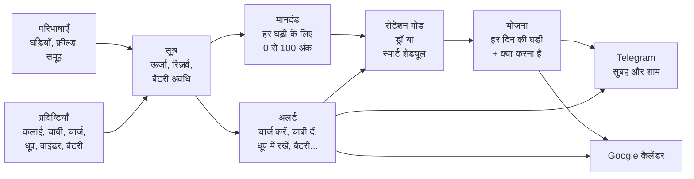

# ⌚ Relojoeiro — Relógios 2

🌐 [Português](README.md) · [English](README.en.md) · [中文](README.zh-CN.md) · **हिन्दी** · [Español](README.es.md) · [Français](README.fr.md)

> **घड़ियों के कलेक्शन का स्मार्ट रोटेशन।** यह हर दिन बताता है कि कौन-सी घड़ी कलाई पर जाएगी, चाबी देने, चार्ज करने, धूप में
> रखने और बैटरी बदलने की याद दिलाता है, और पूरा कलेक्शन पहनवाता है, सिर्फ़ पसंदीदा नहीं।


[](#लाइसेंस)


<sub>8 घड़ियों के एक डेमो कलेक्शन के साथ **आज** पेज (आम मॉडल, API से दर्ज छह हफ़्ते का उपयोग): दिन की घड़ी (Casio, सुबह 7
बजे से कलाई पर), आज क्या करना है, अगले दिनों का स्मार्ट शेड्यूल और दाईं ओर Tissot का पैनल, सूची के बगल में खुला (सेटिंग्स
में यह पेज के ऊपर फ़्लोटिंग भी खुल सकता है)।</sub>

| | |
|---|---|
| **[यह क्यों है](#यह-क्यों-बना)** · [मूल विचार](#मूल-विचार-सिस्टम-घड़ियों-के-बारे-में-कुछ-नहीं-जानता) · [यह कैसे काम करता है](#यह-कैसे-काम-करता-है) · [इसके साथ एक दिन](#relógios-2-के-साथ-एक-दिन) | **[1 मिनट में आज़माएँ](#1-मिनट-में-आज़माएँ)** · [स्क्रीनें](#स्क्रीनें) · [API](#api-हर-चीज़-के-लिए-एक-ही-दरवाज़ा) · [इंस्टॉलेशन](#इंस्टॉलेशन) |
| [अक्सर पूछे जाने वाले सवाल](#अक्सर-पूछे-जाने-वाले-सवाल) · [भीतर से यह कैसा है](#भीतर-से-यह-कैसा-है) | [योगदान कैसे करें](#योगदान-कैसे-करें) · [लाइसेंस](#लाइसेंस) |

---

## यह क्यों बना

जो घड़ियाँ इकट्ठा करता है, वह यह दृश्य जानता है:

- **पसंदीदा घड़ी रोज़ कलाई पर जाती है**, और जो आपने इतने चाव से ख़रीदी थी वह दो महीने से दराज़ में पड़ी है।
- **ऑटोमैटिक रुक जाती है** क्योंकि सप्ताहांत में किसी ने नहीं पहनी, और फिर से समय, तारीख़ और चाँद की कला मिलानी पड़ती है।
- **सोलर डिब्बे के अँधेरे में ख़ाली हो जाती है**, और आपको पता भी नहीं चलता।
- **बैटरी बिना बताए ख़त्म हो जाती है**, ठीक उसी घड़ी में जो आप आज पहनना चाहते थे।
- **स्मार्टवॉच सुबह बिना बैटरी के मिलती है**, उसी दिन जब उसकी बारी थी।
- **मैकेनिकल की सर्विस** ("हर 5 साल") और **वारंटी** ("क्या मार्च में ख़त्म होती है?") सिर्फ़ याद में रहती हैं, यानी कहीं नहीं।

स्प्रेडशीट आधी समस्या हल करती है: वह याद रखती है, पर फ़ैसला नहीं करती। **Relógios 2** फ़ैसला करता है। वह जानता है कि हर
घड़ी कितने समय से पड़ी है, अभी उसमें कितना चार्ज है, आपको वह कितनी पसंद है और बाक़ी की तुलना में वह कितनी पहनी गई। इससे वह
अगले दिनों की, या अगले दो सालों की, योजना बनाता है, रिमाइंडर पहले से सही जगह पर रखकर।

सुबह Telegram पर एक संदेश आता है: *"आज: Seiko 5। Orient को चाबी दें (रिज़र्व दोपहर 3 बजे ख़त्म होगा)।"*
शाम को दूसरा: *"कल: Xiaomi Band। सोने से पहले चार्ज करें: कल दोपहर 2 बजे 20% पर पहुँचेगी।"*
और Google कैलेंडर में नवंबर में Casio की बैटरी बदलना और 2027 में Tissot की सर्विस दर्ज है।

## मूल विचार: सिस्टम घड़ियों के बारे में कुछ नहीं जानता

यह डिज़ाइन का सबसे अहम फ़ैसला है, और यही सिस्टम को किसी भी कलेक्शन के लिए उपयोगी बनाता है। **कोड में सिर्फ़ तंत्र हैं;
घड़ियों के बारे में सारा ज्ञान वह डेटा है जो आप दर्ज करते हैं।**

सिस्टम यह "नहीं जानता" कि ऑटोमैटिक घड़ी में पावर रिज़र्व होता है, या सोलर घड़ी धूप में चार्ज होती है। यह सब दर्ज
सूत्रों में लिखा है, जिन्हें आप स्क्रीन पर पढ़ते, बदलते और जाँचते हैं:

```text
मैकेनिकल का बचा हुआ रिज़र्व =
  ACUMULA(0; reserva_horas; 1;                                  ← 0 से शुरू, अधिकतम रिज़र्व, हर घंटे 1 घंटा घटता है
          "pulso";  carga_pulso_reserva / carga_pulso_horas;    ← कलाई पर हर घंटा इतना रीचार्ज करता है
          "winder"; carga_winder_reserva / carga_winder_horas;  ← वाइंडर पर हर घंटा, इतना
          "corda";  reserva_horas)                              ← चाबी देने से भर जाता है
```

"स्ट्रैप बदलना", "अल्ट्रासोनिक सफ़ाई" या "वॉटर रेज़िस्टेंस" फ़ील्ड दर्ज करना है? वह डेटा है। चाहते हैं कि क्रोनोग्राफ़ का
ड्रॉ में अलग भार हो? वह डेटा है। "हर साल चमड़े का स्ट्रैप बदलें" की अलर्ट चाहिए? वह भी।

सिस्टम एक पूरे शुरुआती सेट के साथ आता है (स्मार्टवॉच, ऑटोमैटिक, हाथ से चाबी, बैटरी और सोलर, हर एक के सूत्र,
अलर्ट और मानदंड), जिसे आप अपने कलेक्शन के अनुसार ढालते हैं।


<sub>परिभाषाओं के फ़ील्ड। हर फ़ील्ड एक समूह और उसके नीचे की हर चीज़ पर लागू होता है (पावर रिज़र्व सिर्फ़ मैकेनिकल पर,
बैटरी की उम्र सिर्फ़ बैटरी वाली घड़ियों पर), और पहचानकर्ता वह नाम है जो सूत्रों में इस्तेमाल होता है।</sub>

---

## यह कैसे काम करता है



### अवधारणाएँ, एक-एक करके

| अवधारणा | यह क्या है | उदाहरण |
|---|---|---|
| **समूह** (पेड़) | कलेक्शन का वर्गीकरण, जितने चाहें उतने स्तरों में। किसी समूह में दर्ज हर चीज़ उस पर और उसके नीचे की हर चीज़ पर लागू होती है। | `पारंपरिक › मैकेनिकल › ऑटोमैटिक` |
| **फ़ील्ड** | हर घड़ी का डेटा, आपके द्वारा तय: टेक्स्ट, संख्या, तारीख़, हाँ/नहीं या सूची, इकाई और डिफ़ॉल्ट मान के साथ। | `reserva_horas = 40 h`, `data_pilha`, `loja` |
| **प्रविष्टि के प्रकार** | घड़ी के साथ क्या होता है। यह **तुरंत** (चाबी, बैटरी बदलना), **मान के साथ** (चार्ज रीडिंग: 68%) या शुरुआत और अंत वाला **सत्र** (कलाई पर, वाइंडर पर, धूप में) हो सकता है। | `sol`: एक सत्र जो आप भूल जाएँ तो शाम 6 बजे अपने-आप बंद हो जाता है |
| **सूत्र** | फ़ील्ड और प्रविष्टियों पर गणनाएँ। एक ही सूत्र का **हर समूह के लिए एक संस्करण** हो सकता है, और घड़ी के सबसे नज़दीकी समूह वाला लागू होता है। | `energia` स्मार्टवॉच पर बैटरी है, मैकेनिकल पर रिज़र्व, सोलर पर रोशनी और क्वार्ट्ज़ पर बैटरी की उम्र |
| **अलर्ट** | सूत्र से अपेक्षित तारीख़, पहले से कितना समय, एक टेक्स्ट और वह प्रविष्टि जो अलर्ट को हल करती है। | *"Orient को चाबी दें: रिज़र्व दोपहर 3 बजे ख़त्म होगा"*, और **चाबी** बटन इसे हल करता है |
| **चार्ज सीमा** | वह चार्ज जिस पर घड़ी को ध्यान चाहिए: स्मार्टवॉच चार्ज करना, सोलर को धूप में रखना, मैकेनिकल को चाबी देना। अलर्ट तभी जाती है जब चार्ज वहाँ पहुँचता है। हर घड़ी की अपनी सीमा हो सकती है (फ़ील्ड *"जब चार्ज यहाँ पहुँचे तब अलर्ट दें"*); ख़ाली हो तो सेटिंग्स वाली सामान्य सीमा लागू होती है। | स्मार्टवॉच 20% पर (सामान्य), Samsung 30% पर (अपनी) |
| **मानदंड** | ड्रॉ के लिए हर घड़ी को 0 से 100 अंक कैसे मिलते हैं: भार वाले पैरामीटर, किसी फ़ील्ड या सूत्र को मापने वाले उप-पैरामीटर, और सीमाएँ जो मान को अंक में बदलती हैं। | *बिना उपयोग का समय* (40%): 0 से 1 दिन पर 0, 30 दिन या अधिक पर 100 |
| **रोटेशन मोड** | योजना के नियम: सप्ताह के दिनों के ब्लॉक, किस समूह से ड्रॉ करना है, हर दिन एक घड़ी या पूरे ब्लॉक के लिए एक, एक तय घड़ी और चुनने का तरीका। | *"सोमवार से शुक्रवार स्मार्टवॉच, सप्ताहांत में हर दिन एक पारंपरिक"* |
| **योजना** | हर दिन की घड़ी, और क्या करना है (*पहले चार्ज करें*, *चाबी दें*, *वाइंडर पर रखें*)। | `सोम 10/06 · Xiaomi Band · पहनने से पहले चार्ज करें` |

### सूत्र इंजन

सूत्र स्प्रेडशीट की तरह लिखे जाते हैं: संख्याएँ अल्पविराम या बिंदु के साथ, टेक्स्ट उद्धरण चिह्नों में, तर्कों को अलग
करने के लिए `;`, संक्रियाएँ `+ - * / ^` और तुलनाएँ `= <> < <= > >=` (जो 1 या 0 देती हैं)। ख़ाली मान गणना में आगे
बढ़ता है, और शून्य से भाग देने पर ख़ाली मिलता है। बुनियादी फ़ंक्शन:

| फ़ंक्शन | क्या लौटाता है |
|---|---|
| `SE(शर्त; सही हो तो; ग़लत हो तो)`, `E(...)`, `OU(...)`, `NAO(x)` | तर्क: `E` सब सही हों तो 1 देता है, `OU` कोई भी सही हो तो, `NAO` उलट देता है |
| `MIN(...)`, `MAX(...)` | मानों में सबसे छोटा और सबसे बड़ा (ख़ाली मानों को छोड़ देते हैं) |
| `LIMITA(x; न्यूनतम; अधिकतम)`, `ARREDONDA(x; दशमलव)`, `ABS(x)` | सीमा के भीतर रखा गया x; पूर्णांकित; बिना चिह्न के |
| `PADRAO(x; दूसरा)`, `VAZIO(x)`, `NADA()` | x, या x ख़ाली हो तो दूसरा; x ख़ाली हो तो 1; जान-बूझकर ख़ाली (`SE(शर्त; NADA(); गणना)`) |
| `HOJE()`, `AGORA()` | आज की तारीख़ और वर्तमान क्षण, दिनों में (अभी दिन के अंश के साथ) |
| `DIAS_DESDE(तारीख़)`, `DIAS_ATE(तारीख़)`, `SOMA_MESES(तारीख़; महीने)` | किसी तारीख़ से और तक के दिन (ऋणात्मक: बीत चुकी); कैलेंडर के अनुसार तारीख़ में महीने जोड़कर |
| `HORAS_USO()` | उपयोग के एक दिन के घंटे, सेटिंग्स में पहनने के समय के अनुसार (सुबह 7 से रात 10: 15) |
| `CONFIG("कुंजी")` | सेटिंग्स की एक संख्या, जैसे `CONFIG("sol_limiar")` |

और वे जो हर घड़ी का इतिहास पढ़ते हैं:

| फ़ंक्शन | क्या लौटाता है |
|---|---|
| `HORAS("pulso"; 30)` | पिछले 30 दिनों में कलाई पर घंटे |
| `CONTAR("pulso"; 30)` | पिछले 30 दिनों में कितने दिन पहनी गई |
| `DIAS_DESDE_ULTIMO("pulso")` | कलाई पर आख़िरी बार से अब तक के दिन |
| `ULTIMO_VALOR("carga")` / `ULTIMA_DATA("pilha")` | आख़िरी रीडिंग / आख़िरी प्रविष्टि की तारीख़ |
| `HORAS_APOS("pulso"; "carga")` | आख़िरी चार्ज रीडिंग के बाद से कलाई पर घंटे |
| `ACUMULA(शुरुआत; अधिकतम; हानि/घंटा; "प्रकार"; असर; ...)` | एक शेष जो इतिहास पर चलता है: समय के साथ घटता है और हर प्रविष्टि से बढ़ता है |
| `MEDIDO("uso")` / `MEDIDO("repouso")` | बैटरी की असली खपत, आपकी चार्ज रीडिंग से मापी गई |
| `EM_SESSAO("winder")` | सत्र अभी खुला हो तो 1 (घड़ी वाइंडर पर है) |
| `MEDIA_COLECAO("uso_30d")` | पूरे कलेक्शन में किसी वेरिएबल का औसत |

**परिभाषाएँ** पेज पर हर सूत्र के साथ **सभी घड़ियों पर जाँचें** बटन है, जो सहेजने से पहले हर घड़ी पर नतीजा दिखाता है।

### हर घड़ी के अंक (मानदंड)

पहले से तैयार मानदंड, सभी घड़ियों के लिए:

| पैरामीटर | भार | क्या मापता है |
|---|---:|---|
| बिना उपयोग का समय | 40 | कलाई पर आख़िरी बार से दिन: जितनी देर पड़ी रहे, उतने ज़्यादा अंक |
| उपयोग का संतुलन | 30 | पिछले 30 दिनों का उपयोग कलेक्शन के औसत की तुलना में: कम पहनी गई ऊपर आती है |
| पसंद | 20 | घड़ी के लिए आपके अंक (0 से 100) |
| नयापन और मूल्य | 10 | कितने समय पहले ख़रीदी गई और कितने की थी (निवेश का लाभ उठाना) |

हर समूह, और हर घड़ी भी, अपना सेट रख सकती है। उदाहरण के लिए स्मार्टवॉच **ऊर्जा** (अभी का चार्ज और वह कितने दिन चलेगा)
को भी तौलती है, ताकि ऐसी घड़ी न निकले जो दोपहर तक बंद हो जाए। **मानदंड** पेज हर अंक की पूरी गणना दिखाता है: हर सीमा,
हर भार और हर अंक।

पहले से तैयार सेट, पूरे। किसी पैरामीटर के अंक उसके उप-पैरामीटरों के अंकों का औसत है, हर एक के भार के अनुसार; घड़ी के
अंक पैरामीटरों का भार के अनुसार औसत है। हर उप-पैरामीटर एक वेरिएबल (फ़ील्ड या सूत्र) पढ़ता है और मान जिस सीमा में आता
है उसके अनुसार अंक देता है; बिना मान वाला उप-पैरामीटर (ख़ाली फ़ील्ड, किसी भी सीमा से बाहर का मान) छोड़ दिया जाता है, और
बाक़ी उसका भार बाँट लेते हैं। सब कुछ **मानदंड** पेज पर बदला जाता है, और **शुरुआती मानदंड वापस लाएँ** इन्हीं पर लौटा देता है।

**सभी घड़ियाँ**

| पैरामीटर | भार | उप-पैरामीटर (वेरिएबल, पैरामीटर के भीतर भार) | सीमाएँ: मान → अंक |
|---|---:|---|---|
| बिना उपयोग का समय | 40 | बिना उपयोग के दिन (`dias_sem_uso`) | 0 से 1 → 0; 1 से 3 → 30; 3 से 7 → 60; 7 से 14 → 80; 14 से 30 → 95; 30 या अधिक → 100 |
| उपयोग का संतुलन | 30 | पिछले 30 दिनों में उपयोग, औसत से तुलना (`uso_vs_media`) | 0 से 25 → 100; 25 से 60 → 80; 60 से 100 → 60; 100 से 140 → 35; 140 से 200 → 15; 200 या अधिक → 0 |
| पसंद | 20 | घड़ी के लिए आपके अंक (`preferencia`) | 0 से 20 → 0; 20 से 40 → 25; 40 से 60 → 50; 60 से 80 → 75; 80 से 100 → 100 |
| नयापन और मूल्य | 10 | नयापन: ख़रीद से दिन (`dias_desde_compra`, 60) | 0 से 15 → 100; 15 से 45 → 80; 45 से 120 → 55; 120 से 365 → 40; 365 या अधिक → 30 |
|  |  | निवेश का लाभ: चुकाई गई क़ीमत (`valor_compra`, 40) | 0 से 300 → 30; 300 से 800 → 50; 800 से 1500 → 70; 1500 या अधिक → 90 |

**स्मार्टवॉच**

| पैरामीटर | भार | उप-पैरामीटर (वेरिएबल, पैरामीटर के भीतर भार) | सीमाएँ: मान → अंक |
|---|---:|---|---|
| ऊर्जा | 30 | अभी चार्ज (%) (`energia`, 50) | 0 से 15 → 0; 15 से 30 → 25; 30 से 50 → 55; 50 से 80 → 85; 80 से 100 → 100 |
|  |  | चार्ज कितने उपयोग दिन चलेगा (`dias_de_carga`, 50) | 0 से 1 → 0; 1 से 2 → 30; 2 से 4 → 60; 4 से 7 → 85; 7 या अधिक → 100 |
| बैटरी अवधि | 15 | स्मार्टवॉच की बैटरी अवधि (`autonomia_dias`) | 0 से 2 → 10; 2 से 4 → 40; 4 से 7 → 70; 7 से 14 → 90; 14 या अधिक → 100 |
| बिना उपयोग का समय | 25 | बिना उपयोग के दिन (`dias_sem_uso`) | 0 से 1 → 0; 1 से 3 → 30; 3 से 7 → 60; 7 से 14 → 80; 14 से 30 → 95; 30 या अधिक → 100 |
| उपयोग का संतुलन | 15 | पिछले 30 दिनों में उपयोग, औसत से तुलना (`uso_vs_media`) | 0 से 25 → 100; 25 से 60 → 80; 60 से 100 → 60; 100 से 140 → 35; 140 से 200 → 15; 200 या अधिक → 0 |
| पसंद | 10 | घड़ी के लिए आपके अंक (`preferencia`) | 0 से 20 → 0; 20 से 40 → 25; 40 से 60 → 50; 60 से 80 → 75; 80 से 100 → 100 |
| नयापन और मूल्य | 5 | नयापन: ख़रीद से दिन (`dias_desde_compra`, 60) | 0 से 15 → 100; 15 से 45 → 80; 45 से 120 → 55; 120 से 365 → 40; 365 या अधिक → 30 |
|  |  | निवेश का लाभ: चुकाई गई क़ीमत (`valor_compra`, 40) | 0 से 300 → 30; 300 से 800 → 50; 800 से 1500 → 70; 1500 या अधिक → 90 |

**पारंपरिक › मैकेनिकल**

| पैरामीटर | भार | उप-पैरामीटर (वेरिएबल, पैरामीटर के भीतर भार) | सीमाएँ: मान → अंक |
|---|---:|---|---|
| पावर रिज़र्व | 25 | अभी रिज़र्व (%): ख़ाली, चलना ज़रूरी (`energia`) | 0 से 10 → 100; 10 से 30 → 85; 30 से 60 → 60; 60 से 90 → 35; 90 से 100 → 20 |
| मैकेनिकल देखभाल | 15 | रुकी हुई को चलना ज़रूरी (लुब्रिकेशन) (`dias_sem_uso`, 50) | 0 से 7 → 20; 7 से 30 → 60; 30 से 90 → 90; 90 या अधिक → 100 |
|  |  | सर्विस समय पर (`dias_ate_revisao`, 50) | 0 से 30 → 20; 30 से 180 → 60; 180 या अधिक → 100 |
| बिना उपयोग का समय | 25 | बिना उपयोग के दिन (`dias_sem_uso`) | 0 से 1 → 0; 1 से 3 → 30; 3 से 7 → 60; 7 से 14 → 80; 14 से 30 → 95; 30 या अधिक → 100 |
| उपयोग का संतुलन | 20 | पिछले 30 दिनों में उपयोग, औसत से तुलना (`uso_vs_media`) | 0 से 25 → 100; 25 से 60 → 80; 60 से 100 → 60; 100 से 140 → 35; 140 से 200 → 15; 200 या अधिक → 0 |
| पसंद | 10 | घड़ी के लिए आपके अंक (`preferencia`) | 0 से 20 → 0; 20 से 40 → 25; 40 से 60 → 50; 60 से 80 → 75; 80 से 100 → 100 |
| नयापन और मूल्य | 5 | नयापन: ख़रीद से दिन (`dias_desde_compra`, 60) | 0 से 15 → 100; 15 से 45 → 80; 45 से 120 → 55; 120 से 365 → 40; 365 या अधिक → 30 |
|  |  | निवेश का लाभ: चुकाई गई क़ीमत (`valor_compra`, 40) | 0 से 300 → 30; 300 से 800 → 50; 800 से 1500 → 70; 1500 या अधिक → 90 |

**पारंपरिक › क्वार्ट्ज़ › बैटरी**

| पैरामीटर | भार | उप-पैरामीटर (वेरिएबल, पैरामीटर के भीतर भार) | सीमाएँ: मान → अंक |
|---|---:|---|---|
| बैटरी की उम्र | 15 | बैटरी की उम्र (%) (`energia`) | 0 से 10 → 10; 10 से 30 → 50; 30 से 100 → 70 |
| सर्विस | 10 | सर्विस समय पर (`dias_ate_revisao`) | 0 से 30 → 20; 30 से 180 → 60; 180 या अधिक → 100 |
| बिना उपयोग का समय | 35 | बिना उपयोग के दिन (`dias_sem_uso`) | 0 से 1 → 0; 1 से 3 → 30; 3 से 7 → 60; 7 से 14 → 80; 14 से 30 → 95; 30 या अधिक → 100 |
| उपयोग का संतुलन | 25 | पिछले 30 दिनों में उपयोग, औसत से तुलना (`uso_vs_media`) | 0 से 25 → 100; 25 से 60 → 80; 60 से 100 → 60; 100 से 140 → 35; 140 से 200 → 15; 200 या अधिक → 0 |
| पसंद | 10 | घड़ी के लिए आपके अंक (`preferencia`) | 0 से 20 → 0; 20 से 40 → 25; 40 से 60 → 50; 60 से 80 → 75; 80 से 100 → 100 |
| नयापन और मूल्य | 5 | नयापन: ख़रीद से दिन (`dias_desde_compra`, 60) | 0 से 15 → 100; 15 से 45 → 80; 45 से 120 → 55; 120 से 365 → 40; 365 या अधिक → 30 |
|  |  | निवेश का लाभ: चुकाई गई क़ीमत (`valor_compra`, 40) | 0 से 300 → 30; 300 से 800 → 50; 800 से 1500 → 70; 1500 या अधिक → 90 |

**पारंपरिक › क्वार्ट्ज़ › सोलर**

| पैरामीटर | भार | उप-पैरामीटर (वेरिएबल, पैरामीटर के भीतर भार) | सीमाएँ: मान → अंक |
|---|---:|---|---|
| रोशनी | 25 | रोशनी चार्ज (%) (`energia`) | 0 से 30 → 80; 30 से 70 → 65; 70 से 100 → 50 |
| सर्विस | 10 | सर्विस समय पर (`dias_ate_revisao`) | 0 से 30 → 20; 30 से 180 → 60; 180 या अधिक → 100 |

और एक **रोटेशन गारंटी** है: कोई भी घड़ी N दिनों से ज़्यादा पड़ी नहीं रहती (डिफ़ॉल्ट 21)। यह अंकों से **पहले** लागू होती है:
अगर कोई उम्मीदवार सीमा पार कर चुका है, तो वह सीधे जीतता है, सबसे लंबे समय से पड़ी हुई पहले। जब कोई सीमा पार नहीं करता,
तभी अंक फ़ैसला करते हैं।

पड़े रहने के दिन **बिना उपयोग के दिन** सूत्र हैं, जिसे आप परिभाषाएँ में बदल सकते हैं: कलाई पर आख़िरी बार से दिन और,
जो घड़ी **कभी नहीं पहनी गई**, उसके लिए ख़रीद से दिन (ख़रीद की तारीख़ न हो तो 9999, सबसे ज़्यादा पड़ी हुई)। इस तरह कल
ख़रीदी गई घड़ी कतार नहीं तोड़ती, और दो कभी न पहनी गई घड़ियाँ बराबर नहीं होतीं: पहले ख़रीदी गई ज़्यादा समय से इंतज़ार कर
रही है।

ताकि आपको कभी शक न रहे, **योजना का हर दिन चुनाव का कारण** एक वाक्य में रखता है, और वह आज पेज और योजना पेज पर घड़ी के
नीचे दिखता है: *"रोटेशन गारंटी: कभी नहीं पहनी, 38 दिनों से कलेक्शन में, 21 दिन बिना उपयोग की सीमा से आगे"*, *"अंकों से
ड्रॉ, 5 उम्मीदवारों में: अंक 70.2, 16.4% संभावना"*, *"सबसे ज़्यादा अंक (91.2)"*, *"ब्लॉक सोमवार से शुक्रवार में सप्ताह की
वही घड़ी"*, *"हाथ से चुनी गई"*।
### रोटेशन मोड

एक मोड **सप्ताह के दिनों के ब्लॉकों** से बनता है। हर ब्लॉक बताता है कि कहाँ से ड्रॉ करना है (एक समूह, पूरा कलेक्शन या एक
तय घड़ी) और क्या यह **हर दिन एक घड़ी** है या **पूरे ब्लॉक के लिए एक**। ये पहले से तैयार आते हैं:

- **हफ़्ते में एक**: पूरे हफ़्ते एक पारंपरिक घड़ी।
- **हफ़्ता और सप्ताहांत**: सोमवार से शुक्रवार स्मार्टवॉच और शनिवार-रविवार को हर दिन एक पारंपरिक।
- **सप्ताह के दिन के अनुसार**: हर दिन एक अलग घड़ी।
- **हर दिन यादृच्छिक**।
- **स्मार्ट शेड्यूल**: नीचे देखें।

ब्लॉक के भीतर चुनाव **सबसे ज़्यादा अंक** से, **अंकों से ड्रॉ** (अंक संभावना बन जाते हैं) से, **यादृच्छिक** या **कतार** से
(जो सबसे लंबे समय से इंतज़ार कर रही है) हो सकता है। **चक्र** चालू हो तो कोई घड़ी तभी लौटती है जब ब्लॉक की सभी उपलब्ध
घड़ियों की बारी आ चुकी हो।

**ड्रॉ कहाँ से आता है।** सिस्टम का हर ड्रॉ (पूरी तरह यादृच्छिक मोड, अंकों से ड्रॉ और स्मार्ट शेड्यूल में बराबर अंकों का
फ़ैसला) बाहर से आए सचमुच यादृच्छिक नंबरों का इस्तेमाल करता है, इस क्रम में:

1. **[RANDOM.ORG](https://www.random.org/)**: वायुमंडलीय शोर से यादृच्छिकता (यह हवा में माइक्रोवेव के बदलाव को मापकर बिट
   में बदलता है);
2. जब वह बंद हो (या दिन का कोटा ख़त्म हो जाए), **ANU QRNG**, ऑस्ट्रेलियन नेशनल यूनिवर्सिटी का क्वांटम जनरेटर (यह रोशनी
   के क्वांटम उतार-चढ़ाव मापता है)। सिस्टम पुराना पता `qrng.anu.edu.au/API/jsonI.php` इस्तेमाल करता है, जो बिना कुंजी के
   जवाब देता है (नया, `api.quantumnumbers.anu.edu.au`, API कुंजी माँगता है);
3. दोनों न हों तो (उदाहरण के लिए सर्वर पर इंटरनेट न हो), **PHP का सुरक्षित जनरेटर** (`random_int`, ऑपरेटिंग सिस्टम वाला:
   Python के `secrets` के बराबर)।

नंबर एक बैच में आते हैं (हर अनुरोध में 16 बिट के 64 नंबर), और हर ड्रॉ उतना ही इस्तेमाल करता है जितना चाहिए, सीमा के
आख़िरी पूरे गुणज से आगे वाले को छोड़कर: हर नतीजे की संभावना बिल्कुल बराबर होती है। हर सेवा के पास जवाब देने के लिए 4
सेकंड हैं; दोनों विफल हों तो सिस्टम PHP वाला इस्तेमाल करता है और 10 मिनट तक दोबारा कोशिश नहीं करता (ताकि कोई पेज इंतज़ार
में न रहे)। हर ड्रॉ किए गए दिन का कारण बताता है कि नंबर कहाँ से आया (*"साधारण ड्रॉ, 4 उम्मीदवारों में, सबकी बराबर
संभावना (RANDOM.ORG)।"*), और **सेटिंग्स** आख़िरी बैच दिखाती है (**ड्रॉ** बॉक्स)। जो गुप्त है वह इन सेवाओं का इस्तेमाल नहीं
करता: पासवर्ड का सॉल्ट और दस्तावेज़ों की फ़ाइलों के नाम PHP के जनरेटर से ही बनते हैं, क्योंकि इंटरनेट पर घूमने वाला नंबर
रहस्यों के काम का नहीं।

### कार्यक्रम मिटाएँ

**योजना** पेज के नीचे (मुख्य जगह: पेज के अंत में, दिन-ब-दिन के बाद **कार्यक्रम मिटाएँ** बॉक्स) और आज पेज के **रोटेशन मोड**
बॉक्स में (हर एक एक पंक्ति के नीचे, जैसे **फिर से ड्रॉ करें**):

- **एक अवधि हटाएँ**: **से**, **तक** और **फिर**: *और फिर से ड्रॉ करें* (अवधि में कल से आगे जो कुछ है, हाथ से चुना, ड्रॉ
  किया या ख़ाली, सब हट जाता है, और रोटेशन मोड दिनों को फिर से ड्रॉ करता है) या *और ख़ाली छोड़ें* (सब हट जाता है और दिन
  ख़ाली रहते हैं: बिना घड़ी और बिना ड्रॉ, ताकि आप हर दिन उसके **चुनें…** में या मैनुअल रोटेशन में चुनें)। **हटाएँ** बटन
  पुष्टि माँगता है।
- **सब हटाएँ**: कल से आगे का पूरा कार्यक्रम साफ़ करता है: हाथ से चुने दिन, ड्रॉ किए गए और ख़ाली। **आज समेत** पर टिक करने
  से आज से आगे मिटाता है (अगर आज के लिए दूसरी घड़ी निकले, तो वह अभी से कलाई वाली बन जाती है)। फिर रोटेशन मोड योजना
  को शून्य से दोबारा बनाता है: ब्लॉक वाले ड्रॉ में रविवार तक (अगले हफ़्ते, जब आएँ); स्मार्ट शेड्यूल में पूरा शेड्यूल।
  कार्यक्रम ख़ाली नहीं रहता क्योंकि सिस्टम हमेशा सक्रिय मोड से बचे हुए दिन बनाता है; बिना घड़ी वाले दिनों के लिए
  **एक अवधि हटाएँ… और ख़ाली छोड़ें** इस्तेमाल करें।

### मैनुअल रोटेशन

आज पेज के **रोटेशन मोड** बॉक्स में सूची का आख़िरी विकल्प **मैनुअल रोटेशन** है: किसी अवधि (छुट्टियाँ, एक यात्रा, पूरा
महीना) के हर दिन की घड़ी आप ख़ुद चुनते हैं। शुरुआत (**से**) और अंत (**तक**) डालें और **OK** पर क्लिक करें:

- दिन **7-7 करके** दिखते हैं, तारीख़, सप्ताह का दिन, उस दिन योजना में अभी क्या है और एक चयनकर्ता के साथ;
- 7 से ज़्यादा दिन हों तो पेज नीचे होते हैं: **‹ पिछला**, **1 2 3 …**, **अगला ›**। एक पेज पर जो चुनते हैं वह दूसरे
  पेजों पर जाते समय बना रहता है; सहेजने से पहले कुछ नहीं बदलता;
- हर दिन के चयनकर्ता में उपलब्ध घड़ियाँ, **मेरे लिए तय करें** और **बिना घड़ी (ख़ाली दिन)** होते हैं। शुरुआत में यह वह
  घड़ी दिखाता है जो उस दिन पहले से हाथ से चुनी हुई है; ख़ाली दिन ख़ाली दिखता है; और बाक़ी (ड्रॉ किए गए या अभी बिना
  घड़ी), *मेरे लिए तय करें* के रूप में;
- **मैनुअल रोटेशन सहेजें** पूरी अवधि सहेजता है: घड़ी वाले दिन हाथ से चुने बन जाते हैं, *मेरे लिए तय करें* वाले दिन उसी
  समय सिस्टम तय करता है और वे भी सहेजे जाते हैं (हर एक का कारण योजना में दिखता है), और ख़ाली दिन बिना घड़ी रहते हैं।
  अगर आज अवधि में है और आपने दूसरी घड़ी चुनी, तो वह अभी से कलाई वाली बन जाती है;
- किसी अवधि का सब कुछ हटाने (और फिर से ड्रॉ करने, या दिनों को ख़ाली छोड़ने) या सब हटाने के लिए देखें
  [कार्यक्रम मिटाएँ](#कार्यक्रम-मिटाएँ)।

अवधि के बाहर, सामान्य रोटेशन मोड ही लागू रहता है। हाथ से चुने दिन तब भी बने रहते हैं जब आप फिर से ड्रॉ करें या cron
अगला हफ़्ता बनाए; स्मार्ट शेड्यूल में, शेड्यूल उनके इर्द-गिर्द दोबारा बनता है।

**"मेरे लिए तय करें" का मानदंड:**
1. **मानदंडों के अंक** (जो आप **मानदंड** में तय करते हैं: बिना उपयोग के दिन, संतुलन, पसंद, चार्ज...), हर दिन की शुरुआत
   में गणना किए जाते हैं, अवधि के पिछले दिनों (जो आपने चुने और जो इसने तय किए) को पहले से उपयोग गिनकर;
2. **रोटेशन गारंटी** पहले आती है: जो बिना उपयोग के दिनों की सीमा पार कर चुकी है वह पहले जाती है, सबसे लंबे समय से पड़ी
   हुई सबसे पहले;
3. **पिछले दिन** की और **अगले दिन** की घड़ी छोड़ दी जाती है, अगर कोई और हो। इस तरह कोई घड़ी आपकी चुनी हुई के ठीक बगल
   में दोहराई नहीं जाती;
4. बराबरी होने पर, पहले दर्ज की गई जीतती है।

आज, *मेरे लिए तय करें* के साथ, योजना में पहले से मौजूद घड़ी ही रहती है।

### स्मार्ट शेड्यूल

यह सबसे पूरा मोड है। हफ़्ते-दर-हफ़्ते ड्रॉ करने के बजाय, यह **एक बार में 7 दिन से 2 साल तक की योजना** बनाता है, दिन-ब-दिन
सिमुलेट करते हुए:

1. उस दिन की सिमुलेट की गई स्थिति से हर घड़ी के अंक निकालता है;
2. घड़ी चुनता है; स्मार्टवॉच उतने दिन कलाई पर रहती है जितने दिन बैटरी चलती है (7 तक);
3. उपयोग (पहनने के समय में कलाई का सत्र) और सबके चार्ज और रिज़र्व पर उसका असर सिमुलेट करता है;
4. अलर्ट जाँचता है: अगर चुनी गई घड़ी को चार्ज या चाबी की ज़रूरत होगी, तो वह दिन पर काम लिख देता है (*"पहनने से पहले
   चार्ज करें"*) और उसे हल करने वाली प्रविष्टि सिमुलेट करता है;
5. अगले दिन पर जाता है।

हर सुबह cron **असली स्थिति से दोबारा योजना बनाता है**। अगर आपने दूसरी घड़ी पहनी, चार्ज करना भूल गए या उम्मीद से अलग
रीडिंग दर्ज की, तो योजना ख़ुद को सुधार लेती है।

### रीडिंग से मापी गई खपत

स्मार्टवॉच का रिकॉर्ड कहता है "5 दिन चलती है"। असलियत सहमत नहीं होती, और बैटरी के पुराने होने के साथ बदलती है। इसलिए
**आप जो भी चार्ज रीडिंग दर्ज करते हैं, उसकी तुलना पिछली से होती है**, और दोनों के बीच का अंतराल एक माप बन जाता है: कितना
गिरा, कलाई पर कितने घंटे रही और कितने कलाई से बाहर (रखी हुई, बंद)। सेटिंग्स का पहनने का समय अपने-आप कलाई गिना जाता है,
और आपके निशान (*कलाई पर पहनी*, *कलाई से उतारी*) को प्राथमिकता मिलती है।

हर माप दो अज्ञात खपतों वाला एक समीकरण है:

```text
गिरावट = उपयोग के दिन × उपयोग में खपत + कलाई से बाहर के दिन × कलाई से बाहर खपत
```

पिछले दिनों (सेटिंग्स में 90) के मापों से सिस्टम **दोनों खपतें एक साथ** निकालता है: वे जो सारी गिरावटों को सबसे अच्छी तरह
समझाती हैं (न्यूनतम वर्ग, और हर माप का भार उसके घंटों जितना)। दो रीडिंग के बीच की एक रात (सिर्फ़ कलाई से बाहर) कलाई से
बाहर की खपत तय करती है; कलाई पर के दिन, वह जानते हुए, उपयोग में खपत तय करते हैं। 1 घंटे या उससे लंबा हर माप शामिल होता
है, वह भी जिसमें बिल्कुल गिरावट नहीं हुई (वह बताता है कि खपत कम है): छोटा माप, जिसमें रीडिंग का पूर्णांकन (घड़ी चार्ज
पूरे अंकों में दिखाती है) ज़्यादा असर डालता है, कम भार के साथ शामिल होता है। जितनी ज़्यादा रीडिंग, उतना सटीक।

जब माप अभी दोनों को अलग नहीं करते (उदाहरण के लिए सिर्फ़ रखी हुई घड़ी की रीडिंग), तो हर खपत के मापों का औसत लागू होता है;
पिछले दिनों में कोई न हो तो उससे पहले के। मापी गई खपतें पूर्वानुमानों में रिकॉर्ड वाली की जगह लेती हैं, और इतिहास समय के
साथ बैटरी का दम घटता दिखाता है। रीडिंग में बढ़ोतरी रीचार्ज है: एक नया शुरुआती बिंदु, बिना माप के। और जिस अंतराल के बीच
में कोई दूसरा सत्र हो (घड़ी चार्जर पर गई), वह भी नहीं मापता: माप सिर्फ़ कलाई और रखी हुई को अलग कर सकता है।

इससे फ़र्क़ नहीं पड़ता कि आप रीडिंग *कलाई से उतारी* के ठीक बाद दर्ज करें या *कलाई पर पहनी* के ठीक बाद: रीडिंग न "उपयोग
में" है न "आराम में"। मायने रखता है पिछली रीडिंग तक का अंतराल, जिसे निशान मिनट-दर-मिनट बाँटते हैं। पूरे दिन कलाई पर
रहने के बाद रात 10:05 की रीडिंग लगभग सिर्फ़ उपयोग में खपत मापती है; अगले दिन सुबह 7:05 की रीडिंग बंद रात को मापती है।

दोनों खपतें घड़ी के पेज पर **बैटरी की खपत** बॉक्स में हैं:

- **कलाई पर** और **कलाई से बाहर (बंद)**: गणना में लागू होने वाली खपत, बोल्ड में, और वह कहाँ से आती है (मापी गई, तुलना के
  लिए साथ में रिकॉर्ड वाली, या सिर्फ़ रिकॉर्ड से, जब अभी कोई माप नहीं)।
- **उनसे पहले के 90 दिनों में**: पिछली खिड़की में मापी गई दोनों खपतें। यही तुलना बैटरी का पुराना होना दिखाती है: अगर कलाई
  पर खपत 4.9% से 5.7% हो गई, तो वह अब पहले जैसा चार्ज नहीं रखती।

खिड़की से पुराने माप अपने-आप गणना से निकल जाते हैं। इसलिए पुराने होने के अनुसार समायोजन अपने-आप होता है: रिकॉर्ड छूने की
ज़रूरत नहीं। रिकॉर्ड की "उपयोग में खपत" और "रखी हुई खपत" तभी लागू होती हैं जब तक कोई माप न हो।

---

## हर घड़ी का रिकॉर्ड, फ़ील्ड-दर-फ़ील्ड

हर घड़ी का एक **नाम**, एक **समूह**, **संग्रह में स्थिति**, **उपलब्ध** और एक **फ़ोटो** होती है। बाक़ी सब **फ़ील्ड** हैं, और किसी घड़ी
के कौन-से फ़ील्ड हैं यह उसके **समूह** पर निर्भर करता है: किसी समूह में दर्ज हर चीज़ उस पर और उसके नीचे के सभी समूहों पर लागू
होती है। इसलिए "ऑटोमैटिक होना" कोई अलग निशान नहीं है: यह **ऑटोमैटिक** समूह (या उसके किसी उप-समूह) में होना है, और इससे
कलाई और वाइंडर के फ़ील्ड विरासत में मिलते हैं।

```text
(सभी घड़ियाँ)             टिप्पणी, आपके अंक, ख़रीद, वारंटी, चार्ज सीमा, ब्रांड, रेफ़रेंस, लिंक
                          (सिर्फ़ इच्छित के लिए: लक्ष्य क़ीमत, इच्छा की प्राथमिकता)
├── स्मार्टवॉच            असली उपयोग में बैटरी अवधि, उपयोग में खपत, रखी हुई खपत, चार्जर पर: भरने के घंटे
└── पारंपरिक              आख़िरी सर्विस, हर इतने में सर्विस
    ├── मैकेनिकल          पावर रिज़र्व, क्राउन से चाबी दी जा सकती है
    │   ├── ऑटोमैटिक      कलाई पर: घंटे / रिज़र्व, वाइंडर पर: घंटे / रिज़र्व
    │   └── हाथ से चाबी   (और कुछ नहीं: कलाई पर चार्ज नहीं होती)
    └── क्वार्ट्ज़
        ├── बैटरी          आख़िरी बार बैटरी बदली, बैटरी की उम्र
        └── सोलर          ऊर्जा रिज़र्व, भरने के लिए सीधी धूप, कलाई पर: कितना चार्ज होती है
```

ख़ाली फ़ील्ड रिकॉर्ड का **डिफ़ॉल्ट** लेता है (नीचे की तालिकाओं में "ख़ाली" कॉलम)। फ़ील्ड, समूह और डिफ़ॉल्ट डेटा हैं, कोड
नहीं: आप **परिभाषाएँ** पेज पर सब कुछ बदल सकते हैं, और अपने बना सकते हैं।

### घड़ी की बुनियादी बातें

| फ़ील्ड | यह क्या है |
|---|---|
| **नाम** | हर जगह यह कैसे दिखती है: स्क्रीन पर, Telegram पर और कैलेंडर में। |
| **समूह** | पेड़ में इसकी जगह। यही तय करता है कि इसे कौन-से फ़ील्ड, सूत्र (स्मार्टवॉच का "चार्ज" बैटरी है; मैकेनिकल का पावर रिज़र्व) और अलर्ट मिलते हैं। |
| **संग्रह में स्थिति** | **संग्रह में** (आम), **इच्छित** (इच्छा-सूची: अभी आपकी नहीं), **उधार दी गई** (आपकी है, पर किसी और के पास है), **बेची गई** या **संग्रहित**। सिर्फ़ संग्रह वाली घड़ी रोटेशन में आती है: बाक़ी स्थितियों में घड़ी उपलब्ध नहीं रहती (डेटाबेस इसकी गारंटी देता है: `ck_relogio_posse_disponivel` नियम), ड्रॉ, शेड्यूल और अलर्ट से निकल जाती है, और संग्रह छोड़ते ही उसके खुले सत्र (कलाई पर, धूप में, चार्जर पर) तुरंत बंद हो जाते हैं और कल से आगे योजना में उसके दिन हटकर फिर से ड्रॉ होते हैं (आज रहता है, पर वह अपने-आप कलाई पर नहीं जाती: **बदलकर…** में बदलें)। उसका रिकॉर्ड, दस्तावेज़ और इतिहास बने रहते हैं। उधार दी गई आज पेज की तालिका में (**उधार दी गई** स्थिति के साथ) और संग्रह के मूल्य में बनी रहती है; इच्छित, बेची गई और संग्रहित तालिका से निकलकर **इच्छा-सूची** पेज पर दिखती हैं (और रिकॉर्ड के चयनकर्ता में **संग्रह से बाहर** के नीचे)। **संग्रह में** लौटने पर वह फिर उपलब्ध हो जाती है। देखें [इच्छा-सूची](#इच्छा-सूची)। |
| **उपलब्ध** | अनचेक हो तो वह रोटेशन और अलर्ट से निकल जाती है (मरम्मत में, विराम में), पर इतिहास रहता है। संग्रह से बाहर हो तो हमेशा अनचेक रहती है (और फ़ील्ड रिकॉर्ड से ग़ायब हो जाता है)। |
| **उसके सभी दस्तावेज़ों की एक कॉपी डेटाबेस में रखें** | चेक हो तो घड़ी की हर फ़ाइल (मैनुअल, बिल, फ़ोटो, वीडियो) बैकअप के तौर पर डेटाबेस में भी जाती है। यह तभी दिखता है जब `config.php` सबके लिए तय नहीं करता (`DOCUMENTOS_COPIA_BANCO` के बिना)। देखें [घड़ी के दस्तावेज़](#घड़ी-के-दस्तावेज़): यह कॉपी के तीन स्तरों में दूसरा है। |
| **फ़ोटो** | सिर्फ़ स्क्रीन के लिए। घड़ी के विवरण में (पैनल, या रिकॉर्ड), फ़ोटो पर माउस रोकने से उसका सारांश दिखता है (नाम, समूह और कोड; स्थिति और चार्ज; अंक और रोटेशन में अगला दिन; ख़रीद) और डबल-क्लिक की याद। उस पर **डबल-क्लिक** करने से, या नीचे के **फ़ोटो खोलें** बटन से, फ़ोटो एक फ़्लोटिंग विंडो में अपने आकार में खुलती है (सिर्फ़ विवरण में: दूसरी फ़ोटो पर, जैसे *आज का काम* वाली और सूची के थंबनेल, क्लिक घड़ी खोलता है); स्क्रीन से बड़ी फ़ोटो बिना बिगड़े, अनुपात में, मॉनिटर (और ब्राउज़र विंडो) में समाने वाले सबसे बड़े आकार में दिखती है, नीचे असली आकार और पैमाने के साथ। × से, बाहर क्लिक करके या Esc से बंद होती है। |
| **एक्सेसरी** | स्ट्रैप, डिब्बा, केस, औज़ार, चार्जर, पुर्ज़े: पैनल का **एक्सेसरी** बॉक्स उसकी अपनी दिखाता है (प्रकार, नाम और टिप्पणी), और **एक्सेसरी** पेज उन्हें जोड़ता और बदलता है (एक्सेसरी किसी घड़ी की हो सकती है या अलग, कई के काम आने वाली)। |
| **दस्तावेज़** | मैनुअल, बिल (PDF और XML में), यादगार फ़ोटो, वीडियो और कुछ भी। देखें [घड़ी के दस्तावेज़](#घड़ी-के-दस्तावेज़)। |
### घड़ी के दस्तावेज़

हर घड़ी **जितनी चाहें उतनी फ़ाइलें** रखती है, किसी भी प्रकार की, हर एक किसी **श्रेणी** में: मैनुअल, PDF में बिल, बिल का XML,
यादगार फ़ोटो, वीडियो, एक स्प्रेडशीट, कुछ भी। हर दस्तावेज़ में होता है:

| डेटा | यह क्या है |
|---|---|
| **श्रेणी** | यह कहाँ जाता है। पहले से तैयार: **मैनुअल** (`manual`, कोई भी फ़ाइल), **बिल** (`nota_fiscal`, PDF या छवि), **बिल (XML)** (`nota_xml`, XML), **फ़ोटो** (`fotos`, छवियाँ), **वीडियो** (`videos`, वीडियो) और **अन्य** (`diversos`, कोई भी फ़ाइल)। ये डेटा हैं: इन्हें **परिभाषाएँ → दस्तावेज़ श्रेणियाँ** में बनाएँ, नाम बदलें या हटाएँ। |
| **शीर्षक** | यह कैसे दिखता है। भेजते समय ख़ाली: फ़ाइल का नाम। |
| **तारीख़** | दस्तावेज़ की तारीख़: फ़ोटो का मौक़ा, वीडियो का दिन, बिल की तारीख़। वैकल्पिक। |
| **विवरण** | मुक्त टेक्स्ट: *"मेरे चचेरे भाई की शादी में"*, *"पहली बार स्ट्रैप बदला"*। वैकल्पिक। |
| **फ़ाइल** | कोई भी फ़ाइल, सर्वर की सीमा तक (देखें [भेजने का आकार](#भेजने-का-आकार-दस्तावेज़))। |

घड़ी के रिकॉर्ड में **दस्तावेज़** बॉक्स दिखाता है कि हर श्रेणी में घड़ी के कितने दस्तावेज़ हैं; हर श्रेणी, और **दस्तावेज़ खोलें**
बटन, उस घड़ी का **दस्तावेज़** पेज नए टैब में खोलते हैं। वहाँ:

- **फ़ाइलें भेजें:** श्रेणी, शीर्षक, तारीख़, विवरण और फ़ाइलें। आप **एक साथ कई** चुन सकते हैं (पूरा एल्बम): वे एक-एक करके
  ऊपर जाती हैं, प्रतिशत में प्रगति के साथ, और शीर्षक, तारीख़ और विवरण सब पर लागू होते हैं (बाद में हर एक अलग से बदला जाता
  है)। श्रेणी सिर्फ़ अपने प्रकार स्वीकार करती है: फ़ोटो **वीडियो** में नहीं जाती।
- **हर श्रेणी का एक टैब**, और **सभी**। उसके भीतर हर फ़ाइल **अपने प्रकार के अनुसार** खुलती है, श्रेणी के अनुसार नहीं:
  - **फ़ोटो:** थंबनेल की गैलरी। फ़ोटो **पूरी स्क्रीन** पर खुलती है, नीचे तारीख़ और विवरण के साथ; स्क्रीन के तीरों,
    कीबोर्ड के तीरों या फ़ोन पर स्वाइप करके बदलें। **▶ स्लाइडशो** हर 4 सेकंड में अपने-आप आगे बढ़ता है (स्पेस बार इसे
    चालू और बंद करता है; Esc बंद करता है)। थंबनेल ब्राउज़र भेजते समय बनाता है, इसलिए बड़ी फ़ोटो के साथ भी गैलरी जल्दी
    खुलती है।
  - **वीडियो:** सूची, हर एक पर एक चेकबॉक्स और उन्हें क्रम में लगाने के लिए **↑** और **↓** तीर। **▶ चुने हुए देखें** चुने
    हुए वीडियो एक के बाद एक, पेज के प्लेयर में चलाता है, **पिछला** और **अगला** के साथ। वीडियो के भीतर आगे-पीछे जा सकते हैं।
  - **PDF:** **यहाँ देखें** पेज के भीतर ब्राउज़र का PDF व्यूअर खोलता है; **दूसरे टैब में खोलें** और **डाउनलोड**।
  - **XML:** अगर यह **NF-e** (ब्राज़ील के इलेक्ट्रॉनिक बिल का XML) है, तो पेज सारांश दिखाता है: जारीकर्ता, नंबर, सीरीज़,
    तारीख़, राशि, उत्पाद और एक्सेस कुंजी। और **XML डाउनलोड करें** बटन।
  - **ऑडियो:** प्लेयर। **कोई भी दूसरी फ़ाइल:** **डाउनलोड** बटन।
- हर दस्तावेज़ पर **बदलें** (शीर्षक, तारीख़, श्रेणी, विवरण) और **हटाएँ**; फ़ोटो और वीडियो वाला पेज के अंत में **फ़ोटो और
  वीडियो बदलें या हटाएँ** सूची में है।
- ऊपर घड़ी का चुनाव: **सभी** पूरे संग्रह के दस्तावेज़ दिखाता है।

**फ़ाइलें कहाँ रहती हैं:** **सर्वर के एक फ़ोल्डर** में (`config.php` का `DOCUMENTOS_PASTA`, प्रकाशित फ़ोल्डर के बाहर), जहाँ
से पेज उन्हें परोसता है, **और, अगर आप कहें, डेटाबेस के भीतर भी**, पूरी, बैकअप के रूप में (`documento_parte` तालिका, 4 MB के
टुकड़ों में: ताकि बड़ा वीडियो MySQL कमांड की सीमा या PHP की मेमोरी से न टकराए)। जिसकी कॉपी है, उसके लिए **डेटाबेस का
बैकअप काफ़ी है**: नए सर्वर पर डेटाबेस वापस लाने पर, ख़ाली फ़ोल्डर के साथ, हर फ़ाइल खोलने पर, या cron के अगले दौर में,
अपने-आप फ़ोल्डर में लौट आती है। दोबारा बनाते समय सिस्टम फ़ाइल को भेजते समय रखे SHA-256 से जाँचता है; जो फ़ाइल मेल न खाए
वह दोबारा नहीं बनती। जिस दस्तावेज़ की फ़ाइल **और** डेटाबेस की कॉपी दोनों खो गईं, वह खो गया: पेज चेतावनी देता है, और cron
का शाम का दौर दर्ज करता है कि ऐसे कितने हैं।

**डेटाबेस में क्या जाता है: तीन स्तर**, और ऊपर वाला नीचे वालों पर भारी पड़ता है:

| स्तर | कहाँ चुना जाता है | क्या करता है |
|---|---|---|
| 1. **सिस्टम** | `config.php` में `DOCUMENTOS_COPIA_BANCO` | `true`: हर घड़ी की **हर** फ़ाइल डेटाबेस में भी जाती है। `false`: **कोई** नहीं जाती (घड़ी या फ़ाइल के माँगने पर भी नहीं)। पंक्ति के बिना: नीचे के दो स्तर तय करते हैं। |
| 2. **घड़ी** | घड़ी के रिकॉर्ड में **उसके सभी दस्तावेज़ों की एक कॉपी डेटाबेस में रखें** बॉक्स (या उसके दस्तावेज़ पेज पर **उसकी सभी डेटाबेस में रखें** बटन) | चेक हो तो उस घड़ी की हर फ़ाइल डेटाबेस में जाती है, मौजूदा और आने वाली। |
| 3. **फ़ाइल** | भेजते समय **इन फ़ाइलों की एक कॉपी डेटाबेस में भी रखें** बॉक्स, या बदलते समय **इस फ़ाइल की एक कॉपी डेटाबेस में रखें** | सिर्फ़ वह फ़ाइल डेटाबेस में जाती है। |

**स्क्रीन सिर्फ़ उसका चुनाव दिखाती है जो तय करता है:** `config.php` में `DOCUMENTOS_COPIA_BANCO` (`true` या `false`) हो
तो न घड़ी का बॉक्स दिखता है न फ़ाइलों का (दस्तावेज़ पेज सिर्फ़ बताता है कि `config.php` क्या कहता है); घड़ी सब रख रही हो
तो उसकी फ़ाइलों का बॉक्स नहीं दिखता (न भेजते समय न बदलते समय), सिर्फ़ वापस जाने के लिए **केवल चुनी गई** बटन।

किसी स्तर पर चेक और फ़ाइल की कॉपी अभी नहीं है: भेजते और बदलते समय तुरंत जाती है; घड़ी को चेक करने पर cron उसकी फ़ाइलें
धीरे-धीरे कॉपी करता है। अनचेक और कोई और नहीं माँगता: बदलते समय कॉपी तुरंत हटती है, और घड़ी के ज़रिए cron उसे धीरे-धीरे
हटाता है; **कॉपी तभी हटती है जब फ़ोल्डर की फ़ाइल वहाँ हो और उससे मेल खाए** (SHA-256), ताकि दस्तावेज़ कभी दोनों के बिना न
रहे। जिन दस्तावेज़ों की कॉपी माइग्रेशन v17 से पहले से थी, उन पर फ़ाइल में ही निशान लगा दिया गया: डेटाबेस से कुछ नहीं निकला।

डेटाबेस कॉपी की गई फ़ाइलों के आकार जितना बढ़ता है: 500 MB का वीडियो डेटाबेस और उसके बैकअप में 500 MB ज़्यादा है। पेज पर
हर फ़ाइल बताती है कि वह कहाँ है (सिर्फ़ फ़ोल्डर में, फ़ोल्डर और डेटाबेस में, फ़ोल्डर के बाहर) और कॉपी किसने माँगी
(`config.php`, घड़ी या ख़ुद फ़ाइल)।

**सफ़ाई, cron द्वारा (हर मिनट):** फ़ोल्डर से ग़ायब फ़ाइल डेटाबेस से लौट आती है; जिस दस्तावेज़ की कॉपी माँगी गई है और
डेटाबेस में अभी नहीं है (घड़ी अभी चेक हुई, या कोई कॉपी विफल रही) उसे कॉपी मिलती है, और जिसकी कॉपी है पर अब कोई नहीं माँगता
उसकी कॉपी हटती है (अगर फ़ोल्डर की फ़ाइल मेल खाए), हर मिनट 256 MB तक; जो घड़ी अब नहीं है उसका फ़ोल्डर (`r<नंबर>`) पूरा
हट जाता है; और फ़ोल्डर की वह फ़ाइल जो किसी दस्तावेज़ की नहीं है, हट जाती है (सिर्फ़ 10 मिनट बाद, क्योंकि भेजना आधे में हो
सकता है)। वह जो कुछ करता है, लॉग में जाता है (**cron के रन**)।

दस्तावेज़ हटाने से फ़ाइल और डेटाबेस की कॉपी हटती है; घड़ी हटाने से उसके दस्तावेज़ हटते हैं। फ़ोल्डर कॉन्फ़िगर न हो तो पेज
बताता है कि क्या कमी है और भेजना स्वीकार नहीं करता।

दस्तावेज़ किसी गणना में नहीं आते: वे देखने के लिए हैं। सिस्टम जिन संख्याओं का इस्तेमाल करता है (पावर रिज़र्व, बैटरी अवधि,
भरने के लिए धूप का समय...) वे रिकॉर्ड के फ़ील्ड में रहती हैं। जो मैनुअल निर्माता सिर्फ़ वेब पेज के रूप में छापता है (Casio
ऐसा करती है), वह ब्राउज़र से ही PDF बन जाता है: पेज खोलें और **प्रिंट → PDF के रूप में सहेजें** इस्तेमाल करें।

पिछला सिस्टम हर घड़ी का एक मैनुअल डेटाबेस की अपनी तालिका में रखता था (माइग्रेशन v13)। माइग्रेशन v16 हर एक को दस्तावेज़ों
में, **मैनुअल** श्रेणी में (डेटाबेस में कॉपी के साथ) ले जाता है, और तालिका हटा देता है; फ़ाइल अगले मिनट cron के ज़रिए
अपने-आप फ़ोल्डर में लौट आती है (वही जो गुम फ़ाइल वापस लाता है)।

### सभी घड़ियाँ

| फ़ील्ड | ख़ाली | यह क्या है और किस काम का है |
|---|---|---|
| **टिप्पणी** `observacao` | | मुक्त टेक्स्ट। किसी गणना में नहीं आता। |
| **घड़ी के लिए आपके अंक (0 से 100)** `preferencia` | 50 | आपको यह कितनी पसंद है। यह *पसंद* मानदंड में जाता है (सभी घड़ियों के सेट में भार 20): ज़्यादा अंक, ड्रॉ में ज़्यादा संभावना। |
| **ख़रीद की तारीख़** `data_compra` | | यह *नयापन और मूल्य* मानदंड में जाता है: नई आई घड़ी ड्रॉ में ऊपर जाती है (15 दिन तक: अंक 100; एक साल बाद: 30), ताकि आप नयेपन का मज़ा लें। |
| **चुकाई गई क़ीमत** (R$) `valor_compra` | | यह भी *नयापन और मूल्य* मानदंड में (*निवेश का लाभ*): महँगी थोड़ी ऊपर जाती है (R$ 300 तक: अंक 30; R$ 1,500 से ऊपर: 90)। |
| **कहाँ से ख़रीदी** `loja` | | टेक्स्ट, ख़रीद बॉक्स में दिखता है। किसी गणना में नहीं आता। |
| **वारंटी तक** `garantia_ate` | | तारीख़। *"वारंटी ख़त्म हो रही"* अलर्ट 30 दिन पहले जाता है। |
| **ब्रांड** `marca` | | टेक्स्ट। किसी गणना में नहीं आता; इच्छा-सूची में दिखता है। |
| **रेफ़रेंस (मॉडल)** `referencia` | | टेक्स्ट: मॉडल, निर्माता का रेफ़रेंस। इच्छा-सूची में दिखता है। |
| **लिंक (घड़ी का पृष्ठ)** `link` | | घड़ी के पेज का पता (दुकान, निर्माता)। इच्छा-सूची में यह **पेज खोलें** लिंक बन जाता है (सिर्फ़ वे जो `http://` या `https://` से शुरू हों)। |
| **जब चार्ज यहाँ पहुँचे तब अलर्ट दें** (%) `carga_minima` | सामान्य | इस घड़ी की **चार्ज सीमा**: वह बिंदु जहाँ चार्ज करने (स्मार्टवॉच), धूप में रखने (सोलर) या चाबी देने/वाइंडर पर रखने (मैकेनिकल) का अलर्ट जाता है। ख़ाली हो तो प्रकार की सामान्य सीमा लागू होती है: स्मार्टवॉच पर सेटिंग्स वाली (*"जब अनुमानित चार्ज यहाँ पहुँचे तब चार्ज करें"*, 20%); सोलर पर सेटिंग्स में सोलर वाली (70%); मैकेनिकल पर 0% (रिज़र्व ख़त्म होना)। देखें [चार्ज के अलर्ट](#चार्ज-के-अलर्ट)। |

### इच्छा-सूची

जो घड़ी आप ख़रीदना चाहते हैं, वह सिस्टम में **इच्छित** के रूप में आती है (**इच्छा-सूची** पेज पर **नई इच्छा** बटन से; या किसी
भी घड़ी के रिकॉर्ड में **संग्रह में स्थिति** से)। वह रोटेशन, योजना या अलर्ट में नहीं आती; उसका रिकॉर्ड, फ़ोटो और दस्तावेज़
किसी भी दूसरी घड़ी की तरह होते हैं (विज्ञापन, शोकेस की फ़ोटो), और दो फ़ील्ड और, जो सिर्फ़ उस पर दिखते हैं (फ़ील्ड का **सिर्फ़
इच्छित पर** निशान, परिभाषाएँ पेज पर):

| फ़ील्ड | ख़ाली | यह क्या है और किस काम का है |
|---|---|---|
| **लक्ष्य क़ीमत (अधिकतम कितना देना)** (R$) `preco_alvo` | | आप कितना देने को तैयार हैं। इच्छा-सूची पेज सूची की लक्ष्य क़ीमतें जोड़ता है। |
| **इच्छा की प्राथमिकता** `prioridade_desejo` | | ऊँची, मध्यम या नीची (फ़ील्ड के विकल्प: आप इन्हें परिभाषाएँ पेज पर बदल सकते हैं)। सूची सबसे ऊँची से सबसे नीची तक जाती है; बिना प्राथमिकता वाली आख़िर में। |

इच्छित घड़ी के पैनल में, रोज़मर्रा के बॉक्सों (अभी, चार्ज, अंक, योजना, ख़रीद, चिह्नित करें) की जगह **इच्छा** बॉक्स दिखता है:
ब्रांड, रेफ़रेंस, लक्ष्य क़ीमत, प्राथमिकता और लिंक। **ख़रीद ली?** इच्छा-सूची पेज पर **ख़रीद ली** बटन घड़ी को संग्रह में
डालता है (रोटेशन के लिए उपलब्ध) और उसका रिकॉर्ड खोलता है, ताकि ख़रीद भरी जाए (तारीख़, क़ीमत, दुकान): इतिहास वहीं से शुरू
होता है। सिर्फ़ इच्छित वाले फ़ील्ड सहेजे रहते हैं, पर रिकॉर्ड से ग़ायब हो जाते हैं। API से: `recurso=desejos` (सूची) और
`recurso=relogio`, `acao=salvar`, `posse=colecao` (ख़रीद ली)।

### स्मार्टवॉच

स्मार्टवॉच का "चार्ज" बैटरी है, % में। सिस्टम घड़ी की बैटरी नहीं पढ़ता: वह आपकी दर्ज की गई आख़िरी **चार्ज की रीडिंग** से
उसका **अनुमान** लगाता है, तब से हुई खपत (कलाई पर और रखी हुई) घटाकर और चार्जर पर हुआ चार्ज (**चार्जर पर** सत्र) जोड़कर।
कोई रीडिंग न हो तो चार्ज अज्ञात है।

| फ़ील्ड | ख़ाली | यह क्या है और किस काम का है |
|---|---|---|
| **असली उपयोग में बैटरी अवधि** (दिन) `autonomia_dias` | 5 | आपके असली उपयोग में (निर्माता वाली नहीं) पूरी बैटरी **उपयोग के कितने दिन** चलती है। इससे उपयोग में खपत मिलती है: 100 ÷ अवधि। 1.5 दिन पर खपत उपयोग के हर दिन 66.7% है। यह यह भी तय करती है कि स्मार्ट शेड्यूल में वह लगातार कितने दिन रहती है (बैटरी जितनी चले, 1 से 7)। |
| **उपयोग में खपत** (% प्रति दिन) `decaimento_uso` | 100 ÷ अवधि | उपयोग में खपत, सीधे। भरी हो तो अवधि वाली गणना की जगह लेती है। |
| **रखी हुई खपत** (% प्रति दिन) `decaimento_repouso` | 0.1 | दराज़ में बंद पड़े कितना घटती है। |
| **चार्जर पर: ख़ाली से भरने के घंटे** (h) `carga_carregador_horas` | 2 | चार्जर पर कितने घंटे इसे 0 से 100% तक ले जाते हैं। *चार्जर पर* सत्र का हर घंटा 100 ÷ 2 = 50% जोड़ता है, 100% तक। भर जाने पर **चार्जर से उतारें** अलर्ट देय हो जाता है। उतारते समय एक चार्ज रीडिंग गणना ठीक कर देती है (वही भारी पड़ती है)। |

दो बातें जो गणना बदलती हैं:

- **"उपयोग का दिन" सेटिंग्स का पहनने का समय है** (सुबह 7 से रात 10: 15 घंटे), 24 घंटे नहीं। जो सुबह 7 से रात 10 तक पहनता
  है और जिसकी खपत उपयोग के हर दिन 66.7% है, वह कलाई पर हर घंटे 4.4% ख़र्च करता है।
- **आपकी रीडिंग भारी पड़ती हैं।** जब खपत के माप हों (देखें [रीडिंग से मापी गई खपत](#रीडिंग-से-मापी-गई-खपत)), तो वे
  दोनों खपतों की जगह लेते हैं। क्रम है: **मापी गई, वरना दर्ज की गई, वरना अवधि से गणना**। घड़ी का पैनल दिखाता है कि कौन-सी
  लागू है और कहाँ से आई।

उदाहरण: आख़िरी रीडिंग कल रात 11:58 पर 89% थी, और तब से वह 1.9 दिन 0.1% प्रति दिन पर रखी रही। अभी चार्ज 89 − 0.19 =
**88.8%** है। अगर आप अभी पहनें, उपयोग के हर दिन 66.7% पर, तो यह (88.8 − 20) ÷ 66.7 = उपयोग के 1 दिन में 20% पर पहुँचती है;
रखी रहे तो (88.8 − 20) ÷ 0.1 = 688 दिनों में।

### पारंपरिक (वे सभी जो स्मार्टवॉच नहीं हैं)

| फ़ील्ड | ख़ाली | यह क्या है और किस काम का है |
|---|---|---|
| **आख़िरी सर्विस** `data_revisao` | | घड़ीसाज़ के यहाँ आख़िरी सर्विस की तारीख़। *सर्विस* की कोई नई प्रविष्टि इसकी जगह लेती है। |
| **हर इतने में सर्विस** (महीने) `intervalo_revisao_meses` | | सर्विस के बीच का अंतराल (मैकेनिकल आम तौर पर हर 4 या 5 साल: 48 या 60)। *"सर्विस"* अलर्ट 30 दिन पहले जाता है और कैलेंडर में जाता है। ख़ाली: कोई अलर्ट नहीं। |

### मैकेनिकल (ऑटोमैटिक और हाथ से चाबी)

मैकेनिकल का "चार्ज" **बचा हुआ पावर रिज़र्व** है, घंटों में (और पूरे रिज़र्व के % में)।

| फ़ील्ड | ख़ाली | यह क्या है और किस काम का है |
|---|---|---|
| **पावर रिज़र्व** (h) `reserva_horas` | 40 | पूरी चाबी के बाद घड़ी **अपने-आप रुकने तक कितनी देर चलती है**: उसकी टंकी। यह कैलिबर के विनिर्देश में होता है (*power reserve*): Orient F6922, ~40 h; Seiko 4R35, ~41 h; Tissot Powermatic 80, ~80 h। यह घड़ी का **100%** है। रुकी हुई (रखी हुई) हालत में रिज़र्व **हर घंटे 1 घंटा** घटता है: रात 8 बजे 40 h रिज़र्व के साथ भरी, दो दिन बाद दोपहर को रुक जाती है। |
| **क्राउन से चाबी दी जा सकती है** `corda_manual` | हाँ | क्या क्राउन घुमाकर चाबी दी जा सकती है। **हाँ**: घड़ी में **चाबी** बटन होता है (जो रिज़र्व भरता है) और *"चाबी दें"* अलर्ट आता है। **नहीं** (कुछ पुरानी Seiko 5 और Orient): चाबी बटन नहीं, और अलर्ट *"वाइंडर पर रखें"* होता है। हाथ से चाबी समूह की घड़ी पर इसे अनचेक न करें: वाइंडर अलर्ट सिर्फ़ ऑटोमैटिक समूह में है, और वह बिना किसी अलर्ट के रह जाएगी। |

### ऑटोमैटिक

ऑटोमैटिक में एक **रोटर** होता है जो बाँह की हलचल से घूमता है और अपने-आप चाबी देता है। ये फ़ील्ड बताते हैं कि **बाँह (और
वाइंडर) कितनी चाबी देते हैं**, अनुपात में: *"यहाँ इतने घंटे मुझे इतने घंटे रिज़र्व देते हैं"*।

| फ़ील्ड | ख़ाली | यह क्या है और किस काम का है |
|---|---|---|
| **कलाई पर: उपयोग के घंटे** `carga_pulso_horas` | 8 | बाँह पर पहनने का एक समय... |
| **कलाई पर: इन घंटों से मिलने वाला रिज़र्व** (h) `carga_pulso_reserva` | 36 | ...और वह समय कितना रिज़र्व देता है। 8 h और 36 h पर: कलाई पर हर घंटा 36 ÷ 8 = **4.5 h** रिज़र्व जोड़ता है। |
| **वाइंडर पर: घंटे** `carga_winder_horas` | कलाई वाला | वही, वाइंडर पर (वह डिब्बा जो घड़ी को घुमाता है)... |
| **वाइंडर पर: इन घंटों से मिलने वाला रिज़र्व** (h) `carga_winder_reserva` | कलाई वाला | ...और वाइंडर पर वह समय कितना रिज़र्व देता है। 4 h और 40 h पर: वाइंडर पर हर घंटे 10 h रिज़र्व। ख़ाली हो तो कलाई वाला अनुपात लागू होता है। |

गणना कैसे चलती है, डिफ़ॉल्ट के साथ (40 h रिज़र्व, कलाई पर 8 h से 36 h):

| क्या हुआ | रिज़र्व |
|---|---|
| कई दिनों से रुकी हुई | 0 h (रुकी) |
| सुबह 8 से दोपहर 12 तक पहनी (4 h × 4.5) | 18 h |
| दोपहर 12 से रात 8 तक रखी (−8 h) | 10 h |
| पूरे दिन पहनी, सुबह 7 से रात 10 तक (15 h × 4.5 = 67 h, पर अधिकतम रिज़र्व है) | 40 h (भरी) |
| चाबी दी | 40 h (भरी) |

**एक की जगह दो संख्याएँ क्यों?** क्योंकि व्यवहार में आप इसे ऐसे ही महसूस करते हैं: *"मैंने इसे काम के एक दिन पहना और यह अगले
दिन दोपहर तक चली"*। और क्योंकि बाँह कितनी चाबी देती है यह आप पर निर्भर है: जो बाँह ज़्यादा हिलाता है वह ज़्यादा चाबी देता
है, जो दिन भर बैठा रहता है वह कम। इसे अपने उपयोग के अनुसार ढालना फ़ायदेमंद है।

**अपनी संख्याएँ कैसे पता करें:**

- **पावर रिज़र्व:** कैलिबर के विनिर्देश से, या मापकर: पूरी चाबी दें (या अच्छी तरह चार्ज रहने दें), स्थिर छोड़ दें और लिखें
  कि रुकने तक कितनी देर चली।
- **कलाई:** रुकी हुई घड़ी से शुरू करें, कुछ घंटे पहनें और लिखें कितने, उतारें और लिखें कि वह कितनी देर और चली। 6 h पहनी और
  बाद में 24 h और चली: **6** और **24** दर्ज करें।
- **वाइंडर:** वही, रुकी हुई घड़ी के साथ: वाइंडर पर X घंटे, उतारें और देखें कितनी देर चलती है। यह वाइंडर की प्रोग्रामिंग
  (प्रति दिन घुमाव और दिशा) पर निर्भर है।

### हाथ से चाबी

इसके कोई अतिरिक्त फ़ील्ड नहीं हैं, और यही इसे ऑटोमैटिक से अलग करता है: **कलाई पर यह चार्ज नहीं होती**। रिज़र्व सिर्फ़ घटता है
(हर घंटे 1 h, बाँह पर या दराज़ में) और सिर्फ़ **चाबी** से भरता है। *"चाबी दें"* अलर्ट कलाई पर होते हुए भी जाता है।

### क्वार्ट्ज़ › बैटरी

बैटरी का "चार्ज" **बची हुई उम्र** है, पूरी उम्र के % में।

| फ़ील्ड | ख़ाली | यह क्या है और किस काम का है |
|---|---|---|
| **आख़िरी बार बैटरी बदली** `data_pilha` | | बैटरी कब बदली गई। *बैटरी बदलना* की कोई नई प्रविष्टि इसकी जगह लेती है। |
| **बैटरी की उम्र** (महीने) `vida_pilha_meses` | 24 | इस घड़ी में एक बैटरी कितनी चलती है। बैटरी आख़िरी बदलाव + उम्र पर देय होती है; *"बैटरी बदलें"* अलर्ट 30 दिन पहले जाता है और कैलेंडर में जाता है। |

### क्वार्ट्ज़ › सोलर

सोलर का "चार्ज" **रोशनी चार्ज** है, % में। जब तक आपने धूप का कोई सत्र दर्ज नहीं किया, यह अज्ञात है।

| फ़ील्ड | ख़ाली | यह क्या है और किस काम का है |
|---|---|---|
| **ऊर्जा रिज़र्व** (दिन) `reserva_dias` | 180 | भरी हालत से **अँधेरे में** रुकने तक कितनी देर चलती है (विनिर्देश में कुछ ऐसा लिखा होता है *"6 महीने का रिज़र्व"*)। अँधेरे में यह 100 ÷ 180 ≈ 0.56% प्रति दिन घटती है। |
| **भरने के लिए सीधी धूप** (h) `carga_sol_horas` | 10 | सीधी धूप के कितने घंटे इसे ख़ाली से भरी तक ले जाते हैं। *धूप में* सत्र का हर घंटा 100 ÷ 10 = 10% जोड़ता है। |
| **कलाई पर: सीधी धूप की तुलना में कितना चार्ज होती है** (%) `luz_pulso` | 25 | कलाई पर भी सोलर दिन की रोशनी से चार्ज होती है: सीधी धूप में मिलने वाले का यह प्रतिशत। 25% और 10 h में धूप से भरने पर, कलाई पर हर घंटा 2.5% जोड़ता है (कलाई पर 14 घंटे का दिन, 35%)। 0: कलाई पर चार्ज जहाँ का तहाँ रहता है। |
### चार्ज के अलर्ट

चार्ज के अलर्ट तब जाते हैं जब चार्ज **घड़ी की चार्ज सीमा तक पहुँचता है** (*"जब चार्ज यहाँ पहुँचे तब अलर्ट दें"* फ़ील्ड, या
सामान्य सीमा), और वे **मौजूदा स्थिति** देखते हैं:

| प्रकार | अलर्ट | कब जाता है | चार्ज होते समय |
|---|---|---|---|
| स्मार्टवॉच | **चार्ज करें** | बैटरी सीमा (20%) तक पहुँची | — |
| चाबी वाली ऑटोमैटिक | **चाबी दें** | रिज़र्व के सीमा (0%: रुकना) तक पहुँचने से आधा दिन पहले | कलाई पर या वाइंडर पर: कोई अलर्ट नहीं |
| बिना क्राउन चाबी वाली ऑटोमैटिक | **वाइंडर पर रखें** | रिज़र्व के सीमा तक पहुँचने से आधा दिन पहले | कलाई पर या वाइंडर पर: कोई अलर्ट नहीं |
| हाथ से चाबी | **चाबी दें** | रिज़र्व के सीमा तक पहुँचने से आधा दिन पहले | (कलाई पर चार्ज नहीं होती: अलर्ट देती है) |
| सोलर | **धूप में रखें** | रोशनी सीमा (70%) तक पहुँची | धूप में: कोई अलर्ट नहीं |
| बैटरी | **बैटरी बदलें** | बैटरी देय होने से 30 दिन पहले | — |

हर अलर्ट की तारीख़ पैनल में **अगली सर्विस** के रूप में दिखती है। स्मार्टवॉच पर इसकी गणना मौजूदा स्थिति की खपत से होती है:
कलाई पर, उपयोग में खपत से; रखी हुई, रखी हुई खपत से। और स्मार्ट शेड्यूल, जो उपयोग के दिन सिमुलेट करता है, जब चुनी गई
घड़ी अपने दिन सीमा तक पहुँचने वाली हो, तो योजना में पहले से करने का काम लिख देता है (*"पहनने से पहले चार्ज करें"*,
*"चाबी दें"*)।

ये सभी अलर्ट डेटा हैं (**परिभाषाएँ → अलर्ट** पेज): तारीख़ का सूत्र, अग्रिम, टेक्स्ट और उसे हल करने वाली प्रविष्टि। साथ में
*"चार्ज दर्ज करें"* (3 दिन बिना किसी रीडिंग के एक रीडिंग माँगता है; चालू आता है, और सूत्र का **3** दिनों की संख्या है) और
*"कम चार्ज"* (रखी हुई स्मार्टवॉच का सीमा तक पहुँचना; बंद आता है, क्योंकि *"चार्ज करें"* यह मामला पहले से संभालता है) भी हैं।

शुरुआती सेट के अलर्ट, पहचानकर्ता के साथ (सूत्रों, सेटिंग्स और API में उनका नाम):

| अलर्ट | पहचानकर्ता | किसके लिए | किससे हल होता है |
|---|---|---|---|
| चार्ज करें | `carregar` | स्मार्टवॉच | एक चार्ज रीडिंग (चार्जर पर अलर्ट नहीं दिखता) |
| चार्जर से उतारें *(तुरंत जाता है)* | `carregado` | स्मार्टवॉच | चार्जर पर, बंद करके (बटन **चार्जर से उतारी** बन जाता है)। बैटरी चार्जर पर भर जाने पर देय होता है और **देय होने वाले मिनट में** Telegram से जाता है। |
| चार्ज दर्ज करें | `leitura` | स्मार्टवॉच | एक चार्ज रीडिंग |
| कम चार्ज *(बंद आता है)* | `carga_baixa` | स्मार्टवॉच | एक चार्ज रीडिंग |
| चाबी दें | `corda` | मैकेनिकल (*क्राउन से चाबी दी जा सकती है* के साथ) | चाबी |
| वाइंडर पर रखें | `winder` | ऑटोमैटिक (बिना क्राउन चाबी) | वाइंडर पर |
| धूप में रखें | `sol` | सोलर | धूप में |
| बैटरी बदलें | `pilha` | बैटरी | बैटरी बदलना |
| सर्विस | `revisao` | पारंपरिक | सर्विस |
| वारंटी ख़त्म हो रही | `garantia` | सभी | (कुछ नहीं: सिर्फ़ अलर्ट देता है) |
| पड़ी हुई | `encostado` | सभी (संग्रह वाली, उपलब्ध) | कलाई पर। यह तब देय होता है जब घड़ी कलाई पर गए बिना दिनों की सीमा पार कर ले (सेटिंग्स, **"पड़ी हुई" अलर्ट: कलाई पर गए बिना कितने दिन**, डिफ़ॉल्ट 30), कलाई पर आख़िरी बार से गिने जाते हैं (कभी नहीं पहनी तो ख़रीद की तारीख़ से; दोनों के बिना, कोई अलर्ट नहीं)। यह अगली सर्विस या **क्या करना है** में नहीं आता: तालिका में अपना **पड़ी हुई** कॉलम है, जिसमें कितना बचा है या कितना बीत चुका है। |

अलर्ट सुबह के अलर्ट में जाते हैं। **तुरंत** चिह्नित अलर्ट (**परिभाषाएँ › अलर्ट** में *तुरंत* बॉक्स) **देय होने वाले मिनट में**
Telegram से भी जाता है, सिर्फ़ एक बार, जब तक हल न हो: इसी तरह बैटरी भरने पर **चार्जर से उतारें** पहुँचता है। **आज का काम**
में बटन उस प्रकार का होता है जो इसे हल करता है: सत्र बंद हो तो *धूप में रखें*, खुला हो तो *चार्जर से उतारी*, मान वाले
फ़ील्ड के साथ *चार्ज रीडिंग दर्ज करें*।

इनके अलावा संदेश में दो प्रकार हैं जो डेटा नहीं हैं: **दिन** (`dia`, आज की घड़ी, सुबह) और **पूर्व संध्या** (`vespera`, कल
की, शाम को)। हर कस्टम इवेंट `ev<id>` के रूप में आता है।

---

### शुरुआती सेट के प्रविष्टि प्रकार

प्रविष्टि वह सब कुछ है जो आप किसी घड़ी पर चिह्नित करते हैं। हर प्रकार एक समूह और उसके नीचे वालों पर लागू होता है।

| प्रकार | फ़ॉर्मेट | किसके लिए | यह क्या है |
|---|---|---|---|
| **कलाई पर** (`pulso`) | सत्र | सभी | कलाई पर समय: **कलाई पर पहनी** और **कलाई से उतारी**, या पहनने के समय में अपने-आप कलाई। खुला भूल जाएँ तो रात 10 बजे बंद होता है। |
| **चार्ज की रीडिंग** (`carga`) | मान | स्मार्टवॉच | घड़ी जो चार्ज दिखाती है, % में। हर रीडिंग खपत मापती है (देखें [रीडिंग से मापी गई खपत](#रीडिंग-से-मापी-गई-खपत))। |
| **चाबी** (`corda`) | तुरंत | मैकेनिकल (*क्राउन से चाबी दी जा सकती है* के साथ) | पावर रिज़र्व भर दिया। |
| **वाइंडर पर** (`winder`) | सत्र | ऑटोमैटिक | वाइंडर पर समय: रिज़र्व बढ़ता है। |
| **धूप में** (`sol`) | सत्र | सोलर | धूप में समय: रोशनी चार्ज बढ़ता है। खुला भूल जाएँ तो शाम 6 बजे बंद होता है (सेटिंग्स इसे बदलती है)। |
| **चार्जर पर** (`carregador`) | सत्र | स्मार्टवॉच | चार्जर पर समय: घड़ी की स्थिति *चार्जर पर* दिखाती है, बैटरी *चार्जर पर: भरने के घंटे* फ़ील्ड के अनुसार बढ़ती है, **चार्ज करें** अलर्ट हट जाता है और भरने पर **चार्जर से उतारें** आता है। उतारते समय एक चार्ज रीडिंग गणना ठीक कर देती है। |
| **बैटरी बदलना** (`pilha`) | तुरंत | बैटरी | नई बैटरी: बैटरी की उम्र फिर से शुरू। |
| **सर्विस** (`revisao`) | तुरंत | पारंपरिक | सर्विस हो गई: अगली तक की गिनती फिर से शुरू। |
| **कलाई पर**, **वाइंडर** और **धूप** *(पुराना निशान, बिना अवधि)* (`pulso_antigo`, `winder_antigo`, `sol_antigo`) | तुरंत | वही | पिछले सिस्टम से आए निशान, जो सिर्फ़ क्षण रखता था, अवधि नहीं। उस क्षण इन्हें "पहनी", "वाइंडर पर भरी" और "धूप में भरी" गिना जाता है। अब स्क्रीन से दर्ज नहीं होते। |

**सत्र** फ़ॉर्मेट की शुरुआत और अंत होता है (पहनना और उतारना); **तुरंत** एक क्षण है; **मान** एक संख्या वाला क्षण है। घड़ी एक
ही जगह होती है: एक सत्र (कलाई, वाइंडर, धूप, चार्जर) खोलने से दूसरा खुला सत्र बंद हो जाता है।

### शुरुआती सेट के सूत्र

सूत्र रिकॉर्ड और इतिहास को संख्याओं में बदलते हैं। एक ही सूत्र का हर समूह के लिए एक संस्करण हो सकता है, और घड़ी के सबसे
नज़दीकी समूह वाला लागू होता है। सभी **परिभाषाएँ** में बदले और जाँचे जाते हैं।

| सूत्र | क्या गणना करता है |
|---|---|
| `energia` (%) | अभी का चार्ज, 0 से 100। **स्मार्टवॉच:** आख़िरी रीडिंग से इतिहास पर चलता है: रीडिंग जैसी है वैसी गिनी जाती है; कलाई पर हर घंटा उपयोग में खपत ÷ 15 (उपयोग के एक दिन के घंटे) घटाता है, चार्जर पर हर घंटा 100 ÷ *भरने के घंटे* जोड़ता है, और बाक़ी समय बंद खपत ÷ 24 घटाता है; हमेशा 0 और 100 के बीच। **मैकेनिकल:** बचा हुआ रिज़र्व ÷ पावर रिज़र्व। **सोलर:** रोशनी चार्ज (अँधेरे में ऊर्जा रिज़र्व के अनुसार घटता है, धूप में भरने के धूप-समय के अनुसार बढ़ता है, और कलाई पर उसका एक हिस्सा (*कलाई पर: कितना चार्ज होती है*); कोई धूप दर्ज न हो तो अज्ञात)। **बैटरी:** बैटरी की उम्र कितनी बची है। |
| `reserva_restante` (h) | **मैकेनिकल:** बचा हुआ पावर रिज़र्व। हर घंटे 1 घंटा घटता है; कलाई पर ऑटोमैटिक *कलाई पर* फ़ील्ड के अनुसार बढ़ती है; वाइंडर पर, *वाइंडर पर* फ़ील्ड के अनुसार; चाबी (और पुराने निशान) इसे भर देती है। |
| `taxa_uso`, `taxa_repouso` (% प्रति दिन) | **स्मार्टवॉच:** लागू होने वाली कलाई पर और बाहर की खपत: रीडिंग से मापी गई, वरना रिकॉर्ड वाली। |
| `dias_de_carga` (दिन) | **स्मार्टवॉच:** मौजूदा चार्ज उपयोग के कितने दिन चलेगा। |
| `dias_seguidos` (दिन) | **स्मार्टवॉच:** स्मार्ट शेड्यूल में लगातार कितने दिन रहती है: पूरी बैटरी जितना दे, 1 से 7। |
| `limite_carga` (%) | घड़ी की चार्ज सीमा: उसका फ़ील्ड, वरना सेटिंग्स वाली सामान्य (सोलर पर सोलर वाली; मैकेनिकल पर 0, रिज़र्व ख़त्म होना)। |
| `autonomia_prevista` (s) | रिकॉर्ड के अनुसार भरी हालत में कितनी चलती है: स्मार्टवॉच की बैटरी अवधि, पावर रिज़र्व, सोलर का ऊर्जा रिज़र्व, बैटरी की उम्र। |
| `autonomia_atual` (s) | गणना के अनुसार भरी हालत में कितनी चलती है: स्मार्टवॉच पर मापी गई खपत से; बाक़ी पर अपेक्षित जितनी। |
| `autonomia_restante` (s) | जिस स्थिति में हर एक ख़ाली होती है, उसमें अभी और कितनी चलेगी: स्मार्टवॉच उपयोग में, मैकेनिकल रुकी हुई, सोलर अँधेरे में, बैटरी अपनी उम्र के अंत तक। |
| `dias_sem_uso` (दिन) | कलाई पर आख़िरी बार से दिन; कभी नहीं पहनी तो ख़रीद से; ख़रीद की तारीख़ न हो तो 9999। |
| `uso_30d` (दिन) | पिछले 30 में कितने दिन पहनी गई। |
| `uso_vs_media` (%) | पिछले 30 दिनों का उपयोग संग्रह के औसत की तुलना में (100: औसत पर)। |
| `dias_desde_compra` (दिन) | ख़रीद से दिन। |
| `dias_de_uso` (दिन) | घड़ी कितने दिन कलाई पर गई (पुराने निशान भी)। |
| `custo_por_uso` (R$) | चुकाई गई क़ीमत को उपयोग के दिनों से भाग: अब तक हर उपयोग की लागत (घड़ी के पेज के **ख़रीद** बॉक्स में दिखती है)। चुकाई गई क़ीमत या उपयोग का कोई दिन न हो तो ख़ाली। |
| `dias_ate_revisao` (दिन) | **पारंपरिक:** अगली सर्विस तक दिन (0: देर हो चुकी), आख़िरी सर्विस और रिकॉर्ड के अंतराल से। |

बैटरी अवधियाँ API में सेकंड में आती हैं (`recurso=autonomia`) और घड़ी के पेज पर शब्दों में (**बैटरी अवधि** बॉक्स)।

## सेटिंग्स, विकल्प-दर-विकल्प

**सेटिंग्स** पेज पूरे सिस्टम के विकल्प रखता है। कोष्ठक में हर एक का API में नाम (`recurso=config`, `config` कुंजी के नीचे),
जो स्वचालन करते हैं उनके लिए; नई इंस्टॉलेशन का डिफ़ॉल्ट हर पंक्ति के अंत में है।

### सामान्य

| विकल्प | क्या करता है |
|---|---|
| **पहनने का समय, शुरुआत और अंत** (`uso_inicio`, `uso_fim`) | दिन की वह अवधि जब घड़ी कलाई पर होती है। यह योजना, पूर्वानुमानों और मापी गई खपत के "उपयोग के दिन" पर लागू होता है (सुबह 7 से रात 10, 15 घंटे)। डिफ़ॉल्ट: 07:00 और 22:00। |
| **अपने आप कलाई पर पहनाएँ** (`pulso_auto_inicio`) | शुरुआत के बगल का बॉक्स: चेक हो तो दिन की घड़ी पहनने के समय की शुरुआत में अपने-आप कलाई पर जाती है; अनचेक हो तो सिर्फ़ **कलाई पर पहनी** से। अगर उस समय वह कहीं और हो (चार्जर पर, धूप में, वाइंडर पर), तो उसके निकलने का इंतज़ार करती है, और कलाई की अवधि उसके निकलने से शुरू होती है। डिफ़ॉल्ट: चेक। |
| **अपने आप कलाई से उतारें** (`pulso_auto_fim`) | अंत के बगल का बॉक्स: चेक हो तो पहनने के समय के अंत में अपने-आप कलाई से उतरती है (यह कलाई पर प्रकार का "बंद होता है" है); अनचेक हो तो सिर्फ़ **कलाई से उतारी** से। डिफ़ॉल्ट: चेक। |
| **सुबह का दौर** (`horario_manha`) | वह समय जब cron दिन का संदेश (आज की घड़ी और अलर्ट) भेजता है और जो हुआ उससे योजना दोबारा बनाता है। डिफ़ॉल्ट: 06:30। |
| **शाम का दौर** (`horario_noite`) | पूर्व संध्या के संदेश का समय: कल की घड़ी और क्या तैयार करना है। डिफ़ॉल्ट: 20:00। |
| **भूला हुआ धूप सत्र बंद होता है** (`sol_fim`, जो धूप में प्रकार का "बंद होता है" सहेजता है) | जिसने धूप में रखी और **उतारी** भूल गया, उसका सत्र इस समय बंद होता है। डिफ़ॉल्ट: 18:00। |
| **चार्ज सीमा** (`carga_limiar`) | वह चार्ज (%) जिस पर अलर्ट चार्ज करने या चाबी देने को कहते हैं; किसी घड़ी का **चार्ज सीमा** फ़ील्ड इसकी जगह लेता है। 1 से 99। डिफ़ॉल्ट: 20। |
| **सोलर सीमा** (`sol_limiar`) | वह चार्ज (%) जिस पर सोलर को धूप में जाना चाहिए। 1 से 99। डिफ़ॉल्ट: 70। |
| **पूर्वानुमान सीमा** (`previsao_limite`) | वह चार्ज (%) जिसका स्मार्टवॉच पूर्वानुमान "...में सीमा तक पहुँचती है" के लिए इस्तेमाल करता है। 0 से 100। डिफ़ॉल्ट: 20। |
| **रोटेशन गारंटी** (`max_sem_uso`) | कोई घड़ी इतने दिनों से ज़्यादा बिना उपयोग नहीं रहती: जो रहती है वह सबसे आगे जाती है। 0 इसे बंद करता है। डिफ़ॉल्ट: 21। |
| **"पड़ी हुई" अलर्ट: कलाई पर गए बिना कितने दिन** (`encostado_dias`) | कलाई पर गए बिना कितने दिनों के बाद संग्रह की घड़ी को **पड़ी हुई** अलर्ट मिलता है (**आज का काम** में: *पड़ी हुई*, *"कलाई पर गए बिना दिनों की सीमा 2दि पहले देय हुई, 10/11/2026 18:00"*)। 1 से 3650। डिफ़ॉल्ट: 30। अलर्ट **परिभाषाएँ › अलर्ट** में बंद होता है। |
| **मापी गई खपत: पिछले दिन** (`medicao_janela_dias`) | [रीडिंग से मापी गई खपत](#रीडिंग-से-मापी-गई-खपत) की खिड़की: पुराने माप गणना से निकल जाते हैं। 1 से 3650। डिफ़ॉल्ट: 90। |
| **सिस्टम का पता** (`url_sistema`) | वह पता जो `{link}` प्लेसहोल्डर संदेशों और कैलेंडर में डालता है। डिफ़ॉल्ट: ख़ाली। |
| **अगले दिन: इतने तक दिखाएँ** (`proximos_por_pagina`) और **योजना: इतने तक दिखाएँ** (`plano_por_pagina`) | आज पेज के **अगले दिन** और योजना पेज का **दिन-ब-दिन** एक बार में कितने दिन दिखाते हैं (1 से 366)। इससे ज़्यादा हों तो नीचे पेज नेविगेटर दिखता है: **<** (पिछला), नंबर (पहला, आख़िरी और मौजूदा के हर तरफ़ दो तक, बीच की ख़ाली जगह में …) और **>** (अगला); माउस रोकने पर संकेत *पिछला*, *अगला* या *पेज N* कहता है। डिफ़ॉल्ट: 7 और 31। |
| **डिफ़ॉल्ट भाषा** (`idioma`) | उन लोगों के लिए स्क्रीनों की भाषा जिन्होंने अभी मेनू के चयनकर्ता में अपनी भाषा नहीं चुनी (देखें [भाषाएँ](#भाषाएँ)): पुर्तगाली, अंग्रेज़ी, चीनी, हिंदी, स्पेनिश या फ़्रेंच। डिफ़ॉल्ट: ख़ाली (ब्राउज़र की, वरना पुर्तगाली)। |
| **"आज" पेज पर घड़ी कैसे खुले** (`painel_modo`) | **सूची के बगल में** (`lado`): क्लिक की गई घड़ी दाईं ओर एक पैनल में खुलती है, और सूची दिखती रहती है। **बड़ी फ़्लोटिंग विंडो में** (`flutuante`): स्क्रीन के बीच में, पेज के ऊपर खुलती है, पृष्ठभूमि गहरी और बॉक्स अगल-बगल; ×, Esc या बाहर क्लिक से बंद होती है। फ़ोन पर दोनों पूरी स्क्रीन घेरते हैं। डिफ़ॉल्ट: सूची के बगल में। |
| **"आज" पेज के ऊपर मुख्य बॉक्स** (`destaque_hoje`) | **दिन की घड़ी** (`dia`): आज पेज के ऊपर का बड़ा बॉक्स दिन की घड़ी (योजना वाली) दिखाता है, वह कब तक रहेगी और क्यों निकली। **अभी कलाई पर पहनी घड़ी** (`pulso`): वह घड़ी दिखाता है जो कलाई पर है, भले ही वह दिन की न हो (*अभी कलाई पर* के साथ और नीचे *दिन की घड़ी: …*, जो दिन की घड़ी खोलता है); कलाई पर एक से ज़्यादा हों तो आख़िरी पहनी; कलाई पर कोई न हो तो दिन की घड़ी रहती है, *अभी कलाई पर कोई घड़ी नहीं* सूचना के साथ। नीचे का डेटा (स्थिति, चार्ज, कलाई पर पहनी/उतारी बटन, फ़ोटो) मुख्य घड़ी का होता है। डिफ़ॉल्ट: दिन की घड़ी। |

पेज पर हर विकल्प एक पंक्ति में है, बाईं ओर नाम और दाईं ओर फ़ील्ड, बॉक्सों में (दिनचर्या, सीमाएँ और गणनाएँ, स्क्रीनें, Cron,
ड्रॉ, Telegram, Google कैलेंडर); **सेटिंग्स सहेजें** बटन स्क्रीन के नीचे स्थिर पट्टी पर है।

### Telegram और Google कैलेंडर

| विकल्प | क्या करता है |
|---|---|
| **अलर्ट भेजें** (`mensagens_ativas`) | Telegram से भेजना चालू और बंद करता है (संदेश API का पता `config.php` में है)। डिफ़ॉल्ट: चालू। |
| **Google कैलेंडर सक्रिय** (`agenda_ativa`) | कैलेंडर में इवेंट बनाना चालू और बंद करता है। डिफ़ॉल्ट: बंद। |
| **कैलेंडर id** (`agenda_id`) और **कुंजी** (`agenda_chave`) | Google कैलेंडर और सर्विस अकाउंट की JSON कुंजी का सर्वर पर पाथ (ख़ाली: सिस्टम फ़ोल्डर में `google-conta-servico.json`)। देखें [Google कैलेंडर](#google-कैलेंडर)। |
| **अग्रिम** (`agenda_antecedencia`) | इवेंट कितने दिन पहले कैलेंडर में जाते हैं। 1 से 365। डिफ़ॉल्ट: 30। |
| हर चैनल का **डिफ़ॉल्ट संदेश** (`tg_padrao`, `ag_padrao`) | हर उस अलर्ट का टेक्स्ट जिसका अपना संदेश नहीं, प्लेसहोल्डर के साथ (`{acao}`, `{relogio}`, `{motivo}`, `{carga}`, `{ate}`, `{link}`...; **प्लेसहोल्डर डालें** बटन सब दिखाता है)। कैलेंडर में पहली पंक्ति इवेंट का शीर्षक है और बाक़ी विवरण। |
| **क्या कहाँ जाता है** (फ़ॉर्म में `alerta_tipos[]` और `agenda_tipos[]`; डेटाबेस में `canal_aviso` तालिका का `envia` कॉलम) | वह तालिका जो हर अलर्ट प्रकार (दिन, पूर्व संध्या, हर दर्ज अलर्ट और हर कस्टम इवेंट) के लिए चिह्नित करती है कि वह Telegram से और कैलेंडर में जाता है या नहीं। नया कस्टम इवेंट Telegram के लिए पहले से चेक होकर बनता है। |
| किसी चैनल पर अलर्ट का **अपना संदेश** (फ़ॉर्म में `tg_proprio_<tipo>` और `tg_corpo_<tipo>`; कैलेंडर में `ag_proprio_<tipo>` और `ag_corpo_<tipo>`; डेटाबेस में `canal_aviso` तालिका के `propria` और `corpo` कॉलम) | चेक हो तो वह अलर्ट उस चैनल पर डिफ़ॉल्ट संदेश की जगह अपने टेक्स्ट से जाता है। |
| **कस्टम इवेंट** | आपके अपने रिमाइंडर (स्ट्रैप साफ़ करना, संग्रह की समीक्षा), नाम, कब चलते हैं (एक बार, हर दिन, कार्यदिवसों में, महीने के किसी दिन या हर N दिन), समय और चाहें तो एक घड़ी के साथ। ये अलर्ट की तरह चैनलों से जाते हैं। |
| **सुबह जाँचें**, **शाम जाँचें**, **टेस्ट इवेंट बनाएँ**, **टेस्ट इवेंट हटाएँ**, **अभी सिंक करें** | सुबह या शाम का संदेश तुरंत भेजते हैं, कैलेंडर में टेस्ट इवेंट बनाते (10 मिनट बाद) या हटाते हैं, और cron का इंतज़ार किए बिना अभी कैलेंडर सिंक करते हैं। |

**आज क्या जाएगा** पूर्वावलोकन आज के संदेश और इवेंट ठीक वैसे दिखाता है जैसे वे जाएँगे।

### सिस्टम अपने आप क्या रखता है

ये विकल्प के रूप में नहीं दिखते: सिस्टम इन्हें अपने लिए लिखता है, और API इन्हें दिखाती है। (इस्तेमाल में रोटेशन मोड यहाँ
नहीं है: वह `modo` तालिका का `ativo` कॉलम है, और आज पेज पर बदलता है।)

| कुंजी | यह क्या है |
|---|---|
| `escala_fim`, `escala_gerada` | स्मार्ट शेड्यूल किस दिन तक जाता है और कब बना। |
| `ultima_manha`, `ultima_noite` | आख़िरी सुबह और शाम के दौर का दिन (ताकि दो बार न चले)। |
| `cron_ultima_execucao`, `cron_erro`, `cron_registro` | cron कब चला, आख़िरी त्रुटि (ख़ाली: कोई नहीं) और गतिविधि वाले आख़िरी दौर का लॉग। |
| `agenda_teste_id` | कैलेंडर का टेस्ट इवेंट, जब तक वह है। |
| `na_hora_enviados` | "तुरंत" अलर्ट जो Telegram से जा चुके और अभी भी देय हैं (`relogio_id:aviso`): दोबारा नहीं जाते; देय न रहने पर सूची से निकल जाते हैं। |
| `backup_ultima` | आख़िरी बैकअप कब बना। |
| `migracao_v10`, `migracao_v12`, `migracao_v16`, `migracao_v17`, `migracao_v18`, `migracao_v19`, `migracao_v20` | निशान कि ये माइग्रेशन लागू हो चुके (बाक़ी डेटाबेस की संरचना से ही चिह्नित होते हैं)। |

## Relógios 2 के साथ एक दिन

| कब | क्या होता है |
|---|---|
| **06:30** | cron सुबह का दौर करता है: शेड्यूल दोबारा बनाता है, Google कैलेंडर सिंक करता है और दिन की घड़ी और अलर्ट के साथ Telegram भेजता है। |
| **07:00** | पहनने का समय शुरू: सिस्टम अपने-आप दिन की घड़ी का **कलाई पर** सत्र खोलता है (मूल `rodizio`)। |
| **दिन में** | आप **आज** पेज खोलते हैं और एक टैप से अलर्ट हल करते हैं (*चाबी*, *चार्ज करें*, *धूप में रखें*)। अगर घड़ी बदली, तो **... पहनें** पर क्लिक करें और योजना समायोजित हो जाती है। |
| **20:00** | शाम का दौर Telegram भेजता है: *"कल: ... तैयार करें: आज रात चार्ज करें।"* |
| **22:00** | पहनने के समय का अंत: कलाई का सत्र बंद होता है। खुला भूला सत्र भी प्रकार में दर्ज समय पर अपने-आप बंद होता है। |
| **हर मिनट** | cron जाँचता है कि योजना का कोई दिन बनना बाक़ी तो नहीं, और कस्टम इवेंट तय मिनट पर चलाता है। |

**अपने-आप कलाई पर पहनाना और उतारना वैकल्पिक है**, हर छोर का अपना बॉक्स, **सेटिंग्स** में पहनने के समय के बगल में:

| बॉक्स | चेक (डिफ़ॉल्ट) | अनचेक |
|---|---|---|
| **अपने आप कलाई पर पहनाएँ** (*"से"* के बगल में) | सुबह 7 बजे दिन की घड़ी कलाई पर जाती है | सिर्फ़ **कलाई पर पहनी** से जाती है |
| **अपने आप कलाई से उतारें** (*"तक"* के बगल में) | रात 10 बजे कलाई से उतरती है, भूल जाएँ तब भी | सिर्फ़ **कलाई से उतारी** से उतरती है: भूल जाएँ तो कलाई पर गिनी जाती रहती है |

दिन की घड़ी के **कलाई पर पहनी** और **कलाई से उतारी** आज के बॉक्स में हैं (और किसी भी घड़ी के, उसके पैनल के **चिह्नित करें**
बॉक्स में), और जो चिह्नित किया वह हमेशा गिना जाता है: रात 9 बजे *उतारी* उपयोग को 9 बजे ख़त्म करता है, और सुबह 6:30 पर
*पहनी* 6:30 से शुरू करता है, बॉक्स चेक हों या नहीं। हर हाल में, पहनने का समय पूर्वानुमान वाली चीज़ों पर लागू रहता है: योजना,
शेड्यूल और अगले दिनों में चार्ज कितना चलेगा।

---
## 1 मिनट में आज़माएँ

बस `sqlite3` एक्सटेंशन वाला PHP 8.1+ चाहिए: न वेब सर्वर, न डेटाबेस सर्वर।

```sh
git clone https://github.com/Challado/relojoeiro.git && cd relojoeiro
cp config.exemplo.php config.php
```

`config.php` में SQLite इस्तेमाल करने के लिए दो पंक्तियाँ बदलें (डेटाबेस की फ़ाइल फ़ोल्डर के बगल में रहती है):

```php
define("DB_TIPO", "sqlite");
define("DB_ARQUIVO", __DIR__ . "/../relogios.sqlite");
```

```sh
php instalar.php --lingua=hi  # संरचना और शुरुआती सेट (हिंदी में)
php criar_usuario.php aap     # पासवर्ड पूछता है
php -S localhost:8000         # और http://localhost:8000 खोलें
```

**आज → नई घड़ी** में कुछ घड़ियाँ दर्ज करें। cron का इंतज़ार किए बिना शेड्यूल बनाने के लिए `php cron.php --forcar` चलाएँ।

> PHP का बिल्ट-इन सर्वर (`php -S`) सिर्फ़ आज़माने के लिए है: यह फ़ोल्डर की कोई भी फ़ाइल दे देता है, `config.php` भी। असली
> उपयोग के लिए [इंस्टॉलेशन](#इंस्टॉलेशन) देखें।

---

## स्क्रीनें


<sub>आज पेज पर संग्रह की तालिका: प्रकार, स्थिति, अभी का चार्ज या रिज़र्व, कलाई पर आख़िरी बार, अगली सर्विस, क्या करना
है और पड़ी हुई कॉलम, हर कॉलम पर फ़िल्टर और संग्रह पर कुल ख़र्च के साथ।</sub>


<sub>एक घड़ी का इतिहास: कलाई पर, आराम में या वाइंडर पर हर हिस्सा, और हर चार्ज रीडिंग, हर स्थिति में समय और प्रतिशत के
साथ।</sub>


<sub>फ़ोन पर: मेनू एक पट्टी में सिमट जाता है, तालिकाएँ कार्ड बन जाती हैं (कुछ भी स्क्रीन की चौड़ाई से बाहर नहीं जाता, और
कोई फ़ील्ड ग़ायब नहीं होता: घड़ी का हर कार्ड तालिका के 12 कॉलम लाता है) और घड़ी का पैनल पूरी स्क्रीन पर खुलता है; डिवाइस
का "वापस" पैनल बंद करता है।</sub>

**फ़ोन, टैबलेट और कंप्यूटर**, एक ही रूप के साथ:

| स्क्रीन | कैसा दिखता है |
|---|---|
| 900 px तक (फ़ोन, और खड़ा टैबलेट) | मेनू पट्टी में सिमटा, तालिकाएँ कार्ड में, घड़ी पूरी स्क्रीन पर, फ़ील्ड में 16 px टेक्स्ट (छूने पर iPhone ज़ूम नहीं करता) |
| 901 से 1199 px (लेटा टैबलेट, छोटा नोटबुक) | मेनू पट्टी में; "सूची के बगल में" खुली घड़ी सूची को दबाने के बजाय, गहरी पृष्ठभूमि के साथ, दाईं ओर से खिसककर आती है |
| 1200 px या अधिक (कंप्यूटर) | सूची के बगल में पैनल (या फ़्लोटिंग विंडो, सेटिंग्स के अनुसार) |

**सब पर वही जानकारी।** घड़ियों की तालिका में हमेशा 12 कॉलम (कोड, घड़ी, प्रकार, स्थिति, चार्ज, आख़िरी उपयोग, अगली सर्विस,
बाक़ी, क्या करना है, पड़ी हुई, कब ख़रीदी और क़ीमत), 11 फ़िल्टर और किसी भी कॉलम से क्रम होते हैं, कंप्यूटर, टैबलेट और फ़ोन पर; जगह की
कमी से कुछ भी छिपता नहीं। जब पूरी तालिका उतनी चौड़ाई में समा जाए जितनी उसके पास सचमुच है (बगल में पैनल खुला हो या न हो),
तो वह तालिका के रूप में दिखती है, और किसी सेल का टेक्स्ट तभी टूटता है जब ज़रूरी हो। जब न समाए, तो हर घड़ी उन्हीं 12
फ़ील्ड वाला एक कार्ड बन जाती है, उसी क्रम में, हर एक के ऊपर कॉलम का नाम (फ़ोन पर दो कॉलम में, टैबलेट पर पाँच में), शीर्षक
**इसके अनुसार क्रम** बटन बन जाते हैं और सारे फ़िल्टर बने रहते हैं, ऊपर नाम के साथ। बदलाव असली डेटा से मापा जाता है (लंबा
नाम या बड़ी क़ीमत गिनी जाती है), स्क्रीन की चौड़ाई से नहीं। **अगले दिन** भी किसी भी स्क्रीन पर कार्यक्रम के सारे दिन दिखाते हैं।

**हर घड़ी की स्थिति** बताती है कि वह अभी कहाँ है: **उपयोग में** (हरा, कलाई पर), जब कहीं और हो तो खुले सत्र का नाम, जैसे
**धूप में**, **वाइंडर पर** या **चार्जर पर** (नारंगी), **आराम में** (लाल, रखी हुई) और **उपलब्ध नहीं** (स्लेटी, रोटेशन से
बाहर और रखी हुई) या **उधार दी गई** (स्लेटी: किसी और के पास)। **स्थिति** फ़िल्टर में इनमें से हर एक है। पैनल में स्थिति के
साथ यह भी आता है कि कब से (*"09:12 से धूप में"*)। सत्र फ़ॉर्मेट का कोई भी प्रविष्टि प्रकार जो आप दर्ज करें, अपने नाम से
यहाँ आ जाता है।

| पेज | किस काम का |
|---|---|
| **आज** (`index.php`) | मुख्य स्क्रीन। ऊपर दिन की घड़ी दिखाती है (या, सेटिंग्स के अनुसार, जो अभी कलाई पर है; छोटे **आज कोई घड़ी नहीं** बटन के साथ, और ख़ाली दिन पर **आज बिना घड़ी** के साथ **चुनें…**), आज के अलर्ट (देर से और जल्द) हर एक को हल करने वाले बटन के साथ, योजना के अगले दिन (एक बार में "इतने तक दिखाएँ" दिन, नीचे पेजों के साथ) और रोटेशन मोड, जो वहीं बदलता है (**एक अवधि हटाएँ** और **सब हटाएँ** के साथ) (और उसमें **मैनुअल रोटेशन**: किसी अवधि की घड़ियाँ, दिन-ब-दिन; देखें [मैनुअल रोटेशन](#मैनुअल-रोटेशन))। नीचे संग्रह की तालिका है, प्रकार, स्थिति, चार्ज, आख़िरी उपयोग, अगली सर्विस, ख़रीद की तारीख़ और क़ीमत से फ़िल्टर और क्रम के साथ। किसी घड़ी पर क्लिक करने से उसका **पैनल** खुलता है: सूची के बगल में या बड़ी फ़्लोटिंग विंडो में, जैसा सेटिंग्स में हो (**"आज" पेज पर घड़ी कैसे खुले**)। |
| **योजना** (`plano.php`) | पूरी योजना, आज से अंत तक (स्मार्ट शेड्यूल में एक या दो साल), महीने-दर-महीने: हर दिन की घड़ी, रिमाइंडर और **बदलकर…**। अवधि (30 दिन, 90, एक साल, दो, सब) और घड़ी से फ़िल्टर करती है; दिन-ब-दिन एक बार में "इतने तक दिखाएँ" दिन आता है (सेटिंग्स), नीचे पेजों के साथ (**<**, नंबर, **>**); और दिखाती है कि अवधि में हर घड़ी के कितने दिन हैं, प्रतिशत और उसका अगला दिन। किसी अवधि की घड़ियाँ दिन-ब-दिन चुनने के लिए यह **मैनुअल रोटेशन** (आज पेज पर) पर ले जाती है। नीचे **कार्यक्रम मिटाएँ**: **एक अवधि हटाएँ** (और फिर से ड्रॉ करें, या ख़ाली छोड़ें) और **सब हटाएँ** (देखें [कार्यक्रम मिटाएँ](#कार्यक्रम-मिटाएँ))। |
| **पैनल / रिकॉर्ड** (`ficha.php`) | एक घड़ी के बारे में सब कुछ, ग्रिड पर सजे बॉक्सों में (हर बॉक्स में हर जानकारी का लेबल बाईं ओर और मान दाईं ओर): फ़ोटो, अभी की स्थिति (*"21:40 से आराम में"*, *"09:12 से धूप में"*), चार्ज, गणना के साथ अंक, योजना में अगली बारी, बैटरी का पूर्वानुमान, कलाई पर और बाहर बैटरी की खपत (मापी गई और रिकॉर्ड वाली), आख़िरी रीडिंग, हाल की समयरेखा, **ख़रीद** बॉक्स (चुकाई गई क़ीमत, दुकान, वारंटी और **प्रति उपयोग लागत**: चुकाई गई क़ीमत को उपयोग के दिनों से भाग), **दस्तावेज़** बॉक्स (हर श्रेणी में कितने, और दस्तावेज़ पेज का लिंक), **चिह्नित करें** बॉक्स और पूरा, बदलने योग्य रिकॉर्ड (**संग्रह में स्थिति** के साथ)। **इच्छित** घड़ी पर रोज़मर्रा के बॉक्सों की जगह **इच्छा** बॉक्स (ब्रांड, रेफ़रेंस, लक्ष्य क़ीमत, प्राथमिकता और लिंक) और दस्तावेज़; उधार दी गई, बेची गई या संग्रहित पर स्थिति के बगल में संग्रह-स्थिति का निशान। रिकॉर्ड के पेज पर चयनकर्ता में संग्रह की घड़ियाँ और, अलग से, **संग्रह से बाहर** वाली होती हैं। **चिह्नित करें** एक ही मेनू है, *आप क्या चिह्नित करना चाहते हैं?*: कलाई, वाइंडर, धूप या चार्जर पर रखना या उतारना, चाबी, बैटरी बदलना, चार्ज रीडिंग, बीत चुकी कोई अवधि या किसी निशान को ठीक करना; नीचे सिर्फ़ उसी के फ़ील्ड दिखते हैं। |
| **इच्छा-सूची** (`desejos.php`) | **इच्छा-सूची**: इच्छित घड़ियाँ, सबसे ऊँची प्राथमिकता से सबसे नीची तक, हर एक फ़ोटो, ब्रांड और रेफ़रेंस, प्राथमिकता, लक्ष्य क़ीमत, समूह, उसके पेज के लिंक और **ख़रीद ली** बटन के साथ (संग्रह में डालता है और रिकॉर्ड खोलता है, ख़रीद भरने के लिए), लक्ष्य क़ीमतों के जोड़ के साथ; **नई इच्छा** बटन; और नीचे **संग्रह से बाहर**: उधार दी गई, बेची गई और संग्रहित, **संग्रह में वापस** के साथ। आज पेज पर **नई घड़ी** के बगल में **इच्छा-सूची (N)** बटन यहाँ ले जाता है (सिर्फ़ जब कोई हो)। देखें [इच्छा-सूची](#इच्छा-सूची)। |
| **आँकड़े** (`estatisticas.php`) | किसी अवधि में संग्रह का उपयोग (**से**, **तक**; शॉर्टकट 30 दिन, 90 दिन, 1 साल और शुरुआत से; डिफ़ॉल्ट: पिछले 90 दिन): सारांश (कलाई पर घड़ी वाले दिन, कलाई पर घंटे और प्रति दिन, पहनी और न पहनी गई घड़ियाँ, औसत प्रति उपयोग लागत और संग्रह का मूल्य, सबसे ज़्यादा और सबसे कम पहनी); **हर घड़ी**, सबसे ज़्यादा पहनी से सबसे कम तक: उपयोग के दिन, घंटे, हर एक का हिस्सा (पट्टी के साथ), प्रति उपयोग लागत, कितने दिनों से कलाई पर नहीं गई और रुझान (↑ ज़्यादा पहनी जा रही, ↓ कम पहनी जा रही, → स्थिर: अवधि का दूसरा आधा पहले से तुलना में); **सप्ताह के दिन के अनुसार** और **महीने के अनुसार** चार्ट (कलाई पर घंटे); और **संग्रह**: समूह, ब्रांड, ख़रीद के साल, स्थिति और हर सूची फ़ील्ड (जैसे स्टाइल) से बँटी घड़ियाँ, हर हिस्से की संख्या, हिस्सेदारी और घंटों के साथ। API से: `recurso=estatisticas`। |
| **एक्सेसरी** (`acessorios.php`) | स्ट्रैप, डिब्बे, केस, औज़ार, चार्जर, पुर्ज़े और कुछ भी: सूची (नाम, प्रकार, किस घड़ी की है, या *अलग*, और टिप्पणी), **घड़ी** फ़िल्टर के साथ (सभी, अलग वाली या किसी घड़ी की; पैनल का **एक्सेसरी** बॉक्स इसे पहले से फ़िल्टर करके खोलता है), हर एक पर **बदलें** और **हटाएँ**, और नीचे फ़ॉर्म (**नई एक्सेसरी**: नाम, प्रकार, घड़ी या *अलग (कई के काम आती है)* और टिप्पणी)। घड़ी हटाने पर उसकी एक्सेसरी अलग हो जाती हैं। API से: `recurso=acessorios` (सूची) और `acessorios` लेखन (`salvar`, `excluir`)। |
| **गैलरी** (`galeria.php`) | फ़ोटो में संग्रह, समूह के अनुसार: हर घड़ी फ़ोटो (रिकॉर्ड का लिंक), नाम, ब्रांड और रेफ़रेंस, ख़रीद का साल और क़ीमत और उपयोग के दिनों के साथ; ऊपर कितनी, कुल मूल्य और कितनी की फ़ोटो है। **संग्रह के बाहर वाली भी** इच्छित, बेची गई और संग्रहित दिखाता है (स्थिति के निशान के साथ)। **प्रिंट करें**: काग़ज़ पर, एक पंक्ति में चार, बिना मेनू। API से: `recurso=galeria`। |
| **पासपोर्ट** (`passaporte.php`) | प्रिंट करने या PDF में सहेजने के लिए एक घड़ी का पन्ना (पैनल के दस्तावेज़ बॉक्स में **पासपोर्ट** बटन): फ़ोटो, नाम, ब्रांड और रेफ़रेंस, समूह और स्थिति; **ख़रीद**; **उपयोग** (कलाई पर पहली और आख़िरी बार, कलाई पर घंटे, उपयोग के दिन और प्रति उपयोग लागत); भरा हुआ **रिकॉर्ड**; **सर्विस** (हर तरह का निशान, कितनी बार और आख़िरी; सर्विस और बैटरी बदलना); **एक्सेसरी**; **दस्तावेज़**; और **आगामी अलर्ट**। **प्रिंट करें**: काग़ज़ पर सिर्फ़ डेटा आता है। API से: `recurso=passaporte`। |
| **सही समय** (`hora.php`) | घड़ियाँ मिलाने के लिए सर्वर का समय: सुइयों वाला डायल और सेकंड-दर-सेकंड चलता डिजिटल समय (API से मिलाया हुआ, अनुरोध का समय घटाकर; नीचे, डिवाइस की घड़ी कितनी आगे या पीछे है), शब्दों में तारीख़ और UTC समय; **समय क्षेत्र और UTC** बॉक्स (समय क्षेत्र, अंतर, ज़ुलु समय, समय क्षेत्र का सैन्य अक्षर, जैसे *P (Papa)*, और तारीख़-समय समूह, *131433P OCT 26*), **कैलेंडर** (साल का दिन, ISO सप्ताह, तिमाही, जूलियन दिन, Unix) और **चाँद** (कला, आयु, प्रकाशित हिस्सा और अगली पूर्णिमा और अमावस्या, औसत चक्र से: एक दिन का अंतर हो सकता है); और **कैसे मिलाएँ**। हर मिनट API दोबारा पढ़ता है। API से: `recurso=hora_certa`। |
| **दस्तावेज़** (`documentos.php`) | एक घड़ी (या सबके) दस्तावेज़, रिकॉर्ड से खुलते हैं: कई फ़ाइलें भेजना, हर श्रेणी का एक टैब, स्लाइडशो के साथ पूरी स्क्रीन फ़ोटो गैलरी, चुने क्रम में लगातार वीडियो, PDF व्यूअर, XML से NF-e का सारांश, और बाक़ी के लिए डाउनलोड। देखें [घड़ी के दस्तावेज़](#घड़ी-के-दस्तावेज़)। |
| **इतिहास** (`historico.php`) | एक घड़ी की समयरेखा: रोटेशन से उपयोग में, रोटेशन के बाहर कलाई पर, वाइंडर पर, धूप में, आराम में, और हर चाबी, चार्ज और बैटरी बदलना। दिखाता है कि हर स्थिति में कितना समय और कितना प्रतिशत बीता, अवधि और स्थिति के फ़िल्टर के साथ। |
| **सेटिंग्स** (`configuracao.php`) | **बैकअप** (फ़ोल्डर के बैकअप, **डाउनलोड** और **वापस लाएँ** के साथ, और **अभी कॉपी बनाएँ**)। समय (सुबह, शाम, उपयोग), Telegram, Google कैलेंडर, हर चैनल का डिफ़ॉल्ट संदेश, **"क्या कहाँ जाता है"** तालिका (कौन-सा अलर्ट किस चैनल से जाता है), कस्टम इवेंट, **"आज क्या जाएगा"** पूर्वावलोकन और डेटाबेस माइग्रेशन लागू करने वाला बटन। |
| **मानदंड** (`criterios.php`) | जगह के अनुसार मानदंडों के सेट (सभी घड़ियाँ, एक समूह या एक घड़ी), पैरामीटर, उप-पैरामीटर, सीमाओं और खुली गणना के साथ हर घड़ी के अंकों के साथ। इसमें **शुरुआती मानदंड वापस लाएँ** है। |
| **समूह** (`grupos.php`) | पेड़: बनाना, नाम बदलना, खिसकाना, क्रम देना, हटाना (जो समूह का था वह ऊपर वाले में जाता है) और हर घड़ी का समूह चुनना। |
| **परिभाषाएँ** (`cadastros.php`) | फ़ील्ड, प्रविष्टि प्रकार, सूत्र (**जाँचें** के साथ), अलर्ट, रोटेशन मोड और दस्तावेज़ श्रेणियाँ: वह सब जो सिस्टम इस्तेमाल करता है और कोड नहीं है। |
| **cron के रन** (`execucoes.php`) | cron ने हर दौर में क्या किया, कितना समय लगा और त्रुटियाँ, फ़िल्टर के साथ। |
| **उपयोगकर्ता** (`usuarios.php`) | किसकी पहुँच है: उपयोगकर्ता बनाना या पासवर्ड बदलना। |
| **सहायता** (`ajuda.php`) | सिस्टम के भीतर यह गाइड: मूल विचार, यह कैसे काम करता है, हर घड़ी का रिकॉर्ड फ़ील्ड-दर-फ़ील्ड, चार्ज के अलर्ट, स्क्रीनें और अक्सर पूछे जाने वाले सवाल (README के वही हिस्से, उसी से पढ़े हुए; API `recurso=manual` में वही टेक्स्ट लौटाती है)। |

### भाषाएँ

स्क्रीनें छह भाषाएँ बोलती हैं: **पुर्तगाली** (मूल), **अंग्रेज़ी**, **चीनी** (सरलीकृत), **हिंदी**, **स्पेनिश** और **फ़्रेंच**।
हर व्यक्ति मेनू के अंत के चयनकर्ता में अपनी भाषा चुनता है (PT, EN, 中文, हिं, ES, FR); चुनाव उसके ब्राउज़र में रहता है
(`lingua` कुकी, एक साल के लिए) और किसी और का नहीं बदलता। जिसने अभी नहीं चुना, वह इंस्टॉलेशन की **डिफ़ॉल्ट भाषा** देखता है
(सेटिंग्स › सामान्य); डिफ़ॉल्ट न हो तो ब्राउज़र की (अगर वह छह में से एक हो), वरना पुर्तगाली। तारीख़ें और संख्याएँ भाषा के
अनुसार चलती हैं: पुर्तगाली में 13/10/2026 और 1.234,56, अंग्रेज़ी में 10/13/2026 और 1,234.56, चीनी में 2026-10-13।

हर टेक्स्ट एक फ़ंक्शन से गुज़रता है, `t("पुर्तगाली में टेक्स्ट")`, PHP में (API, cron, स्क्रिप्ट) और स्क्रीनों के JavaScript
में: पुर्तगाली ही कुंजी है, और हर भाषा की **एक ही फ़ाइल** है, `textos/<भाषा>.php` (`textos/en.php`, `textos/es.php`...),
जिसमें पुर्तगाली टेक्स्ट => अनुवाद है, हिस्सों में बँटा (`telas`, `api`, और दस्तावेज़ीकरण वाले)। PHP फ़ाइल एक बार लोड करता
है और `t()` हर जगह काम करता है; स्क्रीनें `telas` हिस्सा API (`recurso=textos`) से लेती हैं, जो भाषा, locale, फ़ॉर्मेट और
सिस्टम की भाषाएँ भी देती है। बदलते हिस्सों वाला टेक्स्ट पैरामीटर लेता है, `t("Excluir {1}?", {1: nome})`, जो अनुवाद के बाद,
भाषा के माँगे क्रम में, बदले जाते हैं।

किसी भाषा में जो कमी हो वह पुर्तगाली में आता है, इसलिए उपयोग में कुछ नहीं रुकता। कमी ढूँढने के लिए:

- `php testes/textos.php` सभी फ़ाइलों को एक साथ कोड से मिलाता है, उन संदेशों समेत जो लगभग कभी नहीं दिखते: फ़ाइल, हिस्सा
  और कमी वाला टेक्स्ट (`textos/en.php · telas: falta "Excluir este relógio"`), जो ज़्यादा है और अलग पैरामीटर। पैरिटी टेस्ट
  और GitHub हर push पर यही चलाते हैं।
- `config.php` में `define("TEXTOS_ESTRITO", true);` के साथ (जो अनुवाद कर रहा है उसके लिए), कमी वाला अनुवाद API और cron में
  **त्रुटि के साथ रुक जाता है** (*Falta a tradução em en (textos/en.php): "..."*), और स्क्रीनों पर ⟦ ⟧ के बीच दिखता है, ब्राउज़र
  कंसोल में त्रुटि के साथ।

**नई भाषा जोड़ने के लिए** (उदाहरण के लिए जर्मन), कोड में कुछ नहीं बदलता:

1. [`textos/funcoes.php`](textos/funcoes.php) में `LINGUAS` में एक पंक्ति: कोड (`de`), भाषा में ही नाम (`Deutsch`), मेनू
   का छोटा रूप (`DE`), locale (`de-DE`), साल के साथ और बिना तारीख़ (`d.m.Y` और `d.m`, `d`, `m` और `Y` के साथ) और संख्या के
   विभाजक (दशमलव `,` और हज़ार `.`)। मेनू का चयनकर्ता, सेटिंग्स, API और `Accept-Language` भाषा को तुरंत स्वीकार करते हैं।
2. शब्दकोश: `php testes/textos.php --faltam telas > faltam.json` वे टेक्स्ट (पुर्तगाली में) सूचीबद्ध करता है जो भाषा में अभी
   नहीं हैं; उन्हें JSON `{"पुर्तगाली में टेक्स्ट": "अनुवाद", ...}` में अनुवाद करें, पैरामीटर कोष्ठकों में रखते हुए, और
   `php testes/textos.php --juntar de telas traducao.json` से मिलाएँ, जो कोड के क्रम में `textos/de.php` लिखता है (बाक़ी हिस्सों
   के लिए भी यही: `api`, `ajuda`...)। या सीधे `textos/de.php` में लिखें, किसी और भाषा की फ़ाइल कॉपी करके।
3. `php testes/textos.php` बिना किसी कमी के ख़त्म होना चाहिए (पैरिटी टेस्ट भी यही जाँचता है), और
   `LINGUA=de testes/paridade.sh --layout sqlite` नई भाषा में स्क्रीनें जाँचता है: लंबे टेक्स्ट कोई बटन तोड़ सकते हैं। आगे
   `TESTE_ESTRITO=1` लगाने से पूरी टेस्ट स्क्रिप्ट (सारे लेखन, पठन और cron के दौर) उस भाषा में सख़्त मोड में चलती है, और कोई
   भी कमी वाला अनुवाद स्क्रिप्ट के लॉग में दिखता है।

API के संदेश (हर लेखन का जवाब, त्रुटियाँ, पूछताछ के टेक्स्ट) अनुरोध की भाषा में आते हैं; cron के (Telegram, कैलेंडर और रनों
का लॉग) इंस्टॉलेशन की डिफ़ॉल्ट भाषा में। जो डेटाबेस में सहेजा जाता है, जैसे योजना के हर दिन का कारण, वह सहेजने वाले की
भाषा में रहता है।

शुरुआती सेट (इंस्टॉलेशन के साथ आने वाले समूह, फ़ील्ड, प्रविष्टि प्रकार, सूत्र, अलर्ट, मोड, मानदंड, श्रेणियाँ और डिफ़ॉल्ट
संदेश) इंस्टॉलेशन की भाषा में आता है: `php instalar.php --lingua=en`, या API से `lingua=en` के साथ इंस्टॉलेशन, ये नाम
अंग्रेज़ी में सहेजता है और अंग्रेज़ी को डिफ़ॉल्ट बनाता है (`textos/<भाषा>.php` का `cadastro` हिस्सा; `testes/textos.php`
`schema.sql` को एक अस्थायी SQLite में इंस्टॉल करके टेक्स्ट ढूँढता है)। पहले से मौजूद इंस्टॉलेशन नहीं बदलता।

इस सहायता (README के वे हिस्से जो **सहायता** पेज दिखाता है) का हर भाषा का पूरा अनुवाद `textos/manual/<भाषा>.md` में है, जो
मूल-चिह्न से शुरू होता है: `<!-- origem: ... -->`, मूल के उस संस्करण का निशान जिसका यह अनुवाद है। `php testes/textos.php
--manual` मौजूदा निशान के साथ मूल देता है, नए अनुवाद का शुरुआती बिंदु; जब README बदलता है, `php testes/textos.php` पीछे रह
गए अनुवादों को चिह्नित करता है, और दोबारा किए जाने तक वे लागू रहते हैं (सख़्त मोड में, त्रुटि के साथ रुकते हैं)। अनुवादित
शीर्षक मूल के एंकर से ख़त्म होते हैं, `{#a-ideia-central}`, और एक हिस्से से दूसरे के लिंक हर भाषा में काम करते हैं। प्रोग्रामरों
के लिए दस्तावेज़ (API की सहायता, `recurso=ajuda`, और पुनर्निर्माण, `recurso=reconstrucao`) अनुरोध की भाषा में आता है: पुर्तगाली `t()` से गुज़रता है, और अनुवाद `textos/<भाषा>.php` के `ajuda` और `reconstrucao` हिस्सों में है।

आप जो नाम दर्ज करते हैं (समूह, फ़ील्ड, प्रविष्टि प्रकार, अलर्ट, मोड, घड़ियाँ) वे वैसे ही रहते हैं जैसे आपने लिखे।

---
## API: हर चीज़ के लिए एक ही दरवाज़ा

`api.php` **एकमात्र बैक-एंड** है। पेज सिर्फ़ स्क्रीन हैं: हर पेज का JavaScript API को बुलाता है और HTML बनाता है, कोई गणना किए
बिना (सारांश, प्रतिशत, जोड़ और स्थितियाँ, जैसे योजना का सारांश और cron की स्थिति, API से तैयार आते हैं; स्क्रीन पर सिर्फ़ उसका
अपना काम रहता है: फ़िल्टर करना, क्रम देना और तालिका के फ़िल्टर जो दिखाते हैं उसे जोड़ना)। इसलिए **जो कुछ स्क्रीन करती है, वह
एक स्क्रिप्ट भी कर सकती है**: स्वचालन, फ़ोन के शॉर्टकट, Home Assistant के साथ जोड़, एक विजेट।

API स्क्रीनों से पहले और उनके आस-पास का काम भी करती है: **डेटाबेस इंस्टॉल करती है** (`recurso=instalacao`), **पहला उपयोगकर्ता
बनाती है** (`recurso=usuarios`, टोकन से), **पिछला सिस्टम आयात करती है** (`recurso=importacao`) और **पेजों का लॉगिन** करती है
(`recurso=entrar`: पेज कुछ नहीं जाँचते, सिर्फ़ ढाँचा देते हैं; जो बिना लॉगिन आता है उसे API के पास भेजा जाता है, जो उपयोगकर्ता
और पासवर्ड माँगकर उसे पेज पर लौटा देती है)। कमांड लाइन की स्क्रिप्ट (`instalar.php`, `criar_usuario.php`, `importar.php`)
शॉर्टकट हैं: वे API के वही ऑपरेशन बुलाती हैं।

API के बाहर सिर्फ़ **cron** है (`cron.php`, सिस्टम की घड़ी: योजना बनाता है, दिन का सत्र खोलता और बंद करता है, संदेश भेजता है,
कैलेंडर सिंक करता है, इवेंट चलाता है और दस्तावेज़ों की कॉपियों का ध्यान रखता है), जो वही फ़ंक्शन इस्तेमाल करता है जो API करती
है; जो तुरंत माँगा जा सकता है उसकी API में क्रिया है (`testar_manha`, `testar_noite`, `sincronizar`, `resortear`...), और उसने
जो किया वह `recurso=cron` में दिखता है।

**प्रमाणीकरण:** टोकन (`X-Api-Token: ...` या `?token=...`) या साइट का लॉगिन (HTTP Basic)।
**फ़ॉर्मेट:** डिफ़ॉल्ट JSON, या `formato=xml` के साथ XML। **भाषा:** `lingua=hi` (या `Accept-Language` हेडर): संदेश, सहायता
और पुनर्निर्माण उसी भाषा में आते हैं।

```sh
# सिस्टम में सब कुछ, फ़ोटो के बिना
curl -u upyogkarta:password "http://server/relojoeiro/api.php?foto=nao"

# आज पेज जो दिखाता है
curl -H "X-Api-Token: $TOKEN" "http://server/relojoeiro/api.php?recurso=hoje"

# अगले 24 घंटों में बंद होने वाली घड़ियाँ, सिर्फ़ नाम और कब
curl -u upyogkarta:password -g "http://server/relojoeiro/api.php?recurso=autonomia&f[relogios][acaba_em_segundos][ate]=86400&mostrar[relogios]=nome,acaba_em_datacomtz"

# चार्ज की एक रीडिंग दर्ज करें (और खपत मापें)
curl -u upyogkarta:password -d recurso=lancamento -d acao=lancar -d relogio_id=10 -d tipo=carga -d valor=68 http://server/relojoeiro/api.php

# अभी धूप में रखें... और बाद में उतारें
curl -u upyogkarta:password -d recurso=lancamento -d acao=iniciar  -d relogio_id=4 -d tipo=sol http://server/relojoeiro/api.php
curl -u upyogkarta:password -d recurso=lancamento -d acao=encerrar -d relogio_id=4 -d tipo=sol http://server/relojoeiro/api.php

# दो घड़ियों पर एक सूत्र जाँचें, बिना सहेजे
curl -u upyogkarta:password -G "http://server/relojoeiro/api.php" -d recurso=calcular --data-urlencode "expressao=energia * 2" -d relogio=10,12
```

**पूछताछ** (`GET`, `recurso=` के साथ):

| संसाधन | क्या लौटाता है |
|---|---|
| *(कोई नहीं)* | जो कुछ सहेजा है: पेड़, फ़ील्ड, प्रविष्टि प्रकार, सूत्र, अलर्ट, घड़ियाँ (मानों, गणना किए सूत्रों, अलर्ट, प्रविष्टियों, पूर्वानुमान, फ़ोटो और दस्तावेज़ों के डेटा के साथ), दस्तावेज़ श्रेणियाँ, मोड, योजना, सेटिंग्स, इवेंट, कैलेंडर, मानदंड, cron, उपयोगकर्ता (पासवर्ड के हैश के साथ: पासवर्ड सिस्टम में मौजूद ही नहीं) और माइग्रेशन। `foto=nao` फ़ोटो छोड़ देता है। |
| `hoje` | आज पेज जो दिखाता है: दिन की घड़ी, अलर्ट, अगले दिन, मोड, संग्रह की तालिका और उसके जोड़ (कितनी घड़ियाँ, उपलब्ध, उपयोग में और चुकाई गई क़ीमत) |
| `ficha` | एक घड़ी का पैनल जो दिखाता है (`relogio=<id>`; इसके बिना, सिर्फ़ नई घड़ी का रिकॉर्ड): अभी, चार्ज, अंक, पूर्वानुमान, बैटरी की खपत, हर श्रेणी में कितने दस्तावेज़, हाल के निशान, रिकॉर्ड |
| `proximos` | आज पेज के अगले दिन, एक पेज (`pagina=`, `por_pagina=`; इसके बिना, सेटिंग्स का "इतने तक दिखाएँ"), बीच में ख़ाली दिनों के साथ |
| `rodizio_manual` | मैनुअल रोटेशन: किसी अवधि (`de=`, `ate=`) के दिन 7-7 करके (`pagina=`), हर एक के साथ कि योजना में अभी क्या है और चयनकर्ता की शुरुआती पसंद (हाथ से चुनी घड़ी, `livre` या `auto`: मेरे लिए तय करें), उपलब्ध घड़ियाँ और "मेरे लिए तय करें" का मानदंड |
| `plano` | सहेजी गई योजना, दिन-ब-दिन, हर चुनाव के कारण के साथ, अवधि का सारांश जैसा योजना पेज दिखाता है (हर घड़ी के कितने दिन, प्रतिशत, अगला दिन, कितने हाथ से, कौन बिना दिन रह गई) और `dia_a_dia` एक बार में एक पेज (`pagina=`, `por_pagina=`, `relogio=`)। `de=` और `ate=` (YYYY-MM-DD; इनके बिना, पूरी योजना) या `dias=N` (अगले N दिन; `dias=todos`, आज से अंत तक) |
| `avisos` | सभी घड़ियों के अलर्ट, सबसे ज़रूरी से सबसे दूर तक |
| `previsao` | चार्ज रीडिंग वाली घड़ियों की बैटरी का पूर्वानुमान (`relogio=` एक id या अल्पविराम से अलग कई; इसके बिना, सभी) |
| `autonomia` | हर घड़ी कितनी चलती है, सेकंड में, बाहरी सिस्टमों के लिए छोटा किया हुआ (`relogio=` एक id या कई; इसके बिना, सभी) |
| `historico` | एक घड़ी की समयरेखा, हर स्थिति के समय के साथ। `relogio=` (एक id या कई; `relogio_id` भी चलता है; इसके बिना, सभी), `de=` और `ate=` (तारीख़, या तारीख़ और समय: अवधि को काटने वाला हिस्सा आता है), `estado=` (`rodizio`, `pulso`, `repouso`, `marca` या कोई सत्र प्रकार जैसे `winder` और `sol`; एक या कई; `linha_estado` भी चलता है), `ordem=` (`desc`, डिफ़ॉल्ट, या `asc`), `limite=` (डिफ़ॉल्ट 100, अधिकतम 1000) और `pagina=` |
| `criterios` | मानदंडों के सेट और गणना के साथ हर घड़ी के अंक |
| `eventos`, `agenda` | कस्टम इवेंट; जो Google कैलेंडर में होना चाहिए |
| `config`, `cron` | सेटिंग्स (संदेशों, पूर्वावलोकन और cron की स्थिति के साथ: कभी नहीं चला, रुका या चल रहा); cron के रन, अवधि के सारांश के साथ। `cron` में: `de=` और `ate=` (तारीख़, या तारीख़ और समय), `situacao=` (`atividade`, डिफ़ॉल्ट; `erro`, `nada` या `todas`), `busca=` (लॉग में टेक्स्ट), `limite=` (डिफ़ॉल्ट 100, अधिकतम 1000) और `pagina=`; हर एक आगे `cron_` लगाकर भी चलता है (`cron_de`...) |
| `arvore`, `cadastros` | समूह; परिभाषाएँ पेज जो कुछ दिखाता है |
| `calcular` | घड़ियों पर किसी सूत्र (`expressao=`) का नतीजा (`relogio=` एक id या कई; इसके बिना, सभी), बिना सहेजे, गणना के हिस्सों के साथ; ग़लत लिखा सूत्र: त्रुटियों के साथ 400 |
| `foto` | एक घड़ी की फ़ोटो (`relogio=<id>`): छवि, JSON नहीं |
| `documentos` | एक घड़ी के दस्तावेज़ (`relogio=<id>`; इसके बिना, सबके), श्रेणियों, हर XML के NF-e सारांश, फ़ोल्डर और सीमा के साथ |
| `documento` | एक दस्तावेज़ की फ़ाइल (`id=<id>`): दिखाने के लिए (छवि, वीडियो, ऑडियो, PDF, टेक्स्ट) या डाउनलोड के लिए (बाक़ी, या `baixar=1` के साथ); `mini=1` फ़ोटो का थंबनेल है। टुकड़ों (Range) में देता है, ताकि वीडियो आगे बढ़ सके |
| `usuarios`, `migracoes` | लॉगिन, हर एक पासवर्ड के हैश के साथ (उसी पासवर्ड से माइग्रेट करने के लिए: देखें [उपयोगकर्ता और पासवर्ड](#उपयोगकर्ता-और-पासवर्ड)); लागू होने बाक़ी माइग्रेशन |
| `instalacao` | इंस्टॉलेशन की स्थिति: डेटाबेस, क्या वह ख़ाली है, इंस्टॉल और अद्यतन है, कितने उपयोगकर्ता और अगला क़दम। ख़ाली डेटाबेस पर भी, टोकन से, जवाब देता है |
| `backup` | डेटाबेस का बैकअप: क्या वह चालू है, क्या फ़ोल्डर ठीक है, कितनी रखी जाती हैं, आख़िरी और फ़ोल्डर की कॉपियाँ; `arquivo=` एक डाउनलोड करता है |
| `importacao` | पिछले सिस्टम का आयात क्या इस्तेमाल करता है: पुराने डेटाबेस का सर्वर (पासवर्ड के बिना), क्या PHP में MySQL है और क्या इस डेटाबेस में पहले से घड़ियाँ हैं |
| `entrar` | पेजों का लॉगिन: बिना लॉगिन, 401 (ब्राउज़र उपयोगकर्ता और पासवर्ड माँगता है); लॉगिन के साथ, `volta=` वाले पेज पर लौटता है (302) या बताता है कि कौन आया |
| `ajuda` | पूरा दस्तावेज़ीकरण: हर पूछताछ, हर लेखन, हर जवाब का हर फ़ील्ड और इंजन के फ़ंक्शन |
| `manual` (या `ajuda&parte=manual`) | **सहायता** पेज का टेक्स्ट (इस README के उपयोगकर्ताओं वाले हिस्से: मूल विचार से अक्सर पूछे जाने वाले सवालों तक), markdown में, पूरा और हिस्सा-दर-हिस्सा, हर एक के शीर्षक, स्तर और एंकर के साथ, और विषय-सूची के साथ पहले से HTML में (सहायता पेज इसी से बनता है) |
| `reconstrucao` (या `ajuda&parte=reconstrucao`) | **पूरे सिस्टम को शून्य से दोबारा लिखने** की गाइड (देखें [सिस्टम को शून्य से दोबारा लिखें](#सिस्टम-को-शून्य-से-दोबारा-लिखें)) |
| `codigo` (या `ajuda&parte=codigo`) | **सिस्टम का कोड जैसा अभी है**, उसी क्षण डिस्क से पढ़ा हुआ: हर फ़ाइल परत, वह क्या है, भाषा, आकार, पंक्तियों, SHA-256 और तारीख़ के साथ, और जो जान-बूझकर छोड़ा गया है (`nao_mostrados`)। `arquivo=<नाम>` सामग्री लाता है (छवि base64 में; किसी पेज के लिए, वह HTML भी जो ब्राउज़र को मिलता है); `cru=1` बिना JSON के कच्ची फ़ाइल लाता है, ब्राउज़र में पढ़ने के लिए; `conteudo=1` सब लाता है (देखें [सिस्टम को शून्य से दोबारा लिखें](#सिस्टम-को-शून्य-से-दोबारा-लिखें)) |

**लेखन** (`POST`, `recurso=` और `acao=` के साथ), सब स्क्रीन वाली ही जाँचों और संदेशों के साथ:

| संसाधन | क्रियाएँ |
|---|---|
| `relogio` | `salvar` (बनाना या बदलना), `excluir` (दस्तावेज़ों के साथ), `foto`, `remover_foto` |
| `documentos` | `enviar` (एक या कई फ़ाइलें, श्रेणी, शीर्षक, तारीख़, विवरण और, फ़ोटो में, थंबनेल के साथ), `alterar`, `excluir` |
| `documento_categorias` | `nova`, `alterar`, `excluir` (सिर्फ़ बिना दस्तावेज़ों के) |
| `lancamento` | `lancar` (चाबी, चार्ज, बैटरी...), `iniciar` और `encerrar` (कलाई, वाइंडर, धूप, चार्जर पर रखना और उतारना), `alternar` (सत्र खुला हो तो बंद करता है, बंद हो तो खोलता है: फ़ोन पर एक ही बटन), `periodo` (बीत चुकी अवधि), `alterar`, `excluir`। सबमें `relogio_id=hoje` दिन की घड़ी है |
| `rodizio` | `usando` (आज मैं यह पहन रहा हूँ), `trocar_dia` (किसी दिन की घड़ी), `periodo` (किसी अवधि की घड़ियाँ, क्रम से: `de`, `ate`, `relogio_ids[]`, `dias_cada`), `periodo_sortear` (अवधि में जो है मिटाकर फिर से ड्रॉ करता है), `periodo_livre` (मिटाकर दिनों को बिना ड्रॉ ख़ाली छोड़ता है), `manual` (मैनुअल रोटेशन: `de`, `ate`, `dias[YYYY-MM-DD]` = घड़ी का id, `auto` या `livre`), `apagar_tudo` (कल से आगे का पूरा कार्यक्रम हटता है; `hoje=1`: आज से आगे; मोड योजना दोबारा बनाता है), `resortear`, `resortear_hoje`, `proxima_semana`, `modo` (मोड बदलना) |
| `modos` | `salvar`, `ativar`, `excluir` |
| `arvore` | `novo`, `renomear`, `mover`, `ordem`, `excluir` (समूह) और `relogios` (हर घड़ी का समूह) |
| `campos`, `avisos`, `lancamento_tipos` | `novo`, `alterar`, `excluir` (और फ़ील्ड में `ordem`) |
| `formulas` | `nova`, `alterar`, `excluir` |
| `criterios` | `conjunto_criar`, `conjunto_excluir`, `param_novo`, `param_excluir`, `param_pesos`, `sub_novo`, `sub_excluir`, `sub_medida`, `sub_mover`, `sub_pesos`, `faixas`, `ordem`, `restaurar` |
| `config` | `salvar`, `evento_salvar`, `evento_excluir`, `testar_manha`, `testar_noite`, `teste_agenda_criar`, `teste_agenda_remover`, `sincronizar` |
| `usuarios` | `salvar` (`senha` के साथ, या किसी दूसरे सिस्टम के `senha_hash` के साथ; पहला उपयोगकर्ता, टोकन से), `excluir` |
| `migracoes` | `aplicar` |
| `instalacao` | `instalar` (सिर्फ़ ख़ाली डेटाबेस पर, टोकन से) |
| `backup` | `fazer` (अभी एक बैकअप), `restaurar` (`arquivo=`: डेटाबेस को उस कॉपी पर लौटाता है, पहले अभी वाले की एक कॉपी रखकर) |
| `importacao` | `importar` (`banco=` पुराने डेटाबेस का नाम; `substituir=1` जब इस डेटाबेस में पहले से घड़ियाँ हों; बीच में रुका तो कुछ नहीं सहेजा जाता) |

**त्रुटि वाले जवाब** कारण बताते हैं: पूछताछ में `{"erro": "..."}`, और अस्वीकार हुए लेखन में
`{"ok": false, "mensagem", "erros": [...]}` (हर कारण की एक त्रुटि):

| कोड | कब |
|---|---|
| `400` | जाँचों ने लेखन अस्वीकार किया (त्रुटियाँ बताती हैं क्यों), या `calcular` में ग़लत लिखा सूत्र |
| `302` | सही लॉगिन और `volta=` के साथ `recurso=entrar`: पेज पर जाता है |
| `401` | न टोकन न साइट का लॉगिन, या दोनों ग़लत; कोई उपयोगकर्ता न हो (या डेटाबेस ख़ाली हो) तो जवाब बताता है कि क्या करें (`sem_usuarios` और `como`) |
| `404` | अज्ञात संसाधन (जवाब में संसाधनों की सूची आती है), या घड़ी, फ़ोटो, दस्तावेज़ (या उसकी फ़ाइल) या `README.md` (`manual` में) जो मौजूद नहीं, या ऐसी फ़ाइल जो `codigo` से नहीं निकलती (जान-बूझकर छोड़ी गई चीज़ों पर `o_que_ver` के साथ, जैसे `config.php`) |
| `409` | डेटाबेस ने लेखन अस्वीकार किया: कोई रिकॉर्ड जिसे दूसरा अभी इस्तेमाल करता है, दोहराया मान, या डेटाबेस के सत्यापन नियमों से बाहर का मान (नियम का नाम साथ आता है) |
| `413` | भेजना सर्वर के PHP की सीमा (`post_max_size`) से आगे गया: बहुत बड़ी फ़ाइल |
| `500` | सिस्टम रुका (`config.php` का `API_TOKEN` या `FUSO` अमान्य) या आंतरिक त्रुटि |
| `503` | पुराना डेटाबेस (सिर्फ़ `recurso=migracoes` और `migracoes`/`aplicar` लेखन जवाब देते हैं; और `manual` और `codigo`, जो डेटाबेस इस्तेमाल नहीं करते), ख़ाली डेटाबेस (इंस्टॉलेशन से पहले सिर्फ़ `instalacao` जवाब देता है, और `manual` और `codigo`) या डेटाबेस बंद |

### उपयोगकर्ता और पासवर्ड

पासवर्ड कहीं नहीं रखा जाता: सिर्फ़ उसका **हैश** रहता है, PHP के `password_hash` (bcrypt) से बना। हैश 60 अक्षरों का होता है,
`$2y$12$...`: `$2y$`, लागत (12 का मतलब 2¹² दौर), सॉल्ट (22 अक्षर, हर पासवर्ड के लिए यादृच्छिक) और नतीजा (31)। हैश वापस
पासवर्ड नहीं बनता: लॉगिन पर सिस्टम टाइप किए पासवर्ड का bcrypt हैश में मौजूद सॉल्ट और लागत से निकालकर तुलना करता है
(`password_verify`)। एक ही पासवर्ड हर बार अलग हैश देता है, और सब मेल खाते हैं।

**उपयोगकर्ताओं को किसी दूसरे सिस्टम में ले जाने के लिए**, हर एक का लॉगिन और `senha_hash` (`recurso=usuarios`) ले जाएँ और वहाँ
टाइप किए पासवर्ड को उस भाषा के bcrypt से हैश से मिलाएँ: हर कोई अपने पुराने पासवर्ड से ही आता है। `$2y$` (PHP) और `$2b$`
(बाक़ी भाषाएँ) एक ही गणना हैं; अगर लाइब्रेरी `$2y$` अस्वीकार करे, तो शुरुआत `$2b$` कर दें। **दूसरे सिस्टम से उपयोगकर्ता लाने के
लिए**, वहाँ का हैश भेजें: `recurso=usuarios`, `acao=salvar`, `login` और `senha_hash` (bcrypt `$2y$`, `$2b$` या `$2a$`, या
argon2)।

| भाषा | पासवर्ड जाँचें | हैश बनाएँ |
|---|---|---|
| PHP | `password_verify($senha, $hash)` | `password_hash($senha, PASSWORD_DEFAULT)` |
| Python (`pip install bcrypt`) | `bcrypt.checkpw(senha.encode(), hash.encode())` | `bcrypt.hashpw(senha.encode(), bcrypt.gensalt()).decode()` |
| Node (`npm install bcryptjs`) | `require("bcryptjs").compareSync(senha, hash)` | `require("bcryptjs").hashSync(senha, 12)` |
| Java (Spring Security) | `new BCryptPasswordEncoder().matches(senha, hash)` | `new BCryptPasswordEncoder().encode(senha)` |
| C# (BCrypt.Net-Next) | `BCrypt.Net.BCrypt.Verify(senha, hash)` | `BCrypt.Net.BCrypt.HashPassword(senha)` |

```sh
# सूची: हर एक का लॉगिन और हैश
curl -u upyogkarta:password "http://server/relojoeiro/api.php?recurso=usuarios"

# दूसरे सिस्टम से एक उपयोगकर्ता लाएँ, उसके पुराने पासवर्ड के साथ
curl -u upyogkarta:password --data-urlencode recurso=usuarios --data-urlencode acao=salvar --data-urlencode login=maria \
     --data-urlencode 'senha_hash=$2b$12$...' http://server/relojoeiro/api.php
```

**सामान्य फ़िल्टर** किसी भी जवाब की किसी भी सूची पर काम करते हैं:

| पैरामीटर | क्या करता है |
|---|---|
| `incluir=relogios,plano` / `excluir=motor` | सिर्फ़ ये हिस्से, या इनके सिवा सब |
| `f[lista][campo]=v` | `v` के बराबर (या कई में से एक के: `v1,v2`) |
| `f[lista][campo][de]=` / `[ate]=` | संख्याओं या तारीख़ों की सीमा |
| `f[lista][campo][contem]=` / `[diferente]=` / `[vazio]=1` | टेक्स्ट, बहिष्कार, ख़ाली |
| `busca[lista]=texto` | किसी भी फ़ील्ड में टेक्स्ट |
| `ordem[lista]=-campo` | क्रम देता है (`-` उलट देता है) |
| `limite[lista]=20&pagina[lista]=2` | पेज बाँटना |
| `mostrar[lista]=id,nome` | सिर्फ़ ये फ़ील्ड |

अंदरूनी फ़ील्ड बिंदु से चलते हैं, जैसे `formulas.energia.valor`, `campos.loja.valor` और `compra.valor`। टेक्स्ट की तुलना बड़े-छोटे
अक्षरों और मात्राओं/एक्सेंट का फ़र्क़ किए बिना होती है।

📖 **पूरा दस्तावेज़ीकरण** (हर पूछताछ, उदाहरण के साथ हर लेखन और जवाबों के सभी फ़ील्ड का शब्दकोश) [`api.php`](api.php) के हेडर में
और ख़ुद API में है: `api.php?recurso=ajuda` (अनुरोध की भाषा में)। शब्दकोश का एक ही स्रोत है, सहायता वाला; हेडर वाला उसी से बनता
है (`php testes/dicionario.php --gravar`)।

---

## इंस्टॉलेशन

**ज़रूरतें:** `curl` और `openssl` (यह सिर्फ़ Google कैलेंडर के लिए) के साथ PHP 8.1+, एक वेब सर्वर (nginx या Apache), cron और
**इनमें से एक डेटाबेस**, हर एक अपने PHP एक्सटेंशन से:

| डेटाबेस | PHP एक्सटेंशन | संस्करण | कब चुनें |
|---|---|---|---|
| **SQLite** | `sqlite3` | 3.35+ (3.53 पर जाँचा) | सबसे आसान: एक ही फ़ाइल, बिना डेटाबेस सर्वर। निजी कलेक्शन के लिए काफ़ी से ज़्यादा, Raspberry Pi पर भी |
| **MySQL / MariaDB** | `mysqli` | utf8mb4 के साथ (MariaDB 11.4 पर जाँचा) | आपकी होस्टिंग में पहले से है, या आप पहले से इस्तेमाल करते हैं |
| **PostgreSQL** | `pgsql` | 12+, ICU के साथ, डिफ़ॉल्ट (18 पर जाँचा) | आपके पास पहले से एक Postgres चल रहा है |
| **Firebird** | `pdo_firebird` | 3.0+ (3.0.11 पर, PHP 8.4 के साथ जाँचा) | आपके पास पहले से एक Firebird चल रहा है |

सिस्टम चारों पर एक जैसा व्यवहार करता है। यह पैरिटी टेस्ट ([`testes/`](testes/)) जाँचता है, जो चारों डेटाबेस पर एक ही स्क्रिप्ट
चलाकर API की हर वापसी की तुलना करता है।

```sh
# 1. कोड
git clone https://github.com/Challado/relojoeiro.git /var/www/relojoeiro
cd /var/www/relojoeiro

# 2. सेटिंग्स: डेटाबेस (DB_TIPO), API टोकन, समय क्षेत्र, संदेश, दस्तावेज़ों का फ़ोल्डर
cp config.exemplo.php config.php
nano config.php
#    दस्तावेज़ों का फ़ोल्डर (DOCUMENTOS_PASTA), प्रकाशित फ़ोल्डर के बाहर, PHP उपयोगकर्ता के लिखने लायक़:
#    mkdir -p /var/lib/relogios2/documentos && chown www-data /var/lib/relogios2/documentos

# 3. ख़ाली डेटाबेस (सिर्फ़ MySQL, Postgres और Firebird में; SQLite फ़ाइल ख़ुद बनाता है)
#    MySQL:    mysql -u root -p -e "CREATE DATABASE relogios2 CHARACTER SET utf8mb4 COLLATE utf8mb4_unicode_ci"
#    Postgres: createdb -U postgres relogios2
#    Firebird: echo "CREATE DATABASE 'localhost:/var/lib/firebird/3.0/data/relogios2.fdb' USER 'SYSDBA' PASSWORD '...'
#                    PAGE_SIZE 16384 DEFAULT CHARACTER SET UTF8;" | isql-fb -q

# 4. इंस्टॉलेशन: संरचना और शुरुआती सेट, config.php के डेटाबेस के लिए बदले हुए
php instalar.php --lingua=hi
#    शुरुआती सेट उस भाषा में आता है, और वही इंस्टॉलेशन की डिफ़ॉल्ट बन जाती है (--lingua के बिना: पुर्तगाली)
#    या API से, config.php के टोकन के साथ (भाषा: lingua=hi, किसी भी अनुरोध की तरह):
#    curl -H "X-Api-Token: $TOKEN" -d recurso=instalacao -d acao=instalar -d lingua=hi http://server/relojoeiro/api.php

# 5. पहला उपयोगकर्ता (पासवर्ड बिना दिखे पूछा जाता है)
php criar_usuario.php aapka_login
#    या API से, टोकन के साथ:
#    curl -H "X-Api-Token: $TOKEN" -d recurso=usuarios -d acao=salvar -d login=aapka_login -d senha=... http://server/relojoeiro/api.php

# 6. cron, हर मिनट (यह चुप रहता है: कुछ नहीं लिखता और ईमेल नहीं भेजता)
( crontab -l; echo "* * * * * php /var/www/relojoeiro/cron.php" ) | crontab -
```

`cron.php` के दो विकल्प हैं, हाथ से चलाने के लिए: `--forcar` सुबह और शाम के दौर अभी चलाता है, भले आज पहले चल चुके हों
(शेड्यूल बनाता है, संदेश भेजता है और कैलेंडर सिंक करता है, अगर वे चालू हों), और `-v` स्क्रीन पर वह लॉग दिखाता है जो वह सहेजता है
(cron के रन पेज वाला ही)। उदाहरण: `php cron.php --forcar -v`।

SQLite में डेटाबेस की फ़ाइल (`DB_ARQUIVO`) **वेब सर्वर के प्रकाशित फ़ोल्डर के बाहर** रखें, ऐसे फ़ोल्डर में जिसमें PHP उपयोगकर्ता
लिख सके (SQLite बगल में `-wal` और `-shm` फ़ाइलें बनाता है)।

Firebird में डेटाबेस **UTF8** में बनना चाहिए (ऊपर का `DEFAULT CHARACTER SET UTF8`)। PHP को `pdo_firebird` एक्सटेंशन चाहिए:
Debian और Ubuntu में `php8.4-interbase` पैकेज (उसका पुराना नाम) और Firebird क्लाइंट (`libfbclient2`), जो साथ आता है; `php.ini`
में `extension=pdo_firebird`। सर्वर, `firebird3.0-server` पैकेज (या Firebird की साइट का इंस्टॉलर)। `config.php` में `DB_NOME`
**डेटाबेस सर्वर पर** `.fdb` फ़ाइल का पाथ है (या `databases.conf` का उपनाम), और `DB_USUARIO`/`DB_SENHA` एक Firebird उपयोगकर्ता
(`SYSDBA` या सिस्टम के लिए बनाया गया)।

**7. वेब सर्वर।** वेब से सिर्फ़ पेज, `api.php` और जो वे लोड करते हैं (`estilo.css`, `.js`, छवियाँ) खुल सकते हैं। बाक़ी सब बंद
रहता है: कोर (`lib.php`, `banco.php`, `operacoes.php`), `config.php`, cron, कमांड लाइन की स्क्रिप्ट, टेस्ट, `.sql`, `.json`,
`.md` और `.sqlite` फ़ाइलें, और बिंदु से शुरू होने वाला सब कुछ, `.git` फ़ोल्डर समेत, जो `git clone` के साथ आता है। प्रोजेक्ट
दोनों सर्वरों के लिए यह तैयार लाता है:

- **Apache:** [`.htaccess`](.htaccess) फ़ोल्डर में पहले से है और अपने-आप काम करता है। फ़ोल्डर को Apache की सेटिंग्स में सिर्फ़
  `AllowOverride All` चाहिए, जो लगभग हर होस्टिंग में डिफ़ॉल्ट है; इसके बिना `.htaccess` अनदेखा होता है और कुछ भी बंद नहीं
  होता। यह तब भी साइट का लॉगिन चलाता है जब PHP FastCGI (PHP-FPM, ज़्यादातर होस्टिंग) से चलता है, जिस हालत में Apache पासवर्ड
  PHP तक नहीं पहुँचाता।
- **nginx:** [`nginx-relogios.conf`](nginx-relogios.conf) का ब्लॉक अपनी साइट के `server` में कॉपी करें (`/relojoeiro/` और
  PHP-FPM का पता ठीक करें)। इसमें दस्तावेज़ भेजने के लिए `client_max_body_size 512m` भी है (देखें
  [भेजने का आकार](#भेजने-का-आकार-दस्तावेज़))।

जाँचने के लिए `https://aapka-server/relojoeiro/config.php` और `https://aapka-server/relojoeiro/.git/config` खोलें: दोनों को
**403** देना चाहिए।

**8. ब्राउज़र में खोलें** और बनाए गए उपयोगकर्ता से आएँ। शुरुआती सेट पहले से वहाँ है: **आज → नई घड़ी** में अपनी घड़ियाँ दर्ज
करें, हर एक का समूह चुनें और फ़ील्ड भरें।

### `config.php`

| स्थिरांक | किसलिए |
|---|---|
| `DB_TIPO` | डेटाबेस: `mysql` (डिफ़ॉल्ट, MariaDB के लिए भी), `pgsql`, `sqlite` या `firebird` |
| `DB_HOST`, `DB_PORTA`, `DB_NOME`, `DB_USUARIO`, `DB_SENHA` | डेटाबेस सर्वर (MySQL, Postgres और Firebird); `DB_PORTA` 0 डिफ़ॉल्ट पोर्ट है। Firebird में `DB_NOME` सर्वर पर `.fdb` फ़ाइल का पाथ है (उदा.: `/var/lib/firebird/3.0/data/relogios2.fdb`) या `databases.conf` का उपनाम, और ख़ाली `DB_HOST` फ़ाइल को सीधे, बिना सर्वर के खोलता है (एम्बेडेड Firebird) |
| `DB_ARQUIVO` | डेटाबेस की फ़ाइल (SQLite), प्रकाशित फ़ोल्डर के बाहर |
| `API_TOKEN` | **ज़रूरी**, 10 या ज़्यादा अक्षरों का। इसके बिना पूरा सिस्टम रुक जाता है और कारण बताता है। |
| `FUSO` | समय क्षेत्र, जैसे `America/Sao_Paulo`। ख़ाली या न हो तो: PHP वाला (php.ini में `date.timezone`)। यह हर चीज़ पर लागू होता है, डेटाबेस में सहेजी जाने वाली तारीख़ों पर भी |
| `MSG_ENDPOINT`, `MSG_DESTINATARIO`, `MSG_TITULO` | संदेश (नीचे देखें)। पते के बिना कुछ नहीं भेजा जाता। |
| `DOCUMENTOS_PASTA` | दस्तावेज़ों की फ़ाइलों (मैनुअल, बिल, फ़ोटो, वीडियो) का फ़ोल्डर, **प्रकाशित फ़ोल्डर के बाहर**, PHP उपयोगकर्ता के लिखने लायक़। इसके बिना दस्तावेज़ पेज बताता है कि यह नहीं है और भेजना स्वीकार नहीं करता। उदा.: `define("DOCUMENTOS_PASTA", "/var/lib/relogios2/documentos");` |
| `DOCUMENTOS_COPIA_BANCO` | वैकल्पिक: पूरे सिस्टम के लिए डेटाबेस के भीतर दस्तावेज़ों का बैकअप। `true`: हर फ़ाइल डेटाबेस में भी जाती है; `false`: कोई नहीं जाती; इसके बिना: हर घड़ी और हर फ़ाइल तय करती है। देखें [घड़ी के दस्तावेज़](#घड़ी-के-दस्तावेज़)। |
| `BACKUP_PASTA`, `BACKUP_MANTER`, `BACKUP_DOCUMENTOS` | वैकल्पिक: डेटाबेस का बैकअप (देखें [बैकअप](#बैकअप))। फ़ोल्डर, **प्रकाशित फ़ोल्डर के बाहर** (इसके बिना अपने-आप कॉपी नहीं होती); कितनी रखी जाती हैं (डिफ़ॉल्ट 7); और क्या डेटाबेस में रखी दस्तावेज़ों की सामग्री साथ जाती है (डिफ़ॉल्ट: नहीं)। |
| `BACKUP_ATIVO` | वैकल्पिक: `false` बैकअप बंद करता है: न अपने-आप कॉपी, न **अभी कॉपी बनाएँ**, न सेटिंग्स में **बैकअप** बॉक्स (फ़ोल्डर न होने की चेतावनी भी नहीं)। इसके बिना: चालू |
| `DOCUMENTOS_LIMITE` | वैकल्पिक: स्वीकार होने वाला सबसे बड़ा दस्तावेज़, बाइट में। इसके बिना 100 MB (`104857600`); `0` या `-1`, सिस्टम की कोई सीमा नहीं। पुराना नाम `MANUAL_LIMITE` तब भी चलता है जब यह न हो। PHP और nginx की सीमाएँ लागू रहती हैं (देखें [भेजने का आकार](#भेजने-का-आकार-दस्तावेज़))। उदा.: 500 MB के लिए `define("DOCUMENTOS_LIMITE", 524288000);` |
| `ANTIGO_HOST`, `ANTIGO_PORTA`, `ANTIGO_USUARIO`, `ANTIGO_SENHA` | वैकल्पिक, सिर्फ़ तब `importar.php` के लिए जब यह सिस्टम Postgres, SQLite या Firebird पर हो: पिछले सिस्टम का MySQL कहाँ है |
| `ALEATORIO_RANDOMORG_URL`, `ALEATORIO_ANU_URL` | वैकल्पिक, सिर्फ़ टेस्ट के लिए: यादृच्छिक नंबरों के स्रोतों के पते (`https://www.random.org/integers/` और `https://qrng.anu.edu.au/API/jsonI.php`)। बदलने पर ड्रॉ नंबर एक टेस्ट सर्वर से माँगते हैं |
| `GOOGLE_TOKEN_URL`, `GOOGLE_API_URL` | वैकल्पिक, सिर्फ़ टेस्ट के लिए: कैलेंडर जो Google पते इस्तेमाल करता है (टोकन वाला, `https://oauth2.googleapis.com/token`, और API वाला, `https://www.googleapis.com/calendar/v3`)। बदलने पर कैलेंडर का सिंक Google की जगह एक टेस्ट सर्वर से बात करता है |
| `TEXTOS_ESTRITO` | वैकल्पिक, अनुवाद करने वाले के लिए: `true` से कमी वाला अनुवाद त्रुटि के साथ रुक जाता है (देखें [भाषाएँ](#भाषाएँ)) |

सिस्टम अपने फ़ोल्डर का `config.php` पढ़ता है। सर्वर का एक पर्यावरण चर, `RELOGIOS_CONFIG`, उसकी जगह कोई दूसरी फ़ाइल बताता है:
पैरिटी टेस्ट यही इस्तेमाल करता है (`testes/paridade.sh`, [`testes/config.teste.php`](testes/config.teste.php) के साथ), ताकि असली
`config.php` को छुए बिना चले। सामान्य इंस्टॉलेशन में इसे न लगाएँ।

### Telegram से संदेश

सिस्टम सीधे Telegram API से बात नहीं करता: वह **आपका एक HTTP पता** (`MSG_ENDPOINT`) `?destinatario=...&titulo=...&mensagem=...`
के साथ बुलाता है और जवाब 2xx हो तो भेजा हुआ मानता है। इससे आप अपना बॉट, कोई webhook, n8n, Home Assistant या कोई भी संदेश पुल
इस्तेमाल कर सकते हैं। लंबे संदेश हिस्सों में बँट जाते हैं। **सेटिंग्स** में जाँचने के लिए **अभी भेजें** बटन (सुबह और शाम) हैं।

### Google कैलेंडर

1. Google Cloud में एक **सर्विस अकाउंट** बनाएँ और JSON कुंजी डाउनलोड करें।
2. कुंजी **सर्वर पर, सार्वजनिक फ़ोल्डर और रिपॉज़िटरी के बाहर** रखें (`.gitignore` आम नामों को पहले से रोकता है)।
3. अपना कैलेंडर सर्विस अकाउंट के ईमेल के साथ साझा करें, इवेंट बदलने की अनुमति के साथ।
4. **सेटिंग्स** में कैलेंडर की ID और कुंजी का पाथ डालें, कैलेंडर चालू करें और **अभी सिंक करें** पर क्लिक करें।

सिस्टम सिर्फ़ वही इवेंट बनाता, बदलता और हटाता है जो उसने ख़ुद बनाए, बिना दोहराए। रोज़ का काम (चार्ज, चाबी, धूप) अग्रिम की खिड़की
के भीतर आता है, और देखभाल (बैटरी, सर्विस, वारंटी) किसी भी तारीख़ पर।

### भेजने का आकार (दस्तावेज़)

हर दस्तावेज़ एक बार में ऊपर जाता है (साथ चुनी गई कई फ़ाइलें एक-एक करके जाती हैं), और सर्वर की तीन सीमाएँ बड़ी फ़ाइल को सिस्टम से
पहले ही अस्वीकार कर सकती हैं। सिस्टम हर फ़ाइल **100 MB** तक स्वीकार करता है; `config.php` का `DOCUMENTOS_LIMITE` इसे बदलता है
(बाइट में; `0` या `-1`: सिस्टम की कोई सीमा नहीं)। फ़ोन के वीडियो के लिए लगभग 500 MB सोचें:

| कहाँ | सीमा | डिफ़ॉल्ट | 500 MB के लिए |
|---|---|---|---|
| `php.ini` | `upload_max_filesize` (फ़ाइल) और `post_max_size` (पूरा भेजना) | 2M और 8M | `upload_max_filesize = 500M` और `post_max_size = 512M` |
| nginx | `client_max_body_size` | 1m | `512m` ([`nginx-relogios.conf`](nginx-relogios.conf) में पहले से) |
| `config.php` | `DOCUMENTOS_LIMITE` | 100 MB | `524288000` |

फ़ाइल सीधे दस्तावेज़ों के फ़ोल्डर में जाती है; डेटाबेस की कॉपी 4 MB के टुकड़ों में जाती है, एक बार में एक पढ़ा जाता है: PHP का
`memory_limit` और MySQL का `max_allowed_packet` (16 MB या ज़्यादा) फ़ाइल का आकार सीमित नहीं करते। दस्तावेज़ पेज वह सीमा दिखाता
है जो सचमुच लागू है (सिस्टम वाली, या `php.ini` की वजह से कम; कोई सीमा न हो तो "किसी भी आकार की")। उससे बड़ी फ़ाइल आकार के संदेश
के साथ अस्वीकार होती है; `post_max_size` से बड़ा भेजना कोड `413` और सर्वर की सीमा के साथ लौटता है। Apache में `php.ini` के
अलावा छूने को कोई सीमा नहीं है।

### डेटाबेस के अपडेट

कोड अपडेट करने के बाद, अगर कोई नया माइग्रेशन (`migracao_v*.sql`) हो, तो API `503` लौटाती है और **सेटिंग्स** पेज उसे लागू करने का
बटन दिखाता है। cron भी रुककर कारण दर्ज करता है, आधा चलने के बजाय। नए इंस्टॉलेशन में `schema.sql` में सारे माइग्रेशन पहले से
होते हैं।

`schema.sql` और हर माइग्रेशन **चारों डेटाबेस के लिए एक ही फ़ाइल** हैं: संरचना (`CREATE TABLE`, `ALTER TABLE`) MySQL की बोली में
लिखी जाती है, और [`banco.php`](banco.php) उसे Postgres, SQLite और Firebird के लिए बदलता है (`AUTO_INCREMENT`, `ENUM`, `TINYINT`,
`DATETIME`, तालिका के भीतर के `INDEX`, `AFTER` और `MODIFY COLUMN`, जो SQLite में तालिका दोबारा बनाता है)। डेटा (`INSERT`,
`UPDATE`) चारों में साझा SQL में जाता है: `GROUP_CONCAT`, `IF()` या `FIND_IN_SET` नहीं। `INSERT IGNORE`, `REPLACE INTO`, `NOW()`,
`LEAST`, `GREATEST`, `LENGTH`, `DATE()`, `<=>`, `LIMIT`/`OFFSET`, बिना `FROM` का `SELECT`, कई पंक्तियों वाला `INSERT` और
`CONCAT` चल सकते हैं (`CONCAT` बिना NULL तर्क के: Postgres में NULL ख़ाली टेक्स्ट बन जाता है, MySQL में नतीजा NULL)। माइग्रेशन
v2 से v8 इससे पहले के हैं और सिर्फ़ पुराने MySQL डेटाबेस अपडेट करने के लिए हैं: Postgres, SQLite या Firebird डेटाबेस मौजूदा
संस्करण में ही बनता है।

दो कमांड जो किसी डेटाबेस में ऐसे मौजूद नहीं, `banco.php` समझता है और हर एक के तरीक़े से करता है:

| कमांड | क्या करता है |
|---|---|
| `ALTER TABLE t ALTER FOREIGN KEY (coluna) REFERENCES outra(id) ON DELETE CASCADE` (या `SET NULL`) | कॉलम की फ़ॉरेन की बदलता है (या न हो तो बनाता है)। MySQL, Postgres और Firebird में कैटलॉग में पुरानी की का नाम ढूँढकर उसे हटाता है और नई बनाता है (Firebird में एक ट्रांज़ैक्शन में); SQLite में तालिका दोबारा बनाता है। |
| `ALTER TABLE t DROP COLUMN coluna` | कॉलम को उसकी फ़ॉरेन की और इंडेक्स के साथ हटाता है (SQLite तालिका दोबारा बनाता है; Firebird पहले उस कॉलम वाले नियम भी हटाता है)। |
| `ALTER TABLE t ADD CONSTRAINT nome CHECK (condição)` | नाम वाला सत्यापन नियम; उस नाम का कोई पहले से हो तो बदल दिया जाता है। मौजूदा पंक्तियों को नया नियम मानना होगा, वरना डेटाबेस अस्वीकार करता है और पुराना नियम रहता है (Postgres और Firebird में एक ट्रांज़ैक्शन में; MySQL में नया पहले एक अस्थायी नाम से आता है; SQLite में तालिका एक ट्रांज़ैक्शन में दोबारा बनती है)। |

और, ताकि बीच में रुका माइग्रेशन उसी बटन से फिर चल सके: पहले से मौजूद कॉलम का `ADD COLUMN` और पहले से मौजूद इंडेक्स के नाम वाला
`ADD INDEX` कुछ नहीं करते।

किसी माइग्रेशन में **PHP का एक क़दम** भी हो सकता है, उसके लिए जो चारों का साझा SQL नहीं करता (v16 किसी फ़ील्ड के विकल्पों का
टेक्स्ट, एक प्रति पंक्ति, `campo_opcao` तालिका की पंक्तियों में बाँटता है; v20, MySQL/MariaDB पर, दूसरे collation में बनी
तालिकाओं को `utf8mb4_unicode_ci` में बदलता है)। यह SQL के ठीक बाद चलता है, सेटिंग्स के बटन से, और `instalar.php` में भी।

### डेटाबेस के बीच अंतर जो आप देख सकते हैं

- **MySQL/MariaDB में टेक्स्ट का क्रम:** हर तालिका `utf8mb4_unicode_ci` में बनती है, डेटाबेस का डिफ़ॉल्ट जो भी हो। MariaDB
  `utf8mb4_general_ci` के साथ आता है, जो बाक़ी डेटाबेस से अलग क्रम देता है (`dias_desde_compra` को `dias_de_carga` से पहले रखता
  है); इस तरह बना पुराना इंस्टॉलेशन माइग्रेशन v20 बदल देता है।
- **बड़े-छोटे अक्षर और एक्सेंट:** MySQL की तरह, "Relógio" और "RELOGIO" खोज, क्रम और लॉगिन में एक ही नाम हैं। Postgres में यह
  एक ICU collation (`ci`) से आता है जो `instalar.php` बनाता है। SQLite में PHP के एक फ़ंक्शन से; इसलिए किसी बाहरी प्रोग्राम
  (कमांड लाइन का `sqlite3`, DB Browser) में इन कॉलमों पर क्रम या तुलना करने से "no such collation sequence: ci" त्रुटि आती है।
  पढ़ना और निर्यात सामान्य रूप से चलते हैं। Firebird में सभी टेक्स्ट कॉलमों पर `UNICODE_CI_AI` collation से।
- **Firebird में:**
  - लंबे टेक्स्ट (`schema.sql` में `TEXT`: सूत्र, संदेश, cron का लॉग) **8191 अक्षरों** तक जाते हैं (MySQL में 65535 बाइट),
    क्योंकि वे `VARCHAR(8191)` बन जाते हैं (टेक्स्ट का `BLOB` PHP में null की तरह ख़ाली लौटता है);
  - 31 अक्षरों से लंबे इंडेक्स और नियम के नाम अंत में पूरे नाम के md5 का सिर्फ़ एक टुकड़ा रखते हैं, और `no` तालिका आरक्षित शब्द
    है: बाहरी प्रोग्राम (`isql-fb`, FlameRobin) में `"NO"` लिखें, उद्धरण चिह्नों में और बड़े अक्षरों में;
  - कई कॉलमों वाली यूनिक की जिसमें एक ख़ाली रह सकता है (`canal_aviso`) एक एक्सप्रेशन पर यूनिक इंडेक्स बन जाती है, क्योंकि
    Firebird में एक ही मान और दूसरा कॉलम ख़ाली वाली दो पंक्तियाँ दोहराई गिनी जाती हैं (MySQL में नहीं);
  - `NOW()` का समय PHP से आता है (Firebird में प्रति कनेक्शन समय क्षेत्र नहीं होता), `config.php` के `FUSO` में, बाक़ी की तरह।
- **कॉलमों का क्रम** `AFTER` वाले माइग्रेशन में सिर्फ़ MySQL में लागू होता है: बाक़ी में नया कॉलम तालिका के अंत में जाता है (API के
  JSON में सिर्फ़ कुंजियों का क्रम बदलता है)।
- **id** हर डेटाबेस में अलग नंबर छोड़ सकते हैं (MySQL कुछ `INSERT ... SELECT` में id ब्लॉक में आरक्षित करता है)।

### पिछले सिस्टम से आना

`php importar.php <purana_database>` (या, API से, `recurso=importacao`, `acao=importar`, `banco=<purana_database>`) पेड़, घड़ियाँ,
फ़ोटो, उपयोगकर्ता, फ़ील्ड और पूरा इतिहास (प्रविष्टियों में बदला हुआ) एक ही ट्रांज़ैक्शन में लाता है: बीच में रुके तो कुछ नहीं सहेजा
जाता। `--substituir` (API में `substituir=1`) के साथ, पहले इस डेटाबेस में जो है उसे मिटाता है। [`PORTE.md`](PORTE.md) बिंदु-दर-बिंदु
दर्ज करता है कि पुराने सिस्टम का हर व्यवहार कैसे लाया गया।

---

## अक्सर पूछे जाने वाले सवाल

**क्या मुझे सब कुछ हाथ से दर्ज करना होगा?**
नहीं। दिन की घड़ी का उपयोग पहनने के समय में अपने-आप दर्ज होता है। आप सिर्फ़ वह दर्ज करते हैं जो सिस्टम के पास जानने का कोई
तरीक़ा नहीं: चाबी, स्मार्टवॉच की चार्ज रीडिंग, धूप, वाइंडर, बैटरी बदलना और वह दिन जब आपने कोई दूसरी घड़ी पहनी। और हर अलर्ट
उसे हल करने वाले बटन के साथ ही आता है।

**घड़ी का मैनुअल, बिल और फ़ोटो कहाँ रखूँ?**
उसके **दस्तावेज़** पेज पर (रिकॉर्ड से: **दस्तावेज़ खोलें**)। श्रेणी चुनें (मैनुअल, बिल, बिल (XML), फ़ोटो, वीडियो, अन्य),
फ़ाइलें चुनें, और भेजें। फ़ोटो स्लाइडशो वाली गैलरी बन जाती हैं, वीडियो एक के बाद एक चलते हैं, PDF व्यूअर में खुलता है और
बिल का XML सारांश दिखाता है। जो मैनुअल सिर्फ़ वेब पेज के रूप में है, वह ब्राउज़र से PDF बन जाता है (**प्रिंट → PDF के रूप
में सहेजें**)।

**यह घड़ी क्यों निकली, कोई और क्यों नहीं?**
**आज** या **योजना** पेज पर उसके नाम के नीचे देखें: हर दिन चुनाव के कारण के साथ आता है। अगर कारण *"रोटेशन गारंटी"* है, तो
वह सीमा से ज़्यादा पड़ी थी (या कभी नहीं पहनी गई और सीमा से ज़्यादा समय से संग्रह में है) और अंकों की परवाह किए बिना सबसे
आगे गई; जब तक वह पहनी न जाए, फिर से ड्रॉ करने पर भी यही निकलती है। अगर *"अंकों से ड्रॉ"* है, तो वाक्य उसके अंक और उसकी
संभावना बताता है। बिना कारण वाला दिन उस समय से पहले सहेजा गया था जब सिस्टम कारण रखने लगा: कारण देखने के लिए फिर से ड्रॉ करें।

**अगर मैं ड्रॉ में निकली घड़ी नहीं पहनना चाहता तो?**
**अगले दिन** (आज पेज पर) या **योजना** पेज पर हर दिन में **बदलकर…** है: घड़ी चुनें और **बदलें** पर क्लिक करें। आज के लिए,
वह अभी से कलाई वाली बन जाती है; आने वाले किसी दिन के लिए, सिर्फ़ वह दिन बदलता है, और *हाथ से* चिह्नित होता है। स्मार्ट
शेड्यूल में योजना बदले गए दिन से दोबारा बनती है (अगले दिनों के चार्ज और चाबी के रिमाइंडर समायोजित हो जाते हैं)। हाथ से चुने
दिन पर उसी सूची में **फिर से ड्रॉ करें** है। आप आज से या कल से **फिर से ड्रॉ करें** भी कर सकते हैं।

**अगर आज मैं कोई घड़ी नहीं पहनना चाहता तो?**
आज पेज के ऊपर दिन की घड़ी वाले बॉक्स में, **आज कोई घड़ी नहीं** (पुष्टि माँगता है): दिन **ख़ाली** हो जाता है, बिना घड़ी और
बिना ड्रॉ, योजना के ख़ाली दिनों की तरह। अगर दिन की घड़ी रोटेशन से पहले ही कलाई पर थी, तो वह अभी उतर जाती है (जितना समय
पहनी गई वह उपयोग गिना जाता है; जो शुरू ही नहीं हुआ वह नहीं गिना जाता), और आज कोई घड़ी अपने-आप कलाई पर नहीं जाती। बाक़ी दिन
नहीं बदलते। मन बदल गया? बॉक्स अब **चुनें…** के साथ **आज बिना घड़ी** दिखाता है: चुनी गई घड़ी अभी से कलाई पर जाती है; या
रोटेशन मोड में *आज समेत* **फिर से ड्रॉ करें**। API से: `recurso=rodizio`, `acao=sem_relogio`।

**अगर मैं किसी अवधि की घड़ियाँ ख़ुद चुनना चाहूँ तो?**
आज पेज के **रोटेशन मोड** बॉक्स में **मैनुअल रोटेशन** चुनें, शुरुआत और अंत डालें और **OK** पर क्लिक करें: दिन 7-7 करके
दिखते हैं (नीचे पेजों के साथ), और हर एक में आप घड़ी, **मेरे लिए तय करें** या **बिना घड़ी (ख़ाली दिन)** चुनते हैं।
**मैनुअल रोटेशन सहेजें** सब सहेज देता है। देखें [मैनुअल रोटेशन](#मैनुअल-रोटेशन)। ये दिन तब भी बने रहते हैं जब आप फिर से
ड्रॉ करें या अगला हफ़्ता बनाएँ। (API में `periodo` क्रिया भी है, जो घड़ियों की एक सूची को क्रम से घुमाती है, हर एक लगातार N
दिन।)

**किसी अवधि में जो निकला वह मुझे पसंद नहीं आया। इसे कैसे मिटाऊँ?**
**योजना** पेज के नीचे (या आज पेज के **रोटेशन मोड** बॉक्स में), **एक अवधि हटाएँ** में: शुरुआत और अंत डालें और *और फिर से
ड्रॉ करें* चुनें (अवधि में जो कुछ है, हाथ से चुना या ड्रॉ किया, सब मिटाकर फिर से ड्रॉ करता है) या *और ख़ाली छोड़ें* (मिटाता
है और कुछ ड्रॉ नहीं करता: दिन *ख़ाली: हाथ से चुनें* के रूप में दिखते हैं, और न ड्रॉ न शेड्यूल उन पर घड़ी रखता है)। हर ख़ाली
दिन उसी दिन के **चुनें…** में (या मैनुअल रोटेशन में) चुना जाता है; **↺ फिर से ड्रॉ करें** दिन को ड्रॉ में लौटा देता है। यह कल
से आगे लागू होता है (आज कलाई पर पहले से घड़ी है: उसके लिए रोटेशन मोड का **फिर से ड्रॉ करें** या **बदलकर…**)। जो ख़ाली दिन
आता है, उसमें दिन की घड़ी नहीं होती: अपने-आप कलाई कोई घड़ी नहीं पहनाती, और आप चुनते हैं। शून्य से फिर शुरू करने के लिए:
**सब हटाएँ** (**आज समेत** के साथ, आज भी)। देखें [कार्यक्रम मिटाएँ](#कार्यक्रम-मिटाएँ)।

**घड़ी चार्जर पर (या धूप में) है: क्या दिखता है?**
स्थिति बताती है कि वह कहाँ है (*06:30 से चार्जर पर*)। स्मार्टवॉच पर बैटरी *चार्जर पर: भरने के घंटे* फ़ील्ड के अनुसार बढ़ती है;
भर जाने पर **चार्जर से उतारें** अलर्ट तुरंत Telegram से जाता है और **आज का काम** में **चार्जर से उतारी** बटन के साथ दिखता है।
अपने-आप कलाई चालू हो तो दिन की घड़ी कलाई पर जाने से पहले चार्जर से उतरने का इंतज़ार करती है।

**मैं उतारी (या पहनी) चिह्नित करना भूल गया।**
घड़ी के पैनल में, **चिह्नित करें** बॉक्स में, मेनू से चुनें कि क्या हुआ (*कलाई से उतारें*, *वाइंडर पर रखें*...) और समय भरें।
समय पहले से ब्राउज़र का होता है, और पेज खुला रहने तक घड़ी के साथ चलता है: न छुएँ तो अभी गिना जाता है (सटीक क्षण, सेकंड
समेत); बदलें तो आपका डाला समय गिना जाता है (कल 22:30), और वह चलना बंद कर देता है। सिर्फ़ जो बदला वह ठीक करें (समय, दिन),
सब दोबारा चुने बिना। मिटा दें तो भी अभी। अगर जो चिह्नित किया वह ग़लत है, तो **किसी निशान को ठीक करें या हटाएँ** चुनें:
दूसरा मेनू पिछले 14 दिनों में दर्ज सब कुछ सूचीबद्ध करता है, और नीचे उस निशान के फ़ील्ड दिखते हैं (सत्र की शुरुआत और अंत;
रीडिंग का समय और मान)। जो ग़लत है बदलें और **सहेजें** पर क्लिक करें, या **हटाएँ**। कलाई ठीक करने से उस हिस्से से गुज़रने वाले
खपत के माप भी ठीक हो जाते हैं: भूली हुई उतारी की वजह से कलाई पर गिनी गई रात अब उपयोग में खपत को ऊपर नहीं धकेलती।

**एक घड़ी मरम्मत में है।**
रिकॉर्ड में **उपलब्ध** अनचेक करें। वह ड्रॉ और संग्रह के औसतों से निकल जाती है, पर इतिहास बना रहता है।

**मेरे पास ऐसी घड़ी है जिसे सिस्टम नहीं जानता (काइनेटिक, जेब घड़ी...)।**
उसके लिए एक समूह, फ़ील्ड, प्रविष्टि प्रकार और उस समूह में `energia` सूत्र का एक संस्करण बनाएँ। ऊपर के समूहों के अलर्ट और
मानदंड लागू रहते हैं, और आप सिर्फ़ वही बदलते हैं जो अलग है।

**ऑटोमैटिक में क्राउन से चाबी नहीं दी जा सकती।**
**क्राउन से चाबी दी जा सकती है** फ़ील्ड अनचेक करें: अलर्ट **चाबी दें** की जगह **वाइंडर पर रखें** बन जाता है, और शेड्यूल
उसे हल करने के लिए वाइंडर पर एक रात सिमुलेट करता है।

**क्या मैं स्क्रीनों के बिना सिर्फ़ API इस्तेमाल कर सकता हूँ?**
हाँ। स्क्रीनें बिल्कुल वही API इस्तेमाल करती हैं।

---

## फ़ोन से एक टैप में चिह्नित करें

स्क्रीन जो कुछ चिह्नित करती है, API भी करती है, इसलिए फ़ोन की होम स्क्रीन पर एक शॉर्टकट साइट खोले बिना **कलाई पर पहनी**,
**कलाई से उतारी** या **चार्जर पर** कर देता है। API में इसके लिए दो चीज़ें हैं: `acao=alternar` (सत्र बंद हो तो खोलता है, खुला
हो तो बंद करता है: पहनने और उतारने के लिए एक ही बटन) और `relogio_id=hoje` (दिन की घड़ी, उसका नंबर जाने बिना)। जवाब में
दिखाने के लिए तैयार `mensagem` आता है (*"Xiaomi Band 8: 10/12 07:19 से कलाई पर।"*)।

अनुरोध हमेशा एक जैसा है, सिर्फ़ प्रकार (`pulso`, `carregador`, `sol`, `winder`) और घड़ी बदलती है:

```text
POST https://आपका-सर्वर/relojoeiro/api.php
हेडर    X-Api-Token: <config.php का API_TOKEN>
बॉडी    recurso=lancamento&acao=alternar&relogio_id=hoje&tipo=pulso
```

- **iPhone (Shortcuts ऐप):** नया शॉर्टकट, क्रिया **Get Contents of URL**: `api.php` का पता, विधि **POST**, **Headers** में
  `X-Api-Token`, **Request Body** में **Form** प्रकार, फ़ील्ड `recurso`, `acao`, `relogio_id` और `tipo` के साथ। फिर **Get
  Dictionary Value** (कुंजी `mensagem`) और उसके साथ **Show Notification**। शॉर्टकट होम स्क्रीन पर जोड़ें; एक कलाई के लिए,
  दूसरा चार्जर के लिए।
- **Android:** **HTTP Shortcuts** ऐप (मुफ़्त) यही करता है: POST विधि, हेडर, फ़ॉर्म के फ़ील्ड और "जवाब दिखाएँ" सूचना के रूप
  में; हर शॉर्टकट होम स्क्रीन पर एक आइकन बन जाता है।
- **Home Assistant:** उसी अनुरोध वाला एक `rest_command`, जिसे एक बटन, घड़ी के डिब्बे पर NFC टैग, या चार्जर का स्मार्ट प्लग
  बुलाता है (चालू: चार्जर पर `iniciar`; बंद: `encerrar`)।
- **जो घड़ी दिन की घड़ी नहीं है उसके लिए,** `hoje` की जगह उसका नंबर डालें (`id`, रिकॉर्ड में या API में
  `recurso=hoje&mostrar[relogios]=id,nome` पर)। चार्ज रीडिंग है `acao=lancar&tipo=carga&valor=68`।

टोकन से हर चीज़ की पहुँच मिलती है: इसे सिर्फ़ फ़ोन में रखें (स्क्रीन लॉक के साथ) और डिवाइस खो जाए तो `API_TOKEN` बदल दें।

## बैकअप

`config.php` में `BACKUP_PASTA` के साथ (सर्वर का एक फ़ोल्डर, **प्रकाशित फ़ोल्डर के बाहर**, जिसमें PHP लिख सके), cron शाम के
दौर में **हर दिन पूरे डेटाबेस की एक कॉपी** बनाता है, और सबसे नई `BACKUP_MANTER` रखता है (डिफ़ॉल्ट 7): हर नई कॉपी के साथ
सबसे पुरानी हट जाती हैं। प्रकाशित फ़ोल्डर के भीतर का फ़ोल्डर अस्वीकार होता है (कोई भी ब्राउज़र से डेटाबेस डाउनलोड कर सकता)।

- **फ़ाइल** है `relojoeiro-AAAA-MM-DD-HHMMSS.jsonl.gz`: संपीड़ित JSON Lines, हर रिकॉर्ड की एक पंक्ति, **चारों डेटाबेस में
  एक जैसी**। MySQL की कॉपी PostgreSQL, SQLite या Firebird में लौट सकती है, बशर्ते सिस्टम उसी संस्करण पर हो (वही आख़िरी
  माइग्रेशन)।
- **दस्तावेज़:** फ़ाइलें पहले से अपने फ़ोल्डर में हैं, और डेटाबेस के भीतर उनकी कॉपी (जो बड़ी हो सकती है) बैकअप में सिर्फ़
  `BACKUP_DOCUMENTOS = true` से जाती है। इसके बिना, वापस लाने पर दस्तावेज़ डेटाबेस की कॉपी के बिना लौटते हैं और cron माँगी गई
  कॉपी दोबारा बनाता है।
- **सेटिंग्स में**, **बैकअप** के नीचे: फ़ोल्डर की कॉपियाँ (कब, आकार, दस्तावेज़ों के साथ या बिना), **डाउनलोड** (कभी-कभी एक
  सर्वर के बाहर रखें), **वापस लाएँ** और **अभी कॉपी बनाएँ**।
- **वापस लाएँ** पूरे डेटाबेस को उस कॉपी पर लौटा देता है: पहले सिस्टम अभी जो है उसकी एक कॉपी रखता है (वापस जा सकते हैं);
  फिर एक ही बार में सारे रिकॉर्ड कॉपी वालों से बदल देता है। अगर बीच में कुछ विफल हो, तो कुछ नहीं बदलता।
- **डेटाबेस बदलने के लिए** (उदाहरण के लिए SQLite से MySQL): नया डेटाबेस इंस्टॉल करें, माइग्रेशन लागू करें, कॉपी को बैकअप
  फ़ोल्डर में रखें और वापस लाएँ।
- **API से:** `recurso=backup` (स्थिति और कॉपियाँ; `arquivo=` एक डाउनलोड करता है), और `fazer` और `restaurar` लेखन।
- **बंद करने के लिए** (कोई दूसरी प्रक्रिया पहले से डेटाबेस कॉपी करती है, या यह टेस्ट इंस्टॉलेशन है): `config.php` में
  `define("BACKUP_ATIVO", false);`। cron कोई कॉपी नहीं बनाता, `fazer` लेखन अस्वीकार होता है और **बैकअप** बॉक्स सेटिंग्स से
  ग़ायब हो जाता है, फ़ोल्डर न होने की चेतावनी के साथ।

## सिस्टम को शून्य से दोबारा लिखें

जो Relojoeiro को दूसरी भाषा, दूसरे डेटाबेस या दूसरे फ़्रेमवर्क में दोबारा लिखकर उसी सिस्टम तक पहुँचना चाहे, वह API से गाइड
माँगता है: `api.php?recurso=reconstrucao` (वही जो `api.php?recurso=ajuda&parte=reconstrucao`)। इसमें आता है:

| हिस्सा | इसमें क्या है |
|---|---|
| `o_que_e`, `como_usar` | सिस्टम क्या करता है और गाइड कैसे पढ़ें (और बाक़ी कहाँ है: API, शुरुआती सेट, यह README, टेस्ट) |
| `secoes` | सिद्धांत (सिस्टम घड़ियों के बारे में कुछ नहीं जानता, सब कुछ API से, ग़लती-रोधी, ख़ुद की रक्षा करने वाला डेटाबेस, चार डेटाबेस, दिनों में समय), आर्किटेक्चर, **बनाने का क्रम** (डेटाबेस से स्वीकृति तक, 14 चरणों में) और हर हिस्से के नियम: पेड़ और फ़ील्ड, प्रविष्टियाँ और समयरेखा, सूत्र इंजन, अलर्ट, मापी गई खपत और बैटरी अवधि, मानदंड और अंक, रोटेशन मोड, योजना और स्मार्ट शेड्यूल, अपने-आप कलाई, cron, संदेश, कैलेंडर और इवेंट, दस्तावेज़, स्क्रीनें (फ़ोन, टैबलेट और कंप्यूटर), सुरक्षा और टेस्ट |
| `telas` | **स्क्रीन-दर-स्क्रीन दृश्य विनिर्देश**, ताकि दोबारा लिखा गया सिस्टम वही इंटरफ़ेस बनाए (मिलता-जुलता नहीं): सटीक मानों के साथ रूप (हेक्साडेसिमल में रंग, फ़ॉन्ट, फ़ील्ड और बटनों की ऊँचाई, हर घटक: कार्ड, बॉक्स, लेबल और मान के जोड़े, तालिका, टैग, चार्ज पट्टी, टैब, सहेजने की पट्टी), चौड़ाइयाँ और फ़ोन, टैबलेट और कंप्यूटर पर क्या बदलता है, साझा व्यवहार (सहेजना, पुष्टि, बिना लॉगिन, पुराना डेटाबेस, फ़ोटो); क्रम से मेनू; और हर पेज उसके पते, API में वह क्या पढ़ता और लिखता है और ऊपर से नीचे उसके हिस्सों के साथ, हर तालिका (कॉलम), हर फ़ॉर्म (लेबल, प्रकार, डिफ़ॉल्ट और सीमाओं के साथ फ़ील्ड), हर बटन (टेक्स्ट और वह API को क्या भेजता है) और हर संदेश, शब्दशः। और `docs/telas/` में स्क्रीनशॉट |
| `modelo_de_dados` | **उसी क्षण, इस्तेमाल में चल रहे डेटाबेस से ही पढ़ा गया**: हर तालिका और वह क्या रखती है, कॉलम (प्रकार, ख़ाली, डिफ़ॉल्ट), प्राइमरी की, फ़ॉरेन की (और हटाने पर क्या होता है), यूनिक की, इंडेक्स और सत्यापन के नियम। यह इंस्टॉल किए संस्करण से कभी पीछे नहीं रहता |
| `listas` | कोड की सूचियाँ, वे भी उसी क्षण पढ़ी गईं: सूत्रों के फ़ंक्शन (तर्कों के साथ और क्या वे इतिहास पढ़ते हैं), फ़ील्ड के प्रकार, प्रविष्टि के फ़ॉर्मेट, इवेंट की पुनरावृत्तियाँ, सप्ताह के दिन, संदेशों के प्लेसहोल्डर, चैनल, माइग्रेशन और `config.php` के स्थिरांक |
| `codigo` | सिस्टम की फ़ाइलों की सूची (वही जो `recurso=codigo`, बिना सामग्री के); और `telas` का हर पेज अपनी फ़ाइलें बताता है (`codigo`) |

API का अनुबंध (हर पूछताछ, हर लेखन और हर फ़ील्ड) `recurso=ajuda` में है, और घड़ियों के बारे में ज्ञान (पहले से तैयार फ़ील्ड,
सूत्र, अलर्ट, मानदंड और मोड) `schema.sql` में और `cadastros` और `criterios` संसाधनों में है: गाइड उन्हीं की ओर इशारा करती है।
स्वीकृति `testes/cenario.php` है: दोबारा लिखे सिस्टम को वही जवाब देने होंगे।

और असली कोड, जैसा अभी है, `recurso=codigo` से आता है, अनुरोध के क्षण डिस्क से पढ़ा हुआ (इसलिए किसी बदलाव से कभी पीछे नहीं
रहता): CSS, JavaScript, हर पेज (और वह HTML जो वह ब्राउज़र को देता है, पहले से जुड़ा हुआ), API, कोर, डेटाबेस और माइग्रेशन,
सर्वर, टेस्ट और स्क्रीनशॉट। ब्राउज़र में पढ़ने के लिए, एक कच्ची फ़ाइल:

```
api.php?recurso=codigo                                   सूची: हर फ़ाइल परत, वह क्या है, आकार और SHA-256 के साथ
api.php?recurso=codigo&arquivo=estilo.css&cru=1          CSS, कच्चा
api.php?recurso=codigo&arquivo=hoje.js&cru=1             आज पेज का JavaScript, कच्चा
api.php?recurso=codigo&arquivo=index.php&html=1&cru=1    वह HTML जो आज पेज ब्राउज़र को देता है
api.php?recurso=codigo&conteudo=1&f[arquivos][camada]=tela   स्क्रीन से जुड़ा सब कुछ, एक साथ, JSON में
```

सिर्फ़ सिस्टम की फ़ाइलें आती हैं (रिपॉज़िटरी वाली)। जो जान-बूझकर छोड़ा गया है वह `nao_mostrados` में आता है, हर एक कारण के
साथ और यह बताते हुए कि उसकी जगह क्या देखें: `config.php` (इसमें पासवर्ड हैं: इसकी जगह `config.exemplo.php` और पुनर्निर्माण में
समझाए गए स्थिरांक), Google कुंजी, डेटाबेस (मॉडल पुनर्निर्माण में है और डेटा API में), दस्तावेज़ों का फ़ोल्डर और उपयोगकर्ताओं
के पासवर्ड (सिर्फ़ हैश मौजूद है)।
## भीतर से यह कैसा है

- **शुद्ध PHP 8.1+, SQLite, MySQL/MariaDB, PostgreSQL या Firebird के साथ।** न फ़्रेमवर्क, न Composer, न निर्भरताएँ, ताकि PHP वाली
  किसी भी होस्टिंग पर चले। हर डेटाबेस अपने PHP एक्सटेंशन से (`sqlite3`, `mysqli`, `pgsql`, `pdo_firebird`); सिस्टम का SQL एक
  ही बार लिखा जाता है और [`banco.php`](banco.php) एक डेटाबेस से दूसरे में जो बदलता है उसका अनुवाद करता है।
- **अपना सूत्र इंजन**, सिंटैक्स विश्लेषण, इतिहास वाले फ़ंक्शन, समूह के अनुसार संस्करण और सूत्रों के बीच निर्भरताओं के साथ।
- **सिमुलेशन:** शेड्यूल और पूर्वानुमान भविष्य की प्रविष्टियाँ सिमुलेट करते हैं और दिन-ब-दिन सूत्र दोबारा गणना करते हैं, कुछ
  सहेजे बिना।
- **शुद्ध HTML और JavaScript में फ़्रंट-एंड।** हर PHP पेज सिर्फ़ ढाँचा देता है (वह लॉगिन भी नहीं जाँचता: जो बिना लॉगिन आता है
  उसे API के लॉगिन पर भेजा जाता है); उसका `.js` API को बुलाकर स्क्रीन बनाता है। स्क्रिप्ट URL में फ़ाइल की तारीख़ रखती हैं,
  ताकि ब्राउज़र का कैश पुराना संस्करण न दे।
- **चुप और खोजने योग्य cron:** हर मिनट चलता है, आउटपुट में कुछ नहीं लिखता और हर रन डेटाबेस में दर्ज करता है (बिना गतिविधि के
  7 दिन; गतिविधि या त्रुटि के साथ 1 साल)। गंभीर त्रुटि डेटाबेस में जाती है या, अगर डेटाबेस भी जवाब न दे, एक अस्थायी फ़ाइल में।
- **खोने से बचे दस्तावेज़:** हर फ़ाइल फ़ोल्डर में रहती है और, अगर माँगा जाए (सिस्टम, घड़ी या फ़ाइल द्वारा), पूरी, डेटाबेस में भी;
  cron जो ग़ायब हो उसे दोबारा बनाता है, जो कम हो उसे कॉपी करता है और जो ज़्यादा हो उसे साफ़ करता है (देखें
  [घड़ी के दस्तावेज़](#घड़ी-के-दस्तावेज़))।
- **ख़ुद की रक्षा करने वाला डेटाबेस:** रिलेशनल और नॉर्मलाइज़्ड, चारों डेटाबेस में फ़ॉरेन की और सत्यापन नियमों (`CHECK`,
  `NOT NULL`, `UNIQUE`) के साथ: ग़लत लेखन डेटाबेस ख़ुद अस्वीकार करता है (देखें [डेटाबेस का मॉडल](#डेटाबेस-का-मॉडल))।
- **ग़लती-रोधी:** मान्य टोकन के बिना या पुराने डेटाबेस के साथ, सिस्टम आधा चलने के बजाय रुककर कारण बताता है।
- **छह भाषाएँ:** हर टेक्स्ट `t()` से गुज़रता है, पुर्तगाली को कुंजी बनाकर और हर भाषा की एक फ़ाइल के साथ (देखें
  [भाषाएँ](#भाषाएँ))।

### डेटाबेस का मॉडल

डेटाबेस रिलेशनल और नॉर्मलाइज़्ड है (माइग्रेशन v16 से): हर चीज़ एक तालिका में, तालिकाओं के बीच हर जुड़ाव एक **फ़ॉरेन की**, और कोई
सूची किसी फ़ील्ड के भीतर टेक्स्ट के रूप में नहीं। सीधे डेटाबेस में हटाने से कुछ भी लटका नहीं रहता:

| जुड़ाव | ऊपर वाले को हटाने पर | कहाँ |
|---|---|---|
| ज़रूरी (ऊपर वाले के बिना पंक्ति मौजूद नहीं) | **साथ में हट जाता है** (`ON DELETE CASCADE`) | समूह अपने भीतर के समूह, घड़ियाँ, फ़ील्ड, प्रविष्टि प्रकार, सूत्र और अपने अलर्ट ले जाता है; घड़ी प्रविष्टियाँ, मान, फ़ोटो, दस्तावेज़, योजना और अपने मानदंड ले जाती है; प्रविष्टि खपत का माप ले जाती है; और इसी तरह |
| वैकल्पिक (कॉलम ख़ाली स्वीकार करता है) | **जुड़ाव टूट जाता है** (`ON DELETE SET NULL`) | कस्टम इवेंट की घड़ी, मोड ब्लॉक का समूह और तय घड़ी, योजना के किसी दिन का ब्लॉक, अलर्ट हल करने वाला प्रविष्टि प्रकार, एक्सेसरी की घड़ी (एक्सेसरी अलग हो जाती है) |

स्क्रीन से (**समूह**, हटाएँ), समूह हटाने पर पहले उसका सब कुछ (भीतर के समूह, घड़ियाँ, फ़ील्ड, प्रकार, सूत्र और अलर्ट) ऊपर वाले समूह
में चला जाता है; कैस्केड उसके लिए है जो सीधे डेटाबेस में हटाता है।

सूचियाँ तालिकाएँ बन गईं: मोड ब्लॉक के दिन (`modo_bloco_dia`) और साप्ताहिक इवेंट के दिन (`evento_dia`), दस्तावेज़ श्रेणी जो फ़ाइल
प्रकार स्वीकार करती है (`documento_categoria_aceita`), सूची वाले फ़ील्ड के विकल्प (`campo_opcao`) और, हर चैनल और हर अलर्ट प्रकार
के लिए, क्या वह जाता है, क्या उसका अपना संदेश है और उसका टेक्स्ट (`canal_aviso`)। उपयोग में मोड, मोड का `ativo` कॉलम है, और खपत
का माप घड़ी तक उस प्रविष्टि से पहुँचता है जिसने उसे बंद किया। `config` तालिका सिर्फ़ अलग-अलग मान रखती है (समय, सीमाएँ, निशान)।

तीन संदर्भ जान-बूझकर **नाम से** रहते हैं: सूत्र और मानदंड फ़ील्ड और सूत्रों को पहचानकर्ता से बताते हैं (वह टेक्स्ट जो आप लिखते
हैं, जैसे `HORAS("pulso"; 30)`), और `canal_aviso` अलर्ट को पहचानकर्ता से बताता है, क्योंकि एक अलर्ट के कई संस्करण (हर समूह का
एक) हो सकते हैं और चैनल सब पर लागू होता है। जब किसी अलर्ट का आख़िरी संस्करण हटता है, तो सिस्टम `canal_aviso` में उसकी पंक्तियाँ
भी हटा देता है।

**डेटाबेस जो रखता है उसे सत्यापित करता है** (माइग्रेशन v17 से), मानक SQL की सुविधाओं से, सिर्फ़ सिस्टम नहीं: ग़लत लेखन कहीं से भी
आए (स्क्रीन, API, कोई सीधे डेटाबेस बदले) अस्वीकार होता है। API `409` लौटाती है, विवरण में टूटे नियम के नाम के साथ।

| सुविधा | क्या गारंटी देती है |
|---|---|
| `NOT NULL` | जो ज़रूरी है वह भरा है (उदाहरण के लिए हर प्रविष्टि और योजना के हर दिन का मूल) |
| `CHECK` | हर मान मान्य सीमा में। 54 नियम हैं, हर एक नाम के साथ (`ck_<तालिका>_<क्या>`) |
| बंद सूचियाँ (`ENUM`, जो बाक़ी डेटाबेस में `CHECK ... IN` बन जाता है) | कॉलम जो मान स्वीकार करता है: प्रविष्टि प्रकार का फ़ॉर्मेट, इवेंट की पुनरावृत्ति, प्रविष्टि का मूल (`manual`, `rodizio`, `importado`) और योजना के दिन का (`sorteio`, `manual`)... |
| `UNIQUE` | जो दोहराया नहीं जा सकता: फ़ील्ड, प्रकार, श्रेणी का पहचानकर्ता; दस्तावेज़ की फ़ाइल; **उपयोग में ज़्यादा से ज़्यादा एक मोड** |
| `FOREIGN KEY` | जुड़ाव (ऊपर) |

`CHECK` नियम, विषय के अनुसार:

| विषय | डेटाबेस अस्वीकार करता है |
|---|---|
| टेक्स्ट | नाम, पहचानकर्ता, शीर्षक, अलर्ट का टेक्स्ट, सूत्र और सेटिंग्स की कुंजी ख़ाली या सिर्फ़ स्पेस |
| हाँ/नहीं निशान | 0 और 1 के अलावा कोई भी मान (उपलब्ध, सक्रिय, एकल, खपत मापता है, इस्तेमाल, भेजता है, डेटाबेस में कॉपी, सिर्फ़ इच्छित पर...) |
| घड़ियाँ | सूची से बाहर की संग्रह-स्थिति (`colecao`, `desejado`, `emprestado`, `vendido`, `arquivado`); संग्रह से बाहर उपलब्ध घड़ी |
| प्रविष्टि प्रकार | सत्र फ़ॉर्मेट के बाहर एकल सत्र; मान वाले फ़ॉर्मेट के बाहर "खपत मापता है"; सत्र फ़ॉर्मेट के बाहर "बंद होता है" |
| प्रविष्टियाँ और माप | शुरुआत से पहले अंत; मापी गई खपत (दर) 0 से 100% के बाहर; ऋणात्मक घंटे |
| अलर्ट | अग्रिम 0 से 3650 दिन के बाहर; शेड्यूल में सिमुलेट घंटे 0 से 48 के बाहर |
| मानदंड | भार 0 से 100% के बाहर; अंक 0 से 100 के बाहर; एक ही समय किसी समूह **और** किसी घड़ी का मानदंड सेट; ऐसी सीमा जो न संख्या वाली ("से" के साथ) न श्रेणी वाली; ऋणात्मक "से"; "तक" जो "से" से आगे न जाए |
| रोटेशन मोड | स्मार्ट शेड्यूल 7 से 730 दिन के बाहर; सप्ताह का दिन 1 से 7 के बाहर |
| कस्टम इवेंट | जो पुनरावृत्ति इस्तेमाल नहीं करती (मासिक के बाहर महीने का दिन, "हर N दिन" के बाहर अंतराल, "एक बार" और "हर N दिन" के बाहर तारीख़) और जो वह इस्तेमाल करती है उसकी कमी; महीने का दिन 1 से 31 के बाहर; अंतराल 1 से 3650 दिन के बाहर; सप्ताह का दिन 1 से 7 के बाहर |
| एक्सेसरी | ख़ाली नाम; सूची से बाहर का प्रकार (`pulseira`, `caixa`, `estojo`, `ferramenta`, `carregador`, `peca`, `outro`) |
| दस्तावेज़ | शून्य आकार; SHA-256 जिसमें 64 अक्षर न हों; डेटाबेस में कॉपी का हिस्सा -1 से नीचे (-1 थंबनेल है) |
| घड़ी की फ़ोटो | ऐसा प्रकार जो छवि नहीं |
| cron के रन | शुरुआत से पहले अंत; ऋणात्मक अवधि |

**उपयोग में ज़्यादा से ज़्यादा एक मोड:** मोड का `ativo` निशान उपयोग वाले में 1 और बाक़ी में ख़ाली (`NULL`) है, और कॉलम पर यूनिक की
है। मानक SQL यूनिक की में ख़ाली दोहराने देता है, पर 1 नहीं: दो मोड उपयोग में हों तो डेटाबेस अस्वीकार करता है।

दो नियम MySQL 8 की वजह से बाहर रहे, जो `id` कॉलम (ऑटो-इंक्रीमेंट) पर और `ON DELETE SET NULL` वाले फ़ॉरेन की कॉलम पर `CHECK`
स्वीकार नहीं करता: "समूह ख़ुद का माता-पिता नहीं" (सिस्टम जाँचता है, और बड़े चक्र भी जाँचता है, जिन तक कोई `CHECK` नहीं पहुँचता) और
वैकल्पिक जुड़ावों वाले।

### फ़ाइलें

| फ़ाइल | यह क्या है |
|---|---|
| [`api.php`](api.php) | API, हर पढ़ने और लिखने का दरवाज़ा (प्रमाणीकरण, फ़ॉर्मेट, संसाधनों का क्रम, फ़िल्टर, जवाब), हेडर में पूरे दस्तावेज़ीकरण के साथ |
| [`api/`](api/) | API के बड़े संसाधन, हर एक की एक फ़ाइल (`hoje.php`, `ficha.php`, `configuracao.php`, `desejos.php`, `estatisticas.php`, `hora_certa.php`, `passaporte.php`, `galeria.php`, `ajuda.php`...), साथ में उसके फ़ंक्शन (`funcoes.php`) और लेखन (`escrita.php`): ये `api.php` के भीतर चलते हैं, और सीधे खोलने पर कुछ नहीं करते (`.htaccess` और `nginx-relogios.conf` फ़ोल्डर को रोकते हैं) |
| [`lib.php`](lib.php) | कोर: लॉगिन, पेड़, सूत्र इंजन, अलर्ट, मानदंड, रोटेशन, शेड्यूल, संदेश, कैलेंडर |
| [`banco.php`](banco.php) | डेटाबेस: MySQL, Postgres, SQLite या Firebird से कनेक्शन, और एक से दूसरे में SQL का अनुवाद |
| [`operacoes.php`](operacoes.php) | हर लेखन के नियम: जाँच और संदेश |
| [`cron.php`](cron.php) | योजना, दिन का सत्र, सुबह और शाम के दौर, इवेंट, कैलेंडर और दस्तावेज़ों की देखभाल |
| `index.php`, `plano.php`, `desejos.php`, `estatisticas.php`, `hora.php`, `acessorios.php`, `galeria.php`, `passaporte.php`, `ficha.php`, `documentos.php`, `historico.php`, `configuracao.php`, `criterios.php`, `grupos.php`, `cadastros.php`, `execucoes.php`, `usuarios.php` | पेज (सिर्फ़ ढाँचा) |
| `ajuda.php` | सहायता पेज: सिर्फ़ ढाँचा; `ajuda.js` API से टेक्स्ट माँगता है (`recurso=manual`: README के उपयोगकर्ताओं वाले हिस्से, `lib.php` में पहले से HTML में बदले हुए) |
| [`pagina.php`](pagina.php) | मेनू वाला ऊपरी हिस्सा और पेजों का अंत (लॉगिन API का है: `recurso=entrar`) |
| `api.js`, `hoje.js`, `painel.js`, `tabela.js`, `foto.js`, ... | स्क्रीनें, ब्राउज़र में API से बनाई गईं |
| [`estilo.css`](estilo.css) | रूप |
| [`textos/`](textos/) | भाषाएँ: `funcoes.php` (`t()` फ़ंक्शन, भाषाओं की सूची, अनुरोध की भाषा, हर भाषा की तारीख़ें और संख्याएँ) और हर भाषा की एक फ़ाइल (`en.php`, `zh-CN.php`, `hi.php`, `es.php`, `fr.php`: पुर्तगाली टेक्स्ट => अनुवाद, हिस्सों में); सीधे खोलने पर कुछ नहीं करतीं |
| [`schema.sql`](schema.sql) | डेटाबेस की संरचना और शुरुआती सेट (समूह, फ़ील्ड, सूत्र, अलर्ट, मोड, मानदंड) |
| `migracao_v2.sql` … `migracao_v24.sql` | माइग्रेशन, सेटिंग्स पेज से लागू किए जाते हैं |
| [`config.exemplo.php`](config.exemplo.php) | `config.php` का नमूना |
| [`instalar.php`](instalar.php) | `config.php` के डेटाबेस में `schema.sql` इंस्टॉल करता है, कोई भी हो (वही जो `recurso=instalacao`) |
| [`criar_usuario.php`](criar_usuario.php) | कमांड लाइन से उपयोगकर्ता बनाता है या पासवर्ड बदलता है (वही जो `recurso=usuarios`, `acao=salvar`) |
| [`importar.php`](importar.php) | पिछले सिस्टम का डेटा आयात करता है (वही जो `recurso=importacao`) |
| [`reconstrucao.php`](reconstrucao.php) | सिस्टम को शून्य से दोबारा लिखने की गाइड (API का `recurso=reconstrucao`) |
| [`.htaccess`](.htaccess) | Apache में अंदरूनी फ़ाइलों की सुरक्षा (और FastCGI वाले PHP के साथ साइट का लॉगिन) |
| [`nginx-relogios.conf`](nginx-relogios.conf) | nginx का ब्लॉक जो अंदरूनी फ़ाइलों की रक्षा करता है |
| [`testes/`](testes/) | पैरिटी टेस्ट: हर डेटाबेस में API से एक ही स्क्रिप्ट, और जवाबों की तुलना करने वाला; फ़ोन से कंप्यूटर तक सभी स्क्रीनों के लेआउट की जाँच (`layout.cjs`; `LINGUA=en` किसी भाषा में जाँचता है); भाषाओं के शब्दकोशों की जाँच (`textos.php`); हर भाषा का README बनाना (`readme.php`); और आर्किटेक्चर की जाँच (`arquitetura.php`: वे नियम जो कोड को मानने हैं) |
| [`docs/telas/`](docs/telas/) | इस README के स्क्रीनशॉट |
| `README.md`, `README.en.md`, `README.zh-CN.md`, `README.hi.md`, `README.es.md`, `README.fr.md` | यह README: मूल, पुर्तगाली में, और बाक़ी भाषाएँ। इन्हें हाथ से नहीं बदला जाता: [`testes/readme.php`](testes/readme.php) हर एक को अनुवादित मैनुअल (`textos/manual/<भाषा>.md`, वे हिस्से जो सहायता दिखाती है) और अनुवादित बाक़ी हिस्से (`textos/readme/<भाषा>.md`: शुरुआत, आज़माएँ, API, इंस्टॉलेशन, भीतर से यह कैसा है, योगदान कैसे करें और लाइसेंस) को जोड़कर बनाता है |
| [`PORTE.md`](PORTE.md) | पिछले संस्करण से लाने का रिकॉर्ड |

---

## योगदान कैसे करें

सुधारों का स्वागत है, और रास्ता हमेशा यही रिपॉज़िटरी है:

1. बड़े बदलाव के लिए **पहले एक issue खोलें** और बताएँ कि आप क्या करना चाहते हैं: इससे वह काम बचता है जो शामिल नहीं होगा।
2. GitHub पर fork करें, एक branch बनाएँ और बदलाव करें। fork सिर्फ़ प्रस्ताव तैयार करने के लिए है (देखें [लाइसेंस](#लाइसेंस))।
3. **कोड के तरीक़े का पालन करें:** शुद्ध PHP और JavaScript, बिना निर्भरताओं के, टिप्पणियाँ और संदेश पुर्तगाली में (अनुवाद
   `textos/` में जाते हैं)। घड़ियों के बारे में जो ज्ञान है वह परिभाषाओं (`schema.sql`) में जाता है, कोड में नहीं।
4. डेटाबेस बदला? एक `migracao_vN.sql` बनाएँ और उसे `lib.php` के `$MIGRACOES` में दर्ज करें: संरचना MySQL की बोली में, डेटा चारों
   डेटाबेस के साझा SQL में (देखें [डेटाबेस के अपडेट](#डेटाबेस-के-अपडेट))।
5. API बदली? सहायता के शब्दकोश में **हर नया फ़ील्ड समझाएँ**: `api/ajuda.php` में `recurso=ajuda` का `"campos"` (संसाधन का हिस्सा,
   फ़ील्ड के पाथ को कुंजी बनाकर)। यही एकमात्र स्रोत है: `api.php` के हेडर का शब्दकोश इसी से `php testes/dicionario.php --gravar`
   से बनता है (हेडर में हाथ से न लिखें)।
6. भेजने से पहले चारों डेटाबेस में **पैरिटी टेस्ट चलाएँ** ([`testes/`](testes/)) (GitHub भी `main` पर हर push पर चलाता है: पैरिटी
   टेस्ट, दस्तावेज़ीकरण और लेआउट, [`.github/workflows/testes.yml`](.github/workflows/testes.yml) में; नतीजा **Actions** टैब में और
   हर commit के बगल में ✓ / ✗ में दिखता है): `testes/paridade.sh`, डेटाबेस चालू रहते हुए, `Tudo igual.` पर ख़त्म होना चाहिए। यह
   दस्तावेज़ीकरण भी जाँचता है: हेडर वही है जो सहायता बनाती है, और जवाबों का हर फ़ील्ड समझाया गया है। यह आर्किटेक्चर भी जाँचता है ([`testes/arquitetura.php`](testes/arquitetura.php), जिसे GitHub बिना
   डेटाबेस के एक तेज़ क़दम में भी चलाता है): पेज सिर्फ़ ढाँचा बनाते हैं, स्क्रीनों का नेटवर्क सिर्फ़ API है, डेटाबेस को सिर्फ़ कोर,
   API और cron छूते हैं, अंदरूनी फ़ाइलें वेब से बंद हैं, हर क्रिया और `config.php` का हर स्थिरांक दस्तावेज़ में है, और फ़ाइल
   की शुरुआत में बताए बाक़ी नियम। और अगर दौर के दौरान PHP कोई भी चेतावनी (Warning, Notice, Deprecated) दे तो यह विफल होता है।
   स्क्रीनें बदलीं? लेआउट की
   जाँच भी चलाएँ (`testes/paridade.sh --layout sqlite`): `0 problemas`।
7. **हर नया टेक्स्ट `t()` से गुज़रता है** (`api.js` और `textos/funcoes.php` में यह फ़ंक्शन है), पुर्तगाली को कुंजी बनाकर और
   पैरामीटर कोष्ठकों में: `t("Excluir {1}?", {1: nome})`, कभी `"Excluir " + nome + "?"` नहीं। फिर `textos/` की पाँचों फ़ाइलों
   में उसका अनुवाद करें और `php testes/textos.php` चलाएँ (पैरिटी टेस्ट भी चलाता है): यह बिना किसी कमी के ख़त्म होना चाहिए। README
   बदला? उसके अनुवादों पर उस संस्करण का निशान है जिसका वे अनुवाद करते हैं (`textos/manual/<भाषा>.md` और
   `textos/readme/<भाषा>.md` की पहली पंक्ति), और `php testes/textos.php` पीछे रह गए अनुवाद को बताता है: बदले हिस्से का अनुवाद करें,
   नया निशान लगाएँ (`php testes/textos.php --manual` और `php testes/readme.php --original` उसके साथ मूल देते हैं) और
   `php testes/readme.php` चलाएँ, जो `README.<भाषा>.md` फ़ाइलें फिर से बनाता है।
8. pull request खोलें, बताते हुए कि उपयोगकर्ता के लिए क्या बदलता है और आपने कैसे जाँचा।

---

## लाइसेंस

Relojoeiro **सोर्स-उपलब्ध** है, मुक्त सॉफ़्टवेयर नहीं: कोड दिखता है, पर उसका मालिक और उपयोग के नियम हैं। संक्षेप में (मान्य वही है
जो [`LICENSE`](LICENSE) के पुर्तगाली टेक्स्ट में है):

| ✅ कर सकते हैं | ❌ नहीं कर सकते |
|---|---|
| अपने, अपने परिवार या अपनी कंपनी के लिए इंस्टॉल और इस्तेमाल करना | इस कोड पर आधारित नया प्रोजेक्ट बनाना, पूरा या आंशिक, न किसी दूसरी भाषा में दोबारा लिखकर |
| अपने इंस्टॉलेशन का कोड बदलना | कोड को, मूल या बदला हुआ, इस रिपॉज़िटरी के बाहर बाँटना |
| यहाँ pull request से सुधार प्रस्तावित करना | सिस्टम को दूसरों को सेवा के रूप में देना |
| इन प्रस्तावों को तैयार करने के लिए GitHub पर fork करना | fork को अलग प्रोजेक्ट के रूप में रखना |

किसी भी दूसरे उपयोग के लिए GitHub से अनुमति माँगें ([Challado](https://github.com/Challado))।

> 💡 **योगदान दें, नक़ल न करें।** Relojoeiro का योगदानकर्ता होना fork करने से कहीं बेहतर है: आपका सुधार सबके लिए जाता है, इतिहास में
> आपके नाम के साथ, और आपको कोई जोखिम नहीं। वहीं जो fork अपना प्रोजेक्ट बन जाए वह लाइसेंस का उल्लंघन करता है, और इस कोड के
> अधिकारों की रक्षा की जाती है: प्लेटफ़ॉर्म पर हटाने का अनुरोध, हर्जाने के साथ मुक़दमा और आपराधिक कार्रवाई तक (ब्राज़ील का क़ानून
> 9.609/98 सॉफ़्टवेयर के कॉपीराइट उल्लंघन को अपराध मानता है)। ख़ुद को सही मानने वाले को भी अपना बचाव करना पड़ सकता है, और इसमें
> समय और वकील लगते हैं। **शक हो तो पहले पूछें:** जवाब मुफ़्त है, बाद की बहस नहीं।

---

<p align="center"><sub>उनके लिए बनाया गया जिनके पास कलाइयों से ज़्यादा घड़ियाँ हैं। ⌚</sub></p>
