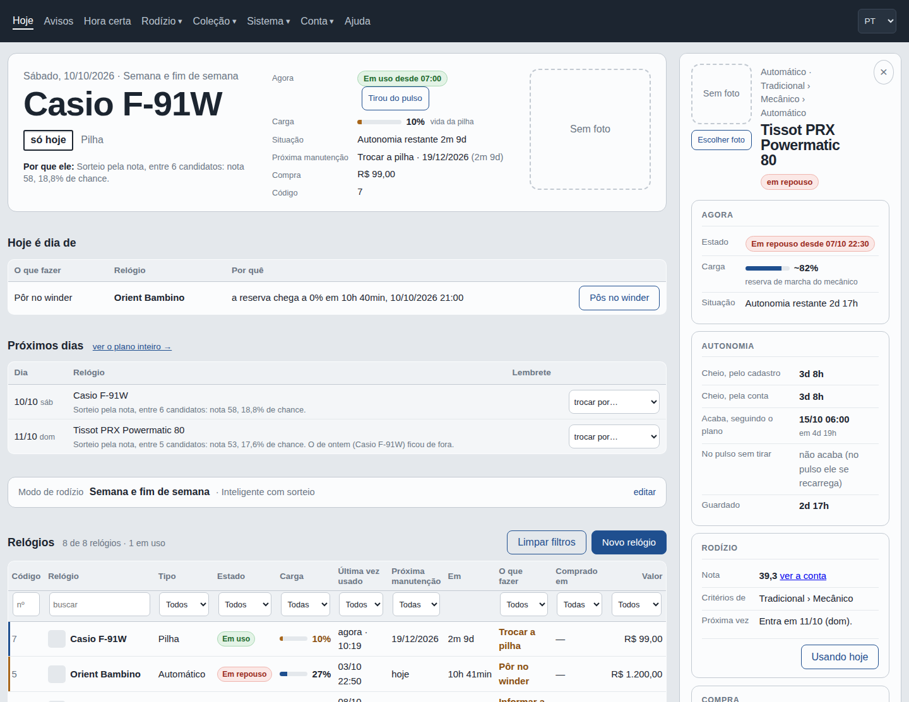
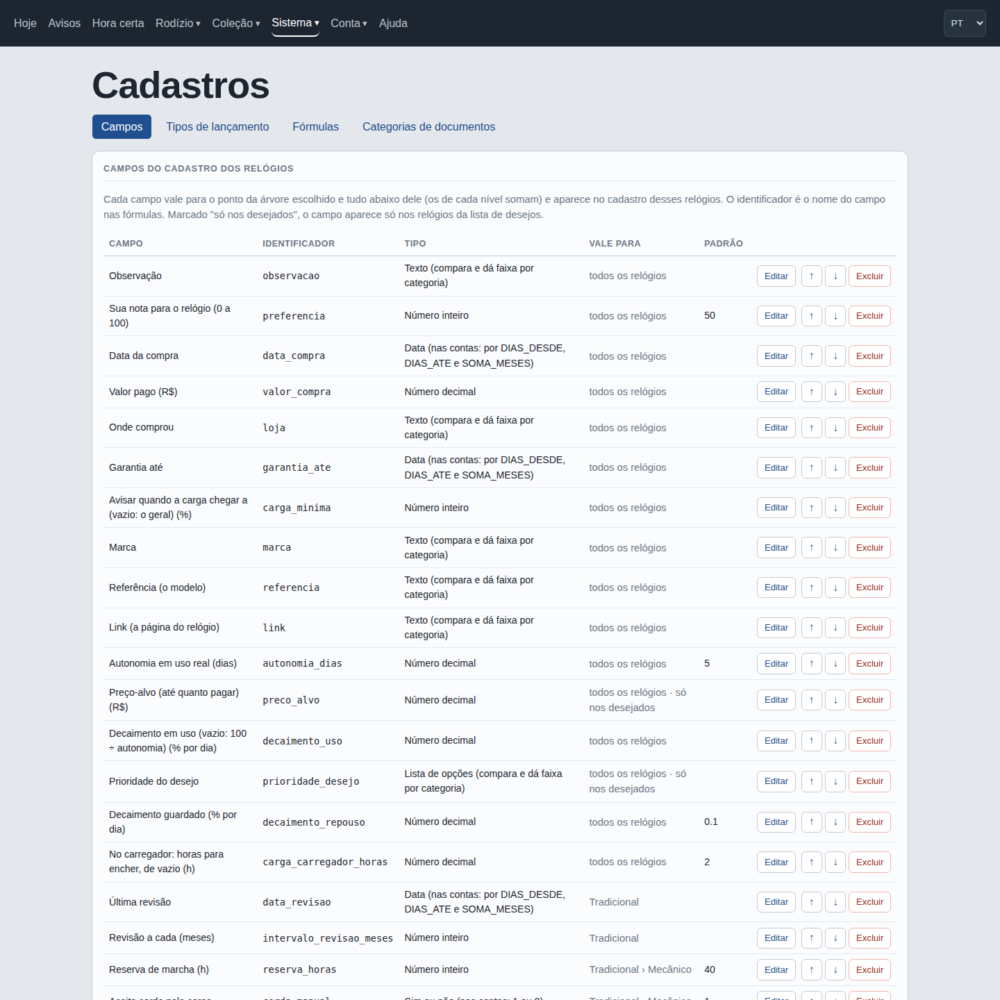
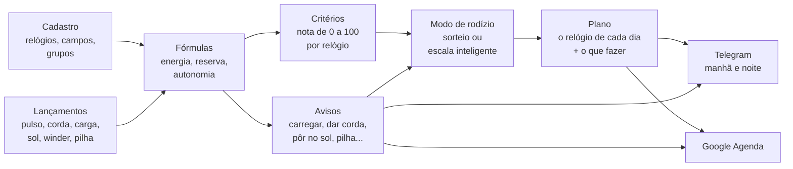
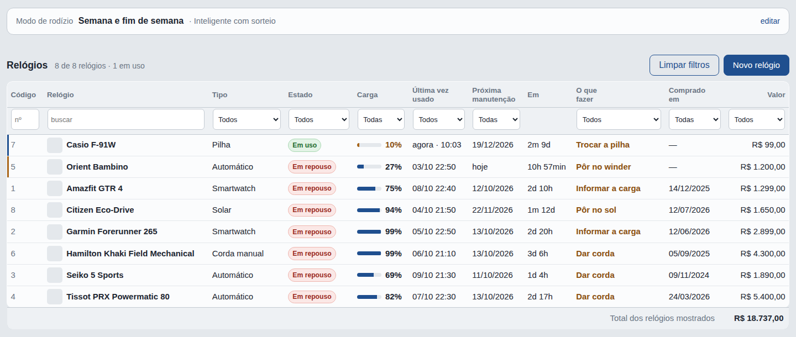
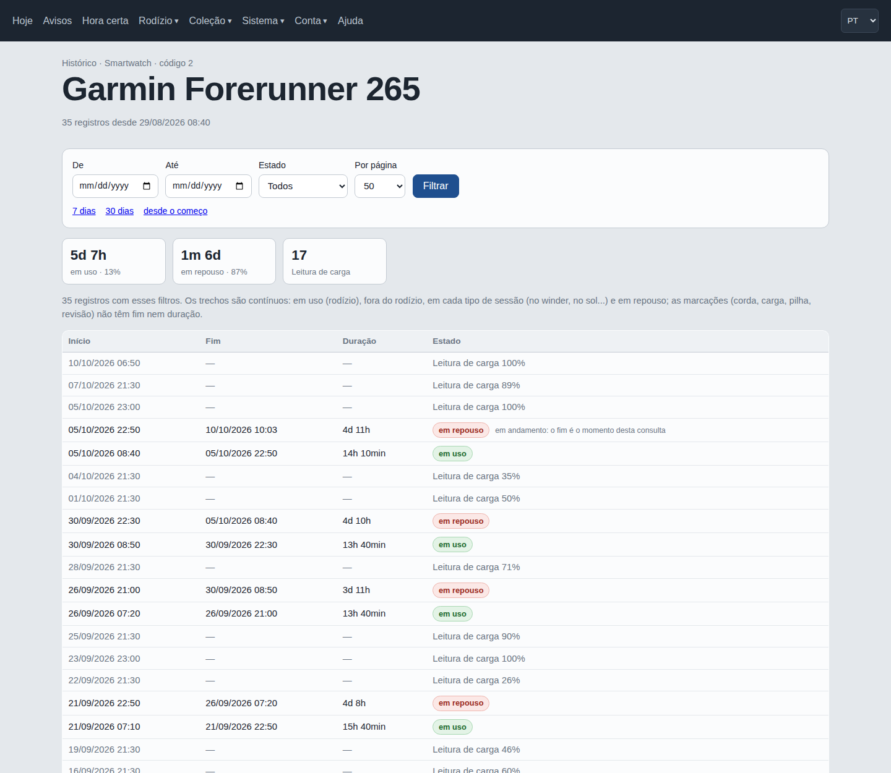
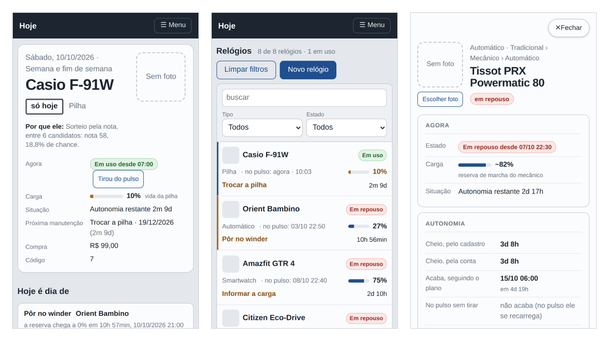

# ⌚ Relojoeiro — Relógios 2

🌐 **Português** · [English](README.en.md) · [中文](README.zh-CN.md) · [हिन्दी](README.hi.md) · [Español](README.es.md) · [Français](README.fr.md)

> **O rodízio inteligente de uma coleção de relógios.** Todo dia ele diz qual relógio vai para o pulso, lembra de dar corda,
> carregar, pôr no sol e trocar a pilha, e faz a coleção inteira ser usada, e não só o favorito. Várias pessoas usam o mesmo
> sistema, cada uma com as suas coleções, e compartilham o que quiserem.

**[▶ Experimente agora, sem instalar nada](https://servidor2.lucas.inf.br/relojoeiro/cadastro.php)**: crie uma conta de
demonstração no servidor do projeto (vale 30 dias, já com uma coleção pronta para você cadastrar os seus relógios).


[](#licença)



<sub>A página **Hoje** com uma coleção de demonstração de 8 relógios (modelos comuns, seis semanas de uso lançadas pela API): o
do dia (o Casio, no pulso desde as 7h), o que fazer hoje, a escala inteligente dos próximos dias e, à direita, o painel do
Tissot, aberto ao lado (na Configuração ele pode abrir flutuante, por cima da página).</sub>

| | |
|---|---|
| **[Por que existe](#por-que-isso-existe)** · [A ideia central](#a-ideia-central-o-sistema-não-sabe-nada-de-relógios) · [Como funciona](#como-funciona) · [Um dia com ele](#um-dia-com-o-relógios-2) | **[Experimente em 1 minuto](#experimente-em-1-minuto)** · [As telas](#as-telas) · [A API](#a-api-uma-porta-só-para-tudo) · [Instalação](#instalação) |
| [Várias pessoas](#várias-pessoas-contas-coleções-e-acesso) · [Perguntas frequentes](#perguntas-frequentes) · [Como é por dentro](#como-é-por-dentro) | [Como contribuir](#como-contribuir) · [Licença](#licença) · [In English](#in-english) |

---

## Por que isso existe

Quem coleciona relógios conhece a cena:

- **O favorito vai para o pulso todo dia**, e aquele que você comprou com tanto carinho está na gaveta há dois meses.
- **O automático para** porque ninguém o usou no fim de semana, e lá vai você acertar hora, data e fase da lua de novo.
- **O solar descarrega no escuro** da caixa, sem você perceber.
- **A pilha acaba sem aviso**, justo no relógio que você queria usar hoje.
- **O smartwatch amanhece sem bateria** no dia em que era a vez dele.
- **A revisão do mecânico** ("a cada 5 anos") e **a garantia** ("vence em março?") ficam na memória, ou seja, em lugar nenhum.

Planilha resolve metade: ela lembra, mas não decide. O **Relógios 2** decide. Ele sabe quanto tempo cada relógio está parado,
quanto de carga ele tem agora, quanto você gosta dele e quanto ele foi usado em relação ao resto. Com isso ele monta o plano
dos próximos dias, ou dos próximos dois anos, já com os lembretes no lugar certo.

De manhã chega uma mensagem no Telegram: *"Hoje: Seiko 5. Dar corda no Orient (a reserva acaba às 15h)."*
À noite chega outra: *"Amanhã: Xiaomi Band. Carregar antes de dormir: chega a 20% amanhã às 14h."*
E no Google Agenda estão a troca de pilha do Casio em novembro e a revisão do Tissot em 2027.

## A ideia central: o sistema não sabe nada de relógios

Essa é a decisão de projeto mais importante, e é o que torna o sistema útil para qualquer coleção. **O código só tem mecanismos;
todo o conhecimento sobre relógios é cadastro.**

Ele não "sabe" que um automático tem reserva de marcha, nem que um solar carrega no sol. Isso tudo está escrito em fórmulas
cadastradas, que você lê, edita e testa pela tela:

```text
Reserva que sobra no mecânico =
  ACUMULA(0; reserva_horas; 1;                                  ← começa em 0, máximo é a reserva, perde 1 h por hora
          "pulso";  carga_pulso_reserva / carga_pulso_horas;    ← cada hora no pulso recarrega tanto
          "winder"; winder_ganho;                               ← cada hora no winder, pelo programa da posição
          "corda";  reserva_horas)                              ← dar corda enche
```

Quer registrar a "troca de pulseira", um "banho ultrassônico" ou um campo "resistência à água"? É cadastro. Quer que os
cronógrafos tenham peso diferente no sorteio? É cadastro. Quer um aviso de "trocar a pulseira de couro a cada ano"? Também.

O sistema já vem com um conjunto inicial completo (smartwatch, automático, corda manual, pilha e solar, com as fórmulas, os
avisos e os critérios de cada um), que você ajusta à sua coleção.



<sub>Os campos do cadastro. Cada um vale para um grupo e tudo abaixo dele (a reserva de marcha só nos mecânicos, a vida da
pilha só nos de pilha), e o identificador é o nome que ele tem nas fórmulas.</sub>

---

## Como funciona



### Os conceitos, um por um

| Conceito | O que é | Exemplo |
|---|---|---|
| **Grupos** (a árvore) | A classificação da coleção, em quantos níveis você quiser. Tudo o que é cadastrado num grupo vale para ele e para tudo abaixo dele. | `Tradicional › Mecânico › Automático` |
| **Campos** | Os dados de cada relógio, definidos por você: texto, número, data, sim/não ou lista, com unidade, valor padrão e as regras do valor (os valores possíveis, o mínimo e o máximo, vários valores de uma vez). | `reserva_horas = 40 h`, `data_pilha`, `funcoes = Data, GMT` |
| **Divisórias** | As seções da ficha, criadas por você: cada campo fica numa delas, e a ficha, o painel, o passaporte e os relatórios mostram os campos agrupados, na ordem delas. | *Identificação*, *Compra*, *Construção*, *Energia* |
| **Unidades** | O que vai depois do número, cadastrado por você: o símbolo, o nome e a conversão (a polegada em milímetros). Os campos, os tipos de lançamento e as fórmulas escolhem a unidade da lista, e o valor pode aparecer também em outra unidade. | `47 mm (1,85 pol)` |
| **Calibres** | O movimento do relógio, com o que é dele: o fabricante, o manual técnico, as recomendações e os valores dos campos. O relógio com um calibre usa o valor dele mesmo, senão o do calibre, senão o padrão do campo. | `NH35`: reserva de 41 h, marcha de −20 a +40 s/dia |
| **Tipos de lançamento** | O que acontece com um relógio. Pode ser **instantâneo** (corda, troca de pilha), **com valor** (leitura de carga: 68%) ou uma **sessão** com início e fim (no pulso, no winder, no sol). | `sol`: sessão que fecha sozinha às 18h se você esquecer |
| **Fórmulas** | Contas sobre os campos e os lançamentos. A mesma fórmula pode ter **uma versão por grupo**, e vale a do grupo mais perto do relógio. | `energia` é a bateria no smartwatch, a reserva no mecânico, a luz no solar e a vida da pilha no quartzo |
| **Avisos** | Uma data prevista por fórmula, uma antecedência, um texto e o lançamento que resolve o aviso. | *"Dar corda no Orient: a reserva acaba às 15h"*, e o botão **Corda** resolve |
| **Limite de carga** | A carga em que o relógio precisa de atenção: carregar o smartwatch, pôr o solar no sol, dar corda no mecânico. O aviso só sai quando a carga chega a ele. Cada relógio pode ter o seu (campo *"Avisar quando a carga chegar a"*); vazio, vale o geral da Configuração. | smartwatch em 20% (o geral), o Samsung em 30% (o dele) |
| **Critérios** | Como cada relógio ganha uma nota de 0 a 100 para o sorteio: parâmetros com peso, subparâmetros que medem um campo ou fórmula, e faixas que transformam o valor em nota. | *Tempo sem uso* (40%): de 0 a 1 dia vale nota 0, 30 dias ou mais vale 100 |
| **Modos de rodízio** | As regras do plano: o tipo do modo (um por semana, semana e fim de semana, por dia da semana, aleatório, escala inteligente ou personalizado), de que grupo escolher em cada dia, quantas semanas à frente, o critério de escolha e, por baixo, o roteiro que o motor calcula. | *"Smartwatch de segunda a sexta, um tradicional por dia no fim de semana"* |
| **Plano** | O relógio de cada dia, com o que fazer (*carregar antes*, *dar corda*, *pôr no winder*). | `seg 06/10 · Xiaomi Band · carregar antes de usar` |

### O motor de fórmulas

As fórmulas são escritas como numa planilha: números com vírgula ou ponto, textos entre aspas, `;` separando os argumentos,
as operações `+ - * / ^` e as comparações `= <> < <= > >=` (que dão 1 ou 0). Um valor vazio se propaga pela conta, e a divisão
por zero dá vazio. O básico:

| Função | O que devolve |
|---|---|
| `SE(condição; se verdadeira; se falsa)`, `E(...)`, `OU(...)`, `NAO(x)` | a lógica: `E` dá 1 se todas são verdadeiras, `OU` se alguma é, `NAO` inverte |
| `MIN(...)`, `MAX(...)` | o menor e o maior dos valores (ignoram os vazios) |
| `LIMITA(x; mín; máx)`, `ARREDONDA(x; casas)`, `ABS(x)` | x preso na faixa; arredondado; sem sinal |
| `CONVERTER(x; "de"; "para")` | x em outra unidade da mesma grandeza, pelo cadastro das unidades: `CONVERTER(diametro; "mm"; "pol")`; vazio quando as duas não se convertem |
| `TEM(x; "valor")`, `ITENS(x)` | 1 se o campo múltiplo tem o valor (sem diferença de maiúsculas): `TEM(funcoes; "Cronógrafo")`; quantos valores ele tem |
| `PADRAO(x; outro)`, `VAZIO(x)`, `NADA()` | x, ou o outro se x estiver vazio; 1 se x está vazio; o vazio, de propósito (`SE(condição; NADA(); conta)`) |
| `HOJE()`, `AGORA()` | a data de hoje e o instante de agora, em dias (o agora com a fração do dia) |
| `DIAS_DESDE(data)`, `DIAS_ATE(data)`, `SOMA_MESES(data; meses)` | dias desde e até uma data (negativo: já passou); a data somada de meses, pelo calendário |
| `HORAS_USO()` | as horas de um dia de uso, pelo horário de uso da Configuração (das 7h às 22h: 15) |
| `CONFIG("chave")` | um número da Configuração, como `CONFIG("sol_limiar")` |

E as que leem o histórico de cada relógio:

| Função | O que devolve |
|---|---|
| `HORAS("pulso"; 30)` | horas no pulso nos últimos 30 dias |
| `CONTAR("pulso"; 30)` | quantos dias com uso nos últimos 30 dias |
| `DIAS_DESDE_ULTIMO("pulso")` | dias desde a última vez no pulso |
| `ULTIMO_VALOR("carga")` / `ULTIMA_DATA("pilha")` | a última leitura / a data do último lançamento |
| `HORAS_APOS("pulso"; "carga")` | horas no pulso desde a última leitura de carga |
| `ACUMULA(início; máx; perda/h; "tipo"; efeito; ...)` | um saldo que percorre o histórico: perde com o tempo e ganha com cada lançamento |
| `MEDIDO("uso")` / `MEDIDO("repouso")` | o gasto real de bateria, medido pelas suas leituras de carga |
| `EM_SESSAO("winder")` | 1 se a sessão está aberta agora (o relógio está no winder) |
| `MEDIA_COLECAO("uso_30d")` | a média de uma variável na coleção inteira |

E as do rodízio (o roteiro dos modos; fora dele, o dia é o do instante da conta):

| Função | O que devolve |
|---|---|
| `DIA_SEMANA()`, `SEMANA_DO_ANO()` | o dia da semana (1 segunda a 7 domingo) e a semana do ano (ISO) do dia que está sendo montado |
| `NO_GRUPO("Tradicional › Quartzo")` | 1 se o relógio está nesse ponto da árvore ou abaixo (o nome, o caminho ou `#id`; `"todos"`: 1 para todos) |
| `RELOGIO("Seiko SKX")` | 1 se é esse relógio (pelo nome ou pelo id) |
| `CALIBRE("NH35")` | 1 se o relógio tem esse calibre (pelo nome ou pelo id) |
| `WINDER_POSICAO("pos_tpd")`, `WINDER("winder_marca")` | um campo da posição do winder em que o relógio está (dentro do `ACUMULA`, a posição de cada sessão no winder) e um campo do winder dela; fora de uma posição, vazio (veja [Os winders](#os-winders)) |
| `ESCOLHIDO_HA(1)`, `VEZES_NO_PLANO(7)` | 1 se o relógio foi o do plano há n dias (1: ontem; -1: amanhã, quando já está no plano); quantos dias ele teve no plano nos últimos n dias |
| `ESCOLHA(n; a; b; c)` | o n-ésimo dos valores (só ele é calculado): `ESCOLHA(DIA_SEMANA(); …)` dá um valor por dia da semana |
| `SORTEIO()` | um número de 0 a 1, do mesmo lote do RANDOM.ORG dos sorteios |

E a variável `nota_criterios`: a nota do relógio pelos critérios, no instante da conta.

Na página **Cadastros** toda fórmula tem o botão **Testar em todos os relógios**, que mostra o resultado em cada relógio antes
de gravar.

### Os totais

Os totais também são do motor de fórmulas, mas olham para **todos os relógios mostrados de uma vez** (os que o filtro da
tabela da página Hoje deixa). Eles ficam na aba **Totais** da página **Cadastros**: cada total tem a **coluna** da tabela onde
ele vai (ou nenhuma), o **nome**, a **expressão**, as caixas **Exibir no rodapé do totalizador** e **Exibir na página de
totais**, a **largura** do quadro na página (estreito ou largo) e o **formato** dos números (número, inteiro, com 2 casas,
dinheiro, porcentagem, data ou dias). Só os totais de uma coluna vão para o rodapé, embaixo dela; os outros, quantos você
quiser, ficam só na **página de totais** (menu **Coleção**, ou **Ver todos os totais** embaixo da tabela, que leva o mesmo
filtro). Vários totais na mesma coluna ficam um embaixo do outro, na ordem da lista (↑ ↓), e o **Testar em todos os
relógios** mostra o resultado antes de gravar.

| Função de total | O que dá |
|---|---|
| `CONTA()`, `CONTA(x)` | quantos relógios; quantos têm `x` preenchido |
| `CONTA_SE(condição)` | quantos passam na condição: `CONTA_SE(carga <= 20)` |
| `DISTINTOS(x)` | quantos valores diferentes: `DISTINTOS(tipo)` |
| `SOMA(x)`, `MEDIA(x)`, `MEDIANA(x)`, `MENOR(x)`, `MAIOR(x)` | a conta de sempre, com os que têm `x` (de uma data, a média é uma data) |
| `QUEM_MAIOR(x)`, `QUEM_MENOR(x)` | o relógio do maior e do menor valor, com o valor ao lado |
| `AGRUPADO(chave; conta; limite)` | uma tabelinha: uma linha por valor da chave e a linha de total; a `conta` (sem ela, `CONTA()`) vai em cada linha, feita só com os relógios dela, e no total, com todos; `limite` mostra as que mais têm e junta o resto em "outros" |
| `FAIXAS(x; 25; 50; 75; 100)` | uma tabelinha por faixas ("até 25", "26 a 50"...), os sem `x` em "sem valor", e o total |

Dentro delas vale tudo o que vale numa fórmula (os campos, as fórmulas, `SE`, `DIAS_DESDE`...), calculado em cada relógio, e
também o que cada coluna da tabela mostra: `codigo`, `nome`, `tipo`, `estado`, `disponivel`, `em_uso`, `carga`, `ultimo_uso`,
`manutencao_data`, `manutencao_nome`, `encostado_data`, `avisos` (quantos avisos ele tem) e `posse`. Fora delas, só números,
textos e as funções que não precisam de um relógio (`SE`, `MIN`, `ARREDONDA`, as contas). As funções novas `MES(data)`,
`ANO(data)` e `MES_ANO(data)` servem para agrupar por mês e por ano, e valem também nas fórmulas. Exemplos:

| Total | Expressão |
|---|---|
| Disponíveis e indisponíveis | `AGRUPADO(SE(disponivel; "disponíveis"; "indisponíveis"))` |
| Por tipo | `AGRUPADO(tipo)` |
| Faixas de carga | `FAIXAS(carga; 25; 50; 75; 100)` |
| Parado há | `FAIXAS(DIAS_DESDE(ultimo_uso); 7; 30)` |
| O que fazer (os 3 que mais aparecem e "outros") | `AGRUPADO(manutencao_nome; CONTA(); 3)` |
| Compras por mês | `AGRUPADO(MES_ANO(data_compra))` |
| Valor por tipo | `AGRUPADO(tipo; SOMA(valor_compra))` |
| O mais caro | `QUEM_MAIOR(valor_compra)` |
| Quem mais tem coisa para fazer | `QUEM_MAIOR(avisos)` |

Uma instalação nova (e a migração v31) já vem com uma tabelinha em cada coluna do rodapé e com os quadros da página de
totais; você muda, apaga ou cria os seus.

### A nota de cada relógio (critérios)

Os critérios que vêm prontos, para todos os relógios:

| Parâmetro | Peso | Mede |
|---|---:|---|
| Tempo sem uso | 40 | dias desde a última vez no pulso: quanto mais parado, maior a nota |
| Equilíbrio de uso | 30 | uso nos últimos 30 dias comparado com a média da coleção: quem foi pouco usado sobe |
| Preferência | 20 | a sua nota para o relógio (0 a 100) |
| Novidade e valor | 10 | há quanto tempo foi comprado e quanto custou (aproveitar o investimento) |

Cada grupo, e até cada relógio, pode ter o seu próprio conjunto. O smartwatch, por exemplo, também pesa a **energia** (a carga
agora e quantos dias ela aguenta), para não sortear um relógio que vai morrer ao meio-dia. A página **Critérios** mostra a
conta inteira de cada nota: cada faixa, cada peso e cada ponto, e ao lado da nota de cada critério uma seta diz para onde ele
puxa a nota final: **↑** verde (nota acima de 50, o neutro: puxa para cima), **↓** vermelha (abaixo de 50: puxa para baixo) ou
**↔** marrom (50 em ponto, ou sem peso: neutro, não puxa para nenhum lado).

Os conjuntos que vêm prontos, completos. A nota de um parâmetro é a média das notas dos subparâmetros, pelo peso de cada um; a
nota do relógio é a média dos parâmetros, pelo peso. Cada subparâmetro lê uma variável (um campo ou uma fórmula) e dá a nota
pela faixa em que o valor cai; o subparâmetro sem valor (um campo vazio, um valor fora de toda faixa) fica de fora, e os outros
dividem o peso dele. Tudo se edita na página **Critérios**, e **Restaurar os critérios iniciais** volta a estes.

**Todos os relógios**

| Parâmetro | Peso | Subparâmetro (a variável, o peso dentro do parâmetro) | As faixas: o valor → a nota |
|---|---:|---|---|
| Tempo sem uso | 40 | Dias sem uso (`dias_sem_uso`) | 0 a 1 → 0; 1 a 3 → 30; 3 a 7 → 60; 7 a 14 → 80; 14 a 30 → 95; 30 ou mais → 100 |
| Equilíbrio de uso | 30 | Uso nos últimos 30 dias, comparado com a média (`uso_vs_media`) | 0 a 25 → 100; 25 a 60 → 80; 60 a 100 → 60; 100 a 140 → 35; 140 a 200 → 15; 200 ou mais → 0 |
| Preferência | 20 | Sua nota para o relógio (`preferencia`) | 0 a 20 → 0; 20 a 40 → 25; 40 a 60 → 50; 60 a 80 → 75; 80 a 100 → 100 |
| Novidade e valor | 10 | Novidade: dias desde a compra (`dias_desde_compra`, 60) | 0 a 15 → 100; 15 a 45 → 80; 45 a 120 → 55; 120 a 365 → 40; 365 ou mais → 30 |
|  |  | Aproveitar o investimento: valor pago (`valor_compra`, 40) | 0 a 300 → 30; 300 a 800 → 50; 800 a 1500 → 70; 1500 ou mais → 90 |

**Smartwatch**

| Parâmetro | Peso | Subparâmetro (a variável, o peso dentro do parâmetro) | As faixas: o valor → a nota |
|---|---:|---|---|
| Energia | 30 | Carga agora (%) (`energia`, 50) | 0 a 15 → 0; 15 a 30 → 25; 30 a 50 → 55; 50 a 80 → 85; 80 a 100 → 100 |
|  |  | Dias de uso que a carga aguenta (`dias_de_carga`, 50) | 0 a 1 → 0; 1 a 2 → 30; 2 a 4 → 60; 4 a 7 → 85; 7 ou mais → 100 |
| Autonomia | 15 | Autonomia do smartwatch (`autonomia_dias`) | 0 a 2 → 10; 2 a 4 → 40; 4 a 7 → 70; 7 a 14 → 90; 14 ou mais → 100 |
| Tempo sem uso | 25 | Dias sem uso (`dias_sem_uso`) | 0 a 1 → 0; 1 a 3 → 30; 3 a 7 → 60; 7 a 14 → 80; 14 a 30 → 95; 30 ou mais → 100 |
| Equilíbrio de uso | 15 | Uso nos últimos 30 dias, comparado com a média (`uso_vs_media`) | 0 a 25 → 100; 25 a 60 → 80; 60 a 100 → 60; 100 a 140 → 35; 140 a 200 → 15; 200 ou mais → 0 |
| Preferência | 10 | Sua nota para o relógio (`preferencia`) | 0 a 20 → 0; 20 a 40 → 25; 40 a 60 → 50; 60 a 80 → 75; 80 a 100 → 100 |
| Novidade e valor | 5 | Novidade: dias desde a compra (`dias_desde_compra`, 60) | 0 a 15 → 100; 15 a 45 → 80; 45 a 120 → 55; 120 a 365 → 40; 365 ou mais → 30 |
|  |  | Aproveitar o investimento: valor pago (`valor_compra`, 40) | 0 a 300 → 30; 300 a 800 → 50; 800 a 1500 → 70; 1500 ou mais → 90 |

**Tradicional › Mecânico**

| Parâmetro | Peso | Subparâmetro (a variável, o peso dentro do parâmetro) | As faixas: o valor → a nota |
|---|---:|---|---|
| Reserva de marcha | 25 | Reserva agora (%): vazia, precisa rodar (`energia`) | 0 a 10 → 100; 10 a 30 → 85; 30 a 60 → 60; 60 a 90 → 35; 90 a 100 → 20 |
| Cuidado mecânico | 15 | Parado precisa rodar (lubrificação) (`dias_sem_uso`, 50) | 0 a 7 → 20; 7 a 30 → 60; 30 a 90 → 90; 90 ou mais → 100 |
|  |  | Revisão em dia (`dias_ate_revisao`, 50) | 0 a 30 → 20; 30 a 180 → 60; 180 ou mais → 100 |
| Tempo sem uso | 25 | Dias sem uso (`dias_sem_uso`) | 0 a 1 → 0; 1 a 3 → 30; 3 a 7 → 60; 7 a 14 → 80; 14 a 30 → 95; 30 ou mais → 100 |
| Equilíbrio de uso | 20 | Uso nos últimos 30 dias, comparado com a média (`uso_vs_media`) | 0 a 25 → 100; 25 a 60 → 80; 60 a 100 → 60; 100 a 140 → 35; 140 a 200 → 15; 200 ou mais → 0 |
| Preferência | 10 | Sua nota para o relógio (`preferencia`) | 0 a 20 → 0; 20 a 40 → 25; 40 a 60 → 50; 60 a 80 → 75; 80 a 100 → 100 |
| Novidade e valor | 5 | Novidade: dias desde a compra (`dias_desde_compra`, 60) | 0 a 15 → 100; 15 a 45 → 80; 45 a 120 → 55; 120 a 365 → 40; 365 ou mais → 30 |
|  |  | Aproveitar o investimento: valor pago (`valor_compra`, 40) | 0 a 300 → 30; 300 a 800 → 50; 800 a 1500 → 70; 1500 ou mais → 90 |

**Tradicional › Quartzo › Pilha**

| Parâmetro | Peso | Subparâmetro (a variável, o peso dentro do parâmetro) | As faixas: o valor → a nota |
|---|---:|---|---|
| Vida da pilha | 15 | Vida da pilha (%) (`energia`) | 0 a 10 → 10; 10 a 30 → 50; 30 a 100 → 70 |
| Revisão | 10 | Revisão em dia (`dias_ate_revisao`) | 0 a 30 → 20; 30 a 180 → 60; 180 ou mais → 100 |
| Tempo sem uso | 35 | Dias sem uso (`dias_sem_uso`) | 0 a 1 → 0; 1 a 3 → 30; 3 a 7 → 60; 7 a 14 → 80; 14 a 30 → 95; 30 ou mais → 100 |
| Equilíbrio de uso | 25 | Uso nos últimos 30 dias, comparado com a média (`uso_vs_media`) | 0 a 25 → 100; 25 a 60 → 80; 60 a 100 → 60; 100 a 140 → 35; 140 a 200 → 15; 200 ou mais → 0 |
| Preferência | 10 | Sua nota para o relógio (`preferencia`) | 0 a 20 → 0; 20 a 40 → 25; 40 a 60 → 50; 60 a 80 → 75; 80 a 100 → 100 |
| Novidade e valor | 5 | Novidade: dias desde a compra (`dias_desde_compra`, 60) | 0 a 15 → 100; 15 a 45 → 80; 45 a 120 → 55; 120 a 365 → 40; 365 ou mais → 30 |
|  |  | Aproveitar o investimento: valor pago (`valor_compra`, 40) | 0 a 300 → 30; 300 a 800 → 50; 800 a 1500 → 70; 1500 ou mais → 90 |

**Tradicional › Quartzo › Solar**

| Parâmetro | Peso | Subparâmetro (a variável, o peso dentro do parâmetro) | As faixas: o valor → a nota |
|---|---:|---|---|
| Luz | 25 | Carga de luz (%) (`energia`) | 0 a 30 → 80; 30 a 70 → 65; 70 a 100 → 50 |
| Revisão | 10 | Revisão em dia (`dias_ate_revisao`) | 0 a 30 → 20; 30 a 180 → 60; 180 ou mais → 100 |
| Tempo sem uso | 30 | Dias sem uso (`dias_sem_uso`) | 0 a 1 → 0; 1 a 3 → 30; 3 a 7 → 60; 7 a 14 → 80; 14 a 30 → 95; 30 ou mais → 100 |
| Equilíbrio de uso | 20 | Uso nos últimos 30 dias, comparado com a média (`uso_vs_media`) | 0 a 25 → 100; 25 a 60 → 80; 60 a 100 → 60; 100 a 140 → 35; 140 a 200 → 15; 200 ou mais → 0 |
| Preferência | 10 | Sua nota para o relógio (`preferencia`) | 0 a 20 → 0; 20 a 40 → 25; 40 a 60 → 50; 60 a 80 → 75; 80 a 100 → 100 |
| Novidade e valor | 5 | Novidade: dias desde a compra (`dias_desde_compra`, 60) | 0 a 15 → 100; 15 a 45 → 80; 45 a 120 → 55; 120 a 365 → 40; 365 ou mais → 30 |
|  |  | Aproveitar o investimento: valor pago (`valor_compra`, 40) | 0 a 300 → 30; 300 a 800 → 50; 800 a 1500 → 70; 1500 ou mais → 90 |

E existe uma **garantia de rodízio**: nenhum relógio passa de N dias parado (21 por padrão). Ela vale **antes** da nota: se
algum candidato já passou do limite, ele ganha direto, o mais tempo parado primeiro. Só quando ninguém passou do limite é
que a nota decide.

Os dias parado são a fórmula **Dias sem uso**, que você pode editar em Cadastros: os dias desde a última vez no pulso e, para
um relógio que **nunca foi usado**, os dias desde a compra (sem data de compra, 9999, o mais parado de todos). Assim um
relógio comprado ontem não fura a fila, e dois nunca usados não empatam: espera há mais tempo o que foi comprado antes.

Para você nunca ficar na dúvida, **cada dia do plano guarda o motivo da escolha**, numa frase, e ela aparece embaixo do
relógio na página Hoje e na página Plano: *"Garantia de rodízio: nunca usado, na coleção há 38 dias, além do limite de 21
dias sem uso"*, *"Sorteio pela nota, entre 5 candidatos: nota 70,2, 16,4% de chance"*, *"A maior nota (91,2). Fica 5 dias
seguidos"*, *"Segue no pulso: dia 2 de 5 seguidos"*, *"Escolhido à mão"*.

### Os modos de rodízio

Os modos ficam na página **Modos de rodízio** (menu **Rodízio**). Cada modo tem um **tipo**, e a tela do tipo pede só o que
faz sentido nele:

- **Um por semana**: um relógio para a semana inteira, do primeiro ao último dia dela (de segunda a domingo, ou de domingo a
  sábado: a semana começa no dia escolhido na Configuração, **A semana começa**). Você diz de onde ele sai (a coleção, um
  grupo ou um relógio fixo) e o critério de escolha.
- **Semana e fim de semana**: dois trechos, de segunda a sexta e no sábado e domingo, cada um com o seu grupo e com **um
  relógio para o trecho** ou **um por dia**. O que vem pronto: o smartwatch na semana, um tradicional por dia no fim dela.
  Com a semana começando no domingo, o sábado e o domingo continuam um trecho só (o relógio do sábado fica no domingo).
- **Por dia da semana**: um relógio por dia, e cada dia da semana diz de onde ele sai (um grupo, um relógio fixo ou nenhum:
  dia livre).
- **Aleatório todo dia**: um por dia, todos com a mesma chance, sem critério nem garantia de rodízio.
- **Escala inteligente**: planeja o período inteiro de uma vez, simulando a carga (veja [abaixo](#a-escala-inteligente)).
- **Personalizado**: você escreve o roteiro (veja [O roteiro do modo](#o-roteiro-do-modo)).

Nos três primeiros, o **critério de escolha** é o sorteio: pela **maior nota**, por **sorteio pela nota** (a nota vira a
chance), **aleatório** ou por **fila** (quem está esperando há mais tempo). Com o **ciclo** ligado, um relógio só volta
depois que todos os candidatos passaram na semana. O quadro **Modo de rodízio** da página Hoje escolhe o modo, o critério e a
garantia de rodízio; **Aplicar modo** só marca: nada do plano muda até você clicar em **Sortear de novo**.

O **Sortear de novo** refaz o que o modo sorteou e deixa como estão os dias escolhidos à mão e os dias livres (os do
Rodízio manual, por exemplo); a mensagem diz quantos ficaram (*"Ficaram como estavam: 7 dias livres..."*). Com a caixa
**Sobrescrever tudo** marcada, sai tudo o que o plano tem do começo do sorteio em diante (de amanhã, de hoje ou do primeiro
dia da próxima semana), à mão, livre ou sorteado, e o modo monta tudo de novo; a confirmação avisa antes, e a mensagem diz
quantos dias à mão e livres foram sobrescritos.

**O que mudou.** Toda gravação que mexe no plano (o Sortear de novo, a próxima semana, o trocar por…, o Rodízio manual, os
períodos, o Sem relógio hoje e o apagar) mostra, junto com a mensagem, o que mudou em relação ao plano de antes: *"3 dias
mudaram; 11 ficaram com o mesmo relógio."* e uma tabelinha com cada dia que mudou (**Dia**, **Antes**, **Depois** e o
**Motivo** do novo). Com a tabelinha, a caixa fica até você fechar. Pela API, a resposta traz `mudancas`.

**As semanas.** Fora da escala, cada modo diz **quantas semanas à frente** o plano vem montado (1 a 8; a lista mostra as
semanas com as datas). O plano vai até o último dia da última delas: o domingo, ou o sábado com a semana começando no
domingo (com uma semana só, no último dia da semana o plano traz também o primeiro da seguinte, para o aviso da véspera), e a
semana seguinte entra quando a sua vez chega. A semana começa no dia escolhido na Configuração (**A semana começa**: na
segunda-feira, o padrão, ou no domingo), e o ciclo, a próxima semana e o relógio para a semana inteira contam dela. Com
mais de uma semana, o **Sortear de novo** tem também **a próxima semana**: ela sai pelo modo atual, com os dias que ainda
faltam desta semana contados como uso, como se você já tivesse usado os relógios do plano (o uso conta nos dias sem uso e na nota; a carga não, porque não se sabe
se o relógio vai ser carregado). Cada dia é escolhido assim, com os anteriores do plano já no pulso, e por isso o relógio de
segunda não volta na terça só por parecer parado. Os dias escolhidos à mão ficam. Na escala inteligente não há próxima
semana: ela já planeja o próprio período.

### O roteiro do modo

Por baixo, todo modo é um **roteiro**: cinco linhas que o motor de fórmulas calcula para cada relógio disponível, no começo
de cada dia do plano, com os dias anteriores já contados como uso. Os modos prontos geram o roteiro das telas deles (a
página mostra o roteiro gerado, só leitura); no **Personalizado** você escreve o seu, uma linha por nome (`nome = expressão`,
na mesma língua das fórmulas do cadastro; linhas que começam com `#` são comentários; os outros nomes são variáveis suas):

| Linha | O que diz | Se faltar |
|---|---|---|
| `candidato` | 1: o relógio entra na escolha desse dia; 0: não | `1` (todos) |
| `nota` | a nota do relógio nesse dia | `nota_criterios` (a nota pelos critérios) |
| `peso` | a chance no sorteio. Todos 0: a maior nota ganha. Todos iguais: todos com a mesma chance. Senão, cada peso é a chance | `0` |
| `dias` | quantos dias seguidos o escolhido fica (enquanto os dias seguintes estiverem vagos e ele continuar candidato) | `1` |
| `garantia` | 1: passa na frente de todos (entre vários, o mais tempo parado; empate: o cadastrado primeiro) | quem passou da garantia de rodízio (`max_sem_uso`) em dias sem uso |

**Como o motor decide cada dia**, nesta ordem: o roteiro diz quem é candidato; entre os candidatos, o relógio de ontem fica de
fora, se houver outro candidato (o único candidato repete, e o motivo diz por quê); o ciclo, se o modo usa, também só entre
os candidatos; quem tem `garantia` ganha direto; senão o `peso`. O escolhido fica os `dias` que o roteiro deu,
e o motivo da escolha fica gravado no plano. O mesmo motor decide o **Sortear este dia por** do seletor de cada dia e o
**Decida por mim** do rodízio manual.

Um exemplo: mecânicos na semana, o que a bateria der no fim de semana, e quem está parado há mais de 3 dias com 100 vezes a
chance dos outros:

```
util      = DIA_SEMANA() <= 5
candidato = SE(util; NO_GRUPO("Mecânico"); 1)
peso      = SE(dias_sem_uso > 3; 100; 1)
dias      = SE(NO_GRUPO("Smartwatch"); dias_seguidos; 1)
```

O botão **Testar em todos os relógios** calcula o roteiro num dia (hoje, ou um dos próximos 13) e mostra cada linha em cada
relógio e quem sairia. Além das funções das fórmulas, o roteiro tem `DIA_SEMANA()` (1 segunda a 7 domingo), `SEMANA_DO_ANO()`,
`NO_GRUPO("grupo")`, `RELOGIO("nome")`, `ESCOLHIDO_HA(n)`, `VEZES_NO_PLANO(n)`, `ESCOLHA(n; a; b; …)` e `SORTEIO()` (a tabela em
[O motor de fórmulas](#o-motor-de-fórmulas)) e a variável `nota_criterios`. Pela API: `recurso=roteiro` testa; `recurso=modos`,
`acao=salvar` com `tipo=personalizado` e `roteiro` grava.

**De onde vem o sorteio.** Todo sorteio do sistema (o modo totalmente aleatório, o sorteio pela nota ou pelo peso e a
função `SORTEIO()` do roteiro) usa números aleatórios de verdade, de fora, nesta ordem:

1. **[RANDOM.ORG](https://www.random.org/)**: aleatoriedade por ruído atmosférico (mede a variação das micro-ondas do ar e
   converte em bits);
2. fora do ar (ou com a cota do dia esgotada), o **ANU QRNG**, o gerador quântico da Universidade Nacional da Austrália (mede
   flutuações quânticas da luz). O sistema usa o endereço antigo, `qrng.anu.edu.au/API/jsonI.php`, que responde sem chave (o
   novo, `api.quantumnumbers.anu.edu.au`, exige uma chave de API);
3. sem os dois (sem internet no servidor, por exemplo), o **gerador seguro do PHP** (`random_int`, o do sistema
   operacional: o equivalente ao `secrets` do Python).

Os números chegam num lote (64 números de 16 bits por pedido), e cada sorteio usa só o que precisa, descartando o que passa do
último múltiplo inteiro da faixa: todos os resultados têm exatamente a mesma chance. Cada serviço tem 4 segundos para
responder; se os dois falham, o sistema usa o do PHP e não tenta de novo por 10 minutos (assim nenhuma página fica esperando).
O motivo de cada dia sorteado diz de onde veio o número (*"Sorteio simples, entre 4 candidatos, todos com a mesma chance
(RANDOM.ORG)."*), e a **Configuração** mostra o último lote (quadro **Sorteios**). O que é segredo não usa estes serviços: o sal das
senhas e os nomes dos arquivos dos documentos continuam com o gerador do PHP, porque um número que viaja pela internet não serve
para segredo.

### Apagar a programação

No rodapé da página **Plano** (o lugar principal: o quadro **Apagar a programação**, no fim da página, depois do dia a dia) e
no quadro **Modo de rodízio** da página Hoje (cada um abaixo de uma linha, como o **Sortear de novo**):

- **Apagar um período**: **De** e **Até**; um dos dois pode ficar vazio (só o **De** apaga dele até o fim do plano; só o
  **Até**, de amanhã até ele). Os dias do período saem do plano, de amanhã em diante (os escolhidos à mão, os sorteados e os
  livres), e o modo de rodízio monta esses dias de novo. O botão **Apagar** pede confirmação.
- **Apagar tudo**: limpa toda a programação, de amanhã em diante: os dias escolhidos à mão, os sorteados e os livres.
  Marcando **Excluindo hoje**, apaga de hoje em diante (se sair outro relógio para hoje, ele passa a ser o do pulso a partir
  de agora). Depois, o modo de rodízio monta o plano de novo, do zero: até o último dia da última das semanas do modo (as
  seguintes, quando chegarem); na escala inteligente, a escala inteira. A programação não fica vazia porque o sistema sempre
  monta os dias que faltam pelo modo ativo; para dias sem relógio, marque *livre* no Rodízio manual.

### O rodízio manual

No quadro **Modo de rodízio** da página Hoje, a última opção da lista é **Rodízio manual**: você mesmo escolhe o relógio de
cada dia de um período (as férias, uma viagem, um mês inteiro). Ponha o começo (**De**) e o fim (**Até**) e clique em **OK**:

- os dias aparecem **de 7 em 7**, com a data, o dia da semana, o que o plano tem agora nesse dia e um seletor;
- com mais de 7 dias, embaixo ficam as páginas: **‹ Anterior**, **1 2 3 …**, **Próxima ›**. O que você escolhe numa página
  fica guardado enquanto você anda pelas outras; nada muda antes de gravar;
- o seletor de cada dia tem os relógios disponíveis, **Decida por mim**, o grupo **Sortear este dia por** (*a maior nota*,
  *sorteio pela nota*, *aleatório* ou *fila*: o dia é sorteado ao gravar por essa forma, sem o de ontem e o de amanhã, como o
  Decida por mim) e **Sem relógio (dia livre)**. De partida, ele mostra o relógio que o dia já tem escolhido à mão; um dia
  livre aparece como livre; e o resto (sorteado ou ainda sem relógio), como *Decida por mim*;
- **Gravar o rodízio manual** grava o período inteiro: os dias com relógio ficam escolhidos à mão, os de *Decida por mim* e os
  de *Sortear este dia por* são decididos na hora pelo sistema e também ficam gravados (o motivo de cada um aparece no
  plano), e os livres ficam sem relógio. Se hoje está no período e você escolheu outro relógio, ele passa a ser o do pulso a partir de agora;
- para apagar os dias de um período (o modo de rodízio monta esses dias de novo) ou apagar tudo, veja
  [Apagar a programação](#apagar-a-programação).

Fora do período, continua valendo o modo de rodízio de sempre. Os dias escolhidos à mão ficam mesmo quando você sorteia de
novo ou o cron monta a semana seguinte; na escala inteligente, ela é refeita em volta deles.

**O critério do *Decida por mim*:**
1. a **nota dos critérios** (os que você cadastra em **Critérios**: dias sem uso, equilíbrio, preferência, carga...), calculada
   no começo de cada dia, com os dias anteriores do período (os que você escolheu e os que ele decidiu) já contados como uso;
2. a **garantia de rodízio** vem na frente: quem passou do limite de dias sem uso entra primeiro, o mais tempo parado antes;
3. o relógio de **ontem** e o de **amanhã** ficam de fora, se houver outro. Assim um relógio não se repete colado ao que você
   escolheu;
4. no empate, ganha o cadastrado primeiro.

Hoje, com *Decida por mim*, continua o relógio que já está no plano.

### A escala inteligente

É o modo mais completo. Em vez de sortear semana a semana, ele **planeja de 7 dias a 2 anos de uma vez**, simulando dia a dia:

1. calcula a nota de cada relógio com o estado simulado daquele dia;
2. escolhe o relógio pela maior nota (o roteiro da escala: `peso = 0`); o smartwatch fica no pulso os dias que a bateria
   aguenta (até 7: a fórmula `dias_seguidos`);
3. simula o uso (a sessão no pulso no horário de uso) e o efeito dele na carga e na reserva de todos;
4. confere os avisos: se o escolhido vai precisar de carga ou de corda, anota a ação no dia (*"carregar antes de usar"*) e
   simula o lançamento que a resolve;
5. passa para o dia seguinte.

Toda manhã o cron **replaneja a partir do estado real**. Se você usou outro relógio, esqueceu de carregar ou lançou uma
leitura diferente da prevista, o plano se corrige sozinho.

### Gasto medido pelas leituras

O cadastro do smartwatch diz "dura 5 dias". A realidade discorda, e muda conforme a bateria envelhece. Por isso, **cada leitura
de carga que você lança é comparada com a anterior**, e o intervalo entre as duas vira uma medição: quanto caiu, quantas horas
ele passou no pulso e quantas fora do pulso (guardado, desligado), e como você marcou cada leitura (em uso ou em repouso). O
horário de uso da Configuração conta como pulso sozinho, e as suas marcações (*Pôs*, *Tirou*) mandam. Uma subida na leitura é
recarga: começa um trecho novo. E um intervalo com outra sessão no meio (o relógio foi para o carregador) também não mede: a
medição só sabe separar pulso e guardado.

**Como transformar as medições nos dois gastos (no pulso e fora do pulso) é escolha sua: há cinco motores.** Todos ficam no
sistema; nenhum apaga nada, e trocar de motor só muda a conta (as medições são as mesmas). A escolha se faz em três lugares, e
o de cima vale sobre os de baixo:

| Nível | Onde se escolhe | O que faz |
|---|---|---|
| 1. **A coleção** | **Gasto da bateria: como calcular (válido para todos os relógios)**, na Configuração (`gasto_motor`) | vale para todos os relógios da coleção. Vazio (*Individual (no relógio ou no grupo)*): decidem os dois níveis de baixo. |
| 2. **O relógio** | o campo **Como calcular o gasto da bateria** (`gasto_motor`), no cadastro do relógio | vale só para ele. Vazio: o do grupo. |
| 3. **O grupo** | o **padrão** desse mesmo campo (em **Cadastros › Campos**: o campo fica na raiz, e vale para os relógios de onde ele está para baixo) | vale para os relógios que não escolheram. Vazio: o motor 1. |

Num relógio sem leitura de carga (um mecânico, um solar), a escolha não faz nada. O quadro **Gasto da bateria** diz qual motor
fez a conta e de onde veio a escolha (*Calculado por: Pela marcação: duas taxas separadas — a escolha da coleção, na
Configuração*).

| Motor | O que faz |
|---|---|
| 1. **Pelas horas registradas (o motor original)** (`horas`) | o padrão. Cada medição é dividida pelas marcações de pulso minuto a minuto (tantas horas no pulso, tantas fora), e os dois gastos saem juntos de todas as medições da janela, cada uma pesando o tempo que cobre. É a conta que o sistema sempre fez. |
| 2. **Pelas horas registradas, com leituras e cadastro (robusto)** (`robusto`) | as mesmas horas, mas a conta é feita nas leituras, todas com o mesmo peso, a que não bate com as outras pesa menos e o cadastro é o ponto de partida (os três cuidados abaixo). Dá a incerteza (±). |
| 3. **Pela marcação: duas taxas separadas** (`marcacao`) | o que você marca manda. O trecho entre duas leituras marcadas **em uso** mede o gasto no pulso: a queda, dividida pelo tempo inteiro do trecho (em dias de uso). O trecho entre duas marcadas **em repouso** mede o gasto fora do pulso, do mesmo jeito. Um trecho com uma leitura de cada jeito fica fora da conta (não dá para saber quanto dele foi no pulso). As duas contas **nunca se cruzam**: o gasto em uso sai só das leituras em uso, e o em repouso, só das em repouso; o pulso registrado não entra. Com a conta robusta em cada lado (a leitura que não bate pesa menos; o cadastro é o ponto de partida), também com a incerteza. |
| 4. **Só o cadastro** (`cadastro`) | o *Decaimento em uso* (ou a *Autonomia em uso real*) e o *Decaimento guardado* do cadastro valem sempre. As medições continuam sendo feitas e ficam no histórico (a tabela **Medições do gasto**), mas não entram em conta nenhuma: `MEDIDO` dá vazio. |
| 5. **Pelas fórmulas do cadastro** (`formulas`) | vale o que as fórmulas `taxa_uso` e `taxa_repouso` derem, para você montar a sua própria conta em **Cadastros › Fórmulas**. Nelas, `MEDIDO("uso")` e `MEDIDO("repouso")` são a conta do motor 3, e as funções **LEITURAS**, **QUEDA**, **DIAS_MEDIDOS**, **MEDIA_TAXA**, **MEDIANA_TAXA** e **ULTIMA_TAXA** dão as peças das medições pela marcação (quantas, a soma das quedas, a soma dos dias, a média, a mediana e a última taxa, de cada tipo, nos últimos N dias ou na janela da Configuração): `MEDIANA_TAXA("uso")`, ou `PADRAO(QUEDA("uso"; 30) / DIAS_MEDIDOS("uso"; 30); decaimento_uso)`. Nos outros motores as fórmulas também valem (é delas que sai o gasto); a diferença é que este diz: a conta é a sua. |

**Quais medições entram** é outra escolha da Configuração, **Gasto medido: contar por**: **dias** (as medições dos últimos
tantos dias, 90 por padrão) ou **leituras** (as últimas tantas medições de cada tipo, em uso e em repouso, 20 por padrão).
Sem nenhuma na janela, entram as de antes. Vale para os motores 1, 2, 3 e 5 (e para as funções das fórmulas sem o N de dias).

Entre duas recargas, a carga cai em linha reta com o tempo no pulso e o tempo guardado:

```text
leitura = carga do começo − gasto em uso × dias de uso − gasto guardado × dias guardado (+ o erro da leitura)
```

Leituras seguidas, sem recarga no meio, formam um **trecho**. Cada trecho tem a carga do começo dele (que a conta descobre), e
os dois gastos valem para todos os trechos. No motor 2, com as leituras da janela, o sistema acha **os dois gastos juntos**: os
que melhor explicam todas as leituras. Uma noite entre duas leituras (só fora do pulso) acerta o gasto guardado; os dias no
pulso, já sabendo esse, acertam o gasto em uso. Entra toda medição de 1 hora ou mais, até a sem queda nenhuma (ela diz que o
gasto é pequeno). Quanto mais leituras, mais preciso. No motor 3 a mesma conta é feita duas vezes, uma só com as leituras em
uso e outra só com as em repouso.

A conta robusta (os motores 2 e 3) tem três cuidados, cada um com um motivo:

1. **A conta é feita nas leituras, e todas pesam igual.** O erro vem da leitura: o relógio mostra a carga em números inteiros,
   e o medidor dele também erra um pouco. Esse erro é o mesmo numa leitura feita 2 horas ou 2 semanas depois da anterior,
   então nenhuma leitura vale mais que outra por cobrir mais tempo. E, como a conta olha as leituras (e não as quedas), uma
   leitura errada é um ponto só, em vez de estragar as duas quedas em volta dela.
2. **A leitura que não bate com as outras pesa menos (regressão robusta).** Depois da conta, o sistema vê o quanto ela erra
   cada leitura. O erro normal sai das próprias leituras (nunca menos de meio ponto); a leitura que fica bem mais longe que o
   normal passa a pesar menos, e tanto menos quanto mais longe ela está, e a conta se refaz. Ela não é jogada fora: só pesa
   menos. Um caso comum: o **100% logo depois de carregar**, que muitos relógios seguram um tempo enquanto a carga de verdade
   já está caindo.
3. **O cadastro é o ponto de partida.** O decaimento (ou a autonomia) do cadastro entra na conta como o valor esperado, com uma
   folga de metade dele. Com poucas leituras, o gasto fica perto do cadastro; com muitas, as leituras mandam. E, quando as
   leituras não separam o uso do guardado (só leituras com o relógio guardado, por exemplo), o gasto que elas não medem fica
   o do cadastro. Para você ver o quanto o cadastro ainda puxa, o quadro **Gasto da bateria** e o **De onde vem a conta** dizem
   o que só as leituras dariam (*só as leituras dariam 15,57% (1 medição): com poucas medições, o cadastro ainda puxa a
   conta*); no motor 3, o quadro conta as medições de cada lado (*pela marcação: 1 em uso e 1 em repouso*).

O resultado desses dois motores vem com a **incerteza** (± um desvio padrão): *22,09% ± 1,48 por dia de uso* quer dizer que o
gasto em uso está, com boa chance, entre 20,6% e 23,6%. Ela diminui conforme entram leituras.

Na tabela **Medições do gasto** (em **Carga ao longo do tempo**), cada medição mostra a marcação das duas leituras (*em uso →
em uso*) e diz se entra na conta: *sim*; *em parte: pesa 31%*, com a leitura que não bate bem com as outras (*a leitura de
100% não bate bem com as outras: a conta erra 4,5 pontos nela*); ou *não* (fora da janela, tirada da conta, as duas leituras
marcadas de jeitos diferentes no motor 3, ou o motor 4). A mensagem da leitura também avisa quando a leitura nova não bate com
as outras. Cada linha tem o botão **Tirar da conta** (ou **Pôr na conta**), para quando você sabe de algo que o sistema não
sabe: a medição sai ou volta sem apagar nada (vale nos motores 1, 2, 3 e 5).

Ao informar a carga, você diz como o relógio estava na hora da leitura: no quadro **Marcar**, **Informar leitura de carga em
uso** (no pulso) ou **Informar leitura de carga em repouso** (guardado); no aviso *Informar a carga* da página Hoje, os botões
**Em uso** e **Em repouso**. **A marcação fica gravada na leitura** (a coluna `estado`; nas leituras de antes, e nas que um
script lança sem dizer, vale o que o pulso registrado dizia naquele instante). Ela é o que o motor 3 usa, e serve de
conferência para os outros. Se o sistema tinha o relógio de outro jeito nesse instante (o horário de uso pôs ele no pulso
sozinho, mas ele ficou guardado; ou faltou um *Pôs*), a tela pergunta antes de gravar: *Para mim, nesse instante (19/10 10:13)
o relógio estava no pulso. Esta leitura em repouso parece incorreta. Deseja continuar mesmo assim?* Só o instante da leitura
conta: o que o relógio fez entre a leitura anterior e esta não entra na pergunta (a leitura é uma foto daquele instante; o
trecho entre as duas é a conta da medição). **Continuar** grava como você marcou (pela API, a resposta vem com
`confirmar: true` e a pergunta, e o lançamento só grava de novo com `confirmar=1`); nada é impedido, e o pulso registrado não
muda: se ele estava errado, acerte em **Corrigir ou excluir uma marcação**. O quadro **Corrigir** também muda a marcação de
uma leitura que já está gravada.

Os dois gastos ficam no quadro **Gasto da bateria**, na ficha do relógio:

- **Calculado por**: o motor que fez a conta e de onde veio a escolha (a coleção, o relógio, o grupo, ou o padrão).
- **No pulso** e **Fora do pulso (desligado)**: o gasto que vale na conta, em negrito, com a incerteza (± ..., nos motores 2 e
  3), e de onde ele vem (medido, com o do cadastro ao lado para comparar, ou só do cadastro, quando ainda não há medição ou
  o motor é o 4).
- Embaixo de cada um, **no cadastro**: os campos de onde sai o gasto do cadastro (o *Decaimento em uso*, a *Autonomia em uso
  real*, o *Decaimento guardado*), com o valor e, quando não é o informado, a etiqueta *padrão*.
- **Nos 90 dias antes desses**: os dois gastos medidos na janela anterior. É a comparação que mostra a bateria envelhecendo:
  se o gasto no pulso passou de 4,9% para 5,7%, ela já não segura a carga como antes.

O mesmo aparece de novo, junto do que é parecido, no quadro **Dados do relógio**: na tabela **Cadastro**, embaixo do decaimento
(e da autonomia) informado, o **calculado pelas leituras** e o que vale **na conta**; na tabela **Calculado agora**, embaixo das
fórmulas do gasto (*taxa_uso*, *taxa_repouso*), o medido e o do cadastro. E cada medição, uma por uma, fica em **Carga ao
longo do tempo › Medições do gasto**.

As medições mais velhas que a janela saem da conta sozinhas. Por isso o ajuste ao envelhecimento é automático: não é preciso
mexer no cadastro. O "Decaimento em uso" e o "Decaimento guardado" do cadastro só valem enquanto não há medição (ou sempre, no
motor 4).

---

### A precisão (a marcha do relógio)

Todo relógio adianta ou atrasa um pouco por dia: é a **marcha**, em segundos por dia (+ adianta, − atrasa). O Relojoeiro mede
a marcha de cada relógio pelas **leituras do desvio da hora**: quanto ele está adiantado ou atrasado em relação à hora certa
(a do servidor, a mesma da página **Hora certa**). Duas leituras com tempo entre elas dão a marcha daquele intervalo; a
marcha do relógio é a média dos intervalos **pesada pelo tempo** (um intervalo de 10 dias pesa dez vezes o de um dia, e uma
leitura errada por 1 segundo quase não pesa). O **Acerto da hora** zera o desvio: a conta recomeça dele, de 0 s.

**Testar a precisão**, no quadro **Marcar** do relógio: a hora certa aparece andando, com os segundos. Ponha no campo a hora
que o relógio vai mostrar daqui a pouco (com os segundos) e aperte **Marcar agora** quando o ponteiro dos segundos chegar
nela; o sistema compara com a hora certa daquele instante. Diga também **onde ele ficou** desde a leitura anterior: no pulso,
pulso e guardado (como o rodízio fez), guardado de mostrador para cima ou para baixo, de coroa para cima, para baixo, para a
esquerda ou para a direita, ou no winder: a marcha de um mecânico muda com a posição, e o sistema separa a marcha de cada
uma. Também dá para digitar o desvio direto, em segundos. A mensagem diz a marcha desde a leitura anterior. O teste aparece nos relógios **tradicionais** (o tipo *Desvio da hora* vale para o grupo Tradicional): o smartwatch acerta a hora sozinho pelo celular. Para medir num smartwatch também, mude o *Vale para* do tipo em **Cadastros › Tipos de lançamento**.

A marcha varia com a posição, a corda, a temperatura e o uso: a média de vários dias diz mais que uma medição só. Num
mecânico, um dia entre as leituras já mede bem; num quartzo, que varia poucos segundos por mês, espere semanas.

O quadro **Precisão** mostra a marcha (e quanto as medições variam entre si), a última, o desvio estimado agora e a marcha
esperada (os campos *Marcha esperada: de* e *até*); o quadro largo **Desvio ao longo do tempo** traz o gráfico (cada acerto
recomeça a linha), as medições e a marcha em cada posição. Os avisos **Acertar a hora** (o desvio estimado vai passar do
limite) e **Marcha fora do esperado** (a última medição saiu da faixa, ou do histórico do próprio relógio) são fórmulas, como
os outros. Nas fórmulas: `MARCHA(dias; "posição")`, `MARCHA_DP(dias; "posição")`, `MARCHA_N(dias; "posição")`,
`MARCHA_ULTIMA()` e `DESVIO_AGORA()`. Pela API: `recurso=precisao` (de um relógio ou o resumo da coleção) e
`recurso=lancamento`, `acao=lancar`, `tipo=desvio`, com `valor` ou `marca` (e `instante_ms`) e `posicao`.

### Os calibres

O **calibre** é o movimento do relógio: o NH35 de um Seiko, o ST2130 de um Sea-Gull, o módulo 3159 de um Casio. Muita coisa é
do movimento, e não do relógio: a reserva de marcha, a marcha que o fabricante promete, se aceita corda pela coroa. Na aba
**Calibres** da página **Cadastros**, cada calibre tem o nome, o fabricante, o link do manual técnico, as recomendações
(*"dar corda pela coroa: até 40 voltas"*) e os **valores dos campos** que ele define. No cadastro do relógio, escolha o
**Calibre**: o relógio passa a usar os valores dele nos campos que ele mesmo deixou vazios.

A ordem é: **o valor do relógio, senão o do calibre, senão o padrão do campo** (o do grupo). Cinco relógios com NH35 ganham a
reserva e a marcha esperada de uma vez; um deles, com a reserva diferente no cadastro, fica com a dele. Nos **Dados do
relógio**, o valor que não é o do relógio traz ao lado uma etiqueta de onde veio (*calibre* ou *padrão*; o informado, sem
etiqueta), e em cima das tabelas aparecem o
calibre, o link do manual e as recomendações. Excluir um calibre deixa os relógios dele sem calibre (a exclusão diz quantos).
Nas fórmulas, `CALIBRE("NH35")` dá 1 se o relógio tem esse calibre. Pela API: `recurso=calibres` (a lista, com os valores e os
relógios de cada um), `recurso=calibres` com `acao=salvar` ou `excluir`, e `recurso=relogio`, `acao=salvar`, com `calibre_id`.

Os **documentos do calibre** (o manual técnico em PDF, a ficha de serviço, as fotos do movimento) ficam no próprio calibre:
na aba Calibres, **Documentos (N)** abre a página **Documentos** do calibre (ele também aparece na lista **Relógio** da
página, no grupo **Calibres**), com a categoria **Manual técnico** além das outras. Eles valem para todos os relógios com
o calibre: aparecem na linha do calibre dos **Dados do relógio** e na página Documentos de cada um (*"Do calibre NH35: …"*).
Excluir o calibre apaga os documentos dele, com os arquivos.

Quais campos o formulário do calibre mostra é uma escolha: **só os do movimento** (o padrão) ou **todos os campos do
cadastro**, na lista **Campos no formulário**, em cima do formulário, ou na **Configuração** (*Formulário do calibre*). Os
do movimento são os marcados na aba **Campos** (a caixa *do movimento*): já vêm marcados a reserva, as cargas, a marcha
esperada, o limite do desvio, a corda pela coroa, a autonomia, os decaimentos, a revisão e a vida da pilha. Um campo que o
calibre já define aparece sempre, para poder tirar. Pela API: `recurso=documentos` com `calibre=` (e `calibre_id` no
`enviar`), `recurso=config` com `calibre_campos` e `recurso=campos` com `calibre`.

### As unidades

Cada árvore tem o seu **cadastro de unidades**, na aba **Unidades** da página **Cadastros**: o **símbolo** (o que vai depois
do número: `mm`, `h`, `dias`, `R$`), o **nome** por extenso e a **conversão**. Ela já vem com as de uso comum: comprimento
(mm, cm, m, pol, pés), massa (g, kg, oz), tempo (s, min, h, dias, semanas, meses, anos), temperatura (°C, °F), pressão (bar,
atm, hPa, psi), batidas (bph, Hz) e as soltas (%, s/dia, ms, °, mAh, V, lux, R$). Os campos, os tipos de lançamento e as
fórmulas escolhem a unidade **dessa lista** (a API recusa um símbolo que não está cadastrado), e mudar o símbolo de uma
unidade muda junto em quem a usa.

A conversão é de um nível: cada unidade se converte na **base** da grandeza dela, com o **fator** (1 pol = 25,4 mm; 1 h =
3600 s) e, só na temperatura, o **zero** (°C = (°F − 32) × 5/9). Duas unidades com a mesma base convertem entre si, e a
fórmula `CONVERTER(x; "de"; "para")` faz a conta. **Mostrar também em**: o valor aparece também nessa unidade nos **Dados
do relógio** e no **Passaporte** (o milímetro já vem mostrando as polegadas: *47 mm (1,85 pol)*). Uma unidade em uso não
se exclui (a exclusão diz quem a usa); excluir uma base leva junto as que se convertem nela. Pela API: `recurso=unidades` (a
lista, com a conversão e o uso de cada uma) e `recurso=unidades` com `acao=salvar` ou `excluir`.

### As regras do valor

Cada campo diz que valor aceita, na aba **Campos** da página **Cadastros**, e a API recusa o que não segue (a tela, a API, a
importação, o calibre):

- **Valores possíveis** (um por linha): na **lista**, são as opções, obrigatórias; no **texto** e no **número**, quando o
  campo tem, o valor tem de ser um deles (a largura da pulseira: 18, 20, 22), e o cadastro mostra um menu. Escrito em
  minúsculas também vale: fica o escrito do cadastro.
- **Mínimo** e **máximo**, só no número (vazio: sem limite): o diâmetro de 20 a 60 mm. A faixa aparece embaixo da entrada,
  e a recusa diz qual é (*tem de ser de 20 a 60 mm*).
- **Vários valores**: o campo múltiplo, como as **funções** do relógio (data, GMT, cronógrafo). No cadastro, uma caixa para
  cada valor possível; nos Dados do relógio, cada um numa etiqueta; no passaporte, separados por vírgula. No banco, um por
  linha (as tabelas `campo_valor_item` e `calibre_valor_item`), e nas fórmulas ele chega com um por linha: `TEM(funcoes;
  "GMT")` diz se tem, e `ITENS(funcoes)`, quantos.

Mudar o tipo ou as regras de um campo confere os valores já gravados: o que não segue mais é listado e a mudança espera você
acertar (deixar de ser múltiplo, por exemplo, só quando cada relógio tem um valor só). Pela API: `recurso=campos` com
`opcoes`, `minimo`, `maximo` e `multiplo`; no relógio, `valores[funcoes][]` uma vez para cada valor.

### A construção e os acessórios

O cadastro novo já traz a **construção** de cada relógio (veja [A construção](#a-construção)): o material e as medidas da
caixa, o vidro, o mostrador, a luminescência, a coroa, o fundo e as funções. Uma árvore que já existia ganha esses campos
na atualização (a migração v44), no idioma da coleção, sem mexer nos que ela já tinha com o mesmo identificador.

Os **acessórios** também têm campos, cadastrados como os do relógio, na aba **Campos** da página **Cadastros**, com
**Para: os acessórios**: o **tipo de acessório** em que o campo vale (ou todos) e, se for o caso, o campo do relógio com que
ele tem de bater para o acessório **servir** no relógio. O cadastro novo traz os da pulseira: a **largura** (que bate com o
**entre alças** do relógio), o **material**, a **cor**, o **fecho** e o **engate rápido**. Na página **Acessórios**, o
formulário pede os campos do tipo escolhido, e a lista mostra os **Dados** e onde cada um **Serve**: a pulseira solta de
20 mm aparece servindo em todos os relógios de entre alças 20; no painel, o quadro **Acessórios** de cada relógio lista
também os de outros relógios (ou soltos) que **servem nele**. Os vendidos e arquivados não entram nessa conta.

### Os winders

O **winder** (a caixa que gira os automáticos) tem cadastro próprio, na página **Winders** (no menu **Coleção**): cada
winder com as **posições** dele, e cada posição com o seu **programa**. Nada disso é fixo no código: os dados do winder e o
programa da posição são **campos**, cadastrados na aba **Campos** da página **Cadastros** com **Para: os winders** ou
**Para: as posições dos winders**, como os dos relógios. O cadastro novo já traz a **marca** e o **modelo** do winder, e, na
posição, as **rotações por dia** (TPD, padrão 650, com os valores possíveis 650, 850, 1050 e 1250, os da chave TPD dos
winders comuns), se ela **gira no sentido horário** e **no anti-horário** (os dois, por padrão: o *Auto*, bidirecional, da
chave do winder) e o **ciclo** (quanto tempo gira e quanto descansa). O seu winder tem outras velocidades? Mude os valores
possíveis do campo **Rotações por dia** na aba **Campos** (ou tire todos, para digitar qualquer número). Outro jeito de
programar? Crie os campos dele.

Do lado do relógio, o automático ganha três campos, que o calibre também pode dar: as **rotações por dia que ele pede** no
winder (padrão 650) e se ele **dá corda girando no sentido horário** e **no anti-horário** (os dois, por padrão; o
movimento que só dá corda num sentido marca só esse).

Quanto cada hora no winder carrega sai de uma fórmula, a `winder_ganho` (aba **Fórmulas** dos Cadastros), que você ajusta
como quiser. A do cadastro novo: se a posição gira num sentido em que o relógio dá corda, ele ganha a proporção do campo
*No winder* (as horas e a reserva que elas dão) vezes as rotações da posição ÷ as que ele pede (no máximo 1); se não gira em
nenhum sentido em que ele dá corda, não ganha nada. A sessão que não está numa posição (as antigas, ou com nenhum winder
cadastrado) usa os campos *No winder*, como antes. Nas fórmulas, `WINDER_POSICAO("pos_tpd")` é um campo da posição e
`WINDER("winder_marca")`, um do winder. A `reserva_restante` usa a `winder_ganho` em cada sessão no winder, com o programa da
posição em que ela ficou: um relógio que passou a noite numa posição de 650 rotações e a tarde numa de 1250 ganha cada trecho
pelo seu. A `winder_falta` dá as horas até ele encher.

Na página, um cartão por winder. No alto, o **desenho** do winder: a caixa com um berço redondo por posição, e em cada berço
ocupado a **foto** do relógio (ou a inicial do nome), com um anel verde em volta que é a **carga** e, enquanto a
posição está ligada, um tracinho claro rodando por cima dele (quem pede menos movimento no aparelho vê parado); o berço livre é tracejado, o desligado fica apagado, e
o clique na foto abre a ficha. Embaixo, os **dados** do winder (rótulo e valor, com a etiqueta *padrão* onde vale o padrão do
campo) e a **tabela das posições**, em que cada linha se edita ali mesmo: uma coluna para cada campo da posição (as
**rotações por dia** no menu dos valores possíveis, os **sentidos** em sim ou não, o **ciclo**; vazio volta ao padrão), a
coluna **Relógio** (um menu com **— nenhum —** e os relógios que vão para um winder), a **carga**, **quanto cada hora dá** e
quando ele **enche** ("cheio às 19:20"), e o **Salvar** da linha. No Relógio, **— nenhum —** tira quem está na posição;
escolher outro **põe** ou **troca**: quem estava sai, e o escolhido, se estava noutra posição (ou no winder sem posição, como
os que foram para o winder antes de ele ser cadastrado), sai de lá e entra nesta. O **Editar** de cada posição abre o nome, a
ordem e o **ligada**; embaixo, os formulários do winder (o nome, os campos e, ao criar, quantas posições ele já ganha) e da
posição. A posição desligada não recebe relógio, e com um relógio dentro só desliga junto com o **— nenhum —**.

No painel do relógio, o **Pôr no winder** do quadro **Marcar** pede a **posição** (só as ligadas e livres); o estado passa a
dizer onde ele está: *"No winder · Escritório, Pos. 2"*. O tipo de lançamento que pede a posição é o marcado como **winder** na
aba **Tipos de lançamento** (o *No winder* do cadastro novo). Excluir uma posição ou um winder não apaga as sessões: elas
ficam sem a posição, e a conta delas volta aos campos do relógio. Pela API: `recurso=winders` (os winders, as posições, o
relógio em cada uma e os relógios que podem ir para um winder), as escritas `winders` e `winder_posicoes` (`salvar`,
`excluir`; no `salvar` da posição, `relogio_id` põe, troca ou tira, com 0) e o `iniciar` do `lancamento` com `posicao_id`.
Uma árvore que já existia ganha os valores possíveis das rotações por dia na atualização (a migração v46), se o campo ainda
não tinha nenhum.

### As divisórias da ficha

Os campos do relógio ficam agrupados em **divisórias**, as seções da ficha: na aba **Divisórias** da página **Cadastros**
você cria as suas, dá o nome e põe na ordem (↑ e ↓), e na aba **Campos** escolhe a divisória de cada campo. O cadastro novo
já vem com sete, e cada campo pronto já está na sua: **Identificação**, **Compra**, **Construção**, **Energia**,
**Manutenção e precisão**, **Rodízio** e **Desejo**.

A ordem vale em todo lugar: no **Editar cadastro** cada divisória é um grupo com o título dela (a que não tem nenhum campo à
vista, como a Desejo num relógio da coleção, some); nos **Dados do relógio** uma linha de título separa cada uma; o
**Passaporte** tem um cartão por divisória, e o relatório Passaporte, uma seção. Os campos sem divisória (como a
Observação) vêm no fim, soltos (nos Dados do relógio, em **Outros**). Excluir uma divisória não apaga os campos: eles ficam
sem divisória, no fim. Pela API: `recurso=cadastros` traz as `secoes` (com quantos campos cada uma tem), e
`recurso=secoes` grava (`salvar`, `ordem`, `excluir`); o campo leva o `secao_id`.

### Os serviços e diagnósticos

Cada intervenção num relógio fica no quadro **Serviços e diagnósticos** do painel (na seção *Cadastro e documentos*): a data,
o tipo (revisão, troca de pilha, teste de estanqueidade, regulagem, polimento, reparo, diagnóstico ou outro), quem fez, o que
foi feito, a mão de obra, as **peças trocadas** (uma por linha, com o custo depois do ponto e vírgula: *"Coroa; 120,00"*), o
teste de **estanqueidade** (aprovada ou reprovada, e a pressão em bar), a **marcha antes e depois** que o profissional mediu,
a garantia, a observação e os documentos do relógio que são do serviço (a nota, o orçamento, as fotos). O custo do serviço é a
mão de obra mais as peças, e o quadro soma o de todos.

A **resistência à água declarada** (o campo *Resistência à água declarada (do fabricante)* do cadastro, em metros) não é a
vedação de hoje: o quadro mostra as duas separadas, a declarada e a **estanqueidade comprovada** no último teste, com a data.
Ao lado da marcha que o profissional informou, aparece a **medida pelo sistema** nas leituras do desvio da hora (veja
[A precisão](#a-precisão-a-marcha-do-relógio)): a dos 60 dias antes do serviço e a dos 60 depois.

A revisão e a troca de pilha viram também a marcação **Revisão** ou **Troca de pilha** na data do serviço: os avisos de sempre
(a próxima revisão, a pilha) contam o serviço, sem lançar duas vezes. Nas fórmulas, `ULTIMO_SERVICO("revisao")` dá a data do
último serviço daquele tipo (`"estanqueidade"` conta também o teste feito numa revisão) e `CUSTO_SERVICOS(365)` quanto os
serviços custaram no último ano; nos totais, as variáveis `servicos` e `custo_servicos` (o total pronto **Custo dos serviços**
soma o da coleção). O **Passaporte** traz os serviços. Pela API: `recurso=servicos` (a lista, com o resumo de um relógio) e
`recurso=servicos` com `acao=salvar` ou `excluir`.

### Declarado, medido e estimado

Cada informação técnica do relógio tem três valores, e o painel mostra os três juntos, numa tabelinha: o **declarado** (o que
o fabricante, o calibre ou o cadastro diz), o **último teste** (a última medição) e a **estimativa agora** (o que o sistema
conclui das medições). Um não vale pelo outro: as "40 h" do calibre não são a reserva do seu relógio, e os "200 m" do
fabricante não comprovam a vedação de hoje. A tabela aparece:

- na **marcha**, no quadro **Precisão**: a marcha esperada, a última medição e a média pesada pelo tempo;
- na **reserva de marcha** (o mecânico), no quadro **Reserva medida**: a do calibre ou do grupo, o último teste e a mediana
  dos testes;
- na **reserva de energia** (o solar), no quadro **Reserva de energia**: a do cadastro e a última observação, sem estimativa;
- na **resistência à água**, no quadro **Serviços e diagnósticos**: a declarada, o último teste de estanqueidade e a vedação
  que ele comprova.

Embaixo de cada tabela vem a **confiança**, por uma regra só e sem porcentagem inventada: quantas medições existem, a idade
da última e quanto elas variam (*"Confiança alta: 3 testes, o último há 12 dias, variação de ±1,1 h."*). É **alta** com o
mínimo de medições (3 na marcha, 2 na reserva, 1 na estanqueidade), a última dentro da validade (30 dias na marcha, um ano na
reserva e na estanqueidade) e a variação até a tolerância (na marcha, a metade da faixa esperada, senão 5 s/dia; na reserva,
10% da medida); **média** com a última até três vezes a validade e a variação até o dobro da tolerância; **baixa** no resto.
Quando não é alta, a frase diz por quê.

**O teste da reserva** (o mecânico): encha até o fim (a corda pela coroa até travar, ou um tempo no winder ou no pulso), abra
**Começar um teste da reserva** no quadro Reserva medida, diga quando ele ficou cheio e como (as voltas da coroa, as horas no
winder ou no pulso) e deixe o relógio parado, sem corda nem pulso. Quando ele parar, aperte **Parou** (a hora dá para
corrigir). O tempo de cheio até parado é a **reserva medida**; com vários testes vale a **mediana**, e um teste errado não
puxa a conta. O valor do calibre não muda: o botão **Usar N h no cadastro deste relógio** grava a medida no cadastro do
próprio relógio, que é o que vale nas contas da carga e da autonomia (apagar o valor do relógio volta ao do calibre). Nas
fórmulas, `RESERVA_MEDIDA()` dá a mediana (vazio sem teste) e `RESERVA_TESTES()` quantos testes terminaram:
`PADRAO(RESERVA_MEDIDA(); reserva_horas)` usa a medida e, sem ela, o cadastro.

**No solar não há calibração**: um Eco-Drive leva meses para descarregar, e a recarga depende da luz, que o sistema não mede;
um número ali seria falsa precisão. O quadro **Reserva de energia** guarda só as **observações**: parou, o indicador de carga
baixa (o ponteiro dos segundos pulando de 2 em 2) ou outra nota. As observações valem também no mecânico. O smartwatch já mede
a bateria pelas leituras de carga (o quadro **Gasto da bateria**, com o ± de cada gasto).

O **Passaporte** traz a tabela. Pela API: `recurso=ficha` (o `tecnico` e a `reserva` do relógio), `recurso=reserva` (os
testes, as observações, a medida e a tabela) e `recurso=reserva` com `acao=iniciar`, `parou`, `observar`, `salvar`, `usar` ou
`excluir`.

### O timegrapher

Quem tem um **timegrapher** (o aparelho de bancada que escuta o relógio) guarda as medições dele no quadro **Timegrapher**, na
seção Precisão e marcha do painel e da Ficha. Em cada posição o aparelho mostra a **marcha** (s/dia), a **amplitude** do
balanço (graus), o **erro de batida** (ms), as **batidas por hora** e o **ângulo de levantamento**; o que ele não mostra fica
vazio. As posições são as do aparelho: mostrador para cima ou para baixo, e a coroa para cima, para baixo, para a esquerda ou
para a direita. As medições do mesmo dia são uma **sessão**: o quadro mostra a última, uma linha por posição e a **média**, e a
**diferença de marcha entre as posições** (a maior menos a menor), que diz o quanto a posição muda a marcha.

Dois jeitos de pôr as medições:

- **Registrar uma medição:** digitar o que o aparelho mostra, posição por posição.
- **Importar o CSV do aparelho:** escolher o arquivo que o timegrapher (ou o aplicativo dele) exporta. O sistema acha o
  separador (`;`, `,` ou tabulação) e as colunas pelo cabeçalho, em português ou em inglês (`date`, `time`, `position`,
  `rate`, `amplitude`, `beat error`, `bph`, `lift angle`, `notes`...); as posições pelo nome ou pelas siglas dos aparelhos
  (`DU`, `DD`, `CU`, `CD`, `CL`, `CR`, ou a hora que fica para cima: `3U`, `9U`, `6U`, `12U`). A data em `AAAA-MM-DD` ou
  `DD/MM/AAAA`; sem data, as linhas ficam no instante escolhido. **Só conferir** mostra o que entraria, sem gravar. A linha
  que não se entende fica de fora, com o motivo, e a repetida não entra duas vezes.

O sistema não diz o que é bom ou ruim (uma amplitude de 220° é ótima num relógio e baixa noutro): isso fica para as fórmulas e
os avisos do cadastro. `TIMEGRAPHER("amplitude")` dá a média da última sessão (também `marcha`, `erro_batida`, `bph`,
`angulo`, `delta`, a diferença entre as posições, e `medicoes`), e `TIMEGRAPHER_DATA()` o dia dela: um aviso com
`SE(TIMEGRAPHER("amplitude") < 220; 1; 0)`, por exemplo. As medições do timegrapher ficam à parte da marcha medida pelo
desvio da hora (a do quadro Precisão): uma é o relógio na bancada, a outra é ele no dia a dia.

Pela API: `recurso=timegrapher` (com `relogio=<id>`: a sessão, as medições e o que a importação entende), e a escrita
`recurso=timegrapher` com `acao=salvar`, `importar` (`csv` e, se quiser, `conferir=1`) ou `excluir`. O **Passaporte** traz as
medições.

## Várias pessoas: contas, coleções e acesso

O sistema é de **várias pessoas**, cada uma com a **conta** dela, e cada conta com **as suas coleções**. Uma coleção tem os
relógios, o histórico, o plano, a Configuração, os destinos das mensagens e as agendas dela; o que se vê e o que se grava em
qualquer página é sempre da coleção escolhida no **seletor do menu** (ele aparece com mais de uma). O primeiro usuário da
instalação é o **master**: cuida do sistema inteiro.

| Conceito | O que é |
|---|---|
| **Conta** | o login, a senha, o e-mail (para recuperar a senha, receber os convites e os avisos), o idioma e o fuso horário. Cada um cuida da sua em **Minha conta** (menu **Conta › Minha conta**). |
| **Coleção** | um conjunto de relógios de um **dono**, com nome. Uma pessoa pode ter várias ("Minha coleção", "Os do meu pai"). Nasce **com o conjunto inicial** (os grupos, campos, fórmulas, avisos, critérios e modos prontos, no idioma de quem cria), **vazia** (só a raiz da árvore) ou **com uma árvore sua que já existe**. |
| **Árvore de grupos** | os grupos e o cadastro deles (campos, tipos de lançamento, fórmulas, avisos, categorias de documentos, critérios dos grupos). É do dono e pode servir a **várias coleções dele**: o que muda nela vale para todas. Em **Minha conta** dá para copiar, renomear e excluir as árvores. |
| **Membro** | quem vê uma coleção de outra pessoa (e usa: marca, lança, troca o dia). |
| **Tudo de um dono** | quem vê **todas** as coleções de alguém, também as que ele criar depois. |
| **Master** | vê todas as coleções, cuida das contas (**Usuários**), da cópia de segurança e das migrações. |

**Como alguém entra numa coleção que não é dele:**

- **Convite:** em **Aprovações**, o dono escreve o e-mail e escolhe o que ele vai ver (uma coleção, ou tudo dele). Sai um
  e-mail com um link (vale `CONVITE_DIAS` dias, 7 sem a linha): quem não tem conta cria pelo link, e quem tem entra e aceita.
  O convite de um **membro** espera o dono aprovar. Sem e-mail no servidor, o link aparece na tela, para mandar como quiser.
- **Pedido:** em **Minha conta** (ou já no cadastro), a pessoa pede acesso a uma coleção, ou a tudo de um dono, com um recado,
  pelo **código** que o dono passou: o da coleção (na tabela **Coleções** de **Minha conta**) ou o do dono (em **Seus dados**,
  para todas as coleções dele). Nenhuma tela mostra a lista de contas ou de coleções, e o pedido só mostra o código até a
  aprovação: quem tenta códigos ao acaso não descobre o login de ninguém. O dono recebe um e-mail e aprova ou recusa em
  **Aprovações**; a pessoa recebe a resposta por e-mail. As duas telas de pedido (a Criar conta e a Minha conta) trazem esse
  passo a passo no quadro **Como pedir acesso (e por que pelo código)**, e **Seus dados** explica ao dono como passar o código.
- **Pelo master:** em **Usuários**, **Dar acesso**.

Em **Aprovações**, o dono vê também **quem vê as coleções dele** e tira o acesso de alguém; em **Minha conta**, cada um pode
**sair** de uma coleção que não é dele. Convites e pedidos sem resposta saem sozinhos depois de `CONVITE_DIAS` dias.

**O cadastro aberto** (a página `cadastro.php`, sem login, com o link **Criar conta**): a pessoa escolhe o login, a senha, o
e-mail, o idioma e como começa (uma coleção com o conjunto inicial, uma vazia, ou pedir acesso à de alguém, pelo código que o
dono passou). A conta criada assim
é **de demonstração** por `DEMO_DIAS` dias (30 sem a linha): o menu mostra **Demo: N dias**, um e-mail avisa 7 dias e 1 dia antes,
e, vencida, o cron apaga a conta com tudo o que é dela. O master **torna a conta oficial** (ou prorroga) em **Usuários**. Com
`CADASTRO_ABERTO = false` no `config.php`, o cadastro fecha: só entra quem o master cria ou quem tem um convite. A página tem
também o **Esqueci a senha**: o link para escolher uma senha nova vai por e-mail e vale 2 horas. A página de acesso (a que
aparece quando o pedido de senha do navegador é cancelado) traz **Tentar de novo**, **Criar conta** e **Recuperar senha**
(`cadastro.php?esqueci=1`, o Esqueci a senha primeiro).

**Nunca duas contas com o mesmo login ou e-mail.** Dá para entrar pelo login ou pelo e-mail, então o mesmo texto não pode
levar a duas contas: o login que já existe (sem diferenciar maiúscula, sem os espaços das pontas) não é criado de novo, o
e-mail de uma conta não pode ser o de outra, e o login de uma também não pode ser o e-mail de outra. Vale em todo caminho
(o master criando ou mudando em **Usuários**, o cadastro aberto, **Minha conta**, a importação do sistema anterior), e o
banco garante também: o `UNIQUE` do login e o do e-mail (a collation não diferencia maiúscula) e a regra
`ck_usuario_aparados` (sem espaços nas pontas; migração v40). Criar a conta (`recurso=usuarios`, `acao=salvar`) nunca mexe
numa que já existe: a senha de outra conta, o master troca com `acao=senha`.

Os campos de usuário e senha de um serviço de fora (o servidor de e-mail próprio, o CalDAV) e o login de **Criar conta** em
**Usuários** ficam somente leitura até o clique: o navegador não os preenche sozinho com o login salvo de quem está usando
(num par usuário e senha ele ignora o `autocomplete="off"`, e o login dele acabaria gravado na conta de outra pessoa).

**A senha** tem a força que o master escolhe na **Configuração**, no cartão **Senhas**: o tamanho mínimo e quantas letras
maiúsculas, minúsculas, números e símbolos ela precisa ter, no mínimo (o padrão: 8 caracteres, com 1 de cada). Vale para
toda senha nova: a conta criada, a troca em **Minha conta**, a senha nova pelo link do **Esqueci a senha**, a do master em
**Usuários**; as que já existem continuam valendo (o `senha.php`, no servidor, troca sem ela). Todo lugar que define uma senha pede também o
**Confirmar a senha** e, enquanto você digita, mostra o que a API diz dela: cada regra com ✓ ou ✗, a confirmação e a
**força** (de muito fraca a forte, pelo tamanho e por quantos tipos de caractere ela mistura). Pela API:
`recurso=cadastro`, `acao=conferir_senha` (sem login e sem gravar nada), e `senha_confirmacao` nas gravações de senha.

**O painel do master** (**Usuários**) mostra cada conta com o e-mail, o papel, o último acesso, quando vence, as coleções (com
quantos relógios) e o que mais ela vê, e as ações: **Ver como** (o sistema inteiro como aquela pessoa vê, com uma faixa no alto
e o botão de voltar), **Tornar oficial**, **Prorrogar**, **Voltar a demo**, **Bloquear**, **Alterar** (o login, o e-mail, o
idioma, o papel), **Trocar a senha**, **Transferir a coleção** (para outro dono: a árvore vai junto, ou, se ela serve a outras
coleções do dono de antes, o novo dono ganha uma cópia), **Dar acesso** e **Excluir**. Uma conta comum que fica sem nada (sem
coleção, sem acesso, sem pedido nem convite esperando) sai sozinha.

**Excluir, em qualquer lugar, avisa antes o que sai junto.** Excluir uma coleção, uma árvore, uma conta, um relógio, um campo,
um destino... mostra antes a lista do que vai junto (*"Sai junto: 4 valores de campo, 2 lançamentos, 12 dias do plano..."*,
com as coleções atingidas: uma árvore serve a várias) e só apaga depois de você confirmar. Os arquivos dos documentos saem do
disco na hora. Pela API, toda exclusão pede `confirmar=1`.

## O cadastro de cada relógio, campo por campo

Todo relógio tem **nome**, **grupo**, **situação na coleção**, **disponível** e **foto**. O resto são **campos**, e quais campos um relógio tem depende
do **grupo** dele: tudo o que é cadastrado num grupo vale para ele e para todos os grupos abaixo. É por isso que "ser
automático" não é uma marcação à parte: é estar no grupo **Automático** (ou num subgrupo dele), e com isso herdar os campos de
pulso e de winder.

```text
(todos os relógios)       Observação, Sua nota, Compra, Garantia, Limite de carga, Marca, Referência, Link
                          (só nos desejados: Preço-alvo, Prioridade do desejo)
├── Smartwatch            Autonomia em uso real, Decaimento em uso, Decaimento guardado, No carregador: horas para encher
└── Tradicional           Última revisão, Revisão a cada
    ├── Mecânico          Reserva de marcha, Aceita corda pela coroa
    │   ├── Automático    No pulso: horas / reserva, No winder: horas / reserva, rotações por dia, sentido da corda
    │   └── Corda manual  (nada a mais: no pulso ele não se carrega)
    └── Quartzo
        ├── Pilha         Última troca de pilha, Vida da pilha
        └── Solar         Reserva de energia, Sol direto para encher, No pulso: quanto carrega
```

Campo vazio vale o **padrão** do cadastro (a coluna "vazio" nas tabelas abaixo). Na ficha, os campos aparecem agrupados
pelas divisórias (veja [As divisórias da ficha](#as-divisórias-da-ficha)), não pelos grupos da árvore. Os campos, os
grupos e os padrões são cadastro, não código: dá para mudar tudo na página **Cadastros**, e criar os seus.

### O básico do relógio

| Campo | O que é |
|---|---|
| **Nome** | como ele aparece em todo lugar: na tela, no Telegram e na agenda. |
| **Grupo** | o lugar dele na árvore. Decide os campos, as fórmulas (a "carga" de um smartwatch é a bateria; a de um mecânico, a reserva de marcha) e os avisos que ele recebe. |
| **Situação na coleção** | **Na coleção** (o de sempre), **Desejado** (a lista de desejos: ainda não é seu), **Emprestado** (é seu, mas está com outra pessoa), **Vendido** ou **Arquivado**. Só o que está na coleção entra no rodízio: nas outras situações o relógio fica indisponível (o banco garante: a regra `ck_relogio_posse_disponivel`), sai do sorteio, da escala e dos avisos, e, ao sair da coleção, as sessões abertas dele (no pulso, no sol, no carregador) fecham na hora e os dias dele no plano de amanhã em diante saem e são sorteados de novo (hoje fica, mas ele não vai mais ao pulso sozinho: troque no **trocar por…**). A ficha, os documentos e o histórico ficam. O emprestado continua na tabela da página Hoje (com o estado **Emprestado**) e no valor da coleção; o desejado, o vendido e o arquivado saem da tabela e aparecem na página **Desejos** (e no seletor da ficha, em **Fora da coleção**). Voltando para **Na coleção**, ele volta disponível. Veja [A lista de desejos](#a-lista-de-desejos). |
| **Disponível** | desmarcado, ele sai do rodízio e dos avisos (no conserto, numa pausa), mas o histórico fica. Fora da coleção, fica sempre desmarcado (e o campo some do cadastro). |
| **Guardar no banco a cópia de todos os documentos dele** | marcada, todo arquivo do relógio (o manual, a nota, as fotos, os vídeos) vai também para o banco, como cópia de segurança. Só aparece quando a Configuração da coleção não decide por todos (**Cópia dos documentos no banco (válido para todos os relógios)** vazia). Veja [Os documentos do relógio](#os-documentos-do-relógio): é o segundo dos três níveis da cópia. |
| **Foto** | só para a tela. No detalhe do relógio (o painel, ou a ficha), parando o mouse em cima da foto aparece um resumo dele (o nome, o grupo e o código; o estado e a carga; a nota e o próximo dia no rodízio; a compra) e a lembrança do duplo clique. **Duplo clique** nela, ou o botão **Abrir foto** embaixo, abre a foto numa janela flutuante, no tamanho dela (só no detalhe: nas outras fotos, como a do *Hoje é dia de* e as miniaturas da lista, o clique abre o relógio); a que é maior que a tela aparece em escala, sem deformar, no maior tamanho que cabe no monitor (e na janela do navegador), com o tamanho real e a escala embaixo. Fecha com o ×, com um clique fora ou com Esc. |
| **Acessórios** | as pulseiras, a caixa, o estojo, as ferramentas, o carregador, as peças: o quadro **Acessórios** do painel mostra os dele (o tipo, o nome e a observação), e a página **Acessórios** cadastra e muda (um acessório pode ser de um relógio ou solto, servindo a vários). Cada acessório tem os campos do tipo dele (a largura, o material, a cor e o fecho da pulseira), e o quadro mostra também os de outros relógios, ou soltos, que **servem** nele. Veja [A construção e os acessórios](#a-construção-e-os-acessórios). |
| **Documentos** | o manual, a nota fiscal (em PDF e em XML), as fotos de recordação, os vídeos e o que mais for. Veja [Os documentos do relógio](#os-documentos-do-relógio). |

### Os documentos do relógio

Cada relógio guarda **quantos arquivos você quiser**, de qualquer tipo, cada um numa **categoria**: o manual, a nota fiscal em
PDF, o XML da nota, as fotos de recordação, os vídeos, uma planilha, o que for. Cada documento tem:

| Dado | O que é |
|---|---|
| **Categoria** | onde ele fica. As que vêm prontas: **Manual** (`manual`, qualquer arquivo), **Nota fiscal** (`nota_fiscal`, PDF ou imagem), **Nota fiscal (XML)** (`nota_xml`, XML), **Fotos** (`fotos`, imagens), **Vídeos** (`videos`, vídeos) e **Diversos** (`diversos`, qualquer arquivo). Elas são cadastro: crie, renomeie ou apague em **Cadastros → Categorias de documentos**. |
| **Título** | como ele aparece. Vazio no envio: o nome do arquivo. |
| **Data** | a data do documento: a ocasião da foto, o dia do vídeo, a data da nota. Opcional. |
| **Descrição** | um texto livre: *"no casamento do primo"*, *"a primeira troca de pulseira"*. Opcional. |
| **O arquivo** | qualquer arquivo, até o limite do servidor (veja [O tamanho dos envios](#o-tamanho-dos-envios-os-documentos)). |

Na ficha, o quadro **Documentos** mostra quantos o relógio tem em cada categoria; cada categoria, e o botão **Abrir os
documentos**, abrem a página **Documentos** daquele relógio numa aba nova. Lá:

- **Enviar arquivos:** a categoria, o título, a data, a descrição e os arquivos. Dá para escolher **vários de uma vez** (um
  álbum inteiro): eles sobem um por um, com o andamento em porcentagem, e o título, a data e a descrição valem para todos (depois
  cada um se edita sozinho). A categoria só aceita os tipos dela: uma foto não entra em **Vídeos**.
- **Uma aba por categoria**, e **Todos**. Dentro dela, cada arquivo abre **pelo tipo dele**, não pela categoria:
  - **Fotos:** uma galeria de miniaturas. Uma foto abre em **tela cheia**, com a data e a descrição embaixo; troque com as
    setas da tela, as setas do teclado ou deslizando o dedo no celular. **▶ Apresentação** passa sozinha a cada 4 segundos (a
    barra de espaço liga e desliga; Esc fecha). As miniaturas são feitas pelo navegador no envio, por isso a galeria abre rápido
    mesmo com fotos grandes.
  - **Vídeos:** a lista, com uma caixa em cada um e as setas **↑** e **↓** para pôr na ordem. **▶ Assistir os marcados** toca
    os marcados um depois do outro, no player da página, com **Anterior** e **Próximo**. Dá para avançar e voltar dentro do vídeo.
  - **PDF:** **Ver aqui** abre o visualizador de PDF do navegador dentro da página; **Abrir noutra aba** e **Baixar**.
  - **XML:** se for uma **NF-e** (o XML da nota fiscal eletrônica), a página mostra o resumo: o emitente, o número, a série, a
    data, o valor, os produtos e a chave de acesso. E o botão **Baixar o XML**.
  - **Áudio:** o player. **Qualquer outro arquivo:** o botão **Baixar**.
- **O menu ⋮ de cada arquivo:** cada foto (no canto da miniatura), cada vídeo da lista, cada cartão de arquivo e o próprio
  visor das fotos têm o botão **⋮**, que abre **Abrir**, **Baixar**, **Editar** (uma janela por cima da página, com o título, a
  data, a categoria, a descrição e a cópia no banco) e **Excluir** (mostra o que sai junto e pede a confirmação).
- No alto, a escolha do relógio: **Todos** mostra os documentos da coleção inteira.

**Onde os arquivos ficam:** numa **pasta do servidor** (o `DOCUMENTOS_PASTA` do `config.php`, fora da pasta publicada), de onde
a página os entrega, **e, se você pedir, também dentro do banco**, inteiros, como cópia de segurança (a tabela
`documento_parte`, em pedaços de 4 MB: assim um vídeo grande não esbarra no limite de um comando do MySQL nem na memória do
PHP). Para o que tem a cópia, **o backup do banco basta**: restaurado o banco num servidor novo, com a pasta vazia, cada
arquivo volta sozinho para a pasta quando é aberto, ou na próxima rodada do cron. Ao recriar, o sistema confere o arquivo pelo SHA-256 guardado no envio; um arquivo que não bate
não é recriado. Um documento que perdeu o arquivo **e** a cópia no banco está perdido: a página avisa, e a rodada da noite do
cron registra quantos são.

**Quem vai para o banco: três níveis**, e o de cima vale sobre os de baixo:

| Nível | Onde se escolhe | O que faz |
|---|---|---|
| 1. **A coleção** | **Cópia dos documentos no banco (válido para todos os relógios)**, na Configuração (`documentos_copia`) | **Todos os arquivos**: **todo** arquivo, de todo relógio da coleção, vai também para o banco. **Nenhum arquivo**: **nenhum** vai (nem o que o relógio ou o arquivo pedem). *Individual (no relógio ou no arquivo)* (vazio): quem decide são os dois níveis de baixo. |
| 2. **O relógio** | a caixa **Guardar no banco a cópia de todos os documentos dele**, no cadastro do relógio (ou o botão **Guardar todos os dele no banco**, na página Documentos dele) | marcada, todo arquivo daquele relógio vai para o banco, os que já estavam e os que vierem. |
| 3. **O arquivo** | a caixa **Guardar a cópia destes arquivos também no banco**, no envio, ou **Guardar a cópia deste arquivo no banco**, em editar | só aquele arquivo vai para o banco. |

**A tela só mostra a escolha de quem decide:** com a Configuração decidindo (todos ou nenhum), não aparece nem a caixa do
relógio nem a dos arquivos (a página Documentos só diz o que a Configuração manda); com o relógio guardando todos, não aparece
a caixa dos arquivos dele (nem no envio, nem em editar), só o botão **Só os marcados**, para voltar. Cada dono escolhe para a
coleção dele: o `DOCUMENTOS_COPIA_BANCO` do `config.php`, que valia para o servidor inteiro, não vale mais (se ainda está lá, a
Configuração avisa).

Marcou num nível e o arquivo ainda não tem a cópia: no envio e em editar ela vai na hora; ao marcar o relógio, o cron copia os
arquivos dele aos poucos. Desmarcou e ninguém mais pede: em editar a cópia sai na hora, e pelo relógio o cron a tira aos poucos;
**a cópia só sai se o arquivo da pasta está lá e confere com ela** (o SHA-256), para o documento nunca ficar sem as duas. Os
documentos que já tinham a cópia antes da migração v17 ficaram marcados no próprio arquivo: nada saiu do banco.

O banco cresce o tamanho dos arquivos copiados: um vídeo de 500 MB são 500 MB a mais no banco e no backup dele. Na página, cada
arquivo diz onde está (só na pasta, na pasta e no banco, fora da pasta) e quem pediu a cópia (a Configuração, o relógio ou o
próprio arquivo).

**A limpeza, pelo cron (a cada minuto):** o arquivo que sumiu da pasta, ou ficou cortado (com um tamanho diferente do que foi enviado: uma cópia ou uma sincronização que parou no meio), volta do banco; o documento que tem a cópia pedida e
ainda não a tem no banco (o relógio acabou de ser marcado, ou uma cópia que falhou) ganha, e o que tem a cópia e ninguém mais
pede perde (se o arquivo da pasta confere), até 256 MB por minuto; a pasta de um relógio que não
existe mais (`r<número>`) é apagada inteira; e o arquivo da pasta que não é de nenhum documento é apagado (só depois de 10
minutos, porque um envio pode estar no meio). Tudo o que ele faz entra no registro (**Execuções do cron**).

Excluir um documento apaga o arquivo e a cópia no banco; excluir o relógio (ou a coleção, a árvore, a conta) apaga os
documentos dele, e os arquivos saem da pasta na hora. Sem a pasta configurada, a página avisa o que falta e não aceita envios.

Os documentos não entram em nenhuma conta: são para consultar. Os números que o sistema usa (a reserva de marcha, a autonomia,
o tempo de sol para encher...) continuam nos campos do cadastro. O manual que o fabricante publica só como página da internet
(a Casio faz assim) vira PDF pelo próprio navegador: abra a página e use **Imprimir → Salvar como PDF**.

O sistema anterior guardava um manual por relógio numa tabela própria do banco (a migração v13). A migração v16 passa cada
um para os documentos, na categoria **Manual** (com a cópia no banco), e apaga a tabela; o arquivo volta para a pasta sozinho
no minuto seguinte, pelo cron (o mesmo que recupera um arquivo sumido).

### Todos os relógios

| Campo | Vazio | O que é e para que serve |
|---|---|---|
| **Observação** `observacao` | | Texto livre. Não entra em nenhuma conta. |
| **Sua nota para o relógio (0 a 100)** `preferencia` | 50 | O quanto você gosta dele. Entra no critério *Preferência* (peso 20 no conjunto de todos os relógios): nota maior, mais chance no sorteio. |
| **Data da compra** `data_compra` | | Entra no critério *Novidade e valor*: o relógio recém-chegado sobe no sorteio (até 15 dias: nota 100; depois de um ano: 30), para você aproveitar a novidade. |
| **Valor pago** (R$) `valor_compra` | | Também no critério *Novidade e valor* (*aproveitar o investimento*): o mais caro sobe um pouco (até R$ 300: nota 30; acima de R$ 1.500: 90). |
| **Onde comprou** `loja` | | Texto, mostrado no quadro Compra. Não entra em conta. |
| **Garantia até** `garantia_ate` | | Data. O aviso *"Garantia vencendo"* sai 30 dias antes. |
| **Marca** `marca` | | Texto. Não entra em conta; aparece na lista de desejos. |
| **Referência (o modelo)** `referencia` | | Texto: o modelo, a referência do fabricante. Aparece na lista de desejos. |
| **Link (a página do relógio)** `link` | | O endereço da página do relógio (a loja, o fabricante). Na lista de desejos vira o link **abrir a página** (só os que começam com `http://` ou `https://`). |
| **Avisar quando a carga chegar a** (%) `carga_minima` | o geral | O **limite de carga** deste relógio: o ponto em que sai o aviso de carregar (smartwatch), de pôr no sol (solar) ou de dar corda/pôr no winder (mecânico). Vazio, vale o geral do tipo: no smartwatch, o da Configuração (*"Carregar quando a carga estimada chegar a"*, 20%); no solar, o do solar na Configuração (70%); no mecânico, 0% (a reserva acabando). Veja [Os avisos de carga](#os-avisos-de-carga). |

### A construção

Também para todos os relógios, na divisória **Construção** (com as regras do valor: os valores possíveis, a faixa das
medidas e as funções, que são várias de uma vez):

| Campo | O que é |
|---|---|
| **Material da caixa** `material_caixa` | uma lista: aço inoxidável, titânio, alumínio, bronze, cerâmica, resina... |
| **Diâmetro da caixa** `diametro`, **Espessura** `espessura` | em mm (de 10 a 80 e de 2 a 40); o diâmetro aparece também em polegadas |
| **Alça a alça (comprimento)** `alca_a_alca` | em mm: o comprimento de uma alça à outra, o que diz se ele cabe no pulso |
| **Entre alças (largura da pulseira)** `entre_alcas` | em mm: a largura da pulseira que serve nele. A pulseira com a mesma largura mostra que **serve** nele |
| **Peso** `peso` | em g |
| **Vidro** `vidro`, **Mostrador** `mostrador`, **Luminescência** `luminescencia`, **Coroa** `coroa`, **Fundo** `fundo` | listas (safira, mineral, acrílico...; analógico, digital, anadigi, tela; Super-LumiNova, trítio, luz de fundo...; rosqueada...; transparente...) |
| **Cor do mostrador** `cor_mostrador` | texto livre: *Azul (sunburst)* |
| **Funções** `funcoes` | várias de uma vez: data, dia da semana, cronógrafo, GMT, hora mundial, fase da lua, alarme, bússola, GPS... Nas fórmulas, `TEM(funcoes; "GMT")` |
| **Resistência à água declarada** `resistencia_agua_declarada` | em m: a do fabricante (o teste de estanqueidade fica nos serviços) |

### A lista de desejos

Um relógio que você quer comprar entra no sistema como **Desejado** (na página **Desejos**, o botão **Novo desejo**; ou, no
cadastro de qualquer relógio, a **Situação na coleção**). Ele não entra no rodízio, no plano nem nos avisos; tem a ficha, a
foto e os documentos como qualquer outro (o anúncio, a foto da vitrine), e dois campos a mais, que só aparecem nele (a marca
**só nos desejados** do campo, na página Cadastros):

| Campo | Vazio | O que é e para que serve |
|---|---|---|
| **Preço-alvo (até quanto pagar)** (R$) `preco_alvo` | | Quanto você está disposto a pagar. A página Desejos soma os preços-alvo da lista. |
| **Prioridade do desejo** `prioridade_desejo` | | Alta, Média ou Baixa (as opções do campo: dá para mudar na página Cadastros). A lista vem da mais alta para a mais baixa; sem prioridade, no fim. |

No painel de um desejado, no lugar dos quadros do dia a dia (agora, carga, nota, plano, compra, Marcar), aparece o quadro
**Desejo**: a marca, a referência, o preço-alvo, a prioridade e o link. **Comprou?** Na página Desejos, o botão **Comprei**
põe o relógio na coleção (disponível para o rodízio) e abre a ficha dele, para preencher a compra (a data, o valor, a loja):
o histórico começa dali. Os campos só dos desejados continuam guardados, mas somem do cadastro. Pela API:
`recurso=desejos` (a lista) e `recurso=relogio`, `acao=salvar`, `posse=colecao` (o Comprei).

### Smartwatch

A "carga" do smartwatch é a bateria, em %. O sistema não lê a bateria do relógio: ela é **estimada** a partir da última
**leitura de carga** que você lançou, descontando o que ele gastou desde então (no pulso e guardado) e somando o que ele carregou
no carregador (a sessão **No carregador**). Sem nenhuma leitura, a carga fica desconhecida.

| Campo | Vazio | O que é e para que serve |
|---|---|---|
| **Autonomia em uso real** (dias) `autonomia_dias` | 5 | Quantos **dias de uso** a bateria cheia aguenta no seu uso de verdade (não o do fabricante). Dá o gasto em uso: 100 ÷ autonomia. Com 1,5 dia, o gasto é 66,7% por dia de uso. Também decide quantos dias seguidos ele fica na escala inteligente (o que a bateria aguenta, de 1 a 7). |
| **Decaimento em uso** (% por dia) `decaimento_uso` | 100 ÷ autonomia | O gasto em uso, direto. Preenchido, vale no lugar da conta pela autonomia. |
| **Decaimento guardado** (% por dia) `decaimento_repouso` | 0,1 | Quanto ele perde desligado na gaveta. |
| **Como calcular o gasto da bateria** `gasto_motor` | o do grupo | Qual dos cinco motores do [gasto medido](#gasto-medido-pelas-leituras) faz a conta deste relógio (`horas`, `robusto`, `marcacao`, `cadastro` ou `formulas`). Vazio: o padrão do campo (o grupo), senão `horas`. A escolha da Configuração, quando feita, vale por cima. |
| **No carregador: horas para encher, de vazio** (h) `carga_carregador_horas` | 2 | Quantas horas no carregador levam de 0 a 100%. Cada hora na sessão *No carregador* soma 100 ÷ 2 = 50%, até 100%. Quando enche, vence o aviso **Tirar do carregador**. Ao tirar, uma leitura de carga acerta a conta (ela manda). |

Dois detalhes que mudam a conta:

- **"Dia de uso" é o horário de uso da Configuração** (das 7h às 22h: 15 horas), não 24 horas. Quem usa das 7h às 22h e tem
  66,7% por dia de uso gasta 4,4% por hora no pulso.
- **As suas leituras mandam.** Quando há medições do gasto (veja [Gasto medido pelas leituras](#gasto-medido-pelas-leituras)),
  elas valem no lugar dos dois decaimentos. A ordem é: **o medido, senão o informado, senão a conta pela autonomia**. O painel
  do relógio mostra qual está valendo e de onde veio.

Exemplo: a última leitura foi 89% às 23h58 de ontem, e desde então ele ficou guardado por 1,9 dia com 0,1% por dia. A carga
agora é 89 − 0,19 = **88,8%**. Se você puser no pulso agora, com 66,7% por dia de uso, ele chega a 20% em
(88,8 − 20) ÷ 66,7 = 1 dia de uso; guardado, em (88,8 − 20) ÷ 0,1 = 688 dias.

### Tradicional (todos os que não são smartwatch)

| Campo | Vazio | O que é e para que serve |
|---|---|---|
| **Última revisão** `data_revisao` | | Data da última revisão no relojoeiro. Um lançamento de *Revisão* mais recente vale no lugar. |
| **Revisão a cada** (meses) `intervalo_revisao_meses` | | O intervalo entre revisões (um mecânico costuma ser a cada 4 ou 5 anos: 48 ou 60). O aviso *"Revisão"* sai 30 dias antes e vai para a agenda. Vazio: nenhum aviso. |
| **Marcha esperada: de** e **até** (s/dia) `marcha_min`, `marcha_max` | | A faixa de marcha que o fabricante promete (um NH35: de −20 a +40 s/dia; um quartzo comum: ±0,5 s/dia, ±15 s/mês). Com ela, a última marcha medida fora da faixa sai em âmbar no quadro **Precisão** e dispara o aviso *"Marcha fora do esperado"*. Vazio: só a comparação com o histórico do próprio relógio. Veja [A precisão](#a-precisão-a-marcha-do-relógio). |
| **Acertar a hora a partir de** (s) `desvio_limite` | 60 | Quanto o relógio pode estar adiantado ou atrasado antes do aviso *"Acertar a hora"*. |

### Mecânico (automático e corda manual)

A "carga" do mecânico é a **reserva de marcha que sobra**, em horas (e em %, da reserva cheia).

| Campo | Vazio | O que é e para que serve |
|---|---|---|
| **Reserva de marcha** (h) `reserva_horas` | 40 | Quanto tempo o relógio **anda sozinho, com a corda cheia, até parar**: o tanque dele. Vem na especificação do calibre (*power reserve*): Orient F6922, ~40 h; Seiko 4R35, ~41 h; Tissot Powermatic 80, ~80 h. É o **100%** do relógio. Parado (guardado), a reserva perde **1 hora a cada hora**: cheio às 20h com 40 h de reserva, ele para às 12h de dois dias depois. |
| **Aceita corda pela coroa** `corda_manual` | sim | Se dá para dar corda girando a coroa. **Sim**: o relógio tem o botão **Corda** (que enche a reserva) e recebe o aviso *"Dar corda"*. **Não** (alguns Seiko 5 e Orient mais antigos): sem botão de corda, e o aviso é *"Pôr no winder"*. Não desmarque num relógio do grupo Corda manual: o aviso de winder só existe no grupo Automático, e ele ficaria sem aviso nenhum. |

### Automático

O automático tem um **rotor** que gira com o movimento do braço e dá corda sozinho. Estes campos dizem **quanto de corda o
braço (e o winder) dá**, em forma de proporção: *"tantas horas aqui me dão tantas horas de reserva"*.

| Campo | Vazio | O que é e para que serve |
|---|---|---|
| **No pulso: horas de uso** `carga_pulso_horas` | 8 | Um tempo de uso no braço... |
| **No pulso: reserva que essas horas dão** (h) `carga_pulso_reserva` | 36 | ...e quanto de reserva esse tempo dá. Com 8 h e 36 h: cada hora no pulso soma 36 ÷ 8 = **4,5 h** de reserva. |
| **No winder: horas** `carga_winder_horas` | o do pulso | O mesmo, no winder (a caixa que gira o relógio)... |
| **No winder: reserva que essas horas dão** (h) `carga_winder_reserva` | o do pulso | ...e quanto de reserva esse tempo no winder dá. Com 4 h e 40 h: 10 h de reserva por hora de winder. Vazios, vale a proporção do pulso. |
| **No winder: rotações por dia que ele pede** (TPD) `winder_tpd` | 650 | Quantas rotações por dia o movimento precisa no winder. Numa posição que gira menos, ele ganha a parte delas (300 de 600: metade); mais, não passa do cheio (veja [Os winders](#os-winders)). |
| **Dá corda girando no sentido horário** `corda_horario` e **no anti-horário** `corda_anti_horario` | sim | Os sentidos em que o rotor dá corda. Numa posição que só gira num sentido em que ele não dá corda, o winder não carrega. |

Como a conta anda, com os padrões (reserva de 40 h, 8 h de pulso dando 36 h):

| O que aconteceu | Reserva |
|---|---|
| Parado há dias | 0 h (parado) |
| Usou das 8h às 12h (4 h × 4,5) | 18 h |
| Guardou das 12h às 20h (−8 h) | 10 h |
| Usou o dia todo, das 7h às 22h (15 h × 4,5 = 67 h, mas o máximo é a reserva) | 40 h (cheio) |
| Deu corda | 40 h (cheio) |

**Por que dois números em vez de um?** Porque é assim que se percebe na prática: *"usei um dia de trabalho e ele aguentou até
o dia seguinte à tarde"*. E porque o quanto o braço dá de corda depende de você: quem mexe muito o braço dá mais corda, quem
passa o dia sentado dá menos. Vale ajustar para o seu uso.

**Como achar os seus números:**

- **Reserva de marcha:** pela especificação do calibre, ou medindo: dê corda cheia (ou deixe bem carregado), deixe parado e
  anote quanto tempo ele anda até parar.
- **Pulso:** comece com o relógio parado, use por algumas horas e anote quantas, tire e anote quanto tempo ele ainda anda. Usou
  6 h e ele andou mais 24 h depois: cadastre **6** e **24**.
- **Winder:** o mesmo, com o relógio parado: X horas no winder, tire e veja quanto tempo ele anda. Depende da programação do
  winder (voltas por dia e sentido).

### Corda manual

Não tem campos a mais, e é isso que o diferencia do automático: **no pulso ele não se carrega**. A reserva só desce (1 h por
hora, no braço ou na gaveta) e só enche com a **corda**. O aviso *"Dar corda"* sai mesmo com ele no pulso.

### Quartzo › Pilha

A "carga" da pilha é a **vida que sobra**, em % da vida inteira.

| Campo | Vazio | O que é e para que serve |
|---|---|---|
| **Última troca de pilha** `data_pilha` | | Quando a pilha foi trocada. Um lançamento de *Troca de pilha* mais recente vale no lugar. |
| **Vida da pilha** (meses) `vida_pilha_meses` | 24 | Quanto dura uma pilha nesse relógio. A pilha vence na última troca + a vida; o aviso *"Trocar a pilha"* sai 30 dias antes e vai para a agenda. |

### Quartzo › Solar

A "carga" do solar é a **carga de luz**, em %. Enquanto você não registrar nenhuma sessão no sol, ela fica desconhecida.

| Campo | Vazio | O que é e para que serve |
|---|---|---|
| **Reserva de energia** (dias) `reserva_dias` | 180 | Quanto tempo ele anda **no escuro**, de cheio até parar (a especificação diz algo como *"6 meses de reserva"*). No escuro, perde 100 ÷ 180 ≈ 0,56% por dia. |
| **Sol direto para encher** (h) `carga_sol_horas` | 10 | Quantas horas de sol direto levam de vazio a cheio. Cada hora na sessão *No sol* soma 100 ÷ 10 = 10%. |
| **No pulso: quanto carrega, comparado ao sol direto** (%) `luz_pulso` | 25 | No pulso o solar também carrega, com a luz do dia: essa porcentagem do que ele ganharia no sol direto. Com 25% e o sol enchendo em 10 h, cada hora no pulso soma 2,5% (um dia de 14 h no pulso, 35%). 0: no pulso a carga fica parada. |

### Os avisos de carga

Os avisos de carga saem quando a carga **chega ao limite de carga** do relógio (o campo *"Avisar quando a carga chegar a"*, ou
o geral), e olham o **estado de agora**:

| Tipo | Aviso | Quando sai | Enquanto carrega |
|---|---|---|---|
| Smartwatch | **Carregar** | a bateria chegou ao limite (20%) | — |
| Automático que aceita corda | **Dar corda** | meio dia antes de a reserva chegar ao limite (0%: parar) | no pulso ou no winder: sem aviso |
| Automático sem corda pela coroa | **Pôr no winder** | meio dia antes de a reserva chegar ao limite | no pulso ou no winder: sem aviso |
| Corda manual | **Dar corda** | meio dia antes de a reserva chegar ao limite | (ele não carrega no pulso: avisa) |
| Solar | **Pôr no sol** | a luz chegou ao limite (70%) | no sol: sem aviso |
| Pilha | **Trocar a pilha** | 30 dias antes de a pilha vencer | — |

A data de cada aviso aparece no painel como **Próxima manutenção**. No smartwatch ela é calculada pelo gasto do estado de
agora: no pulso, pelo gasto em uso; guardado, pelo gasto guardado. E a escala inteligente, que simula os dias de uso, anota no
plano o que fazer antes (*"carregar antes de usar"*, *"dar corda"*) quando o relógio escolhido vai chegar ao limite no dia dele.

Todos esses avisos são cadastro (página **Avisos**, a parte *Avisos dos relógios*): a fórmula da data, a antecedência, o texto e o lançamento que
resolve. Também estão lá o *"Informar a carga"* (pede uma leitura depois de 3 dias sem nenhuma; vem ligado, e o **3** da
fórmula é o número de dias) e o *"Carga baixa"* (o smartwatch guardado chegando ao limite; vem desligado, porque o *"Carregar"*
já cobre esse caso).

Os avisos do cadastro inicial, com o identificador (o nome deles nas fórmulas, na Configuração e na API):

| Aviso | Identificador | Para quem | Resolve com |
|---|---|---|---|
| Carregar | `carregar` | Smartwatch | uma leitura de carga (no carregador, o aviso não aparece) |
| Tirar do carregador *(sai na hora)* | `carregado` | Smartwatch | o No carregador, fechando (o botão vira **Tirou do carregador**). Vence quando a bateria enche no carregador e vai pelo Telegram **no minuto em que vence**. |
| Informar a carga | `leitura` | Smartwatch | uma leitura de carga |
| Carga baixa *(vem desligado)* | `carga_baixa` | Smartwatch | uma leitura de carga |
| Dar corda | `corda` | Mecânico (com *Aceita corda pela coroa*) | a Corda |
| Pôr no winder | `winder` | Automático (sem corda pela coroa) | o No winder |
| Pôr no sol | `sol` | Solar | o No sol |
| Trocar a pilha | `pilha` | Pilha | a Troca de pilha |
| Revisão | `revisao` | Tradicional | a Revisão |
| Acertar a hora | `acertar_hora` | Tradicional | o Acerto da hora. Vence quando o desvio estimado passa de *Acertar a hora a partir de* (padrão 60 s), pela marcha medida; avisa 2 dias antes. |
| Marcha fora do esperado | `marcha_fora` | Tradicional | uma nova leitura do desvio. Vence na leitura cuja marcha saiu da *Marcha esperada* ou, com 4 medições ou mais, ficou longe do histórico do próprio relógio (mais que 3 vezes a variação, e no mínimo 5 s/dia). |
| Garantia vencendo | `garantia` | todos | (nada: só avisa) |
| Encostado | `encostado` | todos (os da coleção, disponíveis) | o Pôs no pulso. Vence quando o relógio passa do limite de dias sem ir ao pulso (a Configuração, **Aviso Encostado: dias sem ir ao pulso**, padrão 30), contados da última vez no pulso (sem nunca ter ido, da data da compra; sem as duas, não avisa). Não entra na próxima manutenção nem no **O que fazer**: a tabela tem a coluna **Encostado**, com quanto falta ou quanto passou. |

Os avisos vão no alerta da manhã. Um aviso marcado **na hora** (na página **Avisos**, a caixa *na hora*) vai também pelo
Telegram **no minuto em que vence**, uma vez só, até ser resolvido: é assim que o **Tirar do carregador** chega quando a bateria
enche. Em **Hoje é dia de**, o botão é o do tipo que resolve: *Pôs no sol* com a sessão fechada, *Tirou do carregador* com ela
aberta, *Informar leitura de carga* com o campo do valor (e, no relógio que vai ao pulso, os botões **Em uso** e **Em
repouso**: como ele estava na hora da leitura).

Além deles, a mensagem tem dois tipos que não são cadastro: o **dia** (`dia`, o relógio de hoje, de manhã) e a **véspera**
(`vespera`, o de amanhã, à noite). Cada evento personalizado entra como `ev<id>`.

---

### Os tipos de lançamento do cadastro inicial

Um lançamento é tudo o que se marca num relógio. Cada tipo vale para um grupo e para os de baixo dele.

| Tipo | Formato | Para quem | O que é |
|---|---|---|---|
| **No pulso** (`pulso`) | sessão | todos | o tempo no pulso: o **Pôs** e o **Tirou**, ou o pulso sozinho no horário de uso. Esquecida aberta, fecha às 22h. |
| **Leitura de carga** (`carga`) | valor | Smartwatch | a carga que o relógio mostra, em %. Cada leitura mede o gasto (veja [Gasto medido pelas leituras](#gasto-medido-pelas-leituras)). |
| **Corda** (`corda`) | instantâneo | Mecânico (com *Aceita corda pela coroa*) | encheu a reserva de marcha. |
| **No winder** (`winder`) | sessão | Automático | o tempo no winder: a reserva sobe pelo programa da posição. Marcado como **winder**: o Pôr pede a posição (veja [Os winders](#os-winders)). |
| **No sol** (`sol`) | sessão | Solar | o tempo no sol: a carga de luz sobe. Esquecida aberta, fecha às 18h (a Configuração muda). |
| **No carregador** (`carregador`) | sessão | Smartwatch | o tempo no carregador: o estado do relógio mostra *No carregador*, a bateria sobe pelo campo *No carregador: horas para encher*, o aviso **Carregar** some e, quando enche, vem o **Tirar do carregador**. Ao tirar, uma leitura de carga acerta a conta. |
| **Troca de pilha** (`pilha`) | instantâneo | Pilha | pilha nova: a vida da pilha recomeça. |
| **Revisão** (`revisao`) | instantâneo | Tradicional | a revisão feita: a contagem até a próxima recomeça. |
| **Desvio da hora** (`desvio`) | valor (s) | Tradicional | quanto o relógio está adiantado (+) ou atrasado (−) em relação à hora certa, com a posição em que ele ficou desde a leitura anterior. Mede a marcha (veja [A precisão](#a-precisão-a-marcha-do-relógio)). |
| **Acerto da hora** (`acerto`) | instantâneo | Tradicional | o relógio foi acertado: o desvio volta a 0 s e a conta da marcha recomeça dele. |
| **No pulso**, **Winder** e **Sol** *(marcação antiga, sem duração)* (`pulso_antigo`, `winder_antigo`, `sol_antigo`) | instantâneo | os mesmos | as marcações que vieram do sistema anterior, que guardava só o momento e não a duração. Contam como "usou", "encheu no winder" e "encheu no sol" naquele momento. Não se lançam mais pela tela. |

Um formato **sessão** tem começo e fim (pôr e tirar); **instantâneo** é um momento; **valor** é um momento com um número. Um
relógio fica num lugar só: abrir uma sessão (pulso, winder, sol, carregador) fecha a outra que estiver aberta.

### As fórmulas do cadastro inicial

As fórmulas transformam o cadastro e o histórico em números. A mesma fórmula pode ter uma versão por grupo, e vale a do grupo
mais perto do relógio. Todas se editam e se testam em **Cadastros**.

| Fórmula | O que calcula |
|---|---|
| `energia` (%) | a carga de agora, de 0 a 100. **Smartwatch:** percorre o histórico desde a última leitura: a leitura vale como está; cada hora no pulso perde o gasto em uso ÷ 15 (as horas de um dia de uso), cada hora no carregador ganha 100 ÷ *horas para encher*, e o resto do tempo perde o gasto fora ÷ 24; sempre entre 0 e 100. **Mecânico:** a reserva que sobra ÷ a reserva de marcha. **Solar:** a carga de luz (perde no escuro pela reserva de energia, ganha no sol pelo tempo de sol para encher, e no pulso uma parte disso (*No pulso: quanto carrega*); sem nenhum sol marcado, desconhecida). **Pilha:** quanto falta da vida da pilha. |
| `reserva_restante` (h) | **Mecânico:** a reserva de marcha que sobra. Perde 1 hora por hora; no pulso o automático ganha pelos campos *No pulso*; no winder, pela `winder_ganho` de cada sessão; a corda (e as marcações antigas) enchem. |
| `winder_ganho` | **Automático:** quanto de reserva cada hora no winder dá. Numa posição: a proporção dos campos *No winder* vezes as rotações da posição ÷ as que ele pede (no máximo 1), e 0 se ela não gira num sentido em que ele dá corda; fora de uma posição, a proporção dos campos *No winder*. |
| `winder_falta` (h) | **Automático:** as horas que faltam no winder para encher (a reserva que falta ÷ a `winder_ganho`); vazia se ali ele não ganha nada. |
| `taxa_uso`, `taxa_repouso` (% por dia) | **Smartwatch:** o gasto no pulso e o gasto fora que valem: o medido pelas leituras, senão o do cadastro. |
| `dias_de_carga` (dias) | **Smartwatch:** quantos dias de uso a carga de agora aguenta. |
| `dias_seguidos` (dias) | **Smartwatch:** quantos dias seguidos ele fica na escala inteligente: o que a bateria cheia dá, de 1 a 7. |
| `limite_carga` (%) | o limite de carga do relógio: o campo dele, senão o geral da Configuração (no solar, o do solar; no mecânico, 0, a reserva acabando). |
| `autonomia_prevista` (s) | quanto dura cheio, pelo cadastro: a autonomia do smartwatch, a reserva de marcha, a reserva de energia do solar, a vida da pilha. |
| `autonomia_atual` (s) | quanto dura cheio, pela conta: no smartwatch, com o gasto medido; nos outros, igual à prevista. |
| `autonomia_restante` (s) | quanto ainda dura no regime em que cada um se esgota: o smartwatch usando, o mecânico parado, o solar no escuro, a pilha até o fim da vida. |
| `dias_sem_uso` (dias) | dias desde a última vez no pulso; nunca usado, desde a compra; sem data de compra, 9999. |
| `uso_30d` (dias) | quantos dias com uso nos últimos 30. |
| `uso_vs_media` (%) | o uso nos últimos 30 dias comparado com a média da coleção (100: na média). |
| `dias_desde_compra` (dias) | dias desde a compra. |
| `dias_de_uso` (dias) | em quantos dias o relógio foi ao pulso (também as marcações antigas). |
| `custo_por_uso` (R$) | o valor pago dividido pelos dias de uso: quanto cada uso já custou (sai no quadro **Compra** da ficha). Sem o valor pago, ou sem nenhum dia de uso, vazio. |
| `dias_ate_revisao` (dias) | **Tradicional:** dias até a próxima revisão (0: vencida), pela última revisão e pelo intervalo do cadastro. |
| `marcha` (s/dia) | **Tradicional:** a marcha medida, `MARCHA(0; "")`: quanto o relógio adianta (+) ou atrasa (−) por dia, na média das medições pesada pelo tempo. |
| `desvio_agora` (s) | **Tradicional:** o desvio estimado agora, `DESVIO_AGORA()`: a última leitura (0 depois de um acerto) mais a marcha vezes o tempo desde ela. |

As autonomias saem em segundos para a API (`recurso=autonomia`) e por extenso na ficha (o quadro **Autonomia**).

## A Configuração, opção por opção

A página **Configuração** guarda as opções **da coleção** (cada coleção tem as suas). Entre parênteses, o nome de cada uma na API
(`recurso=config`, na chave `config`), para quem automatiza; o padrão de uma coleção nova vem no fim de cada linha.

### Geral

| Opção | O que faz |
|---|---|
| **Horário de uso, início e fim** (`uso_inicio`, `uso_fim`) | o período do dia em que um relógio está no pulso. Vale para o plano, as previsões e o "dia de uso" do gasto medido (das 7h às 22h, 15 horas). Padrão: 07:00 e 22:00. |
| **Pôr no pulso sozinho** (`pulso_auto_inicio`) | a caixa ao lado do início: marcada, o relógio do dia entra no pulso sozinho no início do horário de uso; desmarcada, só pelo **Pôs**. Se nessa hora ele está noutro lugar (no carregador, no sol, no winder), espera ele sair de lá, e o período no pulso começa quando ele saiu. Padrão: marcada. |
| **Tirar do pulso sozinho** (`pulso_auto_fim`) | a caixa ao lado do fim: marcada, ele sai do pulso sozinho no fim do horário de uso (é o "fecha às" do tipo No pulso); desmarcada, só pelo **Tirou**. Padrão: marcada. |
| **Rodada da manhã** (`horario_manha`) | a hora em que o cron manda a mensagem do dia (o relógio de hoje e os avisos) e refaz o plano a partir do que aconteceu. Padrão: 06:30. |
| **Rodada da noite** (`horario_noite`) | a hora da mensagem da véspera: o relógio de amanhã e o que preparar. Padrão: 20:00. |
| **A sessão no sol esquecida fecha às** (`sol_fim`, que grava o "fecha às" do tipo No sol) | quem pôs no sol e esqueceu do **Tirou** tem a sessão fechada nessa hora. Padrão: 18:00. |
| **Tirar do sol sozinho** (`sol_auto_fim`) | a caixa ao lado da hora do sol: marcada, o solar sai do sol sozinho nessa hora; desmarcada, a sessão no sol fica aberta até o **Tirar do sol** (esquecida, ele continua carregando na conta), e a hora fica guardada para quando a caixa for marcada de novo. Padrão: marcada. |
| **A semana começa** (`semana_inicio`) | o primeiro dia da semana do rodízio: **Na segunda-feira** (`segunda`) ou **No domingo** (`domingo`). O plano dos [modos de rodízio](#os-modos-de-rodízio) vem montado até o último dia da semana (o domingo ou o sábado), e o ciclo, a próxima semana e o relógio para a semana inteira contam dela; vale para os próximos sorteios (o que já está no plano fica; **Sortear de novo** refaz). A função `SEMANA_DO_ANO()` das fórmulas continua a semana ISO. Padrão: segunda-feira. |
| **Limite de carga** (`carga_limiar`) | a carga (%) em que os avisos mandam carregar ou dar corda; o campo **Limite de carga** de um relógio vale no lugar dele. De 1 a 99. Padrão: 20. |
| **Limite do solar** (`sol_limiar`) | a carga (%) em que o solar deve ir para o sol. De 1 a 99. Padrão: 70. |
| **Limite da previsão** (`previsao_limite`) | a carga (%) que a previsão do smartwatch usa para "chega ao limite em...". De 0 a 100. Padrão: 20. |
| **Garantia de rodízio** (`max_sem_uso`) | nenhum relógio passa mais que esses dias sem uso: o que passa entra na frente de todos. 0 desliga. Padrão: 21. |
| **Avisar quando um relógio fica encostado** (`encostado_ativo`) | marcada, o aviso **Encostado** funciona; desmarcada, ele some inteiro (o aviso, a coluna da página Hoje e o filtro). É o mesmo que ligar ou desligar o aviso `encostado` na página **Avisos**. Padrão: marcada. |
| **Aviso Encostado: dias sem ir ao pulso** (`encostado_dias`) | depois de quantos dias sem ir ao pulso um relógio da coleção ganha o aviso **Encostado** (em **Hoje é dia de**: *Encostado*, *"o limite de dias sem ir ao pulso vence há 2d, 11/10/2026 18:00"*). De 1 a 3650. Padrão: 30. A caixa acima liga e desliga o aviso. |
| **Gasto da bateria: como calcular (válido para todos os relógios)** (`gasto_motor`) | qual dos cinco motores do [gasto medido pelas leituras](#gasto-medido-pelas-leituras) faz a conta, para todos os relógios da coleção: **1. Pelas horas registradas (o motor original)**, **2. ... (robusto)**, **3. Pela marcação: duas taxas separadas**, **4. Só o cadastro** ou **5. Pelas fórmulas do cadastro**. Padrão: vazio (*Individual (no relógio ou no grupo)*: o campo **Como calcular o gasto da bateria** de cada relógio, senão o padrão dele, senão o motor 1). |
| **Gasto medido: contar por** (`medicao_base`) | o que entra na conta do gasto medido: **Dias** (`dias`, as medições dos últimos tantos dias) ou **Leituras** (`leituras`, as últimas tantas medições de cada tipo, em uso e em repouso). Padrão: dias. |
| **Gasto medido: média dos últimos (dias)** (`medicao_janela_dias`) | a janela do gasto medido, contando por dias: as medições mais velhas saem da conta. De 1 a 3650. Padrão: 90. |
| **Gasto medido: últimas leituras (de cada tipo)** (`medicao_janela_leituras`) | a janela contando por leituras: quantas medições de cada tipo entram. De 2 a 1000. Padrão: 20. |
| **Cópia dos documentos no banco (válido para todos os relógios)** (`documentos_copia`) | para a coleção inteira: **Todos os arquivos** (`todos`), **Nenhum arquivo** (`nenhum`) ou vazio (*Individual (no relógio ou no arquivo)*). É o primeiro dos três níveis da cópia (veja [Os documentos do relógio](#os-documentos-do-relógio)). Padrão: vazio. |
| **Endereço do sistema** (`url_sistema`) | o endereço que a âncora `{link}` põe nas mensagens e na agenda, e o dos links dos e-mails, do ICS e do retorno do Outlook. É do sistema inteiro: só o master muda. Padrão: vazio (o endereço por onde a página foi aberta). |
| **Próximos dias: mostrar até** (`proximos_por_pagina`) e **Plano: mostrar até** (`plano_por_pagina`) | quantos dias os **Próximos dias** da página Hoje e o **Dia a dia** da página Plano mostram de cada vez (de 1 a 366). Passando disso, embaixo aparece o navegador das páginas: **<** (anterior), os números (a primeira, a última e até duas de cada lado da atual, com … nos saltos) e **>** (próxima); parando o mouse em cima, a dica diz *Anterior*, *Próximo* ou *Página N*. Padrão: 7 e 31. |
| **Intervalo de atualização das páginas** (`atualizar_segundos`) | de quantos em quantos segundos a **Hoje** (com o relógio aberto no painel), a **Ficha**, o **Plano**, os **Totais** e o **Histórico** leem tudo de novo sozinhos, sem recarregar: de 1 a 86400; **0** desliga; vazio, 60. Negativo ou acima disso, a Configuração recusa. Veja [As páginas se atualizam sozinhas](#as-páginas-se-atualizam-sozinhas). |
| **Fuso horário (quem não escolheu outro em Minha conta)** (`fuso`) | o fuso horário da coleção: o de quem não escolheu o seu em **Minha conta**, e o do cron, das mensagens e das agendas dela (veja [O fuso horário](#o-fuso-horário)). Vazio: o do sistema (o `FUSO` do `config.php`). |
| **Relógio da Hora certa** (`hora_relogio`) | o mostrador da página **Hora certa**: *Analógico e digital (um ao lado do outro)* (o padrão), *Analógico*, *Digital* ou *Anadigi (o visor digital dentro do analógico)*. |
| **Idioma padrão** (`idioma`) | o idioma da coleção: o das telas para quem não escolheu o seu (no seletor do menu ou em **Minha conta**; veja [Os idiomas](#os-idiomas)) e o das mensagens e das agendas sem idioma próprio: português, inglês, chinês, hindi, espanhol ou francês. Padrão: o de quem criou a coleção. |
| **Abrir o relógio na página Hoje** (`painel_modo`) | **Ao lado da lista** (`lado`): o relógio clicado abre num painel à direita, e a lista continua à vista. **Numa janela flutuante, grande** (`flutuante`): abre no meio da tela, por cima da página, com o fundo escurecido e os quadros lado a lado; fecha no ×, no Esc ou num clique fora. No celular, os dois cobrem a tela inteira. Padrão: ao lado. |
| **Destaque no alto da página Hoje** (`destaque_hoje`) | **O relógio do dia** (`dia`): o quadro grande no alto da página Hoje mostra o relógio do dia (o do plano), com até quando ele fica e por que saiu. **O relógio no pulso agora** (`pulso`): mostra o relógio que está no pulso, mesmo que não seja o do dia (com *no pulso agora* e, embaixo, *Relógio do dia: …*, que abre o do dia); com mais de um no pulso, o que foi por último; sem nenhum no pulso, fica o do dia, com o aviso *Nenhum relógio no pulso agora*. Os dados embaixo (estado, carga, o botão Pôs/Tirou do pulso, a foto) são os do relógio do destaque. Embaixo da foto, uma tabelinha de duas casas diz o que está ali: **Do dia** | **No pulso**. A casa que vale fica acesa, com ✓ (azul o *Do dia*, verde o *No pulso*), e a outra apagada; o relógio do dia que está no pulso acende as duas. Parando o mouse nela, a frase do porquê (*No pulso agora; o relógio do dia é outro.*...). Padrão: o relógio do dia. |
| **Reloginho da barra** (`relojinho_modo`) | o reloginho do canto da barra e da aba tem 24 modelos, um para cada hora do dia. **Normal** (`hora`): cada hora tem o seu (à 0 o Clássico, às 16 o Digital, às 23 o Futurista). **Aleatório** (`aleatorio`): cada hora sorteia um dos 24, e pode repetir. **Aleatório sem repetição** (`sem_repeticao`): os 24 embaralhados, cada um aparece uma vez no dia. O sorteio é do dia: o mesmo em toda página e aparelho, e outro no dia seguinte. Padrão: normal. |

Na página, cada opção fica numa linha, com o nome à esquerda e o campo à direita, em quadros (Rotina do dia, Limites e contas,
Telas, Cron, Sorteios e o resumo **Avisos, lembretes e mensagens**, com o caminho para a página **Avisos**); o botão **Salvar
configuração** fica numa barra presa no pé da tela.

### Mensagens e agendas

Tudo o que o sistema lembra fica junto na página **Avisos** (no menu), em três partes: os **avisos dos relógios** (os que ele
calcula sozinho pelos dados de cada um: dar corda, carregar, trocar a pilha...), os **lembretes** (os eventos personalizados,
abaixo) e **Para onde vão**, o resumo dos destinos e das agendas, que têm páginas próprias:

- **Destinos** (`destinos.php`): para onde vão as mensagens da coleção, cada um com o seu idioma e o seu fuso horário (das horas no texto). Cada destino é um **webhook** (um pedido HTTP:
  o Telegram, o n8n, o Home Assistant, qualquer ponte), um **e-mail** (pelo servidor de e-mail do dono da coleção, em Minha conta, senão pelo do `config.php`) ou o **Web
  Push** (as notificações no celular e no navegador de alguém que vê a coleção). Cada um tem o nome, **Ligado**, o **idioma**,
  a **mensagem padrão** (com as âncoras `{acao}`, `{relogio}`, `{motivo}`, `{carga}`, `{ate}`, `{link}`...; o botão **Inserir
  âncora** mostra todas) e **O que recebe**: cada tipo de aviso (o relógio do dia, a véspera, cada aviso do cadastro e cada
  evento personalizado), com o **Personalizar**, que abre o texto próprio daquele aviso naquele destino. **Mandar um teste**,
  **Mandar a da manhã agora** e **Mandar a da noite agora** testam na hora, e **Como sai hoje** mostra o texto de cada horário.
- **Agendas** (`agendas.php`): o **Google Agenda**, um **CalDAV** (Nextcloud, **iCloud**, Fastmail), o **Outlook** (Microsoft
  365, Outlook.com) ou um **link ICS** (um endereço para assinar em qualquer app de agenda, até no Google e no Outlook). Cada
  uma tem o nome, **Ligada**, **Eventos até quantos dias à frente** (30 numa nova), o idioma, o **modelo do evento** (a
  primeira linha é o título; o resto, a descrição) e **O que recebe**. **Sincronizar agora**, **Criar evento de teste** (daqui
  a 10 minutos) e **Remover evento de teste**; embaixo, **O que tem de estar nela agora**. O sistema cria, atualiza e apaga só
  os eventos que ele mesmo criou; os que já passaram ficam, como histórico.

As senhas, as chaves e os tokens das agendas e os cabeçalhos dos webhooks ficam **cifrados no banco** e nunca voltam para a
tela. Como configurar cada serviço no servidor: veja [Destinos e agendas no servidor](#destinos-e-agendas-no-servidor).

**Lembretes** (os eventos personalizados, na página **Avisos**): lembretes seus (limpar as pulseiras, revisar a coleção), com nome, quando
disparam (uma vez, todo dia, em dias da semana, num dia do mês ou a cada N dias), a hora e, se quiser, um relógio. A tabela
mostra cada um com **Vai para** (os destinos e as agendas que o recebem); um evento novo já vai para todos os destinos.

### O que o sistema guarda sozinho

Estas não aparecem como opção: o sistema anota para ele mesmo, e a API mostra. (O modo de rodízio em uso não fica aqui: é a
coluna `ativo` da tabela `modo`, e troca-se na página Hoje.) Na coleção (a tabela `config`):

| Chave | O que é |
|---|---|
| `escala_fim`, `escala_gerada` | até que dia vai a escala inteligente e quando ela foi gerada. |
| `ultima_manha`, `ultima_noite` | o dia da última rodada da manhã e da noite (para não rodar duas vezes). |
| `na_hora_enviados` | os avisos "na hora" que já foram e ainda estão vencidos (`relogio_id:aviso`): não vão de novo; saem da lista quando deixam de vencer. |

E do sistema inteiro (a tabela `sistema`):

| Chave | O que é |
|---|---|
| `cron_ultima_execucao`, `cron_erro`, `cron_registro` | quando o cron rodou, o último erro (vazio: nenhum) e o registro da última rodada com atividade. |
| `backup_ultima` | quando foi feita a última cópia de segurança. |
| `aleatorio_ultima`, `aleatorio_fora` | a fonte do último lote de números aleatórios e desde quando os serviços de fora falharam. |
| `url_sistema`, `idioma` | o endereço do sistema e o idioma da instalação. |
| `demo_avisos` | os avisos de vencimento da conta de demonstração que já foram (para não mandar duas vezes). |
| `migracao_v25` | a marca de que a migração v25 (a passagem para várias pessoas) foi aplicada. |

## Um dia com o Relógios 2

| Quando | O que acontece |
|---|---|
| **06:30** | O cron faz a rodada da manhã: replaneja a escala, sincroniza o Google Agenda e manda o Telegram com o relógio do dia e os avisos. |
| **07:00** | Começa o horário de uso: o sistema abre sozinho a sessão **no pulso** do relógio do dia (origem `rodizio`). |
| **Durante o dia** | Você abre a página **Hoje** e resolve os avisos com um toque (*Corda*, *Carregar*, *Pôr no sol*). Se trocou de relógio, clica em **Usar o...** e o plano se ajusta. |
| **20:00** | A rodada da noite manda o Telegram: *"Amanhã: ... Preparar: carregar hoje à noite."* |
| **22:00** | Fim do horário de uso: a sessão no pulso fecha. Uma sessão esquecida aberta também fecha sozinha na hora cadastrada no tipo. |
| **A cada minuto** | O cron confere se falta montar algum dia do plano e dispara os eventos personalizados no minuto marcado. |

**Pôr e tirar do pulso sozinho é opcional**, cada ponta com a sua caixa, ao lado do horário de uso na **Configuração**:

| Caixa | Marcada (o padrão) | Desmarcada |
|---|---|---|
| **pôr no pulso sozinho** (ao lado de *"a partir de"*) | às 7h o relógio do dia entra no pulso | ele só entra pelo **Pôs no pulso** |
| **tirar do pulso sozinho** (ao lado de *"até"*) | às 22h ele sai do pulso, mesmo esquecido | ele só sai pelo **Tirou do pulso**: esquecido, continua contando como no pulso |

O **Pôs no pulso** e o **Tirou do pulso** do relógio do dia ficam no quadro de hoje. Os de qualquer relógio ficam no alto do painel dele,
embaixo do nome: **Pulso** e um botão só, **Pôr** quando ele não está no pulso e **Tirar** quando está (marca agora); para
outra hora, use o quadro **Marcar** do painel. O que foi marcado sempre vale: um *Tirou* às 21h encerra o uso às 21h, e um *Pôs* às 6h30 começa às 6h30, com as caixas
marcadas ou não. Nos dois jeitos, o horário de uso continua valendo para o que é previsão: o plano, a escala e quanto a carga
vai durar nos próximos dias.

---

## Experimente em 1 minuto

**Sem instalar:** crie uma conta de demonstração em
[servidor2.lucas.inf.br/relojoeiro](https://servidor2.lucas.inf.br/relojoeiro/cadastro.php) (vale 30 dias; a conta nasce
com uma coleção e o conjunto inicial, e só você vê o que cadastrar nela).

**Na sua máquina:** só precisa do PHP 8.1+ com a extensão `sqlite3`: sem servidor web e sem servidor de banco.

```sh
git clone https://github.com/Challado/relojoeiro.git && cd relojoeiro
cp config.exemplo.php config.php
```

No `config.php`, troque duas linhas para usar o SQLite (o arquivo do banco fica ao lado da pasta):

```php
define("DB_TIPO", "sqlite");
define("DB_ARQUIVO", __DIR__ . "/../relogios.sqlite");
```

```sh
php instalar.php              # a estrutura e o conjunto inicial
php -S localhost:8000         # o servidor (deixe rodando) e abra http://localhost:8000
# noutro terminal, o primeiro usuário (o master), pela API com o API_TOKEN do config.php:
curl -H "X-Api-Token: o-seu-token" --data-urlencode recurso=usuarios --data-urlencode acao=salvar --data-urlencode login=voce \
  --data-urlencode senha=Sua-senha-1 --data-urlencode senha_confirmacao=Sua-senha-1 http://localhost:8000/api.php
```

Cadastre alguns relógios em **Hoje → Novo relógio**. Para montar a escala sem esperar o cron, rode `php cron.php --forcar`.

> O servidor embutido do PHP (`php -S`) é só para experimentar: ele entrega qualquer arquivo da pasta, inclusive o
> `config.php`. Para usar de verdade, siga a [Instalação](#instalação).

---

## As telas

**O reloginho.** No canto esquerdo da barra do menu, em toda tela, há um relógio pequeno com a hora certa, os segundos
andando: um clique nele abre a **Hora certa**, e parando o mouse aparece o modelo e a hora. O mesmo relógio é o ícone da aba
do navegador (o *favicon*), refeito a cada minuto: a aba mostra a hora, mesmo com a página escondida. São 24 tipos de
relógio, todos diferentes, desenhados na hora, um para cada hora do dia: Clássico, Mergulhador, Aviador, Militar,
Smartwatch, Tanque, Esportivo azul, Cronógrafo, Esqueleto, Solar, Vintage, GMT, Octogonal (esportivo de luxo), Fases da lua (a
lua de hoje), Calendário (com a data e pulseira milanesa), Bauhaus, Digital (o visor de cristal líquido), De bolso (com a
argola e a corrente, numerais romanos), Regulador (as horas num submostrador), Ponteiro único, Turbilhão (a gaiola girando
à mostra), Joia (bisel de brilhantes), Madeira e, o 24º, o **Futurista**: sem pulseira, colado na pele (a borda cor de pele
com circuitos), a caixa prateada em forma de seixo e, no mostrador redondo com anéis de luz, a carinha de uma IA que pisca,
com a data, a hora, o coração, o sinal e as barrinhas da "voz"; dos lados, dois hologramas flutuando. Qual aparece em cada
hora é a Configuração **Reloginho da barra**: normal (cada hora tem o seu: à 0 o Clássico, às 16 o Digital, às 23 o
Futurista), aleatório (um sorteado a cada hora, podendo repetir) ou aleatório sem repetição (os 24 embaralhados, cada um
uma vez por dia).



<sub>A tabela da coleção, na página Hoje: tipo, estado, carga ou reserva agora, última vez no pulso, próxima manutenção, o
que fazer e a coluna Encostado, com filtros em cada coluna e o total gasto na coleção.</sub>



<sub>O histórico de um relógio: cada trecho no pulso, em repouso ou no winder, e cada leitura de carga, com o tempo e a
porcentagem em cada estado.</sub>



<sub>No celular: o menu fica recolhido numa barra, as tabelas viram cartões e fichas, cada dado numa casinha com o nome dele, sem nada solto (nada passa da largura da tela, e nenhum campo
some: cada cartão de relógio traz as 12 colunas da tabela) e o painel do relógio abre em tela cheia; o "voltar" do aparelho fecha
o painel.</sub>

**Celular, tablet e computador**, com o mesmo visual:

| Tela | Como fica |
|---|---|
| até 900 px (celular, e tablet de pé) | o menu recolhido numa barra, as tabelas em cartões, o relógio em tela cheia, os campos com letra de 16 px (o iPhone não aproxima a tela ao tocar) |
| de 901 a 1199 px (tablet deitado, notebook pequeno) | o menu na barra; o relógio aberto "ao lado da lista" desliza por cima, pela direita, com o fundo escurecido, em vez de espremer a lista |
| 1200 px ou mais (computador) | o painel ao lado da lista (ou a janela flutuante, conforme a Configuração) |

**A mesma informação em todos.** A tabela dos relógios tem sempre as 12 colunas (código, relógio, tipo, estado, carga, última
vez usado, próxima manutenção, em, o que fazer, encostado, comprado em e valor), os 11 filtros e a ordem por qualquer coluna, no
computador, no tablet e no celular; nada é escondido por falta de espaço (a única exceção é de propósito: com a caixa **Avisar
quando um relógio fica encostado** desmarcada na Configuração, a coluna Encostado e o filtro dela somem em todos os tamanhos). Quando a tabela inteira cabe na largura que ela tem de
verdade (com ou sem o painel aberto ao lado), ela aparece como tabela, e o texto de uma célula quebra linha só se precisar.
Quando não cabe, cada relógio vira um cartão com os mesmos 12 campos, na mesma ordem, cada um com o nome da coluna em cima
(em duas colunas no celular, em cinco no tablet), os títulos viram os botões de **Ordenar por** e os filtros ficam todos, com o
nome em cima. A troca é medida com os dados de verdade (um nome comprido ou um valor alto contam), e não pela largura da tela.
Os **Próximos dias** também mostram todos os dias da escala em qualquer tela.

**O menu** junta as páginas por assunto: **Hoje**, **Avisos** e **Hora certa** soltos (os de todo dia); **Rodízio**
(Plano, Modos de rodízio, Critérios de escolha), **Coleção** (Galeria, Ficha, Acessórios, Winders, Desejos, Estatísticas, Totais, Grupos), **Sistema**
(Configuração, Cadastros, Execuções do cron e, só para o master, Usuários) e **Conta** (Minha conta, Aprovações), cada grupo
com a setinha que abre a lista dele num clique (outro clique, um clique fora ou o Esc fecha); e **Ajuda**. O grupo da página
aberta fica sublinhado. No celular, o menu recolhido abre com os grupos já abertos, cada um com o nome em cima. O menu tem,
à direita, o que é de quem entrou: o **seletor da coleção** (com mais de uma; as dos outros com o nome do dono),
**Aprovações (N)** quando há pedidos ou convites esperando, **Demo: N dias** na conta de demonstração e o idioma. O master
vendo o sistema como outra pessoa vê uma faixa no alto, **Vendo como...**, com o botão para voltar.

**O estado de cada relógio** diz onde ele está agora: **Em uso** (verde, no pulso), o nome da sessão aberta quando ele está
noutro lugar, como **No sol**, **No winder** ou **No carregador** (laranja), **Em repouso** (vermelho, guardado) e
**Indisponível** (cinza, fora do rodízio e guardado) ou **Emprestado** (cinza: com outra pessoa). O filtro **Estado** traz cada um deles. No painel, o estado vem com o
desde quando (*"No sol desde 09:12"*). Qualquer tipo de lançamento do formato sessão que você cadastrar entra aqui pelo nome.

**Onde se muda cada coisa.** No topo dos Cadastros (em cada aba), dos Winders, dos Acessórios, dos Grupos, dos Avisos, dos
Modos de rodízio, dos Critérios de escolha e do **Editar cadastro** do relógio, um quadro que abre e fecha diz, numa tabela, o
que se muda ali e o que se muda noutra página, com o link para ela: o valor de um campo num relógio, no Editar cadastro; o
nome, o tipo e os valores possíveis do campo, em **Cadastros › Campos**; os grupos, em **Coleção › Grupos**; e assim por
diante. Fechado, ele fica fechado naquele aparelho.

**Separado pelo Vale para.** Em **Cadastros › Campos**, **Tipos de lançamento** e **Fórmulas**, as linhas vêm em subtelas
que recolhem, uma por **Vale para**: todos os relógios juntos na primeira, depois cada grupo na ordem da árvore (e, nos
campos, os acessórios por tipo, os winders e as posições dos winders). Na fórmula, o Vale para é a versão dela para aquele
ponto da árvore. A subtela fechada também fica fechada naquele aparelho.

| Página | Para que serve |
|---|---|
| **Hoje** (`index.php`) | A tela principal. Mostra no alto o relógio do dia (ou, conforme a Configuração, o que está no pulso agora; com o botão **Sem relógio hoje**, e, num dia livre, **Hoje sem relógio** com o **escolher…**), os avisos de hoje (atrasados e em breve) com o botão que resolve cada um, os próximos dias do plano (de "Mostrar até" em "Mostrar até" dias, com as páginas embaixo) e o modo de rodízio, que se troca ali mesmo (com **Apagar um período** e **Apagar tudo**) (e, nele, o **Rodízio manual**: os relógios de um período, dia a dia; veja [O rodízio manual](#o-rodízio-manual)). Abaixo fica a tabela da coleção, com filtros e ordenação por tipo, estado, carga, última vez usado, próxima manutenção, data e valor da compra, e no rodapé os totais de cada coluna, em tabelinhas alinhadas, contando só os relógios que o filtro deixa (veja [Os totais](#os-totais)), com **Ver todos os totais**. Clicar num relógio abre o **painel** dele: ao lado da lista ou numa janela flutuante grande, como estiver na Configuração (**Abrir o relógio na página Hoje**). |
| **Plano** (`plano.php`) | O plano inteiro, de hoje até o fim (na escala inteligente, um ou dois anos), mês a mês: o relógio de cada dia, o lembrete e o **trocar por…**. Filtra por período (30 dias, 90, um ano, dois, tudo) e por relógio; o dia a dia vem de "Mostrar até" em "Mostrar até" dias (a Configuração), com as páginas embaixo (**<**, os números, **>**); e mostra quantos dias cada relógio tem no período, a porcentagem e o próximo dia dele. Para escolher os relógios de um período, dia a dia, ela leva ao **Rodízio manual** (na página Hoje). No rodapé, **Apagar a programação**: **Apagar um período** (os dias saem e o modo monta de novo) e **Apagar tudo** (veja [Apagar a programação](#apagar-a-programação)). |
| **Painel / Ficha** (`ficha.php`) | Tudo sobre um relógio: no alto, embaixo do nome, o atalho **Pulso** (o botão **Pôr** ou **Tirar**); depois, quadros alinhados numa grade (cada quadro com o rótulo de cada informação à esquerda e o valor à direita): foto, estado agora (*"Em repouso desde 21:40"*, *"No sol desde 09:12"*), carga, nota com a conta, próxima entrada no plano, previsão da bateria, o gasto da bateria no pulso e fora (o medido e o do cadastro), as últimas leituras, a linha do tempo recente, o quadro **Compra** (o valor pago, a loja, a garantia e o **custo por uso**: o valor pago dividido pelos dias de uso), o quadro **Documentos** (quantos em cada categoria, e o link para a página Documentos), o quadro **Marcar** e o cadastro completo, editável (com a **Situação na coleção**). Num relógio **Desejado**, no lugar dos quadros do dia a dia, o quadro **Desejo** (a marca, a referência, o preço-alvo, a prioridade e o link) e os documentos; num emprestado, vendido ou arquivado, a marca da situação ao lado do estado. Na página da ficha, o seletor traz os relógios da coleção e, separados, os de **Fora da coleção**. O **Marcar** é um menu só, *O que você quer marcar?*: pôr ou tirar do pulso, do winder, do sol ou do carregador, corda, troca de pilha, leitura de carga, um período que já passou ou corrigir uma marcação; embaixo aparecem só os campos daquilo. No painel da página Hoje aberto ao lado da lista, **Abrir a ficha ↗** (ao lado do nome) abre a ficha numa aba nova (na janela flutuante e no celular, que já mostram o relógio grande, o botão não aparece); o **Editar cadastro** fica logo embaixo da foto, antes dos quadros. Os quadros ficam em seções do mesmo assunto, uma embaixo da outra: **Uso e rodízio** (agora, rodízio, manutenções e o Marcar), **Carga e autonomia** (previsão, gasto da bateria, autonomia e o gráfico da carga), **Precisão e marcha** (só nos tradicionais com o teste), **Cadastro e documentos** (compra, documentos, acessórios e os dados do relógio) e **Linha do tempo** (o histórico); os botões no alto, um por seção, levam direto a cada uma, sem rolar procurando. Pelo menu, **Coleção › Ficha** abre a ficha do primeiro relógio, e o seletor no alto troca de relógio. O quadro **Serviços e diagnósticos** (na seção Cadastro e documentos) guarda as revisões, os testes de estanqueidade, as peças e o custo (veja [Os serviços e diagnósticos](#os-serviços-e-diagnósticos)). |
| **Desejos** (`desejos.php`) | A **lista de desejos**: os relógios desejados, da prioridade mais alta para a mais baixa, cada um com a foto, a marca e a referência, a prioridade, o preço-alvo, o grupo, o link da página dele e o botão **Comprei** (põe na coleção e abre a ficha, para preencher a compra), com a soma dos preços-alvo; o botão **Novo desejo**; e, embaixo, **Fora da coleção**: os emprestados, vendidos e arquivados, com **Voltar para a coleção**. Na página Hoje, o botão **Desejos (N)** ao lado do **Novo relógio** leva a ela (só quando há algum). Veja [A lista de desejos](#a-lista-de-desejos). |
| **Estatísticas** (`estatisticas.php`) | O uso da coleção num período (**De**, **Até**; os atalhos 30 dias, 90 dias, 1 ano e desde o começo; padrão: os últimos 90 dias): o resumo (dias com relógio no pulso, horas no pulso e por dia, relógios usados e sem uso, o custo por uso médio e o valor da coleção, o mais e o menos usado); **Cada relógio**, do mais usado ao menos usado: dias de uso, horas, a parte de cada um (com a barra), o custo por uso, há quantos dias não vai ao pulso e a tendência (↑ usando mais, ↓ usando menos, → estável: a segunda metade do período comparada com a primeira); os gráficos **Por dia da semana** e **Por mês** (as horas no pulso); e **A coleção**: os relógios divididos por grupo, marca, ano da compra, situação e cada campo de lista (como o Estilo), com quantos, a parte e as horas de cada parte. Pela API: `recurso=estatisticas`. |
| **Totais** (`totais.php`, menu **Coleção**) | A página de totais: os totais marcados para ela (a aba **Totais** dos Cadastros), cada um num quadro, estreito ou largo, na ordem do cadastro: a tabelinha com a linha de total, o número, ou o relógio com o valor. Abre pelo **Ver todos os totais** embaixo da tabela da página Hoje, com o mesmo filtro (*Contando 12 de 17 relógios*, com **Contar todos**), ou pelo menu, com todos. Pela API: `recurso=totais&parte=pagina`. Veja [Os totais](#os-totais). |
| **Acessórios** (`acessorios.php`) | As pulseiras, caixas, estojos, ferramentas, carregadores, peças e o que mais for: a lista (o nome, o tipo, o relógio de que ele é, ou *solto*, e a observação), com o filtro **Relógio** (todos, os soltos ou os de um relógio; o quadro **Acessórios** do painel abre já filtrada), **Editar** e **Excluir** em cada um, e embaixo o cadastro (**Novo acessório**: nome, tipo, relógio ou *solto (serve a vários)*, os campos do tipo e observação). Cada um mostra os **Dados** (os campos do tipo dele) e onde ele **Serve** (veja [A construção e os acessórios](#a-construção-e-os-acessórios)). Excluir um relógio deixa os acessórios dele soltos. Pela API: `recurso=acessorios` (a lista) e a escrita `acessorios` (`salvar`, `excluir`). |
| **Winders** (`winders.php`) | Os winders e as posições de cada um: um cartão por winder, com o **desenho** dele (um berço por posição, com a foto do relógio que está nela e o anel da carga), os dados e a tabela das posições, editável na linha (o **programa**, um campo por coluna; o **Relógio**, com **— nenhum —** para tirar e os relógios para pôr ou trocar; a **carga**, **quanto cada hora dá** e quando **enche**; o **Salvar**), **Editar** a posição (o nome, a ordem, ligada), **Nova posição**, **Editar o winder** e **Excluir o winder**; embaixo, o cadastro (**Novo winder**: o nome, quantas posições ele já ganha, os campos do winder e a observação) e o da posição (o nome, a ordem, ligada, o programa). Veja [Os winders](#os-winders). Pela API: `recurso=winders` e as escritas `winders` e `winder_posicoes`. |
| **Galeria** (`galeria.php`) | A coleção em fotos, por grupo: cada relógio com a foto (o link da ficha), o nome, a marca e a referência, o ano e o valor da compra e os dias de uso; no alto, quantos, o valor somado e quantos têm foto. **Também os de fora da coleção** mostra os desejados, vendidos e arquivados (com a marca da situação). **Imprimir**: no papel, quatro por linha, sem o menu. Pela API: `recurso=galeria`. |
| **Passaporte** (`passaporte.php`) | A ficha de um relógio para imprimir ou guardar em PDF (o botão **Passaporte** no quadro Documentos do painel): a foto, o nome, a marca e a referência, o grupo e a situação; a **Compra**; o **Uso** (a primeira e a última vez no pulso, as horas no pulso, os dias de uso e o custo por uso); o **Cadastro** preenchido; as **Manutenções** (cada tipo de marcação, quantas vezes e a última; as revisões e trocas de pilha); os **Acessórios**; os **Documentos**; e os **Próximos avisos**. **Imprimir**: no papel saem só os dados. Pela API: `recurso=passaporte`. Com algum serviço, também os **Serviços e diagnósticos** (quem fez, o custo, a estanqueidade e a marcha antes e depois). |
| **Relatórios** (`relatorios.php`) | A porta única dos relatórios: o menu com todos (por grupo), os campos do escolhido (o relógio, o período, as opções) e **Gerar o relatório**; o relatório na tela, no papel (**Imprimir**) e numa planilha (**Baixar a planilha (CSV)**). Veja [Os relatórios](#os-relatórios). |
| **Hora certa** (`hora.php`) | A hora do servidor para acertar os relógios, no seu fuso horário: o relógio escolhido na Configuração (**Relógio da Hora certa**): o analógico (caixa de aço, mostrador claro com os índices, os numerais 12, 6 e 9, a janela da data no 3, ponteiros em lança com faixa luminosa e o dos segundos vermelho com contrapeso), o digital (uma caixa escura com visor de cristal líquido: o dia da semana e a data, a hora grande com os "88:88:88" apagados atrás, o UTC e a fase da lua), o anadigi (o visor digital dentro do mostrador analógico) ou os dois, um ao lado do outro; andam segundo a segundo, acertados pela API (descontando o tempo do pedido; embaixo, quanto o relógio do aparelho está adiantado ou atrasado), com a data por extenso, a hora UTC e o fuso (e de onde ele veio); os quadros **Fuso e UTC** (o fuso, o deslocamento, a hora Zulu, a letra militar do fuso, como *P (Papa)*, e o grupo data-hora, *131433P OCT 26*), **Calendário** (dia do ano, semana ISO, trimestre, dia juliano, Unix) e **Lua** (a fase, a idade, a parte iluminada e as próximas cheia e nova, pelo ciclo médio: pode errar por um dia); e **Como acertar**. Lê a API de novo a cada minuto. Pela API: `recurso=hora_certa`. |
| **Documentos** (`documentos.php`) | Os documentos de um relógio (ou de todos), aberta pela ficha: o envio de vários arquivos, uma aba por categoria, a galeria das fotos em tela cheia com apresentação, os vídeos em sequência na ordem escolhida, o visualizador de PDF, o resumo da NF-e do XML, e o download do resto. Veja [Os documentos do relógio](#os-documentos-do-relógio). |
| **Histórico** (`historico.php`) | A linha do tempo de um relógio: em uso pelo rodízio, em uso fora do plano (no pulso sem ser o relógio do dia), no winder, no sol, em repouso, e cada corda, carga e troca de pilha. Mostra quanto tempo e que porcentagem ficou em cada estado, com filtro de período e de estado. |
| **Avisos** (`avisos.php`) | Tudo o que o sistema lembra, num lugar só: os **avisos dos relógios** (o cadastro: a fórmula da data, a antecedência, o texto, o lançamento que resolve, *na hora*...), os **lembretes** (os eventos personalizados, com hora e repetição) e **Para onde vão** (os destinos das mensagens e as agendas, com os links das páginas deles). Veja [Mensagens e agendas](#mensagens-e-agendas). |
| **Configuração** (`configuracao.php`) | As opções da coleção (os horários, os limites, as telas, o idioma), a situação do cron, o resumo dos avisos, dos lembretes e das mensagens (com o caminho para a página **Avisos**), a **Cópia de segurança** (só o master: as cópias da pasta, com **Baixar** e **Restaurar**, e o **Fazer uma cópia agora**) e o botão que aplica as migrações do banco. Veja [A Configuração, opção por opção](#a-configuração-opção-por-opção). |
| **Destinos** (`destinos.php`, aberta pela página Avisos) | Para onde vão as mensagens da coleção: cada webhook, e-mail ou Web Push, com a mensagem, o idioma, o que recebe, os testes e como sai hoje. Veja [Mensagens e agendas](#mensagens-e-agendas). |
| **Agendas** (`agendas.php`, aberta pela página Avisos) | As agendas da coleção (Google, CalDAV, Outlook, link ICS), com o modelo do evento, o que recebe, a sincronização, o evento de teste e o que tem de estar nela agora. |
| **Modos de rodízio** (`modos.php`, menu **Rodízio**) | Os modos de rodízio: a tabela (o modo ativo marcado, o tipo, o critério, as semanas e de onde escolhe) com **Editar**, **Ativar** e **Excluir**, e o formulário de um modo, com a tela do tipo dele: o nome e o tipo; de onde escolher (por trecho ou por dia da semana), o período da escala ou o roteiro escrito à mão com **Testar em todos os relógios**; as semanas à frente (com a lista das semanas); o critério de escolha e o ciclo; e, nos tipos prontos, o roteiro gerado (só leitura, com **copiar este roteiro** para um Personalizado). Veja [Os modos de rodízio](#os-modos-de-rodízio). |
| **Critérios** (`criterios.php`) | Os conjuntos de critérios por lugar (todos os relógios, um grupo ou um relógio), com parâmetros, subparâmetros, faixas e a nota de cada relógio com a conta aberta. Tem **Restaurar os critérios iniciais**. |
| **Grupos** (`grupos.php`) | A árvore: criar, renomear, mover, ordenar, excluir (o que era do grupo passa para o de cima) e escolher o grupo de cada relógio. |
| **Cadastros** (`cadastros.php`) | Campos, tipos de lançamento, fórmulas (com o **Testar**), os totais (a aba **Totais**: veja [Os totais](#os-totais)), os calibres (a aba **Calibres**: veja [Os calibres](#os-calibres)), as divisórias da ficha (a aba **Divisórias**: veja [As divisórias da ficha](#as-divisórias-da-ficha)), as unidades (a aba **Unidades**: veja [As unidades](#as-unidades)) e as categorias de documentos: tudo o que o sistema usa e que não é código (os avisos ficam na página **Avisos**, e os modos de rodízio, na **Modos de rodízio**). |
| **Execuções do cron** (`execucoes.php`) | O que o cron fez a cada rodada, quanto tempo levou e os erros, com filtros. |
| **Minha conta** (`conta.php`, menu **Conta › Minha conta**) | As coleções que você vê (abrir, criar, renomear, excluir, sair), as suas árvores de grupos (copiar, renomear, excluir), pedir acesso à coleção de alguém (pelo código que o dono passou), os seus dados (o seu código, o e-mail, o idioma, o modo da interface, a senha), o **aplicativo no celular** (lembrar este aparelho, instalar, os aparelhos lembrados), os **tokens de API** (para os seus scripts), as **notificações neste aparelho** (o Web Push), o **envio dos seus e-mails** (pelo servidor do sistema ou pelo seu: o Gmail, o Outlook) e excluir a conta. Veja [Várias pessoas](#várias-pessoas-contas-coleções-e-acesso) e [O aplicativo no celular](#o-aplicativo-no-celular). |
| **Aprovações** (`aprovacoes.php`) | Os pedidos de acesso às suas coleções (aprovar, recusar), os convites que membros fizeram e esperam você, **Convidar** (por e-mail), os convites que você fez e quem vê as suas coleções (tirar o acesso). O menu mostra **Aprovações (N)** quando há algo esperando. |
| **Usuários** (`usuarios.php`, só o master) | O painel das contas: cada uma com o que tem e as ações (ver como, tornar oficial, prorrogar, bloquear, alterar, trocar a senha, transferir uma coleção, dar acesso, excluir) e criar uma conta. |
| **Criar conta** (`cadastro.php`, sem login) | O cadastro aberto: a conta nova (com uma coleção, ou pedindo acesso), o convite que chegou por e-mail e o **Esqueci a senha**. |
| **Ajuda** (`ajuda.php`) | Este guia dentro do sistema: a ideia central, como funciona, o cadastro de cada relógio campo por campo, os avisos de carga, as telas e as perguntas frequentes (as mesmas seções deste README, lidas dele; a API devolve o mesmo texto em `recurso=manual`). |

### Os relatórios

A página **Relatórios** (no menu, depois da **Coleção**) é a porta única de todo relatório do sistema: um menu com os
relatórios, por grupo, os campos do escolhido (o relógio, o período, as opções) e **Gerar o relatório**. O relatório sai
na tela e pronto para o papel (**Imprimir**; o "Salvar como PDF" do navegador guarda o arquivo) e numa planilha (**Baixar
a planilha (CSV)**, que o Excel e o LibreOffice abrem com os acentos). O endereço guarda a escolha
(`relatorios.php?tipo=servicos&relogio=3`): o link abre o relatório já gerado, e as outras telas apontam para ele (o
**Relatório** do histórico, das estatísticas, do plano, dos avisos, dos desejos, dos acessórios e da galeria, e dos
quadros de serviços, precisão e timegrapher do painel).

| Grupo | Relatório | O que traz |
|---|---|---|
| Coleção | **Inventário da coleção** | os relógios (só os da coleção, ou todos), com o grupo, a marca, a referência, a situação, o ano e o valor da compra e os dias de uso; o valor somado |
| Coleção | **Passaporte do relógio** | a ficha inteira de um relógio: quem ele é, a compra, o uso, o cadastro, as manutenções, os serviços, o declarado, medido e estimado, os testes da reserva, o timegrapher, os acessórios, os documentos e os próximos avisos |
| Coleção | **Custos da coleção** | o valor pago, os serviços (quantos e quanto), o total, os dias de uso e o custo de cada uso, por relógio e somados |
| Coleção | **Lista de desejos** | os desejados por prioridade, com o preço-alvo e o link, a soma dos preços, e os que saíram da coleção |
| Coleção | **Acessórios** | os acessórios de cada relógio e os soltos, com os dados e onde cada um serve, e quantos de cada tipo |
| Coleção | **Documentos** | os documentos de cada relógio e calibre, com a categoria, a data, o arquivo e o tamanho |
| Uso e rodízio | **Linha do tempo** | o que cada relógio fez no período, trecho a trecho, e o tempo em cada estado |
| Uso e rodízio | **Uso no período** | as estatísticas: dias com relógio, horas, o mais e o menos usado, cada relógio, por dia da semana e por mês |
| Uso e rodízio | **Plano do rodízio** | o relógio de cada dia, com o motivo, e quantos dias cada um tem |
| Uso e rodízio | **Avisos** | os avisos de agora, do atrasado ao mais distante, e quantos de cada situação |
| Uso e rodízio | **Notas dos critérios** | a ordem dos relógios pela nota e a conta de cada um, parâmetro por parâmetro |
| Manutenção e precisão | **Serviços e diagnósticos** | cada serviço no período, com o relógio, quem fez, as peças, o custo, a estanqueidade e a marcha antes e depois; o custo somado e por tipo |
| Manutenção e precisão | **Precisão e marcha** | a marcha de cada relógio; com um relógio, a conta inteira e cada intervalo medido |
| Manutenção e precisão | **Timegrapher** | as medições; com um relógio, também a última sessão |
| Manutenção e precisão | **Reserva medida** | os testes da reserva e as observações da energia |
| Manutenção e precisão | **Calibres** | os calibres, o fabricante, os relógios e os documentos de cada um |
| Sistema | **Totais** | os totais da página de totais, cada um com o resultado |
| Sistema | **Execuções do cron** | as últimas execuções: quando, quanto tempo levou e o que fez |

Quem monta é a API (`recurso=relatorios`): sem `tipo`, o catálogo (cada relatório com o grupo, o nome, a descrição e os
parâmetros, e os relógios); com `tipo` e os parâmetros dele, o relatório pronto, num formato só para todos (o título, o
subtítulo, o resumo, as seções em tabela ou em pares, o rodapé), já em texto, no idioma de quem pede; `csv=1` devolve a
planilha. Cada relatório é montado em cima do que a própria API responde à tela (o mesmo recurso, com as mesmas regras de
acesso): ele nunca diz outra coisa que a tela, e quem não vê um relógio não o vê no relatório.

### O modo básico e o avançado

Cada pessoa escolhe em **Minha conta › Seus dados › Modo da interface**:

- **Básico:** o dia a dia. Cadastrar os relógios, marcar o uso, acompanhar a manutenção e escolher um rodízio pronto (na
  Hoje). Saem do menu os **Modos de rodízio**, os **Critérios de escolha**, os **Totais**, os **Grupos**, os **Cadastros** e as
  **Execuções do cron**; e saem das telas as partes técnicas: o *De onde vem a conta* da Previsão, as tabelas das medições
  do gasto e da marcha, o *Calculado agora* dos Dados do relógio, o *ver a conta* da nota e os campos do motor do gasto na
  Configuração.
- **Avançado:** tudo isso, também as fórmulas, os roteiros, os critérios, as simulações e os totais.

O motor é rigorosamente o mesmo nos dois: muda só o que as telas mostram, e quem decide o que fica de fora é a API (o
menu de `recurso=conta&parte=menu` traz `nivel` e `ocultos`). Uma página do avançado aberta pelo endereço continua
funcionando, com uma faixa no alto e o botão **Usar o modo avançado**. Quem já tinha conta continua no avançado; a conta
criada pelo cadastro aberto começa no básico.

### As páginas se atualizam sozinhas

A **Hoje** (com o relógio aberto no painel), a **Ficha**, o **Plano**, os **Totais** e o **Histórico** leem tudo de novo
sozinhos, sem recarregar, no **Intervalo de atualização das páginas** da Configuração (em segundos: de 1 a 86400; 0
desliga; padrão 60): a carga que vai caindo, a autonomia, a última leitura, os avisos, os contadores ("há 2h 10min",
"em 3d"), o relógio do dia, os totais. Todos os valores da página vêm juntos da API, e nada fica meio atualizado; mas a
tela não pisca: só muda o que mudou (um número, um texto, uma linha que entrou ou saiu), e as fotos não são baixadas nem
desenhadas de novo (a foto só muda quando alguém troca a foto). Só com a aba à mostra (voltando a ela, atualiza na hora), sem sair do lugar na página e nunca por
cima de quem está mexendo: com um campo de texto em foco, algo mudado e não gravado num formulário, uma gravação em
andamento ou, na Hoje, o quadro do modo de rodízio aberto, fica para a próxima volta.

### Os idiomas

As telas falam seis línguas: **português** (o original), **inglês**, **chinês** (simplificado), **hindi**, **espanhol** e
**francês**. Cada pessoa escolhe a sua no seletor do fim do menu (PT, EN, 中文, हिं, ES, FR); a escolha fica no navegador
dela (o cookie `lingua`, por um ano) e não muda a das outras. Quem nunca escolheu segue o padrão, e acompanha o padrão
quando ele muda (o cookie gravado sozinho é marcado como automático); só a escolha no seletor prende o idioma. Gravar outro idioma na **Configuração** (o padrão) ou em **Minha conta** (o da conta) solta a escolha do seletor: a página abre de novo no idioma que vale agora. Quem ainda não escolheu vê o **idioma padrão** da instalação
(Configuração › Geral); sem padrão, o do navegador (se for um dos seis), senão português. As datas e os números seguem o
idioma: 13/10/2026 e 1.234,56 em português, 10/13/2026 e 1,234.56 em inglês, 2026-10-13 em chinês.

Todo texto passa por uma função, `t("o texto em português")`, no PHP (a API, o cron, os scripts) e no JavaScript das
telas: o português é a chave, e cada idioma tem **um arquivo só**, `textos/<idioma>.php` (`textos/en.php`,
`textos/es.php`...), com o texto em português => a tradução, dividido em partes (`telas`, `api`, e as da documentação). O
PHP carrega o arquivo uma vez e o `t()` vale em todo lugar; as telas recebem a parte `telas` da API (`recurso=textos`),
que também diz o idioma, o locale, os formatos e os idiomas do sistema. Um texto com partes que mudam leva parâmetros,
`t("Excluir {1}?", {1: nome})`, trocados depois da tradução, na ordem que o idioma pedir.

O que falta num idioma sai em português, para nada parar no uso. Para achar o que falta:

- `php testes/textos.php` confere todos os arquivos contra o código, de uma vez, inclusive as mensagens que quase nunca
  aparecem: o arquivo, a parte e o texto que falta (`textos/en.php · telas: falta "Excluir este relógio"`), o que sobrou e
  o parâmetro diferente. Confere também as listas que saem traduzidas no uso, `t(LISTA[...])`: cada nome delas tem de
  estar no código como `tk("...")`, senão sairia em português em todo idioma. O teste de paridade e o GitHub rodam o
  mesmo a cada push.
- Com `define("TEXTOS_ESTRITO", true);` no `config.php` (para quem está traduzindo), a tradução que falta **para com erro**
  na API e no cron (*Falta a tradução em en (textos/en.php): "..."*), e nas telas aparece entre ⟦ ⟧, com o erro no
  console do navegador.

**Para pôr um idioma novo** (o alemão, por exemplo), nada no código muda:

1. Uma linha em `LINGUAS`, no [`textos/funcoes.php`](textos/funcoes.php): o código (`de`), o nome no próprio idioma
   (`Deutsch`), o curto do menu (`DE`), o locale (`de-DE`), a data com e sem o ano (`d.m.Y` e `d.m`, com `d`, `m` e `Y`) e os
   separadores dos números (o decimal `,` e o de milhar `.`). O seletor do menu, a Configuração, a API e o `Accept-Language`
   passam a aceitar o idioma na hora.
2. Os dicionários: `php testes/textos.php --faltam telas > faltam.json` lista os textos (em português) que o idioma ainda
   não tem; traduza num JSON `{"o texto em português": "a tradução", ...}`, mantendo os parâmetros entre chaves, e junte com
   `php testes/textos.php --juntar de telas traducao.json`, que grava o `textos/de.php` na ordem do código (o mesmo para as
   outras partes: `api`, `ajuda`...). Ou escreva direto no `textos/de.php`, copiando o de outro idioma.
3. `php testes/textos.php` tem de terminar sem falta (o teste de paridade confere o mesmo), e
   `LINGUA=de testes/paridade.sh --layout sqlite` confere as telas no idioma novo: textos mais longos podem quebrar um botão.
   Com `TESTE_ESTRITO=1` na frente, o roteiro inteiro do teste (todas as gravações, leituras e rodadas do cron) roda nesse
   idioma em modo estrito, e a tradução que faltar aparece no registro do roteiro.

As mensagens da API (o que cada gravação responde, os erros, os textos das consultas) saem no idioma do pedido; as do cron
(o Telegram, a agenda e o registro das execuções) saem no idioma padrão da instalação. O que fica gravado no banco, como o
motivo de cada dia do plano, fica no idioma de quem gravou.

O cadastro inicial (os grupos, os campos, os tipos de lançamento, as fórmulas, os avisos, os modos, os critérios, as
categorias e as mensagens padrão que vêm na instalação) sai no idioma da instalação: `php instalar.php --lingua=en`, ou a
instalação pela API com `lingua=en`, grava esses nomes em inglês e deixa o inglês como padrão (a parte `cadastro` do
`textos/<idioma>.php`; `testes/textos.php` acha os textos instalando o `schema.sql` num SQLite temporário). Uma instalação
que já existe não muda.

Esta ajuda (as seções do README que a página **Ajuda** mostra) tem a tradução inteira de cada idioma em
`textos/manual/<idioma>.md`, que começa com a origem: `<!-- origem: ... -->`, a marca da versão do original de que ela é a
tradução. `php testes/textos.php --manual` dá o original com a marca do momento, o ponto de partida de uma tradução nova;
quando o README muda, `php testes/textos.php` acusa as traduções que ficaram para trás, e até serem refeitas elas continuam
valendo (no modo estrito, param com erro). Os títulos traduzidos terminam com a âncora do original, `{#a-ideia-central}`, e
os links de uma seção para outra valem em todo idioma. A documentação para quem programa (a ajuda da API, `recurso=ajuda`, e a reconstrução, `recurso=reconstrucao`) sai no idioma do pedido: o português passa por `t()`, e a tradução fica nas partes `ajuda` e `reconstrucao` de `textos/<idioma>.php`.

Os nomes que você cadastra (grupos, campos, tipos de lançamento, avisos, modos, os relógios) ficam como você escreveu.

---

### O fuso horário

Há dois relógios no sistema, e é bom saber qual manda em quê:

- **O relógio da coleção** manda no rodízio: o dia do plano, o relógio do dia, o "só hoje", o horário de uso (o pulso que
  entra e sai sozinho), as rodadas da manhã e da noite do cron, a escala, a garantia de rodízio e as estatísticas por dia.
  É o fuso da coleção (Configuração › Telas, **Fuso horário**); vazio, o do sistema (o `FUSO` do `config.php`, senão o do
  PHP). Não depende de quem está olhando: o plano é um só, por data, para todos os membros.
- **O seu fuso** manda no que você vê e digita: a Hora certa, os lançamentos (o "quando" que você digita e o que o
  histórico mostra), os avisos, as medições. Escolhe-se em **Minha conta › Seus dados**, **Fuso horário**: **O da coleção**
  (o padrão, para quem não escolheu nada), **O do navegador** (o fuso do aparelho em que você entra, que as páginas mandam
  à API; serve para quem viaja) ou um fuso fixo da lista (todos os que o PHP conhece, com o deslocamento de agora:
  *America/Sao Paulo (UTC−03:00)*). A página **Hora certa** diz qual está valendo e de onde veio. O master escolhe o de
  qualquer um em **Usuários**.

No banco, tudo fica no fuso do sistema: a camada do banco converte as datas com hora ao ler e ao gravar, para quem está em
outro fuso. Assim duas pessoas em países diferentes dividem a mesma coleção e cada uma vê cada hora na sua: o pulso posto às
10:00 em Nova York aparece às 11:00 para quem está em São Paulo, e para os dois o relógio do dia é o mesmo. A data sozinha (o
dia do plano, a data da compra) é um dia do calendário, igual em todo fuso.

As mensagens e as agendas têm o fuso de quem recebe: cada destino (Telegram, e-mail, Web Push) e cada agenda tem o seu
**Fuso horário (das horas no texto)**, como já têm o idioma; vazio, o da coleção. Muda só o texto ("chega a 0% às 00:36"); o
instante do evento no calendário já era certo em qualquer fuso (o Google e o Outlook recebem o fuso, o ICS vai em UTC).

Pela API: `recurso=conta` (`acao=alterar`, `fuso=` um nome, `navegador` ou vazio), `recurso=config` (`fuso=`),
`recurso=destinos` e `recurso=agendas` (`fuso=`); em cada resposta da conta, o fuso em vigor, de onde veio e a lista (`fuso`,
`fusos[]`). Um script de quem escolheu "O do navegador" manda `fuso_pedido=` (sem ele, vale o da coleção).
## A API: uma porta só para tudo

O `api.php` é o **único back-end**. As páginas são só a tela: o JavaScript de cada uma chama a API e monta o HTML, sem fazer
conta (os resumos, as porcentagens, os totais e as situações, como o resumo do Plano e a situação do cron, vêm prontos da API;
na tela fica só o que é dela: filtrar, ordenar e somar o que os filtros da tabela deixam à mostra). Por isso,
**tudo o que a tela faz, um script também faz**: automações, atalhos no celular, integração com o Home Assistant, um widget.

A API faz também o que vem antes e em volta das telas: **instala o banco** (`recurso=instalacao`), **cria o primeiro usuário**
(`recurso=usuarios`, pelo token), **importa o sistema anterior** (`recurso=importacao`), o **cadastro aberto** (`recurso=cadastro`,
sem login), as **contas** (`conta`, `colecoes`, `acessos`, `convites`, `pedidos`, `aprovacoes`) e faz o **login das páginas**
(`recurso=entrar`: quando o login cai com a página já aberta, a API pede o usuário e a senha e devolve para a página; ao
abrir, a própria página já pede, antes de mandar qualquer coisa). Os scripts de linha de comando (`instalar.php` e
`importar.php`) são atalhos: chamam as mesmas operações da API. O `senha.php` é a exceção de propósito: troca a senha de uma
conta pelo servidor, sem a força da Configuração (quem tem o servidor na mão decide), o que a API não faz.

Fora da API fica só o **cron** (`cron.php`, o relógio do sistema: monta o plano, abre e fecha a sessão do dia, manda as
mensagens, sincroniza a agenda, dispara os eventos e cuida das cópias dos documentos), que usa as mesmas funções que a API usa;
o que dá para pedir na hora tem ação na API (o `testar` dos destinos, o `sincronizar` das agendas, o `resortear`...), e o que ele fez
aparece em `recurso=cron`.

**Autenticação:** o login do site (HTTP Basic), um **token pessoal** (criado em **Minha conta**, vale como o seu login), a chave de um **aparelho lembrado** (o cookie do aplicativo no celular) ou o token
do servidor (o `API_TOKEN`, vale como o master), no cabeçalho `X-Api-Token` ou em `?token=...`. **A coleção:** `colecao=<id>`
(sem ele, a do seletor do menu, senão a primeira sua); uma que você não vê responde 404. **Excluir** pede `confirmar=1`: sem
ele, a resposta (409) diz o que sairia junto e nada é apagado.
**Formato:** JSON por padrão, ou XML com `formato=xml`. **Idioma:** `lingua=en` (ou o cabeçalho `Accept-Language`): as
mensagens, a ajuda e a reconstrução saem nesse idioma.

```sh
# tudo o que está no sistema, sem as fotos
curl -u usuario:senha "http://servidor/relojoeiro/api.php?foto=nao"

# o que a página Hoje mostra
curl -H "X-Api-Token: $TOKEN" "http://servidor/relojoeiro/api.php?recurso=hoje"

# os relógios que acabam nas próximas 24 horas, só o nome e quando
curl -u usuario:senha -g "http://servidor/relojoeiro/api.php?recurso=autonomia&f[relogios][acaba_em_segundos][ate]=86400&mostrar[relogios]=nome,acaba_em_datacomtz"

# lançar uma leitura de carga (e medir o gasto); estado=uso ou repouso: como ele estava na hora da leitura (opcional)
curl -u usuario:senha -d recurso=lancamento -d acao=lancar -d relogio_id=10 -d tipo=carga -d valor=68 -d estado=repouso http://servidor/relojoeiro/api.php

# pôr no sol agora... e tirar depois
curl -u usuario:senha -d recurso=lancamento -d acao=iniciar  -d relogio_id=4 -d tipo=sol http://servidor/relojoeiro/api.php
curl -u usuario:senha -d recurso=lancamento -d acao=encerrar -d relogio_id=4 -d tipo=sol http://servidor/relojoeiro/api.php

# testar uma fórmula em dois relógios, sem gravar
curl -u usuario:senha -G "http://servidor/relojoeiro/api.php" -d recurso=calcular --data-urlencode "expressao=energia * 2" -d relogio=10,12
```

**Consultas** (`GET`, com `recurso=`):

| Recurso | Devolve |
|---|---|
| *(nenhum)* | tudo o que está guardado: a árvore, os campos, os tipos de lançamento, as fórmulas, os avisos, os relógios (com os valores, as fórmulas calculadas, os avisos, os lançamentos, a previsão, a foto e os dados dos documentos), as categorias dos documentos, os modos, o plano, a configuração, os eventos, a agenda, os critérios, o cron, os usuários (com o hash da senha: a senha não existe no sistema) e as migrações. `foto=nao` deixa as fotos de fora. |
| `hoje` | o que a página Hoje mostra: o relógio do dia, os avisos, os próximos dias, os modos, a tabela da coleção e os totais dela (quantos relógios, disponíveis, em uso e o valor pago) |
| `ficha` | o que o painel de um relógio mostra (`relogio=<id>`; sem ele, só o cadastro de um relógio novo): agora, carga, nota, previsão, gasto da bateria, quantos documentos em cada categoria, marcações recentes, cadastro |
| `proximos` | os Próximos dias da página Hoje, uma página (`pagina=`, `por_pagina=`; sem ele, o "Mostrar até" da Configuração), com os dias livres no meio |
| `rodizio_manual` | o Rodízio manual: os dias de um período (`de=`, `ate=`) de 7 em 7 (`pagina=`), cada um com o que o plano tem agora e a escolha de partida do seletor (o relógio escolhido à mão, `livre` ou `auto`: Decida por mim), os relógios disponíveis e o critério do Decida por mim |
| `plano` | o plano gravado, dia a dia, com o motivo de cada escolha, o resumo do período como a página Plano mostra (quantos dias cada relógio tem, a porcentagem, o próximo dia, quantos à mão, quem ficou sem dia) e o `dia_a_dia` uma página por vez (`pagina=`, `por_pagina=`, `relogio=`). `de=` e `ate=` (AAAA-MM-DD; sem eles, o plano inteiro) ou `dias=N` (os próximos N dias; `dias=todos`, de hoje até o fim) |
| `avisos` | os avisos de todos os relógios, do mais urgente ao mais distante |
| `previsao` | a previsão da bateria dos relógios com leitura de carga (`relogio=` um id ou vários separados por vírgula; sem ele, todos) |
| `autonomia` | quanto cada relógio dura, em segundos, enxuto para sistemas de fora (`relogio=` um id ou vários; sem ele, todos) |
| `historico` | a linha do tempo de um relógio, com o tempo em cada estado. `relogio=` (um id ou vários; `relogio_id` também vale; sem ele, todos), `de=` e `ate=` (data, ou data e hora: entra o trecho que cruza o período), `estado=` (`rodizio`, `pulso`, `repouso`, `marca` ou um tipo de sessão como `winder` e `sol`; um ou vários; `linha_estado` também vale), `ordem=` (`desc`, o padrão, ou `asc`), `limite=` (padrão 100, máximo 1000) e `pagina=` |
| `criterios` | os conjuntos de critérios e a nota de cada relógio com a conta |
| `eventos`, `destinos`, `agendas` | os eventos personalizados; os destinos das mensagens, com o que cada um recebe e a prévia de hoje; as agendas, com o que tem de estar em cada uma |
| `ics` | o calendário de uma agenda do tipo link ICS (sem login, pela chave do link) |
| `config`, `cron` | a configuração da coleção (com o resumo dos destinos e das agendas e a situação do cron: nunca rodou, parado ou rodando); as execuções do cron, com o resumo do período. No `cron`: `de=` e `ate=` (data, ou data e hora), `situacao=` (`atividade`, o padrão; `erro`, `nada` ou `todas`), `busca=` (texto no registro), `limite=` (padrão 100, máximo 1000) e `pagina=`; cada um também vale com `cron_` na frente (`cron_de`...) |
| `arvore`, `cadastros` | os grupos; tudo o que a página Cadastros mostra |
| `unidades` | as unidades da árvore (a aba **Unidades** dos Cadastros), na ordem das grandezas, cada uma com a conversão em texto e quantos campos, tipos e fórmulas a usam |
| `calcular` | o resultado de uma fórmula (`expressao=`) nos relógios (`relogio=` um id ou vários; sem ele, todos), sem gravar, com as partes da conta; fórmula mal escrita: 400 com os erros |
| `foto` | a foto de um relógio (`relogio=<id>`): a imagem, não JSON |
| `documentos` | os documentos de um relógio (`relogio=<id>`; sem ele, de todos), com as categorias, o resumo da NF-e de cada XML, a pasta e o limite |
| `servicos` | os serviços e diagnósticos (`relogio=<id>`, com o resumo: a resistência declarada, a estanqueidade comprovada, quantos e o custo somado; sem ele, os de todos), com as peças, o custo, a estanqueidade e a marcha antes e depois |
| `reserva` | a reserva medida (`relogio=<id>`: os testes da reserva do mecânico, as observações da energia, a medida, que é a mediana dos testes, e a tabela declarado, medido e estimado com a confiança; sem ele, os testes e as observações de todos) |
| `timegrapher` | as medições do timegrapher (`relogio=<id>`: a última sessão, com a média de cada grandeza e a diferença entre as posições, as medições e o que a importação do CSV entende; sem ele, as de todos) |
| `winders` | os winders da coleção (a página **Winders**): cada um com os dados, a observação e as posições, e cada posição com o programa, se está ligada e o relógio que está nela agora (a carga, o que cada hora dá, quando enche, a foto); os campos do winder e da posição e os relógios que podem ir para um winder (com a posição em que estão e se estão no winder sem posição) |
| `relatorios` | os relatórios, por uma porta só: sem `tipo`, o catálogo (cada relatório com o grupo, o nome, a descrição e os parâmetros, e os relógios); com `tipo` (`colecao`, `passaporte`, `custos`, `desejos`, `acessorios`, `documentos`, `historico`, `estatisticas`, `plano`, `avisos`, `criterios`, `servicos`, `precisao`, `timegrapher`, `reserva`, `calibres`, `totais`, `cron`) e os parâmetros dele (`relogio`, `de`, `ate`, `posse`, `situacao`), o relatório pronto (título, subtítulo, resumo, seções em tabela ou em pares, rodapé, já em texto); `csv=1`: a planilha |
| `documento` | o arquivo de um documento (`id=<id>`): para mostrar (imagem, vídeo, áudio, PDF, texto) ou para baixar (o resto, ou com `baixar=1`); `mini=1` é a miniatura da foto. Atende pedaços (Range), para o vídeo avançar |
| `usuarios`, `migracoes` | o master: o painel das contas, cada uma com o que tem e o hash da senha (para migrar com a mesma senha: veja [Os usuários e as senhas](#os-usuários-e-as-senhas)); os outros, só a própria conta; as migrações que faltam aplicar |
| `conta`, `colecoes`, `aprovacoes` | Minha conta (as coleções, as árvores, os pedidos, os tokens, os aparelhos lembrados, os aparelhos do Web Push, o servidor de e-mail próprio; `parte=menu`: só o do menu); as coleções e as árvores; a página Aprovações |
| `manifest`, `sw` | o aplicativo no celular, sem login: o manifesto (JSON; com o cookie do aparelho lembrado, o `start_url` já entra) e o *service worker* (JavaScript). Veja [O aplicativo no celular](#o-aplicativo-no-celular) |
| `cadastro` | o cadastro aberto, sem login: se está aberto e o convite (`convite=<token>`); nenhuma lista de contas nem de coleções (o pedido de acesso é pelo código que o dono passou) |
| `instalacao` | a situação da instalação: o banco, se está vazio, instalado e em dia, quantos usuários e o próximo passo. Responde também com o banco vazio, pelo token |
| `backup` | a cópia de segurança do banco: se está ligada, se a pasta serve, quantas ficam, a última e as cópias da pasta; `arquivo=` baixa uma |
| `importacao` | o que a importação do sistema anterior usa: o servidor do banco antigo (sem a senha), se o PHP tem o MySQL e se este banco já tem relógios |
| `entrar` | o login das páginas: sem login, 401 (o navegador pede o usuário e a senha); com login, volta para a página de `volta=` (302) ou diz quem entrou |
| `ajuda` | a documentação inteira: cada consulta, cada escrita, cada campo de cada resposta e as funções do motor |
| `manual` (ou `ajuda&parte=manual`) | o texto da página **Ajuda** (as seções deste README para quem usa: da ideia central às perguntas frequentes), em markdown, inteiro e seção por seção, com o título, o nível e a âncora de cada uma, e já em HTML com o sumário (é dele que a página Ajuda se monta) |
| `reconstrucao` (ou `ajuda&parte=reconstrucao`) | o roteiro para **reescrever o sistema inteiro do zero** (veja [Reescrever o sistema do zero](#reescrever-o-sistema-do-zero)) |
| `codigo` (ou `ajuda&parte=codigo`) | **o código do sistema como está agora**, lido do disco na hora: cada arquivo com a camada, o que ele é, a linguagem, o tamanho, as linhas, o SHA-256 e a data, e o que fica de fora de propósito (`nao_mostrados`). `arquivo=<nome>` traz o conteúdo (a imagem em base64; numa página, também o HTML que o navegador recebe); `cru=1` traz o arquivo puro, sem JSON, para ler no navegador; `conteudo=1` traz todos (veja [Reescrever o sistema do zero](#reescrever-o-sistema-do-zero)) |

**Escritas** (`POST`, com `recurso=` e `acao=`), todas com as mesmas validações e mensagens da tela:

| Recurso | Ações |
|---|---|
| `relogio` | `salvar` (criar ou alterar), `excluir` (com os documentos), `foto`, `remover_foto` |
| `documentos` | `enviar` (um ou vários arquivos, com a categoria, o título, a data, a descrição e, numa foto, a miniatura), `alterar`, `excluir` |
| `servicos` | `salvar` (a data, o tipo, quem fez, a mão de obra, as peças, a estanqueidade, a marcha antes e depois, a garantia e os documentos; a revisão e a troca de pilha viram também a marcação), `excluir` |
| `reserva` | `iniciar` (quando ficou cheio e como), `parou`, `observar` (parou, carga baixa, nota; também no solar), `salvar`, `usar` (a mediana vai para o cadastro do relógio), `excluir` |
| `timegrapher` | `salvar` (uma medição: a posição, a marcha, a amplitude, o erro de batida, as batidas por hora, o ângulo), `importar` (o CSV do aparelho; `conferir=1`: sem gravar), `excluir` |
| `winders`, `winder_posicoes` | `salvar` (o winder: o nome, os campos, a observação e, ao criar, quantas posições; a posição: o nome, a ordem, ligada, o programa e `relogio_id`, o relógio que fica nela: põe, troca ou, com 0, tira), `excluir` (as sessões que ficaram neles continuam, sem a posição) |
| `documento_categorias` | `nova`, `alterar`, `excluir` (só sem documentos) |
| `secoes` | as divisórias da ficha: `salvar` (o nome; `id=0` cria no fim), `ordem` (`direcao=sobe` ou `desce`), `excluir` (os campos dela ficam sem divisória, no fim) |
| `unidades` | `salvar` (o símbolo, o nome, a base e o fator, o zero e o mostrar também em; o símbolo novo vai junto para quem o usa), `excluir` (só sem uso; leva junto as que se convertem nela) |
| `lancamento` | `lancar` (corda, carga, pilha...), `iniciar` e `encerrar` (pôr e tirar do pulso, do winder, do sol, do carregador; no winder, `posicao_id`: a posição), `alternar` (fecha a sessão se está aberta, abre se está fechada: um botão só no celular), `periodo` (um período que já passou; no pulso do relógio do dia é uso do rodízio, e os trechos do mesmo tipo em que ele encosta, como o Pôr que ficou aberto, viram um só), `alterar`, `excluir`, `medicao` (uma medição do gasto entra ou sai da conta: `id`, `usada` 1 ou 0). Em todas, `relogio_id=hoje` é o relógio do dia |
| `rodizio` | `usando` (estou usando este hoje), `trocar_dia` (o relógio de um dia), `periodo` (os relógios de um período, na ordem: `de`, `ate`, `relogio_ids[]`, `dias_cada`), `periodo_sortear` (apaga os dias do período e o modo monta de novo; só `de`: até o fim do plano; só `ate`: de amanhã até ele), `periodo_livre` (apaga e deixa os dias livres, sem sorteio; as mesmas datas), `manual` (o Rodízio manual: `de`, `ate`, `dias[AAAA-MM-DD]` = o id do relógio, `auto` ou `livre`), `apagar_tudo` (toda a programação de amanhã em diante sai; `hoje=1`: de hoje em diante; o modo monta o plano de novo), `resortear`, `resortear_hoje`, `proxima_semana`, `modo` (trocar o modo) |
| `modos` | `salvar`, `ativar`, `excluir` |
| `arvore` | `novo`, `renomear`, `mover`, `ordem`, `excluir` (grupos) e `relogios` (o grupo de cada relógio) |
| `campos`, `avisos`, `lancamento_tipos` | `novo`, `alterar`, `excluir` (e `ordem` nos campos; o campo com as regras do valor: `opcoes`, `minimo`, `maximo`, `multiplo`) |
| `formulas` | `nova`, `alterar`, `excluir` |
| `criterios` | `conjunto_criar`, `conjunto_excluir`, `param_novo`, `param_excluir`, `param_pesos`, `sub_novo`, `sub_excluir`, `sub_medida`, `sub_mover`, `sub_pesos`, `faixas`, `ordem`, `restaurar` |
| `config` | `salvar`, `evento_salvar`, `evento_excluir` |
| `destinos` | `salvar` (webhook, e-mail ou Web Push, com o que recebe), `testar` (`qual=`: texto, manhã ou noite), `excluir` |
| `agendas` | `salvar` (Google, CalDAV, Outlook ou ICS), `sincronizar`, `teste_criar`, `teste_remover`, `novo_link` (ICS), `outlook_conectar`, `excluir` |
| `usuarios` | `salvar` (com a `senha`, ou com o `senha_hash` de outro sistema; o primeiro usuário, pelo token, é o master) e, só o master: `alterar`, `oficializar`, `prorrogar`, `voltar_demo`, `bloquear`, `transferir`, `dar_acesso`, `excluir` |
| `conta` | `alterar` (e-mail, idioma, `nivel`: o modo da interface, senha), `token_criar`, `token_revogar`, `aparelho_lembrar` (o aplicativo no celular: a chave deste aparelho num cookie, que entra sem a senha), `aparelho_esquecer`, `push_inscrever`, `push_cancelar`, `push_testar`, `smtp_salvar` (o servidor de e-mail próprio; `proprio=0` volta ao do sistema), `smtp_testar`, `excluir`; só o master: `email_testar`, `vapid_gerar` |
| `colecoes` | `criar`, `renomear`, `excluir`, `arvore_copiar`, `arvore_renomear`, `arvore_excluir` |
| `acessos`, `convites`, `pedidos` | `remover`, `sair`; `convidar`, `aprovar`, `recusar`, `reenviar`, `cancelar`, `aceitar`; `pedir`, `aprovar`, `recusar`, `cancelar` |
| `cadastro` | sem login: `criar_conta`, `esqueci_senha`, `nova_senha` |
| `migracoes` | `aplicar` |
| `instalacao` | `instalar` (só num banco vazio, pelo token) |
| `backup` | `fazer` (uma cópia de segurança agora), `restaurar` (`arquivo=`: volta o banco para aquela cópia, guardando antes uma do que está agora) |
| `importacao` | `importar` (`banco=` o nome do banco antigo; `substituir=1` quando este banco já tem relógios; parou no meio, nada fica gravado) |

**As respostas de erro** dizem o motivo: `{"erro": "..."}` nas consultas, e `{"ok": false, "mensagem", "erros": [...]}` (um erro
por motivo) numa escrita recusada:

| Código | Quando |
|---|---|
| `400` | escrita recusada pelas validações (os erros dizem por quê), ou uma fórmula mal escrita no `calcular` |
| `302` | `recurso=entrar` com o login certo e `volta=`: vai para a página |
| `401` | sem o token nem o login do site, ou com eles errados; sem nenhum usuário (ou com o banco vazio), a resposta diz o que fazer (`sem_usuarios` e `como`) |
| `403` | a cópia de segurança e as migrações, por quem não é o master |
| `404` | recurso desconhecido (a resposta traz a lista dos recursos), a coleção que você não vê, ou o relógio, a foto, o documento (ou o arquivo dele) ou o `README.md` (no `manual`) que não existe, ou um arquivo que não sai pelo `codigo` (com `o_que_ver` no que fica de fora de propósito, como o `config.php`) |
| `409` | uma exclusão sem `confirmar=1` (com `impacto`: o que sairia junto; nada foi apagado); a conta sem coleção nenhuma (`sem_colecao`); ou o banco recusou a gravação: um registro que outro ainda usa, um valor repetido, ou um valor fora das regras de validação do banco (vem o nome da regra) |
| `413` | o envio passou do limite do PHP do servidor (`post_max_size`): um arquivo grande demais |
| `500` | sistema parado (o `API_TOKEN` ou o `FUSO` do `config.php` inválido) ou um erro interno |
| `503` | banco desatualizado (só `recurso=migracoes` responde, e a escrita `migracoes`/`aplicar`; e o `manual` e o `codigo`, que não usam o banco), banco vazio (antes da instalação só `instalacao` responde, e o `manual` e o `codigo`) ou banco fora do ar |

### Os usuários e as senhas

A senha não fica guardada em lugar nenhum: fica só o **hash** dela, feito pelo `password_hash` do PHP (bcrypt). O hash tem 60
caracteres, `$2y$12$...`: o `$2y$`, o custo (12 quer dizer 2¹² rodadas), o sal (22 caracteres, sorteado a cada senha) e o
resultado (31). O hash não se desfaz em senha: no login, o sistema calcula o bcrypt da senha digitada com o sal e o custo que
estão no hash e compara (`password_verify`). A mesma senha dá hashes diferentes a cada vez, e todos conferem.

**Para levar os usuários para outro sistema**, leve o login e o `senha_hash` de cada um (`recurso=usuarios`, pelo master) e, lá, confira a
senha digitada contra o hash com o bcrypt da linguagem: cada um entra com a mesma senha de sempre. `$2y$` (PHP) e `$2b$` (as
outras linguagens) são o mesmo cálculo; se a biblioteca recusar o `$2y$`, troque o começo por `$2b$`. **Para trazer usuários
de outro sistema**, mande o hash de lá: `recurso=usuarios`, `acao=salvar`, `login` e `senha_hash` (bcrypt `$2y$`, `$2b$` ou
`$2a$`, ou argon2).

| Linguagem | Conferir a senha | Fazer o hash |
|---|---|---|
| PHP | `password_verify($senha, $hash)` | `password_hash($senha, PASSWORD_DEFAULT)` |
| Python (`pip install bcrypt`) | `bcrypt.checkpw(senha.encode(), hash.encode())` | `bcrypt.hashpw(senha.encode(), bcrypt.gensalt()).decode()` |
| Node (`npm install bcryptjs`) | `require("bcryptjs").compareSync(senha, hash)` | `require("bcryptjs").hashSync(senha, 12)` |
| Java (Spring Security) | `new BCryptPasswordEncoder().matches(senha, hash)` | `new BCryptPasswordEncoder().encode(senha)` |
| C# (BCrypt.Net-Next) | `BCrypt.Net.BCrypt.Verify(senha, hash)` | `BCrypt.Net.BCrypt.HashPassword(senha)` |

```sh
# o catálogo: login e hash de cada um
curl -u usuario:senha "http://servidor/relojoeiro/api.php?recurso=usuarios"

# trazer um usuário de outro sistema, com a senha que ele já tinha
curl -u usuario:senha --data-urlencode recurso=usuarios --data-urlencode acao=salvar --data-urlencode login=maria \
     --data-urlencode 'senha_hash=$2b$12$...' http://servidor/relojoeiro/api.php
```

**Filtros genéricos** funcionam em qualquer lista de qualquer resposta:

| Parâmetro | Faz |
|---|---|
| `incluir=relogios,plano` / `excluir=motor` | só essas partes, ou todas menos essas |
| `f[lista][campo]=v` | igual a `v` (ou a um de vários: `v1,v2`) |
| `f[lista][campo][de]=` / `[ate]=` | faixa de números ou datas |
| `f[lista][campo][contem]=` / `[diferente]=` / `[vazio]=1` | texto, exclusão, vazio |
| `busca[lista]=texto` | o texto em qualquer campo |
| `ordem[lista]=-campo` | ordena (o `-` inverte) |
| `limite[lista]=20&pagina[lista]=2` | paginação |
| `mostrar[lista]=id,nome` | só esses campos |

Os campos aninhados funcionam com ponto, como `formulas.energia.valor`, `campos.loja.valor` e `compra.valor`. Textos são
comparados sem diferenciar maiúsculas e acentos.

📖 **A documentação completa** (cada consulta, cada escrita com exemplo e o dicionário de todos os campos das respostas) está no
cabeçalho do [`api.php`](api.php) e na própria API: `api.php?recurso=ajuda` (no idioma do pedido). O dicionário tem uma fonte só, o da ajuda; o do
cabeçalho é gerado dele (`php testes/dicionario.php --gravar`).

---

## Instalação

**Requisitos:** PHP 8.1+ com `curl` e `openssl` (os webhooks, o e-mail, o Web Push, as agendas e os segredos cifrados), um servidor web (nginx ou Apache), o cron e
**um destes bancos**, cada um pela extensão do PHP:

| Banco | Extensão do PHP | Versão | Quando escolher |
|---|---|---|---|
| **SQLite** | `sqlite3` | 3.35+ (testado no 3.53) | o mais simples: um arquivo só, sem servidor de banco. Sobra para uma coleção pessoal, até num Raspberry Pi |
| **MySQL / MariaDB** | `mysqli` | com utf8mb4 (testado no MariaDB 11.4) | a hospedagem já tem, ou você já usa |
| **PostgreSQL** | `pgsql` | 12+, com ICU, o padrão (testado no 18) | você já tem um Postgres rodando |
| **Firebird** | `pdo_firebird` | 3.0+ (testado no 3.0.11, com o PHP 8.4) | você já tem um Firebird rodando |

O sistema se comporta igual nos quatro. Isso é conferido pelo teste de paridade ([`testes/`](testes/)), que roda o mesmo
roteiro nos quatro bancos e compara tudo o que a API devolve.

```sh
# 1. o código
git clone https://github.com/Challado/relojoeiro.git /var/www/relojoeiro
cd /var/www/relojoeiro

# 2. a configuração: o banco (DB_TIPO), o token da API, o fuso, a pasta dos documentos e, se quiser, o e-mail, o Web Push,
#    o Outlook e as regras do cadastro aberto (veja a tabela do config.php, abaixo)
cp config.exemplo.php config.php
nano config.php
#    a pasta dos documentos (DOCUMENTOS_PASTA), fora da pasta publicada, com escrita para o usuário do PHP:
#    mkdir -p /var/lib/relogios2/documentos && chown www-data /var/lib/relogios2/documentos

# 3. o banco vazio (só no MySQL, no Postgres e no Firebird; o SQLite cria o arquivo sozinho)
#    MySQL:    mysql -u root -p -e "CREATE DATABASE relogios2 CHARACTER SET utf8mb4 COLLATE utf8mb4_unicode_ci"
#    Postgres: createdb -U postgres relogios2
#    Firebird: echo "CREATE DATABASE 'localhost:/var/lib/firebird/3.0/data/relogios2.fdb' USER 'SYSDBA' PASSWORD '...'
#                    PAGE_SIZE 16384 DEFAULT CHARACTER SET UTF8;" | isql-fb -q

# 4. a instalação: a estrutura e o conjunto inicial, traduzidos para o banco do config.php
php instalar.php
#    noutro idioma (o cadastro inicial nele, e ele vira o padrão da instalação): php instalar.php --lingua=en
#    ou pela API, com o token do config.php (o idioma: lingua=en, como em qualquer pedido):
#    curl -H "X-Api-Token: $TOKEN" -d recurso=instalacao -d acao=instalar http://servidor/relojoeiro/api.php

# 5. o primeiro usuário, o master, com a coleção dele: pela API, com o token (como qualquer conta: a força da senha,
#    a confirmação, o login e o e-mail únicos)
curl -H "X-Api-Token: $TOKEN" --data-urlencode recurso=usuarios --data-urlencode acao=salvar --data-urlencode login=seu_login \
  --data-urlencode senha=... --data-urlencode senha_confirmacao=... http://servidor/relojoeiro/api.php
#    esqueceu a senha de alguém (ou a sua) e o servidor não manda e-mail? No servidor, sem a força da Configuração:
#    php senha.php seu_login senha_nova      (sem os dois: o menu com os usuários, e a senha pedida sem aparecer)

# 6. o cron, a cada minuto (ele é mudo: não escreve nada e não manda e-mail)
( crontab -l; echo "* * * * * php /var/www/relojoeiro/cron.php" ) | crontab -
```

O `cron.php` tem duas opções, para rodar à mão: `--forcar` roda a rodada da manhã e a da noite agora, mesmo que já tenham
rodado hoje (monta a escala, manda as mensagens e sincroniza a agenda, se estiverem ligadas), e `-v` mostra na tela o registro
que ele grava (o mesmo da página Execuções do cron). Ex.: `php cron.php --forcar -v`.

No SQLite, ponha o arquivo do banco (`DB_ARQUIVO`) **fora da pasta que o servidor web publica**, numa pasta em que o
usuário do PHP possa escrever (o SQLite cria ao lado os arquivos `-wal` e `-shm`).

No Firebird, o banco tem de ser criado em **UTF8** (o `DEFAULT CHARACTER SET UTF8` acima). O PHP precisa da extensão
`pdo_firebird`: no Debian e no Ubuntu, o pacote `php8.4-interbase` (o nome antigo dela) e o cliente do Firebird
(`libfbclient2`), que vem junto; no `php.ini`, `extension=pdo_firebird`. O servidor, o pacote `firebird3.0-server` (ou o
instalador do site do Firebird). No `config.php`, `DB_NOME` é o caminho do arquivo `.fdb` **no servidor do banco** (ou um
apelido do `databases.conf`), e `DB_USUARIO`/`DB_SENHA` um usuário do Firebird (o `SYSDBA` ou um criado para o sistema).

**7. O servidor web.** Pela web só podem abrir as páginas, o `api.php` e o que elas carregam (`estilo.css`, os `.js`, as
imagens). Todo o resto fica bloqueado: o núcleo (`lib.php`, `banco.php`, `operacoes.php`), o `config.php`, o cron, os scripts
de linha de comando, os testes, os arquivos `.sql`, `.json`, `.md` e `.sqlite`, e tudo o que começa com ponto, inclusive a
pasta `.git`, que vem junto com o `git clone`. O projeto traz isso pronto para os dois servidores:

- **Apache:** o [`.htaccess`](.htaccess) já vem na pasta e funciona sozinho. A pasta só precisa de `AllowOverride All` na
  configuração do Apache, o padrão de quase toda hospedagem; sem ele, o `.htaccess` é ignorado e nada fica bloqueado. Ele
  também faz o login do site funcionar quando o PHP roda por FastCGI (PHP-FPM, a maioria das hospedagens), caso em que o
  Apache não repassaria a senha para o PHP.
- **nginx:** copie o bloco do [`nginx-relogios.conf`](nginx-relogios.conf) para dentro do `server` do seu site (ajuste
  `/relojoeiro/` e o endereço do PHP-FPM). Ele traz também o `client_max_body_size 512m`, para o envio dos documentos (veja
  [O tamanho dos envios](#o-tamanho-dos-envios-os-documentos)).

Para conferir, abra `https://seu-servidor/relojoeiro/config.php` e `https://seu-servidor/relojoeiro/.git/config`: os dois
têm de dar **403**.

**8. Abra no navegador** e entre com o usuário criado. O conjunto inicial já está lá: cadastre seus relógios em
**Hoje → Novo relógio**, escolha o grupo de cada um e preencha os campos. Em **Minha conta**, ponha o seu e-mail. As outras
pessoas entram pelo **Criar conta** (`cadastro.php`), por um convite seu, ou o master cria a conta em **Usuários**.

### O `config.php`

| Constante | Para quê |
|---|---|
| `DB_TIPO` | o banco: `mysql` (o padrão, vale para o MariaDB), `pgsql`, `sqlite` ou `firebird` |
| `DB_HOST`, `DB_PORTA`, `DB_NOME`, `DB_USUARIO`, `DB_SENHA` | o servidor do banco (MySQL, Postgres e Firebird); `DB_PORTA` 0 é a porta padrão. No Firebird, `DB_NOME` é o caminho do arquivo `.fdb` no servidor (ex.: `/var/lib/firebird/3.0/data/relogios2.fdb`) ou um apelido do `databases.conf`, e `DB_HOST` vazio abre o arquivo direto, sem servidor (o Firebird embutido) |
| `DB_ARQUIVO` | o arquivo do banco (SQLite), fora da pasta publicada |
| `API_TOKEN` | **obrigatório**, com 10 caracteres ou mais. Sem ele o sistema inteiro para e diz por quê. |
| `FUSO` | o fuso horário do sistema, como `America/Sao_Paulo`. Vazio ou ausente: o do PHP (`date.timezone` no php.ini). É o fuso das datas que o banco grava e o de quem não escolheu outro; cada coleção (Configuração) e cada pessoa (Minha conta) pode escolher o seu (veja [O fuso horário](#o-fuso-horário)) |
| `SEGREDO_CHAVE` | opcional: a chave que cifra no banco as senhas do CalDAV, as chaves do Google, os tokens do Outlook, os cabeçalhos dos webhooks e as senhas dos servidores de e-mail próprios. Sem ela, o `API_TOKEN` (trocar a chave perde os segredos guardados: é só digitar de novo) |
| `MSG_TITULO` | o título das mensagens (o `{titulo}` dos webhooks, o assunto do e-mail, o título do Web Push). Padrão: Relógios |
| `MSG_ENDPOINT`, `MSG_DESTINATARIO` | só para a migração v25: a API de mensagem antiga (Telegram) vira o primeiro destino webhook da coleção |
| `CADASTRO_ABERTO`, `DEMO_DIAS`, `CONVITE_DIAS` | opcionais: o cadastro aberto (`false`: fechado, só com convite; sem a linha, aberto), os dias da conta de demonstração (padrão 30; `0`: a conta já nasce oficial) e os dias que um convite ou um pedido espera (padrão 7) |
| `EMAIL_METODO`, `EMAIL_REMETENTE`, `SMTP_HOST`, `SMTP_PORTA`, `SMTP_SEGURANCA`, `SMTP_USUARIO`, `SMTP_SENHA` | o e-mail: `smtp` (o servidor dado; a segurança `tls`, o padrão, `ssl` ou `nenhuma`) ou `mail` (o `mail()` do PHP), e o remetente. Sem nenhum, nenhum e-mail sai |
| `IMAP_HOST`, `IMAP_PORTA`, `IMAP_SEGURANCA`, `IMAP_USUARIO`, `IMAP_SENHA`, `IMAP_PASTA_ENVIADOS` | opcionais: uma cópia de cada e-mail enviado na pasta Enviados da conta |
| `POP_HOST`, `POP_PORTA`, `POP_SEGURANCA`, `POP_USUARIO`, `POP_SENHA` | opcionais: só para o teste do e-mail conferir a caixa por POP3 |
| `VAPID_PUBLICA`, `VAPID_PRIVADA`, `VAPID_ASSUNTO` | o Web Push: o par de chaves (o master gera em **Minha conta**) e o assunto (`mailto:...`) |
| `OUTLOOK_CLIENTE_ID`, `OUTLOOK_CLIENTE_SEGREDO` | o aplicativo registrado na Microsoft, para as agendas do Outlook (veja abaixo) |
| `DOCUMENTOS_PASTA` | a pasta dos arquivos dos documentos (o manual, a nota, fotos, vídeos), **fora da pasta publicada**, com permissão de escrita para o usuário do PHP. Sem ela, a página Documentos avisa que falta e não aceita envios. Ex.: `define("DOCUMENTOS_PASTA", "/var/lib/relogios2/documentos");` |
| `BACKUP_PASTA`, `BACKUP_MANTER`, `BACKUP_DOCUMENTOS` | opcionais: a cópia de segurança do banco (veja [Cópia de segurança](#cópia-de-segurança)). A pasta, **fora da pasta publicada** (sem ela, não há cópia automática); quantas ficam (padrão 7); e se leva o conteúdo dos documentos guardado no banco (padrão: não). |
| `BACKUP_ATIVO` | opcional: `false` desliga a cópia de segurança: sem cópia automática, sem **Fazer uma cópia agora** e sem o quadro **Cópia de segurança** na Configuração (nem o aviso de que falta a pasta). Sem ela: ligada |
| `DOCUMENTOS_LIMITE` | opcional: o maior documento aceito, em bytes. Sem ela, 100 MB (`104857600`); `0` ou `-1`, sem limite do sistema. O `MANUAL_LIMITE`, o nome antigo, ainda vale quando ela não existe. O limite do PHP e o do nginx continuam valendo (veja [O tamanho dos envios](#o-tamanho-dos-envios-os-documentos)). Ex.: `define("DOCUMENTOS_LIMITE", 524288000);` para 500 MB |
| `ANTIGO_HOST`, `ANTIGO_PORTA`, `ANTIGO_USUARIO`, `ANTIGO_SENHA` | opcionais, só para o `importar.php` com este sistema no Postgres, no SQLite ou no Firebird: onde está o MySQL do sistema anterior |
| `ALEATORIO_RANDOMORG_URL`, `ALEATORIO_ANU_URL` | opcionais, só para testes: os endereços das fontes dos números aleatórios (`https://www.random.org/integers/` e `https://qrng.anu.edu.au/API/jsonI.php`). Trocados, os sorteios pedem os números a um servidor de teste |
| `GOOGLE_TOKEN_URL`, `GOOGLE_API_URL`, `OUTLOOK_LOGIN_URL`, `OUTLOOK_GRAPH_URL` | opcionais, só para testes: os endereços do Google e da Microsoft que as agendas usam. Trocados, a sincronização conversa com um servidor de teste |
| `TEXTOS_ESTRITO` | opcional, para quem está traduzindo: `true` faz a tradução que falta parar com erro (veja [Os idiomas](#os-idiomas)) |

O sistema lê o `config.php` da pasta dele. Uma variável de ambiente do servidor, `RELOGIOS_CONFIG`, aponta outro arquivo no
lugar: é o que o teste de paridade usa (`testes/paridade.sh`, com o [`testes/config.teste.php`](testes/config.teste.php)), para
rodar sem tocar no `config.php` de verdade. Numa instalação normal, não a defina.

### Destinos e agendas no servidor

Cada coleção cria os destinos e as agendas dela nas páginas **Destinos** e **Agendas**. O que precisa de configuração no servidor:

- **Telegram (um webhook):** crie um bot com o @BotFather (ele dá o token) e descubra o seu `chat_id` (mande uma mensagem ao bot
  e abra `https://api.telegram.org/bot<token>/getUpdates`). Em **Destinos**, um webhook: método `GET` ou `POST`, endereço
  `https://api.telegram.org/bot<token>/sendMessage`, os campos `chat_id` = o número e `text` = `{mensagem}`. Qualquer outra
  ponte (n8n, Home Assistant, o seu próprio endereço) funciona igual: o sistema manda `{titulo}` e `{mensagem}` onde você
  pôs, e considera enviado se a resposta for 2xx. Mensagens longas são divididas em partes.
- **E-mail:** o servidor SMTP no `config.php` (`SMTP_HOST`, a porta, a segurança, o usuário e a senha; no Gmail e no Outlook,
  uma senha de app) e o `EMAIL_REMETENTE`; ou `EMAIL_METODO = "mail"`, com um sendmail no servidor. Com o `IMAP_*`, cada e-mail
  enviado ganha uma cópia em Enviados. O master testa em **Minha conta › Servidor de e-mail**: o quadro mostra o que o sistema
  leu do `config.php` (o método, o remetente, o SMTP, o IMAP e o POP; as senhas só como *definida* ou não) e aponta o que está
  errado ou faltando (sem o `EMAIL_METODO`, a porta que não combina com a segurança, a senha vazia, o PHP sem `openssl`...).
  **Testar as conexões** entra no SMTP, no IMAP (e confere a pasta Enviados) e no POP sem mandar nada; **Mandar um e-mail de
  teste** manda de verdade para o endereço que você puser. Depois, aparecem o resultado de cada parte e a **conversa com os
  servidores**, linha a linha (sem a senha), para achar onde parou.
- **O seu próprio servidor de e-mail:** por padrão, os e-mails que cada pessoa manda (os destinos de e-mail das coleções dela,
  os convites, os pedidos de acesso e as respostas a eles) saem pelo servidor do sistema. Quem preferir usa o seu, em
  **Minha conta › Envio dos meus e-mails**: **O meu servidor (SMTP)**, o servidor, a porta, a segurança, o usuário, a senha
  e o remetente (no Gmail: `smtp.gmail.com`, 587, TLS, o seu e-mail e uma senha de app; no Outlook:
  `smtp-mail.outlook.com`, 587, TLS). A senha fica cifrada no banco e não aparece de novo (em branco, mantém a gravada);
  **Mandar um e-mail de teste** confere. **O servidor do sistema** volta ao padrão. Quem não é o master só usa servidores da
  internet, nada da rede do servidor; a cópia em Enviados (o `IMAP_*`) é só do servidor do sistema.
- **Web Push:** o site tem de abrir por **https**. O master gera as chaves em **Minha conta › Chaves do Web Push** e copia as
  duas linhas para o `config.php`. Depois, cada pessoa liga as notificações no aparelho dela, em **Minha conta**
  (no iPhone, primeiro adicione o site à tela de início), e um destino Web Push manda para os aparelhos de quem ele aponta.
- **Google Agenda:** no Google Cloud, crie uma **conta de serviço** e baixe a chave JSON; compartilhe a sua agenda com o e-mail
  da conta de serviço, com permissão de alterar eventos; em **Agendas**, cole o JSON da chave (ele fica cifrado no banco) e o
  ID da agenda. Só o master pode, no lugar do JSON, dar o caminho de um arquivo no servidor.
- **CalDAV (Nextcloud, iCloud, Fastmail):** o endereço do calendário, o usuário e a senha. No **iCloud**, uma **senha de app**
  (appleid.apple.com › Senhas de app) e o endereço do calendário em `caldav.icloud.com`.
- **Outlook:** registre um aplicativo no portal da Microsoft (**Entra ID › Registros de aplicativo**), com a permissão
  `Calendars.ReadWrite` e o endereço de retorno `https://<o seu servidor>/relojoeiro/api.php?recurso=outlook_retorno`
  (a página Agendas mostra o endereço exato); ponha o ID e o segredo no `config.php` (`OUTLOOK_CLIENTE_ID` e
  `OUTLOOK_CLIENTE_SEGREDO`). Em **Agendas**, **Conectar ao Outlook** leva à página da Microsoft e volta conectado. Sem o
  aplicativo, use um link ICS: o Outlook o assina.
- **Link ICS:** nada a configurar. A agenda dá um link secreto para assinar em qualquer app (Google: **Outras agendas › Do URL**;
  Outlook: **Assinar da Web**; iPhone: **Calendário assinado**); **Trocar o link** desliga o de antes.

Fora das coleções do master, os endereços que alguém escreve (webhook, CalDAV) têm de ser da internet: o sistema recusa os da
rede do próprio servidor (`127.0.0.1`, `192.168.x`...), para ninguém usar o servidor para sondar a rede dele.

### O tamanho dos envios (os documentos)

Cada documento sobe num envio (vários arquivos escolhidos juntos sobem um por vez), e três limites do servidor podem recusar um
arquivo grande antes do sistema. O sistema aceita até **100 MB** por arquivo; o `DOCUMENTOS_LIMITE` do `config.php` muda isso
(em bytes; `0` ou `-1`: sem limite do sistema). Para vídeos de celular, pense em uns 500 MB:

| Onde | O limite | O padrão | Para 500 MB |
|---|---|---|---|
| `php.ini` | `upload_max_filesize` (o arquivo) e `post_max_size` (o envio inteiro) | 2M e 8M | `upload_max_filesize = 500M` e `post_max_size = 512M` |
| nginx | `client_max_body_size` | 1m | `512m` (já vem no [`nginx-relogios.conf`](nginx-relogios.conf)) |
| `config.php` | `DOCUMENTOS_LIMITE` | 100 MB | `524288000` |

O arquivo vai direto para a pasta dos documentos; a cópia no banco vai em pedaços de 4 MB, lidos um de cada vez: o
`memory_limit` do PHP e o `max_allowed_packet` do MySQL (16 MB ou mais) não limitam o tamanho do arquivo. A página Documentos mostra o limite que vale de verdade (o do sistema, ou menos pelo
`php.ini`; sem limite nenhum, "de qualquer tamanho"). Um arquivo acima dele é recusado com a mensagem do tamanho; um envio acima
do `post_max_size` volta com o código `413` e o limite do servidor. No Apache não há limite a mexer, além do `php.ini`.

### Atualizações do banco

Depois de atualizar o código, se houver migração nova (`migracao_v*.sql`), a API responde `503` e a página **Configuração**
mostra o botão para aplicá-la (só o master aplica). O cron também para e registra o motivo, em vez de rodar pela metade. Numa
instalação nova, o `schema.sql` já traz a estrutura de todas as migrações, e o conjunto inicial vem do `modelo.json`, quando o
primeiro usuário é criado.

**A migração v25 (várias pessoas)** refaz o banco inteiro: guarda antes uma cópia de tudo em
`relojoeiro-antes-da-v25.jsonl.gz` (na `BACKUP_PASTA`, ou na pasta temporária), cria a estrutura nova e devolve cada registro na
forma nova, com os mesmos números (os relógios, os documentos e os lançamentos continuam com o id de sempre). O usuário mais
antigo vira o master e o dono da coleção e da árvore; os outros, membros da coleção. O Telegram (`MSG_ENDPOINT`) vira o
primeiro destino webhook, e o Google Agenda, a primeira agenda. Se parar no meio, o mesmo botão refaz a partir da cópia.

O `schema.sql` e cada migração são **um arquivo só para os quatro bancos**: a estrutura (`CREATE TABLE`, `ALTER TABLE`) é
escrita no dialeto do MySQL, e o [`banco.php`](banco.php) traduz para o Postgres, o SQLite e o Firebird (`AUTO_INCREMENT`,
`ENUM`, `TINYINT`, `DATETIME`, os `INDEX` dentro da tabela, o `AFTER` e o `MODIFY COLUMN`, que no SQLite refaz a tabela). Os
dados (`INSERT`, `UPDATE`) vão em SQL comum aos quatro: nada de `GROUP_CONCAT`, `IF()` ou `FIND_IN_SET`. `INSERT IGNORE`,
`REPLACE INTO`, `NOW()`, `LEAST`, `GREATEST`, `LENGTH`, `DATE()`, `<=>`, `LIMIT`/`OFFSET`, o `SELECT` sem `FROM`, o `INSERT`
de várias linhas e `CONCAT` podem (o `CONCAT` sem argumento NULL: no Postgres o NULL vira texto vazio, no MySQL o resultado
vira NULL). As migrações v2 a v8 são de antes disso e existem só para atualizar bancos MySQL antigos: um banco Postgres,
SQLite ou Firebird já nasce na versão atual.

Dois comandos que não existem assim em nenhum banco, o `banco.php` entende e faz do jeito de cada um:

| Comando | O que faz |
|---|---|
| `ALTER TABLE t ALTER FOREIGN KEY (coluna) REFERENCES outra(id) ON DELETE CASCADE` (ou `SET NULL`) | troca a chave estrangeira da coluna (ou cria, se não havia). No MySQL, no Postgres e no Firebird, procura no catálogo o nome da chave antiga, apaga e cria a nova (no Firebird, numa transação); no SQLite, refaz a tabela. |
| `ALTER TABLE t DROP COLUMN coluna` | apaga a coluna junto com a chave estrangeira e os índices dela (o SQLite refaz a tabela; o Firebird apaga antes também as regras que usam a coluna). |
| `ALTER TABLE t ADD CONSTRAINT nome CHECK (condição)` | a regra de validação, com nome; se já existe uma com ele, é trocada. As linhas que já existem têm de cumprir a regra nova, senão o banco recusa e a regra de antes continua (no Postgres e no Firebird, numa transação; no MySQL, a nova entra antes com um nome provisório; no SQLite, a tabela é refeita numa transação). |

E, para uma migração que parou no meio poder rodar de novo pelo mesmo botão: o `ADD COLUMN` de uma coluna que já existe e o
`ADD INDEX` com nome de um índice que já existe não fazem nada.

Uma migração pode ter também um **passo em PHP**, para o que o SQL comum aos quatro não faz (a v16 quebra o texto das opções
de um campo, uma por linha, em linhas da tabela `campo_opcao`; a v20, no MySQL/MariaDB, passa para `utf8mb4_unicode_ci` as
tabelas criadas noutra collation). Ele roda logo depois do SQL, pelo botão da Configuração, e
também no `instalar.php`.

### Diferenças entre os bancos que você pode notar

- **A ordem dos textos no MySQL/MariaDB:** toda tabela nasce em `utf8mb4_unicode_ci`, qualquer que seja o padrão do banco. O
  MariaDB vem com `utf8mb4_general_ci`, que ordena diferente dos outros bancos (põe `dias_desde_compra` antes de
  `dias_de_carga`); uma instalação antiga criada assim é convertida pela migração v20.

- **Maiúsculas e acentos:** como no MySQL, "Relógio" e "RELOGIO" são o mesmo nome, na busca, na ordem e no login. No
  Postgres, isso vem de uma collation ICU (`ci`) que o `instalar.php` cria. No SQLite, de uma função do PHP; por isso, num
  programa de fora (o `sqlite3` da linha de comando, o DB Browser), ordenar ou comparar essas colunas dá o erro "no such
  collation sequence: ci". Ler e exportar funciona normalmente. No Firebird, da collation `UNICODE_CI_AI`, em todas as
  colunas de texto.
- **No Firebird:**
  - os textos longos (`TEXT` no `schema.sql`: as fórmulas, as mensagens, o registro do cron) vão até **8191 letras** (no
    MySQL, 65535 bytes), porque viram `VARCHAR(8191)` (o `BLOB` de texto volta vazio como nulo no PHP); o texto livre, sem
    limite (`LONGTEXT`: a observação de um serviço), vira o `BLOB` de texto;
  - os nomes de índice e de regra passam de 31 letras só com um pedaço do md5 do nome inteiro no fim, e a tabela `no` é
    palavra reservada: num programa de fora (o `isql-fb`, o FlameRobin), escreva `"NO"`, entre aspas e em maiúsculas;
  - a chave única de várias colunas em que uma pode ficar vazia vira um índice único de uma expressão, porque no Firebird
    duas linhas com o mesmo valor e a outra coluna vazia contam como repetidas (no MySQL, não);
  - a hora do `NOW()` vem do PHP (o Firebird não tem fuso por conexão), no `FUSO` do `config.php`, como nos outros.
- **A ordem das colunas** de uma migração com `AFTER` só vale no MySQL: nos outros a coluna nova vai para o fim da tabela
  (muda só a ordem das chaves no JSON da API).
- **Os ids** podem pular números diferentes em cada banco (o MySQL reserva ids em bloco em alguns `INSERT ... SELECT`).

### Vindo do sistema anterior

`php importar.php <banco_antigo>` (ou, pela API, `recurso=importacao`, `acao=importar`, `banco=<banco_antigo>`) traz a árvore, os
relógios, as fotos, os usuários, os campos e todo o histórico (convertido em lançamentos), numa transação só: se parar no meio,
nada fica gravado. Com `--substituir` (na API, `substituir=1`), apaga antes o que já existe neste banco. O [`PORTE.md`](PORTE.md) registra, item por item, como cada
comportamento do sistema antigo foi portado.

---

## Perguntas frequentes

**Preciso lançar tudo à mão?**
Não. O uso do relógio do dia é registrado sozinho, no horário de uso. Você só lança o que o sistema não tem como saber: a corda,
a leitura de carga do smartwatch, o sol, o winder, a troca de pilha e o dia em que usou outro relógio. E cada aviso já traz o
botão que o resolve.

**Tem aplicativo para o celular?**
Tem, sem loja: o próprio site se instala como aplicativo (um ícone, tela cheia, sem pedir a senha, com as notificações). Veja
[O aplicativo no celular](#o-aplicativo-no-celular): três passos em **Minha conta**.

**Onde guardo o manual, a nota fiscal, as fotos do relógio?**
Na página **Documentos** dele (pela ficha: **Abrir os documentos**). Escolha a categoria (Manual, Nota fiscal, Nota fiscal
(XML), Fotos, Vídeos, Diversos), os arquivos, e envie. As fotos viram uma galeria com apresentação, os vídeos tocam em
sequência, o PDF abre no visualizador e o XML da nota mostra o resumo. O manual que só existe como página da internet vira PDF
pelo navegador (**Imprimir → Salvar como PDF**).

**Minha esposa (ou um amigo) pode ver a minha coleção?**
Pode. Em **Aprovações**, **Convidar**: o e-mail dela e o que ela vai ver (uma coleção, ou tudo seu). Ela recebe um link: sem
conta, cria uma por ele; com conta, entra e aceita. Ou ela mesma pede acesso (em **Minha conta**, ou já no cadastro) com o
código que você passa: o seu (em **Minha conta › Seus dados**, para todas as suas coleções) ou o de uma coleção (na tabela
**Coleções**); e você aprova. Para tirar o acesso depois: **Aprovações › Quem vê as suas coleções**.

**Dá para ter mais de uma coleção?**
Dá: **Minha conta › Nova coleção**. Ela pode usar uma árvore de grupos que você já tem (o cadastro fica em comum: um campo novo
vale nas duas) ou começar com a sua própria. O seletor do menu troca de coleção.

**Criei a conta pelo cadastro e ela vai sumir?**
A conta do cadastro aberto é de demonstração por 30 dias (o `DEMO_DIAS` do servidor). Um e-mail avisa 7 dias e 1 dia antes; para
continuar, peça ao administrador para torná-la oficial. Vencida, ela sai com as coleções dela.

**Por que saiu este relógio, e não outro?**
Olhe embaixo do nome dele, na página **Hoje** ou na **Plano**: cada dia traz o motivo da escolha. Se for *"Garantia de
rodízio"*, ele estava parado além do limite (ou nunca tinha sido usado e já está na coleção há mais tempo que o limite) e passou na
frente de todos, qualquer que fosse a nota;
sortear de novo dá o mesmo resultado enquanto ele não for usado. Se for *"Sorteio pela nota"*, a frase traz a nota e a chance
que ele tinha. Um dia sem motivo foi gravado antes de o sistema guardar isso: sorteie de novo para ele aparecer.

**E se eu não quiser usar o relógio sorteado?**
Em **Próximos dias** (na página Hoje) ou na página **Plano**, cada dia tem o **trocar por…**: escolha o relógio e clique em
**Trocar**. Hoje, ele passa a ser o do pulso a partir de agora; num dia que vem, só aquele dia muda, e fica marcado *à mão*. Na
escala inteligente, o plano é refeito a partir do dia trocado (os lembretes de carregar e de dar corda dos dias seguintes se
ajustam). Num dia escolhido à mão, a mesma lista tem **voltar a sortear**. Também dá para **Sortear de novo** a partir de hoje
ou de amanhã, ou montar **a próxima semana** em qualquer dia; com **Sobrescrever tudo** marcado, os dias escolhidos à mão e
os livres também saem e são sorteados de novo.

A mesma lista tem o grupo **Sortear este dia por**: *a maior nota*, *sorteio pela nota*, *aleatório, todos com a mesma chance*
ou *fila: o mais tempo sem uso*. Só aquele dia é sorteado na hora, por essa forma, entre os relógios do bloco do modo ativo
que cobre o dia (sem bloco, entre todos os disponíveis), sem o relógio que o dia tinha; a garantia de rodízio vem na frente
(menos no aleatório), e os dias anteriores do plano contam como uso. O dia fica *à mão*, com o motivo *"Sorteado à mão (a
maior nota): …"*, e por isso o Sortear de novo e o cron o respeitam; **voltar a sortear** devolve o dia ao modo. Hoje, o
sorteado vai para o pulso a partir de agora. Pela API: `recurso=rodizio`, `acao=trocar_dia`, `relogio_id=sortear:<forma>`
(`inteligente`, `ponderado`, `aleatorio` ou `fifo`).

**E se hoje eu não quiser usar relógio nenhum?**
No quadro do relógio do dia, no alto da página Hoje, **Sem relógio hoje** (pede confirmação): o dia fica **livre**, sem
relógio e sem sorteio, como os dias livres do plano. Se o relógio do dia já estava no pulso pelo rodízio, ele sai agora (o
tempo que já ficou conta como uso; o que nem começou não conta), e nenhum relógio vai ao pulso sozinho hoje. Os outros dias
não mudam. Mudou de ideia? O quadro passa a mostrar **Hoje sem relógio** com o **escolher…**: o relógio escolhido vai para
o pulso a partir de agora; ou **Sortear de novo** *inclusive hoje*, no modo de rodízio. Pela API: `recurso=rodizio`,
`acao=sem_relogio`.

**E se eu quiser escolher eu mesmo os relógios de um período?**
No quadro **Modo de rodízio** da página Hoje, escolha **Rodízio manual**, ponha o começo e o fim e clique em **OK**: os dias
aparecem de 7 em 7 (com as páginas embaixo), e em cada um você escolhe o relógio, **Decida por mim**, uma forma de **Sortear
este dia por** ou **Sem relógio (dia livre)**. **Gravar o rodízio manual** grava tudo. Veja [O rodízio manual](#o-rodízio-manual). Esses dias ficam mesmo quando
você sorteia de novo ou monta a próxima semana. (Pela API, há também a ação `periodo`, que reveza uma lista de relógios na
ordem, N dias seguidos cada.)

**Não gostei do que saiu num período. Como apago?**
No rodapé da página **Plano** (ou no quadro **Modo de rodízio** da página Hoje), em **Apagar um período**: ponha o começo, o
fim ou os dois (só o começo: dele até o fim do plano; só o fim: de amanhã até ele) e clique em **Apagar**. Os dias saem do
plano (os escolhidos à mão, os sorteados e os livres) e o modo de rodízio monta esses dias de novo. Vale de amanhã em diante
(hoje já tem o relógio no pulso: para ele, o **Sortear de novo** do modo de rodízio ou o **trocar por…**). Para deixar dias
sem relógio, marque *livre* no Rodízio manual: eles aparecem como *livre: escolha à mão*, nem o sorteio nem a escala põem
relógio neles, cada um se escolhe no **escolher…** do próprio dia e **↺ voltar a sortear** devolve o dia ao sorteio. Num dia
livre que chega, não há relógio do dia: o pulso sozinho não põe nenhum, e você escolhe.
Para recomeçar do zero: **Apagar tudo** (com **Excluindo hoje**, também hoje). Veja [Apagar a programação](#apagar-a-programação).

**O relógio está no carregador (ou no sol): o que aparece?**
O estado mostra onde ele está (*No carregador desde 06:30*). No smartwatch, a bateria sobe pelo campo *No carregador: horas
para encher*; quando enche, o aviso **Tirar do carregador** sai na hora pelo Telegram e aparece em **Hoje é dia de** com o botão
**Tirou do carregador**. Com o pulso sozinho ligado, o relógio do dia espera sair do carregador para ir ao pulso.

**Esqueci de marcar o Tirou (ou o Pôs).**
No painel do relógio, no quadro **Marcar**, escolha no menu o que aconteceu (*Tirar do pulso*, *Pôr no winder*...) e preencha
a hora. Ela já vem com a hora do navegador, e acompanha o relógio enquanto a página está aberta: sem mexer, vale agora (o
instante exato, com os segundos); mexendo, vale a hora que você pôs (ontem às 22:30), e ela para de andar. Basta acertar o que
mudou (a hora, o dia), sem escolher tudo de novo. Apagada, também é agora. Se o que foi marcado está errado, escolha
**Corrigir ou excluir uma marcação**: um segundo menu lista tudo o que foi lançado nos últimos 14 dias, e embaixo aparecem os
campos daquela marcação (o início e o fim de uma sessão; a hora e o valor de uma leitura). Mude o que estiver errado e clique
em **Salvar**, ou **Excluir**. Corrigir o pulso também corrige as medições do gasto que passam por aquele trecho: uma noite que
contou como no pulso por um Tirou esquecido deixa de puxar o gasto em uso para cima.

**Um relógio está no conserto.**
Desmarque **Disponível** no cadastro. Ele sai do sorteio e das médias da coleção, mas o histórico continua.

**Tenho um tipo de relógio que o sistema não conhece (um kinetic, um relógio de bolso...).**
Crie um grupo para ele, os campos, os tipos de lançamento e uma versão da fórmula `energia` nesse grupo. Os avisos e os
critérios dos grupos de cima continuam valendo, e você sobrescreve só o que for diferente.

**O automático não aceita corda pela coroa.**
Desmarque o campo **Aceita corda pela coroa**: o aviso vira **Pôr no winder** em vez de **Dar corda**, e a escala simula uma
noite no winder para resolver.

**Posso usar só a API, sem as telas?**
Pode. As telas usam exatamente a mesma API.

---

## O aplicativo no celular

O sistema se instala como **aplicativo** no celular e no tablet, sem loja nenhuma (é uma PWA: o próprio site, com um
manifesto e um *service worker*): um ícone na tela inicial, abrindo em tela cheia, entrando sem pedir a senha e recebendo
as notificações. Tudo se faz em **Minha conta › Aplicativo no celular**, no aparelho em que você quer o aplicativo, em três
passos:

1. **Lembrar este aparelho.** O botão grava no navegador uma chave só desse aparelho (um cookie, válido por um ano), e o
   sistema passa a entrar por ela, sem pedir a senha. Só nesse aparelho: cada um tem a sua chave, e a tabela **Os aparelhos
   lembrados** mostra todas (o nome, desde quando, o último uso), com **Esquecer** em cada uma. Trocar a senha esquece todos.
2. **Instalar.** No Android (Chrome), o botão **Instalar o aplicativo** aparece ali mesmo; senão, no menu do navegador,
   **Instalar aplicativo** (ou **Adicionar à tela inicial**). No iPhone e no iPad, no Safari: **Compartilhar › Adicionar à
   Tela de Início**. O aplicativo instalado abre já entrando: o manifesto leva a chave do aparelho lembrado, e ela vira o
   cookie do aplicativo (no iPhone o aplicativo não compartilha os cookies do Safari; é por isso que o passo 1 vem antes).
3. **Ligar as notificações.** No quadro **Notificações neste aparelho**, logo abaixo: o relógio do dia, a véspera e os
   avisos chegam como notificação do aparelho (o Web Push; no iPhone, só de dentro do aplicativo instalado). O que chega se
   escolhe na página **Avisos**, em **Destinos** (veja [Mensagens e agendas](#mensagens-e-agendas)).

O aplicativo é o site: as mesmas telas, atualizadas sozinhas a cada abertura (nada para baixar da loja). O *service worker*
guarda o estilo, os scripts, os ícones e os textos do idioma, para abrir rápido; as páginas e os dados vêm sempre da rede (as
páginas, direto: o *service worker* não se mete, e o pedido de senha do login aparece), e sem rede aparece a página **Sem
conexão**, com **Tentar de novo**. Pela API: `recurso=manifest` e `recurso=sw` (sem login),
e `recurso=conta` com `acao=aparelho_lembrar` (o cookie) e `acao=aparelho_esquecer`. Quem prefere um atalho de um toque só,
sem abrir nada, tem a seção seguinte.

## Marcar pelo celular, com um toque

Tudo o que a tela marca, a API marca, então um atalho na tela inicial do celular faz o **Pôs**, o **Tirou** ou o **No
carregador** sem abrir o site. Duas coisas da API existem para isso: `acao=alternar` (abre a sessão se está fechada, fecha se
está aberta: um botão só para pôr e tirar) e `relogio_id=hoje` (o relógio do dia, sem precisar saber o número dele). A resposta
traz a `mensagem` pronta para mostrar (*"Xiaomi Band 8: No pulso desde 12/10 07:19."*).

O pedido é sempre o mesmo, mudando só o tipo (`pulso`, `carregador`, `sol`, `winder`) e o relógio:

```text
POST https://seu-servidor/relojoeiro/api.php
cabeçalho  X-Api-Token: <o API_TOKEN do config.php>
corpo      recurso=lancamento&acao=alternar&relogio_id=hoje&tipo=pulso
```

- **iPhone (app Atalhos):** novo atalho, ação **Obter Conteúdo do URL**: o endereço do `api.php`, método **POST**, em
  **Cabeçalhos** o `X-Api-Token`, em **Corpo da Solicitação** o tipo **Formulário** com os campos `recurso`, `acao`,
  `relogio_id` e `tipo`. Depois, **Obter Valor do Dicionário** (chave `mensagem`) e **Mostrar Notificação** com ele. Adicione o
  atalho à Tela de Início; um para o pulso, outro para o carregador.
- **Android:** o app **HTTP Shortcuts** (gratuito) faz o mesmo: método POST, o cabeçalho, os campos do formulário e "mostrar a
  resposta" como notificação; cada atalho vira um ícone na tela inicial.
- **Home Assistant:** um `rest_command` com o mesmo pedido, chamado por um botão, por um NFC na caixa dos relógios, ou pela
  tomada inteligente do carregador (ligou: `iniciar` no carregador; desligou: `encerrar`).
- **Para um relógio que não é o do dia,** troque `hoje` pelo número dele (o `id`, na ficha ou na API em
  `recurso=hoje&mostrar[relogios]=id,nome`). Uma leitura de carga é `acao=lancar&tipo=carga&valor=68`.

O token dá acesso a tudo: guarde-o só no celular (com bloqueio de tela) e troque o `API_TOKEN` se o aparelho for perdido.

## Cópia de segurança

Com a `BACKUP_PASTA` no `config.php` (uma pasta do servidor **fora da pasta publicada**, com escrita para o PHP), o cron faz
**uma cópia do banco inteiro por dia**, na rodada da noite, e guarda as `BACKUP_MANTER` mais novas (padrão 7): a cada cópia
nova, as mais velhas saem. A pasta dentro da publicada é recusada (qualquer um baixaria o banco pelo navegador).

- **O arquivo** é `relojoeiro-AAAA-MM-DD-HHMMSS.jsonl.gz`: JSON Lines comprimido, uma linha por registro, **o mesmo nos quatro
  bancos**. Uma cópia de um MySQL volta num PostgreSQL, num SQLite ou num Firebird, desde que o sistema esteja na mesma versão (a mesma
  última migração).
- **Os documentos:** os arquivos já ficam na pasta deles, e a cópia deles dentro do banco (que pode ser grande) só entra na
  cópia de segurança com `BACKUP_DOCUMENTOS = true`. Sem ela, ao restaurar, os documentos voltam sem a cópia no banco e o cron
  refaz a que for pedida.
- **Na Configuração**, em **Cópia de segurança**: as cópias da pasta (quando, o tamanho, com ou sem documentos), **Baixar**
  (guarde uma fora do servidor de vez em quando), **Restaurar** e **Fazer uma cópia agora**.
- **Restaurar** volta o banco inteiro para aquela cópia: antes, o sistema guarda uma cópia do que está agora (dá para voltar
  atrás); depois, num passo só, troca todos os registros pelos da cópia. Se algo falha no meio, nada muda.
- **Para mudar de banco** (do SQLite para o MySQL, por exemplo): instale o banco novo, aplique as migrações, ponha a cópia na
  pasta das cópias e restaure.
- **Pela API:** `recurso=backup` (a situação e as cópias; `arquivo=` baixa uma), e as escritas `fazer` e `restaurar`.
- **O que foi excluído continua nas cópias de antes.** Excluir uma conta, uma coleção ou um relógio tira tudo do banco e os
  arquivos da pasta na hora, mas as cópias de segurança feitas antes guardam o que havia, até saírem pela regra do
  `BACKUP_MANTER` (7 dias, sem a linha). Para tirar de vez, apague também as cópias velhas da pasta.
- **Para desligar** (outra rotina já copia o banco, ou é uma instalação de teste): `define("BACKUP_ATIVO", false);` no
  `config.php`. O cron não faz cópia, a escrita `fazer` é recusada e o quadro **Cópia de segurança** some da Configuração,
  com o aviso de que falta a pasta.

## Reescrever o sistema do zero

Quem quiser reescrever o Relojoeiro, em outra linguagem, outro banco ou outro framework, e chegar ao mesmo sistema, pede à API o
roteiro: `api.php?recurso=reconstrucao` (o mesmo que `api.php?recurso=ajuda&parte=reconstrucao`). Ele traz:

| Parte | O que tem |
|---|---|
| `o_que_e`, `como_usar` | o que o sistema faz e como ler o roteiro (e onde está o resto: a API, o cadastro inicial, este README, os testes) |
| `secoes` | os princípios (o sistema não sabe nada de relógios, tudo pela API, falha segura, o banco que se defende, os quatro bancos, o tempo em dias), a arquitetura, **a ordem de construção** (do banco à aceitação, em 14 passos) e as regras de cada parte: árvore e campos, lançamentos e linha do tempo, o motor das fórmulas, avisos, gasto medido e autonomia, critérios e nota, modos de rodízio, plano e escala inteligente, pulso sozinho, cron, mensagens, agenda e eventos, documentos, telas (celular, tablet e computador), segurança e testes |
| `telas` | **a especificação visual, tela por tela**, para a reescrita reproduzir a mesma interface (não uma parecida): o visual com os valores exatos (as cores em hexadecimal, as letras, a altura dos campos e botões, cada componente: cartão, quadro, pares rótulo e valor, tabela, etiquetas, barra de carga, abas, barra de salvar), as larguras e o que muda no celular, no tablet e no computador, o comportamento comum (gravar, confirmar, sem login, banco desatualizado, fotos); o menu na ordem; e cada página com o endereço, o que lê e grava na API e as partes de cima para baixo, com cada tabela (as colunas), cada formulário (os campos com rótulo, tipo, padrão e limites), cada botão (o texto e o que manda para a API) e cada mensagem, palavra por palavra. E as capturas em `docs/telas/` |
| `modelo_de_dados` | **lido do próprio banco em uso**, na hora: cada tabela com o que ela guarda, as colunas (tipo, vazio, padrão), a chave primária, as chaves estrangeiras (e o que acontece ao apagar), as chaves únicas, os índices e as regras de validação. Nunca fica atrás da versão instalada |
| `listas` | as listas do código, também lidas na hora: as funções das fórmulas (com os argumentos e se leem o histórico), os tipos de campo, os formatos de lançamento, as repetições dos eventos, os dias da semana, as âncoras das mensagens, os canais, as migrações e as constantes do `config.php` |
| `codigo` | a lista dos arquivos do sistema (a mesma do `recurso=codigo`, sem o conteúdo); e cada página em `telas` diz os arquivos dela (`codigo`) |

O contrato da API (cada consulta, cada escrita e cada campo) fica no `recurso=ajuda`, e o conhecimento sobre relógios (os campos,
as fórmulas, os avisos, os critérios e os modos que vêm prontos) no `schema.sql` e nos recursos `cadastros` e `criterios`: o
roteiro aponta para eles. A aceitação é o `testes/cenario.php`: a reescrita tem de dar as mesmas respostas.

E o código de verdade, como está agora, sai pelo `recurso=codigo`, lido do disco na hora do pedido (assim nunca fica atrás de uma
alteração): o CSS, o JavaScript, cada página (e o HTML que ela entrega ao navegador, já montado), a API, o núcleo, o banco e as
migrações, o servidor, os testes e as capturas. Para ler no navegador, um arquivo puro:

```
api.php?recurso=codigo                                   a lista: cada arquivo com a camada, o que é, o tamanho e o SHA-256
api.php?recurso=codigo&arquivo=estilo.css&cru=1          o CSS, puro
api.php?recurso=codigo&arquivo=hoje.js&cru=1             o JavaScript da página Hoje, puro
api.php?recurso=codigo&arquivo=index.php&html=1&cru=1    o HTML que a página Hoje entrega ao navegador
api.php?recurso=codigo&conteudo=1&f[arquivos][camada]=tela   tudo o que é tela, de uma vez, em JSON
```

Só saem os arquivos do sistema (os do repositório). O que fica de fora de propósito vem em `nao_mostrados`, cada um com o porquê
e o que ver no lugar: o `config.php` (tem as senhas: no lugar, o `config.exemplo.php` e as constantes explicadas na reconstrução),
a chave do Google, o banco (o modelo está na reconstrução e os dados na API), a pasta dos documentos e as senhas dos usuários (só
o hash existe).

## Como é por dentro

- **PHP 8.1+ puro, com SQLite, MySQL/MariaDB, PostgreSQL ou Firebird.** Sem framework, sem Composer e sem dependências,
  para rodar em qualquer hospedagem com PHP. Cada banco pela extensão do PHP (`sqlite3`, `mysqli`, `pgsql`, `pdo_firebird`); o SQL do sistema é
  escrito uma vez só e o [`banco.php`](banco.php) traduz o que muda de um banco para outro.
- **Motor de fórmulas próprio**, com análise sintática, funções de histórico, versões por grupo e dependências entre fórmulas.
- **Simulação:** a escala e as previsões simulam lançamentos futuros e recalculam as fórmulas dia a dia, sem gravar nada.
- **Front-end em HTML e JavaScript puro.** Cada página PHP só entrega o esqueleto; o `.js` dela chama a API e monta a tela.
  **Nada sai antes do login:** a página confere o usuário e a senha no servidor antes da primeira linha (`pagina_login()`, no
  `lib.php`, chamada pelo `topo()`) e, sem eles, responde 401 com o pedido de senha do navegador, sem menu nem esqueleto (se a
  pessoa cancelar, só aparece "Entrar", com os links **Tentar de novo** e **Criar conta**). O login vale para a página e para a
  API ao mesmo tempo (o mesmo realm). Só passam sem login a **Criar conta** e, antes de existir algum usuário, as páginas da
  instalação. Os scripts levam a data do arquivo na URL, para o cache do navegador não servir uma versão antiga.
- **Cron mudo e rastreável:** roda a cada minuto, não escreve na saída e registra cada execução no banco (sem atividade, 7 dias;
  com atividade ou erro, 1 ano). Um erro fatal vai para o banco ou, se nem o banco responder, para um arquivo temporário.
- **Documentos à prova de perda:** cada arquivo fica na pasta e, se pedido (pelo sistema, pelo relógio ou pelo arquivo),
  inteiro, no banco; o cron recria o que sumir, copia o que falta e limpa o que sobrou (veja [Os documentos do
  relógio](#os-documentos-do-relógio)).
- **Banco que se defende:** relacional e normalizado, com chaves estrangeiras e regras de validação (`CHECK`, `NOT NULL`,
  `UNIQUE`) nos quatro bancos: uma gravação errada é recusada pelo próprio banco (veja [O modelo do banco](#o-modelo-do-banco)).
- **Falha segura:** sem token válido ou com o banco desatualizado, o sistema para e explica o motivo, em vez de rodar pela metade.
- **Várias pessoas, separadas pelo banco:** cada pedido vale numa coleção, e a camada do banco reescreve cada consulta para
  enxergar só ela (e a árvore dela); nenhuma tela ou recurso precisa lembrar de filtrar. Uma coleção que você não vê responde
  404, como se não existisse.
- **Seis idiomas:** todo texto passa pelo `t()`, com o português como chave e um arquivo por idioma (veja
  [Os idiomas](#os-idiomas)).

### O modelo do banco

O banco é relacional e normalizado (desde a migração v16; desde a v25, em 60 tabelas): cada coisa numa tabela, cada ligação
entre tabelas uma **chave estrangeira**, e nenhuma lista guardada como texto dentro de um campo. As contas (`usuario`), as
coleções (`colecao`, com o dono e a raiz da árvore), os membros (`colecao_usuario`), o acesso a tudo de um dono (`acesso_dono`),
os convites, os pedidos, os tokens, os aparelhos do Web Push, os destinos (`destino` e uma tabela por tipo) e as agendas
(`agenda` e uma tabela por tipo). A árvore (`no`) tem a raiz com o dono e os grupos apontando para o de cima; o cadastro dela
(campos, tipos, fórmulas, avisos, categorias) aponta para um grupo da árvore; o que é da coleção (relógios, modos, plano,
eventos, configuração, acessórios) aponta para a coleção. As ligações opcionais viraram tabelas de uma linha (o relógio de um
acessório, o relógio fixo de um bloco, o bloco de um dia do plano). Apagar direto no banco não deixa nada solto:

| A ligação | Ao apagar o de cima | Onde |
|---|---|---|
| obrigatória (a linha não existe sem o de cima) | **some junto** (`ON DELETE CASCADE`) | uma conta leva as coleções e as árvores dela; uma coleção leva os relógios, os modos, o plano, os destinos e as agendas; uma árvore leva as coleções que a usam; um grupo leva os grupos de dentro, os relógios, os campos, os tipos de lançamento, as fórmulas e os avisos dele; um relógio leva os lançamentos, os valores, as fotos, os documentos, o plano e os critérios próprios; um lançamento leva a medição do gasto; e assim por diante |
| opcional (a coluna aceita vazio) | **a ligação se desfaz** (`ON DELETE SET NULL`) | o relógio de um evento personalizado, o grupo e o relógio fixo de um bloco de modo, o bloco de um dia do plano, o tipo de lançamento que resolve um aviso, o relógio de um acessório (o acessório fica solto) |

Pela tela (**Grupos**, Excluir), apagar um grupo continua passando antes o que era dele (os grupos de dentro, os relógios,
os campos, os tipos, as fórmulas e os avisos) para o grupo de cima; a cascata vale para quem apaga direto no banco.

As listas viraram tabelas: os dias de um bloco de modo (`modo_bloco_dia`) e de um evento semanal (`evento_dia`), os tipos de
arquivo que uma categoria de documentos aceita (`documento_categoria_aceita`), as opções de um campo de lista
(`campo_opcao`) e, para cada destino e cada agenda, o que eles recebem (`destino_aviso`, `destino_evento`, `agenda_aviso`,
`agenda_evento`). O modo em uso é a coluna `ativo` do modo, e a medição do gasto chega ao relógio pelo lançamento que a fechou.
A tabela `config` guarda só os valores soltos de cada coleção, e a `sistema`, os do sistema inteiro.

Quatro referências ficam **pelo nome**, de propósito: as fórmulas e os critérios citam campos e fórmulas pelo identificador
(é o texto que você escreve, como `HORAS("pulso"; 30)`); o `destino_aviso` e o `agenda_aviso` citam o aviso pelo
identificador, porque um aviso pode ter várias versões (uma por grupo) e a escolha vale para todas (quando a última versão de
um aviso é apagada, o sistema apaga junto as linhas dele); e o campo, o tipo de lançamento e a fórmula citam a unidade pelo
símbolo, a chave dela na árvore (o sistema confere que ela existe e leva o símbolo novo junto quando ele muda).

**O banco valida o que guarda** (desde a migração v17), com os recursos do SQL padrão, e não só o sistema: uma gravação
errada é recusada venha de onde vier (a tela, a API, alguém mexendo direto no banco). A API responde `409`, com o nome da
regra quebrada no detalhe.

| Recurso | O que garante |
|---|---|
| `NOT NULL` | o que é obrigatório está preenchido (a origem de cada lançamento e de cada dia do plano, por exemplo) |
| `CHECK` | cada valor dentro do que vale. São 54 regras, cada uma com nome (`ck_<tabela>_<o quê>`) |
| listas fechadas (`ENUM`, que nos outros bancos vira `CHECK ... IN`) | os valores que uma coluna aceita: o formato do tipo de lançamento, a repetição do evento, a origem do lançamento (`manual`, `rodizio`, `importado`) e do dia do plano (`sorteio`, `manual`)... |
| `UNIQUE` | o que não pode repetir: o identificador de um campo, de um tipo, de uma categoria; o arquivo de um documento; **no máximo um modo em uso** |
| `FOREIGN KEY` | as ligações (acima) |

As regras `CHECK`, por assunto:

| Assunto | O banco recusa |
|---|---|
| Textos | nome, identificador, título, texto de aviso, fórmula e chave da configuração vazios ou só com espaços |
| Marcas sim/não | qualquer valor além de 0 e 1 (disponível, ativo, exclusiva, mede o gasto, usada, envia, cópia no banco, só nos desejados...) |
| Relógios | uma situação na coleção fora da lista (`colecao`, `desejado`, `emprestado`, `vendido`, `arquivado`); um relógio disponível fora da coleção |
| Tipos de lançamento | sessão exclusiva fora do formato sessão; "mede o gasto" fora do formato com valor; "fecha às" fora do formato sessão |
| Lançamentos e medições | fim antes do início; gasto medido (taxa) fora de 0 a 100%; horas negativas |
| Avisos | antecedência fora de 0 a 3650 dias; horas simuladas na escala fora de 0 a 48 |
| Critérios | peso fora de 0 a 100%; nota fora de 0 a 100; um conjunto de critérios de um grupo **e** de um relógio ao mesmo tempo; faixa que não é nem de número (com "de") nem de categoria; "de" negativo; "até" que não passa do "de" |
| Modos de rodízio | escala inteligente fora de 7 a 730 dias; dia da semana fora de 1 a 7 |
| Eventos personalizados | o que a repetição não usa (o dia do mês fora do mensal, o intervalo fora do "a cada N dias", a data fora do "uma vez" e do "a cada N dias") e a falta do que ela usa; dia do mês fora de 1 a 31; intervalo fora de 1 a 3650 dias; dia da semana fora de 1 a 7 |
| Acessórios | nome vazio; um tipo fora da lista (`pulseira`, `caixa`, `estojo`, `ferramenta`, `carregador`, `peca`, `outro`) |
| Documentos | tamanho zero; SHA-256 que não tem 64 caracteres; parte da cópia no banco abaixo de -1 (a -1 é a miniatura) |
| Foto do relógio | um tipo que não é imagem |
| Execuções do cron | fim antes do início; duração negativa |

**No máximo um modo em uso:** a marca `ativo` do modo é 1 no que está em uso e vazia (`NULL`) nos outros, e a coluna tem chave
única. O SQL padrão deixa repetir o vazio numa chave única, mas não o 1: dois modos em uso, o banco recusa.

Duas regras ficaram de fora por causa do MySQL 8, que não aceita `CHECK` na coluna `id` (auto-incremento) nem numa coluna de
chave estrangeira com `ON DELETE SET NULL`: "um grupo não é pai dele mesmo" (o sistema confere, e confere também os ciclos
maiores, que nenhum `CHECK` alcança) e as das ligações opcionais.

### Arquivos

| Arquivo | O que é |
|---|---|
| [`api.php`](api.php) | a API, a porta de toda leitura e escrita (a autenticação, o formato, a ordem dos recursos, os filtros, a resposta), com a documentação completa no cabeçalho |
| [`api/`](api/) | os recursos grandes da API, um arquivo cada (`hoje.php`, `ficha.php`, `configuracao.php`, `desejos.php`, `estatisticas.php`, `hora_certa.php`, `passaporte.php`, `galeria.php`, `relatorios.php`, `unidades.php`, `ajuda.php`...), mais as funções dela (`funcoes.php`, com o `api_ler` dos relatórios) e as escritas (`escrita.php`): rodam dentro do `api.php`, e abertos direto não fazem nada (o `.htaccess` e o `nginx-relogios.conf` bloqueiam a pasta) |
| [`lib.php`](lib.php) | o núcleo: login, árvore, motor de fórmulas, avisos, critérios, rodízio, escala, documentos |
| [`colecoes.php`](colecoes.php) | as coleções no núcleo: o escopo do pedido, o `modelo.json`, os segredos cifrados, a tabela `sistema`, a migração v25 e o impacto das exclusões |
| [`alertas.php`](alertas.php) | os destinos (webhook, e-mail, Web Push) e as agendas (Google, CalDAV, Outlook, ICS) |
| [`contas.php`](contas.php) | as contas: o cadastro aberto, Minha conta, as coleções e as árvores, os convites, os pedidos, os tokens e o painel do master |
| [`banco.php`](banco.php) | o banco: a conexão com o MySQL, o Postgres, o SQLite ou o Firebird, e a tradução do SQL de um para outro |
| [`operacoes.php`](operacoes.php) | as regras de cada gravação: validações e mensagens |
| [`cron.php`](cron.php) | o plano, a sessão do dia, as rodadas da manhã e da noite, os eventos, a agenda e a manutenção dos documentos |
| `index.php`, `plano.php`, `desejos.php`, `estatisticas.php`, `hora.php`, `acessorios.php`, `winders.php`, `galeria.php`, `passaporte.php`, `ficha.php`, `documentos.php`, `historico.php`, `avisos.php`, `modos.php`, `configuracao.php`, `destinos.php`, `agendas.php`, `criterios.php`, `grupos.php`, `cadastros.php`, `execucoes.php`, `conta.php`, `aprovacoes.php`, `usuarios.php`, `cadastro.php` | as páginas (só o esqueleto; a `cadastro.php` é a pública) |
| `relojinho.js` | o reloginho da barra e do favicon: 24 tipos de relógio desenhados em canvas, com a hora certa, um por hora (na ordem, sorteado ou sem repetir) |
| `sw.js`, `offline.html`, `icone-*.png` | o aplicativo no celular: o *service worker* (entregue por `recurso=sw`, com a versão na frente: o cache das telas, a página sem conexão e o Web Push), a página **Sem conexão** e os ícones (192, 512 e 180 px) |
| `ajuda.php` | a página de ajuda: só o esqueleto; o `ajuda.js` pede o texto à API (`recurso=manual`: as seções do README para quem usa, já em HTML, convertidas no `lib.php`) |
| [`pagina.php`](pagina.php) | o topo com o menu e o fim das páginas; o `topo()` confere o login antes de mandar qualquer coisa (`pagina_login()`) |
| `api.js`, `hoje.js`, `painel.js`, `tabela.js`, `foto.js`, ... | as telas, montadas no navegador a partir da API |
| [`estilo.css`](estilo.css) | o visual |
| [`textos/`](textos/) | os idiomas: `funcoes.php` (a função `t()`, a lista dos idiomas, o idioma do pedido, as datas e os números de cada idioma) e um arquivo por idioma (`en.php`, `zh-CN.php`, `hi.php`, `es.php`, `fr.php`: o texto em português => a tradução, por parte); abertos direto não fazem nada |
| [`schema.sql`](schema.sql) | a estrutura do banco (só a estrutura: sem dados) |
| [`modelo.json`](modelo.json) | o conjunto inicial de uma coleção nova (grupos, campos, tipos, fórmulas, avisos, critérios, categorias, modos, mensagens), sem códigos fixos |
| `migracao_v2.sql` … `migracao_v25.sql` | as migrações, aplicadas pela página Configuração |
| [`config.exemplo.php`](config.exemplo.php) | o modelo do `config.php` |
| [`instalar.php`](instalar.php) | instala o `schema.sql` no banco do `config.php`, qualquer um dos três (o mesmo que `recurso=instalacao`) |
| [`senha.php`](senha.php) | troca a senha de uma conta pela linha de comando do servidor, sem a força da Configuração: `php senha.php <login> <senha>`; sem os dois, o menu com os usuários e a senha pedida duas vezes, sem aparecer (criar conta é pela API ou pelas telas) |
| [`importar.php`](importar.php) | importa os dados do sistema anterior (o mesmo que `recurso=importacao`) |
| [`reconstrucao.php`](reconstrucao.php) | o roteiro para reescrever o sistema do zero (o `recurso=reconstrucao` da API) |
| [`.htaccess`](.htaccess) | a proteção dos arquivos internos no Apache (e o login do site com o PHP por FastCGI) |
| [`nginx-relogios.conf`](nginx-relogios.conf) | o bloco do nginx que protege os arquivos internos |
| [`testes/`](testes/) | o teste de paridade: o mesmo roteiro pela API em cada banco, e o comparador das respostas; a conferência do layout de todas as telas, do celular ao computador, e do espelho entre a ficha e o painel da Hoje (a mesma ordem das seções e dos quadros) (`layout.cjs`; `LINGUA=en` confere num idioma); a da atualização de um banco antigo: o banco instalado por uma versão anterior, com dados, passa para a de agora pelas migrações (`migracao.sh`); a dos dicionários dos idiomas (`textos.php`); a montagem do README de cada idioma (`readme.php`); e a conferência da arquitetura (`arquitetura.php`: as regras que o código tem de seguir) |
| [`docs/telas/`](docs/telas/) | as capturas de tela deste README |
| `README.en.md`, `README.zh-CN.md`, `README.hi.md`, `README.es.md`, `README.fr.md` | este README nos outros idiomas. Não se editam à mão: o [`testes/readme.php`](testes/readme.php) monta cada um juntando o manual traduzido (`textos/manual/<idioma>.md`, as seções que a Ajuda mostra) e o resto traduzido (`textos/readme/<idioma>.md`: o começo, Experimente, a API, a Instalação, Como é por dentro, Como contribuir e a Licença) |
| [`PORTE.md`](PORTE.md) | o registro do porte da versão anterior |

---

## Como contribuir

Melhorias são bem-vindas, e o caminho é sempre este repositório:

1. Para uma mudança grande, **abra uma issue antes** e conte o que pretende: evita trabalho que não vai entrar.
2. Faça um fork no GitHub, crie uma branch e faça a mudança. O fork serve só para preparar a proposta (veja a
   [licença](#licença)).
3. **Siga o jeito do código:** PHP e JavaScript puros, sem dependências, comentários e mensagens em português (as traduções
   vão em `textos/`). O que é conhecimento sobre relógios vai para o conjunto inicial (`modelo.json`), não para o código.
4. Mudou o banco? Crie uma `migracao_vN.sql` e registre em `$MIGRACOES` no `lib.php`: a estrutura no dialeto do MySQL, os
   dados em SQL comum aos quatro bancos (veja [Atualizações do banco](#atualizações-do-banco)).
   O `testes/migracao.sh` confere o caminho de quem já usa: um banco da versão anterior, com dados, passa pelas migrações para
   a de agora (o GitHub roda, nos quatro bancos, a cada push).
5. Mudou a API? **Explique cada campo novo** no dicionário da ajuda: o `"campos"` do `recurso=ajuda`, no `api/ajuda.php` (a seção do
   recurso, com o caminho do campo como chave). Ele é a fonte única: o dicionário do cabeçalho do `api.php` é gerado dele, com
   `php testes/dicionario.php --gravar` (não escreva no cabeçalho à mão).
6. **Rode o teste de paridade** ([`testes/`](testes/)) nos quatro bancos antes de mandar (o GitHub também roda, a cada push
   no `main`: o teste de paridade, a atualização de um banco antigo, a documentação e o layout, em [`.github/workflows/testes.yml`](.github/workflows/testes.yml);
   o resultado aparece na aba **Actions** e no ✓ / ✗ ao lado de cada commit): `testes/paridade.sh`, com os
   bancos no ar, tem de terminar com `Tudo igual.` Ele confere também a documentação: o cabeçalho é o que a ajuda gera, e
   todo campo das respostas está explicado. Confere a arquitetura ([`testes/arquitetura.php`](testes/arquitetura.php), que
   o GitHub roda também num passo rápido, sem banco): as páginas só montam o esqueleto, a rede das telas é só a API, o
   banco só é tocado pelo núcleo, pela API e pelo cron, os arquivos internos ficam bloqueados pela web, toda ação e toda
   constante do `config.php` estão documentadas, e as outras regras listadas no começo do arquivo. E falha se o PHP der
   qualquer aviso (Warning, Notice, Deprecated) durante a rodada. Mexeu nas telas? Rode também a conferência do layout
   (`testes/paridade.sh --layout sqlite`): `0 problemas`.
7. **Todo texto novo passa pelo `t()`** (o `api.js` e o `textos/funcoes.php` têm a função), com o português como chave e os
   parâmetros entre chaves: `t("Excluir {1}?", {1: nome})`, nunca `"Excluir " + nome + "?"`. Nenhum texto escrito direto nas telas nem na API: o GitHub confere de dois jeitos. A regra 11 do `testes/arquitetura.php` recusa o texto entre aspas que vai para a tela fora do `t()` (o que não se traduz de propósito, como a marca, vai no `fixo("...")`), e `LINGUA=zh-CN testes/paridade.sh --textos sqlite` abre todas as telas com o sistema inteiro em chinês e acusa qualquer palavra em letra latina que não seja dado de quem usa nem venha do dicionário. Depois, traduza nos cinco
   arquivos de `textos/` e rode `php testes/textos.php` (o teste de paridade também roda): tem de terminar sem falta.
   Mudou este README? As traduções dele têm a marca da versão que traduzem (a primeira linha de `textos/manual/<idioma>.md`
   e de `textos/readme/<idioma>.md`), e o `php testes/textos.php` acusa a que ficou para trás: traduza o trecho mudado, ponha
   a marca nova (`php testes/textos.php --manual` e `php testes/readme.php --original` dão o original com ela) e rode
   `php testes/readme.php`, que monta de novo os `README.<idioma>.md`.
8. Abra o pull request contando o que muda para quem usa e como você testou.

---

## Licença

O Relojoeiro é **código-fonte disponível**, não software livre: o código está à vista, mas tem dono e regras de uso. Em
resumo (o que vale é o texto do [`LICENSE`](LICENSE)):

| ✅ Pode | ❌ Não pode |
|---|---|
| instalar e usar para você, a sua família ou a sua empresa | criar um projeto novo baseado neste código, no todo ou em parte, nem reescrito em outra linguagem |
| alterar o código da sua instalação | distribuir o código, original ou alterado, fora deste repositório |
| propor melhorias por pull request aqui | oferecer o sistema como serviço para outras pessoas |
| fazer fork no GitHub para preparar essas propostas | manter um fork como projeto separado |

Para qualquer outro uso, peça autorização pelo GitHub ([Challado](https://github.com/Challado)).

> 💡 **Contribua, não copie.** Ser contribuidor do Relojoeiro é muito melhor que fazer um fork: a sua melhoria entra para
> todos, com o seu nome no histórico, e você não corre risco nenhum. Já um fork que vira projeto próprio viola a licença,
> e os direitos sobre este código são defendidos: pedido de remoção nas plataformas, ação judicial com indenização e até
> ação penal (a Lei 9.609/98 trata a violação de direito de autor de software como crime). Mesmo quem acha que está certo
> pode ter de se defender, e isso custa tempo e advogado. **Na dúvida, pergunte antes:** a resposta é de graça, a
> discussão depois não é.

---

## In English

**Relojoeiro** ("watchmaker") is a self-hosted rotation planner for watch collections. Every day it picks which watch goes on
your wrist, scoring each one by the criteria you set (days unworn, balance of use, your preference, battery or power reserve),
and it can plan weeks or months ahead by simulating each watch's charge day by day. It reminds you (by Telegram or any
webhook, e-mail, Web Push, and Google, CalDAV/iCloud, Outlook or ICS calendars) to wind the automatic, charge the smartwatch,
put the solar in the sun and replace the battery, and it learns each smartwatch's real battery drain from your readings.
Several people share one install, each with their own collections, sharing them by invitation or request. Everything about watches (types, fields, formulas, alerts) is data you
edit, not code. PHP 8.1+ with SQLite, MySQL/MariaDB, PostgreSQL or Firebird, no dependencies, and a complete REST API
(`api.php?recurso=ajuda`).

The screens, the API messages, the in-app help and this README come in six languages: Portuguese (the original), English,
Chinese, Hindi, Spanish and French. **The full README in English is [`README.en.md`](README.en.md).** The code is
**source-available, not open source**: you may install, use and modify it for yourself, and contribute back through pull
requests, but you may not publish derived projects or redistribute it (see [`LICENSE`](LICENSE), in Portuguese).
Contributions are welcome.

---

<p align="center"><sub>Feito para quem tem mais relógios do que pulsos. ⌚</sub></p>
