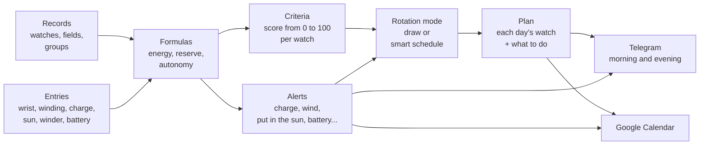

<!-- origem: 4c907a65d62e84d19c7cad74815a0c378cb0a1ea -->

## The central idea: the system knows nothing about watches {#a-ideia-central-o-sistema-não-sabe-nada-de-relógios}

This is the most important design decision, and it is what makes the system useful for any collection. **The code only has
mechanisms; all the knowledge about watches is data you register.**

It doesn't "know" that an automatic has a power reserve, or that a solar charges in the sun. All of that is written in
registered formulas, which you read, edit and test on screen:

```text
Remaining reserve of the mechanical =
  ACUMULA(0; reserva_horas; 1;                                  ← starts at 0, the maximum is the reserve, loses 1 h per hour
          "pulso";  carga_pulso_reserva / carga_pulso_horas;    ← each hour on the wrist recharges this much
          "winder"; carga_winder_reserva / carga_winder_horas;  ← each hour on the winder, this much
          "corda";  reserva_horas)                              ← winding fills it
```

Want to log a "strap change", an "ultrasonic bath" or a "water resistance" field? That's data. Want chronographs to weigh
differently in the draw? That's data. Want an alert to "change the leather strap every year"? Also.

The system comes with a complete initial set (smartwatch, automatic, hand-wound, battery and solar, with the formulas, the
alerts and the criteria of each one), which you adjust to your collection.


<sub>The record fields. Each one applies to a group and everything below it (the power reserve only on mechanicals, the
battery life only on battery watches), and the identifier is the name it has in the formulas.</sub>

---

## How it works {#como-funciona}



### The concepts, one by one {#os-conceitos-um-por-um}

| Concept | What it is | Example |
|---|---|---|
| **Groups** (the tree) | The classification of the collection, in as many levels as you want. Everything registered in a group applies to it and to everything below it. | `Traditional › Mechanical › Automatic` |
| **Fields** | The data of each watch, defined by you: text, number, date, yes/no or list, with unit and default value. | `reserva_horas = 40 h`, `data_pilha`, `loja` |
| **Entry types** | What happens to a watch. It can be **instant** (winding, battery change), **with a value** (charge reading: 68%) or a **session** with start and end (on the wrist, on the winder, in the sun). | `sol`: a session that closes by itself at 6 pm if you forget |
| **Formulas** | Calculations over the fields and the entries. The same formula can have **one version per group**, and the one of the group closest to the watch applies. | `energia` is the battery on the smartwatch, the reserve on the mechanical, the light on the solar and the battery life on the quartz |
| **Alerts** | An expected date by formula, a lead time, a text and the entry that resolves the alert. | *"Wind the Orient: the reserve runs out at 3 pm"*, and the **Winding** button resolves it |
| **Charge limit** | The charge at which the watch needs attention: charge the smartwatch, put the solar in the sun, wind the mechanical. The alert only goes out when the charge reaches it. Each watch can have its own (field *"Alert when the charge reaches"*); empty, the general one in Settings applies. | smartwatch at 20% (the general one), the Samsung at 30% (its own) |
| **Criteria** | How each watch gets a score from 0 to 100 for the draw: weighted parameters, subparameters that measure a field or formula, and ranges that turn the value into a score. | *Time without use* (40%): 0 to 1 day scores 0, 30 days or more scores 100 |
| **Rotation modes** | The rules of the plan: the mode's type (one per week, week and weekend, by day of the week, random, smart schedule or custom), which group to choose from on each day, how many weeks ahead, the choice criterion and, underneath, the script the engine computes. | *"Smartwatch Monday to Friday, one traditional per day on the weekend"* |
| **Plan** | Each day's watch, with what to do (*charge first*, *wind*, *put on the winder*). | `Mon 10/06 · Xiaomi Band · charge before wearing` |

### The formula engine {#o-motor-de-fórmulas}

Formulas are written like in a spreadsheet: numbers with a comma or a point, texts in quotes, `;` separating the arguments,
the operations `+ - * / ^` and the comparisons `= <> < <= > >=` (which give 1 or 0). An empty value propagates through the
calculation, and division by zero gives empty. The basics:

| Function | What it returns |
|---|---|
| `SE(condition; if true; if false)`, `E(...)`, `OU(...)`, `NAO(x)` | the logic: `E` gives 1 if all are true, `OU` if any is, `NAO` inverts |
| `MIN(...)`, `MAX(...)` | the smallest and the largest of the values (ignore the empty ones) |
| `LIMITA(x; min; max)`, `ARREDONDA(x; places)`, `ABS(x)` | x held in the range; rounded; without sign |
| `PADRAO(x; other)`, `VAZIO(x)`, `NADA()` | x, or the other if x is empty; 1 if x is empty; empty, on purpose (`SE(condition; NADA(); calculation)`) |
| `HOJE()`, `AGORA()` | today's date and the current instant, in days (now with the fraction of the day) |
| `DIAS_DESDE(date)`, `DIAS_ATE(date)`, `SOMA_MESES(date; months)` | days since and until a date (negative: already passed); the date plus months, by the calendar |
| `HORAS_USO()` | the hours of a day of use, by the wearing hours in Settings (7 am to 10 pm: 15) |
| `CONFIG("key")` | a number from Settings, like `CONFIG("sol_limiar")` |

And the ones that read each watch's history:

| Function | What it returns |
|---|---|
| `HORAS("pulso"; 30)` | hours on the wrist in the last 30 days |
| `CONTAR("pulso"; 30)` | how many days with use in the last 30 days |
| `DIAS_DESDE_ULTIMO("pulso")` | days since the last time on the wrist |
| `ULTIMO_VALOR("carga")` / `ULTIMA_DATA("pilha")` | the last reading / the date of the last entry |
| `HORAS_APOS("pulso"; "carga")` | hours on the wrist since the last charge reading |
| `ACUMULA(start; max; loss/h; "type"; effect; ...)` | a balance that runs through the history: loses with time and gains with each entry |
| `MEDIDO("uso")` / `MEDIDO("repouso")` | the real battery drain, measured by your charge readings |
| `EM_SESSAO("winder")` | 1 if the session is open now (the watch is on the winder) |
| `MEDIA_COLECAO("uso_30d")` | the average of a variable over the whole collection |

And the rotation ones (the modes' script; outside it, the day is the one of the moment of the calculation):

| Function | What it returns |
|---|---|
| `DIA_SEMANA()`, `SEMANA_DO_ANO()` | the weekday (1 Monday to 7 Sunday) and the week of the year (ISO) of the day being built |
| `NO_GRUPO("Tradicional › Quartzo")` | 1 if the watch is at that point of the tree or below (the name, the path or `#id`; `"todos"`: 1 for all) |
| `RELOGIO("Seiko SKX")` | 1 if it is that watch (by name or by id) |
| `ESCOLHIDO_HA(1)`, `VEZES_NO_PLANO(7)` | 1 if the watch was the plan's one n days ago (1: yesterday; -1: tomorrow, when it is already in the plan); how many days it had in the plan in the last n days |
| `ESCOLHA(n; a; b; c)` | the n-th of the values (only it is calculated): `ESCOLHA(DIA_SEMANA(); …)` gives one value per weekday |
| `SORTEIO()` | a number from 0 to 1, from the same RANDOM.ORG batch as the draws |

And the variable `nota_criterios`: the watch's score by the criteria, at the moment of the calculation.

On the **Definitions** page every formula has the **Test on all watches** button, which shows the result on each watch before
saving.

### Totals {#os-totais}

Totals also belong to the formula engine, but they look at **all the watches shown at once** (the ones the filter of the
table on the Today page leaves). They are in the **Totals** tab of the **Definitions** page: each total has the table
**column** where it goes (or none), the **name**, the **expression**, the boxes **Show in the totals footer** and **Show on
the totals page**, the **width** of its box on the page (narrow or wide) and the **format** of the numbers (number, whole
number, with 2 decimals, money, percentage, date or days). Only the totals of a column go to the footer, under it; the
others, as many as you want, stay only on the **totals page** (menu **Collection**, or **See all totals** under the table,
which takes the same filter). Several totals in the same column go one under the other, in the order of the list (↑ ↓), and
**Test on all watches** shows the result before saving.

| Total function | What it gives |
|---|---|
| `CONTA()`, `CONTA(x)` | how many watches; how many have `x` filled in |
| `CONTA_SE(condição)` | how many pass the condition: `CONTA_SE(carga <= 20)` |
| `DISTINTOS(x)` | how many different values: `DISTINTOS(tipo)` |
| `SOMA(x)`, `MEDIA(x)`, `MEDIANA(x)`, `MENOR(x)`, `MAIOR(x)` | the usual calculation, with the ones that have `x` (for a date, the average is a date) |
| `QUEM_MAIOR(x)`, `QUEM_MENOR(x)` | the watch with the highest and the lowest value, with the value next to it |
| `AGRUPADO(chave; conta; limite)` | a small table: one row per value of the key and the total row; the `conta` (without it, `CONTA()`) goes in each row, done only with that row's watches, and in the total, with all of them; `limite` shows the ones that have the most and joins the rest in "others" |
| `FAIXAS(x; 25; 50; 75; 100)` | a small table by ranges ("up to 25", "26 to 50"...), the ones without `x` in "no value", and the total |

Inside them works everything that works in a formula (the fields, the formulas, `SE`, `DIAS_DESDE`...), calculated on each
watch, and also what each column of the table shows: `codigo`, `nome`, `tipo`, `estado`, `disponivel`, `em_uso`, `carga`,
`ultimo_uso`, `manutencao_data`, `manutencao_nome`, `encostado_data`, `avisos` (how many alerts it has) and `posse`. Outside
them, only numbers, texts and the functions that don't need a watch (`SE`, `MIN`, `ARREDONDA`, the arithmetic). The new
functions `MES(data)`, `ANO(data)` and `MES_ANO(data)` serve to group by month and by year, and also work in formulas.
Examples:

| Total | Expression |
|---|---|
| Available and unavailable | `AGRUPADO(SE(disponivel; "disponíveis"; "indisponíveis"))` |
| By type | `AGRUPADO(tipo)` |
| Charge ranges | `FAIXAS(carga; 25; 50; 75; 100)` |
| Idle for | `FAIXAS(DIAS_DESDE(ultimo_uso); 7; 30)` |
| What to do (the 3 that appear most and "others") | `AGRUPADO(manutencao_nome; CONTA(); 3)` |
| Purchases per month | `AGRUPADO(MES_ANO(data_compra))` |
| Value by type | `AGRUPADO(tipo; SOMA(valor_compra))` |
| The most expensive | `QUEM_MAIOR(valor_compra)` |
| Who has the most to do | `QUEM_MAIOR(avisos)` |

A new installation (and migration v31) already comes with a small table in each footer column and with the boxes of the
totals page; you change, delete or create your own.

### Each watch's score (criteria) {#a-nota-de-cada-relógio-critérios}

The criteria that come ready, for all watches:

| Parameter | Weight | Measures |
|---|---:|---|
| Time without use | 40 | days since the last time on the wrist: the longer it sits, the higher the score |
| Balance of use | 30 | use in the last 30 days compared with the collection's average: whoever was little used goes up |
| Preference | 20 | your score for the watch (0 to 100) |
| Novelty and value | 10 | how long ago it was bought and how much it cost (making the most of the investment) |

Each group, and even each watch, can have its own set. The smartwatch, for example, also weighs the **energy** (the charge
now and how many days it lasts), so as not to draw a watch that will die at noon. The **Criteria** page shows the whole
calculation of each score: each range, each weight and each point, and beside each criterion's score an arrow says which way
it pulls the final score: **↑** green (score above 50, the neutral point: pulls up), **↓** red (below 50: pulls down) or
**↔** brown (exactly 50, or no weight: neutral, pulls neither way).

The sets that come ready, in full. A parameter's score is the average of its subparameters' scores, by each one's weight; the
watch's score is the average of the parameters, by weight. Each subparameter reads a variable (a field or a formula) and gives
the score by the range the value falls in; a subparameter without a value (an empty field, a value outside every range) is
left out, and the others share its weight. Everything is edited on the **Criteria** page, and **Restore the initial criteria**
goes back to these.

**All watches**

| Parameter | Weight | Subparameter (the variable, the weight within the parameter) | The ranges: the value → the score |
|---|---:|---|---|
| Time without use | 40 | Days without use (`dias_sem_uso`) | 0 to 1 → 0; 1 to 3 → 30; 3 to 7 → 60; 7 to 14 → 80; 14 to 30 → 95; 30 or more → 100 |
| Balance of use | 30 | Use in the last 30 days, compared to the average (`uso_vs_media`) | 0 to 25 → 100; 25 to 60 → 80; 60 to 100 → 60; 100 to 140 → 35; 140 to 200 → 15; 200 or more → 0 |
| Preference | 20 | Your score for the watch (`preferencia`) | 0 to 20 → 0; 20 to 40 → 25; 40 to 60 → 50; 60 to 80 → 75; 80 to 100 → 100 |
| Novelty and value | 10 | Novelty: days since purchase (`dias_desde_compra`, 60) | 0 to 15 → 100; 15 to 45 → 80; 45 to 120 → 55; 120 to 365 → 40; 365 or more → 30 |
|  |  | Make the most of the investment: price paid (`valor_compra`, 40) | 0 to 300 → 30; 300 to 800 → 50; 800 to 1500 → 70; 1500 or more → 90 |

**Smartwatch**

| Parameter | Weight | Subparameter (the variable, the weight within the parameter) | The ranges: the value → the score |
|---|---:|---|---|
| Energy | 30 | Charge now (%) (`energia`, 50) | 0 to 15 → 0; 15 to 30 → 25; 30 to 50 → 55; 50 to 80 → 85; 80 to 100 → 100 |
|  |  | Days of use the charge lasts (`dias_de_carga`, 50) | 0 to 1 → 0; 1 to 2 → 30; 2 to 4 → 60; 4 to 7 → 85; 7 or more → 100 |
| Autonomy | 15 | Smartwatch autonomy (`autonomia_dias`) | 0 to 2 → 10; 2 to 4 → 40; 4 to 7 → 70; 7 to 14 → 90; 14 or more → 100 |
| Time without use | 25 | Days without use (`dias_sem_uso`) | 0 to 1 → 0; 1 to 3 → 30; 3 to 7 → 60; 7 to 14 → 80; 14 to 30 → 95; 30 or more → 100 |
| Balance of use | 15 | Use in the last 30 days, compared to the average (`uso_vs_media`) | 0 to 25 → 100; 25 to 60 → 80; 60 to 100 → 60; 100 to 140 → 35; 140 to 200 → 15; 200 or more → 0 |
| Preference | 10 | Your score for the watch (`preferencia`) | 0 to 20 → 0; 20 to 40 → 25; 40 to 60 → 50; 60 to 80 → 75; 80 to 100 → 100 |
| Novelty and value | 5 | Novelty: days since purchase (`dias_desde_compra`, 60) | 0 to 15 → 100; 15 to 45 → 80; 45 to 120 → 55; 120 to 365 → 40; 365 or more → 30 |
|  |  | Make the most of the investment: price paid (`valor_compra`, 40) | 0 to 300 → 30; 300 to 800 → 50; 800 to 1500 → 70; 1500 or more → 90 |

**Traditional › Mechanical**

| Parameter | Weight | Subparameter (the variable, the weight within the parameter) | The ranges: the value → the score |
|---|---:|---|---|
| Power reserve | 25 | Reserve now (%): empty, needs to run (`energia`) | 0 to 10 → 100; 10 to 30 → 85; 30 to 60 → 60; 60 to 90 → 35; 90 to 100 → 20 |
| Mechanical care | 15 | Stopped needs to run (lubrication) (`dias_sem_uso`, 50) | 0 to 7 → 20; 7 to 30 → 60; 30 to 90 → 90; 90 or more → 100 |
|  |  | Service up to date (`dias_ate_revisao`, 50) | 0 to 30 → 20; 30 to 180 → 60; 180 or more → 100 |
| Time without use | 25 | Days without use (`dias_sem_uso`) | 0 to 1 → 0; 1 to 3 → 30; 3 to 7 → 60; 7 to 14 → 80; 14 to 30 → 95; 30 or more → 100 |
| Balance of use | 20 | Use in the last 30 days, compared to the average (`uso_vs_media`) | 0 to 25 → 100; 25 to 60 → 80; 60 to 100 → 60; 100 to 140 → 35; 140 to 200 → 15; 200 or more → 0 |
| Preference | 10 | Your score for the watch (`preferencia`) | 0 to 20 → 0; 20 to 40 → 25; 40 to 60 → 50; 60 to 80 → 75; 80 to 100 → 100 |
| Novelty and value | 5 | Novelty: days since purchase (`dias_desde_compra`, 60) | 0 to 15 → 100; 15 to 45 → 80; 45 to 120 → 55; 120 to 365 → 40; 365 or more → 30 |
|  |  | Make the most of the investment: price paid (`valor_compra`, 40) | 0 to 300 → 30; 300 to 800 → 50; 800 to 1500 → 70; 1500 or more → 90 |

**Traditional › Quartz › Battery**

| Parameter | Weight | Subparameter (the variable, the weight within the parameter) | The ranges: the value → the score |
|---|---:|---|---|
| Battery life | 15 | Battery life (%) (`energia`) | 0 to 10 → 10; 10 to 30 → 50; 30 to 100 → 70 |
| Service | 10 | Service up to date (`dias_ate_revisao`) | 0 to 30 → 20; 30 to 180 → 60; 180 or more → 100 |
| Time without use | 35 | Days without use (`dias_sem_uso`) | 0 to 1 → 0; 1 to 3 → 30; 3 to 7 → 60; 7 to 14 → 80; 14 to 30 → 95; 30 or more → 100 |
| Balance of use | 25 | Use in the last 30 days, compared to the average (`uso_vs_media`) | 0 to 25 → 100; 25 to 60 → 80; 60 to 100 → 60; 100 to 140 → 35; 140 to 200 → 15; 200 or more → 0 |
| Preference | 10 | Your score for the watch (`preferencia`) | 0 to 20 → 0; 20 to 40 → 25; 40 to 60 → 50; 60 to 80 → 75; 80 to 100 → 100 |
| Novelty and value | 5 | Novelty: days since purchase (`dias_desde_compra`, 60) | 0 to 15 → 100; 15 to 45 → 80; 45 to 120 → 55; 120 to 365 → 40; 365 or more → 30 |
|  |  | Make the most of the investment: price paid (`valor_compra`, 40) | 0 to 300 → 30; 300 to 800 → 50; 800 to 1500 → 70; 1500 or more → 90 |

**Traditional › Quartz › Solar**

| Parameter | Weight | Subparameter (the variable, the weight within the parameter) | The ranges: the value → the score |
|---|---:|---|---|
| Light | 25 | Light charge (%) (`energia`) | 0 to 30 → 80; 30 to 70 → 65; 70 to 100 → 50 |
| Service | 10 | Service up to date (`dias_ate_revisao`) | 0 to 30 → 20; 30 to 180 → 60; 180 or more → 100 |
| Time without use | 30 | Days without use (`dias_sem_uso`) | 0 to 1 → 0; 1 to 3 → 30; 3 to 7 → 60; 7 to 14 → 80; 14 to 30 → 95; 30 or more → 100 |
| Balance of use | 20 | Use in the last 30 days, compared to the average (`uso_vs_media`) | 0 to 25 → 100; 25 to 60 → 80; 60 to 100 → 60; 100 to 140 → 35; 140 to 200 → 15; 200 or more → 0 |
| Preference | 10 | Your score for the watch (`preferencia`) | 0 to 20 → 0; 20 to 40 → 25; 40 to 60 → 50; 60 to 80 → 75; 80 to 100 → 100 |
| Novelty and value | 5 | Novelty: days since purchase (`dias_desde_compra`, 60) | 0 to 15 → 100; 15 to 45 → 80; 45 to 120 → 55; 120 to 365 → 40; 365 or more → 30 |
|  |  | Make the most of the investment: price paid (`valor_compra`, 40) | 0 to 300 → 30; 300 to 800 → 50; 800 to 1500 → 70; 1500 or more → 90 |

And there is a **rotation guarantee**: no watch sits idle for more than N days (21 by default). It applies **before** the
score: if some candidate has already passed the limit, it wins outright, the one idle the longest first. Only when nobody has
passed the limit does the score decide.

The idle days are the **Days without use** formula, which you can edit in Definitions: the days since the last time on the
wrist and, for a watch that has **never been worn**, the days since purchase (without a purchase date, 9999, the idlest of
all). So a watch bought yesterday doesn't jump the queue, and two never-worn ones don't tie: the one bought earlier has been
waiting longer.

So you are never left wondering, **each day of the plan keeps the reason for the choice**, in one sentence, and it appears
below the watch on the Today page and the Plan page: *"Rotation guarantee: never worn, in the collection for 38 days, beyond
the limit of 21 days without use"*, *"Draw by score, among 5 candidates: score 70.2, 16.4% chance"*, *"The highest score
(91.2). Stays 5 days in a row"*, *"Stays on the wrist: day 2 of 5 in a row"*, *"Chosen by hand"*.

### The rotation modes {#os-modos-de-rodízio}

The modes are on the **Rotation modes** page (menu **Rotation**). Each mode has a **type**, and the type's screen asks only
for what makes sense in it:

- **One per week**: a watch for the whole week, from its first to its last day (Monday to Sunday, or Sunday to Saturday: the week starts on
  the day chosen in the Settings, **The week starts**). You say where it comes from (the collection, a group or a fixed
  watch) and the choice criterion.
- **Week and weekend**: two stretches, Monday to Friday and Saturday and Sunday, each with its own group and with **one
  watch for the stretch** or **one per day**. The ready-made one: the smartwatch during the week, one traditional per day at
  the end of it. With the week starting on Sunday, Saturday and Sunday are still a single stretch (Saturday's watch stays
  on Sunday).
- **By day of the week**: one watch per day, and each weekday says where it comes from (a group, a fixed watch or none: free
  day).
- **Random every day**: one per day, all with the same chance, with no criterion or rotation guarantee.
- **Smart schedule**: plans the whole period at once, simulating the charge (see [below](#a-escala-inteligente)).
- **Custom**: you write the script (see [The mode's script](#o-roteiro-do-modo)).

In the first three, the **choice criterion** is the draw: by the **highest score**, by **draw by score** (the score becomes
the chance), **random** or by **queue** (whoever has been waiting the longest). With the **cycle** on, a watch only comes back
after all the candidates have had their turn in the week. The **Rotation mode** panel on the Today page chooses the mode, the
criterion and the rotation guarantee; **Apply mode** only marks: nothing in the plan changes until you click **Draw again**.

**Draw again** rebuilds what the mode drew and leaves the days chosen by hand and the free days as they are (the ones from
the Manual rotation, for example); the message says how many stayed (*"Left as they were: 7 free days..."*). With the
**Overwrite everything** box checked, everything the plan has from the start of the draw on goes away (from tomorrow, from
today or from the first day of the next week), by hand, free or drawn, and the mode builds everything again; the
confirmation warns you first, and the message says how many days by hand and free days were overwritten.

**The weeks.** Outside the schedule, each mode says **how many weeks ahead** the plan comes built (1 to 8; the list shows the
weeks with their dates). The plan goes up to the last day of the last of them: Sunday, or Saturday with the week starting on
Sunday (with a single week, on the last day of the week the plan also brings the first of the next one, for the day-before
reminder), and the following week comes in when its turn comes. The week starts on the day chosen in the Settings (**The
week starts**: on Monday, the default, or on Sunday), and the cycle, the next week and the watch for the whole week count
from it. With more than one week,
**Draw again** also has **next week**: it comes out of the current mode, with the days still left this week counted as use,
as if you had already worn the watches in the plan (the use counts in the days without use and in the score; the charge does
not, because no one knows whether the watch will be charged). Each day is chosen this way, with the earlier days of the plan
already on the wrist, which is why Monday's watch does not come back on Tuesday just because it looks idle. The days chosen
by hand stay. On the smart schedule there is no next week: it already plans its own period.

### The mode's script {#o-roteiro-do-modo}

Underneath, every mode is a **script**: five lines the formula engine computes for each available watch, at the start of each
day of the plan, with the previous days already counted as use. The ready-made modes generate the script from their screens
(the page shows the generated script, read-only); in **Custom** you write your own, one line per name (`name = expression`,
in the same language as the formulas of the definitions; lines starting with `#` are comments; the other names are your own
variables):

| Line | What it says | If missing |
|---|---|---|
| `candidato` | 1: the watch enters that day's choice; 0: it does not | `1` (all) |
| `nota` | the watch's score on that day | `nota_criterios` (the score by the criteria) |
| `peso` | the chance in the draw. All 0: the highest score wins. All equal: all with the same chance. Otherwise, each weight is the chance | `0` |
| `dias` | how many days in a row the chosen one stays (as long as the following days are vacant and it is still a candidate) | `1` |
| `garantia` | 1: goes ahead of everyone (among several, the one idle the longest; tie: the one registered first) | whoever passed the rotation guarantee (`max_sem_uso`) in days without use |

**How the engine decides each day**, in this order: yesterday's watch stays out, if there is another; the cycle, if the mode
uses it; the script says who is a candidate; whoever has `garantia` wins outright; otherwise the `peso`. The chosen one stays
the `dias` the script gave, and the reason for the choice is saved in the plan. The same engine decides the **Draw this day
by** of each day's selector and the **Decide for me** of the manual rotation.

An example: mechanicals during the week, whatever the battery allows on the weekend, and whoever has been idle for more than
3 days with 100 times the chance of the others:

```
util      = DIA_SEMANA() <= 5
candidato = SE(util; NO_GRUPO("Mecânico"); 1)
peso      = SE(dias_sem_uso > 3; 100; 1)
dias      = SE(NO_GRUPO("Smartwatch"); dias_seguidos; 1)
```

The **Test on all watches** button computes the script on a day (today, or one of the next 13) and shows each line on each
watch and who would go. Besides the formula functions, the script has `DIA_SEMANA()` (1 Monday to 7 Sunday), `SEMANA_DO_ANO()`,
`NO_GRUPO("group")`, `RELOGIO("name")`, `ESCOLHIDO_HA(n)`, `VEZES_NO_PLANO(n)`, `ESCOLHA(n; a; b; …)` and `SORTEIO()` (the table in
[The formula engine](#o-motor-de-fórmulas)) and the variable `nota_criterios`. Through the API: `recurso=roteiro` tests;
`recurso=modos`, `acao=salvar` with `tipo=personalizado` and `roteiro` saves.

**Where the draw comes from.** Every draw in the system (the fully random mode, the draw by score or by weight and the
script's `SORTEIO()` function) uses truly random numbers, from outside, in this order:

1. **[RANDOM.ORG](https://www.random.org/)**: randomness from atmospheric noise (it measures the variation of microwaves in the
   air and turns it into bits);
2. when it is down (or the day's quota is used up), **ANU QRNG**, the quantum generator of the Australian National University
   (it measures quantum fluctuations of light). The system uses the old address, `qrng.anu.edu.au/API/jsonI.php`, which answers
   without a key (the new one, `api.quantumnumbers.anu.edu.au`, requires an API key);
3. without both (no internet on the server, for example), **PHP's secure generator** (`random_int`, the operating system's:
   the equivalent of Python's `secrets`).

The numbers arrive in a batch (64 16-bit numbers per request), and each draw uses only what it needs, discarding what goes
beyond the last whole multiple of the range: every result has exactly the same chance. Each service has 4 seconds to answer;
if both fail, the system uses PHP's and doesn't try again for 10 minutes (so no page is left waiting). The reason of each
drawn day says where the number came from (*"Simple draw, among 4 candidates, all with the same chance (RANDOM.ORG)."*), and
**Settings** shows the last batch (the **Draws** box). What is secret doesn't use these services: the password salt and the
names of the document files keep using PHP's generator, because a number that travels over the internet is no good for
secrets.

### Erase the schedule {#apagar-a-programação}

At the bottom of the **Plan** page (the main place: the **Erase the schedule** box, at the end of the page, after the day by
day) and in the **Rotation mode** box on the Today page (each below a line, like **Draw again**):

- **Erase a period**: **From** and **To**; one of the two can stay empty (only **From** erases from it to the end of the
  plan; only **To**, from tomorrow to it). The period's days leave the plan, from tomorrow on (the ones chosen by hand, the
  drawn ones and the free ones), and the rotation mode builds these days again. The **Erase** button asks for confirmation.
- **Erase all**: clears the whole schedule, from tomorrow on: the days chosen by hand, the drawn ones and the free ones.
  Ticking **Including today**, it erases from today on (if another watch comes up for today, it becomes the one on the wrist
  from now on). Then the rotation mode builds the plan again, from scratch: up to the last day of the last of the mode's weeks (the
  following ones, when they come); in the smart schedule, the whole schedule. The schedule doesn't stay empty because the system always
  builds the missing days by the active mode; for days without a watch, mark *free* in the Manual rotation.

### The manual rotation {#o-rodízio-manual}

In the **Rotation mode** box on the Today page, the last option in the list is **Manual rotation**: you choose the watch for
each day of a period yourself (the holidays, a trip, a whole month). Set the start (**From**) and the end (**To**) and click
**OK**:

- the days appear **7 at a time**, with the date, the weekday, what the plan has on that day now and a selector;
- with more than 7 days, the pages are below: **‹ Previous**, **1 2 3 …**, **Next ›**. What you choose on one page is kept
  while you move through the others; nothing changes before saving;
- each day's selector has the available watches, **Decide for me**, the group **Draw this day by** (*the highest score*,
  *draw by score*, *random* or *queue*: the day is drawn when saving by that way, without yesterday's and tomorrow's, like
  Decide for me) and **No watch (free day)**. At the start, it shows the watch the day already has chosen by hand; a free day appears as free; and the rest (drawn or still without a watch), as
  *Decide for me*;
- **Save the manual rotation** saves the whole period: the days with a watch are chosen by hand, the *Decide for me* and the
  *Draw this day by* ones are decided right then by the system and are also saved (the reason for each one appears in the
  plan), and the free ones are left without a watch. If today is in the period and you chose another watch, it becomes the one on the wrist from now on;
- to erase a period's days (the rotation mode builds these days again) or erase everything, see
  [Erase the schedule](#apagar-a-programação).

Outside the period, the usual rotation mode still applies. The days chosen by hand stay even when you draw again or the cron
builds the following week; in the smart schedule, it is rebuilt around them.

**The *Decide for me* criterion:**
1. the **criteria score** (the ones you define in **Criteria**: days without use, balance, preference, charge...), calculated
   at the start of each day, with the previous days of the period (the ones you chose and the ones it decided) already counted
   as use;
2. the **rotation guarantee** comes first: whoever passed the limit of days without use goes first, the one idle the longest
   before;
3. **yesterday's** and **tomorrow's** watch are left out, if there is another. So a watch doesn't repeat right next to the one
   you chose;
4. on a tie, the one registered first wins.

Today, with *Decide for me*, the watch already in the plan stays.

### The smart schedule {#a-escala-inteligente}

It is the most complete mode. Instead of drawing week by week, it **plans from 7 days to 2 years at once**, simulating day by
day:

1. it calculates each watch's score with that day's simulated state;
2. it chooses the watch by the highest score (the schedule's script: `peso = 0`); the smartwatch stays on the wrist for the
   days the battery lasts (up to 7: the `dias_seguidos` formula);
3. it simulates the use (the wrist session in the wearing hours) and its effect on everyone's charge and reserve;
4. it checks the alerts: if the chosen one will need charging or winding, it notes the action on the day (*"charge before
   wearing"*) and simulates the entry that resolves it;
5. it moves on to the next day.

Every morning the cron **replans from the real state**. If you wore another watch, forgot to charge or logged a different
reading than expected, the plan corrects itself.

### Consumption measured by the readings {#gasto-medido-pelas-leituras}

The smartwatch's record says "lasts 5 days". Reality disagrees, and changes as the battery ages. That's why **each charge
reading you log is compared with the previous one**, and the interval between the two becomes a measurement: how much it
dropped, how many hours it spent on the wrist and how many off the wrist (stored, switched off), and how you marked each
reading (in use or at rest). The Settings' use hours count as wrist on their own, and your markings (*Put on*, *Took off*)
rule. A rise in the reading is a recharge: a new stretch begins. And an interval with another session in the middle (the
watch went to the charger) doesn't measure either: the measurement only knows how to separate wrist and stored.

**How to turn the measurements into the two consumptions (on the wrist and off the wrist) is your choice: there are five
engines.** All of them stay in the system; none deletes anything, and switching engines only changes the calculation (the
measurements are the same). The choice is made in three places, and the upper one overrides the lower ones:

| Level | Where it is chosen | What it does |
|---|---|---|
| 1. **The collection** | **Battery drain: how to calculate (applies to every watch)**, in Settings (`gasto_motor`) | applies to every watch in the collection. Empty (*Individual (on the watch or the group)*): the two levels below decide. |
| 2. **The watch** | the **How to calculate the battery drain** field (`gasto_motor`), in the watch's record | applies only to it. Empty: the group's. |
| 3. **The group** | the **default** of that same field (in **Records › Fields**: the field sits at the root, and applies to the watches from where it is downwards) | applies to the watches that didn't choose. Empty: engine 1. |

On a watch without charge readings (a mechanical, a solar), the choice does nothing. The **Battery consumption** box says which
engine did the calculation and where the choice came from (*Calculated by: By the marking: two separate rates — the
collection's choice, in Settings*).

| Engine | What it does |
|---|---|
| 1. **By the recorded hours (the original engine)** (`horas`) | the default. Each measurement is split by the wrist markings minute by minute (so many hours on the wrist, so many off), and the two consumptions come out together from all the measurements in the window, each one weighing the time it covers. It is the calculation the system has always done. |
| 2. **By the recorded hours, with readings and registration (robust)** (`robusto`) | the same hours, but the calculation is done on the readings, all with the same weight, the one that doesn't fit with the others weighs less and the record is the starting point (the three precautions below). Gives the uncertainty (±). |
| 3. **By the marking: two separate rates** (`marcacao`) | what you mark rules. A reading marked **in use** measures the consumption on the wrist: the drop since the previous reading, divided by the whole time of the interval (in days of use). A reading marked **at rest** measures the consumption off the wrist, the same way. The two calculations **never cross**: the consumption in use comes only from the readings in use, and the one at rest only from the ones at rest; the recorded wrist doesn't enter. With the robust calculation on each side (the reading that doesn't fit weighs less; the record is the starting point), also with the uncertainty. |
| 4. **Registration only** (`cadastro`) | the record's *Decay in use* (or *Real battery life in use*) and *Decay stored* always apply. The measurements keep being made and stay in the history (the **Consumption measurements** table), but enter no calculation at all: `MEDIDO` gives empty. |
| 5. **By the registration formulas** (`formulas`) | whatever the `taxa_uso` and `taxa_repouso` formulas give applies, for you to build your own calculation in **Records › Formulas**. In them, `MEDIDO("uso")` and `MEDIDO("repouso")` are engine 3's calculation, and the **LEITURAS**, **QUEDA**, **DIAS_MEDIDOS**, **MEDIA_TAXA**, **MEDIANA_TAXA** and **ULTIMA_TAXA** functions give the pieces of the measurements by the marking (how many, the sum of the drops, the sum of the days, the average, the median and the last rate, of each kind, in the last N days or in the Settings' window): `MEDIANA_TAXA("uso")`, or `PADRAO(QUEDA("uso"; 30) / DIAS_MEDIDOS("uso"; 30); decaimento_uso)`. In the other engines the formulas also apply (the consumption comes from them); the difference is that this one says: the calculation is yours. |

**Which measurements enter** is another Settings choice, **Measured drain: count by**: **days** (the measurements of the last
so many days, 90 by default) or **readings** (the last so many measurements of each kind, in use and at rest, 20 by default).
With none in the window, the earlier ones enter. It applies to engines 1, 2, 3 and 5 (and to the formula functions without
the N of days).

Between two recharges, the charge drops in a straight line with the time on the wrist and the time stored:

```text
reading = charge at the start − consumption in use × days of use − consumption stored × days stored (+ the reading's error)
```

Consecutive readings, with no recharge in between, form a **stretch**. Each stretch has its own starting charge (which the
calculation finds out), and the two consumptions apply to all the stretches. In engine 2, with the readings in the window,
the system finds **the two consumptions together**: the ones that best explain all the readings. A night between two readings
(only off the wrist) pins down the consumption stored; the days on the wrist, already knowing that one, pin down the
consumption in use. Every measurement of 1 hour or more enters, even the one with no drop at all (it says the consumption is
small). The more readings, the more precise. In engine 3 the same calculation is done twice, once with only the readings in
use and once with only the ones at rest.

The robust calculation (engines 2 and 3) takes three precautions, each with a reason:

1. **The calculation is done on the readings, and they all weigh the same.** The error comes from the reading: the watch
   shows the charge in whole numbers, and its meter also errs a little. That error is the same in a reading taken 2 hours or
   2 weeks after the previous one, so no reading is worth more than another for covering more time. And, as the calculation
   looks at the readings (not at the drops), a wrong reading is a single point, instead of spoiling the two drops around it.
2. **The reading that doesn't fit with the others weighs less (robust regression).** After the calculation, the system sees
   how much it misses each reading by. The normal error comes from the readings themselves (never less than half a point);
   the reading that is much farther than normal comes to weigh less, and the farther it is the less it weighs, and the
   calculation is redone. It is not thrown away: it just weighs less. A common case: the **100% right after charging**, which
   many watches hold for a while when the real charge is already dropping.
3. **The record is the starting point.** The record's decay (or battery life) enters the calculation as the expected value,
   with a leeway of half of it. With few readings, the consumption stays near the record; with many, the readings rule. And,
   when the readings don't separate use from stored (only readings with the watch stored, for example), the consumption they
   don't measure stays the record's.

The result of these two engines comes with the **uncertainty** (± one standard deviation): *22.09% ± 1.48 per day of use*
means the consumption in use is, with good odds, between 20.6% and 23.6%. It shrinks as readings come in.

In the **Consumption measurements** table (in **Charge over time**), each measurement shows the marking of the two readings
(*in use → in use*) and says whether it enters the calculation: *yes*; *partly: weighs 31%*, with the reading that doesn't
fit well with the others (*the 100% reading doesn't fit well with the others: the calculation is off by 4.5 points on it*);
or *no* (outside the window, taken out of the calculation, the two readings marked differently in engine 3, or engine 4).
The reading's message also warns when the new reading doesn't fit with the others. Each row has the **Take out of the
calculation** button (or **Put in the calculation**), for when you know something the system doesn't: the measurement leaves
or comes back without deleting anything (applies in engines 1, 2, 3 and 5).

When logging the charge, you say how the watch was at the time of the reading: in the **Mark** box, **Log charge reading in
use** (on the wrist) or **Log charge reading at rest** (stored); in the *Log the charge* warning on the Today page, the **In
use** and **At rest** buttons. **The marking is stored in the reading** (the `estado` column; in earlier readings, and in
the ones a script logs without saying, what the recorded wrist said at that moment applies). It is what engine 3 uses, and
serves as a check for the others. If the system had the watch the other way at that moment (the use hours put it on the
wrist on their own, but it stayed stored; or a *Put on* was missing), the screen asks before saving: *I have it on the wrist
now. Save the reading as at rest anyway?* **Continue** saves as you marked it (through the API, the response comes with
`confirmar: true` and the question, and the entry is only saved by sending it again with `confirmar=1`); nothing is blocked,
and the recorded wrist doesn't change: if it was wrong, fix it in **Correct or delete a marking**. The **Correct** box also
changes the marking of a reading already saved.

Both consumptions are in the **Battery consumption** box, on the watch's page:

- **Calculated by**: the engine that did the calculation and where the choice came from (the collection, the watch, the
  group, or the default).
- **On the wrist** and **Off the wrist (switched off)**: the consumption that counts in the calculation, in bold, with the
  uncertainty (± ..., in engines 2 and 3), and where it comes from (measured, with the record's next to it to compare, or only
  from the record, when there is no measurement yet or the engine is 4).
- Under each one, **in the record**: the record fields the record's consumption comes from (the *Decay in use*, the
  *Real battery life in use*, the *Decay when stored*), with the value and whether it was entered or is the default.
- **In the 90 days before those**: the two consumptions measured in the previous window. It is the comparison that shows the
  battery aging: if the consumption on the wrist went from 4.9% to 5.7%, it no longer holds the charge as it used to.

The same appears again, next to what is similar, in the **Watch data** box: in the **Record** table, under the entered decay
(and battery life), the **calculated from the readings** and what counts **in the calculation**; in the **Calculated now**
table, under the consumption formulas (*taxa_uso*, *taxa_repouso*), the measured and the record's. And each measurement, one by
one, is in **Charge over time › Consumption measurements**.

Measurements older than the window leave the calculation on their own. That's why the adjustment to ageing is automatic:
there's no need to touch the record. The record's "Decay in use" and "Decay stored" only apply while there is no measurement
(or always, in engine 4).

---

## Several people: accounts, collections and access {#várias-pessoas-contas-coleções-e-acesso}

The system belongs to **several people**, each with their own **account**, and each account with **its own collections**. A
collection has its watches, history, plan, Settings, message destinations and calendars; what you see and save on any page
always belongs to the collection chosen in the **menu selector** (it shows up when there is more than one). The first user of
the installation is the **master**: they take care of the whole system.

| Concept | What it is |
|---|---|
| **Account** | the login, the password, the e-mail (to recover the password, receive invitations and notices), the language and the time zone. Each person takes care of their own in **My account** (menu **Account › My account**). |
| **Collection** | a named set of watches belonging to an **owner**. A person can have several ("My collection", "My father's"). It is born **with the starter set** (the groups, fields, formulas, alerts, criteria and modes ready, in the creator's language), **empty** (only the root of the tree) or **with a tree of yours that already exists**. |
| **Group tree** | the groups and their definitions (fields, entry types, formulas, alerts, document categories, group criteria). It belongs to the owner and can serve **several of their collections**: what changes in it applies to all. In **My account** you can copy, rename and delete the trees. |
| **Member** | someone who sees another person's collection (and uses it: marks, logs, changes the day). |
| **Everything of an owner** | someone who sees **all** of a person's collections, also the ones they create later. |
| **Master** | sees all collections, takes care of the accounts (**Users**), the backup and the migrations. |

**How someone gets into a collection that isn't theirs:**

- **Invitation:** in **Approvals**, the owner types the e-mail and chooses what the person will see (one collection, or
  everything of theirs). An e-mail goes out with a link (it lasts `CONVITE_DIAS` days, 7 without the line): whoever has no
  account creates one through the link, and whoever has one signs in and accepts. A **member's** invitation waits for the owner
  to approve. Without e-mail on the server, the link shows on the screen, to send however you like.
- **Request:** in **My account** (or right at sign-up), the person asks for access to a collection, or to everything of an
  owner, with a note, by the **code** the owner gave: the collection's (in the **Collections** table of **My account**) or the
  owner's (in **Your details**, for all their collections). No screen shows the list of accounts or collections, and the request
  shows only the code until the approval: whoever tries codes at random finds out no one's login. The owner gets an e-mail and
  approves or declines in **Approvals**; the person gets the answer by e-mail. Both request screens (Create account and My
  account) carry this step by step in the box **How to ask for access (and why by code)**, and **Your details** tells the
  owner how to give the code.
- **By the master:** in **Users**, **Give access**.

In **Approvals**, the owner also sees **who sees their collections** and removes someone's access; in **My account**, anyone
can **leave** a collection that isn't theirs. Unanswered invitations and requests go away by themselves after `CONVITE_DIAS`
days.

**The open sign-up** (the `cadastro.php` page, without login, with the **Create account** link): the person chooses the login,
the password, the e-mail, the language and how to start (a collection with the starter set, an empty one, or asking for access
to someone's, by the code the owner gave). An account created this way is a **demo** for `DEMO_DIAS` days (30 without the line): the menu shows **Demo: N
days**, an e-mail warns 7 days and 1 day before, and, once expired, the cron deletes the account with everything that is
theirs. The master **makes the account official** (or extends it) in **Users**. With `CADASTRO_ABERTO = false` in
`config.php`, sign-up closes: only those the master creates or who have an invitation get in. The page also has **Forgot my
password**: the link to choose a new password goes by e-mail and lasts 2 hours.

**The master's panel** (**Users**) shows each account with the e-mail, the role, the last access, when it expires, the
collections (with how many watches) and what else it sees, and the actions: **View as** (the whole system as that person sees
it, with a bar at the top and the button to go back), **Make official**, **Extend**, **Back to demo**, **Block**, **Edit** (the
login, the e-mail, the language, the role), **Change the password**, **Transfer the collection** (to another owner: the tree
goes along, or, if it serves other collections of the previous owner, the new owner gets a copy), **Give access** and
**Delete**. A common account left with nothing (no collection, no access, no request or invitation waiting) goes away by
itself.

**Deleting, anywhere, first tells you what goes along.** Deleting a collection, a tree, an account, a watch, a field, a
destination... first shows the list of what goes along (*"Goes along: 4 field values, 2 entries, 12 plan days..."*, with the
affected collections: a tree serves several) and only deletes after you confirm. The document files leave the disk at once.
Through the API, every deletion asks for `confirmar=1`.

## Each watch's record, field by field {#o-cadastro-de-cada-relógio-campo-por-campo}

Every watch has a **name**, a **group**, a **status in the collection**, **available** and a **photo**. The rest are **fields**, and which fields a watch has
depends on its **group**: everything registered in a group applies to it and to all the groups below. That's why "being
automatic" is not a separate flag: it is being in the **Automatic** group (or in a subgroup of it), and thereby inheriting the
wrist and winder fields.

```text
(all watches)             Note, Your score, Purchase, Warranty, Charge limit, Brand, Reference, Link
                          (only for wished ones: Target price, Wish priority)
├── Smartwatch            Real-use autonomy, Drain in use, Drain when stored, On the charger: hours to fill
└── Traditional           Last service, Service every
    ├── Mechanical        Power reserve, Can be wound by the crown
    │   ├── Automatic     On the wrist: hours / reserve, On the winder: hours / reserve
    │   └── Hand-wound    (nothing more: on the wrist it doesn't charge)
    └── Quartz
        ├── Battery       Last battery change, Battery life
        └── Solar         Energy reserve, Direct sun to fill, On the wrist: how much it charges
```

An empty field takes the record's **default** (the "empty" column in the tables below). The fields, the groups and the
defaults are data, not code: you can change everything on the **Definitions** page, and create your own.

### The watch's basics {#o-básico-do-relógio}

| Field | What it is |
|---|---|
| **Name** | how it appears everywhere: on screen, on Telegram and in the calendar. |
| **Group** | its place in the tree. It decides the fields, the formulas (a smartwatch's "charge" is the battery; a mechanical's, the power reserve) and the alerts it gets. |
| **Status in the collection** | **In the collection** (the usual), **Wished** (the wishlist: not yours yet), **Lent** (it's yours, but someone else has it), **Sold** or **Archived**. Only what is in the collection goes into the rotation: in the other statuses the watch is unavailable (the database guarantees it: the `ck_relogio_posse_disponivel` rule), it leaves the draw, the schedule and the alerts, and, when it leaves the collection, its open sessions (on the wrist, in the sun, on the charger) close at once and its days in the plan from tomorrow on are removed and drawn again (today stays, but it no longer goes on the wrist by itself: change it in **change to…**). Its page, documents and history remain. The lent one stays in the table on the Today page (with the **Lent** state) and in the collection's value; the wished, sold and archived ones leave the table and appear on the **Wishlist** page (and in the watch page's selector, under **Outside the collection**). Going back to **In the collection**, it becomes available again. See [The wishlist](#a-lista-de-desejos). |
| **Available** | unticked, it leaves the rotation and the alerts (at the repairer, on a break), but the history stays. Out of the collection, it is always unticked (and the field disappears from the record). |
| **Keep a copy of all its documents in the database** | ticked, every file of the watch (the manual, the invoice, the photos, the videos) also goes to the database, as a backup. It only appears when the collection's Settings don't decide for all (**Copy of the documents in the database (applies to every watch)** empty). See [The watch's documents](#os-documentos-do-relógio): it is the second of the three levels of the copy. |
| **Photo** | just for the screen. In the watch's detail (the panel, or the watch page), resting the mouse on the photo shows a summary of it (the name, the group and the code; the state and the charge; the score and the next day in the rotation; the purchase) and the reminder about the double-click. **Double-clicking** it, or the **Open photo** button below, opens the photo in a floating window, at its size (only in the detail: on the other photos, like the one in *Today is the day for* and the list thumbnails, the click opens the watch); one bigger than the screen appears scaled, without distortion, at the largest size that fits the monitor (and the browser window), with the real size and the scale below. It closes with the ×, with a click outside or with Esc. |
| **Accessories** | the straps, the box, the case, the tools, the charger, the parts: the **Accessories** box in the panel shows its own (the type, the name and the note), and the **Accessories** page adds and changes them (an accessory can belong to a watch or be loose, serving several). |
| **Documents** | the manual, the invoice (in PDF and XML), the souvenir photos, the videos and anything else. See [The watch's documents](#os-documentos-do-relógio). |

### The watch's documents {#os-documentos-do-relógio}

Each watch keeps **as many files as you want**, of any type, each one in a **category**: the manual, the invoice in PDF, the
invoice XML, souvenir photos, videos, a spreadsheet, whatever. Each document has:

| Data | What it is |
|---|---|
| **Category** | where it goes. The ones that come ready: **Manual** (`manual`, any file), **Invoice** (`nota_fiscal`, PDF or image), **Invoice (XML)** (`nota_xml`, XML), **Photos** (`fotos`, images), **Videos** (`videos`, videos) and **Miscellaneous** (`diversos`, any file). They are data: create, rename or delete them in **Definitions → Document categories**. |
| **Title** | how it appears. Empty on upload: the file name. |
| **Date** | the document's date: the occasion of the photo, the day of the video, the date of the invoice. Optional. |
| **Description** | free text: *"at my cousin's wedding"*, *"the first strap change"*. Optional. |
| **The file** | any file, up to the server's limit (see [The size of uploads](#o-tamanho-dos-envios-os-documentos)). |

On the watch page, the **Documents** box shows how many the watch has in each category; each category, and the **Open the
documents** button, open that watch's **Documents** page in a new tab. There:

- **Upload files:** the category, the title, the date, the description and the files. You can choose **several at once** (a
  whole album): they go up one by one, with the progress in percent, and the title, the date and the description apply to all
  (afterwards each one is edited on its own). The category only accepts its types: a photo doesn't go into **Videos**.
- **One tab per category**, and **All**. Inside it, each file opens **by its type**, not by the category:
  - **Photos:** a gallery of thumbnails. A photo opens **full screen**, with the date and the description below; switch with
    the on-screen arrows, the keyboard arrows or by swiping on the phone. **▶ Slideshow** moves on by itself every 4 seconds
    (the space bar turns it on and off; Esc closes). The thumbnails are made by the browser on upload, so the gallery opens fast
    even with large photos.
  - **Videos:** the list, with a box on each and the **↑** and **↓** arrows to put them in order. **▶ Watch the ticked ones**
    plays the ticked ones one after the other, in the page's player, with **Previous** and **Next**. You can skip forward and
    back within the video.
  - **PDF:** **View here** opens the browser's PDF viewer inside the page; **Open in another tab** and **Download**.
  - **XML:** if it is an **NF-e** (the XML of the Brazilian electronic invoice), the page shows the summary: the issuer, the
    number, the series, the date, the value, the products and the access key. And the **Download the XML** button.
  - **Audio:** the player. **Any other file:** the **Download** button.
- **The ⋮ menu of each file:** each photo (in the corner of the thumbnail), each video in the list, each file card and the
  photo viewer itself have the **⋮** button, which opens **Open**, **Download**, **Edit** (a window over the page, with the
  title, the date, the category, the description and the copy in the database) and **Delete** (shows what goes along and asks
  for confirmation).
- At the top, the choice of watch: **All** shows the documents of the whole collection.

**Where the files are kept:** in a **server folder** (`DOCUMENTOS_PASTA` in `config.php`, outside the published folder), from
where the page serves them, **and, if you ask, also inside the database**, whole, as a backup (the `documento_parte` table, in
4 MB pieces: so a large video doesn't hit the limit of a MySQL command or PHP's memory). For what has the copy, **the database
backup is enough**: once the database is restored on a new server, with the folder empty, each file comes back to the folder by
itself when it is opened, or on the cron's next round. When recreating, the system checks the file against the SHA-256 kept at
upload; a file that doesn't match is not recreated. A document that lost the file **and** the copy in the database is lost:
the page warns, and the cron's evening round logs how many there are.

**What goes to the database: three levels**, and the higher one prevails over the lower ones:

| Level | Where it is chosen | What it does |
|---|---|---|
| 1. **The collection** | **Copy of the documents in the database (applies to every watch)**, in Settings (`documentos_copia`) | **All files**: **every** file, of every watch in the collection, also goes to the database. **No file**: **none** goes (not even what the watch or the file asks for). *Individual (on the watch or the file)* (empty): the two levels below decide. |
| 2. **The watch** | the **Keep a copy of all its documents in the database** box, in the watch's record (or the **Keep all of its in the database** button, on its Documents page) | ticked, every file of that watch goes to the database, the existing ones and the ones to come. |
| 3. **The file** | the **Keep a copy of these files in the database too** box, on upload, or **Keep a copy of this file in the database**, in edit | only that file goes to the database. |

**The screen only shows the choice of whoever decides:** with the Settings deciding (all or none), neither the watch's box nor
the files' box appears (the Documents page only says what the Settings order); with the watch keeping all, its files' box
doesn't appear (neither on upload nor in edit), only the **Only the ticked ones** button, to go back. Each owner chooses for
their own collection: the `DOCUMENTOS_COPIA_BANCO` of `config.php`, which applied to the whole server, no longer applies (if
it is still there, the Settings warn).

Ticked at a level and the file doesn't have the copy yet: on upload and in edit it goes right away; when ticking the watch, the
cron copies its files little by little. Unticked and nobody else asks: in edit the copy is removed right away, and through the
watch the cron removes it little by little; **the copy is only removed if the file in the folder is there and matches it**
(the SHA-256), so the document is never left without both. The documents that already had the copy before migration v17 were
marked on the file itself: nothing left the database.

The database grows by the size of the copied files: a 500 MB video is 500 MB more in the database and in its backup. On the
page, each file says where it is (only in the folder, in the folder and in the database, outside the folder) and who asked for
the copy (the Settings, the watch or the file itself).

**The cleanup, by the cron (every minute):** a file that disappeared from the folder comes back from the database; a document
that has the copy requested and doesn't yet have it in the database (the watch was just ticked, or a copy that failed) gets it,
and one that has the copy and nobody asks for it anymore loses it (if the file in the folder matches), up to 256 MB per
minute; the folder of a watch that no longer exists (`r<number>`) is deleted whole; and a file in the folder that belongs to no
document is deleted (only after 10 minutes, because an upload may be halfway). Everything it does goes into the log (**Cron
runs**).

Deleting a document deletes the file and the copy in the database; deleting the watch (or the collection, the tree, the
account) deletes its documents, and the files leave the folder at once. Without the folder configured, the page says what is
missing and doesn't accept uploads.

The documents don't enter any calculation: they are for reference. The numbers the system uses (the power reserve, the
autonomy, the sun time to fill...) stay in the record's fields. A manual the manufacturer only publishes as a web page (Casio
does this) becomes a PDF through the browser itself: open the page and use **Print → Save as PDF**.

The previous system kept one manual per watch in its own database table (migration v13). Migration v16 moves each one to the
documents, in the **Manual** category (with the copy in the database), and deletes the table; the file comes back to the folder
by itself the next minute, through the cron (the same one that recovers a missing file).

### All watches {#todos-os-relógios}

| Field | Empty | What it is and what it's for |
|---|---|---|
| **Note** `observacao` | | Free text. It doesn't enter any calculation. |
| **Your score for the watch (0 to 100)** `preferencia` | 50 | How much you like it. It goes into the *Preference* criterion (weight 20 in the set for all watches): a higher score, more chance in the draw. |
| **Purchase date** `data_compra` | | It goes into the *Novelty and value* criterion: the newly arrived watch goes up in the draw (up to 15 days: score 100; after a year: 30), so you enjoy the novelty. |
| **Price paid** (R$) `valor_compra` | | Also in the *Novelty and value* criterion (*make the most of the investment*): the more expensive one goes up a little (up to R$ 300: score 30; above R$ 1,500: 90). |
| **Where bought** `loja` | | Text, shown in the Purchase box. It doesn't enter any calculation. |
| **Warranty until** `garantia_ate` | | Date. The *"Warranty expiring"* alert goes out 30 days before. |
| **Brand** `marca` | | Text. It doesn't enter any calculation; it appears in the wishlist. |
| **Reference (the model)** `referencia` | | Text: the model, the manufacturer's reference. It appears in the wishlist. |
| **Link (the watch's page)** `link` | | The address of the watch's page (the store, the manufacturer). In the wishlist it becomes the **open the page** link (only those starting with `http://` or `https://`). |
| **Alert when the charge reaches** (%) `carga_minima` | the general one | This watch's **charge limit**: the point at which the alert to charge (smartwatch), put in the sun (solar) or wind/put on the winder (mechanical) goes out. Empty, the type's general one applies: on the smartwatch, the one in Settings (*"Charge when the estimated charge reaches"*, 20%); on the solar, the solar one in Settings (70%); on the mechanical, 0% (the reserve running out). See [The charge alerts](#os-avisos-de-carga). |

### The wishlist {#a-lista-de-desejos}

A watch you want to buy enters the system as **Wished** (on the **Wishlist** page, the **New wish** button; or, in any watch's
record, the **Status in the collection**). It doesn't go into the rotation, the plan or the alerts; it has the page, the photo
and the documents like any other (the ad, the shop-window photo), and two more fields, which only appear on it (the field's
**only for wished ones** flag, on the Definitions page):

| Field | Empty | What it is and what it's for |
|---|---|---|
| **Target price (how much to pay at most)** (R$) `preco_alvo` | | How much you are willing to pay. The Wishlist page adds up the list's target prices. |
| **Wish priority** `prioridade_desejo` | | High, Medium or Low (the field's options: you can change them on the Definitions page). The list goes from the highest to the lowest; without a priority, at the end. |

In a wished watch's panel, instead of the day-to-day boxes (now, charge, score, plan, purchase, Mark), the **Wish** box appears:
the brand, the reference, the target price, the priority and the link. **Bought it?** On the Wishlist page, the **I bought it**
button puts the watch in the collection (available for the rotation) and opens its page, to fill in the purchase (the date,
the price, the store): the history starts there. The fields only for wished ones stay stored, but disappear from the record.
Through the API: `recurso=desejos` (the list) and `recurso=relogio`, `acao=salvar`, `posse=colecao` (the I bought it).

### Smartwatch {#smartwatch}

The smartwatch's "charge" is the battery, in %. The system doesn't read the watch's battery: it is **estimated** from the last
**charge reading** you logged, subtracting what it spent since then (on the wrist and stored) and adding what it charged on the
charger (the **On the charger** session). Without any reading, the charge is unknown.

| Field | Empty | What it is and what it's for |
|---|---|---|
| **Real-use autonomy** (days) `autonomia_dias` | 5 | How many **days of use** a full battery lasts in your real use (not the manufacturer's). It gives the in-use drain: 100 ÷ autonomy. With 1.5 days, the drain is 66.7% per day of use. It also decides how many days in a row it stays in the smart schedule (what the battery lasts, from 1 to 7). |
| **Drain in use** (% per day) `decaimento_uso` | 100 ÷ autonomy | The in-use drain, directly. Filled in, it replaces the calculation from the autonomy. |
| **Drain when stored** (% per day) `decaimento_repouso` | 0.1 | How much it loses turned off in the drawer. |
| **How to calculate the battery drain** `gasto_motor` | the group's | Which of the five engines of the [measured consumption](#gasto-medido-pelas-leituras) does this watch's calculation (`horas`, `robusto`, `marcacao`, `cadastro` or `formulas`). Empty: the field's default (the group), else `horas`. The Settings' choice, when made, overrides it. |
| **On the charger: hours to fill, from empty** (h) `carga_carregador_horas` | 2 | How many hours on the charger take it from 0 to 100%. Each hour in the *On the charger* session adds 100 ÷ 2 = 50%, up to 100%. When it fills, the **Take off the charger** alert comes due. When taking it off, a charge reading sets the calculation right (it prevails). |

Two details that change the calculation:

- **"Day of use" is the wearing hours in Settings** (7 am to 10 pm: 15 hours), not 24 hours. Someone who wears it from 7 am to
  10 pm and has 66.7% per day of use spends 4.4% per hour on the wrist.
- **Your readings prevail.** When there are consumption measurements (see [Consumption measured by the readings](#gasto-medido-pelas-leituras)),
  they replace the two drains. The order is: **the measured one, otherwise the entered one, otherwise the calculation from the
  autonomy**. The watch's panel shows which one applies and where it came from.

Example: the last reading was 89% at 11:58 pm yesterday, and since then it was stored for 1.9 days at 0.1% per day. The charge
now is 89 − 0.19 = **88.8%**. If you put it on the wrist now, at 66.7% per day of use, it reaches 20% in
(88.8 − 20) ÷ 66.7 = 1 day of use; stored, in (88.8 − 20) ÷ 0.1 = 688 days.

### Traditional (all that are not smartwatches) {#tradicional-todos-os-que-não-são-smartwatch}

| Field | Empty | What it is and what it's for |
|---|---|---|
| **Last service** `data_revisao` | | Date of the last service at the watchmaker. A more recent *Service* entry takes its place. |
| **Service every** (months) `intervalo_revisao_meses` | | The interval between services (a mechanical is usually every 4 or 5 years: 48 or 60). The *"Service"* alert goes out 30 days before and goes to the calendar. Empty: no alert. |

### Mechanical (automatic and hand-wound) {#mecânico-automático-e-corda-manual}

The mechanical's "charge" is the **remaining power reserve**, in hours (and in %, of the full reserve).

| Field | Empty | What it is and what it's for |
|---|---|---|
| **Power reserve** (h) `reserva_horas` | 40 | How long the watch **runs on its own, fully wound, until it stops**: its tank. It comes in the calibre's specification (*power reserve*): Orient F6922, ~40 h; Seiko 4R35, ~41 h; Tissot Powermatic 80, ~80 h. It is the watch's **100%**. Stopped (stored), the reserve loses **1 hour every hour**: full at 8 pm with 40 h of reserve, it stops at noon two days later. |
| **Can be wound by the crown** `corda_manual` | yes | Whether it can be wound by turning the crown. **Yes**: the watch has the **Winding** button (which fills the reserve) and gets the *"Wind"* alert. **No** (some older Seiko 5 and Orient): no winding button, and the alert is *"Put on the winder"*. Don't untick it on a watch in the Hand-wound group: the winder alert only exists in the Automatic group, and it would be left with no alert at all. |

### Automatic {#automático}

The automatic has a **rotor** that turns with the arm's movement and winds it by itself. These fields say **how much winding
the arm (and the winder) gives**, as a proportion: *"so many hours here give me so many hours of reserve"*.

| Field | Empty | What it is and what it's for |
|---|---|---|
| **On the wrist: hours of use** `carga_pulso_horas` | 8 | A time of use on the arm... |
| **On the wrist: reserve those hours give** (h) `carga_pulso_reserva` | 36 | ...and how much reserve that time gives. With 8 h and 36 h: each hour on the wrist adds 36 ÷ 8 = **4.5 h** of reserve. |
| **On the winder: hours** `carga_winder_horas` | the wrist's | The same, on the winder (the box that turns the watch)... |
| **On the winder: reserve those hours give** (h) `carga_winder_reserva` | the wrist's | ...and how much reserve that time on the winder gives. With 4 h and 40 h: 10 h of reserve per hour on the winder. Empty, the wrist's proportion applies. |

How the calculation goes, with the defaults (40 h reserve, 8 h on the wrist giving 36 h):

| What happened | Reserve |
|---|---|
| Stopped for days | 0 h (stopped) |
| Worn from 8 am to noon (4 h × 4.5) | 18 h |
| Stored from noon to 8 pm (−8 h) | 10 h |
| Worn all day, from 7 am to 10 pm (15 h × 4.5 = 67 h, but the maximum is the reserve) | 40 h (full) |
| Wound | 40 h (full) |

**Why two numbers instead of one?** Because that's how you notice it in practice: *"I wore it for a workday and it lasted
until the next afternoon"*. And because how much winding the arm gives depends on you: someone who moves the arm a lot winds
more, someone who sits all day winds less. It's worth adjusting to your use.

**How to find your numbers:**

- **Power reserve:** from the calibre's specification, or by measuring: wind it fully (or leave it well charged), leave it
  still and note how long it runs until it stops.
- **Wrist:** start with the watch stopped, wear it for some hours and note how many, take it off and note how long it still
  runs. Wore it 6 h and it ran 24 h more afterwards: register **6** and **24**.
- **Winder:** the same, with the watch stopped: X hours on the winder, take it off and see how long it runs. It depends on the
  winder's programming (turns per day and direction).

### Hand-wound {#corda-manual}

It has no extra fields, and that's what sets it apart from the automatic: **on the wrist it doesn't charge**. The reserve only
goes down (1 h per hour, on the arm or in the drawer) and only fills with **winding**. The *"Wind"* alert goes out even with it
on the wrist.

### Quartz › Battery {#quartzo--pilha}

The battery's "charge" is the **remaining life**, in % of the whole life.

| Field | Empty | What it is and what it's for |
|---|---|---|
| **Last battery change** `data_pilha` | | When the battery was changed. A more recent *Battery change* entry takes its place. |
| **Battery life** (months) `vida_pilha_meses` | 24 | How long a battery lasts in this watch. The battery is due at the last change + the life; the *"Change the battery"* alert goes out 30 days before and goes to the calendar. |

### Quartz › Solar {#quartzo--solar}

The solar's "charge" is the **light charge**, in %. As long as you haven't logged any session in the sun, it is unknown.

| Field | Empty | What it is and what it's for |
|---|---|---|
| **Energy reserve** (days) `reserva_dias` | 180 | How long it runs **in the dark**, from full until it stops (the specification says something like *"6 months of reserve"*). In the dark, it loses 100 ÷ 180 ≈ 0.56% per day. |
| **Direct sun to fill** (h) `carga_sol_horas` | 10 | How many hours of direct sun take it from empty to full. Each hour in the *In the sun* session adds 100 ÷ 10 = 10%. |
| **On the wrist: how much it charges, compared to direct sun** (%) `luz_pulso` | 25 | On the wrist the solar also charges, with daylight: this percentage of what it would gain in direct sun. With 25% and the sun filling it in 10 h, each hour on the wrist adds 2.5% (a 14-hour day on the wrist, 35%). 0: on the wrist the charge stays put. |

### The charge alerts {#os-avisos-de-carga}

The charge alerts go out when the charge **reaches the watch's charge limit** (the *"Alert when the charge reaches"* field, or
the general one), and they look at the **current state**:

| Type | Alert | When it goes out | While it charges |
|---|---|---|---|
| Smartwatch | **Charge** | the battery reached the limit (20%) | — |
| Automatic that can be wound | **Wind** | half a day before the reserve reaches the limit (0%: stopping) | on the wrist or on the winder: no alert |
| Automatic without crown winding | **Put on the winder** | half a day before the reserve reaches the limit | on the wrist or on the winder: no alert |
| Hand-wound | **Wind** | half a day before the reserve reaches the limit | (it doesn't charge on the wrist: it alerts) |
| Solar | **Put in the sun** | the light reached the limit (70%) | in the sun: no alert |
| Battery | **Change the battery** | 30 days before the battery is due | — |

Each alert's date appears in the panel as **Next service**. On the smartwatch it is calculated by the consumption of the
current state: on the wrist, by the in-use consumption; stored, by the stored consumption. And the smart schedule, which
simulates the days of use, notes in the plan what to do beforehand (*"charge before wearing"*, *"wind"*) when the chosen watch
will reach the limit on its day.

All these alerts are data (the **Alerts** page, the *Watch alerts* part): the date formula, the lead time, the text and the entry that
resolves it. Also there are *"Enter the charge"* (asks for a reading after 3 days without any; it comes on, and the **3** in the
formula is the number of days) and *"Low charge"* (the stored smartwatch reaching the limit; it comes off, because *"Charge"*
already covers that case).

The alerts of the initial set, with the identifier (their name in the formulas, in Settings and in the API):

| Alert | Identifier | For whom | Resolved by |
|---|---|---|---|
| Charge | `carregar` | Smartwatch | a charge reading (on the charger, the alert doesn't appear) |
| Take off the charger *(goes out right away)* | `carregado` | Smartwatch | On the charger, closing (the button becomes **Took off the charger**). It comes due when the battery fills on the charger and goes via Telegram **in the minute it comes due**. |
| Enter the charge | `leitura` | Smartwatch | a charge reading |
| Low charge *(comes off)* | `carga_baixa` | Smartwatch | a charge reading |
| Wind | `corda` | Mechanical (with *Can be wound by the crown*) | Winding |
| Put on the winder | `winder` | Automatic (without crown winding) | On the winder |
| Put in the sun | `sol` | Solar | In the sun |
| Change the battery | `pilha` | Battery | Battery change |
| Service | `revisao` | Traditional | Service |
| Warranty expiring | `garantia` | all | (nothing: it only alerts) |
| Idle | `encostado` | all (those in the collection, available) | Put on the wrist. It comes due when the watch passes the limit of days without going on the wrist (Settings, **Idle alert: days without going on the wrist**, default 30), counted from the last time on the wrist (never worn, from the purchase date; without both, no alert). It does not take the next service or **What to do**: the table has its own **Idle** column, with how long is left or how long it is overdue. |

The alerts go in the morning alert. An alert marked **right away** (on the **Alerts** page, the *right away* box) also goes
via Telegram **in the minute it comes due**, only once, until it is resolved: that's how **Take off the charger** arrives when
the battery fills. In **Today is the day for**, the button is the one of the type that resolves it: *Put in the sun* with the
session closed, *Took off the charger* with it open, *Enter charge reading* with the value field (and, on a watch that goes on the wrist, the **In use** and **At
rest** buttons: how it was at the reading time).

Besides them, the message has two types that aren't data: the **day** (`dia`, today's watch, in the morning) and the **eve**
(`vespera`, tomorrow's, in the evening). Each custom event goes in as `ev<id>`.

---

### The entry types of the initial set {#os-tipos-de-lançamento-do-cadastro-inicial}

An entry is anything you mark on a watch. Each type applies to a group and to the ones below it.

| Type | Format | For whom | What it is |
|---|---|---|---|
| **On the wrist** (`pulso`) | session | all | the time on the wrist: **Put on** and **Took off**, or the wrist on its own in the wearing hours. Forgotten open, it closes at 10 pm. |
| **Charge reading** (`carga`) | value | Smartwatch | the charge the watch shows, in %. Each reading measures the consumption (see [Consumption measured by the readings](#gasto-medido-pelas-leituras)). |
| **Winding** (`corda`) | instant | Mechanical (with *Can be wound by the crown*) | filled the power reserve. |
| **On the winder** (`winder`) | session | Automatic | the time on the winder: the reserve goes up. |
| **In the sun** (`sol`) | session | Solar | the time in the sun: the light charge goes up. Forgotten open, it closes at 6 pm (Settings changes it). |
| **On the charger** (`carregador`) | session | Smartwatch | the time on the charger: the watch's state shows *On the charger*, the battery goes up by the *On the charger: hours to fill* field, the **Charge** alert goes away and, when it fills, **Take off the charger** comes. When taking it off, a charge reading sets the calculation right. |
| **Battery change** (`pilha`) | instant | Battery | new battery: the battery life starts over. |
| **Service** (`revisao`) | instant | Traditional | the service done: the count to the next one starts over. |
| **On the wrist**, **Winder** and **Sun** *(old mark, no duration)* (`pulso_antigo`, `winder_antigo`, `sol_antigo`) | instant | the same | the marks that came from the previous system, which kept only the moment and not the duration. They count as "worn", "filled on the winder" and "filled in the sun" at that moment. They are no longer logged from the screen. |

A **session** format has a start and an end (put on and take off); **instant** is a moment; **value** is a moment with a
number. A watch is in one place only: opening a session (wrist, winder, sun, charger) closes the other one that is open.

### The formulas of the initial set {#as-fórmulas-do-cadastro-inicial}

The formulas turn the record and the history into numbers. The same formula can have one version per group, and the one of the
group closest to the watch applies. All of them are edited and tested in **Definitions**.

| Formula | What it calculates |
|---|---|
| `energia` (%) | the current charge, from 0 to 100. **Smartwatch:** it runs through the history since the last reading: the reading counts as it is; each hour on the wrist loses the in-use consumption ÷ 15 (the hours of a day of use), each hour on the charger gains 100 ÷ *hours to fill*, and the rest of the time loses the off consumption ÷ 24; always between 0 and 100. **Mechanical:** the remaining reserve ÷ the power reserve. **Solar:** the light charge (it loses in the dark by the energy reserve, gains in the sun by the sun time to fill, and on the wrist a part of that (*On the wrist: how much it charges*); without any sun marked, unknown). **Battery:** how much of the battery life is left. |
| `reserva_restante` (h) | **Mechanical:** the remaining power reserve. It loses 1 hour per hour; on the wrist the automatic gains by the *On the wrist* fields; on the winder, by the *On the winder* fields; winding (and the old marks) fills it. |
| `taxa_uso`, `taxa_repouso` (% per day) | **Smartwatch:** the consumption on the wrist and off that apply: the one measured by the readings, otherwise the record's. |
| `dias_de_carga` (days) | **Smartwatch:** how many days of use the current charge lasts. |
| `dias_seguidos` (days) | **Smartwatch:** how many days in a row it stays in the smart schedule: what the full battery gives, from 1 to 7. |
| `limite_carga` (%) | the watch's charge limit: its field, otherwise the general one in Settings (on the solar, the solar one; on the mechanical, 0, the reserve running out). |
| `autonomia_prevista` (s) | how long it lasts full, by the record: the smartwatch's autonomy, the power reserve, the solar's energy reserve, the battery life. |
| `autonomia_atual` (s) | how long it lasts full, by the calculation: on the smartwatch, with the measured consumption; on the others, the same as the expected one. |
| `autonomia_restante` (s) | how long it still lasts in the regime in which each one runs down: the smartwatch in use, the mechanical stopped, the solar in the dark, the battery until the end of its life. |
| `dias_sem_uso` (days) | days since the last time on the wrist; never worn, since the purchase; without a purchase date, 9999. |
| `uso_30d` (days) | how many days with use in the last 30. |
| `uso_vs_media` (%) | the use in the last 30 days compared with the collection's average (100: at the average). |
| `dias_desde_compra` (days) | days since the purchase. |
| `dias_de_uso` (days) | on how many days the watch went on the wrist (the old marks too). |
| `custo_por_uso` (R$) | the price paid divided by the days of use: how much each use has cost so far (it appears in the **Purchase** box on the watch page). Without the price paid, or without any day of use, empty. |
| `dias_ate_revisao` (days) | **Traditional:** days until the next service (0: overdue), by the last service and the record's interval. |

The autonomies come out in seconds in the API (`recurso=autonomia`) and in words on the watch page (the **Autonomy** box).

## Settings, option by option {#a-configuração-opção-por-opção}

The **Settings** page keeps the options **of the collection** (each collection has its own). In parentheses, each one's name in
the API (`recurso=config`, under the `config` key), for those who automate; the default of a new collection comes at the end of
each line.

### General {#geral}

| Option | What it does |
|---|---|
| **Wearing hours, start and end** (`uso_inicio`, `uso_fim`) | the period of the day when a watch is on the wrist. It applies to the plan, the forecasts and the "day of use" of the measured consumption (7 am to 10 pm, 15 hours). Default: 07:00 and 22:00. |
| **Put on the wrist automatically** (`pulso_auto_inicio`) | the box next to the start: ticked, the watch of the day goes on the wrist by itself at the start of the wearing hours; unticked, only via **Put on**. If at that time it is somewhere else (on the charger, in the sun, on the winder), it waits for it to leave, and the period on the wrist starts when it left. Default: ticked. |
| **Take off the wrist automatically** (`pulso_auto_fim`) | the box next to the end: ticked, it comes off the wrist by itself at the end of the wearing hours (it is the "closes at" of the On the wrist type); unticked, only via **Took off**. Default: ticked. |
| **Morning round** (`horario_manha`) | the time when the cron sends the day's message (today's watch and the alerts) and rebuilds the plan from what happened. Default: 06:30. |
| **Evening round** (`horario_noite`) | the time of the eve's message: tomorrow's watch and what to prepare. Default: 20:00. |
| **A forgotten sun session closes at** (`sol_fim`, which saves the "closes at" of the In the sun type) | whoever put it in the sun and forgot the **Took off** has the session closed at this time. Default: 18:00. |
| **The week starts** (`semana_inicio`) | the first day of the rotation week: **On Monday** (`segunda`) or **On Sunday** (`domingo`). The plan of the [rotation modes](#os-modos-de-rodízio) comes built up to the last day of the week (Sunday or Saturday), and the cycle, the next week and the watch for the whole week count from it; it applies to the next draws (what is already in the plan stays; **Draw again** rebuilds it). The `SEMANA_DO_ANO()` function of the formulas is still the ISO week. Default: Monday. |
| **Charge limit** (`carga_limiar`) | the charge (%) at which the alerts say to charge or wind; a watch's **Charge limit** field takes its place. From 1 to 99. Default: 20. |
| **Solar limit** (`sol_limiar`) | the charge (%) at which the solar should go into the sun. From 1 to 99. Default: 70. |
| **Forecast limit** (`previsao_limite`) | the charge (%) that the smartwatch forecast uses for "reaches the limit in...". From 0 to 100. Default: 20. |
| **Rotation guarantee** (`max_sem_uso`) | no watch goes more than these days without use: the one that does goes ahead of all. 0 turns it off. Default: 21. |
| **Idle alert: days without going on the wrist** (`encostado_dias`) | after how many days without going on the wrist a watch in the collection gets the **Idle** alert (in **Today is the day for**: *Idle*, *"the limit of days without going on the wrist was due 2d ago, 10/11/2026 18:00"*). From 1 to 3650. Default: 30. The alert is turned off in **Definitions › Alerts**. |
| **Battery drain: how to calculate (applies to every watch)** (`gasto_motor`) | which of the five engines of the [consumption measured by the readings](#gasto-medido-pelas-leituras) does the calculation, for every watch in the collection: **1. By the recorded hours (the original engine)**, **2. ... (robust)**, **3. By the marking: two separate rates**, **4. Registration only** or **5. By the registration formulas**. Default: empty (*Individual (on the watch or the group)*: each watch's **How to calculate the battery drain** field, else its default, else engine 1). |
| **Measured drain: count by** (`medicao_base`) | what enters the measured consumption's calculation: **Days** (`dias`, the measurements of the last so many days) or **Readings** (`leituras`, the last so many measurements of each kind, in use and at rest). Default: days. |
| **Measured drain: average of the last (days)** (`medicao_janela_dias`) | the measured consumption's window, counting by days: older measurements leave the calculation. From 1 to 3650. Default: 90. |
| **Measured drain: last readings (of each kind)** (`medicao_janela_leituras`) | the window counting by readings: how many measurements of each kind enter. From 2 to 1000. Default: 20. |
| **Copy of the documents in the database (applies to every watch)** (`documentos_copia`) | for the whole collection: **All files** (`todos`), **No file** (`nenhum`) or empty (*Individual (on the watch or the file)*). It is the first of the three levels of the copy (see [The watch's documents](#os-documentos-do-relógio)). Default: empty. |
| **System address** (`url_sistema`) | the address that the `{link}` placeholder puts in the messages and in the calendar, and the one of the links in the e-mails, the ICS and the Outlook return. It belongs to the whole system: only the master changes it. Default: empty (the address the page was opened from). |
| **Next days: show up to** (`proximos_por_pagina`) and **Plan: show up to** (`plano_por_pagina`) | how many days the **Next days** on the Today page and the **Day by day** on the Plan page show at a time (from 1 to 366). Beyond that, the page navigator appears below: **<** (previous), the numbers (the first, the last and up to two on each side of the current one, with … in the gaps) and **>** (next); resting the mouse on it, the tip says *Previous*, *Next* or *Page N*. Default: 7 and 31. |
| **Page refresh interval** (`atualizar_segundos`) | how often, in seconds, **Today** (with the watch open in the panel), the **Watch page**, the **Plan**, the **Totals** and the **History** read everything again by themselves, without reloading: from 1 to 86400; **0** turns it off; empty, 60. Negative or above that, Settings refuses it. See [The pages refresh by themselves](#as-páginas-se-atualizam-sozinhas). |
| **Time zone (whoever has not chosen another in My account)** (`fuso`) | the collection's time zone: that of whoever has not chosen their own in **My account**, and that of its cron, messages and calendars (see [The time zone](#o-fuso-horário)). Empty: the system's (the `FUSO` of `config.php`). |
| **Exact time clock** (`hora_relogio`) | the dial of the **Exact time** page: *Analog and digital (side by side)* (the default), *Analog*, *Digital* or *Ana-digi (the digital display inside the analog one)*. |
| **Default language** (`idioma`) | the collection's language: the one of the screens for whoever hasn't chosen their own (in the menu selector or in **My account**; see [The languages](#os-idiomas)) and the one of the messages and calendars without a language of their own: Portuguese, English, Chinese, Hindi, Spanish or French. Default: the one of whoever created the collection. |
| **Open the watch on the Today page** (`painel_modo`) | **Next to the list** (`lado`): the clicked watch opens in a panel on the right, and the list stays in view. **In a large floating window** (`flutuante`): it opens in the middle of the screen, over the page, with the background darkened and the boxes side by side; it closes with the ×, Esc or a click outside. On the phone, both cover the whole screen. Default: next to the list. |
| **Highlight at the top of the Today page** (`destaque_hoje`) | **The watch of the day** (`dia`): the big box at the top of the Today page shows the watch of the day (the plan's), with until when it stays and why it came up. **The watch on the wrist now** (`pulso`): it shows the watch that is on the wrist, even if it isn't the day's (with *on the wrist now* and, below, *Watch of the day: …*, which opens the day's); with more than one on the wrist, the last one put on; with none on the wrist, the day's stays, with the notice *No watch on the wrist now*. The data below (state, charge, the Put on/Took off the wrist button, the photo) are those of the highlighted watch. Default: the watch of the day. |

On the page, each option is on one line, with the name on the left and the field on the right, in boxes (Daily routine,
Limits and calculations, Screens, Cron, Draws and the summary **Alerts, reminders and messages**, with the way to the **Alerts** page); the **Save settings** button is on a bar fixed at the
bottom of the screen.

### Messages and calendars {#mensagens-e-agendas}

Everything the system reminds you of is together on the **Alerts** page (in the menu), in three parts: the **watch alerts** (the ones it
works out by itself from each watch's data: wind, charge, change the battery...), the **reminders** (the custom events, below)
and **Where they go**, the summary of the destinations and the calendars, which have pages of their own:

- **Destinations** (`destinos.php`): where the collection's messages go, each with its own language and its own time zone (of the times in the text). Each destination is a **webhook** (an HTTP request:
  Telegram, n8n, Home Assistant, any bridge), an **e-mail** (through the e-mail server in `config.php`) or **Web Push** (the
  notifications on the phone and in the browser of someone who sees the collection). Each has the name, **On**, the
  **language**, the **default message** (with the placeholders `{acao}`, `{relogio}`, `{motivo}`, `{carga}`, `{ate}`,
  `{link}`...; the **Insert placeholder** button shows them all) and **What it receives**: each type of alert (the watch of the
  day, the eve, each alert in the definitions and each custom event), with **Customize**, which opens that alert's own text on
  that destination. **Send a test**, **Send the morning one now** and **Send the night one now** test right away, and **How it
  goes out today** shows the text of each time.
- **Calendars** (`agendas.php`): **Google Calendar**, a **CalDAV** (Nextcloud, **iCloud**, Fastmail), **Outlook** (Microsoft
  365, Outlook.com) or an **ICS link** (an address to subscribe to in any calendar app, even Google and Outlook). Each has the
  name, **On**, **Events up to how many days ahead** (30 on a new one), the language, the **event template** (the first line is
  the title; the rest, the description) and **What it receives**. **Sync now**, **Create a test event** (10 minutes from now)
  and **Remove the test event**; below, **What has to be in it now**. The system creates, updates and deletes only the events
  it created itself; the ones already past stay, as history.

The passwords, keys and tokens of the calendars and the webhook headers are **encrypted in the database** and never go back to
the screen. How to set up each service on the server: see [Destinations and calendars on the
server](#destinos-e-agendas-no-servidor).

**Reminders** (the custom events, on the **Alerts** page): your own reminders (clean the straps, review the collection), with a name, when they fire
(once, every day, on weekdays, on a day of the month or every N days), the time and, if you want, a watch. The table shows
each one with **Goes to** (the destinations and calendars that receive it); a new event already goes to all destinations.

### What the system keeps by itself {#o-que-o-sistema-guarda-sozinho}

These don't appear as options: the system notes them for itself, and the API shows them. (The rotation mode in use isn't
here: it is the `ativo` column of the `modo` table, and it is changed on the Today page.) In the collection (the `config`
table):

| Key | What it is |
|---|---|
| `escala_fim`, `escala_gerada` | until which day the smart schedule goes and when it was generated. |
| `ultima_manha`, `ultima_noite` | the day of the last morning and evening round (so as not to run twice). |
| `na_hora_enviados` | the "right away" alerts that already went and are still due (`relogio_id:aviso`): they don't go again; they leave the list when they stop being due. |

And of the whole system (the `sistema` table):

| Key | What it is |
|---|---|
| `cron_ultima_execucao`, `cron_erro`, `cron_registro` | when the cron ran, the last error (empty: none) and the log of the last round with activity. |
| `backup_ultima` | when the last backup was made. |
| `aleatorio_ultima`, `aleatorio_fora` | the source of the last batch of random numbers and since when the outside services have failed. |
| `url_sistema`, `idioma` | the system address and the installation language. |
| `demo_avisos` | the demo account expiry notices already sent (so as not to send them twice). |
| `migracao_v25` | the mark that migration v25 (the move to several people) was applied. |

## A day with Relógios 2 {#um-dia-com-o-relógios-2}

| When | What happens |
|---|---|
| **06:30** | The cron does the morning round: replans the schedule, syncs Google Calendar and sends the Telegram with the watch of the day and the alerts. |
| **07:00** | The wearing hours start: the system opens by itself the **on the wrist** session of the watch of the day (origin `rodizio`). |
| **During the day** | You open the **Today** page and resolve the alerts with a tap (*Winding*, *Charge*, *Put in the sun*). If you switched watches, click **Wear the...** and the plan adjusts. |
| **20:00** | The evening round sends the Telegram: *"Tomorrow: ... Prepare: charge tonight."* |
| **22:00** | End of the wearing hours: the wrist session closes. A session forgotten open also closes by itself at the time registered in the type. |
| **Every minute** | The cron checks whether any day of the plan is still to be built and fires the custom events at the set minute. |

**Putting on and taking off the wrist automatically is optional**, each end with its own box, next to the wearing hours in
**Settings**:

| Box | Ticked (the default) | Unticked |
|---|---|---|
| **put on the wrist automatically** (next to *"from"*) | at 7 am the watch of the day goes on the wrist | it only goes on via **Put on the wrist** |
| **take off the wrist automatically** (next to *"until"*) | at 10 pm it comes off the wrist, even if forgotten | it only comes off via **Took off the wrist**: forgotten, it keeps counting as on the wrist |

The watch of the day's **Put on the wrist** and **Took off the wrist** are in today's box Those of any watch are at the top of its panel, below
the name: **Wrist** and a single button, **Put on** when it isn't on the wrist and **Take off** when it is (it marks now); for
another time, use the panel's **Mark** box. And what was marked always counts: a *Took off* at 9 pm ends the use at 9 pm, and a *Put on* at
6:30 am starts at 6:30 am, with the boxes ticked or not. Either way, the wearing hours still apply to what is a forecast: the
plan, the schedule and how long the charge will last in the next days.

---

## The screens {#as-telas}

**The little watch.** At the left corner of the menu bar, on every screen, there is a small watch with the right time, seconds
ticking: a click on it opens the **Right time**, and resting the mouse shows the model and the time. The same watch is the
browser tab's icon (the *favicon*), redone every minute: the tab shows the time, even with the page hidden. There are twelve
models drawn on the fly (Classic, Diver, Pilot, Field, Smartwatch, Tank, Blue sports, Chronograph, Skeleton, Solar, Vintage
and GMT), and the full hour picks which: at 7 and at 19 the Pilot, at 10 and at 22 the Solar...


<sub>The collection table, on the Today page: type, state, charge or reserve now, last time on the wrist, next service, what
to do and the Idle column, with filters on each column and the total spent on the collection.</sub>


<sub>A watch's history: each stretch on the wrist, at rest or on the winder, and each charge reading, with the time and the
percentage in each state.</sub>


<sub>On the phone: the menu is folded into a bar, the tables become cards (nothing goes beyond the width of the screen, and no
field disappears: each watch card brings the table's 12 columns) and the watch's panel opens full screen; the device's "back"
closes the panel.</sub>

**Phone, tablet and computer**, with the same look:

| Screen | How it looks |
|---|---|
| up to 900 px (phone, and tablet upright) | the menu folded into a bar, the tables as cards, the watch full screen, the fields with 16 px text (the iPhone doesn't zoom in when tapping) |
| from 901 to 1199 px (tablet lying down, small notebook) | the menu in the bar; the watch opened "next to the list" slides over from the right, with the background darkened, instead of squeezing the list |
| 1200 px or more (computer) | the panel next to the list (or the floating window, according to Settings) |

**The same information on all of them.** The watch table always has the 12 columns (code, watch, type, state, charge, last
worn, next service, in, what to do, idle, bought on and value), the 11 filters and sorting by any column, on the computer, the tablet
and the phone; nothing is hidden for lack of space (the only exception is on purpose: with the **Warn when a watch becomes
idle** box unchecked in Settings, the Idle column and its filter disappear at every size). When the whole table fits the width it really has (with or without the
panel open next to it), it appears as a table, and a cell's text wraps only if it needs to. When it doesn't fit, each watch
becomes a card with the same 12 fields, in the same order, each with the column name above it (in two columns on the phone, in
five on the tablet), the headings become the **Sort by** buttons and all the filters stay, with the name above. The switch is
measured with the real data (a long name or a large value count), not by the width of the screen. The **Next days** also show
all the days of the schedule on any screen.

**The menu** gathers the pages by subject: **Today**, **Alerts** and **Exact time** on their own (the everyday ones); **Rotation**
(Plan, Rotation modes, Selection criteria), **Collection** (Gallery, Accessories, Wishlist, Statistics, Groups), **System**
(Settings, Definitions, Cron runs and, only for the master, Users) and **Account** (My account, Approvals), each group with the
little arrow that opens its list in one click (another click, a click outside or Esc closes it); and **Help**. The group of the
open page is underlined. On the phone, the collapsed menu opens with the groups already open, each with its name on top. The menu has,
on the right, what belongs to whoever is signed in: the **collection selector** (with more than one; other
people's with the owner's name), **Approvals (N)** when there are requests or invitations waiting, **Demo: N days** on the demo
account and the language. The master viewing the system as another person sees a bar at the top, **Viewing as...**, with the
button to go back.

**Each watch's state** says where it is now: **In use** (green, on the wrist), the name of the open session when it is
somewhere else, like **In the sun**, **On the winder** or **On the charger** (orange), **At rest** (red, stored) and
**Unavailable** (grey, out of rotation and stored) or **Lent** (grey: with someone else). The **State** filter has each one of
them. In the panel, the state comes with since when (*"In the sun since 09:12"*). Any session-format entry type you register
comes in here by its name.

| Page | What it's for |
|---|---|
| **Today** (`index.php`) | The main screen. It shows at the top the watch of the day (or, according to Settings, the one on the wrist now; with the discreet **No watch today** button, and, on a free day, **Watch-free today** with **choose…**), today's alerts (overdue and soon) with the button that resolves each one, the next days of the plan ("Show up to" days at a time, with the pages below) and the rotation mode, which is changed right there (with **Erase a period** and **Erase all**) (and, in it, the **Manual rotation**: the watches of a period, day by day; see [The manual rotation](#o-rodízio-manual)). Below is the collection table, with filters and sorting by type, state, charge, last worn, next service, purchase date and value, and in the footer the totals of each column, in aligned small tables, counting only the watches the filter leaves (see [Totals](#os-totais)), with **See all totals**. Clicking a watch opens its **panel**: next to the list or in a large floating window, as set in Settings (**Open the watch on the Today page**). |
| **Plan** (`plano.php`) | The whole plan, from today to the end (in the smart schedule, one or two years), month by month: each day's watch, the reminder and **change to…**. It filters by period (30 days, 90, one year, two, all) and by watch; the day by day comes "Show up to" days at a time (Settings), with the pages below (**<**, the numbers, **>**); and it shows how many days each watch has in the period, the percentage and its next day. To choose the watches for a period, day by day, it leads to the **Manual rotation** (on the Today page). At the bottom, **Erase the schedule**: **Erase a period** (the days go and the mode builds them again) and **Erase all** (see [Erase the schedule](#apagar-a-programação)). |
| **Panel / Watch page** (`ficha.php`) | Everything about a watch: at the top, below the name, the **Wrist** shortcut (the **Put on** or **Take off** button); then, boxes aligned on a grid (each box with each item's label on the left and the value on the right): photo, state now (*"At rest since 21:40"*, *"In the sun since 09:12"*), charge, score with the calculation, next entry in the plan, battery forecast, the battery consumption on the wrist and off (the measured one and the record's), the last readings, the recent timeline, the **Purchase** box (the price paid, the store, the warranty and the **cost per use**: the price paid divided by the days of use), the **Documents** box (how many in each category, and the link to the Documents page), the **Mark** box and the complete, editable record (with the **Status in the collection**). On a **Wished** watch, instead of the day-to-day boxes, the **Wish** box (the brand, the reference, the target price, the priority and the link) and the documents; on a lent, sold or archived one, the status mark next to the state. On the watch page, the selector has the watches in the collection and, separately, those **Outside the collection**. **Mark** is a single menu, *What do you want to mark?*: put on or take off the wrist, the winder, the sun or the charger, winding, battery change, charge reading, a period that has passed or fix a mark; below appear only the fields for that. |
| **Wishlist** (`desejos.php`) | The **wishlist**: the wished watches, from the highest priority to the lowest, each with the photo, the brand and the reference, the priority, the target price, the group, the link to its page and the **I bought it** button (puts it in the collection and opens its page, to fill in the purchase), with the sum of the target prices; the **New wish** button; and, below, **Outside the collection**: the lent, sold and archived ones, with **Back to the collection**. On the Today page, the **Wishlist (N)** button next to **New watch** leads to it (only when there is one). See [The wishlist](#a-lista-de-desejos). |
| **Statistics** (`estatisticas.php`) | The collection's use in a period (**From**, **To**; the shortcuts 30 days, 90 days, 1 year and since the beginning; default: the last 90 days): the summary (days with a watch on the wrist, hours on the wrist and per day, watches worn and unworn, the average cost per use and the collection's value, the most and the least worn); **Each watch**, from the most worn to the least: days of use, hours, each one's share (with the bar), the cost per use, how many days since it last went on the wrist and the trend (↑ wearing more, ↓ wearing less, → stable: the second half of the period compared to the first); the **By day of the week** and **By month** charts (the hours on the wrist); and **The collection**: the watches divided by group, brand, purchase year, status and each list field (like Style), with how many, the share and the hours of each part. Through the API: `recurso=estatisticas`. |
| **Totals** (`totais.php`, menu **Collection**) | The totals page: the totals marked for it (the **Totals** tab of Definitions), each in a box, narrow or wide, in the order of the definitions: the small table with the total row, the number, or the watch with the value. It opens from **See all totals** under the table on the Today page, with the same filter (*Counting 12 of 17 watches*, with **Count all**), or from the menu, with all of them. Through the API: `recurso=totais&parte=pagina`. See [Totals](#os-totais). |
| **Accessories** (`acessorios.php`) | The straps, boxes, cases, tools, chargers, parts and anything else: the list (the name, the type, the watch it belongs to, or *loose*, and the note), with the **Watch** filter (all, the loose ones or those of a watch; the panel's **Accessories** box opens it already filtered), **Edit** and **Delete** on each one, and below the form (**New accessory**: name, type, watch or *loose (serves several)* and note). Deleting a watch leaves its accessories loose. Through the API: `recurso=acessorios` (the list) and the `acessorios` write (`salvar`, `excluir`). |
| **Gallery** (`galeria.php`) | The collection in photos, by group: each watch with the photo (the link to its page), the name, the brand and the reference, the purchase year and price and the days of use; at the top, how many, the total value and how many have a photo. **Also those outside the collection** shows the wished, sold and archived ones (with the status mark). **Print**: on paper, four per row, without the menu. Through the API: `recurso=galeria`. |
| **Passport** (`passaporte.php`) | A watch's sheet to print or save as PDF (the **Passport** button in the panel's Documents box): the photo, the name, the brand and the reference, the group and the status; the **Purchase**; the **Use** (the first and the last time on the wrist, the hours on the wrist, the days of use and the cost per use); the filled-in **Record**; the **Services** (each type of mark, how many times and the last one; the services and battery changes); the **Accessories**; the **Documents**; and the **Upcoming alerts**. **Print**: only the data comes out on paper. Through the API: `recurso=passaporte`. |
| **Exact time** (`hora.php`) | The server's time to set the watches, in your time zone: the clock chosen in Settings (**Exact time clock**): the analog (steel case, light dial with the indices, the numerals 12, 6 and 9, the date window at 3, lance hands with a lume strip and the red seconds hand with counterweight), the digital (a dark case with a liquid crystal display: the weekday and the date, the big time with the faded "88:88:88" behind, the UTC and the moon phase), the ana-digi (the digital display inside the analog dial) or both, side by side; they move second by second, set by the API (discounting the request time; below, how far the device's clock is fast or slow), with the date in words, the UTC time and the time zone (and where it came from); the **Time zone and UTC** boxes (the time zone, the offset, Zulu time, the military letter of the time zone, like *P (Papa)*, and the date-time group, *131433P OCT 26*), **Calendar** (day of the year, ISO week, quarter, Julian day, Unix) and **Moon** (the phase, the age, the illuminated part and the next full and new moons, by the mean cycle: it can be off by a day); and **How to set it**. It reads the API again every minute. Through the API: `recurso=hora_certa`. |
| **Documents** (`documentos.php`) | The documents of a watch (or of all), opened from the watch page: uploading several files, one tab per category, the full-screen photo gallery with a slideshow, the videos in sequence in the chosen order, the PDF viewer, the summary of the NF-e from the XML, and download for the rest. See [The watch's documents](#os-documentos-do-relógio). |
| **History** (`historico.php`) | A watch's timeline: in use by the rotation, in use outside the plan (on the wrist without being the watch of the day), on the winder, in the sun, at rest, and each winding, charge and battery change. It shows how much time and what percentage it spent in each state, with a period and state filter. |
| **Alerts** (`avisos.php`) | Everything the system reminds you of, in one place: the **watch alerts** (the definition: the date formula, the lead time, the text, the entry that resolves it, *right away*...), the **reminders** (the custom events, with a time and a repetition) and **Where they go** (the message destinations and the calendars, with the links to their pages). See [Messages and calendars](#mensagens-e-agendas). |
| **Settings** (`configuracao.php`) | The collection's options (the times, the limits, the screens, the language), the cron status, the summary of the alerts, the reminders and the messages (with the way to the **Alerts** page), the **Backup** (master only: the folder's backups, with **Download** and **Restore**, and **Make a backup now**) and the button that applies the database migrations. See [Settings, option by option](#a-configuração-opção-por-opção). |
| **Destinations** (`destinos.php`, opened from the Alerts page) | Where the collection's messages go: each webhook, e-mail or Web Push, with the message, the language, what it receives, the tests and how it goes out today. See [Messages and calendars](#mensagens-e-agendas). |
| **Calendars** (`agendas.php`, opened from the Alerts page) | The collection's calendars (Google, CalDAV, Outlook, ICS link), with the event template, what it receives, the sync, the test event and what has to be in it now. |
| **Rotation modes** (`modos.php`, menu **Rotation**) | The rotation modes: the table (the active mode marked, the type, the criterion, the weeks and where it chooses from) with **Edit**, **Activate** and **Delete**, and a mode's form, with its type's screen: the name and the type; where to choose from (per stretch or per weekday), the schedule's period or the hand-written script with **Test on all watches**; the weeks ahead (with the list of weeks); the choice criterion and the cycle; and, in the ready-made types, the generated script (read-only, with **copy this script** to a Custom one). See [The rotation modes](#os-modos-de-rodízio). |
| **Criteria** (`criterios.php`) | The criteria sets per place (all watches, a group or a watch), with parameters, subparameters, ranges and each watch's score with the calculation open. It has **Restore the initial criteria**. |
| **Groups** (`grupos.php`) | The tree: create, rename, move, sort, delete (what belonged to the group goes to the one above) and choose each watch's group. |
| **Definitions** (`cadastros.php`) | Fields, entry types, formulas (with **Test**), the totals (the **Totals** tab: see [Totals](#os-totais)) and the document categories: everything the system uses that isn't code (the alerts are on the **Alerts** page, and the rotation modes on **Rotation modes**). |
| **Cron runs** (`execucoes.php`) | What the cron did in each round, how long it took and the errors, with filters. |
| **My account** (`conta.php`, menu **Account › My account**) | The collections you see (open, create, rename, delete, leave), your group trees (copy, rename, delete), asking for access to someone's collection (by the code the owner gave), your data (your code, the e-mail, the language, the password), the **app on the phone** (remember this device, install, the remembered devices), the **API tokens** (for your scripts), the **notifications on this device** (Web Push) and deleting the account. See [Several people](#várias-pessoas-contas-coleções-e-acesso) and [The app on the phone](#o-aplicativo-no-celular). |
| **Approvals** (`aprovacoes.php`) | The access requests to your collections (approve, decline), the invitations members made that wait for you, **Invite** (by e-mail), the invitations you made and who sees your collections (remove access). The menu shows **Approvals (N)** when something is waiting. |
| **Users** (`usuarios.php`, master only) | The accounts panel: each one with what it has and the actions (view as, make official, extend, block, edit, change the password, transfer a collection, give access, delete) and creating an account. |
| **Create account** (`cadastro.php`, without login) | The open sign-up: the new account (with a collection, or asking for access), the invitation that arrived by e-mail and **Forgot my password**. |
| **Help** (`ajuda.php`) | This guide inside the system: the central idea, how it works, each watch's record field by field, the charge alerts, the screens and the frequently asked questions (the same sections of the README, read from it; the API returns the same text in `recurso=manual`). |

### The pages refresh by themselves {#as-páginas-se-atualizam-sozinhas}

**Today** (with the watch open in the panel), the **Watch page**, the **Plan**, the **Totals** and the **History** read
everything again by themselves, without reloading, at the **Page refresh interval** of Settings (in seconds: from 1 to
86400; 0 turns it off; default 60): the charge that keeps dropping, the autonomy, the last reading, the alerts, the
counters ("2h 10min ago", "in 3d"), the watch of the day, the totals. All the values of the page come together from the
API, and the whole page is rebuilt: nothing is left half updated. Only with the tab visible (coming back to it, it refreshes
right away), without moving you on the page, and never on top of someone who is working: with a text field in focus,
something changed and not saved in a form, a write in progress or, on Today, the rotation mode box open, it waits for the
next round.

### The languages {#os-idiomas}

The screens speak six languages: **Portuguese** (the original), **English**, **Chinese** (simplified), **Hindi**, **Spanish**
and **French**. Each person chooses theirs in the selector at the end of the menu (PT, EN, 中文, हिं, ES, FR); the choice stays
in their browser (the `lingua` cookie, for a year) and doesn't change anyone else's. Whoever has never chosen follows the default, and follows it when it changes (the cookie written automatically is marked as automatic); only a choice in the selector pins the language. Saving another language in **Settings** (the default) or in **My account** (the account's) releases the selector's choice: the page opens again in the language that now applies. Whoever hasn't chosen yet sees the
installation's **default language** (Settings › General); without a default, the browser's (if it is one of the six),
otherwise Portuguese. Dates and numbers follow the language: 13/10/2026 and 1.234,56 in Portuguese, 10/13/2026 and 1,234.56
in English, 2026-10-13 in Chinese.

All text goes through a function, `t("the text in Portuguese")`, in PHP (the API, the cron, the scripts) and in the screens'
JavaScript: the Portuguese is the key, and each language has **a single file**, `textos/<language>.php` (`textos/en.php`,
`textos/es.php`...), with the text in Portuguese => the translation, divided into parts (`telas`, `api`, and those of the
documentation). PHP loads the file once and `t()` works everywhere; the screens get the `telas` part from the API
(`recurso=textos`), which also gives the language, the locale, the formats and the system's languages. A text with changing
parts takes parameters, `t("Excluir {1}?", {1: nome})`, replaced after the translation, in the order the language requires.

What is missing in a language comes out in Portuguese, so nothing stops in use. To find what is missing:

- `php testes/textos.php` checks all the files against the code, at once, including the messages that almost never appear:
  the file, the part and the missing text (`textos/en.php · telas: falta "Excluir este relógio"`), what is left over and the
  different parameter. The parity test and GitHub run the same on every push.
- With `define("TEXTOS_ESTRITO", true);` in `config.php` (for whoever is translating), the missing translation **stops with
  an error** in the API and the cron (*Falta a tradução em en (textos/en.php): "..."*), and on the screens it appears between
  ⟦ ⟧, with the error in the browser console.

**To add a new language** (German, for example), nothing in the code changes:

1. A line in `LINGUAS`, in [`textos/funcoes.php`](textos/funcoes.php): the code (`de`), the name in the language itself
   (`Deutsch`), the menu's short form (`DE`), the locale (`de-DE`), the date with and without the year (`d.m.Y` and `d.m`, with
   `d`, `m` and `Y`) and the number separators (the decimal `,` and the thousands `.`). The menu selector, Settings, the API
   and `Accept-Language` accept the language right away.
2. The dictionaries: `php testes/textos.php --faltam telas > faltam.json` lists the texts (in Portuguese) the language doesn't
   have yet; translate them in a JSON `{"the text in Portuguese": "the translation", ...}`, keeping the parameters in braces,
   and merge with `php testes/textos.php --juntar de telas traducao.json`, which writes `textos/de.php` in the code's order
   (the same for the other parts: `api`, `ajuda`...). Or write directly in `textos/de.php`, copying another language's.
3. `php testes/textos.php` must finish with nothing missing (the parity test checks the same), and
   `LINGUA=de testes/paridade.sh --layout sqlite` checks the screens in the new language: longer texts can break a button.
   With `TESTE_ESTRITO=1` in front, the whole test script (all the writes, reads and cron rounds) runs in that language in
   strict mode, and any missing translation appears in the script's log.

The API messages (what each write answers, the errors, the texts of the queries) come out in the request's language; the
cron's (Telegram, the calendar and the log of the runs) in the installation's default language. What is saved in the
database, like the reason for each day of the plan, stays in the language of whoever saved it.

The initial set (the groups, the fields, the entry types, the formulas, the alerts, the modes, the criteria, the categories
and the default messages that come with the installation) comes out in the installation's language: `php instalar.php
--lingua=en`, or the installation through the API with `lingua=en`, saves these names in English and makes English the
default (the `cadastro` part of `textos/<language>.php`; `testes/textos.php` finds the texts by installing `schema.sql` in a
temporary SQLite). An installation that already exists doesn't change.

This help (the README sections that the **Help** page shows) has each language's whole translation in
`textos/manual/<language>.md`, which starts with the origin: `<!-- origem: ... -->`, the mark of the version of the original
it translates. `php testes/textos.php --manual` gives the original with the current mark, the starting point of a new
translation; when the README changes, `php testes/textos.php` flags the translations that fell behind, and until they are
redone they still apply (in strict mode, they stop with an error). Translated headings end with the original's anchor,
`{#a-ideia-central}`, and the links from one section to another work in every language. The documentation for programmers (the API help, `recurso=ajuda`, and the rebuild, `recurso=reconstrucao`) comes out in the language of the request: the Portuguese goes through `t()`, and the translation is in the `ajuda` and `reconstrucao` parts of `textos/<language>.php`.

The names you register (groups, fields, entry types, alerts, modes, the watches) stay as you wrote them.

---

### The time zone {#o-fuso-horário}

There are two clocks in the system, and it helps to know which one rules what:

- **The collection's clock** rules the rotation: the plan's day, the watch of the day, the "today only", the wearing hours
  (the wrist that goes on and off by itself), the cron's morning and night rounds, the schedule, the rotation guarantee and
  the statistics by day. It is the collection's time zone (Settings › Screens, **Time zone**); empty, the system's (the
  `FUSO` of `config.php`, else PHP's). It does not depend on who is looking: the plan is one, by date, for every member.
- **Your time zone** rules what you see and type: the Exact time, the entries (the "when" you type and what the history
  shows), the alerts, the measurements. It is chosen in **My account › Your data**, **Time zone**: **The collection's** (the
  default, for whoever has not chosen anything), **The browser's** (the time zone of the device you enter from, which the
  pages send to the API; for whoever travels) or a fixed time zone from the list (every one PHP knows, with the current
  offset: *America/Sao Paulo (UTC−03:00)*). The **Exact time** page says which one is in effect and where it came from. The
  master chooses anyone's in **Users**.

In the database, everything stays in the system's time zone: the database layer converts the dates with time when reading
and writing, for whoever is in another zone. So two people in different countries share the same collection and each sees
every time in their own: the wrist put on at 10:00 in New York shows as 11:00 for whoever is in São Paulo, and for both the
watch of the day is the same. A date alone (the plan's day, the purchase date) is a calendar day, the same in every zone.

Messages and calendars have the time zone of whoever receives them: each destination (Telegram, e-mail, Web Push) and each
calendar has its own **Time zone (of the times in the text)**, as they already have a language; empty, the collection's.
Only the text changes ("reaches 0% at 00:36"); the event's instant in the calendar was already right in every zone (Google
and Outlook receive the zone, the ICS goes in UTC).

Through the API: `recurso=conta` (`acao=alterar`, `fuso=` a name, `navegador` or empty), `recurso=config` (`fuso=`),
`recurso=destinos` and `recurso=agendas` (`fuso=`); in every account response, the zone in effect, where it came from and
the list (`fuso`, `fusos[]`). A script of whoever chose "The browser's" sends `fuso_pedido=` (without it, the collection's
applies).
## Frequently asked questions {#perguntas-frequentes}

**Do I need to log everything by hand?**
No. The use of the watch of the day is logged by itself, in the wearing hours. You only log what the system has no way of
knowing: winding, the smartwatch's charge reading, the sun, the winder, the battery change and the day you wore another watch.
And each alert already comes with the button that resolves it.

**Is there an app for the phone?**
There is, with no store: the site itself installs as an app (an icon, full screen, no password asked, with the notifications).
See [The app on the phone](#o-aplicativo-no-celular): three steps in **My account**.

**Where do I keep the watch's manual, invoice and photos?**
On its **Documents** page (from the watch page: **Open the documents**). Choose the category (Manual, Invoice, Invoice (XML),
Photos, Videos, Miscellaneous), the files, and upload. The photos become a gallery with a slideshow, the videos play in
sequence, the PDF opens in the viewer and the invoice XML shows the summary. A manual that only exists as a web page becomes a
PDF through the browser (**Print → Save as PDF**).

**Can my wife (or a friend) see my collection?**
Yes. In **Approvals**, **Invite**: her e-mail and what she will see (one collection, or everything of yours). She gets a link:
without an account, she creates one through it; with an account, she signs in and accepts. Or she asks for access herself (in
**My account**, or right at sign-up) with the code you give her: yours (in **My account › Your details**, for all your
collections) or a collection's (in the **Collections** table); and you approve. To remove the access later: **Approvals › Who sees your collections**.

**Can I have more than one collection?**
Yes: **My account › New collection**. It can use a group tree you already have (the definitions are shared: a new field applies
to both) or start with its own. The menu selector switches collections.

**I created the account through sign-up: will it disappear?**
The open sign-up account is a demo for 30 days (the server's `DEMO_DIAS`). An e-mail warns 7 days and 1 day before; to keep
it, ask the administrator to make it official. Once expired, it goes with its collections.

**Why did this watch come up, and not another one?**
Look below its name, on the **Today** or the **Plan** page: each day comes with the reason for the choice. If it is
*"Rotation guarantee"*, it had been idle beyond the limit (or had never been worn and has been in the collection longer than
the limit) and went ahead of all, whatever the score; drawing again gives the same result as long as it isn't worn. If it is
*"Draw by score"*, the sentence gives the score and the chance it had. A day without a reason was saved before the system kept
it: draw again for it to appear.

**What if I don't want to wear the drawn watch?**
In **Next days** (on the Today page) or on the **Plan** page, each day has **change to…**: choose the watch and click
**Change**. Today, it becomes the one on the wrist from now on; on an upcoming day, only that day changes, and it is marked
*by hand*. In the smart schedule, the plan is rebuilt from the changed day (the charging and winding reminders of the following
days adjust). On a day chosen by hand, the same list has **draw again**. You can also **Draw again** from today or from
tomorrow, or build **next week** on any day; with **Overwrite everything** checked, the days chosen by hand and the free
ones also go away and are drawn again.

The same list has the group **Draw this day by**: *the highest score*, *draw by score*, *random, all with the same chance*
or *queue: the longest without use*. Only that day is drawn on the spot, by that way, among the watches of the active mode's
block that covers the day (no block: among all the available ones), without the watch the day had; the rotation guarantee
comes first (except on random), and the previous days of the plan count as use. The day stays *by hand*, with the reason
*"Drawn by hand (the highest score): …"*, which is why Draw again and the cron respect it; **draw again** gives the day back
to the mode. Today, the drawn watch goes to the wrist from now on. Through the API: `recurso=rodizio`, `acao=trocar_dia`,
`relogio_id=sortear:<way>` (`inteligente`, `ponderado`, `aleatorio` or `fifo`).

**What if today I don't want to wear any watch?**
In the watch of the day box, at the top of the Today page, **No watch today** (it asks for confirmation): the day is left
**free**, with no watch and no draw, like the plan's free days. If the watch of the day was already on the wrist through the
rotation, it comes off now (the time it was already worn counts as use; what hadn't even started doesn't count), and no watch
goes on the wrist by itself today. The other days don't change. Changed your mind? The box now shows **Watch-free today** with
**choose…**: the chosen watch goes on the wrist from now on; or **Draw again** *including today*, in the rotation mode. Through
the API: `recurso=rodizio`, `acao=sem_relogio`.

**What if I want to choose the watches for a period myself?**
In the **Rotation mode** box on the Today page, choose **Manual rotation**, set the start and the end and click **OK**: the
days appear 7 at a time (with the pages below), and on each one you choose the watch, **Decide for me**, a way of **Draw this
day by** or **No watch (free day)**. **Save the manual rotation** saves everything. See [The manual rotation](#o-rodízio-manual). These days stay even when
you draw again or build the next week. (Through the API, there is also the `periodo` action, which rotates a list of watches
in order, N days in a row each.)

**I didn't like what came up in a period. How do I erase it?**
At the bottom of the **Plan** page (or in the **Rotation mode** box on the Today page), in **Erase a period**: set the start,
the end or both (only the start: from it to the end of the plan; only the end: from tomorrow to it) and click **Erase**. The
days leave the plan (the ones chosen by hand, the drawn ones and the free ones) and the rotation mode builds these days again.
It applies from tomorrow on (today already has the watch on the wrist: for it, the rotation mode's **Draw again** or the
**change to…**). To leave days without a watch, mark *free* in the Manual rotation: they show as *free: choose by hand*,
neither the draw nor the schedule puts a watch on them, each one is chosen in the day's own **choose…**, and **↺ draw again**
returns the day to the draw. On a free day that arrives, there is no watch of the day: the automatic wrist doesn't put any,
and you choose. To start over from scratch: **Erase all** (with **Including today**, today too). See [Erase the
schedule](#apagar-a-programação).

**The watch is on the charger (or in the sun): what shows?**
The state shows where it is (*On the charger since 06:30*). On the smartwatch, the battery goes up by the *On the charger:
hours to fill* field; when it fills, the **Take off the charger** alert goes out right away via Telegram and appears in
**Today is the day for** with the **Took off the charger** button. With the automatic wrist on, the watch of the day waits to
leave the charger before going on the wrist.

**I forgot to mark Took off (or Put on).**
In the watch's panel, in the **Mark** box, choose from the menu what happened (*Take off the wrist*, *Put on the winder*...)
and fill in the time. It already comes with the browser's time, and follows the clock while the page is open: untouched, it
counts as now (the exact instant, with the seconds); changed, the time you set counts (yesterday at 22:30), and it stops
moving. Just fix what changed (the time, the day), without choosing everything again. Erased, it is also now. If what was
marked is wrong, choose **Fix or delete a mark**: a second menu lists everything logged in the last 14 days, and below appear
that mark's fields (the start and the end of a session; the time and the value of a reading). Change what is wrong and click
**Save**, or **Delete**. Fixing the wrist also fixes the consumption measurements that go through that stretch: a night that
counted as on the wrist because of a forgotten Took off no longer pushes the in-use consumption up.

**A watch is at the repairer.**
Untick **Available** in the record. It leaves the draw and the collection's averages, but the history stays.

**I have a type of watch the system doesn't know (a kinetic, a pocket watch...).**
Create a group for it, the fields, the entry types and a version of the `energia` formula in that group. The alerts and
criteria of the groups above still apply, and you override only what is different.

**The automatic can't be wound by the crown.**
Untick the **Can be wound by the crown** field: the alert becomes **Put on the winder** instead of **Wind**, and the schedule
simulates a night on the winder to resolve it.

**Can I use only the API, without the screens?**
Yes. The screens use exactly the same API.

---

## The app on the phone {#o-aplicativo-no-celular}

The system installs as an **app** on the phone and the tablet, with no store at all (it is a PWA: the site itself, with a
manifest and a *service worker*): an icon on the home screen, opening full screen, getting in without asking for the password
and receiving the notifications. Everything is done in **My account › App on the phone**, on the device where you want the
app, in three steps:

1. **Remember this device.** The button stores in the browser a key for that device only (a cookie, valid for one year), and
   the system starts getting in through it, without asking for the password. Only on that device: each one has its own key,
   and the table **The remembered devices** shows them all (the name, since when, the last use), with **Forget** on each.
   Changing the password forgets them all.
2. **Install.** On Android (Chrome), the **Install the app** button appears right there; otherwise, in the browser menu,
   **Install app** (or **Add to home screen**). On the iPhone and the iPad, in Safari: **Share › Add to Home Screen**. The
   installed app opens already logged in: the manifest carries the remembered device's key, and it becomes the app's cookie
   (on the iPhone the app does not share Safari's cookies; that is why step 1 comes first).
3. **Turn on the notifications.** In the **Notifications on this device** box, right below: the watch of the day, the day
   before and the alerts arrive as device notifications (Web Push; on the iPhone, only from inside the installed app). What
   arrives is chosen on the **Alerts** page, in **Destinations** (see [Messages and calendars](#mensagens-e-agendas)).

The app is the site: the same screens, updated by themselves at each opening (nothing to download from a store). The *service
worker* keeps the stylesheet, the scripts, the icons and the language texts, to open fast; the pages and the data always come
from the network, and without network the **No connection** page appears, with **Try again**. Through the API:
`recurso=manifest` and `recurso=sw` (no login), and `recurso=conta` with `acao=aparelho_lembrar` (the cookie) and
`acao=aparelho_esquecer`. Whoever prefers a one-tap shortcut, without opening anything, has the next section.

## Mark from the phone, with one tap {#marcar-pelo-celular-com-um-toque}

Everything the screen marks, the API marks, so a shortcut on the phone's home screen does **Put on**, **Took off** or **On the
charger** without opening the site. Two things in the API exist for this: `acao=alternar` (opens the session if it is closed,
closes it if it is open: a single button to put on and take off) and `relogio_id=hoje` (the watch of the day, without needing
to know its number). The response brings the `mensagem` ready to show (*"Xiaomi Band 8: On the wrist since 10/12 07:19."*).

The request is always the same, changing only the type (`pulso`, `carregador`, `sol`, `winder`) and the watch:

```text
POST https://your-server/relojoeiro/api.php
header  X-Api-Token: <the API_TOKEN from config.php>
body    recurso=lancamento&acao=alternar&relogio_id=hoje&tipo=pulso
```

- **iPhone (Shortcuts app):** new shortcut, action **Get Contents of URL**: the address of `api.php`, method **POST**, in
  **Headers** the `X-Api-Token`, in **Request Body** the **Form** type with the fields `recurso`, `acao`, `relogio_id` and
  `tipo`. Then **Get Dictionary Value** (key `mensagem`) and **Show Notification** with it. Add the shortcut to the Home Screen;
  one for the wrist, another for the charger.
- **Android:** the **HTTP Shortcuts** app (free) does the same: POST method, the header, the form fields and "show the
  response" as a notification; each shortcut becomes an icon on the home screen.
- **Home Assistant:** a `rest_command` with the same request, called by a button, by an NFC tag on the watch box, or by the
  charger's smart plug (on: `iniciar` on the charger; off: `encerrar`).
- **For a watch that isn't the watch of the day,** replace `hoje` with its number (the `id`, on the watch page or in the API at
  `recurso=hoje&mostrar[relogios]=id,nome`). A charge reading is `acao=lancar&tipo=carga&valor=68`.

The token gives access to everything: keep it only on the phone (with screen lock) and change `API_TOKEN` if the device is
lost.

## Backup {#cópia-de-segurança}

With `BACKUP_PASTA` in `config.php` (a server folder **outside the published folder**, writable by PHP), the cron makes **one
copy of the whole database per day**, in the evening round, and keeps the newest `BACKUP_MANTER` (default 7): with each new
copy, the oldest ones go away. A folder inside the published one is refused (anyone could download the database through the
browser).

- **The file** is `relojoeiro-AAAA-MM-DD-HHMMSS.jsonl.gz`: compressed JSON Lines, one line per record, **the same on all four
  databases**. A copy from MySQL goes back into PostgreSQL, SQLite or Firebird, as long as the system is on the same version
  (the same last migration).
- **The documents:** the files are already in their folder, and their copy inside the database (which can be large) only goes
  into the backup with `BACKUP_DOCUMENTOS = true`. Without it, when restoring, the documents come back without the copy in the
  database and the cron redoes the requested one.
- **In Settings**, under **Backup**: the folder's copies (when, the size, with or without documents), **Download** (keep one
  off the server now and then), **Restore** and **Make a backup now**.
- **Restore** brings the whole database back to that copy: before, the system keeps a copy of what is there now (you can go
  back); then, in a single step, it replaces all the records with the copy's. If something fails halfway, nothing changes.
- **To change databases** (from SQLite to MySQL, for example): install the new database, apply the migrations, put the copy in
  the backups folder and restore.
- **Through the API:** `recurso=backup` (the status and the copies; `arquivo=` downloads one), and the `fazer` and `restaurar`
  writes.
- **What was deleted stays in the earlier backups.** Deleting an account, a collection or a watch removes everything from
  the database and the files from the folder at once, but the backups made before keep what was there, until they leave by
  the `BACKUP_MANTER` rule (7 days, without the line). To remove it for good, also delete the old backups from the folder.
- **To turn it off** (another routine already copies the database, or it is a test installation): `define("BACKUP_ATIVO", false);`
  in `config.php`. The cron makes no copy, the `fazer` write is refused and the **Backup** box disappears from Settings, along
  with the warning that the folder is missing.

## Rewrite the system from scratch {#reescrever-o-sistema-do-zero}

Whoever wants to rewrite Relojoeiro, in another language, another database or another framework, and arrive at the same
system, asks the API for the script: `api.php?recurso=reconstrucao` (the same as `api.php?recurso=ajuda&parte=reconstrucao`).
It brings:

| Part | What it has |
|---|---|
| `o_que_e`, `como_usar` | what the system does and how to read the script (and where the rest is: the API, the initial set, this README, the tests) |
| `secoes` | the principles (the system knows nothing about watches, everything through the API, fail-safe, the database that defends itself, the four databases, time in days), the architecture, **the build order** (from the database to acceptance, in 14 steps) and the rules of each part: tree and fields, entries and timeline, the formula engine, alerts, measured consumption and autonomy, criteria and score, rotation modes, plan and smart schedule, automatic wrist, cron, messages, calendar and events, documents, screens (phone, tablet and computer), security and tests |
| `telas` | **the visual specification, screen by screen**, for the rewrite to reproduce the same interface (not a similar one): the look with the exact values (the colors in hexadecimal, the fonts, the height of fields and buttons, each component: card, box, label and value pairs, table, tags, charge bar, tabs, save bar), the widths and what changes on the phone, the tablet and the computer, the common behavior (save, confirm, no login, outdated database, photos); the menu in order; and each page with the address, what it reads and writes in the API and the parts from top to bottom, with each table (the columns), each form (the fields with label, type, default and limits), each button (the text and what it sends to the API) and each message, word for word. And the screenshots in `docs/telas/` |
| `modelo_de_dados` | **read from the database in use itself**, at that moment: each table with what it keeps, the columns (type, empty, default), the primary key, the foreign keys (and what happens on delete), the unique keys, the indexes and the validation rules. It never falls behind the installed version |
| `listas` | the code's lists, also read at that moment: the formula functions (with the arguments and whether they read the history), the field types, the entry formats, the event repetitions, the weekdays, the message placeholders, the channels, the migrations and the `config.php` constants |
| `codigo` | the list of the system's files (the same as `recurso=codigo`, without the content); and each page in `telas` says its files (`codigo`) |

The API contract (each query, each write and each field) is in `recurso=ajuda`, and the knowledge about watches (the fields,
the formulas, the alerts, the criteria and the modes that come ready) is in `schema.sql` and in the `cadastros` and `criterios`
resources: the script points to them. Acceptance is `testes/cenario.php`: the rewrite must give the same answers.

And the real code, as it is now, comes out through `recurso=codigo`, read from disk at the moment of the request (so it never
falls behind a change): the CSS, the JavaScript, each page (and the HTML it delivers to the browser, already assembled), the
API, the core, the database and the migrations, the server, the tests and the screenshots. To read in the browser, a raw file:

```
api.php?recurso=codigo                                   the list: each file with the layer, what it is, the size and the SHA-256
api.php?recurso=codigo&arquivo=estilo.css&cru=1          the CSS, raw
api.php?recurso=codigo&arquivo=hoje.js&cru=1             the JavaScript of the Today page, raw
api.php?recurso=codigo&arquivo=index.php&html=1&cru=1    the HTML the Today page delivers to the browser
api.php?recurso=codigo&conteudo=1&f[arquivos][camada]=tela   everything that is screen, at once, in JSON
```

Only the system's files come out (those in the repository). What is left out on purpose comes in `nao_mostrados`, each one
with the reason and what to look at instead: `config.php` (it has the passwords: instead, `config.exemplo.php` and the
constants explained in the rebuild), the Google key, the database (the model is in the rebuild and the data in the API), the
documents folder and the users' passwords (only the hash exists).
