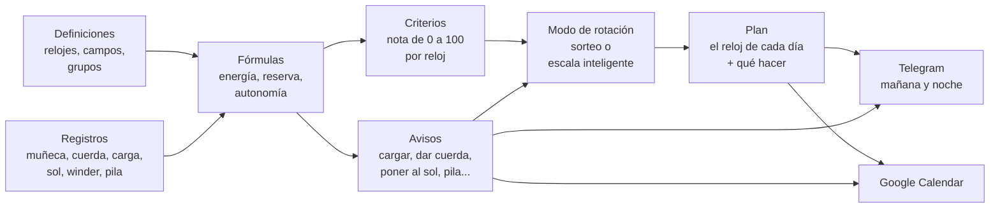

<!-- origem: 6b28fffd3e9c55e1ab356e1550478768ac8134f0 -->

## La idea central: el sistema no sabe nada de relojes {#a-ideia-central-o-sistema-não-sabe-nada-de-relógios}

Esta es la decisión de diseño más importante, y es lo que hace que el sistema sirva para cualquier colección. **El código solo
tiene mecanismos; todo el conocimiento sobre relojes son datos que usted registra.**

No "sabe" que un automático tiene reserva de marcha, ni que un solar se carga al sol. Todo eso está escrito en fórmulas
registradas, que usted lee, edita y prueba en pantalla:

```text
Reserva que le queda al mecánico =
  ACUMULA(0; reserva_horas; 1;                                  ← empieza en 0, el máximo es la reserva, pierde 1 h por hora
          "pulso";  carga_pulso_reserva / carga_pulso_horas;    ← cada hora en la muñeca recarga tanto
          "winder"; carga_winder_reserva / carga_winder_horas;  ← cada hora en el winder, tanto
          "corda";  reserva_horas)                              ← dar cuerda la llena
```

¿Quiere registrar el "cambio de correa", un "baño ultrasónico" o un campo "resistencia al agua"? Son datos. ¿Quiere que los
cronógrafos pesen distinto en el sorteo? Son datos. ¿Quiere un aviso de "cambiar la correa de cuero cada año"? También.

El sistema ya trae un conjunto inicial completo (smartwatch, automático, cuerda manual, pila y solar, con las fórmulas, los
avisos y los criterios de cada uno), que usted ajusta a su colección.


<sub>Los campos de las definiciones. Cada uno se aplica a un grupo y a todo lo que está debajo (la reserva de marcha solo en
los mecánicos, la vida de la pila solo en los de pila), y el identificador es el nombre que tiene en las fórmulas.</sub>

---

## Cómo funciona {#como-funciona}



### Los conceptos, uno por uno {#os-conceitos-um-por-um}

| Concepto | Qué es | Ejemplo |
|---|---|---|
| **Grupos** (el árbol) | La clasificación de la colección, en tantos niveles como quiera. Todo lo registrado en un grupo vale para él y para todo lo que está debajo. | `Tradicional › Mecánico › Automático` |
| **Campos** | Los datos de cada reloj, definidos por usted: texto, número, fecha, sí/no o lista, con unidad y valor por defecto. | `reserva_horas = 40 h`, `data_pilha`, `loja` |
| **Tipos de registro** | Lo que le pasa a un reloj. Puede ser **instantáneo** (cuerda, cambio de pila), **con valor** (lectura de carga: 68%) o una **sesión** con inicio y fin (en la muñeca, en el winder, al sol). | `sol`: una sesión que se cierra sola a las 18 h si usted se olvida |
| **Fórmulas** | Cálculos sobre los campos y los registros. La misma fórmula puede tener **una versión por grupo**, y vale la del grupo más cercano al reloj. | `energia` es la batería en el smartwatch, la reserva en el mecánico, la luz en el solar y la vida de la pila en el cuarzo |
| **Avisos** | Una fecha prevista por fórmula, una antelación, un texto y el registro que resuelve el aviso. | *"Dar cuerda al Orient: la reserva se acaba a las 15 h"*, y el botón **Cuerda** lo resuelve |
| **Límite de carga** | La carga en la que el reloj necesita atención: cargar el smartwatch, poner el solar al sol, dar cuerda al mecánico. El aviso solo sale cuando la carga llega a él. Cada reloj puede tener el suyo (campo *"Avisar cuando la carga llegue a"*); vacío, vale el general de la Configuración. | smartwatch al 20% (el general), el Samsung al 30% (el suyo) |
| **Criterios** | Cómo cada reloj recibe una nota de 0 a 100 para el sorteo: parámetros con peso, subparámetros que miden un campo o una fórmula, y rangos que convierten el valor en nota. | *Tiempo sin uso* (40%): de 0 a 1 día da 0, 30 días o más da 100 |
| **Modos de rotación** | Las reglas del plan: el tipo del modo (uno por semana, semana y fin de semana, por día de la semana, aleatorio, escala inteligente o personalizado), de qué grupo elegir cada día, cuántas semanas adelante, el criterio de elección y, por debajo, el guion que el motor calcula. | *"Smartwatch de lunes a viernes, un tradicional por día el fin de semana"* |
| **Plan** | El reloj de cada día, con qué hacer (*cargar antes*, *dar cuerda*, *poner en el winder*). | `lun 10/06 · Xiaomi Band · cargar antes de usar` |

### El motor de fórmulas {#o-motor-de-fórmulas}

Las fórmulas se escriben como en una hoja de cálculo: números con coma o punto, textos entre comillas, `;` separando los
argumentos, las operaciones `+ - * / ^` y las comparaciones `= <> < <= > >=` (que dan 1 o 0). Un valor vacío se propaga por
la cuenta, y la división por cero da vacío. Lo básico:

| Función | Qué devuelve |
|---|---|
| `SE(condición; si sí; si no)`, `E(...)`, `OU(...)`, `NAO(x)` | la lógica: `E` da 1 si todas son verdaderas, `OU` si alguna lo es, `NAO` invierte |
| `MIN(...)`, `MAX(...)` | el menor y el mayor de los valores (ignoran los vacíos) |
| `LIMITA(x; mín; máx)`, `ARREDONDA(x; decimales)`, `ABS(x)` | x sujeto al rango; redondeado; sin signo |
| `PADRAO(x; otro)`, `VAZIO(x)`, `NADA()` | x, o el otro si x está vacío; 1 si x está vacío; vacío, a propósito (`SE(condición; NADA(); cuenta)`) |
| `HOJE()`, `AGORA()` | la fecha de hoy y el instante actual, en días (ahora con la fracción del día) |
| `DIAS_DESDE(fecha)`, `DIAS_ATE(fecha)`, `SOMA_MESES(fecha; meses)` | días desde y hasta una fecha (negativo: ya pasó); la fecha más meses, por el calendario |
| `HORAS_USO()` | las horas de un día de uso, por el horario de uso de la Configuración (de 7 a 22 h: 15) |
| `CONFIG("clave")` | un número de la Configuración, como `CONFIG("sol_limiar")` |

Y las que leen el historial de cada reloj:

| Función | Qué devuelve |
|---|---|
| `HORAS("pulso"; 30)` | horas en la muñeca en los últimos 30 días |
| `CONTAR("pulso"; 30)` | cuántos días con uso en los últimos 30 días |
| `DIAS_DESDE_ULTIMO("pulso")` | días desde la última vez en la muñeca |
| `ULTIMO_VALOR("carga")` / `ULTIMA_DATA("pilha")` | la última lectura / la fecha del último registro |
| `HORAS_APOS("pulso"; "carga")` | horas en la muñeca desde la última lectura de carga |
| `ACUMULA(inicio; máx; pérdida/h; "tipo"; efecto; ...)` | un saldo que recorre el historial: pierde con el tiempo y gana con cada registro |
| `MEDIDO("uso")` / `MEDIDO("repouso")` | el consumo real de la batería, medido por sus lecturas de carga |
| `EM_SESSAO("winder")` | 1 si la sesión está abierta ahora (el reloj está en el winder) |
| `MEDIA_COLECAO("uso_30d")` | el promedio de una variable en toda la colección |

Y las de la rotación (el guion de los modos; fuera de él, el día es el del instante del cálculo):

| Función | Qué devuelve |
|---|---|
| `DIA_SEMANA()`, `SEMANA_DO_ANO()` | el día de la semana (1 lunes a 7 domingo) y la semana del año (ISO) del día que se está armando |
| `NO_GRUPO("Tradicional › Quartzo")` | 1 si el reloj está en ese punto del árbol o debajo (el nombre, la ruta o `#id`; `"todos"`: 1 para todos) |
| `RELOGIO("Seiko SKX")` | 1 si es ese reloj (por el nombre o por el id) |
| `ESCOLHIDO_HA(1)`, `VEZES_NO_PLANO(7)` | 1 si el reloj fue el del plan hace n días (1: ayer; -1: mañana, cuando ya está en el plan); cuántos días tuvo en el plan en los últimos n días |
| `ESCOLHA(n; a; b; c)` | el n-ésimo de los valores (solo ese se calcula): `ESCOLHA(DIA_SEMANA(); …)` da un valor por día de la semana |
| `SORTEIO()` | un número de 0 a 1, del mismo lote de RANDOM.ORG de los sorteos |

Y la variable `nota_criterios`: la nota del reloj por los criterios, en el instante del cálculo.

En la página **Definiciones** cada fórmula tiene el botón **Probar en todos los relojes**, que muestra el resultado en cada
reloj antes de guardar.

### La nota de cada reloj (criterios) {#a-nota-de-cada-relógio-critérios}

Los criterios que vienen listos, para todos los relojes:

| Parámetro | Peso | Mide |
|---|---:|---|
| Tiempo sin uso | 40 | días desde la última vez en la muñeca: cuanto más parado, mayor la nota |
| Equilibrio de uso | 30 | uso en los últimos 30 días comparado con el promedio de la colección: el poco usado sube |
| Preferencia | 20 | su nota para el reloj (0 a 100) |
| Novedad y valor | 10 | hace cuánto se compró y cuánto costó (aprovechar la inversión) |

Cada grupo, e incluso cada reloj, puede tener su propio conjunto. El smartwatch, por ejemplo, también pesa la **energía** (la
carga ahora y cuántos días aguanta), para no sortear un reloj que se va a apagar al mediodía. La página **Criterios** muestra
la cuenta entera de cada nota: cada rango, cada peso y cada punto, y al lado de la nota de cada criterio una flecha dice hacia
dónde empuja la nota final: **↑** verde (nota por encima de 50, el neutro: empuja hacia arriba), **↓** roja (por debajo de 50:
empuja hacia abajo) o **↔** marrón (50 exacto, o sin peso: neutro, no empuja hacia ningún lado).

Los conjuntos que vienen listos, completos. La nota de un parámetro es el promedio de las notas de sus subparámetros, por el
peso de cada uno; la nota del reloj es el promedio de los parámetros, por peso. Cada subparámetro lee una variable (un campo
o una fórmula) y da la nota según el rango en que cae el valor; el subparámetro sin valor (un campo vacío, un valor fuera de
todo rango) queda fuera, y los demás se reparten su peso. Todo se edita en la página **Criterios**, y **Restaurar los criterios
iniciales** vuelve a estos.

**Todos los relojes**

| Parámetro | Peso | Subparámetro (la variable, el peso dentro del parámetro) | Los rangos: el valor → la nota |
|---|---:|---|---|
| Tiempo sin uso | 40 | Días sin uso (`dias_sem_uso`) | 0 a 1 → 0; 1 a 3 → 30; 3 a 7 → 60; 7 a 14 → 80; 14 a 30 → 95; 30 o más → 100 |
| Equilibrio de uso | 30 | Uso en los últimos 30 días, comparado con la media (`uso_vs_media`) | 0 a 25 → 100; 25 a 60 → 80; 60 a 100 → 60; 100 a 140 → 35; 140 a 200 → 15; 200 o más → 0 |
| Preferencia | 20 | Su nota para el reloj (`preferencia`) | 0 a 20 → 0; 20 a 40 → 25; 40 a 60 → 50; 60 a 80 → 75; 80 a 100 → 100 |
| Novedad y valor | 10 | Novedad: días desde la compra (`dias_desde_compra`, 60) | 0 a 15 → 100; 15 a 45 → 80; 45 a 120 → 55; 120 a 365 → 40; 365 o más → 30 |
|  |  | Aprovechar la inversión: valor pagado (`valor_compra`, 40) | 0 a 300 → 30; 300 a 800 → 50; 800 a 1500 → 70; 1500 o más → 90 |

**Smartwatch**

| Parámetro | Peso | Subparámetro (la variable, el peso dentro del parámetro) | Los rangos: el valor → la nota |
|---|---:|---|---|
| Energía | 30 | Carga ahora (%) (`energia`, 50) | 0 a 15 → 0; 15 a 30 → 25; 30 a 50 → 55; 50 a 80 → 85; 80 a 100 → 100 |
|  |  | Días de uso que aguanta la carga (`dias_de_carga`, 50) | 0 a 1 → 0; 1 a 2 → 30; 2 a 4 → 60; 4 a 7 → 85; 7 o más → 100 |
| Autonomía | 15 | Autonomía del smartwatch (`autonomia_dias`) | 0 a 2 → 10; 2 a 4 → 40; 4 a 7 → 70; 7 a 14 → 90; 14 o más → 100 |
| Tiempo sin uso | 25 | Días sin uso (`dias_sem_uso`) | 0 a 1 → 0; 1 a 3 → 30; 3 a 7 → 60; 7 a 14 → 80; 14 a 30 → 95; 30 o más → 100 |
| Equilibrio de uso | 15 | Uso en los últimos 30 días, comparado con la media (`uso_vs_media`) | 0 a 25 → 100; 25 a 60 → 80; 60 a 100 → 60; 100 a 140 → 35; 140 a 200 → 15; 200 o más → 0 |
| Preferencia | 10 | Su nota para el reloj (`preferencia`) | 0 a 20 → 0; 20 a 40 → 25; 40 a 60 → 50; 60 a 80 → 75; 80 a 100 → 100 |
| Novedad y valor | 5 | Novedad: días desde la compra (`dias_desde_compra`, 60) | 0 a 15 → 100; 15 a 45 → 80; 45 a 120 → 55; 120 a 365 → 40; 365 o más → 30 |
|  |  | Aprovechar la inversión: valor pagado (`valor_compra`, 40) | 0 a 300 → 30; 300 a 800 → 50; 800 a 1500 → 70; 1500 o más → 90 |

**Tradicional › Mecánico**

| Parámetro | Peso | Subparámetro (la variable, el peso dentro del parámetro) | Los rangos: el valor → la nota |
|---|---:|---|---|
| Reserva de marcha | 25 | Reserva ahora (%): vacía, necesita funcionar (`energia`) | 0 a 10 → 100; 10 a 30 → 85; 30 a 60 → 60; 60 a 90 → 35; 90 a 100 → 20 |
| Cuidado mecánico | 15 | Parado necesita funcionar (lubricación) (`dias_sem_uso`, 50) | 0 a 7 → 20; 7 a 30 → 60; 30 a 90 → 90; 90 o más → 100 |
|  |  | Revisión al día (`dias_ate_revisao`, 50) | 0 a 30 → 20; 30 a 180 → 60; 180 o más → 100 |
| Tiempo sin uso | 25 | Días sin uso (`dias_sem_uso`) | 0 a 1 → 0; 1 a 3 → 30; 3 a 7 → 60; 7 a 14 → 80; 14 a 30 → 95; 30 o más → 100 |
| Equilibrio de uso | 20 | Uso en los últimos 30 días, comparado con la media (`uso_vs_media`) | 0 a 25 → 100; 25 a 60 → 80; 60 a 100 → 60; 100 a 140 → 35; 140 a 200 → 15; 200 o más → 0 |
| Preferencia | 10 | Su nota para el reloj (`preferencia`) | 0 a 20 → 0; 20 a 40 → 25; 40 a 60 → 50; 60 a 80 → 75; 80 a 100 → 100 |
| Novedad y valor | 5 | Novedad: días desde la compra (`dias_desde_compra`, 60) | 0 a 15 → 100; 15 a 45 → 80; 45 a 120 → 55; 120 a 365 → 40; 365 o más → 30 |
|  |  | Aprovechar la inversión: valor pagado (`valor_compra`, 40) | 0 a 300 → 30; 300 a 800 → 50; 800 a 1500 → 70; 1500 o más → 90 |

**Tradicional › Cuarzo › Pila**

| Parámetro | Peso | Subparámetro (la variable, el peso dentro del parámetro) | Los rangos: el valor → la nota |
|---|---:|---|---|
| Vida de la pila | 15 | Vida de la pila (%) (`energia`) | 0 a 10 → 10; 10 a 30 → 50; 30 a 100 → 70 |
| Revisión | 10 | Revisión al día (`dias_ate_revisao`) | 0 a 30 → 20; 30 a 180 → 60; 180 o más → 100 |
| Tiempo sin uso | 35 | Días sin uso (`dias_sem_uso`) | 0 a 1 → 0; 1 a 3 → 30; 3 a 7 → 60; 7 a 14 → 80; 14 a 30 → 95; 30 o más → 100 |
| Equilibrio de uso | 25 | Uso en los últimos 30 días, comparado con la media (`uso_vs_media`) | 0 a 25 → 100; 25 a 60 → 80; 60 a 100 → 60; 100 a 140 → 35; 140 a 200 → 15; 200 o más → 0 |
| Preferencia | 10 | Su nota para el reloj (`preferencia`) | 0 a 20 → 0; 20 a 40 → 25; 40 a 60 → 50; 60 a 80 → 75; 80 a 100 → 100 |
| Novedad y valor | 5 | Novedad: días desde la compra (`dias_desde_compra`, 60) | 0 a 15 → 100; 15 a 45 → 80; 45 a 120 → 55; 120 a 365 → 40; 365 o más → 30 |
|  |  | Aprovechar la inversión: valor pagado (`valor_compra`, 40) | 0 a 300 → 30; 300 a 800 → 50; 800 a 1500 → 70; 1500 o más → 90 |

**Tradicional › Cuarzo › Solar**

| Parámetro | Peso | Subparámetro (la variable, el peso dentro del parámetro) | Los rangos: el valor → la nota |
|---|---:|---|---|
| Luz | 25 | Carga de luz (%) (`energia`) | 0 a 30 → 80; 30 a 70 → 65; 70 a 100 → 50 |
| Revisión | 10 | Revisión al día (`dias_ate_revisao`) | 0 a 30 → 20; 30 a 180 → 60; 180 o más → 100 |

Y existe una **garantía de rotación**: ningún reloj pasa más de N días parado (21 por defecto). Vale **antes** de la nota: si
algún candidato ya pasó el límite, gana directamente, primero el que lleva más tiempo parado. Solo cuando nadie pasó el
límite decide la nota.

Los días parado son la fórmula **Días sin uso**, que puede editar en Definiciones: los días desde la última vez en la muñeca
y, para un reloj que **nunca se usó**, los días desde la compra (sin fecha de compra, 9999, el más parado de todos). Así un
reloj comprado ayer no se cuela en la fila, y dos nunca usados no empatan: lleva más tiempo esperando el que se compró antes.

Para que nunca quede con la duda, **cada día del plan guarda el motivo de la elección**, en una frase, y aparece debajo del
reloj en la página Hoy y en la página Plan: *"Garantía de rotación: nunca usado, en la colección hace 38 días, más allá del
límite de 21 días sin uso"*, *"Sorteo por la nota, entre 5 candidatos: nota 70,2, 16,4% de probabilidad"*, *"La mayor nota
(91,2). Se queda 5 días seguidos"*, *"Sigue en la muñeca: día 2 de 5 seguidos"*, *"Elegido a mano"*.
### Los modos de rotación {#os-modos-de-rodízio}

Los modos están en la página **Modos de rotación** (menú **Rotación**). Cada modo tiene un **tipo**, y la pantalla del tipo
pide solo lo que tiene sentido en él:

- **Uno por semana**: un reloj para toda la semana, del primer al último día de ella (de lunes a domingo, o de domingo a sábado: la
  semana empieza el día elegido en la Configuración, **La semana empieza**). Usted dice de dónde sale (la colección, un
  grupo o un reloj fijo) y el criterio de elección.
- **Semana y fin de semana**: dos tramos, de lunes a viernes y el sábado y domingo, cada uno con su grupo y con **un reloj
  para el tramo** o **uno por día**. El que viene listo: el smartwatch en la semana, un tradicional por día al final de ella.
  Con la semana empezando el domingo, el sábado y el domingo siguen siendo un solo tramo (el reloj del sábado se queda el
  domingo).
- **Por día de la semana**: un reloj por día, y cada día de la semana dice de dónde sale (un grupo, un reloj fijo o ninguno:
  día libre).
- **Aleatorio todos los días**: uno por día, todos con la misma probabilidad, sin criterio ni garantía de rotación.
- **Escala inteligente**: planifica todo el período de una vez, simulando la carga (vea [más abajo](#a-escala-inteligente)).
- **Personalizado**: usted escribe el guion (vea [El guion del modo](#o-roteiro-do-modo)).

En los tres primeros, el **criterio de elección** es el sorteo: por la **mayor nota**, por **sorteo por la nota** (la nota se
vuelve probabilidad), **aleatorio** o por **fila** (el que lleva más tiempo esperando). Con el **ciclo** activado, un reloj
solo vuelve después de que todos los candidatos hayan pasado en la semana. El cuadro **Modo de rotación** de la página Hoy
elige el modo, el criterio y la garantía de rotación; **Aplicar modo** solo marca: nada del plan cambia hasta que haga clic en
**Sortear de nuevo**.

**Las semanas.** Fuera de la escala, cada modo dice **cuántas semanas adelante** viene armado el plan (1 a 8; la lista muestra
las semanas con las fechas). El plan llega hasta el último día de la última de ellas: el domingo, o el sábado con la semana
empezando el domingo (con una sola semana, el último día de la semana el plan trae también el primero de la siguiente, para
el aviso de la víspera), y la semana siguiente entra cuando le llega el turno. La semana empieza el día elegido en la
Configuración (**La semana empieza**: el lunes, el predeterminado, o el domingo), y el ciclo, la próxima semana y el reloj
para toda la semana cuentan desde ella. Con más de una semana,
**Sortear de nuevo** tiene también **la próxima semana**: sale con el modo actual, con los días que aún faltan de esta semana
contados como uso, como si ya hubiera usado los relojes del plan (el uso cuenta en los días sin uso y en la nota; la carga no,
porque no se sabe si el reloj se va a cargar). Cada día se elige así, con los anteriores del plan ya en la muñeca, y por eso el
reloj del lunes no vuelve el martes solo por parecer parado. Los días elegidos a mano se quedan. En la escala inteligente no hay
próxima semana: ya planifica su propio período.

### El guion del modo {#o-roteiro-do-modo}

Por debajo, todo modo es un **guion**: cinco líneas que el motor de fórmulas calcula para cada reloj disponible, al comienzo de
cada día del plan, con los días anteriores ya contados como uso. Los modos listos generan el guion de sus pantallas (la página
muestra el guion generado, solo lectura); en **Personalizado** usted escribe el suyo, una línea por nombre (`nombre = expresión`,
en el mismo lenguaje de las fórmulas de las definiciones; las líneas que empiezan con `#` son comentarios; los otros nombres son
variables suyas):

| Línea | Qué dice | Si falta |
|---|---|---|
| `candidato` | 1: el reloj entra en la elección de ese día; 0: no | `1` (todos) |
| `nota` | la nota del reloj ese día | `nota_criterios` (la nota por los criterios) |
| `peso` | la probabilidad en el sorteo. Todos 0: gana la mayor nota. Todos iguales: todos con la misma probabilidad. Si no, cada peso es la probabilidad | `0` |
| `dias` | cuántos días seguidos se queda el elegido (mientras los días siguientes estén vacíos y siga siendo candidato) | `1` |
| `garantia` | 1: pasa delante de todos (entre varios, el que lleva más tiempo parado; empate: el registrado primero) | quien pasó de la garantía de rotación (`max_sem_uso`) en días sin uso |

**Cómo decide el motor cada día**, en este orden: el reloj de ayer queda fuera, si hay otro; el ciclo, si el modo lo usa; el
guion dice quién es candidato; quien tiene `garantia` gana directamente; si no, el `peso`. El elegido se queda los `dias` que
el guion dio, y el motivo de la elección queda grabado en el plan. El mismo motor decide el **Sortear este día por** del
selector de cada día y el **Decide por mí** de la rotación manual.

Un ejemplo: mecánicos en la semana, lo que dé la batería el fin de semana, y quien lleva más de 3 días parado con 100 veces la
probabilidad de los demás:

```
util      = DIA_SEMANA() <= 5
candidato = SE(util; NO_GRUPO("Mecânico"); 1)
peso      = SE(dias_sem_uso > 3; 100; 1)
dias      = SE(NO_GRUPO("Smartwatch"); dias_seguidos; 1)
```

El botón **Probar en todos los relojes** calcula el guion en un día (hoy, o uno de los próximos 13) y muestra cada línea en cada
reloj y quién saldría. Además de las funciones de las fórmulas, el guion tiene `DIA_SEMANA()` (1 lunes a 7 domingo),
`SEMANA_DO_ANO()`, `NO_GRUPO("grupo")`, `RELOGIO("nombre")`, `ESCOLHIDO_HA(n)`, `VEZES_NO_PLANO(n)`, `ESCOLHA(n; a; b; …)` y
`SORTEIO()` (la tabla en [El motor de fórmulas](#o-motor-de-fórmulas)) y la variable `nota_criterios`. Por la API:
`recurso=roteiro` prueba; `recurso=modos`, `acao=salvar` con `tipo=personalizado` y `roteiro` graba.

**De dónde sale el sorteo.** Todo sorteo del sistema (el modo totalmente aleatorio, el sorteo por la nota o por el peso y la
función `SORTEIO()` del guion) usa números realmente aleatorios, de fuera, en este orden:

1. **[RANDOM.ORG](https://www.random.org/)**: azar del ruido atmosférico (mide la variación de las microondas en el aire y la
   convierte en bits);
2. cuando está caído (o se agotó la cuota del día), **ANU QRNG**, el generador cuántico de la Universidad Nacional de
   Australia (mide fluctuaciones cuánticas de la luz). El sistema usa la dirección antigua, `qrng.anu.edu.au/API/jsonI.php`,
   que responde sin clave (la nueva, `api.quantumnumbers.anu.edu.au`, exige una clave de API);
3. sin ambos (sin internet en el servidor, por ejemplo), el **generador seguro de PHP** (`random_int`, el del sistema
   operativo: el equivalente al `secrets` de Python).

Los números llegan en lote (64 números de 16 bits por petición), y cada sorteo usa solo lo que necesita, descartando lo que
pasa del último múltiplo entero del rango: todo resultado tiene exactamente la misma probabilidad. Cada servicio tiene 4
segundos para responder; si los dos fallan, el sistema usa el de PHP y no vuelve a intentarlo durante 10 minutos (así ninguna
página se queda esperando). El motivo de cada día sorteado dice de dónde vino el número (*"Sorteo simple, entre 4 candidatos,
todos con la misma probabilidad (RANDOM.ORG)."*), y la **Configuración** muestra el último lote (el cuadro **Sorteos**). Lo que
es secreto no usa estos servicios: la sal de las contraseñas y los nombres de los archivos de los documentos siguen usando el
generador de PHP, porque un número que viaja por internet no sirve para secretos.

### Borrar la programación {#apagar-a-programação}

Al pie de la página **Plan** (el lugar principal: el cuadro **Borrar la programación**, al final de la página, después del día
a día) y en el cuadro **Modo de rotación** de la página Hoy (cada uno debajo de una línea, como **Sortear de nuevo**):

- **Borrar un período**: **Desde** y **Hasta**; uno de los dos puede quedar vacío (solo **Desde** borra desde él hasta el
  final del plan; solo **Hasta**, desde mañana hasta él). Los días del período salen del plan, de mañana en adelante (los
  elegidos a mano, los sorteados y los libres), y el modo de rotación vuelve a montar esos días. El botón **Borrar** pide
  confirmación.
- **Borrar todo**: limpia toda la programación, de mañana en adelante: los días elegidos a mano, los sorteados y los libres.
  Marcando **Incluyendo hoy**, borra de hoy en adelante (si sale otro reloj para hoy, pasa a ser el de la muñeca desde ese
  momento). Después el modo de rotación vuelve a armar el plan, desde cero: hasta el último día de la última de las semanas del modo (las
  siguientes, cuando lleguen); en la escala inteligente, toda la escala. La programación no queda vacía porque el
  sistema siempre arma los días que faltan con el modo activo; para días sin reloj, marque *libre* en la Rotación manual.

### La rotación manual {#o-rodízio-manual}

En el cuadro **Modo de rotación** de la página Hoy, la última opción de la lista es **Rotación manual**: usted mismo elige el
reloj de cada día de un período (las vacaciones, un viaje, un mes entero). Ponga el inicio (**Desde**) y el fin (**Hasta**) y
haga clic en **OK**:

- los días aparecen **de 7 en 7**, con la fecha, el día de la semana, lo que el plan tiene ese día ahora y un selector;
- con más de 7 días, las páginas están debajo: **‹ Anterior**, **1 2 3 …**, **Siguiente ›**. Lo que elige en una página se
  conserva mientras recorre las demás; nada cambia antes de guardar;
- el selector de cada día tiene los relojes disponibles, **Decide por mí**, el grupo **Sortear este día por** (*la mayor
  nota*, *sorteo por la nota*, *aleatorio* o *fila*: el día se sortea al guardar por esa forma, sin el de ayer ni el de mañana,
  como el Decide por mí) y **Sin reloj (día libre)**. Al principio, muestra el reloj que el día ya tiene elegido a mano; un día libre aparece como libre; y el resto (sorteado o todavía sin reloj),
  como *Decide por mí*;
- **Guardar la rotación manual** guarda todo el período: los días con reloj quedan elegidos a mano, los de *Decide por mí* y los de
  *Sortear este día por* los decide el sistema en ese momento y también se guardan (el motivo de cada uno aparece en el
  plan), y los libres quedan sin reloj. Si hoy está en el período y usted eligió otro reloj, pasa a ser el de la muñeca desde ese momento;
- para borrar los días de un período (el modo de rotación vuelve a montar esos días) o borrarlo todo, vea
  [Borrar la programación](#apagar-a-programação).

Fuera del período, sigue valiendo el modo de rotación de siempre. Los días elegidos a mano se mantienen aunque sortee de nuevo
o el cron arme la semana siguiente; en la escala inteligente, se rehace alrededor de ellos.

**El criterio del *Decide por mí*:**
1. la **nota de los criterios** (los que usted define en **Criterios**: días sin uso, equilibrio, preferencia, carga...),
   calculada al inicio de cada día, con los días anteriores del período (los que usted eligió y los que él decidió) ya
   contados como uso;
2. la **garantía de rotación** va primero: el que pasó el límite de días sin uso va antes, primero el que lleva más tiempo
   parado;
3. el reloj de **ayer** y el de **mañana** quedan fuera, si hay otro. Así un reloj no se repite justo al lado del que usted
   eligió;
4. en caso de empate, gana el registrado primero.

Hoy, con *Decide por mí*, se queda el reloj que ya está en el plan.

### La escala inteligente {#a-escala-inteligente}

Es el modo más completo. En lugar de sortear semana a semana, **planifica de 7 días a 2 años de una vez**, simulando día a
día:

1. calcula la nota de cada reloj con el estado simulado de ese día;
2. elige el reloj por la mayor nota (el guion de la escala: `peso = 0`); el smartwatch se queda en la muñeca los días que
   aguanta la batería (hasta 7: la fórmula `dias_seguidos`);
3. simula el uso (la sesión en la muñeca en el horario de uso) y su efecto en la carga y la reserva de todos;
4. comprueba los avisos: si el elegido va a necesitar carga o cuerda, anota la acción en el día (*"cargar antes de usar"*) y
   simula el registro que la resuelve;
5. pasa al día siguiente.

Cada mañana el cron **vuelve a planificar desde el estado real**. Si usó otro reloj, se olvidó de cargar o registró una lectura
distinta de la prevista, el plan se corrige.

### Consumo medido por las lecturas {#gasto-medido-pelas-leituras}

La ficha del smartwatch dice "dura 5 días". La realidad discrepa, y cambia conforme la batería envejece. Por eso, **cada
lectura de carga que usted lanza se compara con la anterior**, y el intervalo entre las dos se vuelve una medición: cuánto
cayó, cuántas horas pasó en la muñeca y cuántas fuera de la muñeca (guardado, apagado), y cómo usted marcó cada lectura (en
uso o en reposo). El horario de uso de la Configuración cuenta como muñeca por sí solo, y sus marcaciones (*Puso*, *Quitó*)
mandan. Una subida en la lectura es recarga: empieza un tramo nuevo. Y un intervalo con otra sesión en medio (el reloj fue al
cargador) tampoco mide: la medición solo sabe separar muñeca y guardado.

**Cómo transformar las mediciones en los dos consumos (en la muñeca y fuera de la muñeca) es elección suya: hay cinco
motores.** Todos quedan en el sistema; ninguno borra nada, y cambiar de motor solo cambia la cuenta (las mediciones son las
mismas). La elección se hace en tres lugares, y el de arriba vale sobre los de abajo:

| Nivel | Dónde se elige | Qué hace |
|---|---|---|
| 1. **La colección** | **Gasto de batería: cómo calcular (válido para todos los relojes)**, en la Configuración (`gasto_motor`) | vale para todos los relojes de la colección. Vacío (*Individual (en el reloj o en el grupo)*): deciden los dos niveles de abajo. |
| 2. **El reloj** | el campo **Cómo calcular el gasto de batería** (`gasto_motor`), en la ficha del reloj | vale solo para él. Vacío: el del grupo. |
| 3. **El grupo** | el **predeterminado** de ese mismo campo (en **Registros › Campos**: el campo está en la raíz, y vale para los relojes de donde está hacia abajo) | vale para los relojes que no eligieron. Vacío: el motor 1. |

En un reloj sin lectura de carga (un mecánico, un solar), la elección no hace nada. El cuadro **Consumo de la batería** dice
qué motor hizo la cuenta y de dónde vino la elección (*Calculado por: Por la marcación: dos tasas separadas — la elección de
la colección, en la Configuración*).

| Motor | Qué hace |
|---|---|
| 1. **Por las horas registradas (el motor original)** (`horas`) | el predeterminado. Cada medición se divide por las marcaciones de muñeca minuto a minuto (tantas horas en la muñeca, tantas fuera), y los dos consumos salen juntos de todas las mediciones de la ventana, cada una pesando el tiempo que cubre. Es la cuenta que el sistema siempre hizo. |
| 2. **Por las horas registradas, con lecturas y registro (robusto)** (`robusto`) | las mismas horas, pero la cuenta se hace en las lecturas, todas con el mismo peso, la que no encaja con las otras pesa menos y la ficha es el punto de partida (los tres cuidados de abajo). Da la incertidumbre (±). |
| 3. **Por la marcación: dos tasas separadas** (`marcacao`) | lo que usted marca manda. Una lectura marcada **en uso** mide el consumo en la muñeca: la caída desde la lectura anterior, dividida por el tiempo entero del intervalo (en días de uso). Una lectura marcada **en reposo** mide el consumo fuera de la muñeca, del mismo modo. Las dos cuentas **nunca se cruzan**: el consumo en uso sale solo de las lecturas en uso, y el en reposo, solo de las en reposo; la muñeca registrada no entra. Con la cuenta robusta en cada lado (la lectura que no encaja pesa menos; la ficha es el punto de partida), también con la incertidumbre. |
| 4. **Solo el registro** (`cadastro`) | el *Decaimiento en uso* (o la *Autonomía en uso real*) y el *Decaimiento guardado* de la ficha valen siempre. Las mediciones siguen haciéndose y quedan en el historial (la tabla **Mediciones del consumo**), pero no entran en ninguna cuenta: `MEDIDO` da vacío. |
| 5. **Por las fórmulas del registro** (`formulas`) | vale lo que den las fórmulas `taxa_uso` y `taxa_repouso`, para que usted monte su propia cuenta en **Registros › Fórmulas**. En ellas, `MEDIDO("uso")` y `MEDIDO("repouso")` son la cuenta del motor 3, y las funciones **LEITURAS**, **QUEDA**, **DIAS_MEDIDOS**, **MEDIA_TAXA**, **MEDIANA_TAXA** y **ULTIMA_TAXA** dan las piezas de las mediciones por la marcación (cuántas, la suma de las caídas, la suma de los días, la media, la mediana y la última tasa, de cada tipo, en los últimos N días o en la ventana de la Configuración): `MEDIANA_TAXA("uso")`, o `PADRAO(QUEDA("uso"; 30) / DIAS_MEDIDOS("uso"; 30); decaimento_uso)`. En los otros motores las fórmulas también valen (de ellas sale el consumo); la diferencia es que este dice: la cuenta es suya. |

**Qué mediciones entran** es otra elección de la Configuración, **Gasto medido: contar por**: **días** (las mediciones de los
últimos tantos días, 90 por defecto) o **lecturas** (las últimas tantas mediciones de cada tipo, en uso y en reposo, 20 por
defecto). Sin ninguna en la ventana, entran las de antes. Vale para los motores 1, 2, 3 y 5 (y para las funciones de las
fórmulas sin el N de días).

Entre dos recargas, la carga cae en línea recta con el tiempo en la muñeca y el tiempo guardado:

```text
lectura = carga del comienzo − consumo en uso × días de uso − consumo guardado × días guardado (+ el error de la lectura)
```

Lecturas seguidas, sin recarga en medio, forman un **tramo**. Cada tramo tiene la carga de su comienzo (que la cuenta
descubre), y los dos consumos valen para todos los tramos. En el motor 2, con las lecturas de la ventana, el sistema halla
**los dos consumos juntos**: los que mejor explican todas las lecturas. Una noche entre dos lecturas (solo fuera de la muñeca)
ajusta el consumo guardado; los días en la muñeca, sabiendo ya ese, ajustan el consumo en uso. Entra toda medición de 1 hora o
más, hasta la sin caída ninguna (dice que el consumo es pequeño). Cuantas más lecturas, más preciso. En el motor 3 la misma
cuenta se hace dos veces, una solo con las lecturas en uso y otra solo con las en reposo.

La cuenta robusta (los motores 2 y 3) tiene tres cuidados, cada uno con un motivo:

1. **La cuenta se hace en las lecturas, y todas pesan igual.** El error viene de la lectura: el reloj muestra la carga en
   números enteros, y su medidor también se equivoca un poco. Ese error es el mismo en una lectura hecha 2 horas o 2 semanas
   después de la anterior, así que ninguna lectura vale más que otra por cubrir más tiempo. Y, como la cuenta mira las
   lecturas (y no las caídas), una lectura errada es un punto solo, en vez de estropear las dos caídas a su alrededor.
2. **La lectura que no encaja con las otras pesa menos (regresión robusta).** Después de la cuenta, el sistema ve cuánto se
   equivoca en cada lectura. El error normal sale de las propias lecturas (nunca menos de medio punto); la lectura que queda
   bastante más lejos que lo normal pasa a pesar menos, y tanto menos cuanto más lejos está, y la cuenta se rehace. No se
   tira: solo pesa menos. Un caso común: el **100% justo después de cargar**, que muchos relojes mantienen un tiempo mientras
   la carga de verdad ya está cayendo.
3. **La ficha es el punto de partida.** El decaimiento (o la autonomía) de la ficha entra en la cuenta como el valor
   esperado, con un margen de la mitad de él. Con pocas lecturas, el consumo queda cerca de la ficha; con muchas, las lecturas
   mandan. Y, cuando las lecturas no separan el uso del guardado (solo lecturas con el reloj guardado, por ejemplo), el consumo
   que ellas no miden queda el de la ficha.

El resultado de esos dos motores viene con la **incertidumbre** (± una desviación estándar): *22,09% ± 1,48 por día de uso*
quiere decir que el consumo en uso está, con buena probabilidad, entre 20,6% y 23,6%. Disminuye conforme entran lecturas.

En la tabla **Mediciones del consumo** (en **Carga a lo largo del tiempo**), cada medición muestra la marcación de las dos
lecturas (*en uso → en uso*) y dice si entra en la cuenta: *sí*; *en parte: pesa 31%*, con la lectura que no encaja bien con
las otras (*la lectura de 100% no encaja bien con las otras: la cuenta se equivoca 4,5 puntos en ella*); o *no* (fuera de la
ventana, quitada de la cuenta, las dos lecturas marcadas de maneras distintas en el motor 3, o el motor 4). El mensaje de la
lectura también avisa cuando la lectura nueva no encaja con las otras. Cada línea tiene el botón **Quitar de la cuenta** (o
**Poner en la cuenta**), para cuando usted sabe algo que el sistema no sabe: la medición sale o vuelve sin borrar nada (vale
en los motores 1, 2, 3 y 5).

Al informar la carga, usted dice cómo estaba el reloj a la hora de la lectura: en el cuadro **Marcar**, **Informar lectura de
carga en uso** (en la muñeca) o **Informar lectura de carga en reposo** (guardado); en el aviso *Informar la carga* de la
página Hoy, los botones **En uso** y **En reposo**. **La marcación queda grabada en la lectura** (la columna `estado`; en las
lecturas de antes, y en las que un script lanza sin decir, vale lo que la muñeca registrada decía en ese instante). Es lo que
el motor 3 usa, y sirve de comprobación para los otros. Si el sistema tenía el reloj de otra manera en ese instante (el
horario de uso lo puso en la muñeca por sí solo, pero quedó guardado; o faltó un *Puso*), la pantalla pregunta antes de
grabar: *Para mí está en la muñeca ahora. ¿Grabar la lectura como en reposo de todos modos?* **Continuar** graba como usted
marcó (por la API, la respuesta viene con `confirmar: true` y la pregunta, y el lanzamiento solo se graba enviándolo de nuevo
con `confirmar=1`); nada se impide, y la muñeca registrada no cambia: si estaba errada, corríjala en **Corregir o borrar una
marcación**. El cuadro **Corregir** también cambia la marcación de una lectura ya grabada.

Los dos consumos están en el cuadro **Consumo de la batería**, en la página del reloj:

- **Calculado por**: el motor que hizo la cuenta y de dónde vino la elección (la colección, el reloj, el grupo, o el
  predeterminado).
- **En la muñeca** y **Fuera de la muñeca (apagado)**: el consumo que vale en la cuenta, en negrita, con la incertidumbre
  (± ..., en los motores 2 y 3), y de dónde viene (medido, con el de la ficha al lado para comparar, o solo de la ficha,
  cuando todavía no hay medición o el motor es el 4).
- Debajo de cada uno, **en la ficha**: los campos de donde sale el consumo de la ficha (el *Decaimiento en uso*, la
  *Autonomía en uso real*, el *Decaimiento guardado*), con el valor y si fue indicado o es el predeterminado.
- **En los 90 días anteriores a esos**: los dos consumos medidos en la ventana anterior. Es la comparación que muestra la
  batería envejeciendo: si el consumo en la muñeca pasó del 4,9% al 5,7%, ya no aguanta la carga como antes.

Lo mismo aparece de nuevo, junto a lo parecido, en el cuadro **Datos del reloj**: en la tabla **Ficha**, debajo del
decaimiento (y de la autonomía) indicado, lo **calculado por las lecturas** y lo que vale **en la cuenta**; en la tabla
**Calculado ahora**, debajo de las fórmulas del consumo (*taxa_uso*, *taxa_repouso*), el medido y el de la ficha. Y cada
medición, una por una, está en **Carga a lo largo del tiempo › Mediciones del consumo**.

Las mediciones más antiguas que la ventana salen solas de la cuenta. Por eso el ajuste al envejecimiento es automático: no hace
falta tocar la ficha. El "Consumo en uso" y el "Consumo guardado" de la ficha solo valen mientras no hay medición (o siempre,
en el motor 4).

---

## Varias personas: cuentas, colecciones y acceso {#várias-pessoas-contas-coleções-e-acesso}

El sistema es de **varias personas**, cada una con su **cuenta**, y cada cuenta con **sus colecciones**. Una colección tiene sus
relojes, el historial, el plan, la Configuración, los destinos de los mensajes y los calendarios; lo que se ve y lo que se
guarda en cualquier página es siempre de la colección elegida en el **selector del menú** (aparece cuando hay más de una). El
primer usuario de la instalación es el **master**: cuida de todo el sistema.

| Concepto | Qué es |
|---|---|
| **Cuenta** | el usuario, la contraseña, el correo (para recuperar la contraseña, recibir las invitaciones y los avisos), el idioma y el huso horario. Cada uno cuida de la suya en **Mi cuenta** (menú **Cuenta › Mi cuenta**). |
| **Colección** | un conjunto de relojes de un **dueño**, con nombre. Una persona puede tener varias ("Mi colección", "Los de mi padre"). Nace **con el conjunto inicial** (los grupos, campos, fórmulas, avisos, criterios y modos listos, en el idioma de quien la crea), **vacía** (solo la raíz del árbol) o **con un árbol suyo que ya existe**. |
| **Árbol de grupos** | los grupos y sus definiciones (campos, tipos de registro, fórmulas, avisos, categorías de documentos, criterios de los grupos). Es del dueño y puede servir a **varias colecciones suyas**: lo que cambia en él vale para todas. En **Mi cuenta** se pueden copiar, renombrar y eliminar los árboles. |
| **Miembro** | quien ve una colección de otra persona (y la usa: marca, registra, cambia el día). |
| **Todo de un dueño** | quien ve **todas** las colecciones de alguien, también las que cree después. |
| **Master** | ve todas las colecciones, cuida de las cuentas (**Usuarios**), de la copia de seguridad y de las migraciones. |

**Cómo entra alguien en una colección que no es suya:**

- **Invitación:** en **Aprobaciones**, el dueño escribe el correo y elige lo que va a ver (una colección, o todo lo suyo). Sale
  un correo con un enlace (vale `CONVITE_DIAS` días, 7 sin la línea): quien no tiene cuenta la crea por el enlace, y quien
  tiene entra y acepta. La invitación de un **miembro** espera que el dueño la apruebe. Sin correo en el servidor, el enlace
  aparece en la pantalla, para enviarlo como quiera.
- **Solicitud:** en **Mi cuenta** (o ya en el registro), la persona pide acceso a una colección, o a todo lo de un dueño, con un
  mensaje, por el **código** que pasó el dueño: el de la colección (en la tabla **Colecciones** de **Mi cuenta**) o el del dueño
  (en **Tus datos**, para todas sus colecciones). Ninguna pantalla muestra la lista de cuentas ni de colecciones, y la solicitud
  solo muestra el código hasta la aprobación: quien prueba códigos al azar no descubre el usuario de nadie. El dueño recibe un
  correo y aprueba o rechaza en **Aprobaciones**; la persona recibe la respuesta por correo. Las dos pantallas de solicitud
  (Crear cuenta y Mi cuenta) traen este paso a paso en el cuadro **Cómo pedir acceso (y por qué por el código)**, y **Tus
  datos** explica al dueño cómo pasar el código.
- **Por el master:** en **Usuarios**, **Dar acceso**.

En **Aprobaciones**, el dueño ve también **quién ve sus colecciones** y le quita el acceso a alguien; en **Mi cuenta**, cada uno
puede **salir** de una colección que no es suya. Invitaciones y solicitudes sin respuesta se van solas después de
`CONVITE_DIAS` días.

**El registro abierto** (la página `cadastro.php`, sin login, con el enlace **Crear cuenta**): la persona elige el usuario, la
contraseña, el correo, el idioma y cómo empieza (una colección con el conjunto inicial, una vacía, o pedir acceso a la de
alguien, por el código que pasó el dueño). La cuenta creada así es **de demostración** por `DEMO_DIAS` días (30 sin la línea): el menú muestra **Demo: N días**,
un correo avisa 7 días y 1 día antes y, vencida, el cron borra la cuenta con todo lo que es suyo. El master **hace oficial la
cuenta** (o la prorroga) en **Usuarios**. Con `CADASTRO_ABERTO = false` en el `config.php`, el registro se cierra: solo entra
quien el master crea o quien tiene una invitación. La página tiene también **Olvidé la contraseña**: el enlace para elegir una
contraseña nueva va por correo y vale 2 horas.

**El panel del master** (**Usuarios**) muestra cada cuenta con el correo, el papel, el último acceso, cuándo vence, las
colecciones (con cuántos relojes) y qué más ve, y las acciones: **Ver como** (todo el sistema como lo ve esa persona, con una
franja arriba y el botón para volver), **Hacer oficial**, **Prorrogar**, **Volver a demo**, **Bloquear**, **Cambiar** (el
usuario, el correo, el idioma, el papel), **Cambiar la contraseña**, **Transferir la colección** (a otro dueño: el árbol va
junto o, si sirve a otras colecciones del dueño anterior, el nuevo dueño recibe una copia), **Dar acceso** y **Eliminar**. Una
cuenta común que se queda sin nada (sin colección, sin acceso, sin solicitud ni invitación esperando) sale sola.

**Eliminar, en cualquier lugar, avisa antes de lo que sale junto.** Eliminar una colección, un árbol, una cuenta, un reloj, un
campo, un destino... muestra antes la lista de lo que va junto (*"Sale junto: 4 valores de campo, 2 registros, 12 días del
plan..."*, con las colecciones afectadas: un árbol sirve a varias) y solo borra después de que usted confirme. Los archivos de
los documentos salen del disco en el momento. Por la API, toda eliminación pide `confirmar=1`.

## La ficha de cada reloj, campo por campo {#o-cadastro-de-cada-relógio-campo-por-campo}

Todo reloj tiene **nombre**, **grupo**, **situación en la colección**, **disponible** y **foto**. El resto son **campos**, y qué campos tiene
un reloj depende de su **grupo**: todo lo registrado en un grupo vale para él y para todos los grupos de debajo. Por eso "ser
automático" no es una marca aparte: es estar en el grupo **Automático** (o en un subgrupo suyo), y con eso heredar los campos
de muñeca y de winder.

```text
(todos los relojes)       Observación, Su nota, Compra, Garantía, Límite de carga, Marca, Referencia, Enlace
                          (solo en los deseados: Precio objetivo, Prioridad del deseo)
├── Smartwatch            Autonomía en uso real, Consumo en uso, Consumo guardado, En el cargador: horas para llenar
└── Tradicional           Última revisión, Revisión cada
    ├── Mecánico          Reserva de marcha, Acepta cuerda por la corona
    │   ├── Automático    En la muñeca: horas / reserva, En el winder: horas / reserva
    │   └── Cuerda manual (nada más: en la muñeca no carga)
    └── Cuarzo
        ├── Pila          Último cambio de pila, Vida de la pila
        └── Solar         Reserva de energía, Sol directo para llenar, En la muñeca: cuánto carga
```

Un campo vacío toma el **predeterminado** de la ficha (la columna "vacío" de las tablas de abajo). Los campos, los grupos y
los predeterminados son datos, no código: puede cambiarlo todo en la página **Definiciones**, y crear los suyos.

### Lo básico del reloj {#o-básico-do-relógio}

| Campo | Qué es |
|---|---|
| **Nombre** | cómo aparece en todas partes: en pantalla, en Telegram y en el calendario. |
| **Grupo** | su lugar en el árbol. Decide los campos, las fórmulas (la "carga" de un smartwatch es la batería; la de un mecánico, la reserva de marcha) y los avisos que recibe. |
| **Situación en la colección** | **En la colección** (lo de siempre), **Deseado** (la lista de deseos: todavía no es suyo), **Prestado** (es suyo, pero lo tiene otra persona), **Vendido** o **Archivado**. Solo lo que está en la colección entra en la rotación: en las otras situaciones el reloj queda no disponible (la base de datos lo garantiza: la regla `ck_relogio_posse_disponivel`), sale del sorteo, de la escala y de los avisos, y, al salir de la colección, sus sesiones abiertas (en la muñeca, al sol, en el cargador) se cierran en el acto y sus días en el plan de mañana en adelante se quitan y se sortean de nuevo (hoy se queda, pero ya no va a la muñeca solo: cámbielo en **cambiar por…**). La ficha, los documentos y el historial se quedan. El prestado sigue en la tabla de la página Hoy (con el estado **Prestado**) y en el valor de la colección; el deseado, el vendido y el archivado salen de la tabla y aparecen en la página **Deseos** (y en el selector de la ficha, en **Fuera de la colección**). Al volver a **En la colección**, vuelve a estar disponible. Vea [La lista de deseos](#a-lista-de-desejos). |
| **Disponible** | desmarcado, sale de la rotación y de los avisos (en el relojero, en una pausa), pero el historial se queda. Fuera de la colección, está siempre desmarcado (y el campo desaparece de la ficha). |
| **Guardar una copia de todos sus documentos en la base** | marcado, todo archivo del reloj (el manual, la factura, las fotos, los videos) va también a la base de datos, como copia de seguridad. Solo aparece cuando la Configuración de la colección no decide por todos (**Copia de los documentos en la base (válido para todos los relojes)** vacía). Vea [Los documentos del reloj](#os-documentos-do-relógio): es el segundo de los tres niveles de la copia. |
| **Foto** | solo para la pantalla. En el detalle del reloj (el panel, o la ficha), al detener el ratón sobre la foto aparece un resumen suyo (el nombre, el grupo y el código; el estado y la carga; la nota y el próximo día en la rotación; la compra) y el recordatorio del doble clic. Con **doble clic** en ella, o con el botón **Abrir foto** de debajo, la foto se abre en una ventana flotante, a su tamaño (solo en el detalle: en las otras fotos, como la de *Hoy toca* y las miniaturas de la lista, el clic abre el reloj); una mayor que la pantalla aparece a escala, sin deformar, en el mayor tamaño que cabe en el monitor (y en la ventana del navegador), con el tamaño real y la escala debajo. Se cierra con la ×, con un clic fuera o con Esc. |
| **Accesorios** | las correas, la caja, el estuche, las herramientas, el cargador, las piezas: el cuadro **Accesorios** del panel muestra los suyos (el tipo, el nombre y la observación), y la página **Accesorios** los añade y los cambia (un accesorio puede ser de un reloj o suelto, sirviendo a varios). |
| **Documentos** | el manual, la factura (en PDF y XML), las fotos de recuerdo, los videos y lo que sea. Vea [Los documentos del reloj](#os-documentos-do-relógio). |
### Los documentos del reloj {#os-documentos-do-relógio}

Cada reloj guarda **tantos archivos como quiera**, de cualquier tipo, cada uno en una **categoría**: el manual, la factura en
PDF, el XML de la factura, fotos de recuerdo, videos, una hoja de cálculo, lo que sea. Cada documento tiene:

| Dato | Qué es |
|---|---|
| **Categoría** | dónde va. Las que vienen listas: **Manual** (`manual`, cualquier archivo), **Factura** (`nota_fiscal`, PDF o imagen), **Factura (XML)** (`nota_xml`, XML), **Fotos** (`fotos`, imágenes), **Vídeos** (`videos`, videos) y **Varios** (`diversos`, cualquier archivo). Son datos: créelas, renómbrelas o elimínelas en **Definiciones → Categorías de documentos**. |
| **Título** | cómo aparece. Vacío al enviar: el nombre del archivo. |
| **Fecha** | la fecha del documento: la ocasión de la foto, el día del video, la fecha de la factura. Opcional. |
| **Descripción** | texto libre: *"en la boda de mi primo"*, *"el primer cambio de correa"*. Opcional. |
| **El archivo** | cualquier archivo, hasta el límite del servidor (vea [El tamaño de los envíos](#o-tamanho-dos-envios-os-documentos)). |

En la ficha del reloj, el cuadro **Documentos** muestra cuántos tiene el reloj en cada categoría; cada categoría, y el botón
**Abrir los documentos**, abren la página **Documentos** de ese reloj en una pestaña nueva. Allí:

- **Enviar archivos:** la categoría, el título, la fecha, la descripción y los archivos. Puede elegir **varios a la vez** (un
  álbum entero): suben uno a uno, con el progreso en porcentaje, y el título, la fecha y la descripción valen para todos
  (después cada uno se edita por separado). La categoría solo acepta sus tipos: una foto no entra en **Vídeos**.
- **Una pestaña por categoría**, y **Todos**. Dentro, cada archivo se abre **según su tipo**, no según la categoría:
  - **Fotos:** una galería de miniaturas. Una foto se abre **a pantalla completa**, con la fecha y la descripción debajo; se
    cambia con las flechas de la pantalla, las del teclado o deslizando en el móvil. **▶ Presentación** avanza sola cada 4
    segundos (la barra espaciadora la activa y la detiene; Esc cierra). Las miniaturas las hace el navegador al enviar, así
    que la galería se abre rápido incluso con fotos grandes.
  - **Vídeos:** la lista, con una casilla en cada uno y las flechas **↑** y **↓** para ponerlos en orden. **▶ Ver los
    marcados** reproduce los marcados uno tras otro, en el reproductor de la página, con **Anterior** y **Siguiente**. Se
    puede adelantar y retroceder dentro del video.
  - **PDF:** **Ver aquí** abre el visor de PDF del navegador dentro de la página; **Abrir en otra pestaña** y **Descargar**.
  - **XML:** si es una **NF-e** (el XML de la factura electrónica brasileña), la página muestra el resumen: el emisor, el
    número, la serie, la fecha, el valor, los productos y la clave de acceso. Y el botón **Descargar el XML**.
  - **Audio:** el reproductor. **Cualquier otro archivo:** el botón **Descargar**.
- **El menú ⋮ de cada archivo:** cada foto (en la esquina de la miniatura), cada vídeo de la lista, cada tarjeta de archivo y
  el propio visor de fotos tienen el botón **⋮**, que abre **Abrir**, **Descargar**, **Editar** (una ventana sobre la página,
  con el título, la fecha, la categoría, la descripción y la copia en la base de datos) y **Eliminar** (muestra lo que sale
  junto y pide la confirmación).
- Arriba, la elección del reloj: **Todos** muestra los documentos de toda la colección.

**Dónde quedan los archivos:** en una **carpeta del servidor** (el `DOCUMENTOS_PASTA` del `config.php`, fuera de la carpeta
publicada), desde donde la página los sirve, **y, si usted lo pide, también dentro de la base de datos**, enteros, como copia
de seguridad (la tabla `documento_parte`, en trozos de 4 MB: así un video grande no choca con el límite de un comando de MySQL
ni con la memoria de PHP). Para lo que tiene la copia, **basta la copia de seguridad de la base**: restaurada la base en un
servidor nuevo, con la carpeta vacía, cada archivo vuelve solo a la carpeta cuando se abre, o en la siguiente vuelta del cron.
Al recrear, el sistema compara el archivo con el SHA-256 guardado al enviar; un archivo que no coincide no se recrea. Un
documento que perdió el archivo **y** la copia en la base está perdido: la página avisa, y la vuelta de la noche del cron
registra cuántos hay.

**Qué va a la base: tres niveles**, y el de arriba prevalece sobre los de abajo:

| Nivel | Dónde se elige | Qué hace |
|---|---|---|
| 1. **La colección** | **Copia de los documentos en la base (válido para todos los relojes)**, en la Configuración (`documentos_copia`) | **Todos los archivos**: **todo** archivo, de todo reloj de la colección, va también a la base. **Ningún archivo**: **ninguno** va (ni lo que pidan el reloj o el archivo). *Individual (en el reloj o en el archivo)* (vacío): deciden los dos niveles de abajo. |
| 2. **El reloj** | la casilla **Guardar una copia de todos sus documentos en la base**, en la ficha del reloj (o el botón **Guardar todos en la base**, en su página Documentos) | marcada, todo archivo de ese reloj va a la base, los que ya existen y los que vengan. |
| 3. **El archivo** | la casilla **Guardar una copia de estos archivos también en la base**, al enviar, o **Guardar una copia de este archivo en la base**, al editar | solo ese archivo va a la base. |

**La pantalla solo muestra la elección de quien decide:** con la Configuración decidiendo (todos o ninguno), no aparece ni la
casilla del reloj ni la de los archivos (la página Documentos solo dice lo que ordena la Configuración); con el reloj
guardando todos, la casilla de sus archivos no aparece (ni al enviar ni al editar), solo el botón **Solo los marcados**, para
volver atrás. Cada dueño elige para su colección: el `DOCUMENTOS_COPIA_BANCO` del `config.php`, que valía para el servidor
entero, ya no vale (si todavía está ahí, la Configuración avisa).

Marcado en un nivel y el archivo todavía no tiene la copia: al enviar y al editar va enseguida; al marcar el reloj, el cron
copia sus archivos poco a poco. Desmarcado y nadie más lo pide: al editar la copia se quita enseguida, y por el reloj el cron
la quita poco a poco; **la copia solo se quita si el archivo de la carpeta está allí y coincide con ella** (el SHA-256), para
que el documento nunca se quede sin las dos. Los documentos que ya tenían la copia antes de la migración v17 quedaron marcados
en el propio archivo: nada salió de la base.

La base crece con el tamaño de los archivos copiados: un video de 500 MB son 500 MB más en la base y en su copia de seguridad.
En la página, cada archivo dice dónde está (solo en la carpeta, en la carpeta y en la base, fuera de la carpeta) y quién pidió
la copia (la Configuración, el reloj o el propio archivo).

**La limpieza, por el cron (cada minuto):** el archivo que desapareció de la carpeta vuelve de la base; el documento que tiene
la copia pedida y todavía no la tiene en la base (el reloj recién marcado, o una copia que falló) la recibe, y el que tiene la
copia y ya nadie la pide la pierde (si el archivo de la carpeta coincide), hasta 256 MB por minuto; la carpeta de un reloj que
ya no existe (`r<número>`) se borra entera; y un archivo de la carpeta que no pertenece a ningún documento se borra (solo
después de 10 minutos, porque un envío puede estar a medias). Todo lo que hace queda en el registro (**Ejecuciones del cron**).

Eliminar un documento borra el archivo y la copia en la base de datos; eliminar el reloj (o la colección, el árbol, la cuenta)
borra sus documentos, y los archivos salen de la carpeta en el momento. Sin la carpeta configurada, la página avisa de lo que
falta y no acepta envíos.

Los documentos no entran en ningún cálculo: son de consulta. Los números que usa el sistema (la reserva de marcha, la
autonomía, el tiempo de sol para llenar...) siguen en los campos de la ficha. Un manual que el fabricante solo publica como
página web (Casio lo hace) se convierte en PDF con el propio navegador: abra la página y use **Imprimir → Guardar como PDF**.

El sistema anterior guardaba un manual por reloj en una tabla propia de la base (migración v13). La migración v16 pasa cada uno
a los documentos, en la categoría **Manual** (con la copia en la base), y borra la tabla; el archivo vuelve solo a la carpeta
en el minuto siguiente, por el cron (el mismo que recupera un archivo que falta).

### Todos los relojes {#todos-os-relógios}

| Campo | Vacío | Qué es y para qué sirve |
|---|---|---|
| **Observación** `observacao` | | Texto libre. No entra en ningún cálculo. |
| **Su nota para el reloj (0 a 100)** `preferencia` | 50 | Cuánto le gusta. Entra en el criterio *Preferencia* (peso 20 en el conjunto de todos los relojes): nota más alta, más probabilidad en el sorteo. |
| **Fecha de compra** `data_compra` | | Entra en el criterio *Novedad y valor*: el reloj recién llegado sube en el sorteo (hasta 15 días: nota 100; después de un año: 30), para que disfrute la novedad. |
| **Valor pagado** (R$) `valor_compra` | | También en el criterio *Novedad y valor* (*aprovechar la inversión*): el más caro sube un poco (hasta R$ 300: nota 30; por encima de R$ 1.500: 90). |
| **Dónde lo compró** `loja` | | Texto, mostrado en el cuadro Compra. No entra en ningún cálculo. |
| **Garantía hasta** `garantia_ate` | | Fecha. El aviso *"Garantía venciendo"* sale 30 días antes. |
| **Marca** `marca` | | Texto. No entra en ningún cálculo; aparece en la lista de deseos. |
| **Referencia (el modelo)** `referencia` | | Texto: el modelo, la referencia del fabricante. Aparece en la lista de deseos. |
| **Enlace (la página del reloj)** `link` | | La dirección de la página del reloj (la tienda, el fabricante). En la lista de deseos se convierte en el enlace **abrir la página** (solo los que empiezan por `http://` o `https://`). |
| **Avisar cuando la carga llegue a** (%) `carga_minima` | el general | El **límite de carga** de este reloj: el punto en que sale el aviso de cargar (smartwatch), poner al sol (solar) o dar cuerda/poner en el winder (mecánico). Vacío, vale el general del tipo: en el smartwatch, el de la Configuración (*"Cargar cuando la carga estimada llegue a"*, 20%); en el solar, el del solar en la Configuración (70%); en el mecánico, 0% (la reserva acabándose). Vea [Los avisos de carga](#os-avisos-de-carga). |

### La lista de deseos {#a-lista-de-desejos}

Un reloj que quiere comprar entra en el sistema como **Deseado** (en la página **Deseos**, el botón **Nuevo deseo**; o, en la
ficha de cualquier reloj, la **Situación en la colección**). No entra en la rotación, en el plan ni en los avisos; tiene la
ficha, la foto y los documentos como cualquier otro (el anuncio, la foto del escaparate), y dos campos más, que solo aparecen
en él (la marca **solo en los deseados** del campo, en la página Definiciones):

| Campo | Vacío | Qué es y para qué sirve |
|---|---|---|
| **Precio objetivo (hasta cuánto pagar)** (R$) `preco_alvo` | | Cuánto está dispuesto a pagar. La página Deseos suma los precios objetivo de la lista. |
| **Prioridad del deseo** `prioridade_desejo` | | Alta, Media o Baja (las opciones del campo: puede cambiarlas en la página Definiciones). La lista va de la más alta a la más baja; sin prioridad, al final. |

En el panel de un reloj deseado, en lugar de los cuadros del día a día (ahora, carga, nota, plan, compra, Marcar), aparece el
cuadro **Deseo**: la marca, la referencia, el precio objetivo, la prioridad y el enlace. **¿Lo compró?** En la página Deseos,
el botón **Lo compré** pone el reloj en la colección (disponible para la rotación) y abre su ficha, para completar la compra
(la fecha, el valor, la tienda): el historial empieza ahí. Los campos solo de deseados quedan guardados, pero desaparecen de la
ficha. Por la API: `recurso=desejos` (la lista) y `recurso=relogio`, `acao=salvar`, `posse=colecao` (el Lo compré).

### Smartwatch {#smartwatch}

La "carga" del smartwatch es la batería, en %. El sistema no lee la batería del reloj: la **estima** a partir de la última
**lectura de carga** que usted registró, restando lo que gastó desde entonces (en la muñeca y guardado) y sumando lo que cargó
en el cargador (la sesión **En el cargador**). Sin ninguna lectura, la carga es desconocida.

| Campo | Vacío | Qué es y para qué sirve |
|---|---|---|
| **Autonomía en uso real** (días) `autonomia_dias` | 5 | Cuántos **días de uso** dura una batería llena en su uso real (no la del fabricante). Da el consumo en uso: 100 ÷ autonomía. Con 1,5 días, el consumo es del 66,7% por día de uso. También decide cuántos días seguidos se queda en la escala inteligente (lo que aguanta la batería, de 1 a 7). |
| **Consumo en uso** (% por día) `decaimento_uso` | 100 ÷ autonomía | El consumo en uso, directo. Rellenado, sustituye al cálculo por la autonomía. |
| **Consumo guardado** (% por día) `decaimento_repouso` | 0,1 | Cuánto pierde apagado en el cajón. |
| **Cómo calcular el gasto de batería** `gasto_motor` | el del grupo | Cuál de los cinco motores del [consumo medido](#gasto-medido-pelas-leituras) hace la cuenta de este reloj (`horas`, `robusto`, `marcacao`, `cadastro` o `formulas`). Vacío: el predeterminado del campo (el grupo), si no `horas`. La elección de la Configuración, cuando se hace, vale por encima. |
| **En el cargador: horas para llenar, desde vacío** (h) `carga_carregador_horas` | 2 | Cuántas horas en el cargador lo llevan del 0 al 100%. Cada hora en la sesión *En el cargador* suma 100 ÷ 2 = 50%, hasta el 100%. Cuando se llena, vence el aviso **Quitar del cargador**. Al quitarlo, una lectura de carga pone la cuenta en su sitio (prevalece). |

Dos detalles que cambian la cuenta:

- **"Día de uso" es el horario de uso de la Configuración** (de 7 a 22 h: 15 horas), no 24 horas. Quien lo usa de 7 a 22 h y
  tiene 66,7% por día de uso gasta 4,4% por hora en la muñeca.
- **Sus lecturas prevalecen.** Cuando hay mediciones de consumo (vea [Consumo medido por las lecturas](#gasto-medido-pelas-leituras)),
  sustituyen a los dos consumos. El orden es: **el medido, si no el introducido, si no el cálculo por la autonomía**. El panel
  del reloj muestra cuál vale y de dónde vino.

Ejemplo: la última lectura fue 89% a las 23:58 de ayer, y desde entonces estuvo guardado 1,9 días a 0,1% por día. La carga
ahora es 89 − 0,19 = **88,8%**. Si se lo pone ahora, a 66,7% por día de uso, llega al 20% en (88,8 − 20) ÷ 66,7 = 1 día de
uso; guardado, en (88,8 − 20) ÷ 0,1 = 688 días.

### Tradicional (todos los que no son smartwatch) {#tradicional-todos-os-que-não-são-smartwatch}

| Campo | Vacío | Qué es y para qué sirve |
|---|---|---|
| **Última revisión** `data_revisao` | | Fecha de la última revisión en el relojero. Un registro *Revisión* más reciente ocupa su lugar. |
| **Revisión cada** (meses) `intervalo_revisao_meses` | | El intervalo entre revisiones (un mecánico suele ser cada 4 o 5 años: 48 o 60). El aviso *"Revisión"* sale 30 días antes y va al calendario. Vacío: sin aviso. |

### Mecánico (automático y cuerda manual) {#mecânico-automático-e-corda-manual}

La "carga" del mecánico es la **reserva de marcha que queda**, en horas (y en %, de la reserva llena).

| Campo | Vacío | Qué es y para qué sirve |
|---|---|---|
| **Reserva de marcha** (h) `reserva_horas` | 40 | Cuánto tiempo **funciona solo, con la cuerda llena, hasta pararse**: su depósito. Viene en la especificación del calibre (*power reserve*): Orient F6922, ~40 h; Seiko 4R35, ~41 h; Tissot Powermatic 80, ~80 h. Es el **100%** del reloj. Parado (guardado), la reserva pierde **1 hora por hora**: lleno a las 20 h con 40 h de reserva, se para a mediodía dos días después. |
| **Acepta cuerda por la corona** `corda_manual` | sí | Si se le puede dar cuerda girando la corona. **Sí**: el reloj tiene el botón **Cuerda** (que llena la reserva) y recibe el aviso *"Dar cuerda"*. **No** (algunos Seiko 5 y Orient antiguos): sin botón de cuerda, y el aviso es *"Poner en el winder"*. No lo desmarque en un reloj del grupo Cuerda manual: el aviso del winder solo existe en el grupo Automático, y se quedaría sin ningún aviso. |

### Automático {#automático}

El automático tiene un **rotor** que gira con el movimiento del brazo y le da cuerda solo. Estos campos dicen **cuánta cuerda
dan el brazo (y el winder)**, como proporción: *"tantas horas aquí me dan tantas horas de reserva"*.

| Campo | Vacío | Qué es y para qué sirve |
|---|---|---|
| **En la muñeca: horas de uso** `carga_pulso_horas` | 8 | Un tiempo de uso en el brazo... |
| **En la muñeca: reserva que dan esas horas** (h) `carga_pulso_reserva` | 36 | ...y cuánta reserva da ese tiempo. Con 8 h y 36 h: cada hora en la muñeca suma 36 ÷ 8 = **4,5 h** de reserva. |
| **En el winder: horas** `carga_winder_horas` | el de la muñeca | Lo mismo, en el winder (la caja que hace girar el reloj)... |
| **En el winder: reserva que dan esas horas** (h) `carga_winder_reserva` | el de la muñeca | ...y cuánta reserva da ese tiempo en el winder. Con 4 h y 40 h: 10 h de reserva por hora en el winder. Vacío, vale la proporción de la muñeca. |

Cómo va la cuenta, con los predeterminados (reserva de 40 h, 8 h en la muñeca dando 36 h):

| Qué pasó | Reserva |
|---|---|
| Parado varios días | 0 h (parado) |
| Usado de 8 h a 12 h (4 h × 4,5) | 18 h |
| Guardado de 12 h a 20 h (−8 h) | 10 h |
| Usado el día entero, de 7 a 22 h (15 h × 4,5 = 67 h, pero el máximo es la reserva) | 40 h (lleno) |
| Se le dio cuerda | 40 h (lleno) |

**¿Por qué dos números en lugar de uno?** Porque así lo percibe en la práctica: *"lo usé un día de trabajo y aguantó hasta la
tarde siguiente"*. Y porque cuánta cuerda da el brazo depende de usted: quien mueve mucho el brazo da más cuerda, quien pasa el
día sentado da menos. Vale la pena ajustarlo a su uso.

**Cómo encontrar sus números:**

- **Reserva de marcha:** de la especificación del calibre, o midiendo: dele cuerda completa (o déjelo bien cargado), déjelo
  quieto y anote cuánto tiempo funciona hasta pararse.
- **Muñeca:** empiece con el reloj parado, úselo unas horas y anote cuántas, quíteselo y anote cuánto tiempo sigue funcionando.
  Lo usó 6 h y funcionó 24 h más después: registre **6** y **24**.
- **Winder:** lo mismo, con el reloj parado: X horas en el winder, quítelo y vea cuánto funciona. Depende de la programación
  del winder (vueltas por día y sentido).

### Cuerda manual {#corda-manual}

No tiene campos de más, y es eso lo que lo diferencia del automático: **en la muñeca no carga**. La reserva solo baja (1 h por
hora, en el brazo o en el cajón) y solo se llena con **cuerda**. El aviso *"Dar cuerda"* sale incluso con él en la muñeca.

### Cuarzo › Pila {#quartzo--pilha}

La "carga" de la pila es la **vida que queda**, en % de la vida entera.

| Campo | Vacío | Qué es y para qué sirve |
|---|---|---|
| **Último cambio de pila** `data_pilha` | | Cuándo se cambió la pila. Un registro *Cambio de pila* más reciente ocupa su lugar. |
| **Vida de la pila** (meses) `vida_pilha_meses` | 24 | Cuánto dura una pila en este reloj. La pila vence en el último cambio + la vida; el aviso *"Cambiar la pila"* sale 30 días antes y va al calendario. |

### Cuarzo › Solar {#quartzo--solar}

La "carga" del solar es la **carga de luz**, en %. Mientras no haya registrado ninguna sesión al sol, es desconocida.

| Campo | Vacío | Qué es y para qué sirve |
|---|---|---|
| **Reserva de energía** (días) `reserva_dias` | 180 | Cuánto tiempo funciona **a oscuras**, de lleno hasta pararse (la especificación dice algo como *"6 meses de reserva"*). A oscuras, pierde 100 ÷ 180 ≈ 0,56% por día. |
| **Sol directo para llenar** (h) `carga_sol_horas` | 10 | Cuántas horas de sol directo lo llevan de vacío a lleno. Cada hora en la sesión *Al sol* suma 100 ÷ 10 = 10%. |
| **En la muñeca: cuánto carga, comparado con el sol directo** (%) `luz_pulso` | 25 | En la muñeca el solar también carga, con la luz del día: este porcentaje de lo que ganaría al sol directo. Con 25% y el sol llenándolo en 10 h, cada hora en la muñeca suma 2,5% (un día de 14 horas en la muñeca, 35%). 0: en la muñeca la carga se queda quieta. |
### Los avisos de carga {#os-avisos-de-carga}

Los avisos de carga salen cuando la carga **llega al límite de carga del reloj** (el campo *"Avisar cuando la carga llegue
a"*, o el general), y miran el **estado actual**:

| Tipo | Aviso | Cuándo sale | Mientras carga |
|---|---|---|---|
| Smartwatch | **Cargar** | la batería llegó al límite (20%) | — |
| Automático que acepta cuerda | **Dar cuerda** | medio día antes de que la reserva llegue al límite (0%: pararse) | en la muñeca o en el winder: sin aviso |
| Automático sin cuerda por la corona | **Poner en el winder** | medio día antes de que la reserva llegue al límite | en la muñeca o en el winder: sin aviso |
| Cuerda manual | **Dar cuerda** | medio día antes de que la reserva llegue al límite | (no carga en la muñeca: avisa) |
| Solar | **Poner al sol** | la luz llegó al límite (70%) | al sol: sin aviso |
| Pila | **Cambiar la pila** | 30 días antes del vencimiento de la pila | — |

La fecha de cada aviso aparece en el panel como **Próximo mantenimiento**. En el smartwatch se calcula por el consumo del
estado actual: en la muñeca, por el consumo en uso; guardado, por el consumo guardado. Y la escala inteligente, que simula los
días de uso, anota en el plan qué hacer antes (*"cargar antes de usar"*, *"dar cuerda"*) cuando el reloj elegido vaya a llegar
al límite en su día.

Todos estos avisos son datos (la página **Avisos**, la parte *Avisos de los relojes*): la fórmula de la fecha, la antelación, el texto y el
registro que lo resuelve. También están *"Anotar la carga"* (pide una lectura tras 3 días sin ninguna; viene activado, y el
**3** de la fórmula es el número de días) y *"Carga baja"* (el smartwatch guardado llegando al límite; viene desactivado,
porque *"Cargar"* ya cubre ese caso).

Los avisos del conjunto inicial, con el identificador (su nombre en las fórmulas, en la Configuración y en la API):

| Aviso | Identificador | Para quién | Lo resuelve |
|---|---|---|---|
| Cargar | `carregar` | Smartwatch | una lectura de carga (en el cargador, el aviso no aparece) |
| Quitar del cargador *(sale en el acto)* | `carregado` | Smartwatch | En el cargador, cerrando (el botón pasa a ser **Lo quité del cargador**). Vence cuando la batería se llena en el cargador y sale por Telegram **en el minuto en que vence**. |
| Anotar la carga | `leitura` | Smartwatch | una lectura de carga |
| Carga baja *(viene desactivado)* | `carga_baixa` | Smartwatch | una lectura de carga |
| Dar cuerda | `corda` | Mecánico (con *Acepta cuerda por la corona*) | Cuerda |
| Poner en el winder | `winder` | Automático (sin cuerda por la corona) | En el winder |
| Poner al sol | `sol` | Solar | Al sol |
| Cambiar la pila | `pilha` | Pila | Cambio de pila |
| Revisión | `revisao` | Tradicional | Revisión |
| Garantía venciendo | `garantia` | todos | (nada: solo avisa) |
| Arrinconado | `encostado` | todos (los de la colección, disponibles) | En la muñeca. Vence cuando el reloj pasa el límite de días sin ir a la muñeca (Configuración, **Aviso Arrinconado: días sin ir a la muñeca**, predeterminado 30), contados desde la última vez en la muñeca (nunca usado, desde la fecha de compra; sin ambas, sin aviso). No entra en el próximo mantenimiento ni en **Qué hacer**: la tabla tiene la columna **Arrinconado**, con cuánto falta o cuánto pasó. |

Los avisos van en el aviso de la mañana. Un aviso marcado **en el acto** (en la página **Avisos**, la casilla *en el
acto*) también sale por Telegram **en el minuto en que vence**, una sola vez, hasta que se resuelve: así llega el **Quitar del
cargador** cuando la batería se llena. En **Hoy toca**, el botón es el del tipo que lo resuelve: *Poner al sol* con la sesión
cerrada, *Lo quité del cargador* con ella abierta, *Anotar lectura de carga* con el campo del valor (y, en el reloj que va a la muñeca, los botones **En uso**
y **En reposo**: cómo estaba a la hora de la lectura).

Además de ellos, el mensaje tiene dos tipos que no son datos: el **día** (`dia`, el reloj de hoy, por la mañana) y la
**víspera** (`vespera`, el de mañana, por la noche). Cada evento personalizado entra como `ev<id>`.

---

### Los tipos de registro del conjunto inicial {#os-tipos-de-lançamento-do-cadastro-inicial}

Un registro es todo lo que usted marca en un reloj. Cada tipo vale para un grupo y para los de debajo.

| Tipo | Formato | Para quién | Qué es |
|---|---|---|---|
| **En la muñeca** (`pulso`) | sesión | todos | el tiempo en la muñeca: **Me lo puse** y **Me lo quité**, o la muñeca sola en el horario de uso. Olvidada abierta, se cierra a las 22 h. |
| **Lectura de carga** (`carga`) | valor | Smartwatch | la carga que muestra el reloj, en %. Cada lectura mide el consumo (vea [Consumo medido por las lecturas](#gasto-medido-pelas-leituras)). |
| **Cuerda** (`corda`) | instantáneo | Mecánico (con *Acepta cuerda por la corona*) | llenó la reserva de marcha. |
| **En el winder** (`winder`) | sesión | Automático | el tiempo en el winder: la reserva sube. |
| **Al sol** (`sol`) | sesión | Solar | el tiempo al sol: la carga de luz sube. Olvidada abierta, se cierra a las 18 h (la Configuración lo cambia). |
| **En el cargador** (`carregador`) | sesión | Smartwatch | el tiempo en el cargador: el estado del reloj muestra *En el cargador*, la batería sube según el campo *En el cargador: horas para llenar*, el aviso **Cargar** desaparece y, cuando se llena, llega el **Quitar del cargador**. Al quitarlo, una lectura de carga pone la cuenta en su sitio. |
| **Cambio de pila** (`pilha`) | instantáneo | Pila | pila nueva: la vida de la pila vuelve a empezar. |
| **Revisión** (`revisao`) | instantáneo | Tradicional | la revisión hecha: la cuenta hasta la siguiente vuelve a empezar. |
| **En la muñeca**, **Winder** y **Sol** *(marca antigua, sin duración)* (`pulso_antigo`, `winder_antigo`, `sol_antigo`) | instantáneo | los mismos | las marcas que vinieron del sistema anterior, que guardaba solo el momento y no la duración. Cuentan como "usado", "llenó en el winder" y "llenó al sol" en ese momento. Ya no se registran desde la pantalla. |

Un formato **sesión** tiene inicio y fin (ponerse y quitarse); **instantáneo** es un momento; **valor** es un momento con un
número. Un reloj está en un solo lugar: abrir una sesión (muñeca, winder, sol, cargador) cierra la otra que esté abierta.

### Las fórmulas del conjunto inicial {#as-fórmulas-do-cadastro-inicial}

Las fórmulas convierten la ficha y el historial en números. La misma fórmula puede tener una versión por grupo, y vale la del
grupo más cercano al reloj. Todas se editan y se prueban en **Definiciones**.

| Fórmula | Qué calcula |
|---|---|
| `energia` (%) | la carga ahora, de 0 a 100. **Smartwatch:** recorre el historial desde la última lectura: la lectura vale tal cual; cada hora en la muñeca pierde el consumo en uso ÷ 15 (las horas de un día de uso), cada hora en el cargador gana 100 ÷ *horas para llenar*, y el resto del tiempo pierde el consumo apagado ÷ 24; siempre entre 0 y 100. **Mecánico:** la reserva que queda ÷ la reserva de marcha. **Solar:** la carga de luz (pierde a oscuras según la reserva de energía, gana al sol según el tiempo de sol para llenar, y en la muñeca una parte de eso (*En la muñeca: cuánto carga*); sin ningún sol marcado, desconocida). **Pila:** cuánto queda de la vida de la pila. |
| `reserva_restante` (h) | **Mecánico:** la reserva de marcha que queda. Pierde 1 hora por hora; en la muñeca el automático gana según los campos *En la muñeca*; en el winder, según los campos *En el winder*; la cuerda (y las marcas antiguas) la llena. |
| `taxa_uso`, `taxa_repouso` (% por día) | **Smartwatch:** el consumo en la muñeca y fuera que valen: el medido por las lecturas, si no el de la ficha. |
| `dias_de_carga` (días) | **Smartwatch:** cuántos días de uso aguanta la carga actual. |
| `dias_seguidos` (días) | **Smartwatch:** cuántos días seguidos se queda en la escala inteligente: lo que da la batería llena, de 1 a 7. |
| `limite_carga` (%) | el límite de carga del reloj: su campo, si no el general de la Configuración (en el solar, el del solar; en el mecánico, 0, la reserva acabándose). |
| `autonomia_prevista` (s) | cuánto dura lleno, según la ficha: la autonomía del smartwatch, la reserva de marcha, la reserva de energía del solar, la vida de la pila. |
| `autonomia_atual` (s) | cuánto dura lleno, según el cálculo: en el smartwatch, con el consumo medido; en los demás, igual que la prevista. |
| `autonomia_restante` (s) | cuánto aguanta todavía en el régimen en que cada uno se descarga: el smartwatch en uso, el mecánico parado, el solar a oscuras, la pila hasta el final de su vida. |
| `dias_sem_uso` (días) | días desde la última vez en la muñeca; nunca usado, desde la compra; sin fecha de compra, 9999. |
| `uso_30d` (días) | cuántos días con uso en los últimos 30. |
| `uso_vs_media` (%) | el uso en los últimos 30 días comparado con el promedio de la colección (100: en el promedio). |
| `dias_desde_compra` (días) | días desde la compra. |
| `dias_de_uso` (días) | en cuántos días el reloj fue a la muñeca (las marcas antiguas también). |
| `custo_por_uso` (R$) | el valor pagado dividido por los días de uso: cuánto ha costado cada uso hasta ahora (aparece en el cuadro **Compra** de la ficha). Sin el valor pagado, o sin ningún día de uso, vacío. |
| `dias_ate_revisao` (días) | **Tradicional:** días hasta la próxima revisión (0: atrasada), por la última revisión y el intervalo de la ficha. |

Las autonomías salen en segundos en la API (`recurso=autonomia`) y en palabras en la ficha (el cuadro **Autonomía**).

## La Configuración, opción por opción {#a-configuração-opção-por-opção}

La página **Configuración** guarda las opciones **de la colección** (cada colección tiene las suyas). Entre paréntesis, el
nombre de cada una en la API (`recurso=config`, en la clave `config`), para quien automatiza; el valor por defecto de una
colección nueva va al final de cada línea.

### General {#geral}

| Opción | Qué hace |
|---|---|
| **Horario de uso, inicio y fin** (`uso_inicio`, `uso_fim`) | el período del día en que un reloj está en la muñeca. Vale para el plan, las previsiones y el "día de uso" del consumo medido (de 7 a 22 h, 15 horas). Predeterminado: 07:00 y 22:00. |
| **Poner en la muñeca solo** (`pulso_auto_inicio`) | la casilla al lado del inicio: marcada, el reloj del día va solo a la muñeca al inicio del horario de uso; desmarcada, solo con **Me lo puse**. Si a esa hora está en otro lugar (en el cargador, al sol, en el winder), espera a que salga, y el período en la muñeca empieza cuando salió. Predeterminado: marcada. |
| **Quitar de la muñeca solo** (`pulso_auto_fim`) | la casilla al lado del fin: marcada, sale solo de la muñeca al final del horario de uso (es el "se cierra a las" del tipo En la muñeca); desmarcada, solo con **Me lo quité**. Predeterminado: marcada. |
| **Vuelta de la mañana** (`horario_manha`) | la hora en que el cron envía el mensaje del día (el reloj de hoy y los avisos) y rehace el plan con lo que pasó. Predeterminado: 06:30. |
| **Vuelta de la noche** (`horario_noite`) | la hora del mensaje de la víspera: el reloj de mañana y qué preparar. Predeterminado: 20:00. |
| **La sesión de sol olvidada se cierra a las** (`sol_fim`, que guarda el "se cierra a las" del tipo Al sol) | a quien lo puso al sol y olvidó el **Lo quité**, la sesión se le cierra a esta hora. Predeterminado: 18:00. |
| **La semana empieza** (`semana_inicio`) | el primer día de la semana de la rotación: **El lunes** (`segunda`) o **El domingo** (`domingo`). El plan de los [modos de rotación](#os-modos-de-rodízio) viene armado hasta el último día de la semana (el domingo o el sábado), y el ciclo, la próxima semana y el reloj para toda la semana cuentan desde ella; vale para los próximos sorteos (lo que ya está en el plan se queda; **Sortear de nuevo** lo rehace). La función `SEMANA_DO_ANO()` de las fórmulas sigue siendo la semana ISO. Predeterminado: lunes. |
| **Límite de carga** (`carga_limiar`) | la carga (%) en la que los avisos dicen cargar o dar cuerda; el campo **Límite de carga** de un reloj ocupa su lugar. De 1 a 99. Predeterminado: 20. |
| **Límite del solar** (`sol_limiar`) | la carga (%) en la que el solar debe ir al sol. De 1 a 99. Predeterminado: 70. |
| **Límite de la previsión** (`previsao_limite`) | la carga (%) que usa la previsión del smartwatch para "llega al límite en...". De 0 a 100. Predeterminado: 20. |
| **Garantía de rotación** (`max_sem_uso`) | ningún reloj pasa más de estos días sin uso: el que pasa va delante de todos. 0 la desactiva. Predeterminado: 21. |
| **Aviso Arrinconado: días sin ir a la muñeca** (`encostado_dias`) | tras cuántos días sin ir a la muñeca un reloj de la colección recibe el aviso **Arrinconado** (en **Hoy toca**: *Arrinconado*, *"el límite de días sin ir a la muñeca venció hace 2d, 10/11/2026 18:00"*). De 1 a 3650. Predeterminado: 30. El aviso se desactiva en **Definiciones › Avisos**. |
| **Gasto de batería: cómo calcular (válido para todos los relojes)** (`gasto_motor`) | cuál de los cinco motores del [consumo medido por las lecturas](#gasto-medido-pelas-leituras) hace la cuenta, para todos los relojes de la colección: **1. Por las horas registradas (el motor original)**, **2. ... (robusto)**, **3. Por la marcación: dos tasas separadas**, **4. Solo el registro** o **5. Por las fórmulas del registro**. Predeterminado: vacío (*Individual (en el reloj o en el grupo)*: el campo **Cómo calcular el gasto de batería** de cada reloj, si no su predeterminado, si no el motor 1). |
| **Gasto medido: contar por** (`medicao_base`) | lo que entra en la cuenta del consumo medido: **Días** (`dias`, las mediciones de los últimos tantos días) o **Lecturas** (`leituras`, las últimas tantas mediciones de cada tipo, en uso y en reposo). Predeterminado: días. |
| **Gasto medido: media de los últimos (días)** (`medicao_janela_dias`) | la ventana del consumo medido, contando por días: las mediciones más antiguas salen de la cuenta. De 1 a 3650. Predeterminado: 90. |
| **Gasto medido: últimas lecturas (de cada tipo)** (`medicao_janela_leituras`) | la ventana contando por lecturas: cuántas mediciones de cada tipo entran. De 2 a 1000. Predeterminado: 20. |
| **Copia de los documentos en la base (válido para todos los relojes)** (`documentos_copia`) | para toda la colección: **Todos los archivos** (`todos`), **Ningún archivo** (`nenhum`) o vacío (*Individual (en el reloj o en el archivo)*). Es el primero de los tres niveles de la copia (vea [Los documentos del reloj](#os-documentos-do-relógio)). Predeterminado: vacío. |
| **Dirección del sistema** (`url_sistema`) | la dirección que el marcador `{link}` pone en los mensajes y en el calendario, y la de los enlaces de los correos, del ICS y del retorno de Outlook. Es de todo el sistema: solo el master la cambia. Por defecto: vacía (la dirección por la que se abrió la página). |
| **Próximos días: mostrar hasta** (`proximos_por_pagina`) y **Plan: mostrar hasta** (`plano_por_pagina`) | cuántos días muestran a la vez los **Próximos días** de la página Hoy y el **Día a día** de la página Plan (de 1 a 366). Pasado eso, aparece el paginador debajo: **<** (anterior), los números (el primero, el último y hasta dos a cada lado del actual, con … en los huecos) y **>** (siguiente); al detener el ratón encima, la ayuda dice *Anterior*, *Siguiente* o *Página N*. Predeterminado: 7 y 31. |
| **Huso horario (quien no eligió otro en Mi cuenta)** (`fuso`) | el huso horario de la colección: el de quien no eligió el suyo en **Mi cuenta**, y el del cron, los mensajes y las agendas de ella (vea [El huso horario](#o-fuso-horário)). Vacío: el del sistema (el `FUSO` del `config.php`). |
| **Reloj de la Hora exacta** (`hora_relogio`) | la esfera de la página **Hora exacta**: *Analógico y digital (uno al lado del otro)* (el predeterminado), *Analógico*, *Digital* o *Anadigi (el visor digital dentro del analógico)*. |
| **Idioma predeterminado** (`idioma`) | el idioma de la colección: el de las pantallas para quien no eligió el suyo (en el selector del menú o en **Mi cuenta**; vea [Los idiomas](#os-idiomas)) y el de los mensajes y los calendarios sin idioma propio: portugués, inglés, chino, hindi, español o francés. Por defecto: el de quien creó la colección. |
| **Abrir el reloj en la página Hoy** (`painel_modo`) | **Al lado de la lista** (`lado`): el reloj pulsado se abre en un panel a la derecha, y la lista sigue a la vista. **En una ventana flotante, grande** (`flutuante`): se abre en el centro de la pantalla, sobre la página, con el fondo oscurecido y los cuadros lado a lado; se cierra con la ×, Esc o un clic fuera. En el móvil, los dos ocupan toda la pantalla. Predeterminado: al lado de la lista. |
| **Destacado arriba de la página Hoy** (`destaque_hoje`) | **El reloj del día** (`dia`): el cuadro grande de arriba de la página Hoy muestra el reloj del día (el del plan), con hasta cuándo se queda y por qué salió. **El reloj en la muñeca ahora** (`pulso`): muestra el reloj que está en la muñeca, aunque no sea el del día (con *en la muñeca ahora* y, debajo, *Reloj del día: …*, que abre el del día); con más de uno en la muñeca, el último puesto; sin ninguno en la muñeca, se queda el del día, con el aviso *Ningún reloj en la muñeca ahora*. Los datos de debajo (estado, carga, el botón Me lo puse/Me lo quité, la foto) son los del reloj destacado. Predeterminado: el reloj del día. |

En la página, cada opción está en una línea, con el nombre a la izquierda y el campo a la derecha, en recuadros (Rutina del
día, Límites y cálculos, Pantallas, Cron, Sorteos y el resumen **Avisos, recordatorios y mensajes**, con el camino a la página **Avisos**); el botón **Guardar configuración** está en una barra
fija al pie de la pantalla.

### Mensajes y calendarios {#mensagens-e-agendas}

Todo lo que el sistema recuerda está junto en la página **Avisos** (en el menú), en tres partes: los **avisos de los relojes** (los que
calcula solo con los datos de cada uno: dar cuerda, cargar, cambiar la pila...), los **recordatorios** (los eventos
personalizados, abajo) y **Adónde van**, el resumen de los destinos y los calendarios, que tienen páginas propias:

- **Destinos** (`destinos.php`): adónde van los mensajes de la colección, cada uno con su idioma y su huso horario (de las horas en el texto). Cada destino es un **webhook** (una petición HTTP:
  Telegram, n8n, Home Assistant, cualquier puente), un **correo** (por el servidor de correo del `config.php`) o el **Web Push**
  (las notificaciones en el móvil y en el navegador de alguien que ve la colección). Cada uno tiene el nombre, **Activo**, el
  **idioma**, el **mensaje por defecto** (con los marcadores `{acao}`, `{relogio}`, `{motivo}`, `{carga}`, `{ate}`,
  `{link}`...; el botón **Insertar marcador** los muestra todos) y **Lo que recibe**: cada tipo de aviso (el reloj del día, la
  víspera, cada aviso de las definiciones y cada evento personalizado), con **Personalizar**, que abre el texto propio de ese
  aviso en ese destino. **Enviar una prueba**, **Enviar el de la mañana ahora** y **Enviar el de la noche ahora** prueban en el
  momento, y **Cómo sale hoy** muestra el texto de cada horario.
- **Calendarios** (`agendas.php`): **Google Calendar**, un **CalDAV** (Nextcloud, **iCloud**, Fastmail), **Outlook**
  (Microsoft 365, Outlook.com) o un **enlace ICS** (una dirección para suscribirse en cualquier app de calendario, incluso en
  Google y Outlook). Cada uno tiene el nombre, **Activo**, **Eventos hasta cuántos días adelante** (30 en uno nuevo), el
  idioma, la **plantilla del evento** (la primera línea es el título; el resto, la descripción) y **Lo que recibe**.
  **Sincronizar ahora**, **Crear evento de prueba** (dentro de 10 minutos) y **Quitar evento de prueba**; debajo, **Lo que
  tiene que estar en él ahora**. El sistema crea, actualiza y borra solo los eventos que él mismo creó; los que ya pasaron se
  quedan, como historial.

Las contraseñas, las claves y los tokens de los calendarios y las cabeceras de los webhooks quedan **cifrados en la base de
datos** y nunca vuelven a la pantalla. Cómo configurar cada servicio en el servidor: vea [Destinos y calendarios en el
servidor](#destinos-e-agendas-no-servidor).

**Recordatorios** (los eventos personalizados, en la página **Avisos**): recordatorios suyos (limpiar las correas, revisar la colección), con nombre,
cuándo se disparan (una vez, todos los días, en días de la semana, en un día del mes o cada N días), la hora y, si quiere, un
reloj. La tabla muestra cada uno con **Va a** (los destinos y los calendarios que lo reciben); un evento nuevo ya va a todos
los destinos.

### Lo que el sistema guarda solo {#o-que-o-sistema-guarda-sozinho}

Estas no aparecen como opción: el sistema las anota para sí mismo, y la API las muestra. (El modo de rotación en uso no está
aquí: es la columna `ativo` de la tabla `modo`, y se cambia en la página Hoy.) En la colección (la tabla `config`):

| Clave | Qué es |
|---|---|
| `escala_fim`, `escala_gerada` | hasta qué día llega la escala inteligente y cuándo se generó. |
| `ultima_manha`, `ultima_noite` | el día de la última ronda de la mañana y de la noche (para no ejecutarla dos veces). |
| `na_hora_enviados` | los avisos "en el momento" que ya salieron y siguen vencidos (`relogio_id:aviso`): no vuelven a salir; dejan la lista cuando dejan de vencer. |

Y de todo el sistema (la tabla `sistema`):

| Clave | Qué es |
|---|---|
| `cron_ultima_execucao`, `cron_erro`, `cron_registro` | cuándo se ejecutó el cron, el último error (vacío: ninguno) y el registro de la última ronda con actividad. |
| `backup_ultima` | cuándo se hizo la última copia de seguridad. |
| `aleatorio_ultima`, `aleatorio_fora` | la fuente del último lote de números aleatorios y desde cuándo fallan los servicios de fuera. |
| `url_sistema`, `idioma` | la dirección del sistema y el idioma de la instalación. |
| `demo_avisos` | los avisos de vencimiento de la cuenta de demostración que ya salieron (para no enviarlos dos veces). |
| `migracao_v25` | la marca de que se aplicó la migración v25 (el paso a varias personas). |

## Un día con Relógios 2 {#um-dia-com-o-relógios-2}

| Cuándo | Qué pasa |
|---|---|
| **06:30** | El cron hace la vuelta de la mañana: vuelve a planificar la escala, sincroniza Google Calendar y envía el Telegram con el reloj del día y los avisos. |
| **07:00** | Empieza el horario de uso: el sistema abre solo la sesión **en la muñeca** del reloj del día (origen `rodizio`). |
| **Durante el día** | Usted abre la página **Hoy** y resuelve los avisos con un toque (*Cuerda*, *Cargar*, *Poner al sol*). Si cambió de reloj, haga clic en **Usar el...** y el plan se ajusta. |
| **20:00** | La vuelta de la noche envía el Telegram: *"Mañana: ... Prepare: cargar esta noche."* |
| **22:00** | Fin del horario de uso: la sesión de muñeca se cierra. Una sesión olvidada abierta también se cierra sola a la hora registrada en el tipo. |
| **Cada minuto** | El cron comprueba si falta armar algún día del plan y dispara los eventos personalizados en el minuto marcado. |

**Ponerse y quitarse de la muñeca solo es opcional**, cada extremo con su casilla, al lado del horario de uso en la
**Configuración**:

| Casilla | Marcada (el predeterminado) | Desmarcada |
|---|---|---|
| **poner en la muñeca solo** (al lado de *"de"*) | a las 7 h el reloj del día va a la muñeca | solo va con **Me lo puse** |
| **quitar de la muñeca solo** (al lado de *"hasta"*) | a las 22 h sale de la muñeca, aunque se olvide | solo sale con **Me lo quité**: olvidado, sigue contando como en la muñeca |

El **Me lo puse** y el **Me lo quité** del reloj del día están en el cuadro de hoy Los de cualquier reloj están arriba en su panel, debajo
del nombre: **Muñeca** y un solo botón, **Poner** cuando no está en la muñeca y **Quitar** cuando está (marca ahora); para
otra hora, use el cuadro **Marcar** del panel. Y lo marcado siempre vale: un *Me lo quité* a las 21 h termina el uso a las 21 h, y un *Me lo puse*
a las 6:30 empieza a las 6:30, con las casillas marcadas o no. Sea como sea, el horario de uso sigue valiendo para lo que es
previsión: el plan, la escala y cuánto va a durar la carga en los próximos días.

---
## Las pantallas {#as-telas}

**El relojito.** En la esquina izquierda de la barra del menú, en toda pantalla, hay un reloj pequeño con la hora exacta, los
segundos andando: un clic en él abre la **Hora exacta**, y al detener el ratón aparece el modelo y la hora. El mismo reloj es
el ícono de la pestaña del navegador (el *favicon*), rehecho cada minuto: la pestaña muestra la hora, aun con la página
escondida. Son doce modelos dibujados al momento (Clásico, Buceador, Aviador, Militar, Smartwatch, Tanque, Deportivo azul,
Cronógrafo, Esqueleto, Solar, Vintage y GMT), y la hora en punto elige cuál: a las 7 y a las 19 el Aviador, a las 10 y a las
22 el Solar...


<sub>La tabla de la colección, en la página Hoy: tipo, estado, carga o reserva ahora, última vez en la muñeca, próximo
mantenimiento, qué hacer y la columna Arrinconado, con filtros en cada columna y el total gastado en la colección.</sub>


<sub>El historial de un reloj: cada tramo en la muñeca, en reposo o en el winder, y cada lectura de carga, con el tiempo y el
porcentaje en cada estado.</sub>


<sub>En el móvil: el menú se pliega en una barra, las tablas se vuelven tarjetas (nada pasa del ancho de la pantalla, y
ningún campo desaparece: cada tarjeta de reloj trae las 12 columnas de la tabla) y el panel del reloj se abre a pantalla
completa; el "atrás" del aparato cierra el panel.</sub>

**Móvil, tableta y ordenador**, con el mismo aspecto:

| Pantalla | Cómo queda |
|---|---|
| hasta 900 px (móvil, y tableta en vertical) | el menú plegado en una barra, las tablas en tarjetas, el reloj a pantalla completa, los campos con texto de 16 px (el iPhone no hace zoom al tocar) |
| de 901 a 1199 px (tableta en horizontal, portátil pequeño) | el menú en la barra; el reloj abierto "al lado de la lista" se desliza desde la derecha, con el fondo oscurecido, en lugar de apretar la lista |
| 1200 px o más (ordenador) | el panel al lado de la lista (o la ventana flotante, según la Configuración) |

**La misma información en todos.** La tabla de relojes siempre tiene las 12 columnas (código, reloj, tipo, estado, carga,
último uso, próximo mantenimiento, en, qué hacer, arrinconado, comprado el y valor), los 11 filtros y la ordenación por cualquier columna, en
el ordenador, la tableta y el móvil; nada se esconde por falta de espacio (la única excepción es a propósito: con la casilla
**Avisar cuando un reloj queda arrinconado** desmarcada en la Configuración, la columna Arrinconado y su filtro desaparecen en
todos los tamaños). Cuando la tabla entera cabe en el ancho que
realmente tiene (con o sin el panel abierto al lado), aparece como tabla, y el texto de una celda solo se parte si hace falta.
Cuando no cabe, cada reloj se vuelve una tarjeta con los mismos 12 campos, en el mismo orden, cada uno con el nombre de la
columna encima (en dos columnas en el móvil, en cinco en la tableta), los encabezados se vuelven los botones **Ordenar por** y
todos los filtros se quedan, con el nombre encima. El cambio se mide con los datos reales (un nombre largo o un valor grande
cuentan), no por el ancho de la pantalla. Los **Próximos días** también muestran todos los días de la programación en
cualquier pantalla.

**El menú** agrupa las páginas por tema: **Hoy**, **Avisos** y **Hora exacta** sueltos (los de todos los días); **Rotación**
(Plan, Modos de rotación, Criterios de elección), **Colección** (Galería, Accesorios, Deseos, Estadísticas, Grupos), **Sistema**
(Configuración, Definiciones, Ejecuciones del cron y, solo para el master, Usuarios) y **Cuenta** (Mi cuenta, Aprobaciones), cada
grupo con la flechita que abre su lista con un clic (otro clic, un clic fuera o Esc la cierra); y **Ayuda**. El grupo de la página
abierta queda subrayado. En el móvil, el menú recogido se abre con los grupos ya abiertos, cada uno con su nombre arriba. El menú
tiene, a la derecha, lo que es de quien entró: el **selector de colección** (con más de una; las de otros con el
nombre del dueño), **Aprobaciones (N)** cuando hay solicitudes o invitaciones esperando, **Demo: N días** en la cuenta de
demostración y el idioma. El master viendo el sistema como otra persona ve una franja arriba, **Viendo como...**, con el botón
para volver.

**El estado de cada reloj** dice dónde está ahora: **En uso** (verde, en la muñeca), el nombre de la sesión abierta cuando
está en otro lugar, como **Al sol**, **En el winder** o **En el cargador** (naranja), **En reposo** (rojo, guardado) y **No
disponible** (gris, fuera de la rotación y guardado) o **Prestado** (gris: con otra persona). El filtro **Estado** tiene cada
uno de ellos. En el panel, el estado viene con desde cuándo (*"Al sol desde 09:12"*). Todo tipo de registro de formato sesión
que usted registre entra aquí con su nombre.

| Página | Para qué sirve |
|---|---|
| **Hoy** (`index.php`) | La pantalla principal. Muestra arriba el reloj del día (o, según la Configuración, el que está en la muñeca ahora; con el botón discreto **Sin reloj hoy**, y, en un día libre, **Hoy sin reloj** con el **elegir…**), los avisos de hoy (atrasados y próximos) con el botón que resuelve cada uno, los próximos días del plan (de "Mostrar hasta" en "Mostrar hasta" días, con las páginas debajo) y el modo de rotación, que se cambia ahí mismo (con **Borrar un período** y **Borrar todo**) (y, en él, la **Rotación manual**: los relojes de un período, día a día; vea [La rotación manual](#o-rodízio-manual)). Debajo está la tabla de la colección, con filtros y ordenación por tipo, estado, carga, último uso, próximo mantenimiento, fecha y valor de compra. Hacer clic en un reloj abre su **panel**: al lado de la lista o en una ventana flotante grande, según la Configuración (**Abrir el reloj en la página Hoy**). |
| **Plan** (`plano.php`) | El plan entero, de hoy hasta el final (en la escala inteligente, uno o dos años), mes a mes: el reloj de cada día, el recordatorio y el **cambiar por…**. Filtra por período (30 días, 90, un año, dos, todo) y por reloj; el día a día viene de "Mostrar hasta" en "Mostrar hasta" días (la Configuración), con las páginas debajo (**<**, los números, **>**); y muestra cuántos días tiene cada reloj en el período, el porcentaje y su próximo día. Para elegir los relojes de un período, día a día, lleva a la **Rotación manual** (en la página Hoy). Al pie, **Borrar la programación**: **Borrar un período** (los días salen y el modo los vuelve a montar) y **Borrar todo** (vea [Borrar la programación](#apagar-a-programação)). |
| **Panel / Ficha** (`ficha.php`) | Todo sobre un reloj: arriba, debajo del nombre, el atajo **Muñeca** (el botón **Poner** o **Quitar**); después, cuadros alineados en una cuadrícula (cada cuadro con la etiqueta de cada dato a la izquierda y el valor a la derecha): foto, estado ahora (*"En reposo desde 21:40"*, *"Al sol desde 09:12"*), carga, nota con la cuenta, próxima entrada en el plan, previsión de la batería, el consumo de la batería en la muñeca y fuera (el medido y el de la ficha), las últimas lecturas, la línea de tiempo reciente, el cuadro **Compra** (el valor pagado, la tienda, la garantía y el **costo por uso**: el valor pagado dividido por los días de uso), el cuadro **Documentos** (cuántos en cada categoría, y el enlace a la página Documentos), el cuadro **Marcar** y la ficha completa, editable (con la **Situación en la colección**). En un reloj **Deseado**, en lugar de los cuadros del día a día, el cuadro **Deseo** (la marca, la referencia, el precio objetivo, la prioridad y el enlace) y los documentos; en uno prestado, vendido o archivado, la marca de la situación al lado del estado. En la página de la ficha, el selector trae los relojes de la colección y, aparte, los de **Fuera de la colección**. El **Marcar** es un solo menú, *¿Qué quiere marcar?*: poner o quitar de la muñeca, del winder, del sol o del cargador, cuerda, cambio de pila, lectura de carga, un período que ya pasó o corregir una marca; debajo aparecen solo los campos de eso. |
| **Deseos** (`desejos.php`) | La **lista de deseos**: los relojes deseados, de la prioridad más alta a la más baja, cada uno con la foto, la marca y la referencia, la prioridad, el precio objetivo, el grupo, el enlace a su página y el botón **Lo compré** (lo pone en la colección y abre la ficha, para completar la compra), con la suma de los precios objetivo; el botón **Nuevo deseo**; y, debajo, **Fuera de la colección**: los prestados, vendidos y archivados, con **Volver a la colección**. En la página Hoy, el botón **Deseos (N)** al lado de **Nuevo reloj** lleva a ella (solo cuando hay alguno). Vea [La lista de deseos](#a-lista-de-desejos). |
| **Estadísticas** (`estatisticas.php`) | El uso de la colección en un período (**Desde**, **Hasta**; los atajos 30 días, 90 días, 1 año y desde el principio; predeterminado: los últimos 90 días): el resumen (días con reloj en la muñeca, horas en la muñeca y por día, relojes usados y sin uso, el costo por uso medio y el valor de la colección, el más y el menos usado); **Cada reloj**, del más usado al menos: días de uso, horas, la parte de cada uno (con la barra), el costo por uso, cuántos días hace que fue a la muñeca y la tendencia (↑ usando más, ↓ usando menos, → estable: la segunda mitad del período comparada con la primera); los gráficos **Por día de la semana** y **Por mes** (las horas en la muñeca); y **La colección**: los relojes divididos por grupo, marca, año de compra, situación y cada campo de lista (como Estilo), con cuántos, la parte y las horas de cada parte. Por la API: `recurso=estatisticas`. |
| **Accesorios** (`acessorios.php`) | Las correas, cajas, estuches, herramientas, cargadores, piezas y lo que sea: la lista (el nombre, el tipo, el reloj al que pertenece, o *suelto*, y la observación), con el filtro **Reloj** (todos, los sueltos o los de un reloj; el cuadro **Accesorios** del panel la abre ya filtrada), **Editar** y **Eliminar** en cada uno, y debajo el formulario (**Nuevo accesorio**: nombre, tipo, reloj o *suelto (sirve a varios)* y observación). Eliminar un reloj deja sus accesorios sueltos. Por la API: `recurso=acessorios` (la lista) y la escritura `acessorios` (`salvar`, `excluir`). |
| **Galería** (`galeria.php`) | La colección en fotos, por grupo: cada reloj con la foto (el enlace a la ficha), el nombre, la marca y la referencia, el año y el valor de compra y los días de uso; arriba, cuántos, el valor total y cuántos tienen foto. **También los de fuera de la colección** muestra los deseados, vendidos y archivados (con la marca de la situación). **Imprimir**: en papel, cuatro por fila, sin el menú. Por la API: `recurso=galeria`. |
| **Pasaporte** (`passaporte.php`) | La hoja de un reloj para imprimir o guardar en PDF (el botón **Pasaporte** del cuadro Documentos del panel): la foto, el nombre, la marca y la referencia, el grupo y la situación; la **Compra**; el **Uso** (la primera y la última vez en la muñeca, las horas en la muñeca, los días de uso y el costo por uso); la **Ficha** rellenada; los **Mantenimientos** (cada tipo de marca, cuántas veces y la última; las revisiones y los cambios de pila); los **Accesorios**; los **Documentos**; y los **Próximos avisos**. **Imprimir**: en el papel salen solo los datos. Por la API: `recurso=passaporte`. |
| **Hora exacta** (`hora.php`) | La hora del servidor para poner en hora los relojes, en tu huso horario: el reloj elegido en la Configuración (**Reloj de la Hora exacta**): el analógico (caja de acero, esfera clara con los índices, los numerales 12, 6 y 9, la ventanilla de la fecha en el 3, agujas en lanza con franja luminosa y la de los segundos roja con contrapeso), el digital (una caja oscura con visor de cristal líquido: el día de la semana y la fecha, la hora grande con los "88:88:88" apagados detrás, el UTC y la fase de la luna), el anadigi (el visor digital dentro de la esfera analógica) o los dos, uno al lado del otro; andan segundo a segundo, ajustados por la API (descontando el tiempo de la petición; debajo, cuánto adelanta o atrasa el reloj del aparato), con la fecha en palabras, la hora UTC y el huso (y de dónde viene); los cuadros **Zona horaria y UTC** (la zona, el desfase, la hora Zulu, la letra militar de la zona, como *P (Papa)*, y el grupo fecha-hora, *131433P OCT 26*), **Calendario** (día del año, semana ISO, trimestre, día juliano, Unix) y **Luna** (la fase, la edad, la parte iluminada y las próximas lunas llena y nueva, por el ciclo medio: puede variar un día); y **Cómo ponerlo en hora**. Vuelve a leer la API cada minuto. Por la API: `recurso=hora_certa`. |
| **Documentos** (`documentos.php`) | Los documentos de un reloj (o de todos), abiertos desde la ficha: envío de varios archivos, una pestaña por categoría, la galería de fotos a pantalla completa con presentación, los videos en secuencia en el orden elegido, el visor de PDF, el resumen de la NF-e a partir del XML, y descarga para el resto. Vea [Los documentos del reloj](#os-documentos-do-relógio). |
| **Historial** (`historico.php`) | La línea de tiempo de un reloj: en uso por la rotación, en la muñeca fuera de la rotación, en el winder, al sol, en reposo, y cada cuerda, carga y cambio de pila. Muestra cuánto tiempo y qué porcentaje pasó en cada estado, con filtro de período y de estado. |
| **Avisos** (`avisos.php`) | Todo lo que el sistema recuerda, en un solo lugar: los **avisos de los relojes** (la definición: la fórmula de la fecha, la antelación, el texto, el registro que lo resuelve, *en el acto*...), los **recordatorios** (los eventos personalizados, con hora y repetición) y **Adónde van** (los destinos de los mensajes y los calendarios, con los enlaces a sus páginas). Vea [Mensajes y calendarios](#mensagens-e-agendas). |
| **Configuración** (`configuracao.php`) | Las opciones de la colección (los horarios, los límites, las pantallas, el idioma), la situación del cron, el resumen de los avisos, los recordatorios y los mensajes (con el camino a la página **Avisos**), la **Copia de seguridad** (solo el master: las copias de la carpeta, con **Descargar** y **Restaurar**, y **Hacer una copia ahora**) y el botón que aplica las migraciones de la base de datos. Vea [La Configuración, opción por opción](#a-configuração-opção-por-opção). |
| **Destinos** (`destinos.php`, abierta desde la página Avisos) | Adónde van los mensajes de la colección: cada webhook, correo o Web Push, con el mensaje, el idioma, lo que recibe, las pruebas y cómo sale hoy. Vea [Mensajes y calendarios](#mensagens-e-agendas). |
| **Calendarios** (`agendas.php`, abierta desde la página Avisos) | Los calendarios de la colección (Google, CalDAV, Outlook, enlace ICS), con la plantilla del evento, lo que recibe, la sincronización, el evento de prueba y lo que tiene que estar en él ahora. |
| **Modos de rotación** (`modos.php`, menú **Rotación**) | Los modos de rotación: la tabla (el modo activo marcado, el tipo, el criterio, las semanas y de dónde elige) con **Editar**, **Activar** y **Eliminar**, y el formulario de un modo, con la pantalla de su tipo: el nombre y el tipo; de dónde elegir (por tramo o por día de la semana), el período de la escala o el guion escrito a mano con **Probar en todos los relojes**; las semanas adelante (con la lista de las semanas); el criterio de elección y el ciclo; y, en los tipos listos, el guion generado (solo lectura, con **copiar este guion** a un Personalizado). Vea [Los modos de rotación](#os-modos-de-rodízio). |
| **Criterios** (`criterios.php`) | Los conjuntos de criterios por lugar (todos los relojes, un grupo o un reloj), con parámetros, subparámetros, rangos y la nota de cada reloj con la cuenta abierta. Tiene **Restaurar los criterios iniciales**. |
| **Grupos** (`grupos.php`) | El árbol: crear, renombrar, mover, ordenar, eliminar (lo que era del grupo pasa al de arriba) y elegir el grupo de cada reloj. |
| **Definiciones** (`cadastros.php`) | Campos, tipos de registro, fórmulas (con **Probar**) y las categorías de documentos: todo lo que el sistema usa que no es código (los avisos están en la página **Avisos**, y los modos de rotación, en **Modos de rotación**). |
| **Ejecuciones del cron** (`execucoes.php`) | Qué hizo el cron en cada vuelta, cuánto tardó y los errores, con filtros. |
| **Mi cuenta** (`conta.php`, menú **Cuenta › Mi cuenta**) | Las colecciones que ve (abrir, crear, renombrar, eliminar, salir), sus árboles de grupos (copiar, renombrar, eliminar), pedir acceso a la colección de alguien (por el código que pasó el dueño), sus datos (su código, el correo, el idioma, la contraseña), la **aplicación en el celular** (recordar este aparato, instalar, los aparatos recordados), los **tokens de API** (para sus scripts), las **notificaciones en este aparato** (el Web Push) y eliminar la cuenta. Vea [Varias personas](#várias-pessoas-contas-coleções-e-acesso) y [La aplicación en el celular](#o-aplicativo-no-celular). |
| **Aprobaciones** (`aprovacoes.php`) | Las solicitudes de acceso a sus colecciones (aprobar, rechazar), las invitaciones que hicieron los miembros y le esperan, **Invitar** (por correo), las invitaciones que hizo y quién ve sus colecciones (quitar el acceso). El menú muestra **Aprobaciones (N)** cuando hay algo esperando. |
| **Usuarios** (`usuarios.php`, solo el master) | El panel de las cuentas: cada una con lo que tiene y las acciones (ver como, hacer oficial, prorrogar, bloquear, cambiar, cambiar la contraseña, transferir una colección, dar acceso, eliminar) y crear una cuenta. |
| **Crear cuenta** (`cadastro.php`, sin login) | El registro abierto: la cuenta nueva (con una colección, o pidiendo acceso), la invitación que llegó por correo y **Olvidé la contraseña**. |
| **Ayuda** (`ajuda.php`) | Esta guía dentro del sistema: la idea central, cómo funciona, la ficha de cada reloj campo por campo, los avisos de carga, las pantallas y las preguntas frecuentes (las mismas secciones del README, leídas de él; la API devuelve el mismo texto en `recurso=manual`). |

### Los idiomas {#os-idiomas}

Las pantallas hablan seis idiomas: **portugués** (el original), **inglés**, **chino** (simplificado), **hindi**, **español** y
**francés**. Cada persona elige el suyo en el selector al final del menú (PT, EN, 中文, हिं, ES, FR); la elección queda en su
navegador (la cookie `lingua`, durante un año) y no cambia la de nadie más. Quien nunca eligió sigue el predeterminado, y lo acompaña cuando cambia (la cookie grabada sola se marca como automática); solo la elección en el selector fija el idioma. Guardar otro idioma en **Configuración** (el predeterminado) o en **Mi cuenta** (el de la cuenta) suelta la elección del selector: la página se abre de nuevo en el idioma que vale ahora. Quien todavía no eligió ve el **idioma
predeterminado** de la instalación (Configuración › General); sin predeterminado, el del navegador (si es uno de los seis), si
no portugués. Fechas y números siguen el idioma: 13/10/2026 y 1.234,56 en portugués, 10/13/2026 y 1,234.56 en inglés,
2026-10-13 en chino.

Todo texto pasa por una función, `t("el texto en portugués")`, en el PHP (la API, el cron, los scripts) y en el JavaScript de
las pantallas: el portugués es la clave, y cada idioma tiene **un único archivo**, `textos/<idioma>.php` (`textos/en.php`,
`textos/es.php`...), con el texto en portugués => la traducción, dividido en partes (`telas`, `api`, y las de la
documentación). El PHP carga el archivo una vez y `t()` funciona en todas partes; las pantallas reciben la parte `telas` de la
API (`recurso=textos`), que también da el idioma, el locale, los formatos y los idiomas del sistema. Un texto con partes que
cambian lleva parámetros, `t("Excluir {1}?", {1: nome})`, sustituidos después de la traducción, en el orden que pida el idioma.

Lo que falta en un idioma sale en portugués, así que nada se detiene en el uso. Para encontrar lo que falta:

- `php testes/textos.php` confronta todos los archivos con el código, de una vez, incluso los mensajes que casi nunca
  aparecen: el archivo, la parte y el texto que falta (`textos/en.php · telas: falta "Excluir este relógio"`), lo que sobra y
  el parámetro distinto. La prueba de paridad y GitHub hacen lo mismo en cada push.
- Con `define("TEXTOS_ESTRITO", true);` en el `config.php` (para quien está traduciendo), la traducción que falta **se detiene
  con un error** en la API y en el cron (*Falta a tradução em en (textos/en.php): "..."*), y en las pantallas aparece entre
  ⟦ ⟧, con el error en la consola del navegador.

**Para añadir un idioma nuevo** (alemán, por ejemplo), nada del código cambia:

1. Una línea en `LINGUAS`, en [`textos/funcoes.php`](textos/funcoes.php): el código (`de`), el nombre en el propio idioma
   (`Deutsch`), la forma corta del menú (`DE`), el locale (`de-DE`), la fecha con y sin el año (`d.m.Y` y `d.m`, con `d`, `m`
   e `Y`) y los separadores de número (el decimal `,` y el de miles `.`). El selector del menú, la Configuración, la API y el
   `Accept-Language` aceptan el idioma enseguida.
2. Los diccionarios: `php testes/textos.php --faltam telas > faltam.json` lista los textos (en portugués) que el idioma todavía
   no tiene; tradúzcalos en un JSON `{"el texto en portugués": "la traducción", ...}`, manteniendo los parámetros entre
   llaves, y junte con `php testes/textos.php --juntar de telas traducao.json`, que escribe `textos/de.php` en el orden del
   código (lo mismo para las otras partes: `api`, `ajuda`...). O escriba directamente en `textos/de.php`, copiando el de otro
   idioma.
3. `php testes/textos.php` debe terminar sin nada que falte (la prueba de paridad comprueba lo mismo), y
   `LINGUA=de testes/paridade.sh --layout sqlite` comprueba las pantallas en el idioma nuevo: textos más largos pueden romper
   un botón. Con `TESTE_ESTRITO=1` delante, todo el guion de prueba (todas las escrituras, lecturas y vueltas del cron) corre
   en ese idioma en modo estricto, y cualquier traducción que falte aparece en el registro del guion.

Los mensajes de la API (lo que responde cada escritura, los errores, los textos de las consultas) salen en el idioma de la
petición; los del cron (Telegram, el calendario y el registro de las ejecuciones), en el idioma predeterminado de la
instalación. Lo que se guarda en la base, como el motivo de cada día del plan, queda en el idioma de quien lo guardó.

El conjunto inicial (los grupos, los campos, los tipos de registro, las fórmulas, los avisos, los modos, los criterios, las
categorías y los mensajes predeterminados que vienen con la instalación) sale en el idioma de la instalación: `php
instalar.php --lingua=en`, o la instalación por la API con `lingua=en`, guarda esos nombres en inglés y deja el inglés como
predeterminado (la parte `cadastro` de `textos/<idioma>.php`; `testes/textos.php` encuentra los textos instalando el
`schema.sql` en un SQLite temporal). Una instalación que ya existe no cambia.

Esta ayuda (las secciones del README que muestra la página **Ayuda**) tiene la traducción entera de cada idioma en
`textos/manual/<idioma>.md`, que empieza por el origen: `<!-- origem: ... -->`, la marca de la versión del original que
traduce. `php testes/textos.php --manual` da el original con la marca actual, el punto de partida de una traducción nueva;
cuando el README cambia, `php testes/textos.php` señala las traducciones que se quedaron atrás, y hasta que se rehagan siguen
valiendo (en el modo estricto, se detienen con un error). Los títulos traducidos terminan con el ancla del original,
`{#a-ideia-central}`, y los enlaces de una sección a otra funcionan en todos los idiomas. La documentación para quien programa (la ayuda de la API, `recurso=ajuda`, y la reconstrucción, `recurso=reconstrucao`) sale en el idioma del pedido: el portugués pasa por `t()`, y la traducción queda en las partes `ajuda` y `reconstrucao` de `textos/<idioma>.php`.

Los nombres que usted registra (grupos, campos, tipos de registro, avisos, modos, los relojes) quedan como usted los escribió.

---
### El huso horario {#o-fuso-horário}

Hay dos relojes en el sistema, y conviene saber cuál manda en qué:

- **El reloj de la colección** manda en el rodaje: el día del plan, el reloj del día, el "solo hoy", el horario de uso (el
  reloj que entra y sale de la muñeca solo), las rondas de la mañana y de la noche del cron, la escala, la garantía de
  rotación y las estadísticas por día. Es el huso de la colección (Configuración › Pantallas, **Huso horario**); vacío, el del
  sistema (el `FUSO` del `config.php`, si no el de PHP). No depende de quién está mirando: el plan es uno solo, por fecha,
  para todos los miembros.
- **Tu huso** manda en lo que ves y escribes: la Hora exacta, los registros (el "cuándo" que escribes y lo que muestra el
  historial), los avisos, las mediciones. Se elige en **Mi cuenta › Tus datos**, **Huso horario**: **El de la colección** (el
  predeterminado, para quien no eligió nada), **El del navegador** (el huso del aparato desde el que entras, que las páginas
  mandan a la API; sirve para quien viaja) o un huso fijo de la lista (todos los que PHP conoce, con el desplazamiento de
  ahora: *America/Sao Paulo (UTC−03:00)*). La página **Hora exacta** dice cuál está valiendo y de dónde vino. El master elige
  el de cualquiera en **Usuarios**.

En la base de datos, todo queda en el huso del sistema: la capa de la base convierte las fechas con hora al leer y al
guardar, para quien está en otro huso. Así dos personas en países distintos comparten la misma colección y cada una ve cada
hora en el suyo: el reloj puesto en la muñeca a las 10:00 en Nueva York aparece a las 11:00 para quien está en São Paulo, y
para los dos el reloj del día es el mismo. La fecha sola (el día del plan, la fecha de la compra) es un día del calendario,
igual en todo huso.

Los mensajes y las agendas tienen el huso de quien recibe: cada destino (Telegram, correo, Web Push) y cada agenda tiene su
**Huso horario (de las horas en el texto)**, como ya tienen el idioma; vacío, el de la colección. Cambia solo el texto ("llega
a 0% a las 00:36"); el instante del evento en el calendario ya era correcto en cualquier huso (Google y Outlook reciben el
huso, el ICS va en UTC).

Por la API: `recurso=conta` (`acao=alterar`, `fuso=` un nombre, `navegador` o vacío), `recurso=config` (`fuso=`),
`recurso=destinos` y `recurso=agendas` (`fuso=`); en cada respuesta de la cuenta, el huso en vigor, de dónde vino y la lista
(`fuso`, `fusos[]`). Un script de quien eligió "El del navegador" manda `fuso_pedido=` (sin él, vale el de la colección).
## Preguntas frecuentes {#perguntas-frequentes}

**¿Tengo que registrarlo todo a mano?**
No. El uso del reloj del día se registra solo, en el horario de uso. Usted solo registra lo que el sistema no tiene cómo
saber: la cuerda, la lectura de carga del smartwatch, el sol, el winder, el cambio de pila y el día en que usó otro reloj. Y
cada aviso ya viene con el botón que lo resuelve.

**¿Hay aplicación para el celular?**
Sí, sin tienda: el propio sitio se instala como aplicación (un ícono, pantalla completa, sin pedir la contraseña, con las
notificaciones). Vea [La aplicación en el celular](#o-aplicativo-no-celular): tres pasos en **Mi cuenta**.

**¿Dónde guardo el manual, la factura y las fotos del reloj?**
En su página **Documentos** (desde la ficha: **Abrir los documentos**). Elija la categoría (Manual, Factura, Factura (XML),
Fotos, Vídeos, Varios), los archivos, y envíe. Las fotos se convierten en una galería con presentación, los videos se
reproducen en secuencia, el PDF se abre en el visor y el XML de la factura muestra el resumen. Un manual que solo existe como
página web se convierte en PDF con el navegador (**Imprimir → Guardar como PDF**).

**¿Mi esposa (o un amigo) puede ver mi colección?**
Puede. En **Aprobaciones**, **Invitar**: su correo y lo que va a ver (una colección, o todo lo suyo). Recibe un enlace: sin
cuenta, crea una con él; con cuenta, entra y acepta. O ella misma pide acceso (en **Mi cuenta**, o ya en el registro) con el
código que usted le pasa: el suyo (en **Mi cuenta › Tus datos**, para todas sus colecciones) o el de una colección (en la tabla
**Colecciones**); y usted aprueba. Para quitar el acceso después: **Aprobaciones › Quién ve tus colecciones**.

**¿Se puede tener más de una colección?**
Sí: **Mi cuenta › Nueva colección**. Puede usar un árbol de grupos que usted ya tiene (las definiciones son comunes: un campo
nuevo vale en las dos) o empezar con el suyo propio. El selector del menú cambia de colección.

**Creé la cuenta por el registro: ¿va a desaparecer?**
La cuenta del registro abierto es de demostración por 30 días (el `DEMO_DIAS` del servidor). Un correo avisa 7 días y 1 día
antes; para seguir, pida al administrador que la haga oficial. Vencida, sale con sus colecciones.

**¿Por qué salió este reloj, y no otro?**
Mire debajo de su nombre, en la página **Hoy** o en la **Plan**: cada día viene con el motivo de la elección. Si es
*"Garantía de rotación"*, llevaba parado más del límite (o nunca se usó y está en la colección hace más que el límite) y pasó
delante de todos, sea cual sea la nota; sortear de nuevo da lo mismo mientras no se use. Si es *"Sorteo por la nota"*, la
frase da la nota y la probabilidad que tenía. Un día sin motivo se guardó antes de que el sistema lo guardara: sortee de nuevo
para que aparezca.

**¿Y si no quiero usar el reloj sorteado?**
En **Próximos días** (en la página Hoy) o en la página **Plan**, cada día tiene el **cambiar por…**: elija el reloj y haga clic
en **Cambiar**. Hoy, pasa a ser el de la muñeca desde ese momento; en un día próximo, solo cambia ese día, y queda marcado
*a mano*. En la escala inteligente, el plan se rehace a partir del día cambiado (los recordatorios de carga y cuerda de los días
siguientes se ajustan). En un día elegido a mano, la misma lista tiene **volver a sortear**. También puede **Sortear de nuevo**
desde hoy o desde mañana, o armar **la próxima semana** cualquier día.

La misma lista tiene el grupo **Sortear este día por**: *la mayor nota*, *sorteo por la nota*, *aleatorio, todos con la misma
probabilidad* o *fila: el más tiempo sin uso*. Solo ese día se sortea en el momento, por esa forma, entre los relojes del bloque
del modo activo que cubre el día (sin bloque, entre todos los disponibles), sin el reloj que tenía el día; la garantía de
rotación va por delante (menos en el aleatorio), y los días anteriores del plan cuentan como uso. El día queda *a mano*, con el
motivo *"Sorteado a mano (la mayor nota): …"*, y por eso el Sortear de nuevo y el cron lo respetan; **volver a sortear**
devuelve el día al modo. Hoy, el sorteado pasa a la muñeca desde ese momento. Por la API: `recurso=rodizio`, `acao=trocar_dia`,
`relogio_id=sortear:<forma>` (`inteligente`, `ponderado`, `aleatorio` o `fifo`).

**¿Y si hoy no quiero usar ningún reloj?**
En el cuadro del reloj del día, arriba de la página Hoy, **Sin reloj hoy** (pide confirmación): el día queda **libre**, sin
reloj y sin sorteo, como los días libres del plan. Si el reloj del día ya estaba en la muñeca por la rotación, sale en ese
momento (el tiempo que ya se usó cuenta como uso; lo que ni había empezado no cuenta), y ningún reloj va solo a la muñeca hoy.
Los demás días no cambian. ¿Cambió de idea? El cuadro pasa a mostrar **Hoy sin reloj** con el **elegir…**: el reloj elegido va
a la muñeca desde ese momento; o **Sortear de nuevo** *incluyendo hoy*, en el modo de rotación. Por la API:
`recurso=rodizio`, `acao=sem_relogio`.

**¿Y si quiero elegir yo los relojes de un período?**
En el cuadro **Modo de rotación** de la página Hoy, elija **Rotación manual**, ponga el inicio y el fin y haga clic en **OK**:
los días aparecen de 7 en 7 (con las páginas debajo), y en cada uno elige el reloj, **Decide por mí**, una forma de **Sortear
este día por** o **Sin reloj (día libre)**. **Guardar la rotación manual** lo guarda todo. Vea [La rotación manual](#o-rodízio-manual). Esos días se mantienen
aunque sortee de nuevo o arme la semana siguiente. (Por la API existe también la acción `periodo`, que rota una lista de
relojes en orden, N días seguidos cada uno.)

**No me gustó lo que salió en un período. ¿Cómo lo borro?**
Al pie de la página **Plan** (o en el cuadro **Modo de rotación** de la página Hoy), en **Borrar un período**: ponga el
inicio, el final o los dos (solo el inicio: desde él hasta el final del plan; solo el final: desde mañana hasta él) y haga
clic en **Borrar**. Los días salen del plan (los elegidos a mano, los sorteados y los libres) y el modo de rotación vuelve a
montar esos días. Vale de mañana en adelante (hoy ya tiene el reloj en la muñeca: para él, el **Sortear de nuevo** del modo
de rotación o el **cambiar por…**). Para dejar días sin reloj, marque *libre* en la Rotación manual: aparecen como *libre:
elija a mano*, ni el sorteo ni la escala les ponen reloj, cada uno se elige en el **elegir…** del propio día y **↺ volver a
sortear** devuelve el día al sorteo. En un día libre que llega, no hay reloj del día: la muñeca automática no pone ninguno, y
usted elige. Para empezar de cero: **Borrar todo** (con **Incluyendo hoy**, también hoy). Vea [Borrar la
programación](#apagar-a-programação).

**El reloj está en el cargador (o al sol): ¿qué aparece?**
El estado muestra dónde está (*En el cargador desde 06:30*). En el smartwatch, la batería sube según el campo *En el cargador:
horas para llenar*; cuando se llena, el aviso **Quitar del cargador** sale en el acto por Telegram y aparece en **Hoy toca** con
el botón **Lo quité del cargador**. Con la muñeca automática activada, el reloj del día espera a salir del cargador antes de ir
a la muñeca.

**Olvidé marcar Me lo quité (o Me lo puse).**
En el panel del reloj, en el cuadro **Marcar**, elija en el menú lo que pasó (*Quitar de la muñeca*, *Poner en el winder*...) y
rellene la hora. Ya viene con la hora del navegador, y sigue el reloj mientras la página está abierta: sin tocarla, vale ahora
(el instante exacto, con los segundos); cambiada, vale la hora que usted puso (ayer a las 22:30), y deja de moverse. Corrija
solo lo que cambió (la hora, el día), sin elegirlo todo de nuevo. Borrada, también es ahora. Si lo marcado está mal, elija
**Corregir o eliminar una marca**: un segundo menú lista todo lo registrado en los últimos 14 días, y debajo aparecen los campos
de esa marca (el inicio y el fin de una sesión; la hora y el valor de una lectura). Cambie lo que está mal y haga clic en
**Guardar**, o **Eliminar**. Corregir la muñeca corrige también las mediciones de consumo que pasan por ese tramo: una noche
que contó como muñeca por un Me lo quité olvidado deja de empujar el consumo en uso hacia arriba.

**Un reloj está en el relojero.**
Desmarque **Disponible** en la ficha. Sale del sorteo y de los promedios de la colección, pero el historial se queda.

**Tengo un tipo de reloj que el sistema no conoce (un kinetic, uno de bolsillo...).**
Cree un grupo para él, los campos, los tipos de registro y una versión de la fórmula `energia` en ese grupo. Los avisos y
criterios de los grupos de arriba siguen valiendo, y usted solo sobrescribe lo que es diferente.

**El automático no acepta cuerda por la corona.**
Desmarque el campo **Acepta cuerda por la corona**: el aviso pasa a ser **Poner en el winder** en lugar de **Dar cuerda**, y la
escala simula una noche en el winder para resolverlo.

**¿Puedo usar solo la API, sin las pantallas?**
Sí. Las pantallas usan exactamente la misma API.

---

## La aplicación en el celular {#o-aplicativo-no-celular}

El sistema se instala como **aplicación** en el celular y la tablet, sin tienda ninguna (es una PWA: el propio sitio, con un
manifiesto y un *service worker*): un ícono en la pantalla de inicio, abriendo a pantalla completa, entrando sin pedir la
contraseña y recibiendo las notificaciones. Todo se hace en **Mi cuenta › Aplicación en el celular**, en el aparato donde
quiere la aplicación, en tres pasos:

1. **Recordar este aparato.** El botón graba en el navegador una clave solo de ese aparato (una cookie, válida por un año), y
   el sistema pasa a entrar por ella, sin pedir la contraseña. Solo en ese aparato: cada uno tiene su clave, y la tabla **Los
   aparatos recordados** las muestra todas (el nombre, desde cuándo, el último uso), con **Olvidar** en cada una. Cambiar la
   contraseña los olvida todos.
2. **Instalar.** En Android (Chrome), el botón **Instalar la aplicación** aparece ahí mismo; si no, en el menú del navegador,
   **Instalar aplicación** (o **Añadir a la pantalla de inicio**). En el iPhone y el iPad, en Safari: **Compartir › Añadir a
   pantalla de inicio**. La aplicación instalada abre ya entrando: el manifiesto lleva la clave del aparato recordado, y ella
   se vuelve la cookie de la aplicación (en el iPhone la aplicación no comparte las cookies de Safari; por eso el paso 1 viene
   antes).
3. **Activar las notificaciones.** En el cuadro **Notificaciones en este aparato**, justo abajo: el reloj del día, la víspera
   y los avisos llegan como notificación del aparato (el Web Push; en el iPhone, solo desde dentro de la aplicación
   instalada). Lo que llega se elige en la página **Avisos**, en **Destinos** (vea [Mensajes y agendas](#mensagens-e-agendas)).

La aplicación es el sitio: las mismas pantallas, actualizadas solas a cada apertura (nada que descargar de una tienda). El
*service worker* guarda el estilo, los scripts, los íconos y los textos del idioma, para abrir rápido; las páginas y los datos
vienen siempre de la red, y sin red aparece la página **Sin conexión**, con **Intentar de nuevo**. Por la API:
`recurso=manifest` y `recurso=sw` (sin login), y `recurso=conta` con `acao=aparelho_lembrar` (la cookie) y
`acao=aparelho_esquecer`. Quien prefiere un atajo de un solo toque, sin abrir nada, tiene la sección siguiente.

## Marcar desde el móvil, con un toque {#marcar-pelo-celular-com-um-toque}

Todo lo que marca la pantalla lo marca la API, así que un atajo en la pantalla de inicio del móvil hace **Me lo puse**, **Me
lo quité** o **En el cargador** sin abrir el sitio. Dos cosas de la API existen para esto: `acao=alternar` (abre la sesión si
está cerrada, la cierra si está abierta: un solo botón para ponerse y quitarse) y `relogio_id=hoje` (el reloj del día, sin
necesidad de saber su número). La respuesta trae el `mensagem` listo para mostrar (*"Xiaomi Band 8: En la muñeca desde 10/12
07:19."*).

La petición es siempre la misma, cambiando solo el tipo (`pulso`, `carregador`, `sol`, `winder`) y el reloj:

```text
POST https://su-servidor/relojoeiro/api.php
cabecera  X-Api-Token: <el API_TOKEN del config.php>
cuerpo    recurso=lancamento&acao=alternar&relogio_id=hoje&tipo=pulso
```

- **iPhone (app Atajos):** atajo nuevo, acción **Obtener contenido de URL**: la dirección del `api.php`, método **POST**, en
  **Encabezados** el `X-Api-Token`, en **Cuerpo de la solicitud** el tipo **Formulario** con los campos `recurso`, `acao`,
  `relogio_id` y `tipo`. Después **Obtener valor de diccionario** (clave `mensagem`) y **Mostrar notificación** con él. Añada
  el atajo a la pantalla de inicio; uno para la muñeca, otro para el cargador.
- **Android:** la app **HTTP Shortcuts** (gratuita) hace lo mismo: método POST, la cabecera, los campos del formulario y
  "mostrar la respuesta" como notificación; cada atajo se vuelve un icono en la pantalla de inicio.
- **Home Assistant:** un `rest_command` con la misma petición, llamado por un botón, por una etiqueta NFC en la caja del reloj,
  o por el enchufe inteligente del cargador (encendido: `iniciar` en el cargador; apagado: `encerrar`).
- **Para un reloj que no es el del día,** cambie `hoje` por su número (el `id`, en la ficha o en la API en
  `recurso=hoje&mostrar[relogios]=id,nome`). Una lectura de carga es `acao=lancar&tipo=carga&valor=68`.

El token da acceso a todo: guárdelo solo en el móvil (con bloqueo de pantalla) y cambie el `API_TOKEN` si pierde el aparato.

## Copia de seguridad {#cópia-de-segurança}

Con `BACKUP_PASTA` en el `config.php` (una carpeta del servidor **fuera de la carpeta publicada**, con escritura para el PHP),
el cron hace **una copia de toda la base por día**, en la vuelta de la noche, y guarda las `BACKUP_MANTER` más nuevas (7 por
defecto): con cada copia nueva, las más antiguas se van. Una carpeta dentro de la publicada se rechaza (cualquiera podría
descargar la base por el navegador).

- **El archivo** es `relojoeiro-AAAA-MM-DD-HHMMSS.jsonl.gz`: JSON Lines comprimido, una línea por registro, **igual en las
  cuatro bases**. Una copia de MySQL vuelve en PostgreSQL, SQLite o Firebird, siempre que el sistema esté en la misma versión
  (la misma última migración).
- **Los documentos:** los archivos ya están en su carpeta, y su copia dentro de la base (que puede ser grande) solo entra en la
  copia de seguridad con `BACKUP_DOCUMENTOS = true`. Sin eso, al restaurar, los documentos vuelven sin la copia en la base y el
  cron rehace la pedida.
- **En la Configuración**, en **Copia de seguridad**: las copias de la carpeta (cuándo, el tamaño, con o sin documentos),
  **Descargar** (guarde una fuera del servidor de vez en cuando), **Restaurar** y **Hacer una copia ahora**.
- **Restaurar** devuelve toda la base a esa copia: antes, el sistema guarda una copia de lo que hay ahora (se puede volver);
  después, de una sola vez, sustituye todos los registros por los de la copia. Si algo falla a medias, nada cambia.
- **Para cambiar de base** (de SQLite a MySQL, por ejemplo): instale la base nueva, aplique las migraciones, ponga la copia en
  la carpeta de copias y restaure.
- **Por la API:** `recurso=backup` (el estado y las copias; `arquivo=` descarga una), y las escrituras `fazer` y `restaurar`.
- **Lo que se eliminó sigue en las copias de antes.** Eliminar una cuenta, una colección o un reloj quita todo de la base de
  datos y los archivos de la carpeta en el momento, pero las copias de seguridad hechas antes guardan lo que había, hasta que
  salgan por la regla del `BACKUP_MANTER` (7 días, sin la línea). Para quitarlo del todo, borre también las copias viejas de
  la carpeta.
- **Para desactivarla** (otra rutina ya copia la base, o es una instalación de prueba): `define("BACKUP_ATIVO", false);` en el
  `config.php`. El cron no hace copia, la escritura `fazer` se rechaza y el cuadro **Copia de seguridad** desaparece de la
  Configuración, junto con el aviso de que falta la carpeta.

## Reescribir el sistema desde cero {#reescrever-o-sistema-do-zero}

Quien quiera reescribir Relojoeiro, en otro lenguaje, otra base u otro framework, y llegar al mismo sistema, pide el guion a la
API: `api.php?recurso=reconstrucao` (lo mismo que `api.php?recurso=ajuda&parte=reconstrucao`). Trae:

| Parte | Qué tiene |
|---|---|
| `o_que_e`, `como_usar` | qué hace el sistema y cómo leer el guion (y dónde está el resto: la API, el conjunto inicial, este README, las pruebas) |
| `secoes` | los principios (el sistema no sabe nada de relojes, todo por la API, a prueba de fallos, la base que se defiende sola, las cuatro bases, el tiempo en días), la arquitectura, **el orden de construcción** (de la base a la aceptación, en 14 pasos) y las reglas de cada parte: árbol y campos, registros y línea de tiempo, el motor de fórmulas, avisos, consumo medido y autonomía, criterios y nota, modos de rotación, plan y escala inteligente, muñeca automática, cron, mensajes, calendario y eventos, documentos, pantallas (móvil, tableta y ordenador), seguridad y pruebas |
| `telas` | **la especificación visual, pantalla por pantalla**, para que la reescritura reproduzca la misma interfaz (no una parecida): el aspecto con los valores exactos (los colores en hexadecimal, las fuentes, la altura de campos y botones, cada componente: tarjeta, cuadro, pares etiqueta y valor, tabla, etiquetas, barra de carga, pestañas, barra de guardar), los anchos y qué cambia en el móvil, la tableta y el ordenador, el comportamiento común (guardar, confirmar, sin login, base desactualizada, fotos); el menú en orden; y cada página con la dirección, lo que lee y escribe en la API y las partes de arriba abajo, con cada tabla (las columnas), cada formulario (los campos con etiqueta, tipo, predeterminado y límites), cada botón (el texto y lo que envía a la API) y cada mensaje, palabra por palabra. Y las capturas en `docs/telas/` |
| `modelo_de_dados` | **leído de la propia base en uso**, en ese momento: cada tabla con lo que guarda, las columnas (tipo, vacío, predeterminado), la clave primaria, las claves externas (y qué pasa al eliminar), las únicas, los índices y las reglas de validación. Nunca se queda atrás de la versión instalada |
| `listas` | las listas del código, también leídas en ese momento: las funciones de las fórmulas (con los argumentos y si leen el historial), los tipos de campo, los formatos de registro, las repeticiones de eventos, los días de la semana, los marcadores de los mensajes, los canales, las migraciones y las constantes del `config.php` |
| `codigo` | la lista de los archivos del sistema (la misma de `recurso=codigo`, sin el contenido); y cada página de `telas` dice sus archivos (`codigo`) |

El contrato de la API (cada consulta, cada escritura y cada campo) está en `recurso=ajuda`, y el conocimiento sobre relojes (los
campos, las fórmulas, los avisos, los criterios y los modos que vienen listos) está en el `schema.sql` y en los recursos
`cadastros` y `criterios`: el guion apunta a ellos. La aceptación es el `testes/cenario.php`: la reescritura debe dar las mismas
respuestas.

Y el código real, tal como está ahora, sale por `recurso=codigo`, leído del disco en el momento de la petición (así nunca se
queda atrás de un cambio): el CSS, el JavaScript, cada página (y el HTML que entrega al navegador, ya montado), la API, el
núcleo, la base y las migraciones, el servidor, las pruebas y las capturas. Para leer en el navegador, un archivo en bruto:

```
api.php?recurso=codigo                                   la lista: cada archivo con la capa, qué es, el tamaño y el SHA-256
api.php?recurso=codigo&arquivo=estilo.css&cru=1          el CSS, en bruto
api.php?recurso=codigo&arquivo=hoje.js&cru=1             el JavaScript de la página Hoy, en bruto
api.php?recurso=codigo&arquivo=index.php&html=1&cru=1    el HTML que la página Hoy entrega al navegador
api.php?recurso=codigo&conteudo=1&f[arquivos][camada]=tela   todo lo que es pantalla, de una vez, en JSON
```

Solo salen los archivos del sistema (los del repositorio). Lo que queda fuera a propósito viene en `nao_mostrados`, cada uno con
el motivo y qué mirar en su lugar: el `config.php` (tiene las contraseñas: en su lugar, el `config.exemplo.php` y las
constantes explicadas en la reconstrucción), la clave de Google, la base de datos (el modelo está en la reconstrucción y los
datos en la API), la carpeta de documentos y las contraseñas de los usuarios (solo existe el hash).
