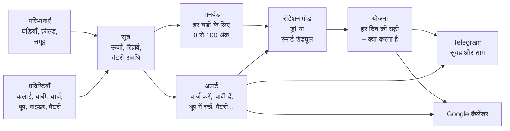

<!-- origem: 4e77f78cc19e6ee0fa132b706cc66f5f26c5b11c -->

## मूल विचार: सिस्टम घड़ियों के बारे में कुछ नहीं जानता {#a-ideia-central-o-sistema-não-sabe-nada-de-relógios}

यह डिज़ाइन का सबसे अहम फ़ैसला है, और यही सिस्टम को किसी भी कलेक्शन के लिए उपयोगी बनाता है। **कोड में सिर्फ़ तंत्र हैं;
घड़ियों के बारे में सारा ज्ञान वह डेटा है जो आप दर्ज करते हैं।**

सिस्टम यह "नहीं जानता" कि ऑटोमैटिक घड़ी में पावर रिज़र्व होता है, या सोलर घड़ी धूप में चार्ज होती है। यह सब दर्ज
सूत्रों में लिखा है, जिन्हें आप स्क्रीन पर पढ़ते, बदलते और जाँचते हैं:

```text
मैकेनिकल का बचा हुआ रिज़र्व =
  ACUMULA(0; reserva_horas; 1;                                  ← 0 से शुरू, अधिकतम रिज़र्व, हर घंटे 1 घंटा घटता है
          "pulso";  carga_pulso_reserva / carga_pulso_horas;    ← कलाई पर हर घंटा इतना रीचार्ज करता है
          "winder"; winder_ganho;                               ← वाइंडर पर हर घंटा, पोज़ीशन के प्रोग्राम से
          "corda";  reserva_horas)                              ← चाबी देने से भर जाता है
```

"स्ट्रैप बदलना", "अल्ट्रासोनिक सफ़ाई" या "वॉटर रेज़िस्टेंस" फ़ील्ड दर्ज करना है? वह डेटा है। चाहते हैं कि क्रोनोग्राफ़ का
ड्रॉ में अलग भार हो? वह डेटा है। "हर साल चमड़े का स्ट्रैप बदलें" की अलर्ट चाहिए? वह भी।

सिस्टम एक पूरे शुरुआती सेट के साथ आता है (स्मार्टवॉच, ऑटोमैटिक, हाथ से चाबी, बैटरी और सोलर, हर एक के सूत्र,
अलर्ट और मानदंड), जिसे आप अपने कलेक्शन के अनुसार ढालते हैं।


<sub>परिभाषाओं के फ़ील्ड। हर फ़ील्ड एक समूह और उसके नीचे की हर चीज़ पर लागू होता है (पावर रिज़र्व सिर्फ़ मैकेनिकल पर,
बैटरी की उम्र सिर्फ़ बैटरी वाली घड़ियों पर), और पहचानकर्ता वह नाम है जो सूत्रों में इस्तेमाल होता है।</sub>

---

## यह कैसे काम करता है {#como-funciona}



### अवधारणाएँ, एक-एक करके {#os-conceitos-um-por-um}

| अवधारणा | यह क्या है | उदाहरण |
|---|---|---|
| **समूह** (पेड़) | कलेक्शन का वर्गीकरण, जितने चाहें उतने स्तरों में। किसी समूह में दर्ज हर चीज़ उस पर और उसके नीचे की हर चीज़ पर लागू होती है। | `पारंपरिक › मैकेनिकल › ऑटोमैटिक` |
| **फ़ील्ड** | हर घड़ी का डेटा, आपके द्वारा तय: टेक्स्ट, संख्या, तारीख़, हाँ/नहीं या सूची, इकाई, डिफ़ॉल्ट मान और मान के नियमों के साथ (संभावित मान, न्यूनतम और अधिकतम, एक साथ कई मान)। | `reserva_horas = 40 h`, `data_pilha`, `funcoes = Data, GMT` |
| **खंड** | रिकॉर्ड के खंड, आपके बनाए हुए: हर फ़ील्ड उनमें से किसी एक में होता है, और रिकॉर्ड, पैनल, पासपोर्ट और रिपोर्ट फ़ील्डों को समूहित करके, उनके क्रम में दिखाते हैं। | *पहचान*, *ख़रीद*, *निर्माण*, *ऊर्जा* |
| **इकाइयाँ** | संख्या के बाद आने वाली चीज़, आपके द्वारा दर्ज: प्रतीक, नाम और रूपांतरण (इंच मिलीमीटर में)। फ़ील्ड, प्रविष्टि प्रकार और सूत्र सूची से इकाई चुनते हैं, और मान किसी दूसरी इकाई में भी दिख सकता है। | `47 mm (1,85 pol)` |
| **कैलिबर** | घड़ी का मूवमेंट, उसकी अपनी चीज़ों के साथ: निर्माता, तकनीकी मैनुअल, सिफ़ारिशें और फ़ील्ड के मान। कैलिबर वाली घड़ी अपना मान लेती है, नहीं तो कैलिबर का, नहीं तो फ़ील्ड का डिफ़ॉल्ट। | `NH35`: 41 घंटे का पावर रिज़र्व, चाल −20 से +40 s/दिन |
| **प्रविष्टि के प्रकार** | घड़ी के साथ क्या होता है। यह **तुरंत** (चाबी, बैटरी बदलना), **मान के साथ** (चार्ज रीडिंग: 68%) या शुरुआत और अंत वाला **सत्र** (कलाई पर, वाइंडर पर, धूप में) हो सकता है। | `sol`: एक सत्र जो आप भूल जाएँ तो शाम 6 बजे अपने-आप बंद हो जाता है |
| **सूत्र** | फ़ील्ड और प्रविष्टियों पर गणनाएँ। एक ही सूत्र का **हर समूह के लिए एक संस्करण** हो सकता है, और घड़ी के सबसे नज़दीकी समूह वाला लागू होता है। | `energia` स्मार्टवॉच पर बैटरी है, मैकेनिकल पर रिज़र्व, सोलर पर रोशनी और क्वार्ट्ज़ पर बैटरी की उम्र |
| **अलर्ट** | सूत्र से अपेक्षित तारीख़, पहले से कितना समय, एक टेक्स्ट और वह प्रविष्टि जो अलर्ट को हल करती है। | *"Orient को चाबी दें: रिज़र्व दोपहर 3 बजे ख़त्म होगा"*, और **चाबी** बटन इसे हल करता है |
| **चार्ज सीमा** | वह चार्ज जिस पर घड़ी को ध्यान चाहिए: स्मार्टवॉच चार्ज करना, सोलर को धूप में रखना, मैकेनिकल को चाबी देना। अलर्ट तभी जाती है जब चार्ज वहाँ पहुँचता है। हर घड़ी की अपनी सीमा हो सकती है (फ़ील्ड *"जब चार्ज यहाँ पहुँचे तब अलर्ट दें"*); ख़ाली हो तो सेटिंग्स वाली सामान्य सीमा लागू होती है। | स्मार्टवॉच 20% पर (सामान्य), Samsung 30% पर (अपनी) |
| **मानदंड** | ड्रॉ के लिए हर घड़ी को 0 से 100 अंक कैसे मिलते हैं: भार वाले पैरामीटर, किसी फ़ील्ड या सूत्र को मापने वाले उप-पैरामीटर, और सीमाएँ जो मान को अंक में बदलती हैं। | *बिना उपयोग का समय* (40%): 0 से 1 दिन पर 0, 30 दिन या अधिक पर 100 |
| **रोटेशन मोड** | योजना के नियम: मोड का प्रकार (हफ़्ते में एक, हफ़्ता और सप्ताहांत, सप्ताह के दिन के अनुसार, यादृच्छिक, स्मार्ट शेड्यूल या कस्टम), हर दिन किस समूह से चुनना है, कितने हफ़्ते आगे, चुनाव का मानदंड और, भीतर से, वह स्क्रिप्ट जो इंजन गिनता है। | *"सोमवार से शुक्रवार स्मार्टवॉच, सप्ताहांत में हर दिन एक पारंपरिक"* |
| **योजना** | हर दिन की घड़ी, और क्या करना है (*पहले चार्ज करें*, *चाबी दें*, *वाइंडर पर रखें*)। | `सोम 10/06 · Xiaomi Band · पहनने से पहले चार्ज करें` |

### सूत्र इंजन {#o-motor-de-fórmulas}

सूत्र स्प्रेडशीट की तरह लिखे जाते हैं: संख्याएँ अल्पविराम या बिंदु के साथ, टेक्स्ट उद्धरण चिह्नों में, तर्कों को अलग
करने के लिए `;`, संक्रियाएँ `+ - * / ^` और तुलनाएँ `= <> < <= > >=` (जो 1 या 0 देती हैं)। ख़ाली मान गणना में आगे
बढ़ता है, और शून्य से भाग देने पर ख़ाली मिलता है। बुनियादी फ़ंक्शन:

| फ़ंक्शन | क्या लौटाता है |
|---|---|
| `SE(शर्त; सही हो तो; ग़लत हो तो)`, `E(...)`, `OU(...)`, `NAO(x)` | तर्क: `E` सब सही हों तो 1 देता है, `OU` कोई भी सही हो तो, `NAO` उलट देता है |
| `MIN(...)`, `MAX(...)` | मानों में सबसे छोटा और सबसे बड़ा (ख़ाली मानों को छोड़ देते हैं) |
| `LIMITA(x; न्यूनतम; अधिकतम)`, `ARREDONDA(x; दशमलव)`, `ABS(x)` | सीमा के भीतर रखा गया x; पूर्णांकित; बिना चिह्न के |
| `CONVERTER(x; "de"; "para")` | उसी राशि की दूसरी इकाई में x, इकाइयों के रजिस्टर के अनुसार: `CONVERTER(diametro; "mm"; "pol")`; जब दोनों आपस में न बदलें तो खाली |
| `TEM(x; "valor")`, `ITENS(x)` | 1 यदि बहु-मान फ़ील्ड में वह मान है (बड़े-छोटे अक्षरों का भेद किए बिना): `TEM(funcoes; "Cronógrafo")`; उसमें कितने मान हैं |
| `PADRAO(x; दूसरा)`, `VAZIO(x)`, `NADA()` | x, या x ख़ाली हो तो दूसरा; x ख़ाली हो तो 1; जान-बूझकर ख़ाली (`SE(शर्त; NADA(); गणना)`) |
| `HOJE()`, `AGORA()` | आज की तारीख़ और वर्तमान क्षण, दिनों में (अभी दिन के अंश के साथ) |
| `DIAS_DESDE(तारीख़)`, `DIAS_ATE(तारीख़)`, `SOMA_MESES(तारीख़; महीने)` | किसी तारीख़ से और तक के दिन (ऋणात्मक: बीत चुकी); कैलेंडर के अनुसार तारीख़ में महीने जोड़कर |
| `HORAS_USO()` | उपयोग के एक दिन के घंटे, सेटिंग्स में पहनने के समय के अनुसार (सुबह 7 से रात 10: 15) |
| `CONFIG("कुंजी")` | सेटिंग्स की एक संख्या, जैसे `CONFIG("sol_limiar")` |

और वे जो हर घड़ी का इतिहास पढ़ते हैं:

| फ़ंक्शन | क्या लौटाता है |
|---|---|
| `HORAS("pulso"; 30)` | पिछले 30 दिनों में कलाई पर घंटे |
| `CONTAR("pulso"; 30)` | पिछले 30 दिनों में कितने दिन पहनी गई |
| `DIAS_DESDE_ULTIMO("pulso")` | कलाई पर आख़िरी बार से अब तक के दिन |
| `ULTIMO_VALOR("carga")` / `ULTIMA_DATA("pilha")` | आख़िरी रीडिंग / आख़िरी प्रविष्टि की तारीख़ |
| `HORAS_APOS("pulso"; "carga")` | आख़िरी चार्ज रीडिंग के बाद से कलाई पर घंटे |
| `ACUMULA(शुरुआत; अधिकतम; हानि/घंटा; "प्रकार"; असर; ...)` | एक शेष जो इतिहास पर चलता है: समय के साथ घटता है और हर प्रविष्टि से बढ़ता है |
| `MEDIDO("uso")` / `MEDIDO("repouso")` | बैटरी की असली खपत, आपकी चार्ज रीडिंग से मापी गई |
| `EM_SESSAO("winder")` | सत्र अभी खुला हो तो 1 (घड़ी वाइंडर पर है) |
| `MEDIA_COLECAO("uso_30d")` | पूरे कलेक्शन में किसी वेरिएबल का औसत |

और रोटेशन के (मोड की स्क्रिप्ट; उसके बाहर, दिन गणना के क्षण का है):

| फ़ंक्शन | क्या लौटाता है |
|---|---|
| `DIA_SEMANA()`, `SEMANA_DO_ANO()` | जिस दिन को बनाया जा रहा है उसका सप्ताह का दिन (1 सोमवार से 7 रविवार) और साल का सप्ताह (ISO) |
| `NO_GRUPO("Tradicional › Quartzo")` | 1 अगर घड़ी पेड़ के उस बिंदु पर या उसके नीचे है (नाम, पथ या `#id`; `"todos"`: सबके लिए 1) |
| `RELOGIO("Seiko SKX")` | 1 अगर वही घड़ी है (नाम या id से) |
| `CALIBRE("NH35")` | 1 अगर घड़ी में यह कैलिबर है (नाम या id से) |
| `WINDER_PROGRAMA("voltas_dia")`, `WINDER_POSICAO("campo")`, `WINDER("winder_marca")` | वाइंडर की उस पोज़ीशन के प्रोग्राम की गणना जिसमें घड़ी है (प्रति दिन चक्कर, `"voltas_horario"`, `"voltas_anti_horario"`, `"minutos_girando"`, `"velocidade"`, `"vezes_dia"`, `"ciclo_minutos"`; `ACUMULA` के अंदर, वाइंडर के हर सत्र की पोज़ीशन), उस पोज़ीशन का एक फ़ील्ड और उसके वाइंडर का एक फ़ील्ड; पोज़ीशन के बाहर, या बिना प्रोग्राम के, ख़ाली (देखें [वाइंडर](#os-winders)) |
| `ESCOLHIDO_HA(1)`, `VEZES_NO_PLANO(7)` | 1 अगर घड़ी n दिन पहले योजना की थी (1: कल; -1: आने वाला कल, जब वह पहले से योजना में है); पिछले n दिनों में योजना में उसके कितने दिन थे |
| `ESCOLHA(n; a; b; c)` | मानों में से n-वाँ (सिर्फ़ वही गिना जाता है): `ESCOLHA(DIA_SEMANA(); …)` सप्ताह के हर दिन के लिए एक मान देता है |
| `SORTEIO()` | 0 से 1 तक एक संख्या, ड्रॉ के उसी RANDOM.ORG बैच से |

और वेरिएबल `nota_criterios`: मानदंडों से घड़ी के अंक, गणना के क्षण पर।

**परिभाषाएँ** पेज पर हर सूत्र के साथ **सभी घड़ियों पर जाँचें** बटन है, जो सहेजने से पहले हर घड़ी पर नतीजा दिखाता है।

### योग {#os-totais}

योग भी सूत्र इंजन के हैं, पर वे **दिखाई गई सभी घड़ियों को एक साथ** देखते हैं (वे जो आज पेज की तालिका का फ़िल्टर छोड़ता है)। वे **परिभाषाएँ** पेज के **योग** टैब में हैं: हर योग में तालिका का वह **कॉलम** होता है जहाँ वह जाता है (या कोई नहीं), **नाम**, **व्यंजक**, **योग फ़ुटर में दिखाएँ** और **योग पृष्ठ पर दिखाएँ** के बॉक्स, पृष्ठ पर उसके खाने की **चौड़ाई** (संकरा या चौड़ा) और संख्याओं का **प्रारूप** (संख्या, पूर्णांक, 2 दशमलव के साथ, पैसा, प्रतिशत, तिथि या दिन)। फ़ुटर में, कॉलम के नीचे, सिर्फ़ किसी कॉलम के योग जाते हैं; बाकी, जितने आप चाहें, सिर्फ़ **योग पृष्ठ** पर रहते हैं (मेनू **संग्रह**, या तालिका के नीचे **सभी योग देखें**, जो वही फ़िल्टर ले जाता है)। एक ही कॉलम के कई योग सूची के क्रम में (↑ ↓) एक के नीचे एक रहते हैं, और **सभी घड़ियों पर जाँचें** सहेजने से पहले नतीजा दिखाता है।

| योग फ़ंक्शन | क्या देता है |
|---|---|
| `CONTA()`, `CONTA(x)` | कितनी घड़ियाँ; कितनी में `x` भरा है |
| `CONTA_SE(condição)` | कितनी शर्त पूरी करती हैं: `CONTA_SE(carga <= 20)` |
| `DISTINTOS(x)` | कितने अलग मान: `DISTINTOS(tipo)` |
| `SOMA(x)`, `MEDIA(x)`, `MEDIANA(x)`, `MENOR(x)`, `MAIOR(x)` | सामान्य गणना, उन घड़ियों से जिनमें `x` है (तिथि का औसत एक तिथि होता है) |
| `QUEM_MAIOR(x)`, `QUEM_MENOR(x)` | सबसे बड़े और सबसे छोटे मान वाली घड़ी, बगल में मान के साथ |
| `AGRUPADO(chave; conta; limite)` | एक छोटी तालिका: कुंजी के हर मान की एक पंक्ति और योग की पंक्ति; `conta` (उसके बिना, `CONTA()`) हर पंक्ति में सिर्फ़ उस पंक्ति की घड़ियों से, और योग में सबसे; `limite` सबसे ज़्यादा वाली दिखाता है और बाकी को "अन्य" में जोड़ता है |
| `FAIXAS(x; 25; 50; 75; 100)` | श्रेणियों की एक छोटी तालिका ("25 तक", "26 से 50"...), बिना `x` वाली "बिना मूल्य" में, और योग |

इनके अंदर वह सब चलता है जो सूत्र में चलता है (फ़ील्ड, सूत्र, `SE`, `DIAS_DESDE`...), हर घड़ी पर गिना हुआ, और वह भी जो तालिका का हर कॉलम दिखाता है: `codigo`, `nome`, `tipo`, `estado`, `disponivel`, `em_uso`, `carga`, `ultimo_uso`, `manutencao_data`, `manutencao_nome`, `encostado_data`, `avisos` (उसके कितने अलर्ट हैं) और `posse`। इनके बाहर, सिर्फ़ संख्याएँ, पाठ और वे फ़ंक्शन जिन्हें घड़ी की ज़रूरत नहीं (`SE`, `MIN`, `ARREDONDA`, गणनाएँ)। नए फ़ंक्शन `MES(data)`, `ANO(data)` और `MES_ANO(data)` महीने और साल से समूह बनाने के लिए हैं, और सूत्रों में भी चलते हैं। उदाहरण:

| योग | व्यंजक |
|---|---|
| उपलब्ध और अनुपलब्ध | `AGRUPADO(SE(disponivel; "disponíveis"; "indisponíveis"))` |
| प्रकार के अनुसार | `AGRUPADO(tipo)` |
| चार्ज की श्रेणियाँ | `FAIXAS(carga; 25; 50; 75; 100)` |
| कब से रुकी | `FAIXAS(DIAS_DESDE(ultimo_uso); 7; 30)` |
| क्या करना है (सबसे ज़्यादा दिखने वाले 3 और "अन्य") | `AGRUPADO(manutencao_nome; CONTA(); 3)` |
| महीने के अनुसार ख़रीद | `AGRUPADO(MES_ANO(data_compra))` |
| प्रकार के अनुसार मूल्य | `AGRUPADO(tipo; SOMA(valor_compra))` |
| सबसे महँगी | `QUEM_MAIOR(valor_compra)` |
| किसके पास सबसे ज़्यादा काम है | `QUEM_MAIOR(avisos)` |

नई स्थापना (और माइग्रेशन v31) में फ़ुटर के हर कॉलम में एक छोटी तालिका और योग पृष्ठ के खाने पहले से आते हैं; आप अपने बदलते, मिटाते या बनाते हैं।

### हर घड़ी के अंक (मानदंड) {#a-nota-de-cada-relógio-critérios}

पहले से तैयार मानदंड, सभी घड़ियों के लिए:

| पैरामीटर | भार | क्या मापता है |
|---|---:|---|
| बिना उपयोग का समय | 40 | कलाई पर आख़िरी बार से दिन: जितनी देर पड़ी रहे, उतने ज़्यादा अंक |
| उपयोग का संतुलन | 30 | पिछले 30 दिनों का उपयोग कलेक्शन के औसत की तुलना में: कम पहनी गई ऊपर आती है |
| पसंद | 20 | घड़ी के लिए आपके अंक (0 से 100) |
| नयापन और मूल्य | 10 | कितने समय पहले ख़रीदी गई और कितने की थी (निवेश का लाभ उठाना) |

हर समूह, और हर घड़ी भी, अपना सेट रख सकती है। उदाहरण के लिए स्मार्टवॉच **ऊर्जा** (अभी का चार्ज और वह कितने दिन चलेगा)
को भी तौलती है, ताकि ऐसी घड़ी न निकले जो दोपहर तक बंद हो जाए। **मानदंड** पेज हर अंक की पूरी गणना दिखाता है: हर सीमा,
हर भार और हर अंक, और हर मानदंड के अंक के बगल में एक तीर बताता है कि वह अंतिम अंक को किधर खींचता है: हरा **↑** (50, यानी तटस्थ, से
ऊपर का अंक: ऊपर खींचता है), लाल **↓** (50 से नीचे: नीचे खींचता है) या भूरा **↔** (ठीक 50, या बिना भार: तटस्थ, किसी ओर नहीं खींचता)।

पहले से तैयार सेट, पूरे। किसी पैरामीटर के अंक उसके उप-पैरामीटरों के अंकों का औसत है, हर एक के भार के अनुसार; घड़ी के
अंक पैरामीटरों का भार के अनुसार औसत है। हर उप-पैरामीटर एक वेरिएबल (फ़ील्ड या सूत्र) पढ़ता है और मान जिस सीमा में आता
है उसके अनुसार अंक देता है; बिना मान वाला उप-पैरामीटर (ख़ाली फ़ील्ड, किसी भी सीमा से बाहर का मान) छोड़ दिया जाता है, और
बाक़ी उसका भार बाँट लेते हैं। सब कुछ **मानदंड** पेज पर बदला जाता है, और **शुरुआती मानदंड वापस लाएँ** इन्हीं पर लौटा देता है।

**सभी घड़ियाँ**

| पैरामीटर | भार | उप-पैरामीटर (वेरिएबल, पैरामीटर के भीतर भार) | सीमाएँ: मान → अंक |
|---|---:|---|---|
| बिना उपयोग का समय | 40 | बिना उपयोग के दिन (`dias_sem_uso`) | 0 से 1 → 0; 1 से 3 → 30; 3 से 7 → 60; 7 से 14 → 80; 14 से 30 → 95; 30 या अधिक → 100 |
| उपयोग का संतुलन | 30 | पिछले 30 दिनों में उपयोग, औसत से तुलना (`uso_vs_media`) | 0 से 25 → 100; 25 से 60 → 80; 60 से 100 → 60; 100 से 140 → 35; 140 से 200 → 15; 200 या अधिक → 0 |
| पसंद | 20 | घड़ी के लिए आपके अंक (`preferencia`) | 0 से 20 → 0; 20 से 40 → 25; 40 से 60 → 50; 60 से 80 → 75; 80 से 100 → 100 |
| नयापन और मूल्य | 10 | नयापन: ख़रीद से दिन (`dias_desde_compra`, 60) | 0 से 15 → 100; 15 से 45 → 80; 45 से 120 → 55; 120 से 365 → 40; 365 या अधिक → 30 |
|  |  | निवेश का लाभ: चुकाई गई क़ीमत (`valor_compra`, 40) | 0 से 300 → 30; 300 से 800 → 50; 800 से 1500 → 70; 1500 या अधिक → 90 |

**स्मार्टवॉच**

| पैरामीटर | भार | उप-पैरामीटर (वेरिएबल, पैरामीटर के भीतर भार) | सीमाएँ: मान → अंक |
|---|---:|---|---|
| ऊर्जा | 30 | अभी चार्ज (%) (`energia`, 50) | 0 से 15 → 0; 15 से 30 → 25; 30 से 50 → 55; 50 से 80 → 85; 80 से 100 → 100 |
|  |  | चार्ज कितने उपयोग दिन चलेगा (`dias_de_carga`, 50) | 0 से 1 → 0; 1 से 2 → 30; 2 से 4 → 60; 4 से 7 → 85; 7 या अधिक → 100 |
| बैटरी अवधि | 15 | स्मार्टवॉच की बैटरी अवधि (`autonomia_dias`) | 0 से 2 → 10; 2 से 4 → 40; 4 से 7 → 70; 7 से 14 → 90; 14 या अधिक → 100 |
| बिना उपयोग का समय | 25 | बिना उपयोग के दिन (`dias_sem_uso`) | 0 से 1 → 0; 1 से 3 → 30; 3 से 7 → 60; 7 से 14 → 80; 14 से 30 → 95; 30 या अधिक → 100 |
| उपयोग का संतुलन | 15 | पिछले 30 दिनों में उपयोग, औसत से तुलना (`uso_vs_media`) | 0 से 25 → 100; 25 से 60 → 80; 60 से 100 → 60; 100 से 140 → 35; 140 से 200 → 15; 200 या अधिक → 0 |
| पसंद | 10 | घड़ी के लिए आपके अंक (`preferencia`) | 0 से 20 → 0; 20 से 40 → 25; 40 से 60 → 50; 60 से 80 → 75; 80 से 100 → 100 |
| नयापन और मूल्य | 5 | नयापन: ख़रीद से दिन (`dias_desde_compra`, 60) | 0 से 15 → 100; 15 से 45 → 80; 45 से 120 → 55; 120 से 365 → 40; 365 या अधिक → 30 |
|  |  | निवेश का लाभ: चुकाई गई क़ीमत (`valor_compra`, 40) | 0 से 300 → 30; 300 से 800 → 50; 800 से 1500 → 70; 1500 या अधिक → 90 |

**पारंपरिक › मैकेनिकल**

| पैरामीटर | भार | उप-पैरामीटर (वेरिएबल, पैरामीटर के भीतर भार) | सीमाएँ: मान → अंक |
|---|---:|---|---|
| पावर रिज़र्व | 25 | अभी रिज़र्व (%): ख़ाली, चलना ज़रूरी (`energia`) | 0 से 10 → 100; 10 से 30 → 85; 30 से 60 → 60; 60 से 90 → 35; 90 से 100 → 20 |
| मैकेनिकल देखभाल | 15 | रुकी हुई को चलना ज़रूरी (लुब्रिकेशन) (`dias_sem_uso`, 50) | 0 से 7 → 20; 7 से 30 → 60; 30 से 90 → 90; 90 या अधिक → 100 |
|  |  | सर्विस समय पर (`dias_ate_revisao`, 50) | 0 से 30 → 20; 30 से 180 → 60; 180 या अधिक → 100 |
| बिना उपयोग का समय | 25 | बिना उपयोग के दिन (`dias_sem_uso`) | 0 से 1 → 0; 1 से 3 → 30; 3 से 7 → 60; 7 से 14 → 80; 14 से 30 → 95; 30 या अधिक → 100 |
| उपयोग का संतुलन | 20 | पिछले 30 दिनों में उपयोग, औसत से तुलना (`uso_vs_media`) | 0 से 25 → 100; 25 से 60 → 80; 60 से 100 → 60; 100 से 140 → 35; 140 से 200 → 15; 200 या अधिक → 0 |
| पसंद | 10 | घड़ी के लिए आपके अंक (`preferencia`) | 0 से 20 → 0; 20 से 40 → 25; 40 से 60 → 50; 60 से 80 → 75; 80 से 100 → 100 |
| नयापन और मूल्य | 5 | नयापन: ख़रीद से दिन (`dias_desde_compra`, 60) | 0 से 15 → 100; 15 से 45 → 80; 45 से 120 → 55; 120 से 365 → 40; 365 या अधिक → 30 |
|  |  | निवेश का लाभ: चुकाई गई क़ीमत (`valor_compra`, 40) | 0 से 300 → 30; 300 से 800 → 50; 800 से 1500 → 70; 1500 या अधिक → 90 |

**पारंपरिक › क्वार्ट्ज़ › बैटरी**

| पैरामीटर | भार | उप-पैरामीटर (वेरिएबल, पैरामीटर के भीतर भार) | सीमाएँ: मान → अंक |
|---|---:|---|---|
| बैटरी की उम्र | 15 | बैटरी की उम्र (%) (`energia`) | 0 से 10 → 10; 10 से 30 → 50; 30 से 100 → 70 |
| सर्विस | 10 | सर्विस समय पर (`dias_ate_revisao`) | 0 से 30 → 20; 30 से 180 → 60; 180 या अधिक → 100 |
| बिना उपयोग का समय | 35 | बिना उपयोग के दिन (`dias_sem_uso`) | 0 से 1 → 0; 1 से 3 → 30; 3 से 7 → 60; 7 से 14 → 80; 14 से 30 → 95; 30 या अधिक → 100 |
| उपयोग का संतुलन | 25 | पिछले 30 दिनों में उपयोग, औसत से तुलना (`uso_vs_media`) | 0 से 25 → 100; 25 से 60 → 80; 60 से 100 → 60; 100 से 140 → 35; 140 से 200 → 15; 200 या अधिक → 0 |
| पसंद | 10 | घड़ी के लिए आपके अंक (`preferencia`) | 0 से 20 → 0; 20 से 40 → 25; 40 से 60 → 50; 60 से 80 → 75; 80 से 100 → 100 |
| नयापन और मूल्य | 5 | नयापन: ख़रीद से दिन (`dias_desde_compra`, 60) | 0 से 15 → 100; 15 से 45 → 80; 45 से 120 → 55; 120 से 365 → 40; 365 या अधिक → 30 |
|  |  | निवेश का लाभ: चुकाई गई क़ीमत (`valor_compra`, 40) | 0 से 300 → 30; 300 से 800 → 50; 800 से 1500 → 70; 1500 या अधिक → 90 |

**पारंपरिक › क्वार्ट्ज़ › सोलर**

| पैरामीटर | भार | उप-पैरामीटर (वेरिएबल, पैरामीटर के भीतर भार) | सीमाएँ: मान → अंक |
|---|---:|---|---|
| रोशनी | 25 | रोशनी चार्ज (%) (`energia`) | 0 से 30 → 80; 30 से 70 → 65; 70 से 100 → 50 |
| सर्विस | 10 | सर्विस समय पर (`dias_ate_revisao`) | 0 से 30 → 20; 30 से 180 → 60; 180 या अधिक → 100 |

और एक **रोटेशन गारंटी** है: कोई भी घड़ी N दिनों से ज़्यादा पड़ी नहीं रहती (डिफ़ॉल्ट 21)। यह अंकों से **पहले** लागू होती है:
अगर कोई उम्मीदवार सीमा पार कर चुका है, तो वह सीधे जीतता है, सबसे लंबे समय से पड़ी हुई पहले। जब कोई सीमा पार नहीं करता,
तभी अंक फ़ैसला करते हैं।

पड़े रहने के दिन **बिना उपयोग के दिन** सूत्र हैं, जिसे आप परिभाषाएँ में बदल सकते हैं: कलाई पर आख़िरी बार से दिन और,
जो घड़ी **कभी नहीं पहनी गई**, उसके लिए ख़रीद से दिन (ख़रीद की तारीख़ न हो तो 9999, सबसे ज़्यादा पड़ी हुई)। इस तरह कल
ख़रीदी गई घड़ी कतार नहीं तोड़ती, और दो कभी न पहनी गई घड़ियाँ बराबर नहीं होतीं: पहले ख़रीदी गई ज़्यादा समय से इंतज़ार कर
रही है।

ताकि आपको कभी शक न रहे, **योजना का हर दिन चुनाव का कारण** एक वाक्य में रखता है, और वह आज पेज और योजना पेज पर घड़ी के
नीचे दिखता है: *"रोटेशन गारंटी: कभी नहीं पहनी, 38 दिनों से कलेक्शन में, 21 दिन बिना उपयोग की सीमा से आगे"*, *"अंकों से
ड्रॉ, 5 उम्मीदवारों में: अंक 70.2, 16.4% संभावना"*, *"सबसे ज़्यादा अंक (91.2)। लगातार 5 दिन रहती है"*, *"कलाई पर
जारी: लगातार 5 में से दिन 2"*, *"हाथ से चुनी गई"*।
### रोटेशन मोड {#os-modos-de-rodízio}

मोड **रोटेशन मोड** पृष्ठ पर हैं (मेनू **रोटेशन**)। हर मोड का एक **प्रकार** है, और प्रकार की स्क्रीन सिर्फ़ वही पूछती है जो
उसमें मायने रखता है:

- **हफ़्ते में एक**: पूरे हफ़्ते के लिए एक घड़ी, उसके पहले से आख़िरी दिन तक (सोमवार से रविवार, या रविवार से शनिवार: हफ़्ता
  कॉन्फ़िगरेशन में **हफ़्ता शुरू होता है** में चुने दिन से शुरू होता है)। आप बताते हैं कि वह कहाँ से आती है (कलेक्शन, एक समूह या एक
  तय घड़ी) और चुनाव का मानदंड।
- **हफ़्ता और सप्ताहांत**: दो हिस्से, सोमवार से शुक्रवार और शनिवार-रविवार, हर एक अपने समूह के साथ और **हिस्से के लिए एक घड़ी**
  या **हर दिन एक**। जो पहले से तैयार है: हफ़्ते में स्मार्टवॉच, उसके अंत में हर दिन एक पारंपरिक। हफ़्ता रविवार से
  शुरू होने पर, शनिवार और रविवार फिर भी एक ही हिस्सा रहते हैं (शनिवार की घड़ी रविवार को भी रहती है)।
- **सप्ताह के दिन के अनुसार**: हर दिन एक घड़ी, और सप्ताह का हर दिन बताता है कि वह कहाँ से आती है (एक समूह, एक तय घड़ी या कोई
  नहीं: ख़ाली दिन)।
- **हर दिन यादृच्छिक**: हर दिन एक, सबको समान संभावना, बिना मानदंड और बिना रोटेशन गारंटी।
- **स्मार्ट शेड्यूल**: चार्ज सिमुलेट करके पूरी अवधि की योजना एक बार में बनाता है ([नीचे](#a-escala-inteligente) देखें)।
- **कस्टम**: आप स्क्रिप्ट लिखते हैं ([मोड की स्क्रिप्ट](#o-roteiro-do-modo) देखें)।

पहले तीन में **चुनाव का मानदंड** ड्रॉ है: **सबसे ज़्यादा अंक** से, **अंकों से ड्रॉ** (अंक संभावना बन जाते हैं) से, **यादृच्छिक**
या **कतार** से (जो सबसे लंबे समय से इंतज़ार कर रही है)। **चक्र** चालू हो तो कोई घड़ी तभी लौटती है जब हफ़्ते में सभी
उम्मीदवारों की बारी आ चुकी हो। आज पेज का **रोटेशन मोड** बॉक्स मोड, मानदंड और रोटेशन गारंटी चुनता है; **मोड लागू करें** सिर्फ़
चिह्नित करता है: जब तक आप **फिर से ड्रॉ करें** पर क्लिक नहीं करते, योजना में कुछ नहीं बदलता।

**फिर से ड्रॉ करें** वह फिर बनाता है जो मोड ने ड्रॉ किया था और हाथ से चुने दिन और ख़ाली दिन (जैसे मैनुअल रोटेशन वाले) जैसे हैं
वैसे छोड़ देता है; संदेश बताता है कितने रहे (*"जैसे थे वैसे रहे: 7 ख़ाली दिन..."*)। **सब कुछ अधिलेखित करें** बॉक्स चिह्नित होने पर,
ड्रॉ की शुरुआत (कल से, आज से या अगले हफ़्ते के पहले दिन से) से आगे योजना में जो कुछ है सब हट जाता है, हाथ से, ख़ाली या ड्रॉ
किया, और मोड सब कुछ फिर से बनाता है; पुष्टि पहले चेतावनी देती है, और संदेश बताता है कितने हाथ वाले और ख़ाली दिन अधिलेखित हुए।

**क्या बदला।** प्लान को छूने वाला हर लेखन (फिर से ड्रॉ, अगला हफ़्ता, "इससे बदलें…", मैनुअल रोटेशन, अवधियाँ, "आज कोई घड़ी नहीं" और
मिटाना) संदेश के साथ दिखाता है कि पहले के प्लान की तुलना में क्या बदला: *"3 दिन बदले; 11 में वही घड़ी रही।"* और हर बदले हुए दिन
की एक छोटी तालिका (**दिन**, **पहले**, **बाद में** और नई घड़ी का **कारण**)। तालिका के साथ, डिब्बा तब तक रहता है जब तक आप उसे बंद न करें।
API से, जवाब में `mudancas` आता है।

**हफ़्ते।** शेड्यूल के बाहर, हर मोड बताता है कि योजना **कितने हफ़्ते आगे** तक बनी आती है (1 से 8; सूची तारीख़ों के साथ हफ़्ते
दिखाती है)। योजना उनमें से आख़िरी के आख़िरी दिन तक जाती है: रविवार, या हफ़्ता रविवार से शुरू होने पर शनिवार (एक ही हफ़्ते के साथ,
हफ़्ते के आख़िरी दिन योजना अगले हफ़्ते का पहला दिन भी लाती है, एक दिन पहले की याद के लिए), और अगला हफ़्ता अपनी बारी आने पर
शामिल होता है। हफ़्ता कॉन्फ़िगरेशन में चुने दिन से शुरू होता है (**हफ़्ता शुरू होता है**: सोमवार को, डिफ़ॉल्ट, या रविवार को), और
चक्र, अगला हफ़्ता और पूरे हफ़्ते की घड़ी उसी से गिने जाते हैं। एक से ज़्यादा हफ़्ते होने पर **फिर से ड्रॉ करें** में **अगला हफ़्ता**
भी है: यह मौजूदा मोड से निकलता है, इस हफ़्ते के बचे दिनों को उपयोग मानकर, मानो आपने योजना की घड़ियाँ पहन ली हों (उपयोग बिना
उपयोग के दिनों और अंकों में गिना जाता है; चार्ज नहीं, क्योंकि पता नहीं घड़ी चार्ज होगी या नहीं)। हर दिन ऐसे ही चुना जाता है,
योजना के पिछले दिन पहले से कलाई पर मानकर, इसलिए सोमवार की घड़ी केवल रुकी हुई लगने से मंगलवार को वापस नहीं आती। हाथ से चुने गए
दिन बने रहते हैं। स्मार्ट शेड्यूल में अगला हफ़्ता नहीं होता: वह पहले से अपनी पूरी अवधि की योजना बनाता है।

### मोड की स्क्रिप्ट {#o-roteiro-do-modo}

भीतर से, हर मोड एक **स्क्रिप्ट** है: पाँच पंक्तियाँ जो सूत्र इंजन हर उपलब्ध घड़ी के लिए योजना के हर दिन की शुरुआत में गिनता
है, पिछले दिनों को पहले से उपयोग मानकर। तैयार मोड अपनी स्क्रीन से स्क्रिप्ट बनाते हैं (पेज बनी हुई स्क्रिप्ट दिखाता है, सिर्फ़
पढ़ने के लिए); **कस्टम** में आप अपनी लिखते हैं, हर नाम की एक पंक्ति (`नाम = व्यंजक`, परिभाषाओं के सूत्रों की ही भाषा में; `#` से
शुरू होने वाली पंक्तियाँ टिप्पणियाँ हैं; बाकी नाम आपके अपने वेरिएबल हैं):

| पंक्ति | क्या कहती है | न हो तो |
|---|---|---|
| `candidato` | 1: घड़ी उस दिन के चुनाव में शामिल; 0: नहीं | `1` (सभी) |
| `nota` | उस दिन घड़ी के अंक | `nota_criterios` (मानदंडों से अंक) |
| `peso` | ड्रॉ में संभावना। सब 0: सबसे ज़्यादा अंक जीतते हैं। सब बराबर: सबको समान संभावना। नहीं तो हर वज़न संभावना है | `0` |
| `dias` | चुनी हुई घड़ी लगातार कितने दिन रहती है (जब तक अगले दिन रिक्त हों और वह उम्मीदवार बनी रहे) | `1` |
| `garantia` | 1: सबसे आगे जाती है (कई में से, सबसे लंबे समय से रुकी; बराबरी: पहले पंजीकृत) | जो बिना उपयोग के दिनों में रोटेशन गारंटी (`max_sem_uso`) पार कर चुकी है |

**इंजन हर दिन कैसे तय करता है**, इस क्रम में: स्क्रिप्ट बताती है कि उम्मीदवार कौन है; उम्मीदवारों में, कल की घड़ी बाहर
रहती है, अगर कोई दूसरी उम्मीदवार हो (अकेली उम्मीदवार दोहराई जाती है, और कारण बताता है क्यों); चक्र, अगर मोड इस्तेमाल करता है, वह भी
सिर्फ़ उम्मीदवारों में; जिसकी `garantia` है वह सीधे जीतती है; नहीं तो `peso`। चुनी हुई घड़ी स्क्रिप्ट के दिए `dias` तक रहती
है, और चुनाव का कारण योजना में दर्ज हो जाता है। वही इंजन हर दिन के चयनकर्ता का **इस दिन का ड्रॉ इसके द्वारा** और मैनुअल रोटेशन
का **मेरे लिए तय करें** तय करता है।

एक उदाहरण: हफ़्ते में मैकेनिकल, सप्ताहांत में जो बैटरी दे, और 3 दिन से ज़्यादा रुकी हुई को बाकियों से 100 गुना संभावना:

```
util      = DIA_SEMANA() <= 5
candidato = SE(util; NO_GRUPO("Mecânico"); 1)
peso      = SE(dias_sem_uso > 3; 100; 1)
dias      = SE(NO_GRUPO("Smartwatch"); dias_seguidos; 1)
```

**सभी घड़ियों पर जाँचें** बटन किसी दिन (आज, या अगले 13 में से एक) स्क्रिप्ट गिनता है और हर घड़ी पर हर पंक्ति और कौन जाती
दिखाता है। सूत्रों के फ़ंक्शनों के अलावा स्क्रिप्ट में `DIA_SEMANA()` (1 सोमवार से 7 रविवार), `SEMANA_DO_ANO()`,
`NO_GRUPO("समूह")`, `RELOGIO("नाम")`, `ESCOLHIDO_HA(n)`, `VEZES_NO_PLANO(n)`, `ESCOLHA(n; a; b; …)` और `SORTEIO()` हैं
([सूत्र इंजन](#o-motor-de-fórmulas) की तालिका) और वेरिएबल `nota_criterios`। API से: `recurso=roteiro` जाँचता है; `recurso=modos`,
`acao=salvar` `tipo=personalizado` और `roteiro` के साथ सहेजता है।

**ड्रॉ कहाँ से आता है।** सिस्टम का हर ड्रॉ (पूरी तरह यादृच्छिक मोड, अंकों या वज़न से ड्रॉ और स्क्रिप्ट का `SORTEIO()`
फ़ंक्शन) बाहर से आए सचमुच यादृच्छिक नंबरों का इस्तेमाल करता है, इस क्रम में:

1. **[RANDOM.ORG](https://www.random.org/)**: वायुमंडलीय शोर से यादृच्छिकता (यह हवा में माइक्रोवेव के बदलाव को मापकर बिट
   में बदलता है);
2. जब वह बंद हो (या दिन का कोटा ख़त्म हो जाए), **ANU QRNG**, ऑस्ट्रेलियन नेशनल यूनिवर्सिटी का क्वांटम जनरेटर (यह रोशनी
   के क्वांटम उतार-चढ़ाव मापता है)। सिस्टम पुराना पता `qrng.anu.edu.au/API/jsonI.php` इस्तेमाल करता है, जो बिना कुंजी के
   जवाब देता है (नया, `api.quantumnumbers.anu.edu.au`, API कुंजी माँगता है);
3. दोनों न हों तो (उदाहरण के लिए सर्वर पर इंटरनेट न हो), **PHP का सुरक्षित जनरेटर** (`random_int`, ऑपरेटिंग सिस्टम वाला:
   Python के `secrets` के बराबर)।

नंबर एक बैच में आते हैं (हर अनुरोध में 16 बिट के 64 नंबर), और हर ड्रॉ उतना ही इस्तेमाल करता है जितना चाहिए, सीमा के
आख़िरी पूरे गुणज से आगे वाले को छोड़कर: हर नतीजे की संभावना बिल्कुल बराबर होती है। हर सेवा के पास जवाब देने के लिए 4
सेकंड हैं; दोनों विफल हों तो सिस्टम PHP वाला इस्तेमाल करता है और 10 मिनट तक दोबारा कोशिश नहीं करता (ताकि कोई पेज इंतज़ार
में न रहे)। हर ड्रॉ किए गए दिन का कारण बताता है कि नंबर कहाँ से आया (*"साधारण ड्रॉ, 4 उम्मीदवारों में, सबकी बराबर
संभावना (RANDOM.ORG)।"*), और **सेटिंग्स** आख़िरी बैच दिखाती है (**ड्रॉ** बॉक्स)। जो गुप्त है वह इन सेवाओं का इस्तेमाल नहीं
करता: पासवर्ड का सॉल्ट और दस्तावेज़ों की फ़ाइलों के नाम PHP के जनरेटर से ही बनते हैं, क्योंकि इंटरनेट पर घूमने वाला नंबर
रहस्यों के काम का नहीं।

### कार्यक्रम मिटाएँ {#apagar-a-programação}

**योजना** पेज के नीचे (मुख्य जगह: पेज के अंत में, दिन-ब-दिन के बाद **कार्यक्रम मिटाएँ** बॉक्स) और आज पेज के **रोटेशन मोड**
बॉक्स में (हर एक एक पंक्ति के नीचे, जैसे **फिर से ड्रॉ करें**):

- **एक अवधि हटाएँ**: **से** और **तक**; दोनों में से एक ख़ाली रह सकता है (केवल **से** उससे योजना के अंत तक हटाता है;
  केवल **तक**, कल से उस तक)। अवधि के दिन कल से योजना से हट जाते हैं (हाथ से चुने, ड्रॉ किए और ख़ाली), और रोटेशन मोड इन
  दिनों को फिर से बनाता है। **हटाएँ** बटन पुष्टि माँगता है।
- **सब हटाएँ**: कल से आगे का पूरा कार्यक्रम साफ़ करता है: हाथ से चुने दिन, ड्रॉ किए दिन और ख़ाली दिन। **आज समेत** चिह्नित
  करने से आज से आगे मिटाता है (अगर आज के लिए दूसरी घड़ी निकले, तो वह अभी से कलाई वाली बन जाती है)। फिर रोटेशन मोड योजना
  को शून्य से दोबारा बनाता है: मोड के हफ़्तों में आख़िरी के आख़िरी दिन तक (अगले, जब आएँ); स्मार्ट शेड्यूल में, पूरा शेड्यूल।
  कार्यक्रम ख़ाली नहीं रहता क्योंकि सिस्टम हमेशा सक्रिय मोड से बचे हुए दिन बनाता है; बिना घड़ी वाले दिनों के लिए, मैनुअल
  रोटेशन में *ख़ाली* चिह्नित करें।

### मैनुअल रोटेशन {#o-rodízio-manual}

आज पेज के **रोटेशन मोड** बॉक्स में सूची का आख़िरी विकल्प **मैनुअल रोटेशन** है: किसी अवधि (छुट्टियाँ, एक यात्रा, पूरा
महीना) के हर दिन की घड़ी आप ख़ुद चुनते हैं। शुरुआत (**से**) और अंत (**तक**) डालें और **OK** पर क्लिक करें:

- दिन **7-7 करके** दिखते हैं, तारीख़, सप्ताह का दिन, उस दिन योजना में अभी क्या है और एक चयनकर्ता के साथ;
- 7 से ज़्यादा दिन हों तो पेज नीचे होते हैं: **‹ पिछला**, **1 2 3 …**, **अगला ›**। एक पेज पर जो चुनते हैं वह दूसरे
  पेजों पर जाते समय बना रहता है; सहेजने से पहले कुछ नहीं बदलता;
- हर दिन के चयनकर्ता में उपलब्ध घड़ियाँ, **मेरे लिए तय करें**, समूह **इस दिन का ड्रॉ इसके द्वारा** (*सबसे बड़ा अंक*, *अंक से
  ड्रॉ*, *यादृच्छिक* या *कतार*: सहेजते समय उस तरीके से दिन का ड्रॉ होता है, कल वाली और आने वाले कल वाली के बिना, मेरे लिए तय
  करें की तरह) और **बिना घड़ी (ख़ाली दिन)** होते हैं। शुरुआत में यह वह
  घड़ी दिखाता है जो उस दिन पहले से हाथ से चुनी हुई है; ख़ाली दिन ख़ाली दिखता है; और बाक़ी (ड्रॉ किए गए या अभी बिना
  घड़ी), *मेरे लिए तय करें* के रूप में;
- **मैनुअल रोटेशन सहेजें** पूरी अवधि सहेजता है: घड़ी वाले दिन हाथ से चुने बन जाते हैं, *मेरे लिए तय करें* और *इस दिन का ड्रॉ
  इसके द्वारा* वाले दिन उसी समय सिस्टम तय करता है और वे भी सहेजे जाते हैं (हर एक का कारण योजना में दिखता है), और ख़ाली दिन बिना घड़ी रहते हैं।
  अगर आज अवधि में है और आपने दूसरी घड़ी चुनी, तो वह अभी से कलाई वाली बन जाती है;
- किसी अवधि के दिन हटाने (रोटेशन मोड इन दिनों को फिर से बनाता है) या सब हटाने के लिए देखें
  [कार्यक्रम मिटाएँ](#apagar-a-programação)।

अवधि के बाहर, सामान्य रोटेशन मोड ही लागू रहता है। हाथ से चुने दिन तब भी बने रहते हैं जब आप फिर से ड्रॉ करें या cron
अगला हफ़्ता बनाए; स्मार्ट शेड्यूल में, शेड्यूल उनके इर्द-गिर्द दोबारा बनता है।

**"मेरे लिए तय करें" का मानदंड:**
1. **मानदंडों के अंक** (जो आप **मानदंड** में तय करते हैं: बिना उपयोग के दिन, संतुलन, पसंद, चार्ज...), हर दिन की शुरुआत
   में गणना किए जाते हैं, अवधि के पिछले दिनों (जो आपने चुने और जो इसने तय किए) को पहले से उपयोग गिनकर;
2. **रोटेशन गारंटी** पहले आती है: जो बिना उपयोग के दिनों की सीमा पार कर चुकी है वह पहले जाती है, सबसे लंबे समय से पड़ी
   हुई सबसे पहले;
3. **पिछले दिन** की और **अगले दिन** की घड़ी छोड़ दी जाती है, अगर कोई और हो। इस तरह कोई घड़ी आपकी चुनी हुई के ठीक बगल
   में दोहराई नहीं जाती;
4. बराबरी होने पर, पहले दर्ज की गई जीतती है।

आज, *मेरे लिए तय करें* के साथ, योजना में पहले से मौजूद घड़ी ही रहती है।

### स्मार्ट शेड्यूल {#a-escala-inteligente}

यह सबसे पूरा मोड है। हफ़्ते-दर-हफ़्ते ड्रॉ करने के बजाय, यह **एक बार में 7 दिन से 2 साल तक की योजना** बनाता है, दिन-ब-दिन
सिमुलेट करते हुए:

1. उस दिन की सिमुलेट की गई स्थिति से हर घड़ी के अंक निकालता है;
2. सबसे ज़्यादा अंक से घड़ी चुनता है (शेड्यूल की स्क्रिप्ट: `peso = 0`); स्मार्टवॉच उतने दिन कलाई पर रहती है जितने दिन
   बैटरी चलती है (7 तक: सूत्र `dias_seguidos`);
3. उपयोग (पहनने के समय में कलाई का सत्र) और सबके चार्ज और रिज़र्व पर उसका असर सिमुलेट करता है;
4. अलर्ट जाँचता है: अगर चुनी गई घड़ी को चार्ज या चाबी की ज़रूरत होगी, तो वह दिन पर काम लिख देता है (*"पहनने से पहले
   चार्ज करें"*) और उसे हल करने वाली प्रविष्टि सिमुलेट करता है;
5. अगले दिन पर जाता है।

हर सुबह cron **असली स्थिति से दोबारा योजना बनाता है**। अगर आपने दूसरी घड़ी पहनी, चार्ज करना भूल गए या उम्मीद से अलग
रीडिंग दर्ज की, तो योजना ख़ुद को सुधार लेती है।

### रीडिंग से मापी गई खपत {#gasto-medido-pelas-leituras}

स्मार्टवॉच का रिकॉर्ड कहता है "5 दिन चलती है"। हक़ीक़त इससे सहमत नहीं, और बैटरी पुरानी होने के साथ बदलती है। इसलिए, **आप जो भी
चार्ज रीडिंग दर्ज करते हैं वह पिछली से तुलना की जाती है**, और दोनों के बीच का अंतराल एक माप बन जाता है: कितना गिरा, कितने घंटे
कलाई पर रही और कितने कलाई से बाहर (रखी हुई, बंद), और आपने हर रीडिंग को कैसे चिह्नित किया (उपयोग में या विश्राम में)। सेटिंग का
उपयोग समय अपने आप कलाई माना जाता है, और आपके निशान (*पहनी*, *उतारी*) निर्णायक हैं। रीडिंग में बढ़त रिचार्ज है: एक नया हिस्सा
शुरू होता है। और बीच में किसी दूसरे सत्र वाला अंतराल (घड़ी चार्जर पर गई) भी नहीं मापता: माप सिर्फ़ कलाई और रखे हुए को अलग करना
जानती है।

**मापों को दो खपतों (कलाई पर और कलाई से बाहर) में कैसे बदलना है, यह आपका चुनाव है: पाँच इंजन हैं।** सभी सिस्टम में रहते हैं;
कोई कुछ नहीं मिटाता, और इंजन बदलने से सिर्फ़ गणना बदलती है (मापें वही रहती हैं)। चुनाव तीन जगहों पर होता है, और ऊपर वाला नीचे
वालों पर भारी पड़ता है:

| स्तर | कहाँ चुना जाता है | क्या करता है |
|---|---|---|
| 1. **संग्रह** | सेटिंग में **बैटरी खपत: कैसे गणना करें (सभी घड़ियों पर लागू)** (`gasto_motor`) | संग्रह की सभी घड़ियों पर लागू। खाली (*व्यक्तिगत (घड़ी या समूह पर)*): नीचे के दो स्तर तय करते हैं। |
| 2. **घड़ी** | घड़ी के रिकॉर्ड में **बैटरी खपत कैसे गणना करें** फ़ील्ड (`gasto_motor`) | सिर्फ़ उस पर लागू। खाली: समूह का। |
| 3. **समूह** | उसी फ़ील्ड का **डिफ़ॉल्ट** (**रिकॉर्ड › फ़ील्ड** में: फ़ील्ड जड़ में है, और जहाँ है वहाँ से नीचे की घड़ियों पर लागू) | जिन घड़ियों ने नहीं चुना उन पर लागू। खाली: इंजन 1। |

बिना चार्ज रीडिंग वाली घड़ी में (मैकेनिकल, सोलर) चुनाव कुछ नहीं करता। **बैटरी की खपत** बॉक्स बताता है कि किस इंजन ने गणना की और
चुनाव कहाँ से आया (*गणना की गई: मार्किंग के अनुसार: दो अलग दरें — संग्रह का चुनाव, सेटिंग में*)।

| इंजन | क्या करता है |
|---|---|
| 1. **दर्ज घंटों के अनुसार (मूल इंजन)** (`horas`) | डिफ़ॉल्ट। हर माप मिनट-दर-मिनट कलाई के निशानों से बँटती है (इतने घंटे कलाई पर, इतने बाहर), और दोनों खपतें विंडो की सभी मापों से एक साथ निकलती हैं, हर माप का भार उसके समय के बराबर। यह वही गणना है जो सिस्टम हमेशा करता आया है। |
| 2. **दर्ज घंटों के अनुसार, रीडिंग और पंजीकरण के साथ (रोबस्ट)** (`robusto`) | वही घंटे, लेकिन गणना रीडिंग पर होती है, सभी समान भार से, जो बाकियों से मेल नहीं खाती उसका भार कम और रिकॉर्ड शुरुआती बिंदु है (नीचे की तीन सावधानियाँ)। अनिश्चितता (±) देता है। |
| 3. **मार्किंग के अनुसार: दो अलग दरें** (`marcacao`) | आपकी मार्किंग निर्णायक है। **उपयोग में** चिह्नित दो रीडिंग के बीच का हिस्सा कलाई पर खपत मापता है: गिरावट, उस हिस्से के पूरे समय से भाग (उपयोग के दिनों में)। **विश्राम में** चिह्नित दो रीडिंग के बीच का हिस्सा उसी तरह कलाई से बाहर की खपत मापता है। हर तरह की एक-एक रीडिंग वाला हिस्सा गणना से बाहर रहता है (यह जानने का तरीका नहीं कि उसमें कितना कलाई पर था)। दोनों गणनाएँ **कभी नहीं मिलतीं**: उपयोग में खपत सिर्फ़ उपयोग वाली रीडिंग से, और विश्राम में खपत सिर्फ़ विश्राम वाली से; दर्ज कलाई नहीं आती। हर ओर रोबस्ट गणना के साथ (मेल न खाने वाली रीडिंग का भार कम; रिकॉर्ड शुरुआती बिंदु), अनिश्चितता के साथ भी। |
| 4. **केवल पंजीकरण** (`cadastro`) | रिकॉर्ड का *उपयोग में क्षय* (या *उपयोग में असली स्वायत्तता*) और *रखे हुए का क्षय* हमेशा लागू। मापें बनती रहती हैं और इतिहास में रहती हैं (**खपत की मापें** तालिका), लेकिन किसी गणना में नहीं आतीं: `MEDIDO` खाली देता है। |
| 5. **पंजीकरण के सूत्रों के अनुसार** (`formulas`) | `taxa_uso` और `taxa_repouso` सूत्र जो दें वही लागू, ताकि आप **रिकॉर्ड › सूत्र** में अपनी गणना बना सकें। उनमें `MEDIDO("uso")` और `MEDIDO("repouso")` इंजन 3 की गणना हैं, और **LEITURAS**, **QUEDA**, **DIAS_MEDIDOS**, **MEDIA_TAXA**, **MEDIANA_TAXA** और **ULTIMA_TAXA** फ़ंक्शन मार्किंग के अनुसार मापों के हिस्से देते हैं (कितनी, गिरावटों का योग, दिनों का योग, औसत, माध्यिका और आखिरी दर, हर प्रकार की, पिछले N दिनों में या सेटिंग की विंडो में): `MEDIANA_TAXA("uso")`, या `PADRAO(QUEDA("uso"; 30) / DIAS_MEDIDOS("uso"; 30); decaimento_uso)`। बाकी इंजनों में भी सूत्र लागू हैं (खपत उन्हीं से निकलती है); फ़र्क़ यह है कि यह कहता है: गणना आपकी है। |

**कौन सी मापें आती हैं** सेटिंग का एक और चुनाव है, **मापी गई खपत: किसके अनुसार गिनें**: **दिन** (पिछले इतने दिनों की मापें, डिफ़ॉल्ट
90) या **रीडिंग** (हर प्रकार की आखिरी इतनी मापें, उपयोग में और विश्राम में, डिफ़ॉल्ट 20)। विंडो में कोई न हो तो पहले वाली आती हैं।
इंजन 1, 2, 3 और 5 पर लागू (और बिना N दिनों वाले सूत्र फ़ंक्शनों पर)।

दो रिचार्ज के बीच चार्ज कलाई पर के समय और रखे हुए समय के साथ सीधी रेखा में गिरता है:

```text
रीडिंग = शुरुआत का चार्ज − उपयोग में खपत × उपयोग के दिन − रखे हुए की खपत × रखे हुए दिन (+ रीडिंग की त्रुटि)
```

बीच में बिना रिचार्ज की लगातार रीडिंग एक **हिस्सा** बनाती हैं। हर हिस्से का अपना शुरुआती चार्ज है (जो गणना खोज लेती है), और दोनों
खपतें सभी हिस्सों पर लागू। इंजन 2 में, विंडो की रीडिंग से, सिस्टम **दोनों खपतें एक साथ** खोजता है: जो सभी रीडिंग को सबसे अच्छा
समझाएँ। दो रीडिंग के बीच एक रात (सिर्फ़ कलाई से बाहर) रखे हुए की खपत तय करती है; कलाई पर के दिन, उसे जानकर, उपयोग में खपत तय
करते हैं। 1 घंटे या अधिक की हर माप आती है, बिना किसी गिरावट वाली भी (वह कहती है कि खपत छोटी है)। जितनी ज़्यादा रीडिंग, उतना सटीक।
इंजन 3 में वही गणना दो बार होती है, एक सिर्फ़ उपयोग वाली रीडिंग से और एक सिर्फ़ विश्राम वाली से।

रोबस्ट गणना (इंजन 2 और 3) में तीन सावधानियाँ हैं, हर एक की वजह के साथ:

1. **गणना रीडिंग पर होती है, और सबका भार बराबर है।** त्रुटि रीडिंग से आती है: घड़ी चार्ज पूर्णांकों में दिखाती है, और उसका मीटर भी
   थोड़ा चूकता है। यह त्रुटि पिछली के 2 घंटे या 2 हफ्ते बाद ली गई रीडिंग में एक जैसी है, इसलिए ज़्यादा समय ढकने से कोई रीडिंग
   दूसरी से ज़्यादा मूल्यवान नहीं। और, चूँकि गणना रीडिंग देखती है (गिरावटें नहीं), एक गलत रीडिंग एक ही बिंदु है, उसके आसपास की
   दो गिरावटों को बिगाड़ने के बजाय।
2. **बाकियों से मेल न खाने वाली रीडिंग का भार कम होता है (रोबस्ट रिग्रेशन)।** गणना के बाद सिस्टम देखता है कि वह हर रीडिंग पर कितना
   चूकता है। सामान्य त्रुटि रीडिंग से ही निकलती है (कभी आधे अंक से कम नहीं); जो रीडिंग सामान्य से काफ़ी दूर है उसका भार कम हो
   जाता है, जितनी दूर उतना कम, और गणना फिर से होती है। उसे फेंका नहीं जाता: बस भार कम होता है। एक आम मामला: **चार्ज के तुरंत बाद
   का 100%**, जिसे कई घड़ियाँ कुछ देर दिखाती रहती हैं जबकि असली चार्ज पहले से गिर रहा है।
3. **रिकॉर्ड शुरुआती बिंदु है।** रिकॉर्ड का क्षय (या स्वायत्तता) अपेक्षित मान के रूप में गणना में आता है, उसके आधे की छूट के साथ।
   कम रीडिंग पर खपत रिकॉर्ड के पास रहती है; ज़्यादा पर रीडिंग निर्णायक हैं। और जब रीडिंग उपयोग और रखे हुए को अलग न कर पाएँ (जैसे
   सिर्फ़ रखी हुई घड़ी की रीडिंग), तो जो खपत वे नहीं मापतीं वह रिकॉर्ड की रहती है। रिकॉर्ड अभी कितना खींचता है यह दिखाने के
   लिए, **बैटरी की खपत** बॉक्स और **गणना कहाँ से आती है** बताते हैं कि केवल रीडिंग से क्या आता (*केवल रीडिंग से 15.57% आता
   (1 माप): कम मापों में रिकॉर्ड अभी भी गणना को अपनी ओर खींचता है*); इंजन 3 में बॉक्स हर ओर की मापें गिनता है (*मार्किंग से: 1
   उपयोग में और 1 विश्राम में*)।

इन दो इंजनों का परिणाम **अनिश्चितता** (± एक मानक विचलन) के साथ आता है: *22.09% ± 1.48 प्रति उपयोग दिन* का मतलब है कि उपयोग में
खपत, अच्छी संभावना से, 20.6% और 23.6% के बीच है। रीडिंग आने के साथ यह घटती है।

**खपत की मापें** तालिका में (**समय के साथ चार्ज** में), हर माप दोनों रीडिंग की मार्किंग दिखाती है (*उपयोग में → उपयोग में*) और
बताती है कि गणना में आती है या नहीं: *हाँ*; *आंशिक: भार 31%*, उस रीडिंग के साथ जो बाकियों से ठीक मेल नहीं खाती (*100% की रीडिंग
बाकियों से ठीक मेल नहीं खाती: गणना उस पर 4.5 अंक चूकती है*); या *नहीं* (विंडो से बाहर, गणना से हटाई गई, इंजन 3 में दोनों रीडिंग
अलग चिह्नित, या इंजन 4)। रीडिंग का संदेश भी बताता है जब नई रीडिंग बाकियों से मेल नहीं खाती। हर पंक्ति में **गणना से हटाएँ** (या
**गणना में रखें**) बटन है, उस स्थिति के लिए जब आप कुछ ऐसा जानते हैं जो सिस्टम नहीं जानता: माप बिना कुछ मिटाए निकलती या लौटती है
(इंजन 1, 2, 3 और 5 में लागू)।

चार्ज बताते समय आप कहते हैं कि रीडिंग के समय घड़ी कैसी थी: **निशान लगाएँ** बॉक्स में, **चार्ज रीडिंग बताएँ (उपयोग में)** (कलाई पर)
या **चार्ज रीडिंग बताएँ (आराम में)** (रखी हुई); आज पेज की *चार्ज बताएँ* चेतावनी में, **उपयोग में** और **विश्राम में** बटन।
**मार्किंग रीडिंग में दर्ज रहती है** (`estado` कॉलम; पहले की रीडिंग में, और जिन्हें कोई स्क्रिप्ट बिना बताए दर्ज करती है, उस क्षण
दर्ज कलाई जो कहती थी वही लागू)। यही इंजन 3 इस्तेमाल करता है, और बाकियों के लिए जाँच का काम करती है। अगर सिस्टम के पास उस क्षण
घड़ी दूसरी तरह थी (उपयोग समय ने उसे अपने आप कलाई पर रखा, पर वह रखी रही; या कोई *पहनी* छूट गया), तो स्क्रीन दर्ज करने से पहले
पूछती है: *मेरे हिसाब से, उस क्षण (19/10 10:13) घड़ी कलाई पर थी। यह रीडिंग विश्राम में गलत लगती है। क्या फिर भी जारी रखना चाहते
हैं?* केवल रीडिंग का क्षण गिना जाता है: पिछली रीडिंग और इस रीडिंग के बीच घड़ी ने जो किया वह सवाल में नहीं आता (रीडिंग उस
क्षण की तस्वीर है; दोनों के बीच का हिस्सा माप की गणना है)। **जारी रखें** आपकी मार्किंग के अनुसार दर्ज
करता है (API से, जवाब `confirmar: true` और सवाल के साथ आता है, और प्रविष्टि सिर्फ़ `confirmar=1` के साथ दोबारा भेजने पर दर्ज
होती है); कुछ भी रोका नहीं जाता, और दर्ज कलाई नहीं बदलती: अगर वह गलत थी, तो **कोई निशान सुधारें या हटाएँ** में सुधारें।
**सुधारें** बॉक्स पहले से दर्ज रीडिंग की मार्किंग भी बदलता है।

दोनों खपतें घड़ी के पेज पर **बैटरी की खपत** बॉक्स में हैं:

- **गणना की गई**: जिस इंजन ने गणना की और चुनाव कहाँ से आया (संग्रह, घड़ी, समूह, या डिफ़ॉल्ट)।
- **कलाई पर** और **कलाई से बाहर (बंद)**: गणना में लागू होने वाली खपत, बोल्ड में, अनिश्चितता (± ..., इंजन 2 और 3 में) के साथ, और
  वह कहाँ से आती है (मापी गई, तुलना के लिए साथ में रिकॉर्ड वाली, या सिर्फ़ रिकॉर्ड से, जब अभी कोई माप नहीं या इंजन 4 है)।
- हर एक के नीचे, **रिकॉर्ड में**: रिकॉर्ड के वे फ़ील्ड जिनसे रिकॉर्ड की खपत निकलती है (*उपयोग में क्षय*, *उपयोग में असली
  बैटरी अवधि*, *रखे रहने पर क्षय*), मान के साथ और, जब वह बताया हुआ न हो, *डिफ़ॉल्ट* का लेबल।
- **उनसे पहले के 90 दिनों में**: पिछली खिड़की में मापी गई दोनों खपतें। यही तुलना बैटरी का पुराना होना दिखाती है: अगर कलाई
  पर खपत 4.9% से 5.7% हो गई, तो वह अब पहले जैसा चार्ज नहीं रखती।

यही बात फिर से, मिलती-जुलती चीज़ों के साथ, **घड़ी का डेटा** बॉक्स में दिखती है: **रिकॉर्ड** तालिका में, बताए गए क्षय (और बैटरी
अवधि) के नीचे, **रीडिंग से गणना** और जो **गणना में** लागू है; **अभी गणना** तालिका में, खपत के सूत्रों (*taxa_uso*, *taxa_repouso*)
के नीचे, मापा हुआ और रिकॉर्ड वाला। और हर माप, एक-एक करके, **समय के साथ चार्ज › खपत के माप** में है।

विंडो से पुरानी मापें अपने आप गणना से निकल जाती हैं। इसलिए पुराने होने के अनुसार समायोजन अपने आप होता है: रिकॉर्ड छूने की
ज़रूरत नहीं। रिकॉर्ड का "उपयोग में क्षय" और "रखे हुए का क्षय" तभी तक लागू हैं जब तक कोई माप नहीं (या हमेशा, इंजन 4 में)।

---

### सटीकता (घड़ी की चाल) {#a-precisão-a-marcha-do-relógio}

हर घड़ी हर दिन थोड़ा आगे या पीछे होती है: यही **चाल** है, सेकंड प्रति दिन में (+ आगे, − पीछे)। Relojoeiro हर घड़ी की चाल **समय
के विचलन की रीडिंग** से मापता है: सही समय के मुक़ाबले वह कितनी आगे या पीछे है (सर्वर का समय, **सही समय** पेज वाला ही)। बीच में समय
के साथ दो रीडिंग उस अंतराल की चाल देती हैं; घड़ी की चाल अंतरालों का **समय से भारित** औसत है (10 दिन का अंतराल एक दिन वाले से दस गुना
भारी, और 1 सेकंड ग़लत रीडिंग का लगभग कोई असर नहीं)। **समय मिलाना** विचलन को शून्य करता है: गिनती वहीं से, 0 s से, फिर शुरू होती है।

**सटीकता जाँचें**, घड़ी के **दर्ज करें** बॉक्स में: सही समय सेकंड के साथ चलता दिखता है। फ़ील्ड में वह समय डालें जो घड़ी थोड़ी देर में
दिखाएगी (सेकंड के साथ) और जब सेकंड की सुई वहाँ पहुँचे तब **अभी दर्ज करें** दबाएँ; सिस्टम उसे उसी क्षण के सही समय से मिलाता है। यह भी
बताएँ कि पिछली रीडिंग के बाद से **वह कहाँ रही**: कलाई पर, कलाई और रखी हुई (जैसा रोटेशन ने किया), डायल ऊपर या नीचे रखी हुई, क्राउन
ऊपर, नीचे, बाएँ या दाएँ, या वाइंडर में: मैकेनिकल की चाल स्थिति से बदलती है, और सिस्टम हर स्थिति की चाल अलग करता है। विचलन सीधे सेकंड
में भी लिखा जा सकता है। संदेश पिछली रीडिंग से चाल बताता है। यह जाँच **पारंपरिक** घड़ियों में दिखती है (*समय का विचलन* प्रकार पारंपरिक समूह पर लागू है): स्मार्टवॉच फ़ोन से अपना समय ख़ुद ठीक कर लेती है। स्मार्टवॉच में भी मापने के लिए, **परिभाषाएँ › प्रविष्टि प्रकार** में प्रकार का *लागू है* बदलें।

चाल स्थिति, चाबी, तापमान और इस्तेमाल से बदलती है: कई दिनों का औसत एक माप से ज़्यादा बताता है। मैकेनिकल में रीडिंग के बीच एक दिन ही
अच्छी तरह मापता है; क्वार्ट्ज़ में, जो महीने में कुछ सेकंड बदलता है, हफ़्तों रुकें।

**सटीकता** बॉक्स चाल (और माप आपस में कितने बदलते हैं), आख़िरी, अभी का अनुमानित विचलन और अपेक्षित चाल (फ़ील्ड *अपेक्षित चाल: से* और
*तक*) दिखाता है; चौड़ा बॉक्स **समय के साथ विचलन** ग्राफ़ (हर समय मिलाना रेखा फिर शुरू करता है), माप और हर स्थिति में चाल लाता है।
चेतावनियाँ **समय मिलाएँ** (अनुमानित विचलन सीमा पार करने वाला है) और **चाल अपेक्षा से बाहर** (आख़िरी माप सीमा से, या घड़ी के अपने
इतिहास से, बाहर गया) दूसरों की तरह फ़ॉर्मूले हैं। फ़ॉर्मूलों में: `MARCHA(dias; "posição")`, `MARCHA_DP(dias; "posição")`,
`MARCHA_N(dias; "posição")`, `MARCHA_ULTIMA()` और `DESVIO_AGORA()`। API से: `recurso=precisao` (एक घड़ी का या संग्रह का सारांश) और
`recurso=lancamento`, `acao=lancar`, `tipo=desvio`, `valor` या `marca` (और `instante_ms`) और `posicao` के साथ।

### कैलिबर {#os-calibres}

**कैलिबर** घड़ी का मूवमेंट है: Seiko का NH35, Sea-Gull का ST2130, Casio का 3159 मॉड्यूल। बहुत-सी चीज़ें घड़ी की नहीं,
मूवमेंट की होती हैं: पावर रिज़र्व, निर्माता की बताई चाल, क्या क्राउन से चाबी दी जा सकती है। **परिभाषाएँ** पृष्ठ के
**कैलिबर** टैब में हर कैलिबर का नाम, निर्माता, तकनीकी मैनुअल का लिंक, सिफ़ारिशें (*"क्राउन से चाबी दें: 40 चक्कर तक"*) और
वे **फ़ील्ड मान** होते हैं जो वह तय करता है। घड़ी के रिकॉर्ड में **कैलिबर** चुनें: तब घड़ी उन फ़ील्ड में उसके मान लेती है
जिन्हें उसने ख़ुद ख़ाली छोड़ा है।

क्रम यह है: **घड़ी का मान, नहीं तो कैलिबर का, नहीं तो फ़ील्ड का डिफ़ॉल्ट** (समूह का)। NH35 वाली पाँच घड़ियों को रिज़र्व और
अपेक्षित चाल एक साथ मिल जाती है; उनमें से जिसके रिकॉर्ड में अलग रिज़र्व है, वह अपना रखती है। **घड़ी का डेटा** में जो मान घड़ी का
अपना नहीं है, उसके पास एक लेबल बताता है कि वह कहाँ से आया (*कैलिबर* या *डिफ़ॉल्ट*; बताया हुआ मान, बिना लेबल), और तालिकाओं के ऊपर कैलिबर, मैनुअल का लिंक और
सिफ़ारिशें दिखती हैं। कैलिबर हटाने पर उसकी घड़ियाँ बिना कैलिबर रह जाती हैं (हटाना बताता है कितनी)। सूत्रों में
`CALIBRE("NH35")` 1 देता है अगर घड़ी में वह कैलिबर है। API से: `recurso=calibres` (सूची, हर एक के मान और घड़ियों के साथ),
`recurso=calibres` के साथ `acao=salvar` या `excluir`, और `recurso=relogio`, `acao=salvar`, `calibre_id` के साथ।

**कैलिबर के दस्तावेज़** (PDF में तकनीकी मैनुअल, सर्विस शीट, मूवमेंट की तस्वीरें) कैलिबर में ही रहते हैं: कैलिबर टैब में
**दस्तावेज़ (N)** कैलिबर का **दस्तावेज़** पृष्ठ खोलता है (वह पृष्ठ की **घड़ी** सूची में **कैलिबर** समूह में भी दिखता है), बाक़ी
श्रेणियों के साथ **तकनीकी मैनुअल** श्रेणी भी। ये उस कैलिबर वाली हर घड़ी पर लागू होते हैं: **घड़ी का डेटा** की कैलिबर पंक्ति में
और हर घड़ी के दस्तावेज़ पृष्ठ पर दिखते हैं (*"कैलिबर NH35 से: …"*)। कैलिबर हटाने पर उसके दस्तावेज़ फ़ाइलों सहित हट जाते हैं।

कैलिबर का फ़ॉर्म कौन-से फ़ील्ड दिखाए, यह एक विकल्प है: **केवल मूवमेंट वाले** (डिफ़ॉल्ट) या **रिकॉर्ड के सभी फ़ील्ड**, फ़ॉर्म
के ऊपर **फ़ॉर्म में फ़ील्ड** सूची में, या **सेटिंग्स** में (*कैलिबर फ़ॉर्म*)। मूवमेंट वाले वे हैं जो **फ़ील्ड** टैब में चिह्नित हैं
(*मूवमेंट का* बॉक्स): रिज़र्व, चार्ज, अपेक्षित चाल, विचलन की सीमा, क्राउन से चाबी, स्वायत्तता, क्षय, सर्विस और बैटरी की आयु पहले से
चिह्नित आते हैं। जो फ़ील्ड कैलिबर पहले से तय करता है वह हमेशा दिखता है, ताकि उसे हटाया जा सके। API से: `recurso=documentos`
के साथ `calibre=` (और `enviar` में `calibre_id`), `recurso=config` के साथ `calibre_campos` और `recurso=campos` के साथ
`calibre`।

### इकाइयाँ {#as-unidades}

हर ट्री का अपना **इकाइयों का रजिस्टर** होता है, **परिभाषाएँ** पेज के **इकाइयाँ** टैब में: **प्रतीक** (जो संख्या के बाद आता
है: `mm`, `h`, `dias`, `R$`), पूरा **नाम** और **रूपांतरण**। यह आम इकाइयों के साथ आता है: लंबाई (mm, cm, m, pol, pés),
द्रव्यमान (g, kg, oz), समय (s, min, h, dias, semanas, meses, anos), तापमान (°C, °F), दाब (bar, atm, hPa, psi), धड़कनें
(bph, Hz) और अलग वाली (%, s/dia, ms, °, mAh, V, lux, R$)। फ़ील्ड, प्रविष्टि प्रकार और सूत्र **इसी सूची से** इकाई चुनते हैं
(API ऐसे प्रतीक को अस्वीकार करता है जो दर्ज नहीं है), और किसी इकाई का प्रतीक बदलने पर वह उसे उपयोग करने वालों में भी बदल
जाता है।

रूपांतरण एक स्तर का है: हर इकाई अपनी राशि के **आधार** में बदलती है, **गुणक** के साथ (1 pol = 25,4 mm; 1 h = 3600 s) और,
सिर्फ़ तापमान में, **शून्य** के साथ (°C = (°F − 32) × 5/9)। एक ही आधार वाली दो इकाइयाँ आपस में बदलती हैं, और सूत्र
`CONVERTER(x; "de"; "para")` हिसाब करता है। **इसमें भी दिखाएँ**: मान उस इकाई में भी **घड़ी के डेटा** और **पासपोर्ट** में
दिखता है (मिलीमीटर पहले से इंच दिखाता है: *47 mm (1,85 pol)*)। उपयोग में चल रही इकाई हटाई नहीं जाती (हटाने पर बताया जाता
है कि कौन उपयोग करता है); आधार हटाने पर उसमें बदलने वाली इकाइयाँ भी हटती हैं। API से: `recurso=unidades` (सूची, हर एक के
रूपांतरण और उपयोग के साथ) और `recurso=unidades` के साथ `acao=salvar` या `excluir`।

### मान के नियम {#as-regras-do-valor}

हर फ़ील्ड बताता है कि वह कौन-सा मान स्वीकार करता है, **परिभाषाएँ** पेज के **फ़ील्ड** टैब में, और जो उसका पालन न करे उसे API
अस्वीकार करता है (स्क्रीन, API, आयात, कैलिबर):

- **संभावित मान** (प्रति पंक्ति एक): **सूची** में वे विकल्प हैं, अनिवार्य; **पाठ** और **संख्या** में, जब फ़ील्ड में हों, मान
  उनमें से एक होना चाहिए (पट्टे की चौड़ाई: 18, 20, 22), और रिकॉर्ड एक मेनू दिखाता है। छोटे अक्षरों में लिखा भी चलता है:
  परिभाषाओं में लिखा रूप रहता है।
- **न्यूनतम** और **अधिकतम**, केवल संख्या में (ख़ाली: कोई सीमा नहीं): व्यास 20 से 60 mm। सीमा इनपुट के नीचे दिखती है, और
  अस्वीकृति बताती है कि वह क्या है (*20 से 60 mm तक होना चाहिए*)।
- **कई मान**: बहु-मान फ़ील्ड, जैसे घड़ी के **फ़ंक्शन** (तारीख़, GMT, क्रोनोग्राफ़)। रिकॉर्ड में हर संभावित मान के लिए एक
  बॉक्स; घड़ी के डेटा में हर एक एक लेबल में; पासपोर्ट में अल्पविराम से अलग। डेटाबेस में प्रति पंक्ति एक (`campo_valor_item`
  और `calibre_valor_item` तालिकाएँ), और सूत्रों में वह प्रति पंक्ति एक के साथ आता है: `TEM(funcoes; "GMT")` बताता है कि
  वह है या नहीं, और `ITENS(funcoes)`, कितने।

किसी फ़ील्ड का प्रकार या नियम बदलने पर पहले से सहेजे मान जाँचे जाते हैं: जो अब पालन नहीं करता उसकी सूची आती है और बदलाव
आपके ठीक करने तक रुकता है (उदाहरण के लिए, बहु-मान तभी हटता है जब हर घड़ी में एक ही मान हो)। API से: `recurso=campos`
`opcoes`, `minimo`, `maximo` और `multiplo` के साथ; घड़ी में, हर मान के लिए एक बार `valores[funcoes][]`।

### निर्माण और एक्सेसरी {#a-construção-e-os-acessórios}

नया रजिस्टर हर घड़ी का **निर्माण** पहले से लाता है (देखें [निर्माण](#a-construção)): केस की सामग्री और माप, काँच, डायल,
चमक, क्राउन, केस बैक और फ़ंक्शन। जो ट्री पहले से था उसे ये फ़ील्ड अपडेट में मिलते हैं (माइग्रेशन v44), संग्रह की भाषा में,
उसी पहचानकर्ता वाले उसके मौजूदा फ़ील्डों को छुए बिना।

**एक्सेसरी** के भी फ़ील्ड होते हैं, घड़ी के फ़ील्डों की तरह दर्ज, **परिभाषाएँ** पेज के **फ़ील्ड** टैब में, **किसके लिए:
एक्सेसरी** के साथ: वह **एक्सेसरी प्रकार** जिस पर फ़ील्ड लागू है (या सभी) और, ज़रूरत हो तो, घड़ी का वह फ़ील्ड जिससे उसे
मेल खाना है ताकि एक्सेसरी घड़ी पर **फ़िट** हो। नया रजिस्टर पट्टे वाले लाता है: **चौड़ाई** (जो घड़ी की **लग चौड़ाई** से
मेल खाती है), **सामग्री**, **रंग**, **क्लैस्प** और **क्विक रिलीज़**। **एक्सेसरी** पेज पर, फ़ॉर्म चुने गए प्रकार के
फ़ील्ड माँगता है, और सूची **डेटा** और हर एक कहाँ **फ़िट होता है** दिखाती है: 20 mm का खुला पट्टा 20 लग चौड़ाई वाली सभी
घड़ियों पर फ़िट दिखता है; पैनल में, हर घड़ी का **एक्सेसरी** बॉक्स दूसरी घड़ियों के (या खुले) वे एक्सेसरी भी दिखाता है जो
**उस पर फ़िट होते हैं**। बेची और संग्रहीत घड़ियाँ इस गिनती में नहीं आतीं।

### वाइंडर {#os-winders}

**वाइंडर** (वह डिब्बा जो ऑटोमैटिक घड़ियों को घुमाता है) का अपना रिकॉर्ड है, **वाइंडर** पेज पर (**संग्रह** मेनू में):
हर वाइंडर अपनी **पोज़ीशनों** के साथ, और हर पोज़ीशन अपने **प्रोग्राम** के साथ, यानी पालना किस तरह घूमता है। वाइंडर का
डेटा **फ़ील्ड** हैं, जो **परिभाषाएँ** पेज के **फ़ील्ड** टैब में **किसके लिए: वाइंडर** के साथ दर्ज होते हैं, घड़ियों के
फ़ील्ड की तरह; नया सेटअप पहले से **ब्रांड**, **मॉडल**, **मैनुअल का लिंक** और **कुशन की सीमाएँ** लाता है (केस इतने mm तक,
कलाई इतने से इतने cm तक और वज़न इतने g तक)। पोज़ीशन के अपने फ़ील्ड भी हो सकते हैं (**किसके लिए: वाइंडर की पोज़ीशनें**)।

**गतियाँ और प्रोग्राम।** प्रोग्राम **गतियों का एक क्रम** है जो दोहराया जाता है। **गतियाँ** पेज (**संग्रह** मेनू) में क़दम
रहते हैं: हर एक का एक **कोड**, नाम, **प्रकार** (**घड़ी की दिशा में घुमाव**, **उल्टी दिशा में घुमाव** या **विराम**) और
सिर्फ़ एक माप: घुमाव बताता है कि वह **कितने चक्कर** लगाता है या **कितनी देर** घूमता है, दोनों कभी नहीं; विराम में सिर्फ़
समय होता है। **प्रोग्राम** पेज (**संग्रह** मेनू) में हर प्रोग्राम का नाम, **दर्ज करने का प्रकार** (**चक्करों से**: क्रम के
घुमाव चक्करों में; **समय से**: समय में), क्या वह **पूरे दिन** चलता है या **खंडों में** (*3 घंटे चालू और 9 घंटे बंद*),
**पालने की गति** और **क्रम** होता है, यानी गतियों के कोड क्रम में (*3, 1, 4, 1*: एक ही कोड दोहराया जा सकता है, जैसे दोनों
घुमावों के बीच एक ही विराम)। पालने की गति **गिनी हुई** होती है (पालने पर टेप का छोटा टुकड़ा चिपकाइए और 1 मिनट में चक्कर
गिनिए) या उस मोड के लिए **मैनुअल में लिखे प्रति दिन चक्करों** से निकलती है: एक या दूसरी। **जो गणना होती है वह लिखी नहीं
जाती**: हर क़दम के चक्कर (या समय), चक्र, दिन में कितनी बार चलता है, घूमने का समय और **प्रति दिन चक्कर** (TPD), कुल और हर
दिशा में, जैसे-जैसे आप बदलते हैं नीचे दिखते हैं, जाँचने के लिए। एक प्रोग्राम जितनी चाहें उतनी पोज़ीशनों में, किसी भी वाइंडर
पर चलता है। जो वाइंडर सिर्फ़ प्रति दिन चक्कर बताता है (TPD स्विच: 650, 850...) उसके लिए सहायक **N प्रति दिन चक्करों के लिए
क्रम बनाएँ** है: चक्कर, गति और दिशा दीजिए, और वह घुमाव और विराम बना देता है (जो गतियाँ नहीं हैं उन्हें बनाता है); उसके बाद
वह बाक़ी प्रोग्रामों जैसा ही है। जो गति किसी प्रोग्राम में है, या जो प्रोग्राम किसी पोज़ीशन में है, वह हटाया नहीं जाता (पहले
उसे वहाँ से निकालिए)।

घड़ी की तरफ़, ऑटोमैटिक को तीन फ़ील्ड मिलते हैं, जो कैलिबर भी दे सकता है: वाइंडर पर **उसे चाहिए प्रति दिन घुमाव**
(डिफ़ॉल्ट 650) और क्या वह **घड़ी की दिशा में** और **उल्टी दिशा में घूमने पर चाबी भरती है** (डिफ़ॉल्ट रूप से दोनों; जो
मूवमेंट सिर्फ़ एक दिशा में चाबी भरता है वह सिर्फ़ वही चुनता है)।

वाइंडर पर हर घंटा कितना चार्ज करता है यह एक सूत्र से आता है, `winder_ganho` (परिभाषाओं का **सूत्र** टैब), जिसे आप जैसे चाहें
बदल सकते हैं। नए सेटअप का सूत्र प्रोग्राम के प्रति दिन चक्करों को **सिर्फ़ उन दिशाओं में जोड़ता है जिनमें घड़ी चाबी भरती
है**, उन्हें उसे चाहिए घुमावों से मिलाता है (अधिकतम 1) और *वाइंडर पर* फ़ील्ड के अनुपात (घंटे और उनसे मिलने वाला रिज़र्व)
से गुणा करता है: 650 चक्करों के प्रोग्राम में, हर दिशा में 325, जो घड़ी सिर्फ़ घड़ी की दिशा में चाबी भरती है उसे आधा मिलता
है। पोज़ीशन में प्रोग्राम न हो, या ऐसे सत्र में जो किसी पोज़ीशन में नहीं है (पुराने, वाइंडर से पहले के, या हटाए गए वाइंडर
का), पहले की तरह *वाइंडर पर* फ़ील्ड लागू होते हैं। सूत्रों में `WINDER_PROGRAMA("voltas_dia")` (और `"voltas_horario"`,
`"voltas_anti_horario"`, `"minutos_girando"`, `"velocidade"`, `"vezes_dia"`, `"ciclo_minutos"`) पोज़ीशन के प्रोग्राम की
गणना पढ़ता है, `WINDER_POSICAO("campo")` पोज़ीशन का एक फ़ील्ड और `WINDER("winder_marca")` वाइंडर का एक फ़ील्ड।
`reserva_restante` वाइंडर के हर सत्र में `winder_ganho` इस्तेमाल करता है, उस पोज़ीशन के प्रोग्राम से जिसमें वह रही: जो घड़ी
रात 650 चक्करों वाली पोज़ीशन में और दोपहर 1250 वाली में रही, उसे हर हिस्सा अपने हिसाब से मिलता है। `winder_falta` भरने तक
के घंटे देता है।

**तय जगह।** जिस पोज़ीशन में आप घड़ी रखते हैं वह **उसकी जगह** बन जाती है। उतारने पर (कलाई पर, रखी हुई...), पालने में
**उसकी फ़ोटो धुंधली और लाल घेरे के साथ** बनी रहती है, और पंक्ति बताती है कि वह कहाँ है (*"Seiko 5 की जगह · बाहर: कलाई
पर"*), **वापस रखें** और **जगह खाली करें** बटनों के साथ। **कहीं से भी** वाइंडर पर रखना (घड़ी का पैनल, फ़ोन का शॉर्टकट,
आज का अलर्ट, API) उसे उसकी जगह पर लौटा देता है, अगर पोज़ीशन चालू और खाली है; उसमें दूसरी घड़ी हो, या वह बंद हो, तो सिस्टम
कारण बताता है और रखना वाइंडर पेज से होता है। पोज़ीशन में रखी गई दूसरी घड़ी को जगह मिल जाती है। **कुशन की सीमाएँ**: जिस घड़ी
का केस या वज़न (उसके रिकॉर्ड वाले) वाइंडर की सहन-सीमा से ज़्यादा है उसे पोज़ीशन पर चेतावनी मिलती है; यह सिर्फ़ चेतावनी है,
और **पता है, ऐसे ही रहने दो** उसे उस वाइंडर पर उस घड़ी के लिए हटा देता है। **वाइंडर के दस्तावेज़** (मैनुअल, बिल, फ़ोटो)
घड़ी के दस्तावेज़ों की तरह चलते हैं: कार्ड का **दस्तावेज़ (N)** वाइंडर के दस्तावेज़ पेज खोलता है।

पेज पर, हर वाइंडर का एक कार्ड। सबसे ऊपर, वाइंडर का **चित्र**: हर पोज़ीशन के लिए एक गोल पालने वाला डिब्बा, और हर भरे
पालने में घड़ी की **फ़ोटो** (या उसके नाम का पहला अक्षर), चारों ओर एक हरे छल्ले के साथ जो **चार्ज** है, और पोज़ीशन चालू रहने
तक उसके ऊपर घूमती एक हल्की रेखा (जो डिवाइस से कम गति माँगता है उसे स्थिर दिखता है); बाहर गई घड़ी की जगह वाला पालना उसकी
फ़ोटो धुंधली, लाल घेरे के साथ दिखाता है; खाली पालना बिंदीदार है, बंद वाला धुंधला, और फ़ोटो पर क्लिक रिकॉर्ड खोलता है। नीचे,
वाइंडर का **डेटा** (लेबल और मान, जहाँ फ़ील्ड का डिफ़ॉल्ट लागू है वहाँ *डिफ़ॉल्ट* टैग के साथ, और मैनुअल का लिंक) और
**पोज़ीशनों की तालिका**, जिसकी हर पंक्ति वहीं बदलती है: **प्रोग्राम** (**— कोई प्रोग्राम नहीं —** और प्रोग्रामों का मेनू,
नीचे उसकी गणना के साथ), पोज़ीशन के फ़ील्ड, अगर हों, **घड़ी** कॉलम (**— कोई नहीं —** और वाइंडर पर जाने वाली घड़ियों का
मेनू), **चार्ज**, **हर घंटा कितना देता है** और कब **भरेगी** ("19:20 पर भरी"), और पंक्ति का **सहेजें**। घड़ी में, **— कोई
नहीं —** पोज़ीशन में रखी घड़ी उतारता है (जगह उसी की रहती है); दूसरी चुनने से वह **रखी** या **बदली** जाती है: जो वहाँ थी वह
निकलती है, और चुनी गई, अगर वह किसी दूसरी पोज़ीशन में थी (या बिना पोज़ीशन के वाइंडर पर, जैसे वाइंडर दर्ज होने से पहले रखी
गई घड़ियाँ), तो वहाँ से निकलकर इसमें आती है। हर पोज़ीशन का **बदलें** नाम, क्रम और **चालू** खोलता है; नीचे, वाइंडर (नाम,
फ़ील्ड और, बनाते समय, कितनी पोज़ीशनें मिलें) और पोज़ीशन के फ़ॉर्म। बंद पोज़ीशन में घड़ी नहीं रखी जाती, और अंदर घड़ी हो तो वह
सिर्फ़ **— कोई नहीं —** के साथ ही बंद होती है।

**वाइंडर अनिवार्य है।** कोई वाइंडर दर्ज न हो, तो कहीं भी वाइंडर पर रखना या उतारना नहीं होता: घड़ी के पैनल में, **निशान लगाएँ** बॉक्स का **वाइंडर पर रखें** बस यही बताता है और **वाइंडर** पेज पर ले जाता है; जो अलर्ट वाइंडर से हल होता है वह बिना बटन के आता है; फ़ोन का शॉर्टकट और API मना कर देते हैं। वाइंडर दर्ज हो, तो घड़ी वाइंडर पर **वाइंडर** पेज से जाती है, किसी पोज़ीशन की **घड़ी** में चुनकर, या, अगर उसकी जगह खाली है, कहीं से भी: पैनल में **अपनी जगह पर वापस: Versa, Pos. 2** बटन; **आज का काम** में अलर्ट का बटन; जगह न हो (या भरी हो), तो **वाइंडर पर रखें ›** पेज पर ले जाता है। **उतारना** हर जगह चलता है: पेज पर (**— कोई नहीं —**), पैनल के **वाइंडर से उतारें** में, अलर्ट के बटन में, शॉर्टकट में और API में। वाइंडर पर **बीती हुई अवधि** (निशान लगाएँ की *एक बीती हुई अवधि*) वह **पोज़ीशन** माँगती है जहाँ घड़ी थी (उसके बिना, उसकी जगह लागू होती है)। बिना वाइंडर वाले संग्रह में खुला रह गया सत्र (अंदर घड़ी के साथ हटाया गया वाइंडर) अब भी उतारा जा सकता है। स्थिति बताती है कि घड़ी कहाँ है: *"वाइंडर पर · दफ़्तर, Pos. 2"*। वाइंडर का प्रविष्टि प्रकार वह है जिस पर **प्रविष्टि प्रकार** टैब में **वाइंडर** का निशान है (नए सेटअप का *वाइंडर पर*)। पोज़ीशन या वाइंडर हटाने से सत्र नहीं मिटते: वे बिना पोज़ीशन के रह जाते हैं, और उनका हिसाब घड़ी के फ़ील्ड पर लौट आता है। API से: `recurso=winders` (वाइंडर, प्रोग्राम, घड़ी, जगह और सीमा की चेतावनियों के साथ पोज़ीशनें, और चुनने के लिए घड़ियाँ और प्रोग्राम), `recurso=programas` (गणना के साथ प्रोग्राम, गतियाँ; `previa=1` के साथ, बिना सहेजे किसी प्रोग्राम की गणना), लेखन `winders` (`salvar`, `limite_ok`, `excluir`), `winder_posicoes` (`salvar`, `programa_id` और `relogio_id` के साथ, जो रखता है, बदलता है या, 0 के साथ, उतारता है; `liberar`; `excluir`), `movimentos` (`salvar`, `excluir`) और `programas` (`salvar`, `montar`, `excluir`); `lancamento` में, वाइंडर के प्रकार का `iniciar` और `alternar` उसे खाली जगह पर लौटाते हैं (जगह न हो तो मना करते हैं), उसका `periodo` `posicao_id` माँगता है, और `encerrar` उतारता है।
पहले से मौजूद पेड़ को अपडेट में (माइग्रेशन v47) यह सब मिलता है: हर पोज़ीशन का पुराना प्रोग्राम (प्रति दिन घुमाव, दिशाएँ
और चक्र, जो पोज़ीशन के फ़ील्ड थे) एक प्रोग्राम बन जाता है, मैनुअल के प्रति दिन चक्कर पहले जितने ही (चार्ज वही रहता है;
पालने की गति गिनिए और प्रोग्राम में डालिए), जो घड़ी वाइंडर पर है उसे जगह मिलती है, और पुराने फ़ील्ड हट जाते हैं।

### रिकॉर्ड के खंड {#as-divisórias-da-ficha}

घड़ी के फ़ील्ड **खंडों** में समूहित रहते हैं, यानी रिकॉर्ड के हिस्सों में: **परिभाषाएँ** पेज के **खंड** टैब में आप अपने खंड
बनाते हैं, नाम देते हैं और क्रम लगाते हैं (↑ और ↓), और **फ़ील्ड** टैब में हर फ़ील्ड का खंड चुनते हैं। नया रजिस्टर सात खंडों
के साथ आता है, और हर तैयार फ़ील्ड पहले से अपने खंड में है: **पहचान**, **ख़रीद**, **निर्माण**, **ऊर्जा**, **रखरखाव और
सटीकता**, **रोटेशन** और **इच्छा**।

यह क्रम हर जगह लागू होता है: **रिकॉर्ड संपादित करें** में हर खंड अपने शीर्षक वाला एक समूह है (जिस खंड में कोई फ़ील्ड दिखता
न हो, जैसे संग्रह की घड़ी में इच्छा, वह छिप जाता है); **घड़ी के डेटा** में एक शीर्षक पंक्ति हर खंड को अलग करती है;
**पासपोर्ट** में हर खंड का एक कार्ड है, और पासपोर्ट रिपोर्ट में एक भाग। बिना खंड वाले फ़ील्ड (जैसे टिप्पणी) अंत में, अलग से
आते हैं (घड़ी के डेटा में, **अन्य** में)। खंड हटाने से फ़ील्ड नहीं मिटते: वे बिना खंड के, अंत में रह जाते हैं। API से:
`recurso=cadastros` `secoes` लाता है (हर एक में कितने फ़ील्ड हैं, उसके साथ), और `recurso=secoes` लिखता है (`salvar`,
`ordem`, `excluir`); फ़ील्ड `secao_id` रखता है।

### वे सूचियाँ जो परिभाषाएँ हैं {#as-listas-que-são-cadastro}

जो परिभाषा हो सकता है वह परिभाषा है: सिस्टम की हर चुनाव-सूची आपकी है, ऐसे आइटमों के साथ जिन्हें आप बनाते, नया नाम देते, क्रम बदलते और
हटाते हैं। हर आइटम में **पहचानकर्ता** (स्थिर: यही सहेजा जाता है और API व फ़ॉर्मूले इसी का हवाला देते हैं), **नाम**, **क्रम** और, सूची के
अनुसार, **वह क्या करता है** (व्यवहार: कोड सिर्फ़ यही जानता है), एक **पाठ** और एक **रंग** होता है। उपयोग में आया आइटम हटता नहीं, और उसका
काम नहीं बदलता (दूसरा बनाइए); सूची कभी उस चीज़ के बिना नहीं रहती जिसकी सिस्टम को ज़रूरत है।

| सूची | कहाँ | आइटम क्या करता है या क्या रखता है |
|---|---|---|
| संग्रह में घड़ी की स्थितियाँ | परिभाषाएँ › सूचियाँ | *संग्रह में* (रोटेशन में आती है), *उधार पर* (संग्रह की, रोटेशन से बाहर), *इच्छित* (इच्छा-सूची) या *संग्रह से बाहर* (बेची गई, संग्रहीत, उपहार में दी गई, खोई या चोरी हुई...) |
| एक्सेसरी के प्रकार | परिभाषाएँ › सूचियाँ | स्ट्रैप, डिब्बा, केस, औज़ार, चार्जर, पुर्ज़ा... |
| चार्ज करने के तरीक़े (रिज़र्व का परीक्षण) | परिभाषाएँ › सूचियाँ | पाठ माप की इकाई है (चक्कर, h) |
| रिज़र्व की टिप्पणियाँ | परिभाषाएँ › सूचियाँ | रुक गई, कम चार्ज का संकेत, कोई और टिप्पणी... |
| रखरखाव की स्थितियाँ | रखरखाव › सूचियाँ | *जारी*, *बंद करती है* (लौटती है और सेवा बन जाती है) या *रद्द करती है*; पाठ स्थिति की सूचना है; रंग, लेबल का |
| सेवा के प्रकार | रखरखाव › सूचियाँ | पाठ वह एंट्री प्रकार है जिसे सेवा भी चिह्नित करती है (revisao, pilha) |
| जल-रोधिता परीक्षण के नतीजे | रखरखाव › सूचियाँ | *पास* (सील साबित करता है) या *फ़ेल* |
| वर्कशॉप के प्रकार | रखरखाव › सूचियाँ | एक सामान्य वर्कशॉप या *आप ख़ुद, घर पर* |
| संपर्क के प्रकार | रखरखाव › सूचियाँ | *फ़ोन* (कॉल करता है), *WhatsApp* (बातचीत खोलता है), *ई-मेल* (लिखता है), *इंटरनेट पता* (खोलता है) या *पाठ* |

हर नया संग्रह पूरी सूचियों के साथ आता है (उसकी भाषा में)। API से: `recurso=listas` (`pagina=cadastros` या `manutencao` के साथ) और
`recurso=listas` के साथ `acao=salvar` या `excluir`।

### रखरखाव {#a-manutenção}

मेनू **संग्रह › रखरखाव** रखरखाव की जगह है, चार टैबों के साथ: **रखरखाव में**, **रखरखाव**, **वर्कशॉप** और **सूचियाँ**। दर्ज रखरखाव के
बिना घड़ी कहीं नहीं जाती: **रखरखाव दर्ज करें** ही उसे भेजता है (पैनल के **रखरखाव** बॉक्स से भी)। घड़ी, **वर्कशॉप**, **स्थिति**, **सेवा का
प्रकार** और, चाहें तो, समस्या, वर्क ऑर्डर, भेजना, वापसी का अनुमान, अनुमानित लागत, साथ क्या गया (डिब्बा, स्ट्रैप) और भेजने के दस्तावेज़
चुनें।

सहेजने पर घड़ी **रखरखाव में** हो जाती है: लौटने तक रोटेशन के लिए अनुपलब्ध (पैनल पर *रखरखाव में* लेबल और आज पेज पर *रखरखाव में*
स्थिति के साथ), उसके खुले सत्र बंद हो जाते हैं (कलाई पर, धूप में, चार्जर पर; वाइंडर में, पोज़िशन ख़ाली हो जाती है), कल से आगे की योजना
में उसके दिन निकलकर फिर से ड्रॉ होते हैं, और चार्ज, चाबी और बैटरी की सूचनाएँ रुक जाती हैं। अगर वह **आज की घड़ी** थी, तो आज ख़ाली हो
जाता है: अगर सेटिंग्स उसी दिन आज की घड़ी बदलने देती हैं, तो आप दूसरी चुनते हैं; नहीं तो, आज बिना घड़ी के रहता है। घड़ी के वर्कशॉप में
रहते उसकी उपलब्धता बदलने से वापसी वाली उपलब्धता बदलती है।

**स्थिति** तालिका की पंक्ति से आगे बढ़ती है (मेनू और **बदलें**), और हर बदलाव **इतिहास** में जाता है। स्थितियाँ आपकी एक सूची हैं
(रखरखाव › सूचियाँ), और हर एक तीन में से एक काम करती है: **जारी** (भेजा गया, अनुमान का इंतज़ार; अनुमान मिला; स्वीकृत, काम चल रहा है;
पुर्ज़े का इंतज़ार; लेने के लिए तैयार), **बंद करती है** (ले लिया; बिना मरम्मत लौटाया) या **रद्द करती है** (रद्द)। बंद करने वाली में, घड़ी पहले
वाली उपलब्धता के साथ **लौटती** है और रखरखाव **एक सेवा बन जाता** है (प्रकार, अनुमान मज़दूरी के रूप में और उसके दस्तावेज़): घड़ी के सर्विस
बॉक्स में क्या किया गया, पुर्ज़े और लागत भर दें। रद्द करने वाली में, वह बिना सेवा लौटती है। रखरखाव की सूचनाएँ: **वर्कशॉप से पूछें**
(अनुमानित तारीख़ निकल गई) और **प्रगति**, मौजूदा स्थिति के पाठ के साथ (*अनुमान स्वीकार करें*, *वर्कशॉप से लें*); फ़ॉर्मूलों में,
`MANUTENCAO("previsao")`, `MANUTENCAO("dias")`, `MANUTENCAO("orcamento")` और `MANUTENCAO()` (रखरखाव में 1)।

**वर्कशॉप** में पता, समय, टिप्पणी और **जितने चाहें उतने संपर्क** होते हैं, हर एक किसी प्रकार का (लैंडलाइन, मोबाइल, WhatsApp, ई-मेल,
वेबसाइट, Instagram...: सूची संपर्क के प्रकार); तालिका में, फ़ोन कॉल करता है, WhatsApp बातचीत खोलता है और ई-मेल लिखता है। वर्कशॉप
**मैं ख़ुद (घर पर)** आपका है: घर पर बदली बैटरी, ठीक किया गया स्ट्रैप। रिपोर्टें: **रखरखाव में, वर्कशॉप के अनुसार** (संपर्कों के साथ),
**अवधि के रखरखाव** और **वर्कशॉप के अनुसार ख़र्च**। API से: `recurso=manutencao` (खुले वाले, फ़िल्टर `relogio`, `oficina`, `de`, `ate`
वाले रखरखाव, वर्कशॉप और सारांश), `recurso=oficinas`, और लिखना `recurso=manutencao` (`salvar`, `situacao`, `excluir`) और
`recurso=oficinas` (`salvar`, `excluir`)।

### सर्विस और जाँच {#os-serviços-e-diagnósticos}

घड़ी पर हर काम पैनल के **सर्विस और जाँच** बॉक्स में दर्ज होता है (*रिकॉर्ड और दस्तावेज़* खंड में): तारीख़, प्रकार (सेवा के प्रकार: सर्विस, बैटरी बदलना, जल-रोधकता की जाँच, समायोजन, पॉलिश...), वर्कशॉप, क्या किया गया, मज़दूरी, **बदले गए पुर्ज़े** (हर पंक्ति में एक,
अर्धविराम के बाद लागत: *"Crown; 120,00"*), **जल-रोधकता** की जाँच (नतीजा, पास या फ़ेल, और bar में दबाव), पेशेवर द्वारा मापी गई **पहले और बाद
की गति**, वारंटी, टिप्पणी और घड़ी के वे दस्तावेज़ जो सर्विस के हैं (बिल, अनुमान, फ़ोटो)। सर्विस की लागत मज़दूरी और पुर्ज़ों का जोड़ है,
और बॉक्स सबकी लागत जोड़ता है। हर सेवा किसी रखरखाव की वापसी है: बॉक्स में सीधे दर्ज की गई सेवा को चुने गए वर्कशॉप में पहले से बंद एक रखरखाव मिलता है (उसके बिना, आपका, **मैं ख़ुद (घर पर)**)।

**घोषित जल-प्रतिरोध** (रिकॉर्ड का फ़ील्ड *घोषित जल-प्रतिरोध (निर्माता का)*, मीटर में) आज की सीलिंग नहीं है: बॉक्स दोनों को अलग दिखाता है,
घोषित और आख़िरी जाँच में **सिद्ध जल-रोधकता**, तारीख़ के साथ। पेशेवर द्वारा बताई गई गति के पास, समय के विचलन की रीडिंग से **सिस्टम द्वारा
मापी गई गति** दिखती है (देखें [सटीकता](#a-precisão-a-marcha-do-relógio)): सर्विस से पहले के 60 दिनों की और बाद के 60 दिनों की।

जो सेवा प्रकार कोई प्रविष्टि चिह्नित करता है (प्रारंभिक परिभाषाओं में सर्विस और बैटरी बदलना) वह सर्विस की तारीख़ पर **सर्विस** या **बैटरी बदलना** प्रविष्टि भी बन जाता है: सामान्य अलर्ट (अगली सर्विस, बैटरी)
सर्विस को गिनते हैं, दो बार दर्ज किए बिना। फ़ॉर्मूलों में, `ULTIMO_SERVICO("revisao")` उस प्रकार की आख़िरी सर्विस की तारीख़ देता है
(`"estanqueidade"` सर्विस के दौरान की गई जाँच भी गिनता है) और `CUSTO_SERVICOS(365)` पिछले साल सर्विसों पर कितना ख़र्च हुआ; योगों में, चर
`servicos` और `custo_servicos` (तैयार योग **सर्विसों की लागत** संग्रह की लागत जोड़ता है)। **पासपोर्ट** में सर्विसें आती हैं। API से:
`recurso=servicos` (सूची, एक घड़ी के सारांश के साथ) और `recurso=servicos` के साथ `acao=salvar` या `excluir`।

### घोषित, मापा गया और अनुमानित {#declarado-medido-e-estimado}

घड़ी की हर तकनीकी जानकारी के तीन मान होते हैं, और पैनल तीनों को एक छोटी तालिका में साथ दिखाता है: **घोषित** (जो निर्माता,
कैलिबर या रिकॉर्ड कहता है), **अंतिम परीक्षण** (आख़िरी माप) और **अभी का अनुमान** (मापों से सिस्टम क्या निकालता है)। एक दूसरे की
जगह नहीं लेता: कैलिबर के "40 घंटे" आपकी घड़ी का रिज़र्व नहीं हैं, और निर्माता के "200 मी" आज की सीलिंग साबित नहीं करते।
तालिका यहाँ दिखती है:

- **चाल** के लिए, **सटीकता** बॉक्स में: अपेक्षित चाल, आख़िरी माप और समय के भार वाला औसत;
- **पावर रिज़र्व** (मैकेनिकल) के लिए, **मापा गया रिज़र्व** बॉक्स में: कैलिबर या समूह का, अंतिम परीक्षण और परीक्षणों की
  माध्यिका;
- **ऊर्जा रिज़र्व** (सोलर) के लिए, **ऊर्जा रिज़र्व** बॉक्स में: रिकॉर्ड का और आख़िरी अवलोकन, बिना अनुमान के;
- **जल प्रतिरोध** के लिए, **सेवाएँ और निदान** बॉक्स में: घोषित, अंतिम जल-रोधकता परीक्षण और वह कौन-सी सीलिंग साबित करता है।

हर तालिका के नीचे **भरोसा** आता है, एक ही नियम से और बिना गढ़े प्रतिशत के: कितने माप हैं, आख़िरी कितना पुराना है और वे कितना
बदलते हैं (*"भरोसा ऊँचा: 3 परीक्षण, अंतिम 12 दिन पहले, बदलाव ±1.1 घंटे।"*)। यह **ऊँचा** होता है जब माप न्यूनतम जितने हों (चाल
में 3, रिज़र्व में 2, जल-रोधकता में 1), आख़िरी अपनी वैधता के भीतर हो (चाल में 30 दिन, रिज़र्व और जल-रोधकता में एक साल) और
बदलाव सहनशीलता तक हो (चाल में अपेक्षित दायरे का आधा, नहीं तो 5 s/दिन; रिज़र्व में माप का 10%); **मध्यम** जब आख़िरी वैधता के तीन
गुना तक हो और बदलाव सहनशीलता के दोगुने तक; बाक़ी में **कम**। जब ऊँचा न हो, वाक्य बताता है क्यों।

**रिज़र्व का परीक्षण** (मैकेनिकल): पूरा भरें (क्राउन से चाबी रुकने तक, या कुछ समय वाइंडर या कलाई पर), मापा गया रिज़र्व
बॉक्स में **रिज़र्व का परीक्षण शुरू करें** खोलें, बताएँ कि कब पूरी भरी और कैसे (क्राउन के चक्कर, वाइंडर या कलाई पर घंटे) और
घड़ी को स्थिर छोड़ दें, बिना चाबी और बिना कलाई के। जब यह रुके, **रुक गई** दबाएँ (समय सुधारा जा सकता है)। भरे से रुकने तक का
समय **मापा गया रिज़र्व** है; कई परीक्षणों में **माध्यिका** मान्य होती है, और एक गलत परीक्षण गणना को नहीं खींचता। कैलिबर का मान
नहीं बदलता: **इस घड़ी के रिकॉर्ड में N घंटे इस्तेमाल करें** बटन माप को घड़ी के अपने रिकॉर्ड में सहेजता है, जो चार्ज और
स्वायत्तता की गणना में मान्य है (घड़ी का मान मिटाने पर कैलिबर का मान लौट आता है)। फ़ॉर्मूलों में, `RESERVA_MEDIDA()` माध्यिका
देता है (परीक्षण न हो तो खाली) और `RESERVA_TESTES()` कितने परीक्षण पूरे हुए: `PADRAO(RESERVA_MEDIDA(); reserva_horas)` माप का
उपयोग करता है और, उसके बिना, रिकॉर्ड का।

**सोलर में कैलिब्रेशन नहीं है**: एक Eco-Drive को ख़ाली होने में महीने लगते हैं, और रिचार्ज रोशनी पर निर्भर है, जिसे सिस्टम नहीं
मापता; वहाँ कोई संख्या झूठी सटीकता होगी। **ऊर्जा रिज़र्व** बॉक्स सिर्फ़ **अवलोकन** रखता है: रुक गई, कम चार्ज का संकेतक (सेकंड
की सुई का 2-2 करके कूदना) या कोई और नोट। अवलोकन मैकेनिकल में भी मान्य हैं। स्मार्टवॉच बैटरी को पहले से चार्ज की रीडिंग से
मापती है (**बैटरी की खपत** बॉक्स, हर खपत के ± के साथ)।

**पासपोर्ट** में तालिका आती है। API से: `recurso=ficha` (घड़ी का `tecnico` और `reserva`), `recurso=reserva` (परीक्षण, अवलोकन,
माप और तालिका) और `recurso=reserva` के साथ `acao=iniciar`, `parou`, `observar`, `salvar`, `usar` या `excluir`।

### टाइमग्राफ़र {#o-timegrapher}

जिसके पास **टाइमग्राफ़र** (बेंच पर रखा उपकरण जो घड़ी की आवाज़ सुनता है) है, वह उसके माप पैनल और फ़िच के सटीकता और चाल वाले हिस्से में
**टाइमग्राफ़र** खाने में रखता है। हर स्थिति में उपकरण **चाल** (से./दिन), बैलेंस का **आयाम** (डिग्री), **बीट त्रुटि** (मि.से.), **प्रति घंटा
बीट** और **लिफ़्ट कोण** दिखाता है; जो वह नहीं दिखाता वह खाली रहता है। स्थितियाँ उपकरण वाली हैं: डायल ऊपर या नीचे, और क्राउन ऊपर, नीचे,
बाएँ या दाएँ। एक ही दिन के माप एक **सत्र** हैं: खाना आख़िरी सत्र दिखाता है, हर स्थिति की एक पंक्ति और **औसत**, और **स्थितियों के बीच चाल
का अंतर** (सबसे बड़ी घटा सबसे छोटी), जो बताता है कि स्थिति चाल को कितना बदलती है।

माप डालने के दो तरीके:

- **एक माप दर्ज करें:** उपकरण जो दिखाता है उसे स्थिति दर स्थिति लिखें।
- **उपकरण की CSV आयात करें:** वह फ़ाइल चुनें जो टाइमग्राफ़र (या उसका ऐप) निर्यात करता है। सिस्टम हेडर से विभाजक (`;`, `,` या टैब) और
  कॉलम पहचानता है, पुर्तगाली या अंग्रेज़ी में (`date`, `time`, `position`, `rate`, `amplitude`, `beat error`, `bph`, `lift angle`,
  `notes`...); स्थितियाँ नाम से या उपकरणों के संक्षेपों से (`DU`, `DD`, `CU`, `CD`, `CL`, `CR`, या जो घंटा ऊपर हो: `3U`, `9U`, `6U`,
  `12U`)। तारीख़ `YYYY-MM-DD` या `DD/MM/YYYY` में; बिना तारीख़ की पंक्तियाँ चुने गए समय पर रहती हैं। **केवल जाँचें** दिखाता है कि क्या जाएगा,
  बिना सहेजे। जो पंक्ति समझ में न आए वह कारण के साथ बाहर रहती है, और दोहराई गई दो बार नहीं जाती।

सिस्टम यह नहीं बताता कि क्या अच्छा है या बुरा (220° का आयाम एक घड़ी में बढ़िया है और दूसरी में कम): यह परिभाषाओं के सूत्रों और चेतावनियों
पर छोड़ा गया है। `TIMEGRAPHER("amplitude")` आख़िरी सत्र का औसत देता है (`marcha`, `erro_batida`, `bph`, `angulo`, `delta`, स्थितियों के बीच
अंतर, और `medicoes` भी), और `TIMEGRAPHER_DATA()` उसका दिन: उदाहरण के लिए `SE(TIMEGRAPHER("amplitude") < 220; 1; 0)` वाली चेतावनी।
टाइमग्राफ़र के माप समय के विचलन से मापी गई चाल (सटीकता खाने वाली) से अलग रहते हैं: एक बेंच पर घड़ी है, दूसरा रोज़ के उपयोग में।

API से: `recurso=timegrapher` (`relogio=<id>` के साथ: सत्र, माप और आयात क्या समझता है), और लिखना `recurso=timegrapher` के साथ
`acao=salvar`, `importar` (`csv` और, चाहें तो, `conferir=1`) या `excluir`। **पासपोर्ट** में माप आते हैं।

## कई लोग: खाते, संग्रह और पहुँच {#várias-pessoas-contas-coleções-e-acesso}

सिस्टम **कई लोगों** का है, हर एक का अपना **खाता**, और हर खाते के **अपने संग्रह**। एक संग्रह में उसकी घड़ियाँ, इतिहास, योजना,
सेटिंग्स, संदेशों के गंतव्य और कैलेंडर होते हैं; किसी भी पृष्ठ पर जो दिखता है और जो सहेजा जाता है वह हमेशा **मेनू के चयनकर्ता**
में चुने संग्रह का होता है (यह एक से अधिक होने पर दिखता है)। इंस्टॉलेशन का पहला उपयोगकर्ता **master** है: वह पूरे सिस्टम की
देखभाल करता है।

| अवधारणा | यह क्या है |
|---|---|
| **खाता** | लॉगिन, पासवर्ड, ई-मेल (पासवर्ड पुनः पाने, निमंत्रण और सूचनाएँ पाने के लिए), भाषा और समय-क्षेत्र। हर कोई अपने खाते की देखभाल **मेरा खाता** (मेनू **खाता › मेरा खाता**) में करता है। |
| **संग्रह** | किसी **स्वामी** की घड़ियों का एक नामित समूह। एक व्यक्ति के कई हो सकते हैं («मेरा संग्रह», «मेरे पिता की घड़ियाँ»)। यह **प्रारंभिक सेट के साथ** (समूह, फ़ील्ड, सूत्र, अलर्ट, मानदंड और मोड तैयार, बनाने वाले की भाषा में), **खाली** (केवल वृक्ष की जड़) या **आपके पहले से मौजूद वृक्ष के साथ** बनता है। |
| **समूह-वृक्ष** | समूह और उनकी परिभाषाएँ (फ़ील्ड, प्रविष्टि के प्रकार, सूत्र, अलर्ट, दस्तावेज़ों की श्रेणियाँ, समूहों के मानदंड)। यह स्वामी का है और **उसके कई संग्रहों** के काम आ सकता है: उसमें जो बदलता है वह सभी पर लागू होता है। **मेरा खाता** में वृक्षों को कॉपी करना, नाम बदलना और हटाना संभव है। |
| **सदस्य** | जो किसी दूसरे व्यक्ति का संग्रह देखता है (और उसका उपयोग करता है: चिह्नित करता है, दर्ज करता है, दिन बदलता है)। |
| **किसी स्वामी का सब कुछ** | जो किसी के **सभी** संग्रह देखता है, बाद में बनाए गए भी। |
| **Master** | सभी संग्रह देखता है, खातों (**उपयोगकर्ता**), बैकअप और माइग्रेशन की देखभाल करता है। |

**कोई ऐसे संग्रह में कैसे आता है जो उसका नहीं है:**

- **निमंत्रण:** **स्वीकृतियाँ** में, स्वामी ई-मेल लिखता है और चुनता है कि वह क्या देखेगा (एक संग्रह, या उसका सब कुछ)। एक लिंक
  वाला ई-मेल जाता है (`CONVITE_DIAS` दिन मान्य, पंक्ति के बिना 7): जिसका खाता नहीं है वह लिंक से बनाता है, और जिसका है वह
  लॉग इन करके स्वीकार करता है। किसी **सदस्य** का निमंत्रण स्वामी की स्वीकृति की प्रतीक्षा करता है। सर्वर पर ई-मेल न हो तो
  लिंक स्क्रीन पर दिखता है, जैसे चाहें भेजने के लिए।
- **अनुरोध:** **मेरा खाता** में (या पंजीकरण के समय ही), व्यक्ति किसी संग्रह, या किसी स्वामी के सब कुछ तक पहुँच एक संदेश के साथ
  माँगता है, स्वामी के दिए **कोड** से: संग्रह का (**मेरा खाता** की **संग्रह** तालिका में) या स्वामी का (**आपकी जानकारी** में, उसके सभी
  संग्रहों के लिए)। कोई स्क्रीन खातों या संग्रहों की सूची नहीं दिखाती, और अनुरोध स्वीकृति तक केवल कोड दिखाता है: अंदाज़े से कोड
  आज़माने वाला किसी का लॉगिन नहीं जान पाता। स्वामी को एक ई-मेल मिलता है और वह **स्वीकृतियाँ** में स्वीकृत या अस्वीकार करता है;
  व्यक्ति को उत्तर ई-मेल से मिलता है। अनुरोध की दोनों स्क्रीन (खाता बनाएँ और मेरा खाता) यह क्रम **पहुँच कैसे माँगें (और कोड
  से क्यों)** बॉक्स में दिखाती हैं, और **आपकी जानकारी** स्वामी को बताती है कि कोड कैसे दें।
- **master द्वारा:** **उपयोगकर्ता** में, **पहुँच दें**।

**स्वीकृतियाँ** में स्वामी यह भी देखता है कि **उसके संग्रह कौन देखता है** और किसी की पहुँच हटा सकता है; **मेरा खाता** में हर
कोई ऐसे संग्रह से **निकल** सकता है जो उसका नहीं है। बिना उत्तर के निमंत्रण और अनुरोध `CONVITE_DIAS` दिनों के बाद अपने-आप
हट जाते हैं।

**खुला पंजीकरण** (`cadastro.php` पृष्ठ, बिना लॉगिन, **खाता बनाएँ** लिंक के साथ): व्यक्ति लॉगिन, पासवर्ड, ई-मेल, भाषा और
शुरुआत का तरीका चुनता है (प्रारंभिक सेट वाला संग्रह, खाली संग्रह, या स्वामी के दिए कोड से किसी के संग्रह तक पहुँच माँगना)। ऐसे बना खाता `DEMO_DIAS`
दिनों (पंक्ति के बिना 30) के लिए **डेमो** होता है: मेनू **डेमो: N दिन** दिखाता है, 7 दिन और 1 दिन पहले एक ई-मेल चेतावनी देता है,
और समाप्त होने पर cron खाते को उसकी हर चीज़ के साथ हटा देता है। master **उपयोगकर्ता** में **खाते को आधिकारिक बनाता है** (या
बढ़ाता है)। `config.php` में `CADASTRO_ABERTO = false` होने पर पंजीकरण बंद हो जाता है: केवल वही प्रवेश करता है जिसे master बनाता
है या जिसके पास निमंत्रण है। पृष्ठ पर **पासवर्ड भूल गए** भी है: नया पासवर्ड चुनने का लिंक ई-मेल से जाता है और 2 घंटे मान्य रहता है।

पहुँच पृष्ठ (वह जो ब्राउज़र का पासवर्ड संवाद रद्द करने पर दिखता है) में **फिर से कोशिश करें**, **खाता बनाएँ** और **पासवर्ड वापस
पाएँ** (`cadastro.php?esqueci=1`, पहले पासवर्ड भूल गए) हैं।

**कभी भी एक ही लॉगिन या ई-मेल वाले दो खाते नहीं।** लॉगिन या ई-मेल दोनों से प्रवेश होता है, इसलिए एक ही पाठ दो खातों तक नहीं ले
जा सकता: पहले से मौजूद लॉगिन (बड़े-छोटे अक्षरों और किनारों के स्पेस के अंतर के बिना) फिर से नहीं बनता, एक खाते का ई-मेल दूसरे
का नहीं हो सकता, और एक का लॉगिन दूसरे का ई-मेल भी नहीं हो सकता। यह हर रास्ते पर लागू है (**उपयोगकर्ता** में master का बनाना
या बदलना, खुला पंजीकरण, **मेरा खाता**, पिछले सिस्टम का आयात), और डेटाबेस भी इसकी गारंटी देता है: लॉगिन और ई-मेल का `UNIQUE`
(collation बड़े-छोटे अक्षरों में अंतर नहीं करता) और नियम `ck_usuario_aparados` (किनारों पर स्पेस नहीं; माइग्रेशन v40)। खाता
बनाना (`recurso=usuarios`, `acao=salvar`) कभी मौजूदा खाते को नहीं छूता: दूसरे खाते का पासवर्ड master `acao=senha` से बदलता है।

किसी बाहरी सेवा (अपना ई-मेल सर्वर, CalDAV) के उपयोगकर्ता और पासवर्ड वाले खाने और **उपयोगकर्ता** में **खाता बनाएँ** का लॉगिन
क्लिक तक केवल पढ़ने के लिए रहते हैं: ब्राउज़र उन्हें इस्तेमाल करने वाले के सहेजे लॉगिन से अपने-आप नहीं भरता (उपयोगकर्ता और
पासवर्ड की जोड़ी में वह `autocomplete="off"` को अनदेखा करता है, और उसका लॉगिन किसी और के खाते में सहेजा जाता)।

**पासवर्ड** की ताक़त वह है जो master **कॉन्फ़िगरेशन** में, **पासवर्ड** कार्ड में चुनता है: न्यूनतम लंबाई और कम से कम कितने
बड़े अक्षर, छोटे अक्षर, संख्याएँ और चिह्न चाहिए (डिफ़ॉल्ट: 8 अक्षर, हर एक का 1)। यह हर नए पासवर्ड पर लागू है: बनाया गया
खाता, **मेरा खाता** में बदलाव, **पासवर्ड भूल गया** के लिंक से नया पासवर्ड, **उपयोगकर्ता** में master का;
जो पहले से हैं वे चलते रहते हैं (सर्वर पर `senha.php` इसके बिना बदलता है)। हर जगह जहाँ पासवर्ड तय होता है वहाँ **पासवर्ड की पुष्टि करें** भी माँगा जाता है और, टाइप
करते समय, दिखता है कि API क्या कहती है: हर नियम ✓ या ✗ के साथ, पुष्टि और **ताक़त** (बहुत कमज़ोर से मज़बूत, लंबाई से और कितने
तरह के अक्षर मिले हैं उससे)। API से: `recurso=cadastro`, `acao=conferir_senha` (बिना लॉगिन और कुछ सहेजे बिना), और पासवर्ड
सहेजने में `senha_confirmacao`।

**master का पैनल** (**उपयोगकर्ता**) हर खाते को ई-मेल, भूमिका, अंतिम पहुँच, कब समाप्त होता है, संग्रह (कितनी घड़ियों सहित) और वह
और क्या देखता है, के साथ दिखाता है, और कार्रवाइयाँ: **के रूप में देखें** (पूरा सिस्टम वैसे जैसे वह व्यक्ति देखता है, ऊपर एक
पट्टी और वापस जाने के बटन के साथ), **आधिकारिक बनाएँ**, **बढ़ाएँ**, **फिर डेमो बनाएँ**, **ब्लॉक करें**, **बदलें** (लॉगिन, ई-मेल,
भाषा, भूमिका), **पासवर्ड बदलें**, **संग्रह स्थानांतरित करें** (दूसरे स्वामी को: वृक्ष साथ जाता है, या, यदि वह पिछले स्वामी के
दूसरे संग्रहों के काम आता है, तो नए स्वामी को एक प्रति मिलती है), **पहुँच दें** और **हटाएँ**। जो सामान्य खाता बिना कुछ के रह
जाता है (बिना संग्रह, बिना पहुँच, बिना प्रतीक्षारत अनुरोध या निमंत्रण) वह अपने-आप हट जाता है।

**कहीं भी हटाना, पहले बताता है कि साथ में क्या जाता है।** कोई संग्रह, वृक्ष, खाता, घड़ी, फ़ील्ड, गंतव्य... हटाना पहले साथ जाने
वाली चीज़ों की सूची दिखाता है (*«साथ में जाता है: फ़ील्ड के 4 मान, 2 प्रविष्टियाँ, योजना के 12 दिन...»*, प्रभावित संग्रहों के साथ:
एक वृक्ष कई संग्रहों के काम आता है) और आपकी पुष्टि के बाद ही हटाता है। दस्तावेज़ों की फ़ाइलें तुरंत डिस्क से हटती हैं। API से,
हर हटाने के लिए `confirmar=1` चाहिए।

## हर घड़ी का रिकॉर्ड, फ़ील्ड-दर-फ़ील्ड {#o-cadastro-de-cada-relógio-campo-por-campo}

हर घड़ी का एक **नाम**, एक **समूह**, **संग्रह में स्थिति**, **उपलब्ध** और एक **फ़ोटो** होती है। बाक़ी सब **फ़ील्ड** हैं, और किसी घड़ी
के कौन-से फ़ील्ड हैं यह उसके **समूह** पर निर्भर करता है: किसी समूह में दर्ज हर चीज़ उस पर और उसके नीचे के सभी समूहों पर लागू
होती है। इसलिए "ऑटोमैटिक होना" कोई अलग निशान नहीं है: यह **ऑटोमैटिक** समूह (या उसके किसी उप-समूह) में होना है, और इससे
कलाई और वाइंडर के फ़ील्ड विरासत में मिलते हैं।

```text
(सभी घड़ियाँ)             टिप्पणी, आपके अंक, ख़रीद, वारंटी, चार्ज सीमा, ब्रांड, रेफ़रेंस, लिंक
                          (सिर्फ़ इच्छित के लिए: लक्ष्य क़ीमत, इच्छा की प्राथमिकता)
├── स्मार्टवॉच            असली उपयोग में बैटरी अवधि, उपयोग में खपत, रखी हुई खपत, चार्जर पर: भरने के घंटे
└── पारंपरिक              आख़िरी सर्विस, हर इतने में सर्विस
    ├── मैकेनिकल          पावर रिज़र्व, क्राउन से चाबी दी जा सकती है
    │   ├── ऑटोमैटिक      कलाई पर: घंटे / रिज़र्व, वाइंडर पर: घंटे / रिज़र्व, प्रति दिन घुमाव, चाबी की दिशा
    │   └── हाथ से चाबी   (और कुछ नहीं: कलाई पर चार्ज नहीं होती)
    └── क्वार्ट्ज़
        ├── बैटरी          आख़िरी बार बैटरी बदली, बैटरी की उम्र
        └── सोलर          ऊर्जा रिज़र्व, भरने के लिए सीधी धूप, कलाई पर: कितना चार्ज होती है
```

ख़ाली फ़ील्ड रिकॉर्ड का **डिफ़ॉल्ट** लेता है (नीचे की तालिकाओं में "ख़ाली" कॉलम)। रिकॉर्ड में फ़ील्ड खंडों के अनुसार
समूहित दिखते हैं (देखें [रिकॉर्ड के खंड](#as-divisórias-da-ficha)), ट्री के समूहों के अनुसार नहीं। फ़ील्ड, समूह और डिफ़ॉल्ट डेटा हैं, कोड
नहीं: आप **परिभाषाएँ** पेज पर सब कुछ बदल सकते हैं, और अपने बना सकते हैं।

### घड़ी की बुनियादी बातें {#o-básico-do-relógio}

| फ़ील्ड | यह क्या है |
|---|---|
| **नाम** | हर जगह यह कैसे दिखती है: स्क्रीन पर, Telegram पर और कैलेंडर में। |
| **समूह** | पेड़ में इसकी जगह। यही तय करता है कि इसे कौन-से फ़ील्ड, सूत्र (स्मार्टवॉच का "चार्ज" बैटरी है; मैकेनिकल का पावर रिज़र्व) और अलर्ट मिलते हैं। |
| **संग्रह में स्थिति** | सूची **संग्रह में घड़ी की स्थितियाँ** (परिभाषाएँ › सूचियाँ) का एक आइटम: **संग्रह में** (आम), **इच्छित** (इच्छा-सूची: अभी आपकी नहीं), **उधार दी गई** (आपकी है, पर किसी और के पास है) या कोई जो संग्रह से बाहर ले जाता है (**बेची गई**, **संग्रहीत**, **उपहार में दी गई**, **खोई या चोरी हुई** और जो आप बनाएँ)। सिर्फ़ संग्रह वाली घड़ी रोटेशन में आती है: बाक़ी स्थितियों में घड़ी उपलब्ध नहीं रहती, ड्रॉ, शेड्यूल और अलर्ट से निकल जाती है, और संग्रह छोड़ते ही उसके खुले सत्र (कलाई पर, धूप में, चार्जर पर) तुरंत बंद हो जाते हैं और कल से आगे योजना में उसके दिन हटकर फिर से ड्रॉ होते हैं (आज रहता है, पर वह अपने-आप कलाई पर नहीं जाती: **बदलकर…** में बदलें)। उसका रिकॉर्ड, दस्तावेज़ और इतिहास बने रहते हैं। उधार दी गई आज पेज की तालिका में (**उधार दी गई** स्थिति के साथ) और संग्रह के मूल्य में बनी रहती है; इच्छित, बेची गई और संग्रहित तालिका से निकलकर **इच्छा-सूची** पेज पर दिखती हैं (और रिकॉर्ड के चयनकर्ता में **संग्रह से बाहर** के नीचे)। **संग्रह में** लौटने पर वह फिर उपलब्ध हो जाती है। देखें [इच्छा-सूची](#a-lista-de-desejos)। |
| **उपलब्ध** | अनचेक हो तो वह रोटेशन और अलर्ट से निकल जाती है (मरम्मत में, विराम में), पर इतिहास रहता है। संग्रह से बाहर हो तो हमेशा अनचेक रहती है (और फ़ील्ड रिकॉर्ड से ग़ायब हो जाता है)। |
| **उसके सभी दस्तावेज़ों की एक कॉपी डेटाबेस में रखें** | चेक हो तो घड़ी की हर फ़ाइल (मैनुअल, बिल, फ़ोटो, वीडियो) बैकअप के तौर पर डेटाबेस में भी जाती है। यह तभी दिखता है जब संग्रह की सेटिंग सबके लिए तय नहीं करती (**दस्तावेज़ों की डेटाबेस में प्रति (सभी घड़ियों पर लागू)** खाली)। देखें [घड़ी के दस्तावेज़](#os-documentos-do-relógio): यह कॉपी के तीन स्तरों में दूसरा है। |
| **फ़ोटो** | सिर्फ़ स्क्रीन के लिए। घड़ी के विवरण में (पैनल, या रिकॉर्ड), फ़ोटो पर माउस रोकने से उसका सारांश दिखता है (नाम, समूह और कोड; स्थिति और चार्ज; अंक और रोटेशन में अगला दिन; ख़रीद) और डबल-क्लिक की याद। उस पर **डबल-क्लिक** करने से, या नीचे के **फ़ोटो खोलें** बटन से, फ़ोटो एक फ़्लोटिंग विंडो में अपने आकार में खुलती है (सिर्फ़ विवरण में: दूसरी फ़ोटो पर, जैसे *आज का काम* वाली और सूची के थंबनेल, क्लिक घड़ी खोलता है); स्क्रीन से बड़ी फ़ोटो बिना बिगड़े, अनुपात में, मॉनिटर (और ब्राउज़र विंडो) में समाने वाले सबसे बड़े आकार में दिखती है, नीचे असली आकार और पैमाने के साथ। × से, बाहर क्लिक करके या Esc से बंद होती है। |
| **एक्सेसरी** | स्ट्रैप, डिब्बा, केस, औज़ार, चार्जर, पुर्ज़े: पैनल का **एक्सेसरी** बॉक्स उसकी अपनी दिखाता है (प्रकार, नाम और टिप्पणी), और **एक्सेसरी** पेज उन्हें जोड़ता और बदलता है (एक्सेसरी किसी घड़ी की हो सकती है या अलग, कई के काम आने वाली)। हर एक्सेसरी के अपने प्रकार के फ़ील्ड होते हैं (पट्टे की चौड़ाई, सामग्री, रंग और क्लैस्प), और बॉक्स दूसरी घड़ियों के या खुले वे एक्सेसरी भी दिखाता है जो उस पर **फ़िट होते हैं**। देखें [निर्माण और एक्सेसरी](#a-construção-e-os-acessórios)। |
| **दस्तावेज़** | मैनुअल, बिल (PDF और XML में), यादगार फ़ोटो, वीडियो और कुछ भी। देखें [घड़ी के दस्तावेज़](#os-documentos-do-relógio)। |
### घड़ी के दस्तावेज़ {#os-documentos-do-relógio}

हर घड़ी **जितनी चाहें उतनी फ़ाइलें** रखती है, किसी भी प्रकार की, हर एक किसी **श्रेणी** में: मैनुअल, PDF में बिल, बिल का XML,
यादगार फ़ोटो, वीडियो, एक स्प्रेडशीट, कुछ भी। हर दस्तावेज़ में होता है:

| डेटा | यह क्या है |
|---|---|
| **श्रेणी** | यह कहाँ जाता है। पहले से तैयार: **मैनुअल** (`manual`, कोई भी फ़ाइल), **बिल** (`nota_fiscal`, PDF या छवि), **बिल (XML)** (`nota_xml`, XML), **फ़ोटो** (`fotos`, छवियाँ), **वीडियो** (`videos`, वीडियो) और **अन्य** (`diversos`, कोई भी फ़ाइल)। ये डेटा हैं: इन्हें **परिभाषाएँ → दस्तावेज़ श्रेणियाँ** में बनाएँ, नाम बदलें या हटाएँ। |
| **शीर्षक** | यह कैसे दिखता है। भेजते समय ख़ाली: फ़ाइल का नाम। |
| **तारीख़** | दस्तावेज़ की तारीख़: फ़ोटो का मौक़ा, वीडियो का दिन, बिल की तारीख़। वैकल्पिक। |
| **विवरण** | मुक्त टेक्स्ट: *"मेरे चचेरे भाई की शादी में"*, *"पहली बार स्ट्रैप बदला"*। वैकल्पिक। |
| **फ़ाइल** | कोई भी फ़ाइल, सर्वर की सीमा तक (देखें [भेजने का आकार](#o-tamanho-dos-envios-os-documentos))। |

घड़ी के रिकॉर्ड में **दस्तावेज़** बॉक्स दिखाता है कि हर श्रेणी में घड़ी के कितने दस्तावेज़ हैं; हर श्रेणी, और **दस्तावेज़ खोलें**
बटन, उस घड़ी का **दस्तावेज़** पेज नए टैब में खोलते हैं। वहाँ:

- **फ़ाइलें भेजें:** श्रेणी, शीर्षक, तारीख़, विवरण और फ़ाइलें। आप **एक साथ कई** चुन सकते हैं (पूरा एल्बम): वे एक-एक करके
  ऊपर जाती हैं, प्रतिशत में प्रगति के साथ, और शीर्षक, तारीख़ और विवरण सब पर लागू होते हैं (बाद में हर एक अलग से बदला जाता
  है)। श्रेणी सिर्फ़ अपने प्रकार स्वीकार करती है: फ़ोटो **वीडियो** में नहीं जाती।
- **हर श्रेणी का एक टैब**, और **सभी**। उसके भीतर हर फ़ाइल **अपने प्रकार के अनुसार** खुलती है, श्रेणी के अनुसार नहीं:
  - **फ़ोटो:** थंबनेल की गैलरी। फ़ोटो **पूरी स्क्रीन** पर खुलती है, नीचे तारीख़ और विवरण के साथ; स्क्रीन के तीरों,
    कीबोर्ड के तीरों या फ़ोन पर स्वाइप करके बदलें। **▶ स्लाइडशो** हर 4 सेकंड में अपने-आप आगे बढ़ता है (स्पेस बार इसे
    चालू और बंद करता है; Esc बंद करता है)। थंबनेल ब्राउज़र भेजते समय बनाता है, इसलिए बड़ी फ़ोटो के साथ भी गैलरी जल्दी
    खुलती है।
  - **वीडियो:** सूची, हर एक पर एक चेकबॉक्स और उन्हें क्रम में लगाने के लिए **↑** और **↓** तीर। **▶ चुने हुए देखें** चुने
    हुए वीडियो एक के बाद एक, पेज के प्लेयर में चलाता है, **पिछला** और **अगला** के साथ। वीडियो के भीतर आगे-पीछे जा सकते हैं।
  - **PDF:** **यहाँ देखें** पेज के भीतर ब्राउज़र का PDF व्यूअर खोलता है; **दूसरे टैब में खोलें** और **डाउनलोड**।
  - **XML:** अगर यह **NF-e** (ब्राज़ील के इलेक्ट्रॉनिक बिल का XML) है, तो पेज सारांश दिखाता है: जारीकर्ता, नंबर, सीरीज़,
    तारीख़, राशि, उत्पाद और एक्सेस कुंजी। और **XML डाउनलोड करें** बटन।
  - **ऑडियो:** प्लेयर। **कोई भी दूसरी फ़ाइल:** **डाउनलोड** बटन।
- **हर फ़ाइल का ⋮ मेनू:** हर फ़ोटो (थंबनेल के कोने में), सूची का हर वीडियो, हर फ़ाइल कार्ड और स्वयं फ़ोटो दर्शक में **⋮** बटन है,
  जो **खोलें**, **डाउनलोड**, **बदलें** (पृष्ठ के ऊपर एक खिड़की, शीर्षक, तारीख़, श्रेणी, विवरण और डेटाबेस में प्रति के साथ) और
  **हटाएँ** (दिखाता है कि साथ में क्या जाता है और पुष्टि माँगता है) खोलता है।
- ऊपर घड़ी का चुनाव: **सभी** पूरे संग्रह के दस्तावेज़ दिखाता है।

**फ़ाइलें कहाँ रहती हैं:** **सर्वर के एक फ़ोल्डर** में (`config.php` का `DOCUMENTOS_PASTA`, प्रकाशित फ़ोल्डर के बाहर), जहाँ
से पेज उन्हें परोसता है, **और, अगर आप कहें, डेटाबेस के भीतर भी**, पूरी, बैकअप के रूप में (`documento_parte` तालिका, 4 MB के
टुकड़ों में: ताकि बड़ा वीडियो MySQL कमांड की सीमा या PHP की मेमोरी से न टकराए)। जिसकी कॉपी है, उसके लिए **डेटाबेस का
बैकअप काफ़ी है**: नए सर्वर पर डेटाबेस वापस लाने पर, ख़ाली फ़ोल्डर के साथ, हर फ़ाइल खोलने पर, या cron के अगले दौर में,
अपने-आप फ़ोल्डर में लौट आती है। दोबारा बनाते समय सिस्टम फ़ाइल को भेजते समय रखे SHA-256 से जाँचता है; जो फ़ाइल मेल न खाए
वह दोबारा नहीं बनती। जिस दस्तावेज़ की फ़ाइल **और** डेटाबेस की कॉपी दोनों खो गईं, वह खो गया: पेज चेतावनी देता है, और cron
का शाम का दौर दर्ज करता है कि ऐसे कितने हैं।

**डेटाबेस में क्या जाता है: तीन स्तर**, और ऊपर वाला नीचे वालों पर भारी पड़ता है:

| स्तर | कहाँ चुना जाता है | क्या करता है |
|---|---|---|
| 1. **संग्रह** | सेटिंग में **दस्तावेज़ों की डेटाबेस में प्रति (सभी घड़ियों पर लागू)** (`documentos_copia`) | **सभी फ़ाइलें**: संग्रह की हर घड़ी की **हर** फ़ाइल डेटाबेस में भी जाती है। **कोई फ़ाइल नहीं**: **कोई** नहीं जाती (घड़ी या फ़ाइल के माँगने पर भी नहीं)। *व्यक्तिगत (घड़ी या फ़ाइल पर)* (खाली): नीचे के दो स्तर तय करते हैं। |
| 2. **घड़ी** | घड़ी के रिकॉर्ड में **उसके सभी दस्तावेज़ों की एक कॉपी डेटाबेस में रखें** बॉक्स (या उसके दस्तावेज़ पेज पर **उसकी सभी डेटाबेस में रखें** बटन) | चेक हो तो उस घड़ी की हर फ़ाइल डेटाबेस में जाती है, मौजूदा और आने वाली। |
| 3. **फ़ाइल** | भेजते समय **इन फ़ाइलों की एक कॉपी डेटाबेस में भी रखें** बॉक्स, या बदलते समय **इस फ़ाइल की एक कॉपी डेटाबेस में रखें** | सिर्फ़ वह फ़ाइल डेटाबेस में जाती है। |

**स्क्रीन सिर्फ़ उसका चुनाव दिखाती है जो तय करता है:** सेटिंग तय कर रही हो (सभी या कोई नहीं) तो न घड़ी का बॉक्स दिखता है न
फ़ाइलों का (दस्तावेज़ पेज सिर्फ़ बताता है कि सेटिंग क्या कहती है); घड़ी सब रख रही हो तो उसकी फ़ाइलों का बॉक्स नहीं दिखता (न भेजते
समय न बदलते समय), सिर्फ़ वापस जाने के लिए **केवल चुनी गई** बटन। हर मालिक अपने संग्रह के लिए चुनता है: `config.php` का
`DOCUMENTOS_COPIA_BANCO`, जो पूरे सर्वर पर लागू था, अब लागू नहीं (अगर अभी भी वहाँ है, तो सेटिंग चेतावनी देती है)।

किसी स्तर पर चेक और फ़ाइल की कॉपी अभी नहीं है: भेजते और बदलते समय तुरंत जाती है; घड़ी को चेक करने पर cron उसकी फ़ाइलें
धीरे-धीरे कॉपी करता है। अनचेक और कोई और नहीं माँगता: बदलते समय कॉपी तुरंत हटती है, और घड़ी के ज़रिए cron उसे धीरे-धीरे
हटाता है; **कॉपी तभी हटती है जब फ़ोल्डर की फ़ाइल वहाँ हो और उससे मेल खाए** (SHA-256), ताकि दस्तावेज़ कभी दोनों के बिना न
रहे। जिन दस्तावेज़ों की कॉपी माइग्रेशन v17 से पहले से थी, उन पर फ़ाइल में ही निशान लगा दिया गया: डेटाबेस से कुछ नहीं निकला।

डेटाबेस कॉपी की गई फ़ाइलों के आकार जितना बढ़ता है: 500 MB का वीडियो डेटाबेस और उसके बैकअप में 500 MB ज़्यादा है। पेज पर
हर फ़ाइल बताती है कि वह कहाँ है (सिर्फ़ फ़ोल्डर में, फ़ोल्डर और डेटाबेस में, फ़ोल्डर के बाहर) और कॉपी किसने माँगी
(सेटिंग, घड़ी या ख़ुद फ़ाइल)।

**सफ़ाई, cron द्वारा (हर मिनट):** फ़ोल्डर से ग़ायब फ़ाइल, या कटी हुई फ़ाइल (भेजे गए आकार से अलग आकार वाली: बीच में रुकी कॉपी या सिंक), डेटाबेस से लौट आती है; जिस दस्तावेज़ की कॉपी माँगी गई है और
डेटाबेस में अभी नहीं है (घड़ी अभी चेक हुई, या कोई कॉपी विफल रही) उसे कॉपी मिलती है, और जिसकी कॉपी है पर अब कोई नहीं माँगता
उसकी कॉपी हटती है (अगर फ़ोल्डर की फ़ाइल मेल खाए), हर मिनट 256 MB तक; जो घड़ी अब नहीं है उसका फ़ोल्डर (`r<नंबर>`) पूरा
हट जाता है; और फ़ोल्डर की वह फ़ाइल जो किसी दस्तावेज़ की नहीं है, हट जाती है (सिर्फ़ 10 मिनट बाद, क्योंकि भेजना आधे में हो
सकता है)। वह जो कुछ करता है, लॉग में जाता है (**cron के रन**)। प्रति सिर्फ़ पूरी फ़ाइल से बनती है: कटी फ़ाइल ठुकराई जाती है। पहले से कटी फ़ाइल से बनी प्रति (इस नियम से पहले) भी कटी होती है और पूरी फ़ाइल वापस नहीं लाती: दस्तावेज़ पेज *फ़ोल्डर में और डेटाबेस में भी कटा हुआ* दिखाता है और cron दिन में एक बार चेतावनी देता है; फ़ाइल फिर से भेजें और पुरानी मिटा दें। अपने मालिक के फ़ोल्डर (`r<घड़ी>`, `c<कैलिबर>`, `w<वाइंडर>`) से बाहर का दस्तावेज़ उसमें ले जाया जाता है: वाइंडर वाले ऐसी घड़ी के फ़ोल्डर में जा रहे थे जो मौजूद नहीं, जिसे cron हर मिनट मिटाता और डेटाबेस से फिर बनाता था।

दस्तावेज़ हटाने से फ़ाइल और डेटाबेस की कॉपी हटती है; घड़ी (या संग्रह, वृक्ष, खाता) हटाने से उसके दस्तावेज़ हटते हैं, और फ़ाइलें
तुरंत फ़ोल्डर से हटती हैं। फ़ोल्डर कॉन्फ़िगर न हो तो पृष्ठ बताता है कि क्या कमी है और अपलोड स्वीकार नहीं करता।

दस्तावेज़ किसी गणना में नहीं आते: वे देखने के लिए हैं। सिस्टम जिन संख्याओं का इस्तेमाल करता है (पावर रिज़र्व, बैटरी अवधि,
भरने के लिए धूप का समय...) वे रिकॉर्ड के फ़ील्ड में रहती हैं। जो मैनुअल निर्माता सिर्फ़ वेब पेज के रूप में छापता है (Casio
ऐसा करती है), वह ब्राउज़र से ही PDF बन जाता है: पेज खोलें और **प्रिंट → PDF के रूप में सहेजें** इस्तेमाल करें।

पिछला सिस्टम हर घड़ी का एक मैनुअल डेटाबेस की अपनी तालिका में रखता था (माइग्रेशन v13)। माइग्रेशन v16 हर एक को दस्तावेज़ों
में, **मैनुअल** श्रेणी में (डेटाबेस में कॉपी के साथ) ले जाता है, और तालिका हटा देता है; फ़ाइल अगले मिनट cron के ज़रिए
अपने-आप फ़ोल्डर में लौट आती है (वही जो गुम फ़ाइल वापस लाता है)।

### सभी घड़ियाँ {#todos-os-relógios}

| फ़ील्ड | ख़ाली | यह क्या है और किस काम का है |
|---|---|---|
| **टिप्पणी** `observacao` | | मुक्त टेक्स्ट। किसी गणना में नहीं आता। |
| **घड़ी के लिए आपके अंक (0 से 100)** `preferencia` | 50 | आपको यह कितनी पसंद है। यह *पसंद* मानदंड में जाता है (सभी घड़ियों के सेट में भार 20): ज़्यादा अंक, ड्रॉ में ज़्यादा संभावना। |
| **ख़रीद की तारीख़** `data_compra` | | यह *नयापन और मूल्य* मानदंड में जाता है: नई आई घड़ी ड्रॉ में ऊपर जाती है (15 दिन तक: अंक 100; एक साल बाद: 30), ताकि आप नयेपन का मज़ा लें। |
| **चुकाई गई क़ीमत** (R$) `valor_compra` | | यह भी *नयापन और मूल्य* मानदंड में (*निवेश का लाभ*): महँगी थोड़ी ऊपर जाती है (R$ 300 तक: अंक 30; R$ 1,500 से ऊपर: 90)। |
| **कहाँ से ख़रीदी** `loja` | | टेक्स्ट, ख़रीद बॉक्स में दिखता है। किसी गणना में नहीं आता। |
| **वारंटी तक** `garantia_ate` | | तारीख़। *"वारंटी ख़त्म हो रही"* अलर्ट 30 दिन पहले जाता है। |
| **ब्रांड** `marca` | | टेक्स्ट। किसी गणना में नहीं आता; इच्छा-सूची में दिखता है। |
| **रेफ़रेंस (मॉडल)** `referencia` | | टेक्स्ट: मॉडल, निर्माता का रेफ़रेंस। इच्छा-सूची में दिखता है। |
| **लिंक (घड़ी का पृष्ठ)** `link` | | घड़ी के पेज का पता (दुकान, निर्माता)। इच्छा-सूची में यह **पेज खोलें** लिंक बन जाता है (सिर्फ़ वे जो `http://` या `https://` से शुरू हों)। |
| **जब चार्ज यहाँ पहुँचे तब अलर्ट दें** (%) `carga_minima` | सामान्य | इस घड़ी की **चार्ज सीमा**: वह बिंदु जहाँ चार्ज करने (स्मार्टवॉच), धूप में रखने (सोलर) या चाबी देने/वाइंडर पर रखने (मैकेनिकल) का अलर्ट जाता है। ख़ाली हो तो प्रकार की सामान्य सीमा लागू होती है: स्मार्टवॉच पर सेटिंग्स वाली (*"जब अनुमानित चार्ज यहाँ पहुँचे तब चार्ज करें"*, 20%); सोलर पर सेटिंग्स में सोलर वाली (70%); मैकेनिकल पर 0% (रिज़र्व ख़त्म होना)। देखें [चार्ज के अलर्ट](#os-avisos-de-carga)। |

### निर्माण {#a-construção}

सभी घड़ियों के लिए भी, **निर्माण** खंड में (मान के नियमों के साथ: संभावित मान, मापों की सीमा और फ़ंक्शन, एक साथ कई):

| फ़ील्ड | क्या है |
|---|---|
| **केस की सामग्री** `material_caixa` | एक सूची: स्टेनलेस स्टील, टाइटेनियम, एल्युमिनियम, काँसा, सिरेमिक, रेज़िन... |
| **केस का व्यास** `diametro`, **मोटाई** `espessura` | mm में (10 से 80 और 2 से 40); व्यास इंच में भी दिखता है |
| **लग से लग (लंबाई)** `alca_a_alca` | mm में: एक लग से दूसरे तक की लंबाई, जो बताती है कि घड़ी कलाई पर आएगी या नहीं |
| **लग चौड़ाई (पट्टे की चौड़ाई)** `entre_alcas` | mm में: उस पर फ़िट होने वाले पट्टे की चौड़ाई। उसी चौड़ाई वाला पट्टा दिखाता है कि वह उस पर **फ़िट होता है** |
| **वज़न** `peso` | g में |
| **काँच** `vidro`, **डायल** `mostrador`, **चमक** `luminescencia`, **क्राउन** `coroa`, **केस बैक** `fundo` | सूचियाँ (नीलम, मिनरल, ऐक्रेलिक...; एनालॉग, डिजिटल, एना-डिजी, स्क्रीन; Super-LumiNova, ट्रिटियम, बैकलाइट...; स्क्रू-डाउन...; पारदर्शी...) |
| **डायल का रंग** `cor_mostrador` | मुक्त पाठ: *नीला (सनबर्स्ट)* |
| **फ़ंक्शन** `funcoes` | एक साथ कई: तारीख़, सप्ताह का दिन, क्रोनोग्राफ़, GMT, विश्व समय, चंद्र कला, अलार्म, कम्पास, GPS... सूत्रों में, `TEM(funcoes; "GMT")` |
| **घोषित जल-प्रतिरोध** `resistencia_agua_declarada` | m में: निर्माता का (जल-रोधिता परीक्षण सेवाओं में है) |

### इच्छा-सूची {#a-lista-de-desejos}

जो घड़ी आप ख़रीदना चाहते हैं, वह सिस्टम में **इच्छित** के रूप में आती है (**इच्छा-सूची** पेज पर **नई इच्छा** बटन से; या किसी
भी घड़ी के रिकॉर्ड में **संग्रह में स्थिति** से)। वह रोटेशन, योजना या अलर्ट में नहीं आती; उसका रिकॉर्ड, फ़ोटो और दस्तावेज़
किसी भी दूसरी घड़ी की तरह होते हैं (विज्ञापन, शोकेस की फ़ोटो), और दो फ़ील्ड और, जो सिर्फ़ उस पर दिखते हैं (फ़ील्ड का **सिर्फ़
इच्छित पर** निशान, परिभाषाएँ पेज पर):

| फ़ील्ड | ख़ाली | यह क्या है और किस काम का है |
|---|---|---|
| **लक्ष्य क़ीमत (अधिकतम कितना देना)** (R$) `preco_alvo` | | आप कितना देने को तैयार हैं। इच्छा-सूची पेज सूची की लक्ष्य क़ीमतें जोड़ता है। |
| **इच्छा की प्राथमिकता** `prioridade_desejo` | | ऊँची, मध्यम या नीची (फ़ील्ड के विकल्प: आप इन्हें परिभाषाएँ पेज पर बदल सकते हैं)। सूची सबसे ऊँची से सबसे नीची तक जाती है; बिना प्राथमिकता वाली आख़िर में। |

इच्छित घड़ी के पैनल में, रोज़मर्रा के बॉक्सों (अभी, चार्ज, अंक, योजना, ख़रीद, चिह्नित करें) की जगह **इच्छा** बॉक्स दिखता है:
ब्रांड, रेफ़रेंस, लक्ष्य क़ीमत, प्राथमिकता और लिंक। **ख़रीद ली?** इच्छा-सूची पेज पर **ख़रीद ली** बटन घड़ी को संग्रह में
डालता है (रोटेशन के लिए उपलब्ध) और उसका रिकॉर्ड खोलता है, ताकि ख़रीद भरी जाए (तारीख़, क़ीमत, दुकान): इतिहास वहीं से शुरू
होता है। सिर्फ़ इच्छित वाले फ़ील्ड सहेजे रहते हैं, पर रिकॉर्ड से ग़ायब हो जाते हैं। API से: `recurso=desejos` (सूची) और
`recurso=relogio`, `acao=salvar`, `posse=colecao` (ख़रीद ली)।

### स्मार्टवॉच {#smartwatch}

स्मार्टवॉच का "चार्ज" बैटरी है, % में। सिस्टम घड़ी की बैटरी नहीं पढ़ता: वह आपकी दर्ज की गई आख़िरी **चार्ज की रीडिंग** से
उसका **अनुमान** लगाता है, तब से हुई खपत (कलाई पर और रखी हुई) घटाकर और चार्जर पर हुआ चार्ज (**चार्जर पर** सत्र) जोड़कर।
कोई रीडिंग न हो तो चार्ज अज्ञात है।

| फ़ील्ड | ख़ाली | यह क्या है और किस काम का है |
|---|---|---|
| **असली उपयोग में बैटरी अवधि** (दिन) `autonomia_dias` | 5 | आपके असली उपयोग में (निर्माता वाली नहीं) पूरी बैटरी **उपयोग के कितने दिन** चलती है। इससे उपयोग में खपत मिलती है: 100 ÷ अवधि। 1.5 दिन पर खपत उपयोग के हर दिन 66.7% है। यह यह भी तय करती है कि स्मार्ट शेड्यूल में वह लगातार कितने दिन रहती है (बैटरी जितनी चले, 1 से 7)। |
| **उपयोग में खपत** (% प्रति दिन) `decaimento_uso` | 100 ÷ अवधि | उपयोग में खपत, सीधे। भरी हो तो अवधि वाली गणना की जगह लेती है। |
| **रखी हुई खपत** (% प्रति दिन) `decaimento_repouso` | 0.1 | दराज़ में बंद पड़े कितना घटती है। |
| **बैटरी खपत कैसे गणना करें** `gasto_motor` | समूह का | [मापी गई खपत](#gasto-medido-pelas-leituras) के पाँच इंजनों में से कौन इस घड़ी की गणना करता है (`horas`, `robusto`, `marcacao`, `cadastro` या `formulas`)। खाली: फ़ील्ड का डिफ़ॉल्ट (समूह), नहीं तो `horas`। सेटिंग का चुनाव, जब किया हो, ऊपर लागू। |
| **चार्जर पर: ख़ाली से भरने के घंटे** (h) `carga_carregador_horas` | 2 | चार्जर पर कितने घंटे इसे 0 से 100% तक ले जाते हैं। *चार्जर पर* सत्र का हर घंटा 100 ÷ 2 = 50% जोड़ता है, 100% तक। भर जाने पर **चार्जर से उतारें** अलर्ट देय हो जाता है। उतारते समय एक चार्ज रीडिंग गणना ठीक कर देती है (वही भारी पड़ती है)। |

दो बातें जो गणना बदलती हैं:

- **"उपयोग का दिन" सेटिंग्स का पहनने का समय है** (सुबह 7 से रात 10: 15 घंटे), 24 घंटे नहीं। जो सुबह 7 से रात 10 तक पहनता
  है और जिसकी खपत उपयोग के हर दिन 66.7% है, वह कलाई पर हर घंटे 4.4% ख़र्च करता है।
- **आपकी रीडिंग भारी पड़ती हैं।** जब खपत के माप हों (देखें [रीडिंग से मापी गई खपत](#gasto-medido-pelas-leituras)), तो वे
  दोनों खपतों की जगह लेते हैं। क्रम है: **मापी गई, वरना दर्ज की गई, वरना अवधि से गणना**। घड़ी का पैनल दिखाता है कि कौन-सी
  लागू है और कहाँ से आई।

उदाहरण: आख़िरी रीडिंग कल रात 11:58 पर 89% थी, और तब से वह 1.9 दिन 0.1% प्रति दिन पर रखी रही। अभी चार्ज 89 − 0.19 =
**88.8%** है। अगर आप अभी पहनें, उपयोग के हर दिन 66.7% पर, तो यह (88.8 − 20) ÷ 66.7 = उपयोग के 1 दिन में 20% पर पहुँचती है;
रखी रहे तो (88.8 − 20) ÷ 0.1 = 688 दिनों में।

### पारंपरिक (वे सभी जो स्मार्टवॉच नहीं हैं) {#tradicional-todos-os-que-não-são-smartwatch}

| फ़ील्ड | ख़ाली | यह क्या है और किस काम का है |
|---|---|---|
| **आख़िरी सर्विस** `data_revisao` | | घड़ीसाज़ के यहाँ आख़िरी सर्विस की तारीख़। *सर्विस* की कोई नई प्रविष्टि इसकी जगह लेती है। |
| **हर इतने में सर्विस** (महीने) `intervalo_revisao_meses` | | सर्विस के बीच का अंतराल (मैकेनिकल आम तौर पर हर 4 या 5 साल: 48 या 60)। *"सर्विस"* अलर्ट 30 दिन पहले जाता है और कैलेंडर में जाता है। ख़ाली: कोई अलर्ट नहीं। |
| **अपेक्षित चाल: से** और **तक** (s/दिन) `marcha_min`, `marcha_max` | | निर्माता जो चाल सीमा वादा करता है (एक NH35: −20 से +40 s/दिन; आम क्वार्ट्ज़: ±0.5 s/दिन, ±15 s/महीना)। इसके साथ, सीमा से बाहर आख़िरी मापी गई चाल **सटीकता** बॉक्स में अंबर में दिखती है और *"चाल अपेक्षा से बाहर"* चेतावनी चलाती है। ख़ाली: सिर्फ़ घड़ी के अपने इतिहास से तुलना। देखें [सटीकता](#a-precisão-a-marcha-do-relógio)। |
| **समय मिलाएँ जब विचलन हो** (s) `desvio_limite` | 60 | *"समय मिलाएँ"* चेतावनी से पहले घड़ी कितनी आगे या पीछे हो सकती है। |

### मैकेनिकल (ऑटोमैटिक और हाथ से चाबी) {#mecânico-automático-e-corda-manual}

मैकेनिकल का "चार्ज" **बचा हुआ पावर रिज़र्व** है, घंटों में (और पूरे रिज़र्व के % में)।

| फ़ील्ड | ख़ाली | यह क्या है और किस काम का है |
|---|---|---|
| **पावर रिज़र्व** (h) `reserva_horas` | 40 | पूरी चाबी के बाद घड़ी **अपने-आप रुकने तक कितनी देर चलती है**: उसकी टंकी। यह कैलिबर के विनिर्देश में होता है (*power reserve*): Orient F6922, ~40 h; Seiko 4R35, ~41 h; Tissot Powermatic 80, ~80 h। यह घड़ी का **100%** है। रुकी हुई (रखी हुई) हालत में रिज़र्व **हर घंटे 1 घंटा** घटता है: रात 8 बजे 40 h रिज़र्व के साथ भरी, दो दिन बाद दोपहर को रुक जाती है। |
| **क्राउन से चाबी दी जा सकती है** `corda_manual` | हाँ | क्या क्राउन घुमाकर चाबी दी जा सकती है। **हाँ**: घड़ी में **चाबी** बटन होता है (जो रिज़र्व भरता है) और *"चाबी दें"* अलर्ट आता है। **नहीं** (कुछ पुरानी Seiko 5 और Orient): चाबी बटन नहीं, और अलर्ट *"वाइंडर पर रखें"* होता है। हाथ से चाबी समूह की घड़ी पर इसे अनचेक न करें: वाइंडर अलर्ट सिर्फ़ ऑटोमैटिक समूह में है, और वह बिना किसी अलर्ट के रह जाएगी। |

### ऑटोमैटिक {#automático}

ऑटोमैटिक में एक **रोटर** होता है जो बाँह की हलचल से घूमता है और अपने-आप चाबी देता है। ये फ़ील्ड बताते हैं कि **बाँह (और
वाइंडर) कितनी चाबी देते हैं**, अनुपात में: *"यहाँ इतने घंटे मुझे इतने घंटे रिज़र्व देते हैं"*।

| फ़ील्ड | ख़ाली | यह क्या है और किस काम का है |
|---|---|---|
| **कलाई पर: उपयोग के घंटे** `carga_pulso_horas` | 8 | बाँह पर पहनने का एक समय... |
| **कलाई पर: इन घंटों से मिलने वाला रिज़र्व** (h) `carga_pulso_reserva` | 36 | ...और वह समय कितना रिज़र्व देता है। 8 h और 36 h पर: कलाई पर हर घंटा 36 ÷ 8 = **4.5 h** रिज़र्व जोड़ता है। |
| **वाइंडर पर: घंटे** `carga_winder_horas` | कलाई वाला | वही, वाइंडर पर (वह डिब्बा जो घड़ी को घुमाता है)... |
| **वाइंडर पर: इन घंटों से मिलने वाला रिज़र्व** (h) `carga_winder_reserva` | कलाई वाला | ...और वाइंडर पर वह समय कितना रिज़र्व देता है। 4 h और 40 h पर: वाइंडर पर हर घंटे 10 h रिज़र्व। ख़ाली हो तो कलाई वाला अनुपात लागू होता है। |
| **वाइंडर पर: उसे चाहिए प्रति दिन घुमाव** (TPD) `winder_tpd` | 650 | वाइंडर पर मूवमेंट को प्रति दिन कितने घुमाव चाहिए। जो प्रोग्राम कम चक्कर देता है (उस दिशा में जिसमें घड़ी चाबी भरती है), उसमें उसे उनका हिस्सा मिलता है (600 में से 300: आधा); ज़्यादा हों तो भी पूरे से आगे नहीं (देखें [वाइंडर](#os-winders))। |
| **घड़ी की दिशा में घूमने पर चाबी भरती है** `corda_horario` और **उल्टी दिशा में** `corda_anti_horario` | हाँ | वे दिशाएँ जिनमें रोटर चाबी भरता है। सिर्फ़ इन दिशाओं में प्रोग्राम के चक्कर गिने जाते हैं: जो प्रोग्राम सिर्फ़ उस दिशा में घूमता है जिसमें घड़ी चाबी नहीं भरती, उसमें वाइंडर चार्ज नहीं करता। |

गणना कैसे चलती है, डिफ़ॉल्ट के साथ (40 h रिज़र्व, कलाई पर 8 h से 36 h):

| क्या हुआ | रिज़र्व |
|---|---|
| कई दिनों से रुकी हुई | 0 h (रुकी) |
| सुबह 8 से दोपहर 12 तक पहनी (4 h × 4.5) | 18 h |
| दोपहर 12 से रात 8 तक रखी (−8 h) | 10 h |
| पूरे दिन पहनी, सुबह 7 से रात 10 तक (15 h × 4.5 = 67 h, पर अधिकतम रिज़र्व है) | 40 h (भरी) |
| चाबी दी | 40 h (भरी) |

**एक की जगह दो संख्याएँ क्यों?** क्योंकि व्यवहार में आप इसे ऐसे ही महसूस करते हैं: *"मैंने इसे काम के एक दिन पहना और यह अगले
दिन दोपहर तक चली"*। और क्योंकि बाँह कितनी चाबी देती है यह आप पर निर्भर है: जो बाँह ज़्यादा हिलाता है वह ज़्यादा चाबी देता
है, जो दिन भर बैठा रहता है वह कम। इसे अपने उपयोग के अनुसार ढालना फ़ायदेमंद है।

**अपनी संख्याएँ कैसे पता करें:**

- **पावर रिज़र्व:** कैलिबर के विनिर्देश से, या मापकर: पूरी चाबी दें (या अच्छी तरह चार्ज रहने दें), स्थिर छोड़ दें और लिखें
  कि रुकने तक कितनी देर चली।
- **कलाई:** रुकी हुई घड़ी से शुरू करें, कुछ घंटे पहनें और लिखें कितने, उतारें और लिखें कि वह कितनी देर और चली। 6 h पहनी और
  बाद में 24 h और चली: **6** और **24** दर्ज करें।
- **वाइंडर:** वही, रुकी हुई घड़ी के साथ: वाइंडर पर X घंटे, उतारें और देखें कितनी देर चलती है। यह पोज़ीशन के प्रोग्राम
  (उस दिशा में प्रति दिन चक्कर जिसमें घड़ी चाबी भरती है) पर निर्भर है।

### हाथ से चाबी {#corda-manual}

इसके कोई अतिरिक्त फ़ील्ड नहीं हैं, और यही इसे ऑटोमैटिक से अलग करता है: **कलाई पर यह चार्ज नहीं होती**। रिज़र्व सिर्फ़ घटता है
(हर घंटे 1 h, बाँह पर या दराज़ में) और सिर्फ़ **चाबी** से भरता है। *"चाबी दें"* अलर्ट कलाई पर होते हुए भी जाता है।

### क्वार्ट्ज़ › बैटरी {#quartzo--pilha}

बैटरी का "चार्ज" **बची हुई उम्र** है, पूरी उम्र के % में।

| फ़ील्ड | ख़ाली | यह क्या है और किस काम का है |
|---|---|---|
| **आख़िरी बार बैटरी बदली** `data_pilha` | | बैटरी कब बदली गई। *बैटरी बदलना* की कोई नई प्रविष्टि इसकी जगह लेती है। |
| **बैटरी की उम्र** (महीने) `vida_pilha_meses` | 24 | इस घड़ी में एक बैटरी कितनी चलती है। बैटरी आख़िरी बदलाव + उम्र पर देय होती है; *"बैटरी बदलें"* अलर्ट 30 दिन पहले जाता है और कैलेंडर में जाता है। |

### क्वार्ट्ज़ › सोलर {#quartzo--solar}

सोलर का "चार्ज" **रोशनी चार्ज** है, % में। जब तक आपने धूप का कोई सत्र दर्ज नहीं किया, यह अज्ञात है।

| फ़ील्ड | ख़ाली | यह क्या है और किस काम का है |
|---|---|---|
| **ऊर्जा रिज़र्व** (दिन) `reserva_dias` | 180 | भरी हालत से **अँधेरे में** रुकने तक कितनी देर चलती है (विनिर्देश में कुछ ऐसा लिखा होता है *"6 महीने का रिज़र्व"*)। अँधेरे में यह 100 ÷ 180 ≈ 0.56% प्रति दिन घटती है। |
| **भरने के लिए सीधी धूप** (h) `carga_sol_horas` | 10 | सीधी धूप के कितने घंटे इसे ख़ाली से भरी तक ले जाते हैं। *धूप में* सत्र का हर घंटा 100 ÷ 10 = 10% जोड़ता है। |
| **कलाई पर: सीधी धूप की तुलना में कितना चार्ज होती है** (%) `luz_pulso` | 25 | कलाई पर भी सोलर दिन की रोशनी से चार्ज होती है: सीधी धूप में मिलने वाले का यह प्रतिशत। 25% और 10 h में धूप से भरने पर, कलाई पर हर घंटा 2.5% जोड़ता है (कलाई पर 14 घंटे का दिन, 35%)। 0: कलाई पर चार्ज जहाँ का तहाँ रहता है। |
### चार्ज के अलर्ट {#os-avisos-de-carga}

चार्ज के अलर्ट तब जाते हैं जब चार्ज **घड़ी की चार्ज सीमा तक पहुँचता है** (*"जब चार्ज यहाँ पहुँचे तब अलर्ट दें"* फ़ील्ड, या
सामान्य सीमा), और वे **मौजूदा स्थिति** देखते हैं:

| प्रकार | अलर्ट | कब जाता है | चार्ज होते समय |
|---|---|---|---|
| स्मार्टवॉच | **चार्ज करें** | बैटरी सीमा (20%) तक पहुँची | — |
| चाबी वाली ऑटोमैटिक | **चाबी दें** | रिज़र्व के सीमा (0%: रुकना) तक पहुँचने से आधा दिन पहले | कलाई पर या वाइंडर पर: कोई अलर्ट नहीं |
| बिना क्राउन चाबी वाली ऑटोमैटिक | **वाइंडर पर रखें** | रिज़र्व के सीमा तक पहुँचने से आधा दिन पहले | कलाई पर या वाइंडर पर: कोई अलर्ट नहीं |
| हाथ से चाबी | **चाबी दें** | रिज़र्व के सीमा तक पहुँचने से आधा दिन पहले | (कलाई पर चार्ज नहीं होती: अलर्ट देती है) |
| सोलर | **धूप में रखें** | रोशनी सीमा (70%) तक पहुँची | धूप में: कोई अलर्ट नहीं |
| बैटरी | **बैटरी बदलें** | बैटरी देय होने से 30 दिन पहले | — |

हर अलर्ट की तारीख़ पैनल में **अगली सर्विस** के रूप में दिखती है। स्मार्टवॉच पर इसकी गणना मौजूदा स्थिति की खपत से होती है:
कलाई पर, उपयोग में खपत से; रखी हुई, रखी हुई खपत से। और स्मार्ट शेड्यूल, जो उपयोग के दिन सिमुलेट करता है, जब चुनी गई
घड़ी अपने दिन सीमा तक पहुँचने वाली हो, तो योजना में पहले से करने का काम लिख देता है (*"पहनने से पहले चार्ज करें"*,
*"चाबी दें"*)।

ये सभी अलर्ट डेटा हैं (**अलर्ट** पेज, *घड़ियों के अलर्ट* वाला हिस्सा): तारीख़ का सूत्र, अग्रिम, टेक्स्ट और उसे हल करने वाली प्रविष्टि। साथ में
*"चार्ज दर्ज करें"* (3 दिन बिना किसी रीडिंग के एक रीडिंग माँगता है; चालू आता है, और सूत्र का **3** दिनों की संख्या है) और
*"कम चार्ज"* (रखी हुई स्मार्टवॉच का सीमा तक पहुँचना; बंद आता है, क्योंकि *"चार्ज करें"* यह मामला पहले से संभालता है) भी हैं।

शुरुआती सेट के अलर्ट, पहचानकर्ता के साथ (सूत्रों, सेटिंग्स और API में उनका नाम):

| अलर्ट | पहचानकर्ता | किसके लिए | किससे हल होता है |
|---|---|---|---|
| चार्ज करें | `carregar` | स्मार्टवॉच | एक चार्ज रीडिंग (चार्जर पर अलर्ट नहीं दिखता) |
| चार्जर से उतारें *(तुरंत जाता है)* | `carregado` | स्मार्टवॉच | चार्जर पर, बंद करके (बटन **चार्जर से उतारी** बन जाता है)। बैटरी चार्जर पर भर जाने पर देय होता है और **देय होने वाले मिनट में** Telegram से जाता है। |
| चार्ज दर्ज करें | `leitura` | स्मार्टवॉच | एक चार्ज रीडिंग |
| कम चार्ज *(बंद आता है)* | `carga_baixa` | स्मार्टवॉच | एक चार्ज रीडिंग |
| चाबी दें | `corda` | मैकेनिकल (*क्राउन से चाबी दी जा सकती है* के साथ) | चाबी |
| वाइंडर पर रखें | `winder` | ऑटोमैटिक (बिना क्राउन चाबी) | वाइंडर पर |
| धूप में रखें | `sol` | सोलर | धूप में |
| बैटरी बदलें | `pilha` | बैटरी | बैटरी बदलना |
| सर्विस | `revisao` | पारंपरिक | सर्विस |
| समय मिलाएँ | `acertar_hora` | पारंपरिक | समय मिलाना। तब देय जब मापी गई चाल से अनुमानित विचलन *समय मिलाएँ जब विचलन हो* (डिफ़ॉल्ट 60 s) पार करे; 2 दिन पहले चेताता है। |
| चाल अपेक्षा से बाहर | `marcha_fora` | पारंपरिक | विचलन की नई रीडिंग। उस रीडिंग पर देय जिसकी चाल *अपेक्षित चाल* से बाहर गई या, 4 या ज़्यादा मापों के साथ, घड़ी के अपने इतिहास से दूर रही (बदलाव के 3 गुना से ज़्यादा, और कम से कम 5 s/दिन)। |
| वारंटी ख़त्म हो रही | `garantia` | सभी | (कुछ नहीं: सिर्फ़ अलर्ट देता है) |
| पड़ी हुई | `encostado` | सभी (संग्रह वाली, उपलब्ध) | कलाई पर। यह तब देय होता है जब घड़ी कलाई पर गए बिना दिनों की सीमा पार कर ले (सेटिंग्स, **"पड़ी हुई" अलर्ट: कलाई पर गए बिना कितने दिन**, डिफ़ॉल्ट 30), कलाई पर आख़िरी बार से गिने जाते हैं (कभी नहीं पहनी तो ख़रीद की तारीख़ से; दोनों के बिना, कोई अलर्ट नहीं)। यह अगली सर्विस या **क्या करना है** में नहीं आता: तालिका में अपना **पड़ी हुई** कॉलम है, जिसमें कितना बचा है या कितना बीत चुका है। |

अलर्ट सुबह के अलर्ट में जाते हैं। **तुरंत** चिह्नित अलर्ट (**अलर्ट** पेज में *तुरंत* बॉक्स) **देय होने वाले मिनट में**
Telegram से भी जाता है, सिर्फ़ एक बार, जब तक हल न हो: इसी तरह बैटरी भरने पर **चार्जर से उतारें** पहुँचता है। **आज का काम**
में बटन उस प्रकार का होता है जो इसे हल करता है: सत्र बंद हो तो *धूप में रखें*, खुला हो तो *चार्जर से उतारी*, मान वाले
फ़ील्ड के साथ *चार्ज रीडिंग दर्ज करें* (और, कलाई पर जाने वाली घड़ी में, **उपयोग में** और **आराम में** बटन: पढ़ने के समय वह
कैसी थी)।

इनके अलावा संदेश में दो प्रकार हैं जो डेटा नहीं हैं: **दिन** (`dia`, आज की घड़ी, सुबह) और **पूर्व संध्या** (`vespera`, कल
की, शाम को)। हर कस्टम इवेंट `ev<id>` के रूप में आता है।

---

### शुरुआती सेट के प्रविष्टि प्रकार {#os-tipos-de-lançamento-do-cadastro-inicial}

प्रविष्टि वह सब कुछ है जो आप किसी घड़ी पर चिह्नित करते हैं। हर प्रकार एक समूह और उसके नीचे वालों पर लागू होता है।

| प्रकार | फ़ॉर्मेट | किसके लिए | यह क्या है |
|---|---|---|---|
| **कलाई पर** (`pulso`) | सत्र | सभी | कलाई पर समय: **कलाई पर पहनी** और **कलाई से उतारी**, या पहनने के समय में अपने-आप कलाई। खुला भूल जाएँ तो रात 10 बजे बंद होता है। |
| **चार्ज की रीडिंग** (`carga`) | मान | स्मार्टवॉच | घड़ी जो चार्ज दिखाती है, % में। हर रीडिंग खपत मापती है (देखें [रीडिंग से मापी गई खपत](#gasto-medido-pelas-leituras))। |
| **चाबी** (`corda`) | तुरंत | मैकेनिकल (*क्राउन से चाबी दी जा सकती है* के साथ) | पावर रिज़र्व भर दिया। |
| **वाइंडर पर** (`winder`) | सत्र | ऑटोमैटिक | वाइंडर पर समय: रिज़र्व पोज़ीशन के प्रोग्राम से बढ़ता है। **वाइंडर** का निशान: वाइंडर अनिवार्य है, और रखना सिर्फ़ वाइंडर पेज से, किसी पोज़ीशन में होता है ([वाइंडर](#os-winders) देखें)। |
| **धूप में** (`sol`) | सत्र | सोलर | धूप में समय: रोशनी चार्ज बढ़ता है। खुला भूल जाएँ तो शाम 6 बजे बंद होता है (सेटिंग्स इसे बदलती है)। |
| **चार्जर पर** (`carregador`) | सत्र | स्मार्टवॉच | चार्जर पर समय: घड़ी की स्थिति *चार्जर पर* दिखाती है, बैटरी *चार्जर पर: भरने के घंटे* फ़ील्ड के अनुसार बढ़ती है, **चार्ज करें** अलर्ट हट जाता है और भरने पर **चार्जर से उतारें** आता है। उतारते समय एक चार्ज रीडिंग गणना ठीक कर देती है। |
| **बैटरी बदलना** (`pilha`) | तुरंत | बैटरी | नई बैटरी: बैटरी की उम्र फिर से शुरू। |
| **सर्विस** (`revisao`) | तुरंत | पारंपरिक | सर्विस हो गई: अगली तक की गिनती फिर से शुरू। |
| **समय का विचलन** (`desvio`) | मान (s) | पारंपरिक | सही समय के मुक़ाबले घड़ी कितनी आगे (+) या पीछे (−) है, पिछली रीडिंग के बाद जिस स्थिति में रही उसके साथ। चाल मापता है (देखें [सटीकता](#a-precisão-a-marcha-do-relógio))। |
| **समय मिलाना** (`acerto`) | तुरंत | पारंपरिक | घड़ी का समय मिलाया गया: विचलन 0 s पर लौटता है और चाल की गिनती वहीं से फिर शुरू होती है। |
| **कलाई पर**, **वाइंडर** और **धूप** *(पुराना निशान, बिना अवधि)* (`pulso_antigo`, `winder_antigo`, `sol_antigo`) | तुरंत | वही | पिछले सिस्टम से आए निशान, जो सिर्फ़ क्षण रखता था, अवधि नहीं। उस क्षण इन्हें "पहनी", "वाइंडर पर भरी" और "धूप में भरी" गिना जाता है। अब स्क्रीन से दर्ज नहीं होते। |

**सत्र** फ़ॉर्मेट की शुरुआत और अंत होता है (पहनना और उतारना); **तुरंत** एक क्षण है; **मान** एक संख्या वाला क्षण है। घड़ी एक
ही जगह होती है: एक सत्र (कलाई, वाइंडर, धूप, चार्जर) खोलने से दूसरा खुला सत्र बंद हो जाता है।

### शुरुआती सेट के सूत्र {#as-fórmulas-do-cadastro-inicial}

सूत्र रिकॉर्ड और इतिहास को संख्याओं में बदलते हैं। एक ही सूत्र का हर समूह के लिए एक संस्करण हो सकता है, और घड़ी के सबसे
नज़दीकी समूह वाला लागू होता है। सभी **परिभाषाएँ** में बदले और जाँचे जाते हैं।

| सूत्र | क्या गणना करता है |
|---|---|
| `energia` (%) | अभी का चार्ज, 0 से 100। **स्मार्टवॉच:** आख़िरी रीडिंग से इतिहास पर चलता है: रीडिंग जैसी है वैसी गिनी जाती है; कलाई पर हर घंटा उपयोग में खपत ÷ 15 (उपयोग के एक दिन के घंटे) घटाता है, चार्जर पर हर घंटा 100 ÷ *भरने के घंटे* जोड़ता है, और बाक़ी समय बंद खपत ÷ 24 घटाता है; हमेशा 0 और 100 के बीच। **मैकेनिकल:** बचा हुआ रिज़र्व ÷ पावर रिज़र्व। **सोलर:** रोशनी चार्ज (अँधेरे में ऊर्जा रिज़र्व के अनुसार घटता है, धूप में भरने के धूप-समय के अनुसार बढ़ता है, और कलाई पर उसका एक हिस्सा (*कलाई पर: कितना चार्ज होती है*); कोई धूप दर्ज न हो तो अज्ञात)। **बैटरी:** बैटरी की उम्र कितनी बची है। |
| `reserva_restante` (h) | **मैकेनिकल:** बचा हुआ पावर रिज़र्व। हर घंटे 1 घंटा घटता है; कलाई पर ऑटोमैटिक *कलाई पर* फ़ील्ड के अनुसार बढ़ती है; वाइंडर पर, हर सत्र की `winder_ganho` के अनुसार; चाबी (और पुराने निशान) इसे भर देती है। |
| `winder_ganho` | **ऑटोमैटिक:** वाइंडर पर हर घंटा कितना रिज़र्व देता है। प्रोग्राम वाली पोज़ीशन में: *वाइंडर पर* फ़ील्ड का अनुपात गुणा उन दिशाओं में प्रोग्राम के प्रति दिन चक्कर जिनमें घड़ी चाबी भरती है ÷ उसे चाहिए घुमाव (अधिकतम 1; 0 अगर प्रोग्राम इनमें से किसी दिशा में नहीं घूमता); बिना प्रोग्राम के या पोज़ीशन के बाहर, *वाइंडर पर* फ़ील्ड का अनुपात। |
| `winder_falta` (h) | **ऑटोमैटिक:** वाइंडर पर भरने तक बचे घंटे (कमी वाला रिज़र्व ÷ `winder_ganho`); खाली अगर वहाँ कुछ नहीं मिलता। |
| `taxa_uso`, `taxa_repouso` (% प्रति दिन) | **स्मार्टवॉच:** लागू होने वाली कलाई पर और बाहर की खपत: रीडिंग से मापी गई, वरना रिकॉर्ड वाली। |
| `dias_de_carga` (दिन) | **स्मार्टवॉच:** मौजूदा चार्ज उपयोग के कितने दिन चलेगा। |
| `dias_seguidos` (दिन) | **स्मार्टवॉच:** स्मार्ट शेड्यूल में लगातार कितने दिन रहती है: पूरी बैटरी जितना दे, 1 से 7। |
| `limite_carga` (%) | घड़ी की चार्ज सीमा: उसका फ़ील्ड, वरना सेटिंग्स वाली सामान्य (सोलर पर सोलर वाली; मैकेनिकल पर 0, रिज़र्व ख़त्म होना)। |
| `autonomia_prevista` (s) | रिकॉर्ड के अनुसार भरी हालत में कितनी चलती है: स्मार्टवॉच की बैटरी अवधि, पावर रिज़र्व, सोलर का ऊर्जा रिज़र्व, बैटरी की उम्र। |
| `autonomia_atual` (s) | गणना के अनुसार भरी हालत में कितनी चलती है: स्मार्टवॉच पर मापी गई खपत से; बाक़ी पर अपेक्षित जितनी। |
| `autonomia_restante` (s) | जिस स्थिति में हर एक ख़ाली होती है, उसमें अभी और कितनी चलेगी: स्मार्टवॉच उपयोग में, मैकेनिकल रुकी हुई, सोलर अँधेरे में, बैटरी अपनी उम्र के अंत तक। |
| `dias_sem_uso` (दिन) | कलाई पर आख़िरी बार से दिन; कभी नहीं पहनी तो ख़रीद से; ख़रीद की तारीख़ न हो तो 9999। |
| `uso_30d` (दिन) | पिछले 30 में कितने दिन पहनी गई। |
| `uso_vs_media` (%) | पिछले 30 दिनों का उपयोग संग्रह के औसत की तुलना में (100: औसत पर)। |
| `dias_desde_compra` (दिन) | ख़रीद से दिन। |
| `dias_de_uso` (दिन) | घड़ी कितने दिन कलाई पर गई (पुराने निशान भी)। |
| `custo_por_uso` (R$) | चुकाई गई क़ीमत को उपयोग के दिनों से भाग: अब तक हर उपयोग की लागत (घड़ी के पेज के **ख़रीद** बॉक्स में दिखती है)। चुकाई गई क़ीमत या उपयोग का कोई दिन न हो तो ख़ाली। |
| `dias_ate_revisao` (दिन) | **पारंपरिक:** अगली सर्विस तक दिन (0: देर हो चुकी), आख़िरी सर्विस और रिकॉर्ड के अंतराल से। |
| `marcha` (s/दिन) | **पारंपरिक:** मापी गई चाल, `MARCHA(0; "")`: घड़ी हर दिन कितनी आगे (+) या पीछे (−) होती है, मापों के समय से भारित औसत में। |
| `desvio_agora` (s) | **पारंपरिक:** अभी का अनुमानित विचलन, `DESVIO_AGORA()`: आख़िरी रीडिंग (समय मिलाने के बाद 0) और चाल गुणा उसके बाद का समय। |

बैटरी अवधियाँ API में सेकंड में आती हैं (`recurso=autonomia`) और घड़ी के पेज पर शब्दों में (**बैटरी अवधि** बॉक्स)।

## सेटिंग्स, विकल्प-दर-विकल्प {#a-configuração-opção-por-opção}

**सेटिंग्स** पृष्ठ **संग्रह के** विकल्प रखता है (हर संग्रह के अपने)। कोष्ठक में, API में हर एक का नाम (`recurso=config`,
`config` कुंजी में), स्वचालन करने वालों के लिए; नए संग्रह का डिफ़ॉल्ट हर पंक्ति के अंत में आता है।

### सामान्य {#geral}

| विकल्प | क्या करता है |
|---|---|
| **पहनने का समय, शुरुआत और अंत** (`uso_inicio`, `uso_fim`) | दिन की वह अवधि जब घड़ी कलाई पर होती है। यह योजना, पूर्वानुमानों और मापी गई खपत के "उपयोग के दिन" पर लागू होता है (सुबह 7 से रात 10, 15 घंटे)। डिफ़ॉल्ट: 07:00 और 22:00। |
| **अपने आप कलाई पर पहनाएँ** (`pulso_auto_inicio`) | शुरुआत के बगल का बॉक्स: चेक हो तो दिन की घड़ी पहनने के समय की शुरुआत में अपने-आप कलाई पर जाती है; अनचेक हो तो सिर्फ़ **कलाई पर पहनी** से। अगर उस समय वह कहीं और हो (चार्जर पर, धूप में, वाइंडर पर), तो उसके निकलने का इंतज़ार करती है, और कलाई की अवधि उसके निकलने से शुरू होती है। डिफ़ॉल्ट: चेक। |
| **अपने आप कलाई से उतारें** (`pulso_auto_fim`) | अंत के बगल का बॉक्स: चेक हो तो पहनने के समय के अंत में अपने-आप कलाई से उतरती है (यह कलाई पर प्रकार का "बंद होता है" है); अनचेक हो तो सिर्फ़ **कलाई से उतारी** से। डिफ़ॉल्ट: चेक। |
| **सुबह का दौर** (`horario_manha`) | वह समय जब cron दिन का संदेश (आज की घड़ी और अलर्ट) भेजता है और जो हुआ उससे योजना दोबारा बनाता है। डिफ़ॉल्ट: 06:30। |
| **शाम का दौर** (`horario_noite`) | पूर्व संध्या के संदेश का समय: कल की घड़ी और क्या तैयार करना है। डिफ़ॉल्ट: 20:00। |
| **भूला हुआ धूप सत्र बंद होता है** (`sol_fim`, जो धूप में प्रकार का "बंद होता है" सहेजता है) | जिसने धूप में रखी और **उतारी** भूल गया, उसका सत्र इस समय बंद होता है। डिफ़ॉल्ट: 18:00। |
| **धूप से अपने-आप हटाएँ** (`sol_auto_fim`) | धूप के समय के बगल वाला चेकबॉक्स: चुना हो तो सोलर उस समय अपने-आप धूप से निकलती है; न चुना हो तो धूप का सत्र **धूप से हटाएँ** तक खुला रहता है (भूल जाने पर, गणना में चार्ज होती रहती है), और समय सहेजा रहता है ताकि चेकबॉक्स फिर चुनने पर काम आए। डिफ़ॉल्ट: चुना हुआ। |
| **हफ़्ता शुरू होता है** (`semana_inicio`) | रोटेशन हफ़्ते का पहला दिन: **सोमवार को** (`segunda`) या **रविवार को** (`domingo`)। [रोटेशन मोड](#os-modos-de-rodízio) की योजना हफ़्ते के आख़िरी दिन (रविवार या शनिवार) तक बनी आती है, और चक्र, अगला हफ़्ता और पूरे हफ़्ते की घड़ी उसी से गिने जाते हैं; यह अगले ड्रॉ पर लागू होता है (योजना में जो है वह रहता है; **फिर से ड्रॉ करें** उसे फिर बनाता है)। सूत्रों का `SEMANA_DO_ANO()` फ़ंक्शन ISO हफ़्ता ही रहता है। डिफ़ॉल्ट: सोमवार। |
| **आज की घड़ी उसी दिन बदलना** (`trocar_hoje`) | बिना निशान (डिफ़ॉल्ट), आज की घड़ी वही रहती है: आज के दिन का **इससे बदलें…** और **चुनें…**, **आज पहनी है**, *आज समेत* **फिर से ड्रॉ करें**, **आज कोई घड़ी नहीं** और सब मिटाएँ का **आज समेत** नहीं दिखते, मैनुअल रोटेशन में आज का दिन स्थिर रहता है, और **फिर से ड्रॉ करें** दिन शुरू न हुआ हो तब भी कल से लागू होता है (API आज की घड़ी बदलने वाली हर चीज़ को अस्वीकार करती है): कल की घड़ी आज तक चुनी जाती है। निशान लगाने पर, आज की घड़ी भी उसी दिन बदलती है, और नई घड़ी अभी से कलाई वाली बन जाती है। कलाई के निशान (**पहनी** और **उतारी**) दोनों स्थितियों में खुले रहते हैं। डिफ़ॉल्ट: बिना निशान। |
| **चार्ज सीमा** (`carga_limiar`) | वह चार्ज (%) जिस पर अलर्ट चार्ज करने या चाबी देने को कहते हैं; किसी घड़ी का **चार्ज सीमा** फ़ील्ड इसकी जगह लेता है। 1 से 99। डिफ़ॉल्ट: 20। |
| **सोलर सीमा** (`sol_limiar`) | वह चार्ज (%) जिस पर सोलर को धूप में जाना चाहिए। 1 से 99। डिफ़ॉल्ट: 70। |
| **पूर्वानुमान सीमा** (`previsao_limite`) | वह चार्ज (%) जिसका स्मार्टवॉच पूर्वानुमान "...में सीमा तक पहुँचती है" के लिए इस्तेमाल करता है। 0 से 100। डिफ़ॉल्ट: 20। |
| **रोटेशन गारंटी** (`max_sem_uso`) | कोई घड़ी इतने दिनों से ज़्यादा बिना उपयोग नहीं रहती: जो रहती है वह सबसे आगे जाती है। 0 इसे बंद करता है। डिफ़ॉल्ट: 21। |
| **"पड़ी हुई" अलर्ट: कलाई पर गए बिना कितने दिन** (`encostado_dias`) | कलाई पर गए बिना कितने दिनों के बाद संग्रह की घड़ी को **पड़ी हुई** अलर्ट मिलता है (**आज का काम** में: *पड़ी हुई*, *"कलाई पर गए बिना दिनों की सीमा 2दि पहले देय हुई, 10/11/2026 18:00"*)। 1 से 3650। डिफ़ॉल्ट: 30। अलर्ट **परिभाषाएँ › अलर्ट** में बंद होता है। |
| **बैटरी खपत: कैसे गणना करें (सभी घड़ियों पर लागू)** (`gasto_motor`) | [रीडिंग से मापी गई खपत](#gasto-medido-pelas-leituras) के पाँच इंजनों में से कौन गणना करता है, संग्रह की सभी घड़ियों के लिए: **1. दर्ज घंटों के अनुसार (मूल इंजन)**, **2. ... (रोबस्ट)**, **3. मार्किंग के अनुसार: दो अलग दरें**, **4. केवल पंजीकरण** या **5. पंजीकरण के सूत्रों के अनुसार**। डिफ़ॉल्ट: खाली (*व्यक्तिगत (घड़ी या समूह पर)*: हर घड़ी का **बैटरी खपत कैसे गणना करें** फ़ील्ड, नहीं तो उसका डिफ़ॉल्ट, नहीं तो इंजन 1)। |
| **मापी गई खपत: किसके अनुसार गिनें** (`medicao_base`) | मापी गई खपत की गणना में क्या आता है: **दिन** (`dias`, पिछले इतने दिनों की मापें) या **रीडिंग** (`leituras`, हर प्रकार की आखिरी इतनी मापें, उपयोग में और विश्राम में)। डिफ़ॉल्ट: दिन। |
| **मापी गई खपत: पिछले (दिनों) का औसत** (`medicao_janela_dias`) | दिनों के अनुसार गिनने पर मापी गई खपत की विंडो: पुरानी मापें गणना से निकल जाती हैं। 1 से 3650। डिफ़ॉल्ट: 90। |
| **मापी गई खपत: आखिरी रीडिंग (हर प्रकार की)** (`medicao_janela_leituras`) | रीडिंग के अनुसार गिनने पर विंडो: हर प्रकार की कितनी मापें आती हैं। 2 से 1000। डिफ़ॉल्ट: 20। |
| **दस्तावेज़ों की डेटाबेस में प्रति (सभी घड़ियों पर लागू)** (`documentos_copia`) | पूरे संग्रह के लिए: **सभी फ़ाइलें** (`todos`), **कोई फ़ाइल नहीं** (`nenhum`) या खाली (*व्यक्तिगत (घड़ी या फ़ाइल पर)*)। यह प्रति के तीन स्तरों में पहला है (देखें [घड़ी के दस्तावेज़](#os-documentos-do-relógio))। डिफ़ॉल्ट: खाली। |
| **सिस्टम का पता** (`url_sistema`) | वह पता जो `{link}` प्लेसहोल्डर संदेशों और कैलेंडर में डालता है, और ई-मेल, ICS और Outlook की वापसी के लिंकों का पता। यह पूरे सिस्टम का है: केवल master बदलता है। डिफ़ॉल्ट: खाली (वह पता जिससे पृष्ठ खोला गया)। |
| **अगले दिन: इतने तक दिखाएँ** (`proximos_por_pagina`) और **योजना: इतने तक दिखाएँ** (`plano_por_pagina`) | आज पेज के **अगले दिन** और योजना पेज का **दिन-ब-दिन** एक बार में कितने दिन दिखाते हैं (1 से 366)। इससे ज़्यादा हों तो नीचे पेज नेविगेटर दिखता है: **<** (पिछला), नंबर (पहला, आख़िरी और मौजूदा के हर तरफ़ दो तक, बीच की ख़ाली जगह में …) और **>** (अगला); माउस रोकने पर संकेत *पिछला*, *अगला* या *पेज N* कहता है। डिफ़ॉल्ट: 7 और 31। |
| **पेजों का रीफ़्रेश अंतराल** (`atualizar_segundos`) | कितने सेकंड में **आज** (पैनल में खुली घड़ी के साथ), **रिकॉर्ड**, **योजना**, **योग** और **इतिहास** अपने आप सब कुछ फिर से पढ़ते हैं, दोबारा लोड किए बिना: 1 से 86400; **0** बंद करता है; ख़ाली, 60। ऋणात्मक या उससे ऊपर, सेटिंग्स मना कर देती हैं। देखें [पेज अपने आप रीफ़्रेश होते हैं](#as-páginas-se-atualizam-sozinhas)। |
| **समय-क्षेत्र (जिसने मेरा खाता में दूसरा नहीं चुना)** (`fuso`) | संग्रह का समय-क्षेत्र: जिसने **मेरा खाता** में अपना नहीं चुना उसका, और संग्रह के cron, संदेशों और कैलेंडरों का (देखें [समय-क्षेत्र](#o-fuso-horário))। खाली: सिस्टम का (`config.php` का `FUSO`)। |
| **सही समय की घड़ी** (`hora_relogio`) | **सही समय** पेज का डायल: *एनालॉग और डिजिटल (अगल-बगल)* (डिफ़ॉल्ट), *एनालॉग*, *डिजिटल* या *एना-डिजी (एनालॉग के भीतर डिजिटल डिस्प्ले)*। |
| **डिफ़ॉल्ट भाषा** (`idioma`) | संग्रह की भाषा: उनके लिए स्क्रीनों की भाषा जिन्होंने अपनी नहीं चुनी (मेनू के चयनकर्ता में या **मेरा खाता** में; देखें [भाषाएँ](#os-idiomas)) और बिना अपनी भाषा वाले संदेशों और कैलेंडरों की: पुर्तगाली, अंग्रेज़ी, चीनी, हिंदी, स्पेनिश या फ़्रेंच। डिफ़ॉल्ट: संग्रह बनाने वाले की भाषा। |
| **"आज" पेज पर घड़ी कैसे खुले** (`painel_modo`) | **सूची के बगल में** (`lado`): क्लिक की गई घड़ी दाईं ओर एक पैनल में खुलती है, और सूची दिखती रहती है। **बड़ी फ़्लोटिंग विंडो में** (`flutuante`): स्क्रीन के बीच में, पेज के ऊपर खुलती है, पृष्ठभूमि गहरी और बॉक्स अगल-बगल; ×, Esc या बाहर क्लिक से बंद होती है। फ़ोन पर दोनों पूरी स्क्रीन घेरते हैं। डिफ़ॉल्ट: सूची के बगल में। |
| **"आज" पेज के ऊपर मुख्य बॉक्स** (`destaque_hoje`) | **दिन की घड़ी** (`dia`): आज पेज के ऊपर का बड़ा बॉक्स दिन की घड़ी (योजना वाली) दिखाता है, वह कब तक रहेगी और क्यों निकली। **अभी कलाई पर पहनी घड़ी** (`pulso`): वह घड़ी दिखाता है जो कलाई पर है, भले ही वह दिन की न हो (*अभी कलाई पर* के साथ और नीचे *दिन की घड़ी: …*, जो दिन की घड़ी खोलता है); कलाई पर एक से ज़्यादा हों तो आख़िरी पहनी; कलाई पर कोई न हो तो दिन की घड़ी रहती है, *अभी कलाई पर कोई घड़ी नहीं* सूचना के साथ। नीचे का डेटा (स्थिति, चार्ज, कलाई पर पहनी/उतारी बटन, फ़ोटो) मुख्य घड़ी का होता है। फ़ोटो के नीचे दो खानों वाली एक छोटी तालिका बताती है कि वहाँ क्या है: **दिन की** | **कलाई पर**। जो लागू हो वह खाना ✓ के साथ जलता है (नीला *दिन की*, हरा *कलाई पर*) और दूसरा बुझा रहता है; कलाई पर दिन की घड़ी हो तो दोनों जलते हैं। उस पर माउस रोकने पर कारण वाला वाक्य (*अभी कलाई पर; दिन की घड़ी दूसरी है।*...)। डिफ़ॉल्ट: दिन की घड़ी। |
| **बार की छोटी घड़ी** (`relojinho_modo`) | बार के कोने और टैब की छोटी घड़ी के 24 मॉडल हैं, दिन के हर घंटे के लिए एक। **सामान्य** (`hora`): हर घंटे का अपना (0 बजे क्लासिक, 16 बजे डिजिटल, 23 बजे भविष्यवादी)। **यादृच्छिक** (`aleatorio`): हर घंटे 24 में से एक चुनता है, और दोहरा सकता है। **बिना दोहराव के यादृच्छिक** (`sem_repeticao`): 24 फेंटे हुए, हर एक दिन में एक बार आता है। चुनाव दिन का होता है: हर पेज और डिवाइस पर वही, और अगले दिन दूसरा। डिफ़ॉल्ट: सामान्य। |

पृष्ठ पर, हर विकल्प एक पंक्ति में है, बाईं ओर नाम और दाईं ओर फ़ील्ड, पैनलों में (दिन की दिनचर्या, सीमाएँ और गणनाएँ, स्क्रीनें,
Cron, ड्रॉ और **अलर्ट, रिमाइंडर और संदेश** का सारांश, **अलर्ट** पृष्ठ के रास्ते के साथ); **सेटिंग्स सहेजें** बटन स्क्रीन के नीचे टिकी एक पट्टी पर है।

### संदेश और कैलेंडर {#mensagens-e-agendas}

सिस्टम जो कुछ भी याद दिलाता है वह सब **अलर्ट** पृष्ठ (मेनू में) पर एक साथ है, तीन हिस्सों में: **घड़ियों के अलर्ट** (जिन्हें वह हर घड़ी के
डेटा से अपने आप निकालता है: चाबी देना, चार्ज करना, बैटरी बदलना...), **रिमाइंडर** (कस्टम इवेंट, नीचे) और **कहाँ जाते हैं**, गंतव्यों और
कैलेंडरों का सारांश, जिनके अपने पृष्ठ हैं:

- **गंतव्य** (`destinos.php`): संग्रह के संदेश कहाँ जाते हैं, हर एक अपनी भाषा और अपने समय-क्षेत्र (पाठ में समय का) के साथ। हर गंतव्य एक **webhook** (एक HTTP अनुरोध: Telegram, n8n, Home
  Assistant, कोई भी ब्रिज), एक **ई-मेल** (संग्रह के मालिक के ई-मेल सर्वर से, मेरा खाता में; नहीं तो `config.php` वाले से) या **Web Push** (संग्रह देखने वाले किसी व्यक्ति के फ़ोन
  और ब्राउज़र पर सूचनाएँ) है। हर एक में नाम, **चालू**, **भाषा**, **डिफ़ॉल्ट संदेश** (प्लेसहोल्डर `{acao}`, `{relogio}`,
  `{motivo}`, `{carga}`, `{ate}`, `{link}`... के साथ; **प्लेसहोल्डर डालें** बटन सब दिखाता है) और **क्या प्राप्त करता है**: हर अलर्ट
  प्रकार (दिन की घड़ी, पिछला दिन, परिभाषाओं का हर अलर्ट और हर कस्टम इवेंट), **कस्टम करें** के साथ, जो उस गंतव्य पर उस अलर्ट का
  अपना पाठ खोलता है। **परीक्षण भेजें**, **सुबह वाला अभी भेजें** और **रात वाला अभी भेजें** तुरंत परीक्षण करते हैं, और **आज क्या
  जाएगा** हर समय का पाठ दिखाता है।
- **कैलेंडर** (`agendas.php`): **Google कैलेंडर**, एक **CalDAV** (Nextcloud, **iCloud**, Fastmail), **Outlook** (Microsoft 365,
  Outlook.com) या एक **ICS लिंक** (किसी भी कैलेंडर ऐप में सदस्यता के लिए एक पता, Google और Outlook में भी)। हर एक में नाम,
  **चालू**, **कितने दिन आगे तक के इवेंट** (नए में 30), भाषा, **इवेंट का टेम्पलेट** (पहली पंक्ति शीर्षक है; बाकी, विवरण) और **क्या
  प्राप्त करता है**। **अभी सिंक करें**, **टेस्ट इवेंट बनाएँ** (10 मिनट बाद) और **टेस्ट इवेंट हटाएँ**; नीचे, **अभी इसमें क्या होना
  चाहिए**। सिस्टम केवल वही इवेंट बनाता, अपडेट करता और हटाता है जो उसने ख़ुद बनाए; जो बीत चुके वे इतिहास के रूप में रहते हैं।

कैलेंडरों के पासवर्ड, कुंजियाँ और टोकन और webhooks के हेडर **डेटाबेस में एन्क्रिप्टेड** रहते हैं और कभी स्क्रीन पर नहीं लौटते।
सर्वर पर हर सेवा कैसे कॉन्फ़िगर करें: देखें [सर्वर पर गंतव्य और कैलेंडर](#destinos-e-agendas-no-servidor)।

**रिमाइंडर** (कस्टम इवेंट, **अलर्ट** पृष्ठ पर): आपके अपने रिमाइंडर (स्ट्रैप साफ़ करना, संग्रह की समीक्षा), नाम, कब ट्रिगर होते हैं (एक बार, हर
दिन, सप्ताह के कुछ दिनों में, महीने के किसी दिन या हर N दिन), समय और, चाहें तो, एक घड़ी के साथ। तालिका हर एक को **किसे जाता
है** (उसे पाने वाले गंतव्य और कैलेंडर) के साथ दिखाती है; नया इवेंट अपने-आप सभी गंतव्यों को जाता है।

### सिस्टम अपने आप क्या रखता है {#o-que-o-sistema-guarda-sozinho}

ये विकल्प के रूप में नहीं दिखते: सिस्टम इन्हें अपने लिए नोट करता है, और API इन्हें दिखाती है। (उपयोग में रोटेशन मोड यहाँ नहीं है:
वह `modo` तालिका का `ativo` कॉलम है, और आज पृष्ठ पर बदला जाता है।) संग्रह में (`config` तालिका):

| कुंजी | यह क्या है |
|---|---|
| `escala_fim`, `escala_gerada` | स्मार्ट शेड्यूल किस दिन तक जाता है और कब बना। |
| `ultima_manha`, `ultima_noite` | सुबह और रात के अंतिम दौर का दिन (ताकि दो बार न चले)। |
| `na_hora_enviados` | «समय पर» अलर्ट जो जा चुके और अभी भी देय हैं (`relogio_id:aviso`): फिर नहीं जाते; देय न रहने पर सूची से हट जाते हैं। |

और पूरे सिस्टम के (`sistema` तालिका):

| कुंजी | यह क्या है |
|---|---|
| `cron_ultima_execucao`, `cron_erro`, `cron_registro` | cron कब चला, अंतिम त्रुटि (खाली: कोई नहीं) और गतिविधि वाले अंतिम दौर का लॉग। |
| `backup_ultima` | अंतिम बैकअप कब बना। |
| `aleatorio_ultima`, `aleatorio_fora` | यादृच्छिक संख्याओं की अंतिम खेप का स्रोत और बाहरी सेवाएँ कब से विफल हैं। |
| `url_sistema`, `idioma` | सिस्टम का पता और इंस्टॉलेशन की भाषा। |
| `demo_avisos` | डेमो खाते की समाप्ति की सूचनाएँ जो जा चुकीं (ताकि दो बार न भेजी जाएँ)। |
| `migracao_v25` | यह चिह्न कि माइग्रेशन v25 (कई लोगों वाला बदलाव) लागू हो चुका। |

## Relógios 2 के साथ एक दिन {#um-dia-com-o-relógios-2}

| कब | क्या होता है |
|---|---|
| **06:30** | cron सुबह का दौर करता है: शेड्यूल दोबारा बनाता है, Google कैलेंडर सिंक करता है और दिन की घड़ी और अलर्ट के साथ Telegram भेजता है। |
| **07:00** | पहनने का समय शुरू: सिस्टम अपने-आप दिन की घड़ी का **कलाई पर** सत्र खोलता है (मूल `rodizio`)। |
| **दिन में** | आप **आज** पेज खोलते हैं और एक टैप से अलर्ट हल करते हैं (*चाबी*, *चार्ज करें*, *धूप में रखें*)। अगर घड़ी बदली, तो **... पहनें** पर क्लिक करें और योजना समायोजित हो जाती है। |
| **20:00** | शाम का दौर Telegram भेजता है: *"कल: ... तैयार करें: आज रात चार्ज करें।"* |
| **22:00** | पहनने के समय का अंत: कलाई का सत्र बंद होता है। खुला भूला सत्र भी प्रकार में दर्ज समय पर अपने-आप बंद होता है। |
| **हर मिनट** | cron जाँचता है कि योजना का कोई दिन बनना बाक़ी तो नहीं, और कस्टम इवेंट तय मिनट पर चलाता है। |

**अपने-आप कलाई पर पहनाना और उतारना वैकल्पिक है**, हर छोर का अपना बॉक्स, **सेटिंग्स** में पहनने के समय के बगल में:

| बॉक्स | चेक (डिफ़ॉल्ट) | अनचेक |
|---|---|---|
| **अपने आप कलाई पर पहनाएँ** (*"से"* के बगल में) | सुबह 7 बजे दिन की घड़ी कलाई पर जाती है | सिर्फ़ **कलाई पर पहनी** से जाती है |
| **अपने आप कलाई से उतारें** (*"तक"* के बगल में) | रात 10 बजे कलाई से उतरती है, भूल जाएँ तब भी | सिर्फ़ **कलाई से उतारी** से उतरती है: भूल जाएँ तो कलाई पर गिनी जाती रहती है |

दिन की घड़ी के **कलाई पर पहनी** और **कलाई से उतारी** आज के बॉक्स में हैं किसी भी घड़ी के उसके पैनल में सबसे ऊपर, नाम के नीचे
हैं: **कलाई** और एक ही बटन, कलाई पर न हो तो **पहनें** और हो तो **उतारें** (अभी चिह्नित करता है); किसी और समय के लिए पैनल का
**चिह्नित करें** बॉक्स इस्तेमाल करें। और जो चिह्नित किया वह हमेशा गिना जाता है: रात 9 बजे *उतारी* उपयोग को 9 बजे ख़त्म करता है, और सुबह 6:30 पर
*पहनी* 6:30 से शुरू करता है, बॉक्स चेक हों या नहीं। हर हाल में, पहनने का समय पूर्वानुमान वाली चीज़ों पर लागू रहता है: योजना,
शेड्यूल और अगले दिनों में चार्ज कितना चलेगा।

---
## स्क्रीनें {#as-telas}

**छोटी घड़ी।** हर स्क्रीन पर मेनू बार के बाएँ कोने में सही समय वाली एक छोटी घड़ी है, सेकंड चलते हुए: उस पर क्लिक **सही समय**
खोलता है, और माउस रोकने पर मॉडल और समय दिखता है। वही घड़ी ब्राउज़र के टैब का आइकन (*favicon*) है, हर मिनट फिर से बनी: पेज
छिपा हो तब भी टैब समय दिखाता है। 24 तरह की घड़ियाँ, सब अलग, तुरंत बनाई जाती हैं, दिन के हर घंटे के लिए एक: क्लासिक, डाइवर, पायलट, मिलिट्री,
Smartwatch, टैंक, नीली स्पोर्ट्स, क्रोनोग्राफ़, स्केलेटन, सोलर, Vintage, GMT, अष्टकोणीय (लग्ज़री स्पोर्ट्स), चंद्र कलाएँ (आज
का चाँद), कैलेंडर (तारीख़ और मिलानीज़ स्ट्रैप के साथ), Bauhaus, डिजिटल (लिक्विड क्रिस्टल स्क्रीन), पॉकेट (कड़े और चेन के साथ,
रोमन अंक), रेगुलेटर (घंटे एक सब-डायल में), एक सुई, टूरबियों (दिखता हुआ घूमता पिंजरा), आभूषण (हीरों वाला बेज़ल), लकड़ी और,
24वीं, **भविष्यवादी**: बिना स्ट्रैप, त्वचा से चिपकी (सर्किट वाला त्वचा के रंग का
किनारा), कंकड़ के आकार का चाँदी जैसा केस और, रोशनी के छल्लों वाले गोल डायल पर, एक AI का छोटा चेहरा जो पलक झपकता है,
तारीख़, समय, दिल, सिग्नल और "आवाज़" की पट्टियों के साथ; दोनों ओर दो तैरते होलोग्राम। हर घंटे कौन सी दिखे, यह सेटिंग **बार की छोटी घड़ी** तय करती है: सामान्य
(हर घंटे की अपनी: 0 बजे क्लासिक, 16 बजे डिजिटल, 23 बजे भविष्यवादी), यादृच्छिक (हर घंटे एक चुनी हुई, दोहरा सकती है) या
बिना दोहराव के यादृच्छिक (24 फेंटी हुई, हर एक दिन में एक बार)।


<sub>आज पेज पर संग्रह की तालिका: प्रकार, स्थिति, अभी का चार्ज या रिज़र्व, कलाई पर आख़िरी बार, अगली सर्विस, क्या करना
है और पड़ी हुई कॉलम, हर कॉलम पर फ़िल्टर और संग्रह पर कुल ख़र्च के साथ।</sub>


<sub>एक घड़ी का इतिहास: कलाई पर, आराम में या वाइंडर पर हर हिस्सा, और हर चार्ज रीडिंग, हर स्थिति में समय और प्रतिशत के
साथ।</sub>


<sub>फ़ोन पर: मेनू एक पट्टी में सिमट जाता है, तालिकाएँ कार्ड और शीट बन जाती हैं, हर मान अपने नाम के साथ एक छोटे खाने में, कुछ भी बिखरा नहीं (कुछ भी स्क्रीन की चौड़ाई से बाहर नहीं जाता, और
कोई फ़ील्ड ग़ायब नहीं होता: घड़ी का हर कार्ड तालिका के 12 कॉलम लाता है) और घड़ी का पैनल पूरी स्क्रीन पर खुलता है; डिवाइस
का "वापस" पैनल बंद करता है।</sub>

**फ़ोन, टैबलेट और कंप्यूटर**, एक ही रूप के साथ:

| स्क्रीन | कैसा दिखता है |
|---|---|
| 900 px तक (फ़ोन, और खड़ा टैबलेट) | मेनू पट्टी में सिमटा, तालिकाएँ कार्ड में, घड़ी पूरी स्क्रीन पर, फ़ील्ड में 16 px टेक्स्ट (छूने पर iPhone ज़ूम नहीं करता) |
| 901 से 1199 px (लेटा टैबलेट, छोटा नोटबुक) | मेनू पट्टी में; "सूची के बगल में" खुली घड़ी सूची को दबाने के बजाय, गहरी पृष्ठभूमि के साथ, दाईं ओर से खिसककर आती है |
| 1200 px या अधिक (कंप्यूटर) | सूची के बगल में पैनल (या फ़्लोटिंग विंडो, सेटिंग्स के अनुसार) |

**सब पर वही जानकारी।** घड़ियों की तालिका में हमेशा 12 कॉलम (कोड, घड़ी, प्रकार, स्थिति, चार्ज, आख़िरी उपयोग, अगली सर्विस,
बाक़ी, क्या करना है, पड़ी हुई, कब ख़रीदी और क़ीमत), 11 फ़िल्टर और किसी भी कॉलम से क्रम होते हैं, कंप्यूटर, टैबलेट और फ़ोन पर; जगह की
कमी से कुछ भी छिपता नहीं (एकमात्र अपवाद जानबूझकर है: सेटिंग्स में **घड़ी पड़ी रहने पर चेतावनी दें** चेकबॉक्स अनचेक होने पर, पड़ी हुई
कॉलम और उसका फ़िल्टर हर आकार में गायब हो जाते हैं)। जब पूरी तालिका उतनी चौड़ाई में समा जाए जितनी उसके पास सचमुच है (बगल में पैनल खुला हो या न हो),
तो वह तालिका के रूप में दिखती है, और किसी सेल का टेक्स्ट तभी टूटता है जब ज़रूरी हो। जब न समाए, तो हर घड़ी उन्हीं 12
फ़ील्ड वाला एक कार्ड बन जाती है, उसी क्रम में, हर एक के ऊपर कॉलम का नाम (फ़ोन पर दो कॉलम में, टैबलेट पर पाँच में), शीर्षक
**इसके अनुसार क्रम** बटन बन जाते हैं और सारे फ़िल्टर बने रहते हैं, ऊपर नाम के साथ। बदलाव असली डेटा से मापा जाता है (लंबा
नाम या बड़ी क़ीमत गिनी जाती है), स्क्रीन की चौड़ाई से नहीं। **अगले दिन** भी किसी भी स्क्रीन पर कार्यक्रम के सारे दिन दिखाते हैं।

**मेनू** पृष्ठों को विषय के अनुसार जोड़ता है: **आज**, **अलर्ट** और **सही समय** अलग से (रोज़ वाले); **रोटेशन** (योजना, रोटेशन मोड,
चुनने के मानदंड), **संग्रह** (गैलरी, रिकॉर्ड, एक्सेसरी, वाइंडर, प्रोग्राम, गतियाँ, इच्छा-सूची, आँकड़े, योग, समूह), **सिस्टम** (सेटिंग्स, परिभाषाएँ, cron के रन और, केवल master के
लिए, उपयोगकर्ता) और **खाता** (मेरा खाता, स्वीकृतियाँ), हर समूह छोटे तीर के साथ जो एक क्लिक में उसकी सूची खोलता है (दूसरा क्लिक, बाहर
क्लिक या Esc बंद करता है); और **सहायता**। खुले पृष्ठ का समूह रेखांकित रहता है। मोबाइल पर सिमटा मेनू समूहों को पहले से खुला दिखाता है, हर
एक के ऊपर उसका नाम। खुला मेनू कभी स्क्रीन की ऊँचाई से आगे नहीं जाता: वह अंदर ही आख़िरी आइटम (भाषा) तक
स्क्रॉल होता है, और पीछे का पेज अपनी जगह रहता है। **मेनू** में, दाईं ओर, वह है जो प्रवेश करने वाले का है: **संग्रह चयनकर्ता** (एक से अधिक होने पर; दूसरों के संग्रह स्वामी के नाम के
साथ), अनुरोध या निमंत्रण प्रतीक्षा में हों तो **स्वीकृतियाँ (N)**, डेमो खाते में **डेमो: N दिन** और भाषा। सिस्टम को किसी और व्यक्ति के
रूप में देखता master ऊपर एक पट्टी देखता है, **... के रूप में देख रहे हैं**, वापस जाने के बटन के साथ।

**हर घड़ी की स्थिति** बताती है कि वह अभी कहाँ है: **उपयोग में** (हरा, कलाई पर), जब कहीं और हो तो खुले सत्र का नाम, जैसे
**धूप में**, **वाइंडर पर** या **चार्जर पर** (नारंगी), **आराम में** (लाल, रखी हुई) और **उपलब्ध नहीं** (स्लेटी, रोटेशन से
बाहर और रखी हुई) या **उधार दी गई** (स्लेटी: किसी और के पास)। **स्थिति** फ़िल्टर में इनमें से हर एक है। पैनल में स्थिति के
साथ यह भी आता है कि कब से (*"09:12 से धूप में"*)। सत्र फ़ॉर्मेट का कोई भी प्रविष्टि प्रकार जो आप दर्ज करें, अपने नाम से
यहाँ आ जाता है।

**व्याख्याएँ।** जो किसी पेज को समझाता है वह उसके बीच में, फ़ील्ड को धकेलते हुए, नहीं रहता: वह एक **दराज़** में रहता है
जो दाईं ओर से खिसककर आती है। किसी लेबल या शीर्षक के बगल का **ⓘ** दराज़ को सीधे उसकी व्याख्या पर खोलता है; पेज के शीर्षक
में **व्याख्याएँ** बटन सब खोलता है। दराज़ में, ऊपर की **खोज** व्याख्याओं को छाँटती है, और वह **×** पर, **Esc** से या बाहर
क्लिक करने पर बंद होती है। परिभाषाओं, वाइंडर, प्रोग्राम, गतियों, एक्सेसरी, समूहों, अलर्ट, रोटेशन मोड, चुनाव मानदंड और घड़ी
के **रिकॉर्ड बदलें** का **हर चीज़ कहाँ बदली जाती है** उनमें से एक है: एक तालिका जो बताती है कि वहाँ क्या बदलता है और किसी
दूसरे पेज पर क्या, उसके लिंक के साथ (किसी घड़ी में किसी फ़ील्ड का मान, रिकॉर्ड बदलें में; फ़ील्ड का नाम, प्रकार और संभव
मान, **परिभाषाएँ › फ़ील्ड** में; समूह, **संग्रह › समूह** में; और इसी तरह)। आज पेज पर, दराज़ खुले घड़ी पैनल की व्याख्याएँ भी
लाती है।

**लागू-क्षेत्र के हिसाब से अलग।** **परिभाषाएँ › फ़ील्ड**, **प्रविष्टि के प्रकार** और **सूत्र** में पंक्तियाँ समेटे जा सकने वाले
उप-भागों में आती हैं, हर **लागू-क्षेत्र** का एक: पहले में सभी घड़ियाँ साथ, फिर ट्री के क्रम में हर समूह (और फ़ील्ड में,
प्रकार के हिसाब से एक्सेसरी, वाइंडर और वाइंडर की पोज़ीशनें)। सूत्र में लागू-क्षेत्र उस बिंदु के लिए उसका संस्करण है। बंद
उप-भाग भी उस डिवाइस पर बंद रहता है।

| पेज | किस काम का |
|---|---|
| **आज** (`index.php`) | मुख्य स्क्रीन। ऊपर दिन की घड़ी दिखाती है (या, सेटिंग्स के अनुसार, जो अभी कलाई पर है; **आज कोई घड़ी नहीं** बटन के साथ, और ख़ाली दिन पर **आज बिना घड़ी** के साथ **चुनें…**), आज के अलर्ट (देर से और जल्द) हर एक को हल करने वाले बटन के साथ, योजना के अगले दिन (एक बार में "इतने तक दिखाएँ" दिन, नीचे पेजों के साथ) और रोटेशन मोड, जो वहीं बदलता है (**एक अवधि हटाएँ** और **सब हटाएँ** के साथ) (और उसमें **मैनुअल रोटेशन**: किसी अवधि की घड़ियाँ, दिन-ब-दिन; देखें [मैनुअल रोटेशन](#o-rodízio-manual))। नीचे संग्रह की तालिका है, प्रकार, स्थिति, चार्ज, आख़िरी उपयोग, अगली सर्विस, ख़रीद की तारीख़ और क़ीमत से फ़िल्टर और क्रम के साथ, और फ़ुटर में हर कॉलम के योग, एक सीध में छोटी तालिकाओं में, सिर्फ़ उन घड़ियों को गिनते हुए जो फ़िल्टर छोड़ता है (देखें [योग](#os-totais)), **सभी योग देखें** के साथ। किसी घड़ी पर क्लिक करने से उसका **पैनल** खुलता है: सूची के बगल में या बड़ी फ़्लोटिंग विंडो में, जैसा सेटिंग्स में हो (**"आज" पेज पर घड़ी कैसे खुले**)। |
| **योजना** (`plano.php`) | पूरी योजना, आज से अंत तक (स्मार्ट शेड्यूल में एक या दो साल), महीने-दर-महीने: हर दिन की घड़ी, रिमाइंडर और **बदलकर…**। अवधि (30 दिन, 90, एक साल, दो, सब) और घड़ी से फ़िल्टर करती है; दिन-ब-दिन एक बार में "इतने तक दिखाएँ" दिन आता है (सेटिंग्स), नीचे पेजों के साथ (**<**, नंबर, **>**); और दिखाती है कि अवधि में हर घड़ी के कितने दिन हैं, प्रतिशत और उसका अगला दिन। किसी अवधि की घड़ियाँ दिन-ब-दिन चुनने के लिए यह **मैनुअल रोटेशन** (आज पेज पर) पर ले जाती है। नीचे **कार्यक्रम मिटाएँ**: **एक अवधि हटाएँ** (दिन हटते हैं और मोड उन्हें फिर से बनाता है) और **सब हटाएँ** (देखें [कार्यक्रम मिटाएँ](#apagar-a-programação))। |
| **पैनल / रिकॉर्ड** (`ficha.php`) | एक घड़ी के बारे में सब कुछ: सबसे ऊपर, नाम के नीचे, **कलाई** शॉर्टकट (**पहनें** या **उतारें** बटन); फिर, ग्रिड पर सजे बॉक्सों में (हर बॉक्स में हर जानकारी का लेबल बाईं ओर और मान दाईं ओर): फ़ोटो, अभी की स्थिति (*"21:40 से आराम में"*, *"09:12 से धूप में"*), चार्ज, गणना के साथ अंक, योजना में अगली बारी, बैटरी का पूर्वानुमान, कलाई पर और बाहर बैटरी की खपत (मापी गई और रिकॉर्ड वाली), आख़िरी रीडिंग, हाल की समयरेखा, **ख़रीद** बॉक्स (चुकाई गई क़ीमत, दुकान, वारंटी और **प्रति उपयोग लागत**: चुकाई गई क़ीमत को उपयोग के दिनों से भाग), **दस्तावेज़** बॉक्स (हर श्रेणी में कितने, और दस्तावेज़ पेज का लिंक), **चिह्नित करें** बॉक्स और पूरा, बदलने योग्य रिकॉर्ड (**संग्रह में स्थिति** के साथ)। **इच्छित** घड़ी पर रोज़मर्रा के बॉक्सों की जगह **इच्छा** बॉक्स (ब्रांड, रेफ़रेंस, लक्ष्य क़ीमत, प्राथमिकता और लिंक) और दस्तावेज़; उधार दी गई, बेची गई या संग्रहित पर स्थिति के बगल में संग्रह-स्थिति का निशान। रिकॉर्ड के पेज पर चयनकर्ता में संग्रह की घड़ियाँ और, अलग से, **संग्रह से बाहर** वाली होती हैं। **चिह्नित करें** एक ही मेनू है, *आप क्या चिह्नित करना चाहते हैं?*: कलाई, वाइंडर, धूप या चार्जर पर रखना या उतारना, चाबी, बैटरी बदलना, चार्ज रीडिंग, बीत चुकी कोई अवधि या किसी निशान को ठीक करना; नीचे सिर्फ़ उसी के फ़ील्ड दिखते हैं। सूची के बगल में खुले आज पृष्ठ के पैनल में, **रिकॉर्ड खोलें ↗** (नाम के पास) रिकॉर्ड को नए टैब में खोलता है (तैरती खिड़की और फ़ोन पर, जो घड़ी को पहले से बड़ा दिखाते हैं, यह बटन नहीं दिखता); **रिकॉर्ड संपादित करें** फ़ोटो के ठीक नीचे, बॉक्सों से पहले रहता है। बॉक्स एक ही विषय के खंडों में, एक के नीचे एक रहते हैं: **उपयोग और रोटेशन** (अभी, रोटेशन, रखरखाव और चिह्नित करें), **चार्ज और बैटरी अवधि** (पूर्वानुमान, बैटरी की खपत, बैटरी अवधि और चार्ज का ग्राफ़), **सटीकता और गति** (केवल जाँच वाली पारंपरिक घड़ियों में), **रिकॉर्ड और दस्तावेज़** (ख़रीद, दस्तावेज़, सहायक सामान और घड़ी का डेटा) और **समयरेखा** (इतिहास); ऊपर के बटन, हर खंड का एक, सीधे उस खंड तक ले जाते हैं, ढूँढ़ने के लिए स्क्रॉल किए बिना। मेनू से, **संग्रह › रिकॉर्ड** पहली घड़ी का रिकॉर्ड खोलता है, और ऊपर का चयनकर्ता घड़ी बदलता है। **सर्विस और जाँच** बॉक्स (रिकॉर्ड और दस्तावेज़ खंड में) सर्विसें, जल-रोधकता की जाँचें, पुर्ज़े और लागत रखता है (देखें [सर्विस और जाँच](#os-serviços-e-diagnósticos))। लंबी टिप्पणी (और डेटा में फ़ील्ड का लंबा पाठ) सिर्फ़ शुरुआत में दिखती है, **+** के साथ जो बाक़ी दिखाता है और **−** जो उसे समेटता है। |
| **इच्छा-सूची** (`desejos.php`) | **इच्छा-सूची**: इच्छित घड़ियाँ, सबसे ऊँची प्राथमिकता से सबसे नीची तक, हर एक फ़ोटो, ब्रांड और रेफ़रेंस, प्राथमिकता, लक्ष्य क़ीमत, समूह, उसके पेज के लिंक और **ख़रीद ली** बटन के साथ (संग्रह में डालता है और रिकॉर्ड खोलता है, ख़रीद भरने के लिए), लक्ष्य क़ीमतों के जोड़ के साथ; **नई इच्छा** बटन; और नीचे **संग्रह से बाहर**: उधार दी गई, बेची गई और संग्रहित, **संग्रह में वापस** के साथ। आज पेज पर **नई घड़ी** के बगल में **इच्छा-सूची (N)** बटन यहाँ ले जाता है (सिर्फ़ जब कोई हो)। देखें [इच्छा-सूची](#a-lista-de-desejos)। |
| **आँकड़े** (`estatisticas.php`) | किसी अवधि में संग्रह का उपयोग (**से**, **तक**; शॉर्टकट 30 दिन, 90 दिन, 1 साल और शुरुआत से; डिफ़ॉल्ट: पिछले 90 दिन): सारांश (कलाई पर घड़ी वाले दिन, कलाई पर घंटे और प्रति दिन, पहनी और न पहनी गई घड़ियाँ, औसत प्रति उपयोग लागत और संग्रह का मूल्य, सबसे ज़्यादा और सबसे कम पहनी); **हर घड़ी**, सबसे ज़्यादा पहनी से सबसे कम तक: उपयोग के दिन, घंटे, हर एक का हिस्सा (पट्टी के साथ), प्रति उपयोग लागत, कितने दिनों से कलाई पर नहीं गई और रुझान (↑ ज़्यादा पहनी जा रही, ↓ कम पहनी जा रही, → स्थिर: अवधि का दूसरा आधा पहले से तुलना में); **सप्ताह के दिन के अनुसार** और **महीने के अनुसार** चार्ट (कलाई पर घंटे); और **संग्रह**: समूह, ब्रांड, ख़रीद के साल, स्थिति और हर सूची फ़ील्ड (जैसे स्टाइल) से बँटी घड़ियाँ, हर हिस्से की संख्या, हिस्सेदारी और घंटों के साथ। API से: `recurso=estatisticas`। |
| **योग** (`totais.php`, मेनू **संग्रह**) | योग पृष्ठ: उसके लिए चुने गए योग (परिभाषाओं का **योग** टैब), हर एक एक खाने में, संकरा या चौड़ा, परिभाषाओं के क्रम में: योग की पंक्ति वाली छोटी तालिका, संख्या, या मान के साथ घड़ी। यह आज पेज की तालिका के नीचे **सभी योग देखें** से, उसी फ़िल्टर के साथ खुलता है (*17 में से 12 घड़ियाँ गिनी जा रही हैं*, **सभी गिनें** के साथ), या मेनू से, सबके साथ। API से: `recurso=totais&parte=pagina`। देखें [योग](#os-totais)। |
| **एक्सेसरी** (`acessorios.php`) | स्ट्रैप, डिब्बे, केस, औज़ार, चार्जर, पुर्ज़े और कुछ भी: सूची (नाम, प्रकार, किस घड़ी की है, या *अलग*, और टिप्पणी), **घड़ी** फ़िल्टर के साथ (सभी, अलग वाली या किसी घड़ी की; पैनल का **एक्सेसरी** बॉक्स इसे पहले से फ़िल्टर करके खोलता है), हर एक पर **बदलें** और **हटाएँ**, और नीचे फ़ॉर्म (**नई एक्सेसरी**: नाम, प्रकार, घड़ी या *अलग (कई के काम आती है)* और टिप्पणी)। घड़ी हटाने पर उसकी एक्सेसरी अलग हो जाती हैं। API से: `recurso=acessorios` (सूची) और `acessorios` लेखन (`salvar`, `excluir`)। हर एक **डेटा** (उसके प्रकार के फ़ील्ड) और वह कहाँ **फ़िट होता है** दिखाता है (देखें [निर्माण और एक्सेसरी](#a-construção-e-os-acessórios)); फ़ॉर्म चुने गए प्रकार के फ़ील्ड माँगता है। |
| **रखरखाव** (`manutencao.php`, मेनू **संग्रह**) | वर्कशॉप में घड़ी, जाने से लौटने तक, चार टैबों में: **रखरखाव में** (जो अभी वर्कशॉप में हैं, स्थिति, अनुमानित तारीख़ और सूचना के साथ; स्थिति बदलने का मेनू; **रखरखाव दर्ज करें**, जो घड़ी भेजता है, और, किसी को संपादित करते समय, इतिहास), **रखरखाव** (सभी, फ़िल्टरों और लागत के साथ), **वर्कशॉप** (संपर्कों के साथ) और **सूचियाँ** (स्थितियाँ, सेवा के प्रकार, जल-रोधिता के नतीजे, वर्कशॉप और संपर्क के प्रकार)। देखें [रखरखाव](#a-manutenção)। |
| **वाइंडर** (`winders.php`) | वाइंडर और हर एक की पोज़ीशनें: हर वाइंडर का एक कार्ड, उसके **चित्र** के साथ (हर पोज़ीशन का एक पालना, उसमें रखी घड़ी की फ़ोटो और चार्ज के छल्ले के साथ), डेटा और पोज़ीशनों की तालिका, पंक्ति में बदलने योग्य (**प्रोग्राम**, हर कॉलम में एक फ़ील्ड; **घड़ी**, उतारने के लिए **— कोई नहीं —** और रखने या बदलने के लिए घड़ियों के साथ; **चार्ज**, **हर घंटा कितना देता है** और कब **भरेगी**; **सहेजें**), पोज़ीशन **बदलें** (नाम, क्रम, चालू), **नई पोज़ीशन**, **वाइंडर बदलें** और **वाइंडर हटाएँ**; नीचे, रिकॉर्ड (**नया वाइंडर**: नाम, कितनी पोज़ीशनें मिलें, वाइंडर के फ़ील्ड और टिप्पणी) और पोज़ीशन का (नाम, क्रम, चालू, प्रोग्राम)। [वाइंडर](#os-winders) देखें। API से: `recurso=winders` और लेखन `winders` और `winder_posicoes`। |
| **गैलरी** (`galeria.php`) | फ़ोटो में संग्रह, समूह के अनुसार: हर घड़ी फ़ोटो (रिकॉर्ड का लिंक), नाम, ब्रांड और रेफ़रेंस, ख़रीद का साल और क़ीमत और उपयोग के दिनों के साथ; ऊपर कितनी, कुल मूल्य और कितनी की फ़ोटो है। **संग्रह के बाहर वाली भी** इच्छित, बेची गई और संग्रहित दिखाता है (स्थिति के निशान के साथ)। **प्रिंट करें**: काग़ज़ पर, एक पंक्ति में चार, बिना मेनू। API से: `recurso=galeria`। |
| **पासपोर्ट** (`passaporte.php`) | प्रिंट करने या PDF में सहेजने के लिए एक घड़ी का पन्ना (पैनल के दस्तावेज़ बॉक्स में **पासपोर्ट** बटन): फ़ोटो, नाम, ब्रांड और रेफ़रेंस, समूह और स्थिति; **ख़रीद**; **उपयोग** (कलाई पर पहली और आख़िरी बार, कलाई पर घंटे, उपयोग के दिन और प्रति उपयोग लागत); भरा हुआ **रिकॉर्ड**; **सर्विस** (हर तरह का निशान, कितनी बार और आख़िरी; सर्विस और बैटरी बदलना); **एक्सेसरी**; **दस्तावेज़**; और **आगामी अलर्ट**। **प्रिंट करें**: काग़ज़ पर सिर्फ़ डेटा आता है। API से: `recurso=passaporte`। किसी सर्विस के होने पर, **सर्विस और जाँच** भी (वर्कशॉप, लागत, जल-रोधकता और पहले व बाद की गति)। |
| **रिपोर्ट** (`relatorios.php`) | रिपोर्टों का एकमात्र दरवाज़ा: सबका मेनू (समूह के अनुसार), चुनी गई के फ़ील्ड (घड़ी, अवधि, विकल्प) और **रिपोर्ट बनाएँ**; रिपोर्ट स्क्रीन पर, काग़ज़ पर (**प्रिंट करें**) और स्प्रेडशीट में (**स्प्रेडशीट डाउनलोड करें (CSV)**)। देखें [रिपोर्टें](#os-relatórios)। |
| **सही समय** (`hora.php`) | घड़ियाँ मिलाने के लिए सर्वर का समय, आपके समय-क्षेत्र में: सेटिंग्स में चुनी घड़ी (**सही समय की घड़ी**): एनालॉग (स्टील केस, सूचकों वाला हल्का डायल, अंक 12, 6 और 9, 3 पर तारीख़ की खिड़की, चमकीली पट्टी वाली भाले-आकार सुइयाँ और काउंटरवेट वाली लाल सेकंड सुई), डिजिटल (लिक्विड क्रिस्टल डिस्प्ले वाला गहरा केस: सप्ताह का दिन और तारीख़, पीछे धुँधले «88:88:88» के साथ बड़ा समय, UTC और चंद्रमा की कला), एना-डिजी (एनालॉग डायल के भीतर डिजिटल डिस्प्ले) या दोनों अगल-बगल; वे सेकंड-दर-सेकंड चलती हैं, API से मिलाई हुई (अनुरोध का समय घटाकर; नीचे, डिवाइस की घड़ी कितनी आगे या पीछे है), शब्दों में तारीख़, UTC समय और समय-क्षेत्र (और वह कहाँ से आया) के साथ; **समय क्षेत्र और UTC** बॉक्स (समय क्षेत्र, अंतर, ज़ुलु समय, समय क्षेत्र का सैन्य अक्षर, जैसे *P (Papa)*, और तारीख़-समय समूह, *131433P OCT 26*), **कैलेंडर** (साल का दिन, ISO सप्ताह, तिमाही, जूलियन दिन, Unix) और **चाँद** (कला, आयु, प्रकाशित हिस्सा और अगली पूर्णिमा और अमावस्या, औसत चक्र से: एक दिन का अंतर हो सकता है); और **कैसे मिलाएँ**। हर मिनट API दोबारा पढ़ता है। API से: `recurso=hora_certa`। |
| **दस्तावेज़** (`documentos.php`) | एक घड़ी (या सबके) दस्तावेज़, रिकॉर्ड से खुलते हैं: कई फ़ाइलें भेजना, हर श्रेणी का एक टैब, स्लाइडशो के साथ पूरी स्क्रीन फ़ोटो गैलरी, चुने क्रम में लगातार वीडियो, PDF व्यूअर, XML से NF-e का सारांश, और बाक़ी के लिए डाउनलोड। देखें [घड़ी के दस्तावेज़](#os-documentos-do-relógio)। |
| **इतिहास** (`historico.php`) | एक घड़ी की समयरेखा: रोटेशन से उपयोग में, योजना से बाहर उपयोग में (कलाई पर, पर दिन की घड़ी नहीं), वाइंडर पर, धूप में, आराम में, और हर चाबी, चार्ज और बैटरी बदलना। दिखाता है कि हर स्थिति में कितना समय और कितना प्रतिशत बीता, अवधि और स्थिति के फ़िल्टर के साथ। |
| **अलर्ट** (`avisos.php`) | सिस्टम जो कुछ भी याद दिलाता है, एक ही जगह: **घड़ियों के अलर्ट** (परिभाषा: तारीख़ का सूत्र, अग्रिम, टेक्स्ट, उसे हल करने वाली प्रविष्टि, *तुरंत*...), **रिमाइंडर** (कस्टम इवेंट, समय और दोहराव के साथ) और **कहाँ जाते हैं** (संदेशों के गंतव्य और कैलेंडर, उनके पृष्ठों के लिंकों के साथ)। देखें [संदेश और कैलेंडर](#mensagens-e-agendas)। |
| **सेटिंग्स** (`configuracao.php`) | संग्रह के विकल्प (समय, सीमाएँ, स्क्रीनें, भाषा), cron की स्थिति, अलर्ट, रिमाइंडर और संदेशों का सारांश (**अलर्ट** पृष्ठ के रास्ते के साथ), **बैकअप** (केवल master: फ़ोल्डर की प्रतियाँ, **डाउनलोड** और **वापस लाएँ** के साथ, और **अभी एक बैकअप बनाएँ**) और डेटाबेस के माइग्रेशन लागू करने वाला बटन। देखें [सेटिंग्स, विकल्प-दर-विकल्प](#a-configuração-opção-por-opção)। |
| **गंतव्य** (`destinos.php`, अलर्ट पृष्ठ से खुलता है) | संग्रह के संदेश कहाँ जाते हैं: हर webhook, ई-मेल या Web Push, संदेश, भाषा, वह क्या पाता है, परीक्षण और आज क्या जाएगा के साथ। देखें [संदेश और कैलेंडर](#mensagens-e-agendas)। |
| **कैलेंडर** (`agendas.php`, अलर्ट पृष्ठ से खुलता है) | संग्रह के कैलेंडर (Google, CalDAV, Outlook, ICS लिंक), इवेंट के टेम्पलेट, वह क्या पाता है, सिंक, टेस्ट इवेंट और अभी उसमें क्या होना चाहिए के साथ। |
| **रोटेशन मोड** (`modos.php`, मेनू **रोटेशन**) | रोटेशन मोड: तालिका (सक्रिय मोड चिह्नित, प्रकार, मानदंड, हफ़्ते और कहाँ से चुनता है) **संपादित करें**, **सक्रिय करें** और **हटाएँ** के साथ, और एक मोड का फ़ॉर्म, उसके प्रकार की स्क्रीन के साथ: नाम और प्रकार; कहाँ से चुनना है (हिस्से से या सप्ताह के दिन से), शेड्यूल की अवधि या हाथ से लिखी स्क्रिप्ट **सभी घड़ियों पर जाँचें** के साथ; आगे के हफ़्ते (हफ़्तों की सूची के साथ); चुनाव का मानदंड और चक्र; और तैयार प्रकारों में बनी हुई स्क्रिप्ट (सिर्फ़ पढ़ने के लिए, **यह स्क्रिप्ट कॉपी करें** से एक कस्टम में)। देखें [रोटेशन मोड](#os-modos-de-rodízio)। |
| **मानदंड** (`criterios.php`) | जगह के अनुसार मानदंडों के सेट (सभी घड़ियाँ, एक समूह या एक घड़ी), पैरामीटर, उप-पैरामीटर, सीमाओं और खुली गणना के साथ हर घड़ी के अंकों के साथ। इसमें **शुरुआती मानदंड वापस लाएँ** है। |
| **समूह** (`grupos.php`) | पेड़: बनाना, नाम बदलना, खिसकाना, क्रम देना, हटाना (जो समूह का था वह ऊपर वाले में जाता है) और हर घड़ी का समूह चुनना। |
| **परिभाषाएँ** (`cadastros.php`) | फ़ील्ड, प्रविष्टि प्रकार, सूत्र (**जाँचें** के साथ), योग (**योग** टैब: देखें [योग](#os-totais)), कैलिबर (**कैलिबर** टैब: देखें [कैलिबर](#os-calibres)), रिकॉर्ड के खंड (**खंड** टैब: देखें [रिकॉर्ड के खंड](#as-divisórias-da-ficha)), इकाइयाँ (**इकाइयाँ** टैब: देखें [इकाइयाँ](#as-unidades)) और दस्तावेज़ श्रेणियाँ: वह सब जो सिस्टम इस्तेमाल करता है और कोड नहीं है (अलर्ट, **अलर्ट** पृष्ठ पर हैं; रोटेशन मोड, **रोटेशन मोड** पृष्ठ पर)। |
| **cron के रन** (`execucoes.php`) | cron ने हर दौर में क्या किया, कितना समय लगा और त्रुटियाँ, फ़िल्टर के साथ। |
| **मेरा खाता** (`conta.php`, मेनू **खाता › मेरा खाता**) | आपको दिखने वाले संग्रह (खोलें, बनाएँ, नाम बदलें, हटाएँ, छोड़ें), आपके समूह-वृक्ष (कॉपी करें, नाम बदलें, हटाएँ), किसी के संग्रह तक पहुँच माँगना (स्वामी के दिए कोड से), आपका डेटा (आपका कोड, ई-मेल, भाषा, इंटरफ़ेस का मोड, पासवर्ड), **फ़ोन पर ऐप** (इस डिवाइस को याद रखें, इंस्टॉल, याद रखे डिवाइस), **API टोकन** (आपकी स्क्रिप्ट के लिए), **इस उपकरण पर सूचनाएँ** (Web Push), **आपके ई-मेल भेजना** (सिस्टम के सर्वर से या आपके अपने से: Gmail, Outlook) और खाता हटाना। देखें [कई लोग](#várias-pessoas-contas-coleções-e-acesso) और [फ़ोन पर ऐप](#o-aplicativo-no-celular)। |
| **स्वीकृतियाँ** (`aprovacoes.php`) | आपके संग्रहों तक पहुँच के अनुरोध (स्वीकृत करें, अस्वीकार करें), सदस्यों के भेजे निमंत्रण जो आपकी प्रतीक्षा में हैं, **आमंत्रित करें** (ई-मेल से), आपके भेजे निमंत्रण और आपके संग्रह कौन देखता है (पहुँच हटाएँ)। कुछ प्रतीक्षा में हो तो मेनू **स्वीकृतियाँ (N)** दिखाता है। |
| **उपयोगकर्ता** (`usuarios.php`, केवल master) | खातों का पैनल: हर खाता उसके पास जो है और कार्रवाइयों (के रूप में देखें, आधिकारिक बनाएँ, बढ़ाएँ, ब्लॉक करें, बदलें, पासवर्ड बदलें, संग्रह स्थानांतरित करें, पहुँच दें, हटाएँ) के साथ, और खाता बनाना। |
| **खाता बनाएँ** (`cadastro.php`, बिना लॉगिन) | खुला पंजीकरण: नया खाता (एक संग्रह के साथ, या पहुँच माँगते हुए), ई-मेल से आया निमंत्रण और **पासवर्ड भूल गए**। |
| **सहायता** (`ajuda.php`) | सिस्टम के भीतर यह गाइड: मूल विचार, यह कैसे काम करता है, हर घड़ी का रिकॉर्ड फ़ील्ड-दर-फ़ील्ड, चार्ज के अलर्ट, स्क्रीनें और अक्सर पूछे जाने वाले सवाल (README के वही हिस्से, उसी से पढ़े हुए; API `recurso=manual` में वही टेक्स्ट लौटाती है)। |

### रिपोर्टें {#os-relatórios}

**रिपोर्ट** पृष्ठ (मेनू में, **संग्रह** के बाद) सिस्टम की हर रिपोर्ट का एकमात्र दरवाज़ा है: रिपोर्टों का एक मेनू, समूह के
अनुसार, चुनी गई रिपोर्ट के फ़ील्ड (घड़ी, अवधि, विकल्प) और **रिपोर्ट बनाएँ**। रिपोर्ट स्क्रीन पर और काग़ज़ के लिए तैयार आती है
(**प्रिंट करें**; ब्राउज़र का "PDF के रूप में सहेजें" फ़ाइल रख लेता है) और स्प्रेडशीट में भी (**स्प्रेडशीट डाउनलोड करें
(CSV)**, जिसे Excel और LibreOffice उच्चारण चिह्नों के साथ खोलते हैं)। पता चुनाव को रखता है
(`relatorios.php?tipo=servicos&relogio=3`): लिंक पहले से बनी रिपोर्ट खोलता है, और बाकी स्क्रीनें उसी की ओर इशारा करती हैं
(इतिहास, आँकड़ों, योजना, अलर्ट, इच्छाओं, सहायक सामान और गैलरी की **रिपोर्ट**, और पैनल के सेवाओं, सटीकता और टाइमग्राफ़र वाले
फ़्रेमों की)।

| समूह | रिपोर्ट | उसमें क्या है |
|---|---|---|
| संग्रह | **संग्रह की सूची** | घड़ियाँ (केवल संग्रह वाली, या सभी), समूह, ब्रांड, संदर्भ, स्थिति, खरीद का वर्ष और मूल्य और उपयोग के दिनों के साथ; कुल मूल्य |
| संग्रह | **घड़ी का पासपोर्ट** | किसी घड़ी का पूरा विवरण: वह कौन है, खरीद, उपयोग, पंजीकरण, रखरखाव, सेवाएँ, घोषित, मापा और अनुमानित, रिज़र्व के परीक्षण, टाइमग्राफ़र, सहायक सामान, दस्तावेज़ और अगली चेतावनियाँ |
| संग्रह | **संग्रह की लागत** | चुकाई गई राशि, सेवाएँ (कितनी और कितने की), कुल, उपयोग के दिन और हर उपयोग की लागत, घड़ी के अनुसार और जोड़कर |
| संग्रह | **इच्छा सूची** | प्राथमिकता के अनुसार इच्छित घड़ियाँ, लक्ष्य मूल्य और लिंक के साथ, कीमतों का जोड़, और जो संग्रह से निकल गईं |
| संग्रह | **सहायक सामान** | हर घड़ी का सहायक सामान और अलग वाला, और हर प्रकार के कितने, डेटा और हर एक कहाँ फ़िट होता है के साथ |
| संग्रह | **दस्तावेज़** | हर घड़ी और कैलिबर के दस्तावेज़, श्रेणी, तारीख, फ़ाइल और आकार के साथ |
| उपयोग और रोटेशन | **समयरेखा** | अवधि में हर घड़ी ने क्या किया, हिस्सा-दर-हिस्सा, और हर अवस्था में समय |
| उपयोग और रोटेशन | **अवधि में उपयोग** | आँकड़े: घड़ी वाले दिन, घंटे, सबसे अधिक और सबसे कम उपयोग वाली, हर घड़ी, सप्ताह के दिन और महीने के अनुसार |
| उपयोग और रोटेशन | **रोटेशन की योजना** | हर दिन की घड़ी, कारण के साथ, और हर एक के कितने दिन |
| उपयोग और रोटेशन | **चेतावनियाँ** | अभी की चेतावनियाँ, विलंबित से सबसे दूर वाली तक, और हर स्थिति की कितनी |
| उपयोग और रोटेशन | **मानदंडों के अंक** | अंक के अनुसार घड़ियों का क्रम और हर एक की गणना, मापदंड-दर-मापदंड |
| रखरखाव और सटीकता | **सेवाएँ और निदान** | अवधि में हर सेवा, घड़ी, वर्कशॉप, पुर्ज़े, लागत, जल प्रतिरोध और पहले और बाद की चाल के साथ; कुल लागत और प्रकार के अनुसार |
| रखरखाव और सटीकता | **रखरखाव में, वर्कशॉप के अनुसार** | अभी वर्कशॉप में घड़ियाँ, वर्कशॉप के अनुसार, स्थिति, अनुमानित तारीख़, अनुमानित लागत और संपर्कों के साथ |
| रखरखाव और सटीकता | **अवधि के रखरखाव** | अवधि का हर रखरखाव: घड़ी, वर्कशॉप, प्रकार, स्थिति, भेजना, वापसी, दिन और लागत |
| रखरखाव और सटीकता | **वर्कशॉप के अनुसार ख़र्च** | अवधि में हर वर्कशॉप पर कितना ख़र्च हुआ, कितने रखरखाव और वर्कशॉप में दिन |
| रखरखाव और सटीकता | **सटीकता और चाल** | हर घड़ी की चाल; एक घड़ी के साथ, पूरी गणना और हर मापा गया अंतराल |
| रखरखाव और सटीकता | **टाइमग्राफ़र** | माप; एक घड़ी के साथ, अंतिम सत्र भी |
| रखरखाव और सटीकता | **मापा गया रिज़र्व** | रिज़र्व के परीक्षण और ऊर्जा के अवलोकन |
| रखरखाव और सटीकता | **कैलिबर** | कैलिबर, निर्माता, हर एक की घड़ियाँ और दस्तावेज़ |
| सिस्टम | **टोटल** | टोटल पृष्ठ के टोटल, हर एक परिणाम के साथ |
| सिस्टम | **cron के रन** | हाल के रन: कब, कितना समय लगा और क्या किया |

इन्हें API बनाती है (`recurso=relatorios`): `tipo` के बिना, सूची (हर रिपोर्ट समूह, नाम, विवरण और मापदंडों के साथ, और घड़ियाँ);
`tipo` और उसके मापदंडों के साथ, तैयार रिपोर्ट, सबके लिए एक ही प्रारूप में (शीर्षक, उपशीर्षक, सारांश, तालिका या जोड़ों में खंड,
फ़ुटर), पहले से पाठ में, माँगने वाले की भाषा में; `csv=1` स्प्रेडशीट लौटाता है। हर रिपोर्ट उस पर बनती है जो API ख़ुद स्क्रीन
को देती है (वही संसाधन, वही पहुँच नियम): वह कभी स्क्रीन से अलग बात नहीं कहती, और जो कोई घड़ी नहीं देखता वह उसे रिपोर्ट में भी
नहीं देखता।

### बुनियादी और उन्नत मोड {#o-modo-básico-e-o-avançado}

हर व्यक्ति **मेरा खाता › आपका डेटा › इंटरफ़ेस का मोड** में चुनता है:

- **बुनियादी:** रोज़ का काम। घड़ियाँ दर्ज करना, उपयोग दर्ज करना, रखरखाव देखना और तैयार रोटेशन चुनना (आज पेज पर)। मेनू से
  **रोटेशन मोड**, **चयन के मानदंड**, **योग**, **समूह**, **परिभाषाएँ** और **cron के निष्पादन** हट जाते हैं; और स्क्रीन से
  तकनीकी हिस्से हट जाते हैं: पूर्वानुमान का *गणना कहाँ से आती है*, खपत और चाल के मापों की तालिकाएँ, घड़ी के डेटा का *अभी
  गणना किया गया*, अंक का *गणना देखें* और कॉन्फ़िगरेशन में खपत के इंजन के फ़ील्ड।
- **उन्नत:** यह सब, साथ में सूत्र, रूटीन, मानदंड, सिमुलेशन और योग भी।

इंजन दोनों में बिल्कुल एक ही है: केवल स्क्रीन पर दिखने वाली चीज़ें बदलती हैं, और क्या बाहर रहेगा यह API तय करता है
(`recurso=conta&parte=menu` का मेनू `nivel` और `ocultos` लाता है)। पते से खोला गया उन्नत का पेज काम करता रहता है, ऊपर एक
पट्टी और **उन्नत मोड इस्तेमाल करें** बटन के साथ। जिसके पास पहले से खाता था वह उन्नत में रहता है; खुले पंजीकरण से बना खाता
बुनियादी में शुरू होता है।

### पेज अपने आप रीफ़्रेश होते हैं {#as-páginas-se-atualizam-sozinhas}

**आज** (पैनल में खुली घड़ी के साथ), **रिकॉर्ड**, **योजना**, **योग** और **इतिहास** सेटिंग्स के **पेजों का रीफ़्रेश अंतराल** (सेकंड में: 1 से 86400; 0 बंद करता है; डिफ़ॉल्ट 60) पर अपने आप, दोबारा लोड किए बिना, सब कुछ फिर से पढ़ते हैं: घटता हुआ चार्ज, स्वायत्तता, आख़िरी रीडिंग, अलर्ट, काउंटर ("2 घंटे 10 मिनट पहले", "3 दिन में"), दिन की घड़ी, योग। पेज के सारे मान API से एक साथ आते हैं, और कुछ भी आधा अपडेट नहीं रहता; पर स्क्रीन झिलमिलाती नहीं: सिर्फ़ वही बदलता है जो बदला (एक संख्या, एक पाठ, आई या गई एक पंक्ति), और फ़ोटो न दोबारा डाउनलोड होती हैं न दोबारा बनती हैं (फ़ोटो सिर्फ़ तब बदलती है जब कोई फ़ोटो बदले)। सिर्फ़ टैब दिखने पर (उस पर लौटने पर तुरंत अपडेट होता है), पेज पर आपकी जगह बदले बिना, और कभी भी काम कर रहे व्यक्ति के ऊपर नहीं: टेक्स्ट फ़ील्ड पर फ़ोकस, किसी फ़ॉर्म में बदला हुआ और बिना सहेजा कुछ, चल रहा लेखन या, आज पर, रोटेशन मोड का बॉक्स खुला हो, तो अगली बारी तक रुकता है।

### भाषाएँ {#os-idiomas}

स्क्रीनें छह भाषाएँ बोलती हैं: **पुर्तगाली** (मूल), **अंग्रेज़ी**, **चीनी** (सरलीकृत), **हिंदी**, **स्पेनिश** और **फ़्रेंच**।
हर व्यक्ति मेनू के अंत के चयनकर्ता में अपनी भाषा चुनता है (PT, EN, 中文, हिं, ES, FR); चुनाव उसके ब्राउज़र में रहता है
(`lingua` कुकी, एक साल के लिए) और किसी और का नहीं बदलता। जिसने कभी नहीं चुना वह डिफ़ॉल्ट का अनुसरण करता है, और उसके बदलने पर उसके साथ बदलता है (अपने आप लिखी कुकी स्वचालित चिह्नित होती है); केवल चयनकर्ता में चुनाव भाषा को स्थिर करता है। **सेटिंग्स** (डिफ़ॉल्ट) या **मेरा खाता** (खाते की) में दूसरी भाषा सहेजने से चयनकर्ता का चुनाव छूट जाता है: पेज अब लागू भाषा में फिर से खुलता है। जिसने अभी नहीं चुना, वह इंस्टॉलेशन की **डिफ़ॉल्ट भाषा** देखता है
(सेटिंग्स › सामान्य); डिफ़ॉल्ट न हो तो ब्राउज़र की (अगर वह छह में से एक हो), वरना पुर्तगाली। तारीख़ें और संख्याएँ भाषा के
अनुसार चलती हैं: पुर्तगाली में 13/10/2026 और 1.234,56, अंग्रेज़ी में 10/13/2026 और 1,234.56, चीनी में 2026-10-13।

हर टेक्स्ट एक फ़ंक्शन से गुज़रता है, `t("पुर्तगाली में टेक्स्ट")`, PHP में (API, cron, स्क्रिप्ट) और स्क्रीनों के JavaScript
में: पुर्तगाली ही कुंजी है, और हर भाषा की **एक ही फ़ाइल** है, `textos/<भाषा>.php` (`textos/en.php`, `textos/es.php`...),
जिसमें पुर्तगाली टेक्स्ट => अनुवाद है, हिस्सों में बँटा (`telas`, `api`, और दस्तावेज़ीकरण वाले)। PHP फ़ाइल एक बार लोड करता
है और `t()` हर जगह काम करता है; स्क्रीनें `telas` हिस्सा API (`recurso=textos`) से लेती हैं, जो भाषा, locale, फ़ॉर्मेट और
सिस्टम की भाषाएँ भी देती है। बदलते हिस्सों वाला टेक्स्ट पैरामीटर लेता है, `t("Excluir {1}?", {1: nome})`, जो अनुवाद के बाद,
भाषा के माँगे क्रम में, बदले जाते हैं।

किसी भाषा में जो कमी हो वह पुर्तगाली में आता है, इसलिए उपयोग में कुछ नहीं रुकता। कमी ढूँढने के लिए:

- `php testes/textos.php` सभी फ़ाइलों को एक साथ कोड से मिलाता है, उन संदेशों समेत जो लगभग कभी नहीं दिखते: फ़ाइल, हिस्सा
  और कमी वाला टेक्स्ट (`textos/en.php · telas: falta "Excluir este relógio"`), जो ज़्यादा है और अलग पैरामीटर। पैरिटी टेस्ट
  और GitHub हर push पर यही चलाते हैं। यह उन सूचियों को भी जाँचता है जिनका अनुवाद इस्तेमाल के समय होता है, `t(LISTA[...])`: उनका
  हर नाम कोड में `tk("...")` के रूप में होना चाहिए, नहीं तो वह हर भाषा में पुर्तगाली में ही आएगा।
- `config.php` में `define("TEXTOS_ESTRITO", true);` के साथ (जो अनुवाद कर रहा है उसके लिए), कमी वाला अनुवाद API और cron में
  **त्रुटि के साथ रुक जाता है** (*Falta a tradução em en (textos/en.php): "..."*), और स्क्रीनों पर ⟦ ⟧ के बीच दिखता है, ब्राउज़र
  कंसोल में त्रुटि के साथ।

**नई भाषा जोड़ने के लिए** (उदाहरण के लिए जर्मन), कोड में कुछ नहीं बदलता:

1. [`textos/funcoes.php`](textos/funcoes.php) में `LINGUAS` में एक पंक्ति: कोड (`de`), भाषा में ही नाम (`Deutsch`), मेनू
   का छोटा रूप (`DE`), locale (`de-DE`), साल के साथ और बिना तारीख़ (`d.m.Y` और `d.m`, `d`, `m` और `Y` के साथ) और संख्या के
   विभाजक (दशमलव `,` और हज़ार `.`)। मेनू का चयनकर्ता, सेटिंग्स, API और `Accept-Language` भाषा को तुरंत स्वीकार करते हैं।
2. शब्दकोश: `php testes/textos.php --faltam telas > faltam.json` वे टेक्स्ट (पुर्तगाली में) सूचीबद्ध करता है जो भाषा में अभी
   नहीं हैं; उन्हें JSON `{"पुर्तगाली में टेक्स्ट": "अनुवाद", ...}` में अनुवाद करें, पैरामीटर कोष्ठकों में रखते हुए, और
   `php testes/textos.php --juntar de telas traducao.json` से मिलाएँ, जो कोड के क्रम में `textos/de.php` लिखता है (बाक़ी हिस्सों
   के लिए भी यही: `api`, `ajuda`...)। या सीधे `textos/de.php` में लिखें, किसी और भाषा की फ़ाइल कॉपी करके।
3. `php testes/textos.php` बिना किसी कमी के ख़त्म होना चाहिए (पैरिटी टेस्ट भी यही जाँचता है), और
   `LINGUA=de testes/paridade.sh --layout sqlite` नई भाषा में स्क्रीनें जाँचता है: लंबे टेक्स्ट कोई बटन तोड़ सकते हैं। आगे
   `TESTE_ESTRITO=1` लगाने से पूरी टेस्ट स्क्रिप्ट (सारे लेखन, पठन और cron के दौर) उस भाषा में सख़्त मोड में चलती है, और कोई
   भी कमी वाला अनुवाद स्क्रिप्ट के लॉग में दिखता है।

API के संदेश (हर लेखन का जवाब, त्रुटियाँ, पूछताछ के टेक्स्ट) अनुरोध की भाषा में आते हैं; cron के (Telegram, कैलेंडर और रनों
का लॉग) इंस्टॉलेशन की डिफ़ॉल्ट भाषा में। जो डेटाबेस में सहेजा जाता है, जैसे योजना के हर दिन का कारण, वह सहेजने वाले की
भाषा में रहता है।

शुरुआती सेट (इंस्टॉलेशन के साथ आने वाले समूह, फ़ील्ड, प्रविष्टि प्रकार, सूत्र, अलर्ट, मोड, मानदंड, श्रेणियाँ और डिफ़ॉल्ट
संदेश) इंस्टॉलेशन की भाषा में आता है: `php instalar.php --lingua=en`, या API से `lingua=en` के साथ इंस्टॉलेशन, ये नाम
अंग्रेज़ी में सहेजता है और अंग्रेज़ी को डिफ़ॉल्ट बनाता है (`textos/<भाषा>.php` का `cadastro` हिस्सा; `testes/textos.php`
`schema.sql` को एक अस्थायी SQLite में इंस्टॉल करके टेक्स्ट ढूँढता है)। पहले से मौजूद इंस्टॉलेशन नहीं बदलता।

इस सहायता (README के वे हिस्से जो **सहायता** पेज दिखाता है) का हर भाषा का पूरा अनुवाद `textos/manual/<भाषा>.md` में है, जो
मूल-चिह्न से शुरू होता है: `<!-- origem: ... -->`, मूल के उस संस्करण का निशान जिसका यह अनुवाद है। `php testes/textos.php
--manual` मौजूदा निशान के साथ मूल देता है, नए अनुवाद का शुरुआती बिंदु; जब README बदलता है, `php testes/textos.php` पीछे रह
गए अनुवादों को चिह्नित करता है, और दोबारा किए जाने तक वे लागू रहते हैं (सख़्त मोड में, त्रुटि के साथ रुकते हैं)। अनुवादित
शीर्षक मूल के एंकर से ख़त्म होते हैं, `{#a-ideia-central}`, और एक हिस्से से दूसरे के लिंक हर भाषा में काम करते हैं। प्रोग्रामरों
के लिए दस्तावेज़ (API की सहायता, `recurso=ajuda`, और पुनर्निर्माण, `recurso=reconstrucao`) अनुरोध की भाषा में आता है: पुर्तगाली `t()` से गुज़रता है, और अनुवाद `textos/<भाषा>.php` के `ajuda` और `reconstrucao` हिस्सों में है।

आप जो नाम दर्ज करते हैं (समूह, फ़ील्ड, प्रविष्टि प्रकार, अलर्ट, मोड, घड़ियाँ) वे वैसे ही रहते हैं जैसे आपने लिखे।

---
### समय-क्षेत्र {#o-fuso-horário}

सिस्टम में दो घड़ियाँ हैं, और यह जानना अच्छा है कि कौन किस पर राज करती है:

- **संग्रह की घड़ी** रोटेशन पर राज करती है: योजना का दिन, दिन की घड़ी, «सिर्फ़ आज», पहनने का समय (कलाई पर अपने आप चढ़ना-उतरना),
  cron के सुबह और रात के राउंड, शेड्यूल, रोटेशन की गारंटी और दिन के हिसाब से आँकड़े। यह संग्रह का समय-क्षेत्र है (सेटिंग्स › स्क्रीनें,
  **समय-क्षेत्र**); खाली हो तो सिस्टम का (`config.php` का `FUSO`, वरना PHP का)। यह इस पर निर्भर नहीं कि कौन देख रहा है: योजना एक
  ही है, तारीख़ के हिसाब से, सभी सदस्यों के लिए।
- **आपका समय-क्षेत्र** उस पर राज करता है जो आप देखते और लिखते हैं: सही समय, प्रविष्टियाँ (जो «कब» आप लिखते हैं और इतिहास जो दिखाता
  है), अलर्ट, मापें। यह **मेरा खाता › आपके डेटा** में **समय-क्षेत्र** से चुना जाता है: **संग्रह का** (डिफ़ॉल्ट, जिसने कुछ नहीं चुना उसके
  लिए), **ब्राउज़र का** (जिस डिवाइस से आप आते हैं उसका समय-क्षेत्र, जो पेज API को भेजते हैं; यात्रा करने वालों के लिए) या सूची से एक
  निश्चित समय-क्षेत्र (PHP को ज्ञात सभी, अभी के अंतर के साथ: *America/Sao Paulo (UTC−03:00)*)। **सही समय** पेज बताता है कि कौन-सा लागू
  है और वह कहाँ से आया। master **उपयोगकर्ता** में किसी का भी चुनता है।

डेटाबेस में सब कुछ सिस्टम के समय-क्षेत्र में रहता है: डेटाबेस परत दूसरे समय-क्षेत्र वाले के लिए पढ़ते और लिखते समय समय वाली तारीख़ें
बदलती है। इस तरह अलग-अलग देशों के दो लोग एक ही संग्रह साझा करते हैं और हर एक हर समय अपने में देखता है: न्यूयॉर्क में 10:00 पर कलाई पर
पहनी घड़ी साओ पाउलो वाले को 11:00 पर दिखती है, और दोनों के लिए दिन की घड़ी एक ही है। अकेली तारीख़ (योजना का दिन, ख़रीद की तारीख़)
कैलेंडर का एक दिन है, हर समय-क्षेत्र में समान।

संदेशों और कैलेंडरों का समय-क्षेत्र पाने वाले का होता है: हर गंतव्य (Telegram, ई-मेल, Web Push) और हर कैलेंडर का अपना **समय-क्षेत्र
(पाठ में समय का)** है, जैसे उनकी भाषा पहले से है; खाली हो तो संग्रह का। सिर्फ़ पाठ बदलता है («00:36 पर 0% पर पहुँचता है»); कैलेंडर में
इवेंट का क्षण हर समय-क्षेत्र में पहले से सही था (Google और Outlook समय-क्षेत्र पाते हैं, ICS UTC में जाता है)।

API से: `recurso=conta` (`acao=alterar`, `fuso=` एक नाम, `navegador` या खाली), `recurso=config` (`fuso=`), `recurso=destinos`
और `recurso=agendas` (`fuso=`); खाते की हर प्रतिक्रिया में, लागू समय-क्षेत्र, वह कहाँ से आया और सूची (`fuso`, `fusos[]`)। जिसने
«ब्राउज़र का» चुना उसकी स्क्रिप्ट `fuso_pedido=` भेजती है (उसके बिना, संग्रह का लागू होता है)।
## अक्सर पूछे जाने वाले सवाल {#perguntas-frequentes}

**क्या मुझे सब कुछ हाथ से दर्ज करना होगा?**
नहीं। दिन की घड़ी का उपयोग पहनने के समय में अपने-आप दर्ज होता है। आप सिर्फ़ वह दर्ज करते हैं जो सिस्टम के पास जानने का कोई
तरीक़ा नहीं: चाबी, स्मार्टवॉच की चार्ज रीडिंग, धूप, वाइंडर, बैटरी बदलना और वह दिन जब आपने कोई दूसरी घड़ी पहनी। और हर अलर्ट
उसे हल करने वाले बटन के साथ ही आता है।

**क्या फ़ोन के लिए ऐप है?**
है, बिना स्टोर के: साइट ही ऐप के रूप में इंस्टॉल होती है (आइकन, पूरी स्क्रीन, बिना पासवर्ड माँगे, सूचनाओं के साथ)। देखें
[फ़ोन पर ऐप](#o-aplicativo-no-celular): **मेरा खाता** में तीन कदम।

**घड़ी का मैनुअल, बिल और फ़ोटो कहाँ रखूँ?**
उसके **दस्तावेज़** पेज पर (रिकॉर्ड से: **दस्तावेज़ खोलें**)। श्रेणी चुनें (मैनुअल, बिल, बिल (XML), फ़ोटो, वीडियो, अन्य),
फ़ाइलें चुनें, और भेजें। फ़ोटो स्लाइडशो वाली गैलरी बन जाती हैं, वीडियो एक के बाद एक चलते हैं, PDF व्यूअर में खुलता है और
बिल का XML सारांश दिखाता है। जो मैनुअल सिर्फ़ वेब पेज के रूप में है, वह ब्राउज़र से PDF बन जाता है (**प्रिंट → PDF के रूप
में सहेजें**)।

**क्या मेरी पत्नी (या कोई मित्र) मेरा संग्रह देख सकती है?**
हाँ। **स्वीकृतियाँ** में, **आमंत्रित करें**: उसका ई-मेल और वह क्या देखेगी (एक संग्रह, या आपका सब कुछ)। उसे एक लिंक मिलता है:
बिना खाते के, वह उससे एक बनाती है; खाते के साथ, वह लॉग इन करके स्वीकार करती है। या वह ख़ुद पहुँच माँगती है (**मेरा खाता** में,
या पंजीकरण के समय ही) उस कोड से जो आप उसे देते हैं: आपका (**मेरा खाता › आपकी जानकारी** में, आपके सभी संग्रहों के लिए) या किसी
संग्रह का (**संग्रह** तालिका में); और आप स्वीकृत करते हैं। बाद में पहुँच हटाने के लिए: **स्वीकृतियाँ › आपके संग्रह कौन देखता है**।

**क्या एक से अधिक संग्रह हो सकते हैं?**
हाँ: **मेरा खाता › नया संग्रह**। यह आपके पहले से मौजूद समूह-वृक्ष का उपयोग कर सकता है (परिभाषाएँ साझा रहती हैं: नया फ़ील्ड
दोनों में लागू होता है) या अपने वृक्ष से शुरू हो सकता है। मेनू का चयनकर्ता संग्रह बदलता है।

**मैंने पंजीकरण से खाता बनाया: क्या वह ग़ायब हो जाएगा?**
खुले पंजीकरण का खाता 30 दिनों के लिए डेमो है (सर्वर का `DEMO_DIAS`)। 7 दिन और 1 दिन पहले एक ई-मेल चेतावनी देता है; जारी रखने
के लिए, प्रशासक से उसे आधिकारिक बनाने को कहें। समाप्त होने पर, वह अपने संग्रहों के साथ हट जाता है।

**यह घड़ी क्यों निकली, कोई और क्यों नहीं?**
**आज** या **योजना** पेज पर उसके नाम के नीचे देखें: हर दिन चुनाव के कारण के साथ आता है। अगर कारण *"रोटेशन गारंटी"* है, तो
वह सीमा से ज़्यादा पड़ी थी (या कभी नहीं पहनी गई और सीमा से ज़्यादा समय से संग्रह में है) और अंकों की परवाह किए बिना सबसे
आगे गई; जब तक वह पहनी न जाए, फिर से ड्रॉ करने पर भी यही निकलती है। अगर *"अंकों से ड्रॉ"* है, तो वाक्य उसके अंक और उसकी
संभावना बताता है। बिना कारण वाला दिन उस समय से पहले सहेजा गया था जब सिस्टम कारण रखने लगा: कारण देखने के लिए फिर से ड्रॉ करें।

**अगर मैं ड्रॉ में निकली घड़ी नहीं पहनना चाहता तो?**
**अगले दिन** (आज पेज पर) या **योजना** पेज पर हर दिन में **बदलकर…** है: घड़ी चुनें और **बदलें** पर क्लिक करें। आज के लिए,
वह अभी से कलाई वाली बन जाती है; आने वाले किसी दिन के लिए, सिर्फ़ वह दिन बदलता है, और *हाथ से* चिह्नित होता है। स्मार्ट
शेड्यूल में योजना बदले गए दिन से दोबारा बनती है (अगले दिनों के चार्ज और चाबी के रिमाइंडर समायोजित हो जाते हैं)। हाथ से चुने
दिन पर उसी सूची में **फिर से ड्रॉ करें** है। आप आज से या कल से **फिर से ड्रॉ करें** भी कर सकते हैं, या किसी भी दिन **अगला हफ़्ता** बना सकते हैं; **सब कुछ अधिलेखित करें** चिह्नित होने पर, हाथ
से चुने दिन और ख़ाली दिन भी हटकर फिर से ड्रॉ होते हैं।

**आज का दिन उसी दिन नहीं बदलता**, जब तक सेटिंग्स इसकी अनुमति न दें (**आज की घड़ी उसी दिन बदलना**, डिफ़ॉल्ट रूप से
बिना निशान): आज के दिन, **इससे बदलें…** की जगह *आज वही रहेगी (बदलाव कल से)* दिखता है, और आप जो बदलते हैं वह कल से लागू होता
है। फिर भी आज कोई दूसरी घड़ी पहनना चाहते हैं? उसकी **कलाई पर पहनी** दर्ज करें: उपयोग दर्ज हो जाता है, और योजना नहीं बदलती।

उसी सूची में समूह **इस दिन का ड्रॉ इसके द्वारा** है: *सबसे बड़ा अंक*, *अंक से ड्रॉ*, *यादृच्छिक, सबको समान मौका* या *कतार:
सबसे लंबे समय से बिना उपयोग*। सिर्फ़ उसी दिन का ड्रॉ उसी समय उस तरीके से होता है, उस दिन को कवर करने वाले सक्रिय मोड के ब्लॉक
की घड़ियों में (ब्लॉक न हो तो सभी उपलब्ध में), उस दिन के पास जो घड़ी थी उसके बिना; रोटेशन की गारंटी पहले आती है (यादृच्छिक में
नहीं), और योजना के पिछले दिन उपयोग गिने जाते हैं। दिन *हाथ से* रहता है, कारण *"हाथ से ड्रॉ (सबसे बड़ा अंक): …"* के साथ, और इसलिए
फिर से ड्रॉ करें और cron उसका सम्मान करते हैं; **फिर से ड्रॉ करें** दिन को मोड को लौटा देता है। आज के लिए, ड्रॉ में निकली घड़ी
अभी से कलाई पर जाती है। API से: `recurso=rodizio`, `acao=trocar_dia`, `relogio_id=sortear:<तरीका>` (`inteligente`,
`ponderado`, `aleatorio` या `fifo`)।

**अगर आज मैं कोई घड़ी नहीं पहनना चाहता तो?**
आज पेज के ऊपर दिन की घड़ी वाले बॉक्स में, **आज कोई घड़ी नहीं** (पुष्टि माँगता है): दिन **ख़ाली** हो जाता है, बिना घड़ी और
बिना ड्रॉ, योजना के ख़ाली दिनों की तरह। अगर दिन की घड़ी रोटेशन से पहले ही कलाई पर थी, तो वह अभी उतर जाती है (जितना समय
पहनी गई वह उपयोग गिना जाता है; जो शुरू ही नहीं हुआ वह नहीं गिना जाता), और आज कोई घड़ी अपने-आप कलाई पर नहीं जाती। बाक़ी दिन
नहीं बदलते। मन बदल गया? बॉक्स अब **चुनें…** के साथ **आज बिना घड़ी** दिखाता है: चुनी गई घड़ी अभी से कलाई पर जाती है; या
रोटेशन मोड में *आज समेत* **फिर से ड्रॉ करें**। API से: `recurso=rodizio`, `acao=sem_relogio`। सिर्फ़ तब, जब सेटिंग्स में उसी दिन बदलना चालू हो (**आज की घड़ी उसी दिन बदलना**)।

**अगर मैं किसी अवधि की घड़ियाँ ख़ुद चुनना चाहूँ तो?**
आज पेज के **रोटेशन मोड** बॉक्स में **मैनुअल रोटेशन** चुनें, शुरुआत और अंत डालें और **OK** पर क्लिक करें: दिन 7-7 करके
दिखते हैं (नीचे पेजों के साथ), और हर एक में आप घड़ी, **मेरे लिए तय करें**, **इस दिन का ड्रॉ इसके द्वारा** का कोई तरीका या **बिना घड़ी (ख़ाली दिन)** चुनते हैं।
**मैनुअल रोटेशन सहेजें** सब सहेज देता है। देखें [मैनुअल रोटेशन](#o-rodízio-manual)। ये दिन तब भी बने रहते हैं जब आप फिर से
ड्रॉ करें या अगला हफ़्ता बनाएँ। (API में `periodo` क्रिया भी है, जो घड़ियों की एक सूची को क्रम से घुमाती है, हर एक लगातार N
दिन।)

**किसी अवधि में जो निकला वह मुझे पसंद नहीं आया। इसे कैसे मिटाऊँ?**
**योजना** पेज के नीचे (या आज पेज के **रोटेशन मोड** बॉक्स में), **एक अवधि हटाएँ** में: शुरुआत, अंत या दोनों डालें (केवल
शुरुआत: उससे योजना के अंत तक; केवल अंत: कल से उस तक) और **हटाएँ** पर क्लिक करें। दिन योजना से हट जाते हैं (हाथ से चुने,
ड्रॉ किए और ख़ाली) और रोटेशन मोड इन दिनों को फिर से बनाता है। यह कल से लागू होता है (आज कलाई पर पहले से घड़ी है: उसके
लिए, रोटेशन मोड का **फिर से ड्रॉ करें** या **इससे बदलें…**)। दिनों को बिना घड़ी छोड़ने के लिए, मैनुअल रोटेशन में *ख़ाली*
चिह्नित करें: वे *ख़ाली: हाथ से चुनें* के रूप में दिखते हैं, न ड्रॉ न शेड्यूल उन पर घड़ी रखता है, हर दिन उसी दिन के
**चुनें…** में चुना जाता है, और **↺ फिर ड्रॉ करें** दिन को ड्रॉ में लौटा देता है। आने वाले ख़ाली दिन पर दिन की कोई घड़ी नहीं
होती: अपने-आप कलाई कोई घड़ी नहीं लगाती, और आप चुनते हैं। शून्य से फिर शुरू करने के लिए: **सब हटाएँ** (**आज समेत** के साथ,
आज भी)। देखें [कार्यक्रम मिटाएँ](#apagar-a-programação)।

**घड़ी चार्जर पर (या धूप में) है: क्या दिखता है?**
स्थिति बताती है कि वह कहाँ है (*06:30 से चार्जर पर*)। स्मार्टवॉच पर बैटरी *चार्जर पर: भरने के घंटे* फ़ील्ड के अनुसार बढ़ती है;
भर जाने पर **चार्जर से उतारें** अलर्ट तुरंत Telegram से जाता है और **आज का काम** में **चार्जर से उतारी** बटन के साथ दिखता है।
अपने-आप कलाई चालू हो तो दिन की घड़ी कलाई पर जाने से पहले चार्जर से उतरने का इंतज़ार करती है।

**मैं उतारी (या पहनी) चिह्नित करना भूल गया।**
घड़ी के पैनल में, **चिह्नित करें** बॉक्स में, मेनू से चुनें कि क्या हुआ (*कलाई से उतारें*, *वाइंडर से उतारें*...) और समय भरें।
समय पहले से ब्राउज़र का होता है, और पेज खुला रहने तक घड़ी के साथ चलता है: न छुएँ तो अभी गिना जाता है (सटीक क्षण, सेकंड
समेत); बदलें तो आपका डाला समय गिना जाता है (कल 22:30), और वह चलना बंद कर देता है। सिर्फ़ जो बदला वह ठीक करें (समय, दिन),
सब दोबारा चुने बिना। मिटा दें तो भी अभी। अगर जो चिह्नित किया वह ग़लत है, तो **किसी निशान को ठीक करें या हटाएँ** चुनें:
दूसरा मेनू पिछले 14 दिनों में दर्ज सब कुछ सूचीबद्ध करता है, और नीचे उस निशान के फ़ील्ड दिखते हैं (सत्र की शुरुआत और अंत;
रीडिंग का समय और मान)। जो ग़लत है बदलें और **सहेजें** पर क्लिक करें, या **हटाएँ**। कलाई ठीक करने से उस हिस्से से गुज़रने वाले
खपत के माप भी ठीक हो जाते हैं: भूली हुई उतारी की वजह से कलाई पर गिनी गई रात अब उपयोग में खपत को ऊपर नहीं धकेलती।

**एक घड़ी मरम्मत में है।**
रिकॉर्ड में **उपलब्ध** अनचेक करें। वह ड्रॉ और संग्रह के औसतों से निकल जाती है, पर इतिहास बना रहता है।

**मेरे पास ऐसी घड़ी है जिसे सिस्टम नहीं जानता (काइनेटिक, जेब घड़ी...)।**
उसके लिए एक समूह, फ़ील्ड, प्रविष्टि प्रकार और उस समूह में `energia` सूत्र का एक संस्करण बनाएँ। ऊपर के समूहों के अलर्ट और
मानदंड लागू रहते हैं, और आप सिर्फ़ वही बदलते हैं जो अलग है।

**ऑटोमैटिक में क्राउन से चाबी नहीं दी जा सकती।**
**क्राउन से चाबी दी जा सकती है** फ़ील्ड अनचेक करें: अलर्ट **चाबी दें** की जगह **वाइंडर पर रखें** बन जाता है, और शेड्यूल
उसे हल करने के लिए वाइंडर पर एक रात सिमुलेट करता है।

**क्या मैं स्क्रीनों के बिना सिर्फ़ API इस्तेमाल कर सकता हूँ?**
हाँ। स्क्रीनें बिल्कुल वही API इस्तेमाल करती हैं।

---

## फ़ोन पर ऐप {#o-aplicativo-no-celular}

सिस्टम फ़ोन और टैबलेट पर **ऐप** के रूप में इंस्टॉल होता है, बिना किसी स्टोर के (यह एक PWA है: साइट ही, एक मैनिफ़ेस्ट और एक
*service worker* के साथ): होम स्क्रीन पर आइकन, पूरी स्क्रीन में खुलना, बिना पासवर्ड माँगे प्रवेश और सूचनाएँ पाना। सब कुछ
**मेरा खाता › फ़ोन पर ऐप** में होता है, उसी डिवाइस पर जहाँ आप ऐप चाहते हैं, तीन कदमों में:

1. **इस डिवाइस को याद रखें।** बटन ब्राउज़र में केवल उसी डिवाइस की एक कुंजी रखता है (एक कुकी, एक साल के लिए वैध), और
   सिस्टम उससे प्रवेश करने लगता है, बिना पासवर्ड माँगे। केवल उसी डिवाइस पर: हर एक की अपनी कुंजी है, और **याद रखे डिवाइस**
   तालिका सबको दिखाती है (नाम, कब से, आखिरी उपयोग), हर एक पर **भूलें** के साथ। पासवर्ड बदलने पर सब भुला दिए जाते हैं।
2. **इंस्टॉल करें।** Android (Chrome) पर **ऐप इंस्टॉल करें** बटन वहीं दिखता है; नहीं तो ब्राउज़र के मेनू में **ऐप इंस्टॉल
   करें** (या **होम स्क्रीन पर जोड़ें**)। iPhone और iPad पर, Safari में: **Share › Add to Home Screen**। इंस्टॉल किया ऐप
   पहले से लॉगिन होकर खुलता है: मैनिफ़ेस्ट याद रखे डिवाइस की कुंजी ले जाता है, और वह ऐप की कुकी बन जाती है (iPhone पर ऐप
   Safari की कुकीज़ साझा नहीं करता; इसीलिए कदम 1 पहले आता है)।
3. **सूचनाएँ चालू करें।** ठीक नीचे के **इस डिवाइस पर सूचनाएँ** बॉक्स में: दिन की घड़ी, एक दिन पहले और चेतावनियाँ डिवाइस की
   सूचना के रूप में आती हैं (Web Push; iPhone पर, केवल इंस्टॉल किए ऐप के अंदर से)। क्या आए यह **चेतावनियाँ** पेज पर,
   **गंतव्यों** में चुना जाता है (देखें [संदेश और कैलेंडर](#mensagens-e-agendas))।

ऐप ही साइट है: वही स्क्रीनें, हर बार खोलने पर अपने-आप अपडेट (स्टोर से कुछ डाउनलोड नहीं)। *service worker* स्टाइल, स्क्रिप्ट,
आइकन और भाषा के पाठ रखता है, ताकि जल्दी खुले; पेज और डेटा हमेशा नेटवर्क से आते हैं (पेज, सीधे: *service worker* बीच में नहीं आता, और लॉगिन का पासवर्ड संवाद दिखता है), और बिना नेटवर्क **कनेक्शन नहीं है** पेज
दिखता है, **फिर से कोशिश करें** के साथ। API से: `recurso=manifest` और `recurso=sw` (बिना लॉगिन), और `recurso=conta` के
`acao=aparelho_lembrar` (कुकी) और `acao=aparelho_esquecer`। जिसे एक टैप का शॉर्टकट चाहिए, बिना कुछ खोले, उसके लिए अगला
खंड है।

## फ़ोन से एक टैप में चिह्नित करें {#marcar-pelo-celular-com-um-toque}

स्क्रीन जो कुछ चिह्नित करती है, API भी करती है, इसलिए फ़ोन की होम स्क्रीन पर एक शॉर्टकट साइट खोले बिना **कलाई पर पहनी**,
**कलाई से उतारी** या **चार्जर पर** कर देता है। API में इसके लिए दो चीज़ें हैं: `acao=alternar` (सत्र बंद हो तो खोलता है, खुला
हो तो बंद करता है: पहनने और उतारने के लिए एक ही बटन) और `relogio_id=hoje` (दिन की घड़ी, उसका नंबर जाने बिना)। जवाब में
दिखाने के लिए तैयार `mensagem` आता है (*"Xiaomi Band 8: 10/12 07:19 से कलाई पर।"*)।

अनुरोध हमेशा एक जैसा है, सिर्फ़ प्रकार (`pulso`, `carregador`, `sol`; `winder` उतारता है और, अगर खाली हो, घड़ी की जगह पर वापस रखता है: वाइंडर पर पहली बार रखना वाइंडर पेज से होता है) और घड़ी बदलती है:

```text
POST https://आपका-सर्वर/relojoeiro/api.php
हेडर    X-Api-Token: <config.php का API_TOKEN>
बॉडी    recurso=lancamento&acao=alternar&relogio_id=hoje&tipo=pulso
```

- **iPhone (Shortcuts ऐप):** नया शॉर्टकट, क्रिया **Get Contents of URL**: `api.php` का पता, विधि **POST**, **Headers** में
  `X-Api-Token`, **Request Body** में **Form** प्रकार, फ़ील्ड `recurso`, `acao`, `relogio_id` और `tipo` के साथ। फिर **Get
  Dictionary Value** (कुंजी `mensagem`) और उसके साथ **Show Notification**। शॉर्टकट होम स्क्रीन पर जोड़ें; एक कलाई के लिए,
  दूसरा चार्जर के लिए।
- **Android:** **HTTP Shortcuts** ऐप (मुफ़्त) यही करता है: POST विधि, हेडर, फ़ॉर्म के फ़ील्ड और "जवाब दिखाएँ" सूचना के रूप
  में; हर शॉर्टकट होम स्क्रीन पर एक आइकन बन जाता है।
- **Home Assistant:** उसी अनुरोध वाला एक `rest_command`, जिसे एक बटन, घड़ी के डिब्बे पर NFC टैग, या चार्जर का स्मार्ट प्लग
  बुलाता है (चालू: चार्जर पर `iniciar`; बंद: `encerrar`)।
- **जो घड़ी दिन की घड़ी नहीं है उसके लिए,** `hoje` की जगह उसका नंबर डालें (`id`, रिकॉर्ड में या API में
  `recurso=hoje&mostrar[relogios]=id,nome` पर)। चार्ज रीडिंग है `acao=lancar&tipo=carga&valor=68`।

टोकन से हर चीज़ की पहुँच मिलती है: इसे सिर्फ़ फ़ोन में रखें (स्क्रीन लॉक के साथ) और डिवाइस खो जाए तो `API_TOKEN` बदल दें।

## बैकअप {#cópia-de-segurança}

`config.php` में `BACKUP_PASTA` के साथ (सर्वर का एक फ़ोल्डर, **प्रकाशित फ़ोल्डर के बाहर**, जिसमें PHP लिख सके), cron शाम के
दौर में **हर दिन पूरे डेटाबेस की एक कॉपी** बनाता है, और सबसे नई `BACKUP_MANTER` रखता है (डिफ़ॉल्ट 7): हर नई कॉपी के साथ
सबसे पुरानी हट जाती हैं। प्रकाशित फ़ोल्डर के भीतर का फ़ोल्डर अस्वीकार होता है (कोई भी ब्राउज़र से डेटाबेस डाउनलोड कर सकता)।

- **फ़ाइल** है `relojoeiro-AAAA-MM-DD-HHMMSS.jsonl.gz`: संपीड़ित JSON Lines, हर रिकॉर्ड की एक पंक्ति, **चारों डेटाबेस में
  एक जैसी**। MySQL की कॉपी PostgreSQL, SQLite या Firebird में लौट सकती है, बशर्ते सिस्टम उसी संस्करण पर हो (वही आख़िरी
  माइग्रेशन)।
- **दस्तावेज़:** फ़ाइलें पहले से अपने फ़ोल्डर में हैं, और डेटाबेस के भीतर उनकी कॉपी (जो बड़ी हो सकती है) बैकअप में सिर्फ़
  `BACKUP_DOCUMENTOS = true` से जाती है। इसके बिना, वापस लाने पर दस्तावेज़ डेटाबेस की कॉपी के बिना लौटते हैं और cron माँगी गई
  कॉपी दोबारा बनाता है।
- **सेटिंग्स में**, **बैकअप** के नीचे: फ़ोल्डर की कॉपियाँ (कब, आकार, दस्तावेज़ों के साथ या बिना), **डाउनलोड** (कभी-कभी एक
  सर्वर के बाहर रखें), **वापस लाएँ** और **अभी कॉपी बनाएँ**।
- **वापस लाएँ** पूरे डेटाबेस को उस कॉपी पर लौटा देता है: पहले सिस्टम अभी जो है उसकी एक कॉपी रखता है (वापस जा सकते हैं);
  फिर एक ही बार में सारे रिकॉर्ड कॉपी वालों से बदल देता है। अगर बीच में कुछ विफल हो, तो कुछ नहीं बदलता।
- **डेटाबेस बदलने के लिए** (उदाहरण के लिए SQLite से MySQL): नया डेटाबेस इंस्टॉल करें, माइग्रेशन लागू करें, कॉपी को बैकअप
  फ़ोल्डर में रखें और वापस लाएँ।
- **API से:** `recurso=backup` (स्थिति और कॉपियाँ; `arquivo=` एक डाउनलोड करता है), और `fazer` और `restaurar` लेखन।
- **जो हटाया गया वह पहले की प्रतियों में रहता है।** किसी खाते, संग्रह या घड़ी को हटाने से सब कुछ डेटाबेस से और फ़ाइलें फ़ोल्डर से
  तुरंत हट जाती हैं, लेकिन पहले बनी बैकअप प्रतियाँ वह रखती हैं जो था, जब तक वे `BACKUP_MANTER` के नियम (पंक्ति के बिना 7
  दिन) से नहीं हटतीं। पूरी तरह हटाने के लिए, फ़ोल्डर से पुरानी प्रतियाँ भी हटाएँ।
- **बंद करने के लिए** (कोई दूसरी प्रक्रिया पहले से डेटाबेस कॉपी करती है, या यह टेस्ट इंस्टॉलेशन है): `config.php` में
  `define("BACKUP_ATIVO", false);`। cron कोई कॉपी नहीं बनाता, `fazer` लेखन अस्वीकार होता है और **बैकअप** बॉक्स सेटिंग्स से
  ग़ायब हो जाता है, फ़ोल्डर न होने की चेतावनी के साथ।

## सिस्टम को शून्य से दोबारा लिखें {#reescrever-o-sistema-do-zero}

जो Relojoeiro को दूसरी भाषा, दूसरे डेटाबेस या दूसरे फ़्रेमवर्क में दोबारा लिखकर उसी सिस्टम तक पहुँचना चाहे, वह API से गाइड
माँगता है: `api.php?recurso=reconstrucao` (वही जो `api.php?recurso=ajuda&parte=reconstrucao`)। इसमें आता है:

| हिस्सा | इसमें क्या है |
|---|---|
| `o_que_e`, `como_usar` | सिस्टम क्या करता है और गाइड कैसे पढ़ें (और बाक़ी कहाँ है: API, शुरुआती सेट, यह README, टेस्ट) |
| `secoes` | सिद्धांत (सिस्टम घड़ियों के बारे में कुछ नहीं जानता, सब कुछ API से, ग़लती-रोधी, ख़ुद की रक्षा करने वाला डेटाबेस, चार डेटाबेस, दिनों में समय), आर्किटेक्चर, **बनाने का क्रम** (डेटाबेस से स्वीकृति तक, 14 चरणों में) और हर हिस्से के नियम: पेड़ और फ़ील्ड, प्रविष्टियाँ और समयरेखा, सूत्र इंजन, अलर्ट, मापी गई खपत और बैटरी अवधि, मानदंड और अंक, रोटेशन मोड, योजना और स्मार्ट शेड्यूल, अपने-आप कलाई, cron, संदेश, कैलेंडर और इवेंट, दस्तावेज़, स्क्रीनें (फ़ोन, टैबलेट और कंप्यूटर), सुरक्षा और टेस्ट |
| `telas` | **स्क्रीन-दर-स्क्रीन दृश्य विनिर्देश**, ताकि दोबारा लिखा गया सिस्टम वही इंटरफ़ेस बनाए (मिलता-जुलता नहीं): सटीक मानों के साथ रूप (हेक्साडेसिमल में रंग, फ़ॉन्ट, फ़ील्ड और बटनों की ऊँचाई, हर घटक: कार्ड, बॉक्स, लेबल और मान के जोड़े, तालिका, टैग, चार्ज पट्टी, टैब, सहेजने की पट्टी), चौड़ाइयाँ और फ़ोन, टैबलेट और कंप्यूटर पर क्या बदलता है, साझा व्यवहार (सहेजना, पुष्टि, बिना लॉगिन, पुराना डेटाबेस, फ़ोटो); क्रम से मेनू; और हर पेज उसके पते, API में वह क्या पढ़ता और लिखता है और ऊपर से नीचे उसके हिस्सों के साथ, हर तालिका (कॉलम), हर फ़ॉर्म (लेबल, प्रकार, डिफ़ॉल्ट और सीमाओं के साथ फ़ील्ड), हर बटन (टेक्स्ट और वह API को क्या भेजता है) और हर संदेश, शब्दशः। और `docs/telas/` में स्क्रीनशॉट |
| `modelo_de_dados` | **उसी क्षण, इस्तेमाल में चल रहे डेटाबेस से ही पढ़ा गया**: हर तालिका और वह क्या रखती है, कॉलम (प्रकार, ख़ाली, डिफ़ॉल्ट), प्राइमरी की, फ़ॉरेन की (और हटाने पर क्या होता है), यूनिक की, इंडेक्स और सत्यापन के नियम। यह इंस्टॉल किए संस्करण से कभी पीछे नहीं रहता |
| `listas` | कोड की सूचियाँ, वे भी उसी क्षण पढ़ी गईं: सूत्रों के फ़ंक्शन (तर्कों के साथ और क्या वे इतिहास पढ़ते हैं), फ़ील्ड के प्रकार, प्रविष्टि के फ़ॉर्मेट, इवेंट की पुनरावृत्तियाँ, सप्ताह के दिन, संदेशों के प्लेसहोल्डर, चैनल, माइग्रेशन और `config.php` के स्थिरांक |
| `codigo` | सिस्टम की फ़ाइलों की सूची (वही जो `recurso=codigo`, बिना सामग्री के); और `telas` का हर पेज अपनी फ़ाइलें बताता है (`codigo`) |

API का अनुबंध (हर पूछताछ, हर लेखन और हर फ़ील्ड) `recurso=ajuda` में है, और घड़ियों के बारे में ज्ञान (पहले से तैयार फ़ील्ड,
सूत्र, अलर्ट, मानदंड और मोड) `schema.sql` में और `cadastros` और `criterios` संसाधनों में है: गाइड उन्हीं की ओर इशारा करती है।
स्वीकृति `testes/cenario.php` है: दोबारा लिखे सिस्टम को वही जवाब देने होंगे।

और असली कोड, जैसा अभी है, `recurso=codigo` से आता है, अनुरोध के क्षण डिस्क से पढ़ा हुआ (इसलिए किसी बदलाव से कभी पीछे नहीं
रहता): CSS, JavaScript, हर पेज (और वह HTML जो वह ब्राउज़र को देता है, पहले से जुड़ा हुआ), API, कोर, डेटाबेस और माइग्रेशन,
सर्वर, टेस्ट और स्क्रीनशॉट। ब्राउज़र में पढ़ने के लिए, एक कच्ची फ़ाइल:

```
api.php?recurso=codigo                                   सूची: हर फ़ाइल परत, वह क्या है, आकार और SHA-256 के साथ
api.php?recurso=codigo&arquivo=estilo.css&cru=1          CSS, कच्चा
api.php?recurso=codigo&arquivo=hoje.js&cru=1             आज पेज का JavaScript, कच्चा
api.php?recurso=codigo&arquivo=index.php&html=1&cru=1    वह HTML जो आज पेज ब्राउज़र को देता है
api.php?recurso=codigo&conteudo=1&f[arquivos][camada]=tela   स्क्रीन से जुड़ा सब कुछ, एक साथ, JSON में
```

सिर्फ़ सिस्टम की फ़ाइलें आती हैं (रिपॉज़िटरी वाली)। जो जान-बूझकर छोड़ा गया है वह `nao_mostrados` में आता है, हर एक कारण के
साथ और यह बताते हुए कि उसकी जगह क्या देखें: `config.php` (इसमें पासवर्ड हैं: इसकी जगह `config.exemplo.php` और पुनर्निर्माण में
समझाए गए स्थिरांक), Google कुंजी, डेटाबेस (मॉडल पुनर्निर्माण में है और डेटा API में), दस्तावेज़ों का फ़ोल्डर और उपयोगकर्ताओं
के पासवर्ड (सिर्फ़ हैश मौजूद है)।
