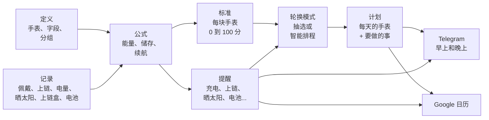

<!-- origem: 10f15890ea6861dee0ce83582e3603f50e2d00e5 -->

## 核心理念：系统对手表一无所知 {#a-ideia-central-o-sistema-não-sabe-nada-de-relógios}

这是最重要的设计决定，也正是它让系统适用于任何收藏。**代码只有机制；所有关于手表的知识都是你录入的数据。**

系统并不"知道"自动表有动力储存，也不知道太阳能表在阳光下充电。这一切都写在录入的公式里，你可以在界面上阅读、编辑和测试：

```text
机械表剩余的动力储存 =
  ACUMULA(0; reserva_horas; 1;                                  ← 从 0 开始，最大值是动力储存，每小时减少 1 小时
          "pulso";  carga_pulso_reserva / carga_pulso_horas;    ← 每佩戴一小时补充这么多
          "winder"; carga_winder_reserva / carga_winder_horas;  ← 每在上链盒上一小时，补充这么多
          "corda";  reserva_horas)                              ← 上链即充满
```

想记录"更换表带"、"超声波清洗"，或者加一个"防水"字段？这是数据。想让计时码表在抽选中权重不同？这是数据。想要一个"每年更换皮表带"的提醒？同样是数据。

系统自带一套完整的初始设置（智能手表、自动、手动上链、电池和太阳能，以及各自的公式、提醒和标准），你可以按自己的收藏进行调整。


<sub>定义中的字段。每个字段适用于一个分组及其下的所有分组（动力储存只用于机械表，电池寿命只用于电池表），标识符就是它在公式中的名字。</sub>

---

## 工作原理 {#como-funciona}



### 概念逐一说明 {#os-conceitos-um-por-um}

| 概念 | 是什么 | 示例 |
|---|---|---|
| **分组**（树） | 收藏的分类，可以有任意多层。在某个分组中录入的一切，适用于该分组及其下的所有分组。 | `传统手表 › 机械表 › 自动机械表` |
| **字段** | 每块手表的数据，由你定义：文本、数字、日期、是/否或列表，可带单位和默认值。 | `reserva_horas = 40 h`、`data_pilha`、`loja` |
| **记录类型** | 发生在手表上的事。可以是**瞬时**的（上链、换电池）、**带数值**的（电量读数：68%），或有开始和结束的**时段**（佩戴、在上链盒上、晒太阳）。 | `sol`：如果你忘了，会在 18 点自动结束的时段 |
| **公式** | 基于字段和记录的计算。同一个公式可以**每个分组一个版本**，采用离手表最近的分组的版本。 | `energia` 在智能手表上是电池，在机械表上是动力储存，在太阳能表上是光能，在石英表上是电池寿命 |
| **提醒** | 由公式算出的预计日期、提前量、文本，以及能消除提醒的记录。 | *"给 Orient 上链：动力储存将在 15 点耗尽"*，按**上链**按钮即可消除 |
| **电量阈值** | 手表需要照顾时的电量：给智能手表充电、让太阳能表晒太阳、给机械表上链。只有电量降到这里时才发出提醒。每块手表可以有自己的阈值（字段*"电量降到多少时提醒"*）；为空则使用设置中的通用值。 | 智能手表 20%（通用值），Samsung 30%（自己的） |
| **标准** | 每块手表如何得到 0 到 100 的分数用于抽选：带权重的参数、衡量某个字段或公式的子参数，以及把数值换算成分数的区间。 | *未使用时间*（40%）：0 到 1 天得 0 分，30 天及以上得 100 分 |
| **轮换模式** | 计划的规则：模式的类型（每周一块、工作日和周末、按星期几、随机、智能排程或自定义）、每天从哪个分组选、提前几周、选择标准，以及底层由引擎计算的脚本。 | *"周一到周五戴智能手表，周末每天一块传统手表"* |
| **计划** | 每天的手表，以及要做的事（*先充电*、*上链*、*放上上链盒*）。 | `周一 06-10 · Xiaomi Band · 佩戴前充电` |

### 公式引擎 {#o-motor-de-fórmulas}

公式的写法和电子表格一样：数字可用逗号或小数点，文本放在引号里，参数用 `;` 分隔，运算有 `+ - * / ^`，比较有 `= <> < <= > >=`（结果为 1 或 0）。空值会在计算中传递，除以零得到空值。基本函数：

| 函数 | 返回 |
|---|---|
| `SE(条件; 为真时; 为假时)`、`E(...)`、`OU(...)`、`NAO(x)` | 逻辑：`E` 在全部为真时得 1，`OU` 在任一为真时得 1，`NAO` 取反 |
| `MIN(...)`、`MAX(...)` | 各值中的最小值和最大值（忽略空值） |
| `LIMITA(x; 最小; 最大)`、`ARREDONDA(x; 小数位)`、`ABS(x)` | 把 x 限制在区间内；四舍五入；去掉符号 |
| `PADRAO(x; 另一个)`、`VAZIO(x)`、`NADA()` | x，若 x 为空则取另一个；x 为空时为 1；故意返回空值（`SE(条件; NADA(); 计算)`） |
| `HOJE()`、`AGORA()` | 今天的日期和当前时刻，以天为单位（当前时刻带有一天中的小数部分） |
| `DIAS_DESDE(日期)`、`DIAS_ATE(日期)`、`SOMA_MESES(日期; 月数)` | 距某日期已过和还剩的天数（负数：已经过去）；按日历加上月数后的日期 |
| `HORAS_USO()` | 一个佩戴日的小时数，按设置中的佩戴时间（7 点到 22 点：15） |
| `CONFIG("键")` | 设置中的一个数字，如 `CONFIG("sol_limiar")` |

以及读取每块手表历史的函数：

| 函数 | 返回 |
|---|---|
| `HORAS("pulso"; 30)` | 最近 30 天的佩戴小时数 |
| `CONTAR("pulso"; 30)` | 最近 30 天中有佩戴的天数 |
| `DIAS_DESDE_ULTIMO("pulso")` | 距上次佩戴的天数 |
| `ULTIMO_VALOR("carga")` / `ULTIMA_DATA("pilha")` | 最近一次读数 / 最近一次记录的日期 |
| `HORAS_APOS("pulso"; "carga")` | 自上次电量读数以来的佩戴小时数 |
| `ACUMULA(起始; 最大; 每小时损耗; "类型"; 效果; ...)` | 沿历史推进的余额：随时间减少，每次记录增加 |
| `MEDIDO("uso")` / `MEDIDO("repouso")` | 根据你的电量读数测得的实际耗电 |
| `EM_SESSAO("winder")` | 时段当前开启时为 1（手表正在上链盒上） |
| `MEDIA_COLECAO("uso_30d")` | 某个变量在整个收藏中的平均值 |

以及轮换的函数（模式的脚本；在脚本之外，日期是计算时刻的那一天）：

| 函数 | 返回值 |
|---|---|
| `DIA_SEMANA()`、`SEMANA_DO_ANO()` | 正在编排的那一天的星期几（1 周一到 7 周日）和年度周数（ISO） |
| `NO_GRUPO("Tradicional › Quartzo")` | 手表在树的该节点或其下时为 1（名称、路径或 `#id`；`"todos"`：所有手表都为 1） |
| `RELOGIO("Seiko SKX")` | 是该手表时为 1（按名称或 id） |
| `ESCOLHIDO_HA(1)`、`VEZES_NO_PLANO(7)` | 手表是 n 天前计划中的那块时为 1（1：昨天；-1：明天，当已在计划中时）；最近 n 天里它在计划中的天数 |
| `ESCOLHA(n; a; b; c)` | 第 n 个值（只计算它）：`ESCOLHA(DIA_SEMANA(); …)` 给每个星期几一个值 |
| `SORTEIO()` | 0 到 1 之间的数，来自与抽选相同的 RANDOM.ORG 批次 |

以及变量 `nota_criterios`：手表按标准在计算时刻的分数。

在**定义**页面，每个公式都有**在所有手表上测试**按钮，保存前即可看到每块手表的结果。

### 合计 {#os-totais}

合计也属于公式引擎，但它们**一次看所有显示出来的手表**（今天页面表格的筛选留下的那些）。它们在**定义**页面的**合计**标签里：每个合计有它所在的表格**列**（或者没有）、**名称**、**表达式**、**显示在合计底部**和**显示在合计页面**两个勾选框、页面上方框的**宽度**（窄或宽）以及数字的**格式**（数字、整数、两位小数、金额、百分比、日期或天数）。只有某一列的合计会进入底部，显示在该列下方；其他的，想要多少都可以，只显示在**合计页面**（菜单**收藏**，或表格下方的**查看所有合计**，它带着同样的筛选）。同一列的多个合计按列表顺序（↑ ↓）上下排列，**在所有手表上测试**会在保存前显示结果。

| 合计函数 | 结果 |
|---|---|
| `CONTA()`, `CONTA(x)` | 多少块手表；多少块填了 `x` |
| `CONTA_SE(condição)` | 多少块满足条件：`CONTA_SE(carga <= 20)` |
| `DISTINTOS(x)` | 多少个不同的值：`DISTINTOS(tipo)` |
| `SOMA(x)`, `MEDIA(x)`, `MEDIANA(x)`, `MENOR(x)`, `MAIOR(x)` | 通常的计算，只算有 `x` 的手表（日期的平均值是一个日期） |
| `QUEM_MAIOR(x)`, `QUEM_MENOR(x)` | 值最大和最小的手表，旁边显示该值 |
| `AGRUPADO(chave; conta; limite)` | 一张小表：键的每个值一行，再加合计行；`conta`（省略时为 `CONTA()`）在每一行只用该行的手表计算，在合计行用全部手表计算；`limite` 显示数量最多的几行，其余合并为"其他" |
| `FAIXAS(x; 25; 50; 75; 100)` | 按区间的小表（"不超过 25"、"26 到 50"……），没有 `x` 的归入"无价值"，再加合计 |

在这些函数里面，公式里能用的都能用（字段、公式、`SE`、`DIAS_DESDE`……），在每块手表上计算，还能用表格每一列显示的内容：`codigo`、`nome`、`tipo`、`estado`、`disponivel`、`em_uso`、`carga`、`ultimo_uso`、`manutencao_data`、`manutencao_nome`、`encostado_data`、`avisos`（它有多少条提醒）和 `posse`。在这些函数外面，只能用数字、文本和不需要手表的函数（`SE`、`MIN`、`ARREDONDA`、各种运算）。新函数 `MES(data)`、`ANO(data)` 和 `MES_ANO(data)` 用于按月和按年分组，在公式里也能用。示例：

| 合计 | 表达式 |
|---|---|
| 可用和不可用 | `AGRUPADO(SE(disponivel; "disponíveis"; "indisponíveis"))` |
| 按类型 | `AGRUPADO(tipo)` |
| 电量区间 | `FAIXAS(carga; 25; 50; 75; 100)` |
| 闲置多久 | `FAIXAS(DIAS_DESDE(ultimo_uso); 7; 30)` |
| 要做什么（出现最多的 3 项和"其他"） | `AGRUPADO(manutencao_nome; CONTA(); 3)` |
| 每月购买 | `AGRUPADO(MES_ANO(data_compra))` |
| 按类型的价值 | `AGRUPADO(tipo; SOMA(valor_compra))` |
| 最贵的 | `QUEM_MAIOR(valor_compra)` |
| 要做的事最多的 | `QUEM_MAIOR(avisos)` |

新安装（以及迁移 v31）已经在底部每一列带有一张小表，并带有合计页面的方框；你可以修改、删除或新建自己的。

### 每块手表的分数（标准） {#a-nota-de-cada-relógio-critérios}

预设的标准，适用于所有手表：

| 参数 | 权重 | 衡量 |
|---|---:|---|
| 未使用时间 | 40 | 距上次佩戴的天数：闲置越久，分数越高 |
| 使用平衡 | 30 | 最近 30 天的使用与收藏平均值相比：戴得少的分数上升 |
| 偏好 | 20 | 你给这块手表的分数（0 到 100） |
| 新鲜感和价值 | 10 | 买了多久以及花了多少钱（充分利用投资） |

每个分组，甚至每块手表，都可以有自己的一套。例如智能手表还会考虑**能量**（当前电量以及还能撑几天），以免抽到一块中午就没电的手表。**标准**页面会展示每个分数的完整计算：每个区间、每个权重和每一分，并且在每条标准的分数旁边用一个箭头说明它把最终分数往哪边拉：绿色 **↑**（分数高于 50，即中性点：往上拉）、红色 **↓**（低于 50：往下拉）或棕色 **↔**（恰好 50，或没有权重：中性，不往任何一边拉）。

预设的全部标准如下。参数的分数是其子参数分数按各自权重的平均；手表的分数是各参数按权重的平均。每个子参数读取一个变量（字段或公式），按数值所在的区间给分；没有数值的子参数（字段为空，或数值不在任何区间内）不参与计算，其权重由其他子参数分摊。所有内容都在**标准**页面编辑，**恢复初始规则**会回到这些设置。

**所有手表**

| 参数 | 权重 | 子参数（变量，在参数内的权重） | 区间：数值 → 分数 |
|---|---:|---|---|
| 未使用时间 | 40 | 未使用天数 (`dias_sem_uso`) | 0 至 1 → 0; 1 至 3 → 30; 3 至 7 → 60; 7 至 14 → 80; 14 至 30 → 95; 30 及以上 → 100 |
| 使用平衡 | 30 | 最近 30 天的使用，与平均值相比 (`uso_vs_media`) | 0 至 25 → 100; 25 至 60 → 80; 60 至 100 → 60; 100 至 140 → 35; 140 至 200 → 15; 200 及以上 → 0 |
| 偏好 | 20 | 你给这块手表的分数 (`preferencia`) | 0 至 20 → 0; 20 至 40 → 25; 40 至 60 → 50; 60 至 80 → 75; 80 至 100 → 100 |
| 新鲜感和价值 | 10 | 新鲜感：自购买以来的天数 (`dias_desde_compra`, 60) | 0 至 15 → 100; 15 至 45 → 80; 45 至 120 → 55; 120 至 365 → 40; 365 及以上 → 30 |
|  |  | 充分利用投资：支付金额 (`valor_compra`, 40) | 0 至 300 → 30; 300 至 800 → 50; 800 至 1500 → 70; 1500 及以上 → 90 |

**智能手表**

| 参数 | 权重 | 子参数（变量，在参数内的权重） | 区间：数值 → 分数 |
|---|---:|---|---|
| 能量 | 30 | 当前电量（%） (`energia`, 50) | 0 至 15 → 0; 15 至 30 → 25; 30 至 50 → 55; 50 至 80 → 85; 80 至 100 → 100 |
|  |  | 电量可支撑的使用天数 (`dias_de_carga`, 50) | 0 至 1 → 0; 1 至 2 → 30; 2 至 4 → 60; 4 至 7 → 85; 7 及以上 → 100 |
| 续航 | 15 | 智能手表续航 (`autonomia_dias`) | 0 至 2 → 10; 2 至 4 → 40; 4 至 7 → 70; 7 至 14 → 90; 14 及以上 → 100 |
| 未使用时间 | 25 | 未使用天数 (`dias_sem_uso`) | 0 至 1 → 0; 1 至 3 → 30; 3 至 7 → 60; 7 至 14 → 80; 14 至 30 → 95; 30 及以上 → 100 |
| 使用平衡 | 15 | 最近 30 天的使用，与平均值相比 (`uso_vs_media`) | 0 至 25 → 100; 25 至 60 → 80; 60 至 100 → 60; 100 至 140 → 35; 140 至 200 → 15; 200 及以上 → 0 |
| 偏好 | 10 | 你给这块手表的分数 (`preferencia`) | 0 至 20 → 0; 20 至 40 → 25; 40 至 60 → 50; 60 至 80 → 75; 80 至 100 → 100 |
| 新鲜感和价值 | 5 | 新鲜感：自购买以来的天数 (`dias_desde_compra`, 60) | 0 至 15 → 100; 15 至 45 → 80; 45 至 120 → 55; 120 至 365 → 40; 365 及以上 → 30 |
|  |  | 充分利用投资：支付金额 (`valor_compra`, 40) | 0 至 300 → 30; 300 至 800 → 50; 800 至 1500 → 70; 1500 及以上 → 90 |

**传统手表 › 机械表**

| 参数 | 权重 | 子参数（变量，在参数内的权重） | 区间：数值 → 分数 |
|---|---:|---|---|
| 动力储存 | 25 | 当前动力储存（%）：已空，需要运转 (`energia`) | 0 至 10 → 100; 10 至 30 → 85; 30 至 60 → 60; 60 至 90 → 35; 90 至 100 → 20 |
| 机械保养 | 15 | 停走时需要运转（润滑） (`dias_sem_uso`, 50) | 0 至 7 → 20; 7 至 30 → 60; 30 至 90 → 90; 90 及以上 → 100 |
|  |  | 保养按时 (`dias_ate_revisao`, 50) | 0 至 30 → 20; 30 至 180 → 60; 180 及以上 → 100 |
| 未使用时间 | 25 | 未使用天数 (`dias_sem_uso`) | 0 至 1 → 0; 1 至 3 → 30; 3 至 7 → 60; 7 至 14 → 80; 14 至 30 → 95; 30 及以上 → 100 |
| 使用平衡 | 20 | 最近 30 天的使用，与平均值相比 (`uso_vs_media`) | 0 至 25 → 100; 25 至 60 → 80; 60 至 100 → 60; 100 至 140 → 35; 140 至 200 → 15; 200 及以上 → 0 |
| 偏好 | 10 | 你给这块手表的分数 (`preferencia`) | 0 至 20 → 0; 20 至 40 → 25; 40 至 60 → 50; 60 至 80 → 75; 80 至 100 → 100 |
| 新鲜感和价值 | 5 | 新鲜感：自购买以来的天数 (`dias_desde_compra`, 60) | 0 至 15 → 100; 15 至 45 → 80; 45 至 120 → 55; 120 至 365 → 40; 365 及以上 → 30 |
|  |  | 充分利用投资：支付金额 (`valor_compra`, 40) | 0 至 300 → 30; 300 至 800 → 50; 800 至 1500 → 70; 1500 及以上 → 90 |

**传统手表 › 石英表 › 电池**

| 参数 | 权重 | 子参数（变量，在参数内的权重） | 区间：数值 → 分数 |
|---|---:|---|---|
| 电池寿命 | 15 | 电池寿命（%） (`energia`) | 0 至 10 → 10; 10 至 30 → 50; 30 至 100 → 70 |
| 保养 | 10 | 保养按时 (`dias_ate_revisao`) | 0 至 30 → 20; 30 至 180 → 60; 180 及以上 → 100 |
| 未使用时间 | 35 | 未使用天数 (`dias_sem_uso`) | 0 至 1 → 0; 1 至 3 → 30; 3 至 7 → 60; 7 至 14 → 80; 14 至 30 → 95; 30 及以上 → 100 |
| 使用平衡 | 25 | 最近 30 天的使用，与平均值相比 (`uso_vs_media`) | 0 至 25 → 100; 25 至 60 → 80; 60 至 100 → 60; 100 至 140 → 35; 140 至 200 → 15; 200 及以上 → 0 |
| 偏好 | 10 | 你给这块手表的分数 (`preferencia`) | 0 至 20 → 0; 20 至 40 → 25; 40 至 60 → 50; 60 至 80 → 75; 80 至 100 → 100 |
| 新鲜感和价值 | 5 | 新鲜感：自购买以来的天数 (`dias_desde_compra`, 60) | 0 至 15 → 100; 15 至 45 → 80; 45 至 120 → 55; 120 至 365 → 40; 365 及以上 → 30 |
|  |  | 充分利用投资：支付金额 (`valor_compra`, 40) | 0 至 300 → 30; 300 至 800 → 50; 800 至 1500 → 70; 1500 及以上 → 90 |

**传统手表 › 石英表 › 太阳能**

| 参数 | 权重 | 子参数（变量，在参数内的权重） | 区间：数值 → 分数 |
|---|---:|---|---|
| 光能 | 25 | 光能电量（%） (`energia`) | 0 至 30 → 80; 30 至 70 → 65; 70 至 100 → 50 |
| 保养 | 10 | 保养按时 (`dias_ate_revisao`) | 0 至 30 → 20; 30 至 180 → 60; 180 及以上 → 100 |

此外还有一个**轮换保证**：任何手表闲置都不会超过 N 天（默认 21 天）。它在分数**之前**生效：如果某个候选已经超过限制，它直接胜出，闲置最久的优先。只有在没有任何手表超过限制时，才由分数决定。

闲置天数就是**未使用天数**公式，你可以在定义中编辑：距上次佩戴的天数；对于**从未佩戴过**的手表，则是自购买以来的天数（没有购买日期时为 9999，最闲置的）。这样昨天刚买的手表不会插队，两块从未佩戴的手表也不会打平：先买的那块等得更久。

为了让你永远不必猜测，**计划中的每一天都会保存选择的理由**，用一句话写出，显示在今天页面和计划页面中手表的下方：*"轮换保证：从未佩戴，已入藏 38 天，超过 21 天未使用的限制"*、*"按分数抽选，5 个候选中：分数 70.2，概率 16.4%"*、*"最高分（91.2）。连续戴 5 天"*、*"继续佩戴：连续 5 天中的第 2 天"*、*"手动选择"*。
### 轮换模式 {#os-modos-de-rodízio}

模式位于**轮换模式**页面（菜单**轮换**）。每个模式有一个**类型**，该类型的界面只询问对它有意义的内容：

- **每周一块**：整周一块手表，从这一周的第一天到最后一天（周一到周日，或周日到周六：每周从设置中**每周开始于**选择的那天开始）。你指定它来自哪里（整个收藏、一个分组或一块固定手表）以及选择标准。
- **工作日和周末**：两段，周一到周五和周六周日，各有自己的分组，并选择**整段一块手表**或**每天一块**。预设的是：工作日戴智能手表，周末每天一块传统手表。每周从周日开始时，周六和周日仍是同一段（周六的手表周日继续戴）。
- **按星期几**：每天一块手表，每个星期几指定它来自哪里（一个分组、一块固定手表或没有：空闲日）。
- **每天随机**：每天一块，所有手表机会相同，没有标准也没有轮换保证。
- **智能排程**：一次规划整个时段，模拟电量（见[下文](#a-escala-inteligente)）。
- **自定义**：你自己写脚本（见[模式的脚本](#o-roteiro-do-modo)）。

前三种的**选择标准**就是抽选：按**最高分**、按**按分数抽选**（分数变成概率）、**随机**，或按**排队**（等待最久的优先）。打开**循环**后，一块手表只有在本周所有候选都轮过之后才会再次出现。今天页面的**轮换模式**框选择模式、标准和轮换保证；**应用模式**只做标记：在你点击**重新抽选**之前，计划不会有任何改变。

**重新抽选**重做模式抽出的内容，手动选择的日子和空闲日（例如手动轮换中的）保持原样；消息会说明保留了多少（*“保持原样：7 个空闲日……”*）。勾选**全部覆盖**后，计划中从抽签开始那天起（明天、今天或下一周的第一天）的所有内容都会被清除，无论手动、空闲还是抽出的，然后模式重新编排全部；确认框会先提醒，消息会说明覆盖了多少手动的日子和空闲日。

**周数。** 排程之外，每个模式都指定计划**提前编排几周**（1 到 8；列表显示各周及其日期）。计划编排到其中最后一周的最后一天：周日，或每周从周日开始时的周六（只有一周时，在一周的最后一天计划还会带上下一周的第一天，用于前一天的提醒），下一周在轮到它时加入。每周从设置中选择的那天开始（**每周开始于**：星期一为默认，或星期日），循环、下一周和整周一块手表都按它来算。多于一周时，**重新抽选**里还有**下一周**：按当前模式抽选，本周剩下的日子算作佩戴，就像你已经戴过计划中的手表一样（佩戴计入未佩戴天数和分数；电量不计入，因为不知道手表会不会充电）。每一天都这样选择，计划中之前的日子已经算在手腕上，所以周一的手表不会因为看起来闲置就在周二又被选中。手动选择的日子保留。智能排程没有下一周：它本来就规划自己的整个时段。

### 模式的脚本 {#o-roteiro-do-modo}

本质上，每个模式都是一个**脚本**：五行内容，由公式引擎在计划每一天的开始，为每块可用手表计算，之前的日子已算作佩戴。预设模式由各自的界面生成脚本（页面显示生成的脚本，只读）；在**自定义**中你自己写，每个名称一行（`名称 = 表达式`，使用与定义中公式相同的语言；以 `#` 开头的行是注释；其他名称是你自己的变量）：

| 行 | 含义 | 缺失时 |
|---|---|---|
| `candidato` | 1：手表进入当天的选择；0：不进入 | `1`（全部） |
| `nota` | 手表当天的分数 | `nota_criterios`（按标准的分数） |
| `peso` | 抽选中的概率。全为 0：最高分获胜。全部相等：所有手表机会相同。否则每个权重就是概率 | `0` |
| `dias` | 被选中的手表连续戴几天（只要接下来的日子空着且它仍是候选） | `1` |
| `garantia` | 1：优先于所有手表（多块时，闲置最久的；平局：先登记的） | 未佩戴天数超过轮换保证（`max_sem_uso`）的手表 |

**引擎每天如何决定**，按此顺序：昨天的手表排除（如果有别的）；循环（如果模式使用）；脚本决定谁是候选；有 `garantia` 的直接获胜；否则看 `peso`。被选中的手表按脚本给出的 `dias` 留下，选择的理由保存在计划中。同一个引擎也决定每天选择器中的**按以下方式为这一天抽签**和手动轮换的**替我决定**。

一个例子：工作日戴机械表，周末看电池情况，闲置超过 3 天的手表概率是其他手表的 100 倍：

```
util      = DIA_SEMANA() <= 5
candidato = SE(util; NO_GRUPO("Mecânico"); 1)
peso      = SE(dias_sem_uso > 3; 100; 1)
dias      = SE(NO_GRUPO("Smartwatch"); dias_seguidos; 1)
```

**在所有手表上测试**按钮在某一天（今天或之后 13 天中的一天）计算脚本，显示每块手表上的每一行以及谁会被选中。除了公式函数，脚本还有 `DIA_SEMANA()`（1 周一到 7 周日）、`SEMANA_DO_ANO()`、`NO_GRUPO("分组")`、`RELOGIO("名称")`、`ESCOLHIDO_HA(n)`、`VEZES_NO_PLANO(n)`、`ESCOLHA(n; a; b; …)` 和 `SORTEIO()`（见[公式引擎](#o-motor-de-fórmulas)中的表格）以及变量 `nota_criterios`。通过 API：`recurso=roteiro` 测试；`recurso=modos`、`acao=salvar` 带 `tipo=personalizado` 和 `roteiro` 保存。

**抽选从哪里来。** 系统中的所有抽选（完全随机模式、按分数或按权重抽选以及脚本的 `SORTEIO()` 函数）都使用来自外部的真正随机数，顺序如下：

1. **[RANDOM.ORG](https://www.random.org/)**：来自大气噪声的随机性（测量空气中微波的变化并转换成比特）；
2. 当它无法访问（或当天配额用完）时，使用 **ANU QRNG**，即澳大利亚国立大学的量子随机数发生器（测量光的量子涨落）。系统使用旧地址 `qrng.anu.edu.au/API/jsonI.php`，无需密钥即可响应（新地址 `api.quantumnumbers.anu.edu.au` 需要 API 密钥）；
3. 两者都不可用时（例如服务器没有网络），使用 **PHP 的安全随机数生成器**（`random_int`，来自操作系统：相当于 Python 的 `secrets`）。

随机数成批获取（每次请求 64 个 16 位数字），每次抽选只用所需的部分，并丢弃超出区间最后一个整倍数的部分：每个结果的概率完全相同。每个服务有 4 秒响应时间；如果两者都失败，系统使用 PHP 的生成器，并在 10 分钟内不再尝试（这样不会有页面一直等待）。每个抽选日的理由会写明随机数的来源（*"简单抽选，4 个候选中，概率均等（RANDOM.ORG）。"*），**设置**中会显示最近一批（**抽选**框）。涉及机密的内容不使用这些服务：密码的盐值和文档文件的名字仍然使用 PHP 的生成器，因为在互联网上传输的数字不适合用作机密。

### 清除安排 {#apagar-a-programação}

在**计划**页面底部（主要位置：页面末尾、逐日列表之后的**清除安排**框），以及今天页面的**轮换模式**框中（每项都在一行下方，就像**重新抽选**）：

- **清除一个时段**：**从**和**到**；其中一个可以留空（只填**从**，从它清除到计划结束；只填**到**，从明天清除到它）。时段内从明天起的日子（手动选择的、抽选的和空闲的）从计划中删除，轮换模式会重新安排这些日子。**清除**按钮会要求确认。
- **全部清除**：清空从明天起的全部安排：手动选择的天、抽选的天和空闲的天。勾选**包括今天**后，从今天起清除（如果今天抽到了另一块手表，它从此刻起就成为戴在手腕上的那块）。然后轮换模式会从头重新生成计划：生成到模式最后一周的最后一天（之后几周到时再生成）；智能排程时，生成整个排程。安排不会一直为空，因为系统总是按当前模式生成缺少的天；如果需要不戴表的天，请在手动轮换中标记*空闲*。

### 手动轮换 {#o-rodízio-manual}

在今天页面的**轮换模式**框中，列表的最后一项是**手动轮换**：由你亲自为一个时段的每一天选择手表（假期、旅行、整整一个月）。设置开始（**从**）和结束（**到**），然后点击**确定**：

- 每天**每页 7 天**显示，包含日期、星期几、计划中当天目前的安排和一个选择框；
- 超过 7 天时，页码在下方：**‹ 上一个**、**1 2 3 …**、**下一页 ›**。你在一页上的选择在翻到其他页时会保留；保存之前不会有任何改变；
- 每天的选择框中有可用的手表、**替我决定**、分组**按以下方式为这一天抽签**（*最高分数*、*按分数抽签*、*随机*或*排队*：保存时按该方式为该日抽签，排除昨天和明天的，与替我决定相同）和**不戴表（空闲日）**。一开始，它显示当天已手动选择的手表；空闲日显示为空闲；其余的（已抽选或尚未有手表的）显示为*替我决定*；
- **保存手动轮换**会保存整个时段：有手表的天成为手动选择，*替我决定*和*按以下方式为这一天抽签*的天由系统当场决定并同样保存（每天的理由会显示在计划中），空闲的天保持不戴表。如果今天在时段内而你选了另一块手表，它从此刻起就成为戴在手腕上的那块；
- 要删除一个时段的日子（轮换模式会重新安排这些日子）或全部清除，请参见[清除安排](#apagar-a-programação)。

时段之外，仍然使用平常的轮换模式。手动选择的天即使重新抽选或 cron 生成下一周时也会保留；在智能排程中，排程会围绕它们重建。

**“替我决定”的标准：**
1. **标准分数**（你在**标准**中定义的：未使用天数、平衡、偏好、电量……），在每天开始时计算，时段内之前的天（你选的和它决定的）已计为使用；
2. **轮换保证**优先：超过未使用天数限制的手表先上，闲置最久的在前；
3. 如果有其他选择，排除**昨天**和**明天**的手表。这样一块手表不会紧挨着你选的那块重复出现；
4. 同分时，先录入的手表胜出。

今天如果选*替我决定*，则保留计划中已有的手表。

### 智能排程 {#a-escala-inteligente}

这是最完整的模式。它不是一周一周地抽选，而是**一次规划 7 天到 2 年**，逐日模拟：

1. 用当天的模拟状态计算每块手表的分数；
2. 按最高分选择手表（排程的脚本：`peso = 0`）；智能手表会在电池能撑的天数内一直戴着（最多 7 天：`dias_seguidos` 公式）；
3. 模拟佩戴（佩戴时间内的手腕时段）及其对所有手表电量和动力储存的影响；
4. 检查提醒：如果选中的手表需要充电或上链，就在当天记下该操作（*"佩戴前充电"*），并模拟能消除提醒的记录；
5. 进入下一天。

每天早上 cron 都会**根据真实状态重新规划**。如果你戴了另一块表、忘了充电，或记录的读数与预期不同，计划会自行修正。

### 根据读数测得的消耗 {#gasto-medido-pelas-leituras}

智能手表的档案说"能用 5 天"。现实并不同意，而且随着电池老化还会变化。因此，**你录入的每一次电量读数都会与上一次比较**，两次之间的间隔成为一次测量：下降了多少、佩戴了多少小时、未佩戴（存放、关机）了多少小时，以及你给每次读数做的标记（使用中或静置中）。设置中的使用时段自动算作佩戴，而你的标记（*戴上*、*取下*）起决定作用。读数上升即充电：开始一个新的时段。中间有其他会话（手表去了充电器）的间隔也不测量：测量只会区分佩戴和存放。

**如何把测量转换成两种消耗（佩戴时和未佩戴时）由你选择：有五种引擎。** 它们都保留在系统中；没有一种会删除任何东西，换引擎只改变计算（测量是一样的）。选择在三个地方进行，上层优先于下层：

| 层级 | 在哪里选择 | 作用 |
|---|---|---|
| 1. **收藏** | 设置中的**电池消耗：如何计算（对所有手表有效）**（`gasto_motor`） | 对收藏中的所有手表生效。空（*单独（在手表或分组上）*）：由下面两个层级决定。 |
| 2. **手表** | 手表档案中的**如何计算电池消耗**字段（`gasto_motor`） | 只对它生效。空：用分组的。 |
| 3. **分组** | 同一字段的**默认值**（在**档案 › 字段**中：字段位于根部，对它所在位置以下的手表生效） | 对没有选择的手表生效。空：引擎 1。 |

对于没有电量读数的手表（机械表、太阳能表），这个选择没有作用。**电池消耗**框会说明是哪种引擎做的计算以及选择的来源（*计算方式：按标记：两个独立的速率 — 收藏的选择（在设置中）*）。

| 引擎 | 作用 |
|---|---|
| 1. **按记录的小时数（原始引擎）**（`horas`） | 默认。每次测量按逐分钟的佩戴标记划分（佩戴多少小时、未佩戴多少小时），两种消耗由窗口内的所有测量一起得出，每次测量以其覆盖的时间为权重。这是系统一直以来的计算方式。 |
| 2. **按记录的小时数，结合读数和档案（稳健）**（`robusto`） | 同样的小时数，但计算在读数上进行，全部权重相同，与其他不吻合的读数权重较低，档案是起点（下面的三个注意点）。给出不确定度（±）。 |
| 3. **按标记：两个独立的速率**（`marcacao`） | 以你的标记为准。标记为**使用中**的读数测量佩戴时的消耗：自上次读数以来的下降量除以间隔的全部时间（以使用天数计）。标记为**静置中**的读数以同样方式测量未佩戴时的消耗。两种计算**永不交叉**：使用中消耗只来自使用中的读数，静置中消耗只来自静置中的读数；记录的佩戴状态不参与。每一侧都用稳健计算（不吻合的读数权重较低；档案是起点），同样带不确定度。 |
| 4. **仅档案**（`cadastro`） | 档案中的*使用中衰减*（或*实际使用续航*）和*存放衰减*始终生效。测量仍然进行并留在历史中（**消耗测量**表），但不进入任何计算：`MEDIDO` 为空。 |
| 5. **按档案的公式**（`formulas`） | 以 `taxa_uso` 和 `taxa_repouso` 公式的结果为准，供你在**档案 › 公式**中构建自己的计算。其中 `MEDIDO("uso")` 和 `MEDIDO("repouso")` 是引擎 3 的计算，函数 **LEITURAS**、**QUEDA**、**DIAS_MEDIDOS**、**MEDIA_TAXA**、**MEDIANA_TAXA** 和 **ULTIMA_TAXA** 给出按标记测量的各部分（每类在最近 N 天或设置窗口内的次数、下降量之和、天数之和、平均值、中位数和最后一次速率）：`MEDIANA_TAXA("uso")`，或 `PADRAO(QUEDA("uso"; 30) / DIAS_MEDIDOS("uso"; 30); decaimento_uso)`。在其他引擎中公式同样生效（消耗来自公式）；区别在于这一种明确说：计算由你决定。 |

**哪些测量计入**是设置中的另一个选择，**测得消耗：按什么计**：**天数**（最近若干天的测量，默认 90）或**读数**（每类最近若干次测量，使用中和静置中，默认 20）。窗口内没有时，计入之前的。对引擎 1、2、3 和 5 有效（对不带 N 天参数的公式函数也有效）。

两次充电之间，电量随佩戴时间和存放时间呈直线下降：

```text
读数 = 起始电量 − 使用中消耗 × 使用天数 − 存放消耗 × 存放天数（+ 读数的误差）
```

中间没有充电的连续读数构成一个**时段**。每个时段有自己的起始电量（由计算得出），两种消耗对所有时段都适用。在引擎 2 中，系统用窗口内的读数**同时求出两种消耗**：最能解释所有读数的那一对。两次读数之间的一个夜晚（只有未佩戴）确定存放消耗；已知存放消耗后，佩戴的几天确定使用中消耗。1 小时或更长的测量全部计入，连没有任何下降的也算（它说明消耗很小）。读数越多，越精确。在引擎 3 中同样的计算做两次，一次只用使用中的读数，一次只用静置中的读数。

稳健计算（引擎 2 和 3）有三个注意点，各有原因：

1. **计算在读数上进行，所有读数权重相同。** 误差来自读数：手表以整数显示电量，电量计本身也有一点误差。这个误差在上次读数之后 2 小时还是 2 周做的读数中都一样，所以没有哪次读数因为覆盖更长时间而更有分量。而且，由于计算看的是读数（而不是下降量），一次错误的读数只是一个点，不会破坏它两侧的两个下降量。
2. **与其他不吻合的读数权重较低（稳健回归）。** 计算之后，系统查看它在每次读数上的偏差。正常误差从读数本身得出（不少于半点）；离正常范围明显更远的读数权重降低，离得越远权重越低，然后重新计算。它不会被丢弃：只是权重更低。一个常见情况：**充电后立刻显示的 100%**，很多手表会保持一段时间，而真实电量已经在下降。
3. **档案是起点。** 档案中的衰减（或续航）作为期望值进入计算，留有其一半的余量。读数少时，消耗接近档案值；读数多时，以读数为准。当读数无法区分使用和存放时（例如只有手表存放时的读数），它们测不到的消耗保持档案值。

这两种引擎的结果带有**不确定度**（± 一个标准差）：*每使用日 22.09% ± 1.48* 表示使用中消耗很可能在 20.6% 到 23.6% 之间。随着读数增加它会缩小。

在**消耗测量**表（在**电量随时间变化**中），每次测量显示两次读数的标记（*使用中 → 使用中*）并说明是否计入计算：*是*；*部分：权重 31%*，附上与其他不吻合的读数（*100% 的读数与其他不吻合：计算在它上面偏差 4.5 点*）；或*否*（窗口之外、已移出计算、引擎 3 中两次读数标记不同，或引擎 4）。读数的消息也会在新读数与其他不吻合时提醒。每行都有**移出计算**（或**放回计算**）按钮，用于你知道而系统不知道的情况：该测量移出或回来，不删除任何东西（在引擎 1、2、3 和 5 中有效）。

录入电量时，你说明读数那一刻手表的状态：在**标记**框中，**录入使用中的电量读数**（佩戴）或**录入静置中的电量读数**（存放）；在今日页的*录入电量*提醒中，是**使用中**和**静置中**按钮。**标记保存在读数中**（`estado` 列；之前的读数以及脚本未说明的读数，以那一刻记录的佩戴状态为准）。它是引擎 3 所用的，也是其他引擎的核对依据。如果系统认为那一刻手表处于另一种状态（使用时段自动把它算作佩戴，但它其实在存放；或者漏了一个*戴上*），界面会在保存前询问：*据我所知它现在在佩戴中。仍要把读数保存为静置中吗？* **继续**按你的标记保存（通过 API，响应带 `confirmar: true` 和提问，记录只有再次发送并带 `confirmar=1` 才会保存）；不会阻止任何操作，记录的佩戴状态也不改变：如果它错了，在**修正或删除标记**中修正。**修正**框也可以修改已保存读数的标记。

两个消耗都显示在手表页面的**电池消耗**框中：

- **计算方式**：做计算的引擎以及选择的来源（收藏、手表、分组，或默认）。
- **佩戴**和**未佩戴时（关机）**：计算中采用的消耗（粗体，在引擎 2 和 3 中附不确定度 ± ……）及其来源（测得的，旁边附档案中的数值以便比较；或者尚无测量或引擎为 4 时只来自档案）。
- 每项下方是**档案中**的内容：得出档案消耗所依据的字段（*使用中衰减*、*实际使用续航*、*存放衰减*），附数值以及是填写的还是默认值。
- **在此之前的 90 天**：上一个时间窗口中测得的两个消耗。正是这个对比显示出电池的老化：如果佩戴时的消耗从 4.9% 变成 5.7%，说明它已经不像以前那么耐用了。

同样的信息也会在**手表数据**框中、和相近的内容放在一起再次出现：在**档案**表中，填写的衰减（和续航）下方显示**由读数算出**的值以及**计算中**采用的值；在**现在算出的**表中，消耗公式（*taxa_uso*、*taxa_repouso*）下方显示测得值和档案值。每一次测量则逐条列在**电量随时间变化 › 消耗测量**中。

早于时间窗口的测量会自动退出计算。因此对老化的调整是自动的：无需修改档案。档案中的"使用消耗"和"存放消耗"只在没有测量时使用（或在引擎 4 中始终使用）。

---

## 多人使用：账户、收藏与访问 {#várias-pessoas-contas-coleções-e-acesso}

系统属于**多个人**，每人有自己的**账户**，每个账户有**自己的收藏**。一个收藏有它的手表、历史、计划、设置、消息推送目标和日历；在任何页面上看到和保存的内容，始终属于**菜单选择器**中选定的收藏（有多个收藏时才会出现）。安装后的第一个用户是 **master**：负责整个系统。

| 概念 | 是什么 |
|---|---|
| **账户** | 登录名、密码、电子邮件（用于找回密码、接收邀请和通知）、语言和时区。每个人在**我的账户**（菜单**账户 › 我的账户**）中管理自己的账户。 |
| **收藏** | 属于某个**所有者**、带名称的一组手表。一个人可以有多个（“我的收藏”“我父亲的”）。新建时可以**带初始集合**（分组、字段、公式、提醒、标准和模式都已准备好，使用创建者的语言）、**为空**（只有树的根）或**使用你已有的一棵树**。 |
| **分组树** | 分组及其定义（字段、记录类型、公式、提醒、文档分类、分组的标准）。它属于所有者，可以供**他的多个收藏**使用：对它的修改对所有这些收藏生效。在**我的账户**中可以复制、重命名和删除树。 |
| **成员** | 能看到别人某个收藏的人（并使用它：标记、记录、更换当天的手表）。 |
| **某个所有者的全部** | 能看到某人**所有**收藏的人，包括他以后创建的。 |
| **Master** | 看到所有收藏，管理账户（**用户**）、备份和迁移。 |

**别人如何进入不属于自己的收藏：**

- **邀请：**在**审批**中，所有者填写电子邮件并选择对方能看到什么（一个收藏，或自己的全部）。系统发出一封带链接的邮件（有效 `CONVITE_DIAS` 天，没有这一行时为 7 天）：没有账户的人通过链接创建账户，有账户的人登录并接受。**成员**发出的邀请需等待所有者批准。服务器没有电子邮件时，链接会显示在屏幕上，可以自行发送。
- **申请：**在**我的账户**中（或注册时），凭所有者给出的**编号**申请访问某个收藏或某个所有者的全部，并附上留言：收藏的编号（在**我的账户**的**收藏**表格中）或所有者的编号（在**你的资料**中，用于其全部收藏）。没有任何页面显示账户或收藏的列表，申请在批准前只显示编号：随便尝试编号的人发现不了任何人的登录名。所有者会收到一封邮件，在**审批**中批准或拒绝；申请人通过邮件收到答复。两个申请页面（创建账户和我的账户）都在**如何申请访问（以及为什么用编号）**框中给出这些步骤，**你的资料**也向所有者说明如何提供编号。
- **由 master：**在**用户**中，**授予访问权限**。

在**审批**中，所有者还能看到**谁能看到他的收藏**，并取消某人的访问权限；在**我的账户**中，每个人都可以**退出**不属于自己的收藏。没有回复的邀请和申请会在 `CONVITE_DIAS` 天后自动删除。

**公开注册**（`cadastro.php` 页面，无需登录，带**创建账户**链接）：填写登录名、密码、电子邮件、语言以及开始方式（带初始集合的收藏、空收藏，或凭所有者给出的编号申请访问别人的收藏）。这样创建的账户是**演示账户**，有效 `DEMO_DIAS` 天（没有这一行时为 30 天）：菜单显示**演示：N 天**，到期前 7 天和 1 天会收到邮件提醒，到期后 cron 会把账户连同其所有内容一起删除。master 可以在**用户**中**把账户转为正式**（或延长）。在 `config.php` 中设置 `CADASTRO_ABERTO = false` 后注册关闭：只有 master 创建的人或持有邀请的人才能进入。该页面还有**忘记密码**：设置新密码的链接通过邮件发送，有效 2 小时。

**master 面板**（**用户**）显示每个账户的电子邮件、角色、最后访问、到期时间、收藏（含手表数量）以及它还能看到的内容，并提供操作：**以其身份查看**（按那个人看到的样子查看整个系统，顶部有横条和返回按钮）、**转为正式**、**延长**、**改回演示**、**封禁**、**修改**（登录名、电子邮件、语言、角色）、**修改密码**、**转移收藏**（转给另一个所有者：树一起转移；如果原所有者的其他收藏也在用这棵树，新所有者获得一份副本）、**授予访问权限**和**删除**。一无所有的普通账户（没有收藏、没有访问权限、没有等待中的申请或邀请）会自动删除。

**在任何地方删除，都会先告诉你一并删除什么。**删除收藏、树、账户、手表、字段、推送目标……都会先列出一并删除的内容（*“一并删除：4 个字段值、2 条记录、12 天计划……”*，以及受影响的收藏：一棵树可供多个收藏使用），只有在你确认后才删除。文档的文件会立即从磁盘删除。通过 API，每次删除都需要 `confirmar=1`。

## 每块手表的档案，逐个字段 {#o-cadastro-de-cada-relógio-campo-por-campo}

每块手表都有**名称**、**分组**、**收藏状态**、**可用**和**照片**。其余的都是**字段**，一块手表有哪些字段取决于它的**分组**：在某个分组中录入的一切，适用于该分组及其下的所有分组。所以"是自动表"并不是一个单独的标志：而是属于**自动机械表**分组（或其子分组），从而继承佩戴和上链盒的字段。

```text
（所有手表）              备注、你的分数、购买、保修、电量阈值、品牌、型号、链接
                          （仅心愿手表：目标价、心愿优先级）
├── 智能手表              实际使用续航、使用消耗、存放消耗、充电器：充满所需小时
└── 传统手表              上次保养、保养间隔
    ├── 机械表            动力储存、可通过表冠上链
    │   ├── 自动机械表    佩戴：小时 / 储存、上链盒：小时 / 储存
    │   └── 手动上链      （没有更多：佩戴时不会充能）
    └── 石英表
        ├── 电池          上次更换电池、电池寿命
        └── 太阳能        能量储存、充满所需直射阳光、佩戴：充电多少
```

空字段采用档案中的**默认**值（下表中的"为空"一栏）。字段、分组和默认值都是数据，不是代码：你可以在**定义**页面修改一切，也可以创建自己的。

### 手表的基本信息 {#o-básico-do-relógio}

| 字段 | 是什么 |
|---|---|
| **名称** | 在所有地方显示的名字：界面、Telegram 和日历。 |
| **分组** | 它在树中的位置。决定它有哪些字段、公式（智能手表的"电量"是电池；机械表的是动力储存）和提醒。 |
| **收藏状态** | **在收藏中**（通常情况）、**心愿**（心愿单：还不是你的）、**已借出**（是你的，但在别人那里）、**已售**或**已归档**。只有在收藏中的手表参与轮换：其他状态下手表不可用（由数据库保证：`ck_relogio_posse_disponivel` 规则），退出抽选、排程和提醒；离开收藏时，它所有打开的时段（佩戴、晒太阳、充电器）立即结束，计划中从明天起它的日子被移除并重新抽选（今天保留，但不再自动戴上：可在**换成…**中更换）。它的档案、文档和历史都会保留。已借出的手表仍在今天页面的表格中（状态为**已借出**），也计入收藏价值；心愿、已售和已归档的手表离开表格，出现在**心愿单**页面（以及档案选择框的**收藏之外**下）。改回**在收藏中**后，它重新变为可用。参见[心愿单](#a-lista-de-desejos)。 |
| **可用** | 取消勾选后，它退出轮换和提醒（在维修、暂停中），但历史保留。不在收藏中时，它总是未勾选（并且该字段从档案中消失）。 |
| **把它的所有文档都在数据库中保存一份** | 勾选后，这块手表的每个文件（说明书、发票、照片、视频）也会存入数据库作为备份。仅当收藏的设置没有统一决定时出现（**文档在数据库中的副本（对所有手表有效）**为空）。参见[手表的文档](#os-documentos-do-relógio)：这是副本三个层级中的第二层。 |
| **照片** | 仅用于界面。在手表的详情中（面板或档案），鼠标停在照片上会显示摘要（名称、分组和编号；状态和电量；分数和轮换中的下一天；购买信息）以及双击的提示。**双击**照片，或点击下方的**打开照片**按钮，会在浮动窗口中按原尺寸打开照片（仅在详情中：在其他照片上，如*今天要做的是*中的照片和列表缩略图，单击会打开手表）；比屏幕大的照片会等比缩放，不变形，以显示器（和浏览器窗口）能容纳的最大尺寸显示，下方显示实际尺寸和缩放比例。点击 ×、点击窗口外部或按 Esc 关闭。 |
| **配件** | 表带、表盒、收纳盒、工具、充电器、零件：面板中的**配件**框显示它自己的配件（类型、名称和备注），**配件**页面用于添加和修改（配件可以属于一块手表，也可以独立存在，供多块手表使用）。 |
| **文档** | 说明书、发票（PDF 和 XML）、纪念照片、视频以及其他任何文件。参见[手表的文档](#os-documentos-do-relógio)。 |
### 手表的文档 {#os-documentos-do-relógio}

每块手表可以保存**任意多个文件**，任何类型，每个文件属于一个**类别**：说明书、PDF 发票、发票 XML、纪念照片、视频、电子表格，什么都行。每个文档包含：

| 数据 | 是什么 |
|---|---|
| **类别** | 放在哪里。预设的有：**说明书**（`manual`，任何文件）、**发票**（`nota_fiscal`，PDF 或图片）、**发票（XML）**（`nota_xml`，XML）、**照片**（`fotos`，图片）、**视频**（`videos`，视频）和**其他**（`diversos`，任何文件）。它们都是数据：在**定义 → 文档类别**中创建、重命名或删除。 |
| **标题** | 显示的名称。上传时为空：使用文件名。 |
| **日期** | 文档的日期：照片的场合、视频的日子、发票的日期。可选。 |
| **描述** | 自由文本：*"在我表哥的婚礼上"*、*"第一次换表带"*。可选。 |
| **文件** | 任何文件，不超过服务器的限制（参见[上传大小](#o-tamanho-dos-envios-os-documentos)）。 |

在手表的档案中，**文档**框显示这块手表在每个类别中有多少个文档；点击每个类别或**打开文件**按钮，都会在新标签页中打开这块手表的**文档**页面。在那里：

- **上传文件：** 类别、标题、日期、描述和文件。可以**一次选择多个**（整个相册）：它们逐个上传，并显示百分比进度，标题、日期和描述适用于所有文件（之后可以单独编辑每一个）。类别只接受它的类型：照片不能放进**视频**。
- **每个类别一个标签页**，以及**全部**。在其中，每个文件**按其类型**打开，而不是按类别：
  - **照片：** 缩略图图库。照片以**全屏**打开，下方显示日期和描述；用屏幕上的箭头、键盘方向键或在手机上滑动来切换。**▶ 幻灯片**每 4 秒自动前进（空格键开始和停止；Esc 关闭）。缩略图由浏览器在上传时生成，所以即使照片很大，图库也能很快打开。
  - **视频：** 列表，每个视频有一个勾选框，以及用于排序的 **↑** 和 **↓** 箭头。**▶ 观看勾选的视频**会在页面的播放器中依次播放勾选的视频，带有**上一页**和**下一页**。可以在视频中快进和后退。
  - **PDF：** **在此查看**在页面内打开浏览器的 PDF 阅读器；还有**在新标签页中打开**和**下载**。
  - **XML：** 如果是 **NF-e**（巴西电子发票的 XML），页面会显示摘要：开票方、号码、系列、日期、金额、商品和访问密钥。以及**下载 XML** 按钮。
  - **音频：** 播放器。**任何其他文件：** **下载**按钮。
- **每个文件的 ⋮ 菜单：**每张照片（缩略图的角上）、列表中的每个视频、每张文件卡片以及照片查看器本身都有 **⋮** 按钮，可打开**打开**、**下载**、**编辑**（页面上方的窗口，含标题、日期、类别、描述和数据库副本）和**删除**（显示一并删除的内容并要求确认）。
- 顶部可以选择手表：**全部**显示整个收藏的文档。

**文件保存在哪里：** 保存在**服务器的一个文件夹**中（`config.php` 中的 `DOCUMENTOS_PASTA`，在发布文件夹之外），页面从那里提供文件，**如果你要求，也会完整地保存在数据库中**作为备份（`documento_parte` 表，按 4 MB 分块：这样大视频不会碰到 MySQL 单条命令的限制或 PHP 的内存限制）。对于有副本的文件，**数据库的备份就足够了**：在新服务器上恢复数据库后，即使文件夹是空的，每个文件在被打开时，或在 cron 的下一轮中，都会自动回到文件夹。重建时，系统会用上传时保存的 SHA-256 校验文件；不匹配的文件不会重建。同时丢失文件**和**数据库副本的文档就丢失了：页面会提示，cron 的晚间一轮会记录有多少个。

**哪些文件进入数据库：三个层级**，上层优先于下层：

| 层级 | 在哪里选择 | 作用 |
|---|---|---|
| 1. **收藏** | 设置中的**文档在数据库中的副本（对所有手表有效）**（`documentos_copia`） | **所有文件**：收藏中所有手表的**每个**文件也都进入数据库。**不复制任何文件**：**都不**进入（即使手表或文件要求）。*单独（在手表或文件上）*（空）：由下面两个层级决定。 |
| 2. **手表** | 手表档案中的**把它的所有文档都在数据库中保存一份**勾选框（或其文档页面上的**把它的所有文件都保存到数据库**按钮） | 勾选后，这块手表的每个文件都进入数据库，包括已有的和以后的。 |
| 3. **文件** | 上传时的**这些文件也在数据库中保存一份**勾选框，或编辑时的**在数据库中保存此文件的副本** | 只有这个文件进入数据库。 |

**界面只显示做决定的那一方的选项：** 如果设置已决定（所有或不复制），手表的勾选框和文件的勾选框都不会出现（文档页面只说明设置的规定）；如果手表设置为保存全部，其文件的勾选框不会出现（上传和编辑时都不出现），只出现**仅勾选的**按钮，用于撤回。每个所有者为自己的收藏选择：`config.php` 中对整个服务器生效的 `DOCUMENTOS_COPIA_BANCO` 已不再生效（若仍存在，设置页会提示）。

在某一层勾选而文件还没有副本：上传和编辑时立即保存；勾选手表时，cron 会逐步复制它的文件。取消勾选且没有其他层要求：编辑时立即删除副本，通过手表取消时由 cron 逐步删除；**只有当文件夹中的文件存在且与副本一致时**（SHA-256），**才会删除副本**，这样文档永远不会两者皆无。在迁移 v17 之前已有副本的文档，已在文件本身上做了标记：没有任何内容离开数据库。

数据库会按复制文件的大小增长：一个 500 MB 的视频会让数据库及其备份多出 500 MB。在页面上，每个文件都会说明它在哪里（只在文件夹中、在文件夹和数据库中、不在文件夹中）以及是谁要求了副本（设置、手表或文件本身）。

**清理由 cron 完成（每分钟）：** 从文件夹中消失的文件从数据库恢复；要求了副本但数据库中还没有的文档（手表刚被勾选，或之前复制失败）会得到副本，有副本但已无人要求的文档会失去副本（前提是文件夹中的文件一致），每分钟最多 256 MB；已不存在的手表的文件夹（`r<编号>`）会被整个删除；文件夹中不属于任何文档的文件会被删除（仅在 10 分钟后，因为上传可能还在进行中）。它所做的一切都会写入日志（**cron 运行记录**）。

删除文档会删除文件和数据库中的副本；删除手表（或收藏、树、账户）会删除它的文档，文件会立即从文件夹中删除。如果没有配置文件夹，页面会提示缺少什么，并且不接受上传。

文档不参与任何计算：它们仅供查阅。系统使用的数字（动力储存、续航、充满所需的日照时间……）都保存在档案的字段中。制造商只以网页形式发布的说明书（Casio 就是这样）可以用浏览器本身转成 PDF：打开页面，使用**打印 → 另存为 PDF**。

旧系统在数据库的一个单独表中为每块手表保存一份说明书（迁移 v13）。迁移 v16 把每份说明书移到文档中，归入**说明书**类别（并在数据库中保留副本），然后删除该表；文件会在下一分钟由 cron 自动回到文件夹（与恢复缺失文件的是同一个 cron）。

### 所有手表 {#todos-os-relógios}

| 字段 | 为空时 | 是什么，有什么用 |
|---|---|---|
| **备注** `observacao` | | 自由文本。不参与任何计算。 |
| **你给这块手表的分数（0 到 100）** `preferencia` | 50 | 你有多喜欢它。计入*偏好*标准（在所有手表的标准中权重为 20）：分数越高，抽中的机会越大。 |
| **购买日期** `data_compra` | | 计入*新鲜感和价值*标准：刚到手的手表在抽选中会上升（15 天以内：100 分；一年以后：30 分），让你享受新鲜感。 |
| **支付金额**（R$）`valor_compra` | | 同样计入*新鲜感和价值*标准（*充分利用投资*）：较贵的手表稍微上升（R$ 300 以内：30 分；R$ 1,500 以上：90 分）。 |
| **购买地点** `loja` | | 文本，显示在购买框中。不参与任何计算。 |
| **保修至** `garantia_ate` | | 日期。*"保修即将到期"*提醒会提前 30 天发出。 |
| **品牌** `marca` | | 文本。不参与任何计算；显示在心愿单中。 |
| **型号（款式）** `referencia` | | 文本：型号，制造商的编号。显示在心愿单中。 |
| **链接（手表页面）** `link` | | 手表页面的地址（商店、制造商）。在心愿单中它会变成**打开页面**链接（仅限以 `http://` 或 `https://` 开头的）。 |
| **电量降到多少时提醒**（%）`carga_minima` | 通用值 | 这块手表的**电量阈值**：发出充电（智能手表）、晒太阳（太阳能）或上链/放上上链盒（机械表）提醒的点。为空时使用该类型的通用值：智能手表使用设置中的值（*"预计电量降到多少时充电"*，20%）；太阳能表使用设置中太阳能的值（70%）；机械表为 0%（动力储存耗尽）。参见[电量提醒](#os-avisos-de-carga)。 |

### 心愿单 {#a-lista-de-desejos}

想买的手表以**心愿**身份进入系统（在**心愿单**页面点击**新心愿**按钮；或在任何手表的档案中修改**收藏状态**）。它不参与轮换、计划和提醒；它和其他手表一样有档案、照片和文档（广告、橱窗照片），另外还有两个只在它身上出现的字段（字段的**仅心愿手表**标记，在定义页面）：

| 字段 | 为空时 | 是什么，有什么用 |
|---|---|---|
| **目标价（最多愿付多少）**（R$）`preco_alvo` | | 你愿意支付的金额。心愿单页面会汇总列表中的目标价。 |
| **心愿优先级** `prioridade_desejo` | | 高、中或低（字段的选项：可以在定义页面修改）。列表从高到低排列；没有优先级的排在最后。 |

在心愿手表的面板中，日常的框（当前、电量、分数、计划、购买、标记）被**心愿**框取代：品牌、型号、目标价、优先级和链接。**买到了？** 在心愿单页面，**我买了**按钮会把手表放入收藏（可参与轮换）并打开它的档案，以便填写购买信息（日期、金额、商店）：历史从这里开始。仅心愿手表的字段会保留，但从档案中消失。通过 API：`recurso=desejos`（列表）以及 `recurso=relogio`、`acao=salvar`、`posse=colecao`（即"我买了"）。

### 智能手表 {#smartwatch}

智能手表的"电量"就是电池，以 % 表示。系统不读取手表的电池：它根据你记录的最近一次**电量读数**进行**估算**，减去此后的消耗（佩戴和存放），再加上在充电器上充入的电量（**在充电器上**时段）。没有任何读数时，电量未知。

| 字段 | 为空时 | 是什么，有什么用 |
|---|---|---|
| **实际使用续航**（天）`autonomia_dias` | 5 | 在你的实际使用中（不是制造商的数据），满电能用多少**使用日**。由它得出使用消耗：100 ÷ 续航。1.5 天时，消耗为每个使用日 66.7%。它也决定在智能排程中连续佩戴几天（电池能撑的天数，1 到 7）。 |
| **使用消耗**（每天 %）`decaimento_uso` | 100 ÷ 续航 | 直接填写的使用消耗。填写后，取代由续航算出的值。 |
| **存放消耗**（每天 %）`decaimento_repouso` | 0.1 | 关机放在抽屉里时每天损失多少。 |
| **如何计算电池消耗** `gasto_motor` | 分组的 | [测得消耗](#gasto-medido-pelas-leituras)的五种引擎中哪一种为这块手表做计算（`horas`、`robusto`、`marcacao`、`cadastro` 或 `formulas`）。空：字段的默认值（分组），否则 `horas`。设置中若已选择则优先。 |
| **充电器：从空到满所需小时**（h）`carga_carregador_horas` | 2 | 在充电器上从 0 到 100% 需要多少小时。*在充电器上*时段中每小时增加 100 ÷ 2 = 50%，最多到 100%。充满时，**从充电器取下**提醒到期。取下时记录一次电量读数可以校正计算（读数优先）。 |

两个会改变计算的细节：

- **"使用日"是设置中的佩戴时间**（7 点到 22 点：15 小时），而不是 24 小时。从 7 点戴到 22 点、每个使用日消耗 66.7% 的人，佩戴时每小时消耗 4.4%。
- **你的读数优先。** 有消耗测量时（参见[根据读数测得的消耗](#gasto-medido-pelas-leituras)），它们会取代这两个消耗。顺序是：**测得的，否则填写的，否则由续航计算的**。手表面板会显示采用的是哪一个以及来源。

示例：最近一次读数是昨天 23:58 的 89%，此后存放了 1.9 天，每天 0.1%。现在的电量是 89 − 0.19 = **88.8%**。如果现在戴上，按每个使用日 66.7%，降到 20% 需要 (88.8 − 20) ÷ 66.7 = 1 个使用日；存放的话需要 (88.8 − 20) ÷ 0.1 = 688 天。

### 传统手表（所有非智能手表） {#tradicional-todos-os-que-não-são-smartwatch}

| 字段 | 为空时 | 是什么，有什么用 |
|---|---|---|
| **上次保养** `data_revisao` | | 上次在钟表师处保养的日期。更新的*保养*记录会取代它。 |
| **保养间隔**（月）`intervalo_revisao_meses` | | 两次保养之间的间隔（机械表通常每 4 或 5 年：48 或 60）。*"保养"*提醒提前 30 天发出，并写入日历。为空：没有提醒。 |

### 机械表（自动和手动上链） {#mecânico-automático-e-corda-manual}

机械表的"电量"是**剩余动力储存**，以小时表示（也以满储存的 % 表示）。

| 字段 | 为空时 | 是什么，有什么用 |
|---|---|---|
| **动力储存**（h）`reserva_horas` | 40 | 手表**上满链后自己能走多久直到停止**：它的油箱。机芯规格中会注明（*power reserve*）：Orient F6922 约 40 h；Seiko 4R35 约 41 h；Tissot Powermatic 80 约 80 h。这是手表的 **100%**。停放（存放）时，储存**每小时减少 1 小时**：20 点时满储存 40 h，两天后中午停止。 |
| **可通过表冠上链** `corda_manual` | 是 | 能否通过转动表冠上链。**是**：手表有**上链**按钮（充满储存），并会收到*"上链"*提醒。**否**（一些老款 Seiko 5 和 Orient）：没有上链按钮，提醒是*"放上上链盒"*。不要在手动上链分组的手表上取消勾选：上链盒提醒只存在于自动机械表分组中，那样它就没有任何提醒了。 |

### 自动机械表 {#automático}

自动表有一个**摆陀**，随手臂的运动转动，自动上链。这些字段说明**手臂（和上链盒）能上多少链**，以比例表示：*"在这里这么多小时能给我这么多小时的储存"*。

| 字段 | 为空时 | 是什么，有什么用 |
|---|---|---|
| **佩戴：使用小时数** `carga_pulso_horas` | 8 | 在手臂上佩戴的一段时间…… |
| **佩戴：这些小时提供的动力储存**（h）`carga_pulso_reserva` | 36 | ……以及这段时间提供的储存。8 h 和 36 h 时：每佩戴一小时增加 36 ÷ 8 = **4.5 h** 储存。 |
| **上链盒：小时数** `carga_winder_horas` | 同佩戴 | 同样的，在上链盒上（让手表转动的盒子）…… |
| **上链盒：这些小时提供的动力储存**（h）`carga_winder_reserva` | 同佩戴 | ……以及在上链盒上这段时间提供的储存。4 h 和 40 h 时：上链盒上每小时 10 h 储存。为空时，使用佩戴的比例。 |

计算过程，使用默认值（储存 40 h，佩戴 8 h 提供 36 h）：

| 发生了什么 | 储存 |
|---|---|
| 停放了好几天 | 0 h（已停） |
| 8 点到 12 点佩戴（4 h × 4.5） | 18 h |
| 12 点到 20 点存放（−8 h） | 10 h |
| 全天佩戴，7 点到 22 点（15 h × 4.5 = 67 h，但最大值是储存） | 40 h（满） |
| 上了链 | 40 h（满） |

**为什么用两个数字而不是一个？** 因为实际中你就是这样感受的：*"我戴了一个工作日，它一直走到第二天下午"*。而且手臂能上多少链取决于你：手臂动得多的人上链多，整天坐着的人上链少。值得根据你的使用情况调整。

**如何得到你的数字：**

- **动力储存：** 来自机芯规格，或自己测量：上满链（或保持充足的电量），静置，记录它走了多久才停。
- **佩戴：** 从停止的手表开始，戴几个小时并记下时长，取下后记下它还能走多久。戴了 6 h，之后又走了 24 h：录入 **6** 和 **24**。
- **上链盒：** 同样，从停止的手表开始：在上链盒上 X 小时，取下后看它能走多久。这取决于上链盒的设置（每天圈数和方向）。

### 手动上链 {#corda-manual}

它没有额外的字段，这正是它与自动表的区别：**佩戴时不会充能**。储存只会减少（每小时 1 h，无论在手臂上还是抽屉里），只有**上链**才能充满。即使戴在手腕上，*"上链"*提醒也会发出。

### 石英表 › 电池 {#quartzo--pilha}

电池的"电量"是**剩余寿命**，以整个寿命的 % 表示。

| 字段 | 为空时 | 是什么，有什么用 |
|---|---|---|
| **上次更换电池** `data_pilha` | | 电池更换的时间。更新的*更换电池*记录会取代它。 |
| **电池寿命**（月）`vida_pilha_meses` | 24 | 一块电池在这块手表中能用多久。电池到期日 = 上次更换 + 寿命；*"更换电池"*提醒提前 30 天发出，并写入日历。 |

### 石英表 › 太阳能 {#quartzo--solar}

太阳能表的"电量"是**光能电量**，以 % 表示。在你记录任何晒太阳时段之前，它是未知的。

| 字段 | 为空时 | 是什么，有什么用 |
|---|---|---|
| **能量储存**（天）`reserva_dias` | 180 | 从满电开始**在黑暗中**能走多久直到停止（规格上会写类似*"6 个月储存"*）。在黑暗中，每天损失 100 ÷ 180 ≈ 0.56%。 |
| **充满所需直射阳光**（h）`carga_sol_horas` | 10 | 直射阳光下从空到满需要多少小时。*晒太阳*时段中每小时增加 100 ÷ 10 = 10%。 |
| **佩戴：与直射阳光相比的充电比例**（%）`luz_pulso` | 25 | 佩戴时太阳能表也会借日光充电：相当于直射阳光下所得的这个百分比。25% 且阳光 10 h 充满时，每佩戴一小时增加 2.5%（佩戴 14 小时的一天为 35%）。0：佩戴时电量不变。 |
### 电量提醒 {#os-avisos-de-carga}

当电量**降到手表的电量阈值**时（*"电量降到多少时提醒"*字段，或通用值），电量提醒就会发出，它们依据的是**当前状态**：

| 类型 | 提醒 | 何时发出 | 充能期间 |
|---|---|---|---|
| 智能手表 | **充电** | 电池降到阈值（20%） | — |
| 可上链的自动表 | **上链** | 动力储存降到阈值（0%：停走）前半天 | 佩戴或在上链盒上：不提醒 |
| 不能通过表冠上链的自动表 | **放上上链盒** | 动力储存降到阈值前半天 | 佩戴或在上链盒上：不提醒 |
| 手动上链 | **上链** | 动力储存降到阈值前半天 | （佩戴时不充能：会提醒） |
| 太阳能 | **晒太阳** | 光能降到阈值（70%） | 晒太阳时：不提醒 |
| 电池 | **更换电池** | 电池到期前 30 天 | — |

每个提醒的日期在面板中显示为**下次保养**。智能手表的日期按当前状态的消耗计算：佩戴时按使用消耗；存放时按存放消耗。智能排程会模拟佩戴的日子，当选中的手表在当天会降到阈值时，就在计划中记下要提前做的事（*"佩戴前充电"*、*"上链"*）。

所有这些提醒都是数据（**提醒**页面的*手表提醒*部分）：日期公式、提前量、文本和消除它的记录。另外还有*"记录电量"*（3 天没有读数时要求一次读数；默认开启，公式中的 **3** 就是天数）和*"电量低"*（存放的智能手表降到阈值；默认关闭，因为*"充电"*已经涵盖这种情况）。

初始设置中的提醒，以及标识符（它们在公式、设置和 API 中的名字）：

| 提醒 | 标识符 | 适用于 | 由什么消除 |
|---|---|---|---|
| 充电 | `carregar` | 智能手表 | 一次电量读数（在充电器上时不显示该提醒） |
| 从充电器取下 *（立即发送）* | `carregado` | 智能手表 | 结束"在充电器上"（按钮变成**已从充电器取下**）。电池在充电器上充满时到期，并在**到期的那一分钟**通过 Telegram 发出。 |
| 记录电量 | `leitura` | 智能手表 | 一次电量读数 |
| 电量低 *（默认关闭）* | `carga_baixa` | 智能手表 | 一次电量读数 |
| 上链 | `corda` | 机械表（勾选了*可通过表冠上链*） | 上链 |
| 放上上链盒 | `winder` | 自动表（不能通过表冠上链） | 在上链盒上 |
| 晒太阳 | `sol` | 太阳能 | 晒太阳 |
| 更换电池 | `pilha` | 电池 | 更换电池 |
| 保养 | `revisao` | 传统手表 | 保养 |
| 保修即将到期 | `garantia` | 全部 | （无：只是提醒） |
| 闲置 | `encostado` | 全部（在收藏中且可用的） | 佩戴。当手表超过未上手腕天数的限制时到期（设置中的 **"闲置"提醒：多少天没戴**，默认 30），从上次佩戴算起（从未佩戴则从购买日期算起；两者都没有则不提醒）。它不占下次保养，也不进**要做的事**：表格有单独的**闲置**列，显示还差多久或已过了多久。 |

提醒会随早上的提醒一起发出。标记为**立即**的提醒（在**提醒**页面中勾选*立即*）还会在**到期的那一分钟**通过 Telegram 发送，只发一次，直到被消除：电池充满时的**从充电器取下**就是这样送达的。在**今天要做的是**中，按钮是消除该提醒的类型对应的按钮：时段关闭时是*晒太阳*，时段打开时是*已从充电器取下*，带数值输入框的是*记录电量读数*（会戴上手腕的手表还有**使用中**和**静置**两个按钮：读数时它的状态）。

除此之外，消息还有两种不属于数据的类型：**当天**（`dia`，今天的手表，早上发送）和**前一天**（`vespera`，明天的手表，晚上发送）。每个自定义事件以 `ev<id>` 的形式加入。

---

### 初始设置中的记录类型 {#os-tipos-de-lançamento-do-cadastro-inicial}

记录就是你在手表上标记的任何事情。每种类型适用于一个分组及其下的分组。

| 类型 | 格式 | 适用于 | 是什么 |
|---|---|---|---|
| **佩戴**（`pulso`） | 时段 | 全部 | 戴在手腕上的时间：**戴上手腕**和**从手腕取下**，或佩戴时间内自动佩戴。忘记结束时，22 点自动结束。 |
| **电量读数**（`carga`） | 数值 | 智能手表 | 手表显示的电量，以 % 表示。每次读数都会测量消耗（参见[根据读数测得的消耗](#gasto-medido-pelas-leituras)）。 |
| **上链**（`corda`） | 瞬时 | 机械表（勾选了*可通过表冠上链*） | 充满了动力储存。 |
| **在上链盒上**（`winder`） | 时段 | 自动机械表 | 在上链盒上的时间：储存上升。 |
| **晒太阳**（`sol`） | 时段 | 太阳能 | 晒太阳的时间：光能电量上升。忘记结束时，18 点自动结束（可在设置中修改）。 |
| **在充电器上**（`carregador`） | 时段 | 智能手表 | 在充电器上的时间：手表状态显示*在充电器上*，电池按*充电器：从空到满所需小时*字段上升，**充电**提醒消失，充满时出现**从充电器取下**。取下时记录一次电量读数可以校正计算。 |
| **更换电池**（`pilha`） | 瞬时 | 电池 | 新电池：电池寿命重新开始。 |
| **保养**（`revisao`） | 瞬时 | 传统手表 | 完成了保养：到下次保养的计时重新开始。 |
| **佩戴**、**上链盒**和**晒太阳** *（旧标记，无时长）*（`pulso_antigo`、`winder_antigo`、`sol_antigo`） | 瞬时 | 同上 | 来自旧系统的标记，旧系统只保存时刻而不保存时长。它们在该时刻分别计为"佩戴过"、"在上链盒上充满"和"晒太阳充满"。现在已不能在界面上记录。 |

**时段**格式有开始和结束（戴上和取下）；**瞬时**是一个时刻；**数值**是带数字的时刻。一块手表只能在一个地方：打开一个时段（佩戴、上链盒、晒太阳、充电器）会关闭另一个已打开的时段。

### 初始设置中的公式 {#as-fórmulas-do-cadastro-inicial}

公式把档案和历史变成数字。同一个公式可以每个分组一个版本，采用离手表最近的分组的版本。所有公式都在**定义**中编辑和测试。

| 公式 | 计算什么 |
|---|---|
| `energia`（%） | 当前电量，0 到 100。**智能手表：** 从最近一次读数开始沿历史推进：读数按原值计；佩戴的每小时减去使用消耗 ÷ 15（一个使用日的小时数），充电器上的每小时加上 100 ÷ *充满所需小时*，其余时间减去关机消耗 ÷ 24；始终在 0 到 100 之间。**机械表：** 剩余储存 ÷ 动力储存。**太阳能：** 光能电量（在黑暗中按能量储存减少，晒太阳时按充满所需日照时间增加，佩戴时增加其中一部分（*佩戴：充电多少*）；没有任何晒太阳记录时为未知）。**电池：** 电池寿命还剩多少。 |
| `reserva_restante`（h） | **机械表：** 剩余动力储存。每小时减少 1 小时；佩戴时自动表按*佩戴*字段增加；在上链盒上按*上链盒*字段增加；上链（以及旧标记）会充满。 |
| `taxa_uso`、`taxa_repouso`（每天 %） | **智能手表：** 采用的佩戴和未佩戴消耗：根据读数测得的，否则用档案中的。 |
| `dias_de_carga`（天） | **智能手表：** 当前电量还能撑多少个使用日。 |
| `dias_seguidos`（天） | **智能手表：** 在智能排程中连续佩戴几天：满电能撑的天数，1 到 7。 |
| `limite_carga`（%） | 手表的电量阈值：它自己的字段，否则用设置中的通用值（太阳能表用太阳能的值；机械表为 0，即储存耗尽）。 |
| `autonomia_prevista`（s） | 按档案，满电能撑多久：智能手表的续航、动力储存、太阳能表的能量储存、电池寿命。 |
| `autonomia_atual`（s） | 按计算，满电能撑多久：智能手表用测得的消耗；其他手表与预计值相同。 |
| `autonomia_restante`（s） | 在各自耗电的状态下还能撑多久：智能手表在使用中，机械表在停放中，太阳能表在黑暗中，电池直到寿命结束。 |
| `dias_sem_uso`（天） | 距上次佩戴的天数；从未佩戴则从购买算起；没有购买日期则为 9999。 |
| `uso_30d`（天） | 最近 30 天中有佩戴的天数。 |
| `uso_vs_media`（%） | 最近 30 天的使用与收藏平均值相比（100：等于平均值）。 |
| `dias_desde_compra`（天） | 自购买以来的天数。 |
| `dias_de_uso`（天） | 手表上过手腕的天数（包括旧标记）。 |
| `custo_por_uso`（R$） | 支付金额除以使用天数：到目前为止每次使用的成本（显示在手表页面的**购买**框中）。没有支付金额或没有任何使用日时为空。 |
| `dias_ate_revisao`（天） | **传统手表：** 距下次保养的天数（0：已逾期），根据上次保养和档案中的间隔计算。 |

续航在 API 中以秒为单位输出（`recurso=autonomia`），在手表页面中以文字显示（**续航**框）。

## 设置，逐项说明 {#a-configuração-opção-por-opção}

**设置**页面保存**该收藏的**选项（每个收藏有自己的设置）。括号中是每个选项在 API 中的名字（`recurso=config`，位于 `config` 键下），供需要自动化的人使用；新收藏的默认值写在每行末尾。

### 常规 {#geral}

| 选项 | 作用 |
|---|---|
| **佩戴时间，开始和结束**（`uso_inicio`、`uso_fim`） | 一天中手表戴在手腕上的时段。用于计划、预测以及测得消耗中的"使用日"（7 点到 22 点，15 小时）。默认：07:00 和 22:00。 |
| **自动戴上**（`pulso_auto_inicio`） | 开始时间旁边的勾选框：勾选后，当天的手表在佩戴时间开始时自动戴上；不勾选则只能通过**戴上手腕**。如果那时它在别处（充电器上、晒太阳、上链盒上），会等它离开，佩戴时段从离开时开始。默认：勾选。 |
| **自动取下**（`pulso_auto_fim`） | 结束时间旁边的勾选框：勾选后，在佩戴时间结束时自动取下（即"佩戴"类型的"结束于"）；不勾选则只能通过**从手腕取下**。默认：勾选。 |
| **早上一轮**（`horario_manha`） | cron 发送当天消息（今天的手表和提醒）并根据实际发生的情况重建计划的时间。默认：06:30。 |
| **晚上一轮**（`horario_noite`） | 前一天消息的时间：明天的手表以及要准备什么。默认：20:00。 |
| **忘记结束的晒太阳时段结束于**（`sol_fim`，保存"晒太阳"类型的"结束于"） | 晒了太阳却忘了点**取下**的，时段会在这个时间结束。默认：18:00。 |
| **每周开始于**（`semana_inicio`） | 轮换一周的第一天：**星期一**（`segunda`）或**星期日**（`domingo`）。[轮换模式](#os-modos-de-rodízio)的计划编排到这一周的最后一天（周日或周六），循环、下一周和整周一块手表都按它来算；它适用于之后的抽选（计划中已有的保留；**重新抽选**会重做）。公式的 `SEMANA_DO_ANO()` 函数仍是 ISO 周。默认：星期一。 |
| **电量阈值**（`carga_limiar`） | 提醒说要充电或上链时的电量（%）；手表的**电量阈值**字段会取代它。1 到 99。默认：20。 |
| **太阳能阈值**（`sol_limiar`） | 太阳能表应该去晒太阳时的电量（%）。1 到 99。默认：70。 |
| **预测阈值**（`previsao_limite`） | 智能手表预测"……后降到阈值"时使用的电量（%）。0 到 100。默认：20。 |
| **轮换保证**（`max_sem_uso`） | 任何手表未使用都不超过这么多天：超过的排在所有手表前面。0 表示关闭。默认：21。 |
| **"闲置"提醒：多少天没戴**（`encostado_dias`） | 收藏中的手表多少天没上手腕后收到**闲置**提醒（在**今天要做的是**中：*闲置*，*"未上手腕天数的限制已于 2天前到期，2026-10-11 18:00"*）。1 到 3650。默认：30。可在**定义 › 提醒**中关闭该提醒。 |
| **电池消耗：如何计算（对所有手表有效）**（`gasto_motor`） | [根据读数测得的消耗](#gasto-medido-pelas-leituras)的五种引擎中哪一种做计算，对收藏中的所有手表：**1. 按记录的小时数（原始引擎）**、**2. ……（稳健）**、**3. 按标记：两个独立的速率**、**4. 仅档案**或**5. 按档案的公式**。默认：空（*单独（在手表或分组上）*：每块手表的**如何计算电池消耗**字段，否则其默认值，否则引擎 1）。 |
| **测得消耗：按什么计**（`medicao_base`） | 测得消耗的计算计入什么：**天数**（`dias`，最近若干天的测量）或**读数**（`leituras`，每类最近若干次测量，使用中和静置中）。默认：天数。 |
| **测得消耗：最近几天的平均（天）**（`medicao_janela_dias`） | 按天数计时测得消耗的窗口：更早的测量退出计算。1 到 3650。默认：90。 |
| **测得消耗：最近读数（每类）**（`medicao_janela_leituras`） | 按读数计时的窗口：每类计入多少次测量。2 到 1000。默认：20。 |
| **文档在数据库中的副本（对所有手表有效）**（`documentos_copia`） | 对整个收藏：**所有文件**（`todos`）、**不复制任何文件**（`nenhum`）或空（*单独（在手表或文件上）*）。这是副本三级中的第一级（参见[手表的文档](#os-documentos-do-relógio)）。默认：空。 |
| **系统地址**（`url_sistema`） | `{link}` 占位符在消息和日历中填入的地址，也是邮件、ICS 和 Outlook 回调中链接所用的地址。它属于整个系统：只有 master 能修改。默认：空（打开页面时所用的地址）。 |
| **接下来的日子：最多显示**（`proximos_por_pagina`）和**计划：最多显示**（`plano_por_pagina`） | 今天页面的**接下来的日子**和计划页面的**逐日**一次显示多少天（1 到 366）。超过时，下方出现分页：**<**（上一页）、页码（第一页、最后一页以及当前页两侧各最多两页，空缺处用 …）和 **>**（下一页）；鼠标停在上面时，提示显示*上一页*、*下一页*或*第 N 页*。默认：7 和 31。 |
| **时区（在“我的账户”中未另选的人）**（`fuso`） | 收藏的时区：在**我的账户**中未选择自己时区的人所用，以及收藏的 cron、消息和日历所用（参见[时区](#o-fuso-horário)）。留空：系统的（`config.php` 的 `FUSO`）。 |
| **准确时间的时钟**（`hora_relogio`） | **准确时间**页面的表盘：*模拟和数字（并排）*（默认）、*模拟*、*数字*或*指针数字两用（数字显示嵌在模拟表盘内）*。 |
| **默认语言**（`idioma`） | 收藏的语言：未自行选择语言的人（在菜单选择器或**我的账户**中；参见[语言](#os-idiomas)）看到的界面语言，以及没有自己语言的消息和日历所用的语言：葡萄牙语、英语、中文、印地语、西班牙语或法语。默认：创建该收藏的人的语言。 |
| **在"今天"页面打开手表的方式**（`painel_modo`） | **在列表旁边**（`lado`）：点击的手表在右侧面板中打开，列表仍然可见。**在大的浮动窗口中**（`flutuante`）：在屏幕中间、页面之上打开，背景变暗，各框并排显示；点击 ×、按 Esc 或点击外部关闭。在手机上两者都占满整个屏幕。默认：在列表旁边。 |
| **"今天"页面顶部的焦点**（`destaque_hoje`） | **当天的手表**（`dia`）：今天页面顶部的大框显示当天的手表（计划中的），以及它戴到什么时候、为什么选中它。**现在戴在手腕上的手表**（`pulso`）：显示正戴在手腕上的手表，即使不是当天的（显示*正在佩戴*，下方是*当天的手表：……*，点击打开当天的手表）；有多块在手腕上时显示最后戴上的；手腕上没有手表时仍显示当天的，并提示*现在手腕上没有手表*。下方的数据（状态、电量、戴上/取下按钮、照片）都属于焦点手表。默认：当天的手表。 |

在页面上，每个选项占一行，名称在左，输入框在右，分布在各个框中（日常、阈值与计算、界面、Cron、抽选，以及通往**提醒**页面的**提醒、定时提醒和消息**摘要）；**保存设置**按钮位于固定在屏幕底部的栏上。

### 消息与日历 {#mensagens-e-agendas}

系统会提醒的一切都集中在**提醒**页面（在菜单中），分为三部分：**手表提醒**（系统根据每块手表的数据自动计算的：上弦、充电、换电池……）、**定时提醒**（自定义事件，见下文）以及**发往何处**，即目的地和日历的摘要，它们有各自的页面：

- **推送目标**（`destinos.php`）：收藏的消息发往哪里，每个都有自己的语言和时区（文本中的时间）。每个推送目标可以是 **webhook**（一个 HTTP 请求：Telegram、n8n、Home Assistant 或任何桥接服务）、**电子邮件**（通过 `config.php` 中的邮件服务器）或 **Web Push**（能看到该收藏的某人在手机和浏览器上收到的通知）。每个都有名称、**启用**、**语言**、**默认消息**（带占位符 `{acao}`、`{relogio}`、`{motivo}`、`{carga}`、`{ate}`、`{link}`……；**插入占位符**按钮会列出全部）和**接收内容**：每种提醒（当天的手表、前一天、定义中的每个提醒和每个自定义事件），带**自定义**，可打开该提醒在该推送目标上的专用文本。**发送测试**、**现在发送早晨的消息**和**现在发送晚上的消息**可立即测试，**今天会发出什么**显示每个时段的文本。
- **日历**（`agendas.php`）：**Google 日历**、**CalDAV**（Nextcloud、**iCloud**、Fastmail）、**Outlook**（Microsoft 365、Outlook.com）或 **ICS 链接**（可在任何日历应用中订阅的地址，包括 Google 和 Outlook）。每个都有名称、**启用**、**事件提前多少天**（新建时为 30）、语言、**事件模板**（第一行是标题；其余是描述）和**接收内容**。**立即同步**、**创建测试事件**（10 分钟后）和**删除测试事件**；下方是**现在应该在其中的内容**。系统只创建、更新和删除它自己创建的事件；已经过去的保留，作为历史。

日历的密码、密钥和令牌以及 webhook 的请求头都**加密保存在数据库中**，绝不会返回到界面。如何在服务器上配置各项服务：参见[服务器上的推送目标与日历](#destinos-e-agendas-no-servidor)。

**定时提醒**（自定义事件，在**提醒**页面中）：你自己的提醒（清洁表带、检查收藏），包含名称、触发时间（一次、每天、每周某几天、每月某天或每 N 天）、时刻，以及可选的手表。表格显示每个事件的**发往**（接收它的推送目标和日历）；新事件会自动发往所有推送目标。

### 系统自动保存的内容 {#o-que-o-sistema-guarda-sozinho}

这些不作为选项出现：系统自己记录，API 会显示。（当前使用的轮换模式不在这里：它是 `modo` 表的 `ativo` 列，在今天页面中更改。）在收藏中（`config` 表）：

| 键 | 是什么 |
|---|---|
| `escala_fim`、`escala_gerada` | 智能排程排到哪一天，以及何时生成。 |
| `ultima_manha`、`ultima_noite` | 最近一次早上和晚上一轮的日期（避免重复执行）。 |
| `na_hora_enviados` | 已经发出且仍处于到期状态的"立即"提醒（`relogio_id:aviso`）：不会再次发送；不再到期时离开列表。 |

以及整个系统的（`sistema` 表）：

| 键 | 是什么 |
|---|---|
| `cron_ultima_execucao`、`cron_erro`、`cron_registro` | cron 何时运行、最近的错误（为空：没有）以及最近一轮有活动的日志。 |
| `backup_ultima` | 最近一次备份的时间。 |
| `aleatorio_ultima`、`aleatorio_fora` | 最近一批随机数的来源，以及外部服务从何时起失败。 |
| `url_sistema`、`idioma` | 系统地址和安装语言。 |
| `demo_avisos` | 已经发出的演示账户到期提醒（避免重复发送）。 |
| `migracao_v25` | v25 迁移（转为多人使用）已应用的标记。 |

## Relógios 2 的一天 {#um-dia-com-o-relógios-2}

| 时间 | 发生什么 |
|---|---|
| **06:30** | cron 执行早上一轮：重新规划排程，同步 Google 日历，并通过 Telegram 发送当天的手表和提醒。 |
| **07:00** | 佩戴时间开始：系统自动为当天的手表打开**佩戴**时段（来源 `rodizio`）。 |
| **白天** | 你打开**今天**页面，一点就能消除提醒（*上链*、*充电*、*晒太阳*）。如果换了手表，点击**佩戴……**，计划会随之调整。 |
| **20:00** | 晚上一轮通过 Telegram 发送：*"明天：…… 准备：今晚充电。"* |
| **22:00** | 佩戴时间结束：佩戴时段结束。忘记结束的时段也会在类型中设定的时间自动结束。 |
| **每分钟** | cron 检查计划中是否还有需要生成的日子，并在设定的分钟触发自定义事件。 |

**自动戴上和自动取下是可选的**，两端各有一个勾选框，位于**设置**中佩戴时间旁边：

| 勾选框 | 勾选（默认） | 不勾选 |
|---|---|---|
| **自动戴上**（*"从"*旁边） | 7 点时当天的手表自动戴上 | 只能通过**戴上手腕** |
| **自动取下**（*"到"*旁边） | 22 点时自动取下，即使忘了 | 只能通过**从手腕取下**：忘了的话，会一直算作佩戴 |

当天手表的**戴上手腕**和**从手腕取下**在今天的框中任何手表的则在其面板顶部、名称下方：**手腕**和一个按钮，不在手腕上时为**戴上**，在手腕上时为**取下**（记录当前时间）；要记录别的时间，请用面板的**标记**框。标记的内容总是有效：21 点的*取下*在 21 点结束使用，6:30 的*戴上*从 6:30 开始，无论勾选框是否勾选。无论哪种情况，佩戴时间仍然用于预测：计划、排程以及接下来几天电量能撑多久。

---
## 界面 {#as-telas}

**小手表。** 在每个页面菜单栏的左角都有一块显示准确时间的小手表，秒针走动：点击它打开**准确时间**，鼠标停在上面会显示款式和时间。同一块手表也是浏览器标签页的图标（*favicon*），每分钟重绘：即使页面被遮住，标签页也显示时间。共有十二种即时绘制的款式（经典、潜水表、飞行员表、军表、Smartwatch、坦克表、蓝色运动表、计时码表、镂空表、太阳能表、Vintage 和 GMT），由整点决定显示哪一种：7 点和 19 点是飞行员表，10 点和 22 点是太阳能表……


<sub>今天页面中的收藏表格：类型、状态、当前电量或储存、上次佩戴、下次保养、要做的事和闲置列，每列都有筛选，并显示收藏的总花费。</sub>


<sub>手表的历史：每段佩戴、静置或在上链盒上的时间，以及每次电量读数，并显示各状态的时长和百分比。</sub>


<sub>在手机上：菜单折叠成一个栏，表格变成卡片（没有任何内容超出屏幕宽度，也没有字段消失：每张手表卡片都包含表格的 12 列），手表面板全屏打开；设备的"返回"键关闭面板。</sub>

**手机、平板和电脑**，外观一致：

| 屏幕 | 显示方式 |
|---|---|
| 900 px 以内（手机，以及竖放的平板） | 菜单折叠成栏，表格变成卡片，手表全屏显示，输入框文字为 16 px（iPhone 点击时不会放大） |
| 901 到 1199 px（横放的平板、小笔记本） | 菜单在栏中；"在列表旁边"打开的手表从右侧滑入，背景变暗，而不是挤压列表 |
| 1200 px 及以上（电脑） | 面板在列表旁边（或浮动窗口，取决于设置） |

**所有设备上的信息都一样。** 手表表格始终有 12 列（编号、手表、类型、状态、电量、上次佩戴、下次保养、剩余、要做的事、闲置、购买日期和金额）、11 个筛选，并可按任意列排序，在电脑、平板和手机上都是如此；不会因为空间不足而隐藏任何内容（唯一的例外是有意为之：在设置中取消勾选**手表闲置时提醒**后，闲置列及其筛选在所有尺寸下都会消失）。当整个表格能放进它实际拥有的宽度时（无论旁边是否打开了面板），它就以表格显示，单元格中的文字只在需要时换行。放不下时，每块手表变成一张卡片，包含同样的 12 个字段，顺序相同，每个字段上方有列名（手机上两列，平板上五列），表头变成**排序**按钮，所有筛选都保留，名称在上方。切换依据的是真实数据（长名称或大数值都会计入），而不是屏幕宽度。**接下来的日子**在任何屏幕上也会显示安排中的所有日子。

**菜单**按主题归类页面：单独的**今天**、**提醒**和**准确时间**（每天用的）；**轮换**（计划、轮换模式、选择规则）、**收藏**（图库、配件、愿望清单、统计、分组）、**系统**（设置、定义、cron 运行记录，以及仅 master 可见的用户）和**账户**（我的账户、审批），每个分组带一个小箭头，点一下打开其列表（再点一下、点击外部或按 Esc 关闭）；以及**帮助**。当前页面所在的分组带下划线。在手机上，收起的菜单展开后各分组已经打开，组名在上方。菜单右侧是登录者自己的内容：**收藏选择器**（有多个收藏时；他人的收藏带所有者名称）、有申请或邀请等待时的**审批（N）**、演示账户的**演示：N 天**以及语言。master 以他人身份查看系统时，顶部会有一条**正在以……的身份查看**横条，带返回按钮。

**每块手表的状态**表明它现在在哪里：**使用中**（绿色，戴在手腕上）；在别处时显示打开的时段名称，如**晒太阳**、**在上链盒上**或**在充电器上**（橙色）；**静置**（红色，存放中）；以及**不可用**（灰色，不参与轮换且存放中）或**已借出**（灰色：在别人那里）。**状态**筛选包含其中每一种。在面板中，状态会附带开始时间（*"09:12 起晒太阳"*）。你录入的任何时段格式的记录类型都会以其名称出现在这里。

| 页面 | 用途 |
|---|---|
| **今天**（`index.php`） | 主界面。顶部显示当天的手表（或者，取决于设置，显示现在戴在手腕上的那块；带有不显眼的**今天不戴表**按钮，空闲日则显示**今天不戴表**和**选择…**），今天的提醒（已逾期和即将到期）以及消除每个提醒的按钮，计划中接下来的日子（每次显示"最多显示"的天数，下方有分页）以及轮换模式，可以就地更改（带有**清除一个时段**和**全部清除**）（其中还有**手动轮换**：逐日指定一个时段的手表；参见[手动轮换](#o-rodízio-manual)）。下方是收藏表格，可按类型、状态、电量、上次佩戴、下次保养、购买日期和金额筛选和排序，底部是每一列的合计，用对齐的小表显示，只统计筛选留下的手表（参见[合计](#os-totais)），并带有**查看所有合计**。点击手表会打开它的**面板**：在列表旁边或在大的浮动窗口中，取决于设置（**在"今天"页面打开手表的方式**）。 |
| **计划**（`plano.php`） | 从今天到结束的完整计划（智能排程中为一到两年），按月显示：每天的手表、提醒和**换成…**。可按时段（30 天、90 天、一年、两年、全部）和手表筛选；逐日列表每次显示"最多显示"的天数（设置），下方有分页（**<**、页码、**>**）；并显示每块手表在该时段中有多少天、百分比以及它的下一天。要逐日选择一个时段的手表，它会引导到**手动轮换**（在今天页面）。底部是**清除安排**：**清除一个时段**（日子被删除，由模式重新安排）和**全部清除**（参见[清除安排](#apagar-a-programação)）。 |
| **面板 / 档案**（`ficha.php`） | 关于一块手表的一切：顶部名称下方是**手腕**快捷按钮（**戴上**或**取下**）；然后是以网格对齐的框（每个框左侧是各项信息的标签，右侧是值）：照片、当前状态（*"21:40 起静置"*、*"09:12 起晒太阳"*）、电量、带计算过程的分数、计划中的下一次、电池预测、佩戴和未佩戴时的电池消耗（测得的和档案中的）、最近的读数、最近的时间线、**购买**框（支付金额、商店、保修以及**每次使用成本**：支付金额除以使用天数）、**文档**框（各类别的数量，以及到文档页面的链接）、**标记**框以及完整可编辑的档案（包括**收藏状态**）。对于**心愿**手表，日常的框换成**心愿**框（品牌、型号、目标价、优先级和链接）以及文档；对于已借出、已售或已归档的手表，状态旁边会显示收藏状态标记。在档案页面，选择框中列出收藏中的手表，并单独列出**收藏之外**的手表。**标记**是一个菜单，*你想标记什么？*：戴上或取下手腕、上链盒、晒太阳或充电器，上链，更换电池，电量读数，一个已经过去的时段，或修正一个标记；下方只显示相应的字段。 |
| **心愿单**（`desejos.php`） | **心愿单**：心愿手表按优先级从高到低排列，每块都有照片、品牌和型号、优先级、目标价、分组、其页面链接和**我买了**按钮（放入收藏并打开档案，以便填写购买信息），并显示目标价总和；**新心愿**按钮；下方是**收藏之外**：已借出、已售和已归档的手表，带有**放回收藏**。在今天页面，**新手表**旁边的**心愿单 (N)** 按钮会通往这里（仅当有心愿手表时）。参见[心愿单](#a-lista-de-desejos)。 |
| **统计**（`estatisticas.php`） | 收藏在某个时段内的使用情况（**从**、**到**；快捷选项 30 天、90 天、1 年和从头开始；默认：最近 90 天）：摘要（有手表佩戴的天数、佩戴小时数及日均、戴过和没戴过的手表、平均每次使用成本和收藏价值、戴得最多和最少的）；**每块手表**，从戴得最多到最少：使用天数、小时数、各自占比（带条形）、每次使用成本、多少天没上手腕以及趋势（↑ 戴得更多，↓ 戴得更少，→ 稳定：时段后半段与前半段相比）；**按星期几**和**按月**图表（佩戴小时数）；以及**收藏**：按分组、品牌、购买年份、状态和每个列表字段（如风格）划分的手表，显示每部分的数量、占比和小时数。通过 API：`recurso=estatisticas`。 |
| **合计**（`totais.php`，菜单**收藏**） | 合计页面：勾选显示在这里的合计（定义的**合计**标签），每个一个方框，窄或宽，按定义里的顺序：带合计行的小表、数字，或带值的手表。从今天页面表格下方的**查看所有合计**打开，带同样的筛选（*统计 17 块中的 12 块手表*，带**全部统计**），或从菜单打开，统计全部。通过 API：`recurso=totais&parte=pagina`。见[合计](#os-totais)。 |
| **配件**（`acessorios.php`） | 表带、表盒、收纳盒、工具、充电器、零件以及其他任何东西：列表（名称、类型、所属手表或*独立*，以及备注），带有**手表**筛选（全部、独立的或某块手表的；面板中的**配件**框打开时已按该手表筛选），每项都有**编辑**和**删除**，下方是表单（**新配件**：名称、类型、手表或*独立（供多块使用）*以及备注）。删除手表后，其配件变为独立。通过 API：`recurso=acessorios`（列表）以及写入 `acessorios`（`salvar`、`excluir`）。 |
| **图库**（`galeria.php`） | 按分组以照片展示收藏：每块手表的照片（链接到档案）、名称、品牌和型号、购买年份和金额以及使用天数；顶部显示数量、总价值以及有照片的数量。**也包括收藏之外的**会显示心愿、已售和已归档的手表（带状态标记）。**打印**：在纸上每行四块，不带菜单。通过 API：`recurso=galeria`。 |
| **护照**（`passaporte.php`） | 一块手表的资料页，可打印或保存为 PDF（面板文档框中的**护照**按钮）：照片、名称、品牌和型号、分组和状态；**购买**；**使用**（第一次和最后一次佩戴、佩戴小时数、使用天数和每次使用成本）；已填写的**档案**；**保养**（每种标记的次数和最近一次；保养和更换电池）；**配件**；**文档**；以及**即将到来的提醒**。**打印**：纸上只输出数据。通过 API：`recurso=passaporte`。 |
| **准确时间**（`hora.php`） | 服务器时间，用于给手表对时，按你的时区显示：在设置中选择的时钟（**准确时间的时钟**）：模拟表（钢表壳、带时标的浅色表盘、数字 12、6 和 9、3 点位置的日期窗、带夜光条的剑形指针和带配重的红色秒针）、数字表（深色外壳配液晶显示屏：星期和日期、背后带淡化“88:88:88”的大号时间、UTC 和月相）、指针数字两用表（数字显示嵌在模拟表盘内）或两者并排；它们逐秒走动，由 API 校准（扣除请求时间；下方显示设备时钟快或慢了多少），并有文字形式的日期、UTC 时间和时区（及其来源）；**时区与 UTC** 框（时区、偏移、祖鲁时间、时区的军用字母，如 *P (Papa)*，以及日期时间组 *131433P OCT 26*）、**日历**框（一年中的第几天、ISO 周、季度、儒略日、Unix）和**月亮**框（月相、月龄、被照亮的部分以及下一次满月和新月，按平均周期计算：可能相差一天）；以及**如何对时**。每分钟重新读取一次 API。通过 API：`recurso=hora_certa`。 |
| **文档**（`documentos.php`） | 一块手表（或全部）的文档，从档案中打开：一次上传多个文件、每个类别一个标签页、带幻灯片的全屏照片图库、按所选顺序连续播放的视频、PDF 阅读器、根据 XML 显示的 NF-e 摘要，其他文件可下载。参见[手表的文档](#os-documentos-do-relógio)。 |
| **历史**（`historico.php`） | 一块手表的时间线：按轮换使用中、计划之外的使用中（戴在手腕上但不是当天的手表）、在上链盒上、晒太阳、静置，以及每次上链、充电和更换电池。显示在每种状态下的时长和百分比，可按时段和状态筛选。 |
| **提醒**（`avisos.php`） | 系统会提醒的一切，集中在一处：**手表提醒**（定义：日期公式、提前量、文本、消除它的记录、*立即*……）、**定时提醒**（自定义事件，带时间和重复方式）以及**发往何处**（消息的目的地和日历，带其页面的链接）。参见[消息与日历](#mensagens-e-agendas)。 |
| **设置**（`configuracao.php`） | 收藏的选项（时间、阈值、界面、语言）、cron 状态、提醒、定时提醒和消息的摘要（带通往**提醒**页面的路径）、**备份**（仅限 master：文件夹中的备份，带**下载**和**恢复**，以及**立即备份**）以及应用数据库迁移的按钮。参见[设置，逐项说明](#a-configuração-opção-por-opção)。 |
| **推送目标**（`destinos.php`，从提醒页面打开） | 收藏的消息发往哪里：每个 webhook、电子邮件或 Web Push，带消息、语言、接收内容、测试以及今天会发出什么。参见[消息与日历](#mensagens-e-agendas)。 |
| **日历**（`agendas.php`，从提醒页面打开） | 收藏的日历（Google、CalDAV、Outlook、ICS 链接），带事件模板、接收内容、同步、测试事件以及现在应该在其中的内容。 |
| **轮换模式**（`modos.php`，菜单**轮换**） | 轮换模式：表格（标出启用中的模式、类型、标准、周数和选自何处），带**编辑**、**启用**和**删除**，以及模式的表单，按其类型显示界面：名称和类型；从哪里选（按段或按星期几）、排程的时段或手写脚本（带**在所有手表上测试**）；提前周数（带周列表）；选择标准和循环；预设类型还显示生成的脚本（只读，带**复制此脚本**到自定义模式）。见[轮换模式](#os-modos-de-rodízio)。 |
| **标准**（`criterios.php`） | 按位置（所有手表、某个分组或某块手表）划分的标准组，包含参数、子参数、区间，以及每块手表带完整计算过程的分数。有**恢复初始规则**。 |
| **分组**（`grupos.php`） | 树：创建、重命名、移动、排序、删除（属于该分组的内容移到上一级）以及选择每块手表的分组。 |
| **定义**（`cadastros.php`） | 字段、记录类型、公式（带**测试**）、合计（**合计**标签：参见[合计](#os-totais)）和文档类别：系统使用的所有非代码内容（提醒在**提醒**页面，轮换模式在**轮换模式**页面）。 |
| **cron 运行记录**（`execucoes.php`） | cron 每一轮做了什么、用了多长时间以及错误，可筛选。 |
| **我的账户**（`conta.php`，菜单**账户 › 我的账户**） | 你能看到的收藏（打开、创建、重命名、删除、退出）、你的分组树（复制、重命名、删除）、申请访问别人的收藏（凭所有者给出的编号）、你的资料（你的编号、电子邮件、语言、密码）、**手机上的应用**（记住此设备、安装、已记住的设备）、**API 令牌**（供你的脚本使用）、**此设备上的通知**（Web Push）以及删除账户。参见[多人使用](#várias-pessoas-contas-coleções-e-acesso)和[手机上的应用](#o-aplicativo-no-celular)。 |
| **审批**（`aprovacoes.php`） | 对你的收藏的访问申请（批准、拒绝）、成员发出并等待你处理的邀请、**邀请**（通过电子邮件）、你发出的邀请以及谁能看到你的收藏（取消访问权限）。有待处理事项时，菜单显示**审批（N）**。 |
| **用户**（`usuarios.php`，仅限 master） | 账户面板：每个账户及其拥有的内容和操作（以其身份查看、转为正式、延长、封禁、修改、修改密码、转移收藏、授予访问权限、删除）以及创建账户。 |
| **创建账户**（`cadastro.php`，无需登录） | 公开注册：新账户（带一个收藏，或申请访问）、通过邮件收到的邀请以及**忘记密码**。 |
| **帮助**（`ajuda.php`） | 系统内的这份指南：核心理念、工作原理、每块手表的档案逐个字段、电量提醒、界面和常见问题（与 README 中的相同章节，从中读取；API 在 `recurso=manual` 中返回相同的文本）。 |

### 语言 {#os-idiomas}

界面支持六种语言：**葡萄牙语**（原文）、**英语**、**中文**（简体）、**印地语**、**西班牙语**和**法语**。每个人在菜单末尾的选择器中选择自己的语言（PT、EN、中文、हिं、ES、FR）；选择保存在自己的浏览器中（`lingua` cookie，有效期一年），不会影响其他人。从未选择的人跟随默认语言，并在默认语言改变时随之改变（自动写入的 cookie 会被标记为自动）；只有在选择器中的选择才会固定语言。在**设置**（默认语言）或**我的账户**（账户语言）中保存另一种语言会解除选择器的选择：页面会以现在生效的语言重新打开。尚未选择的人看到的是安装的**默认语言**（设置 › 常规）；没有默认语言时，使用浏览器的语言（如果是这六种之一），否则为葡萄牙语。日期和数字随语言变化：葡萄牙语为 13/10/2026 和 1.234,56，英语为 10/13/2026 和 1,234.56，中文为 2026-10-13。

所有文本都经过一个函数 `t("葡萄牙语文本")`，无论在 PHP（API、cron、脚本）中还是在界面的 JavaScript 中：葡萄牙语就是键，每种语言只有**一个文件** `textos/<语言>.php`（`textos/en.php`、`textos/es.php`……），内容是 葡萄牙语文本 => 译文，分为几个部分（`telas`、`api`，以及文档的部分）。PHP 只加载一次文件，`t()` 在任何地方都能用；界面从 API（`recurso=textos`）获取 `telas` 部分，API 同时提供语言、locale、格式以及系统支持的语言。含有可变部分的文本使用参数，`t("Excluir {1}?", {1: nome})`，在翻译之后替换，顺序按目标语言的需要。

某种语言中缺少的文本会以葡萄牙语显示，因此使用中不会中断。查找缺少的内容：

- `php testes/textos.php` 一次性把所有文件与代码对照，包括几乎不会出现的消息：文件、部分和缺少的文本（`textos/en.php · telas: falta "Excluir este relógio"`）、多余的内容以及不同的参数。一致性测试和 GitHub 在每次 push 时都会运行同样的检查。
- 在 `config.php` 中加上 `define("TEXTOS_ESTRITO", true);`（给正在翻译的人用），缺少翻译时 API 和 cron 会**报错停止**（*Falta a tradução em en (textos/en.php): "..."*），界面上则显示在 ⟦ ⟧ 之间，并在浏览器控制台中报错。

**添加新语言**（例如德语）时，代码无需任何改动：

1. 在 [`textos/funcoes.php`](textos/funcoes.php) 的 `LINGUAS` 中加一行：代码（`de`）、该语言自己的名称（`Deutsch`）、菜单中的简称（`DE`）、locale（`de-DE`）、带年和不带年的日期格式（`d.m.Y` 和 `d.m`，使用 `d`、`m` 和 `Y`）以及数字分隔符（小数 `,` 和千位 `.`）。菜单选择器、设置、API 和 `Accept-Language` 会立即接受该语言。
2. 词典：`php testes/textos.php --faltam telas > faltam.json` 列出该语言还没有的文本（葡萄牙语）；在 JSON `{"葡萄牙语文本": "译文", ...}` 中翻译，保留花括号中的参数，然后用 `php testes/textos.php --juntar de telas traducao.json` 合并，它会按代码中的顺序写入 `textos/de.php`（其他部分同理：`api`、`ajuda`……）。也可以直接在 `textos/de.php` 中编写，复制另一种语言的文件作为起点。
3. `php testes/textos.php` 必须在没有任何缺失的情况下结束（一致性测试检查的也是这个），`LINGUA=de testes/paridade.sh --layout sqlite` 会检查新语言下的界面：较长的文本可能会撑破按钮。在前面加上 `TESTE_ESTRITO=1`，整个测试脚本（所有写入、读取和 cron 轮次）都会以该语言在严格模式下运行，任何缺少的翻译都会出现在脚本的日志中。

API 的消息（每次写入的回复、错误、查询中的文本）使用请求的语言；cron 的消息（Telegram、日历和运行记录的日志）使用安装的默认语言。保存在数据库中的内容，例如计划中每一天的理由，保留保存者当时的语言。

初始设置（安装时自带的分组、字段、记录类型、公式、提醒、模式、标准、类别和默认消息）使用安装的语言：`php instalar.php --lingua=en`，或通过 API 安装时带上 `lingua=en`，会以英语保存这些名称，并把英语设为默认语言（`textos/<语言>.php` 中的 `cadastro` 部分；`testes/textos.php` 通过把 `schema.sql` 安装到临时 SQLite 中来找到这些文本）。已有的安装不会改变。

这份帮助（**帮助**页面显示的 README 章节）在 `textos/manual/<语言>.md` 中有每种语言的完整翻译，文件以来源标记开头：`<!-- origem: ... -->`，即所翻译的原文版本的标记。`php testes/textos.php --manual` 给出带当前标记的原文，作为新翻译的起点；README 改变后，`php testes/textos.php` 会指出落后的翻译，在重新翻译之前它们仍然有效（在严格模式下会报错停止）。翻译后的标题以原文的锚点结尾，如 `{#a-ideia-central}`，章节之间的链接在所有语言中都能使用。面向程序员的文档（API 帮助 `recurso=ajuda`，以及重建说明 `recurso=reconstrucao`）按请求的语言返回：葡萄牙语原文经过 `t()`，译文在 `textos/<语言>.php` 的 `ajuda` 和 `reconstrucao` 部分。

你录入的名称（分组、字段、记录类型、提醒、模式、手表）保持你写的样子。

---
### 时区 {#o-fuso-horário}

系统里有两个时钟，最好知道各自管什么：

- **收藏的时钟**主宰轮换：计划的日子、当日手表、“仅今天”、佩戴时段（自动上下手腕）、cron 的早晚轮次、排程、轮换保证以及按天统计。它是收藏的时区（设置 › 界面，**时区**）；留空则为系统的（`config.php` 的 `FUSO`，否则 PHP 的）。它不取决于谁在看：计划只有一份，按日期，对所有成员一样。
- **你的时区**主宰你查看和输入的内容：准确时间、记录（你输入的“何时”以及历史显示的内容）、提醒、测量。在**我的账户 › 你的资料**的**时区**中选择：**收藏的**（默认，适用于未做选择的人）、**浏览器的**（你登录所用设备的时区，页面会发给 API；适合经常出行的人）或列表中的固定时区（PHP 认识的全部，带当前偏移：*America/Sao Paulo (UTC−03:00)*）。**准确时间**页面会说明当前生效的是哪个以及它的来源。master 可在**用户**页面为任何人选择。

数据库中一切保持系统时区：数据库层在读写时为处于其他时区的人转换带时间的日期。因此两个身处不同国家的人共享同一个收藏，各自按自己的时区查看每个时间：在纽约 10:00 戴上的手表，对身在圣保罗的人显示为 11:00，而两人的当日手表是同一块。单独的日期（计划的日子、购买日期）是日历中的一天，在任何时区都相同。

消息和日历使用接收者的时区：每个推送目标（Telegram、电子邮件、Web Push）和每个日历都有自己的**时区（文本中的时间）**，就像它们已有语言一样；留空则为收藏的。只有文本改变（“00:36 到达 0%”）；日历中事件的时刻在任何时区本来就是对的（Google 和 Outlook 接收时区，ICS 以 UTC 发送）。

通过 API：`recurso=conta`（`acao=alterar`，`fuso=` 一个名称、`navegador` 或空）、`recurso=config`（`fuso=`）、`recurso=destinos` 和 `recurso=agendas`（`fuso=`）；在账户的每个响应中，有生效的时区、它的来源和列表（`fuso`、`fusos[]`）。选择了“浏览器的”的人的脚本发送 `fuso_pedido=`（没有时，收藏的生效）。
## 常见问题 {#perguntas-frequentes}

**我需要手动记录所有东西吗？**
不需要。当天手表的佩戴会在佩戴时间内自动记录。你只需记录系统无从得知的事情：上链、智能手表的电量读数、晒太阳、上链盒、更换电池，以及戴了另一块表的日子。而且每个提醒都已经附带了消除它的按钮。

**有手机应用吗？**
有，无需商店：网站本身可以安装为应用（图标、全屏、不要求密码、带通知）。见[手机上的应用](#o-aplicativo-no-celular)：在**我的账户**中三步完成。

**手表的说明书、发票和照片放在哪里？**
放在它的**文档**页面（从档案中：**打开文件**）。选择类别（说明书、发票、发票（XML）、照片、视频、其他）和文件，然后上传。照片会变成带幻灯片的图库，视频会连续播放，PDF 在阅读器中打开，发票 XML 会显示摘要。只以网页形式存在的说明书，可以通过浏览器转成 PDF（**打印 → 另存为 PDF**）。

**我的妻子（或朋友）能看到我的收藏吗？**
可以。在**审批**中点**邀请**：填写她的电子邮件以及她能看到的内容（一个收藏，或你的全部）。她会收到一个链接：没有账户就通过它创建；有账户就登录并接受。也可以由她自己凭你给的编号申请访问（在**我的账户**中，或注册时）：你的编号（在**我的账户 › 你的资料**中，用于你的全部收藏）或某个收藏的编号（在**收藏**表格中），再由你批准。以后要取消访问：**审批 › 谁能看到你的收藏**。

**可以有多个收藏吗？**
可以：**我的账户 › 新收藏**。它可以使用你已有的分组树（定义共用：新字段对两个收藏都生效），也可以从自己的树开始。菜单选择器用来切换收藏。

**我通过注册创建的账户会消失吗？**
公开注册的账户是演示账户，有效 30 天（服务器的 `DEMO_DIAS`）。到期前 7 天和 1 天会收到邮件提醒；要继续使用，请管理员把它转为正式账户。到期后，它会连同它的收藏一起删除。

**为什么选中的是这块手表，而不是别的？**
看它名字下方，在**今天**或**计划**页面中：每一天都附带选择的理由。如果是*"轮换保证"*，说明它闲置超过了限制（或者从未佩戴且入藏时间超过了限制），无论分数如何都排在最前面；只要还没戴，重新抽选结果也一样。如果是*"按分数抽选"*，这句话会给出它的分数和当时的概率。没有理由的日子是在系统开始保存理由之前保存的：重新抽选一次就会出现。

**如果我不想戴抽中的手表怎么办？**
在**接下来的日子**（今天页面中）或**计划**页面中，每天都有**换成…**：选择手表，点击**更换**。如果是今天，它从此刻起就成为戴在手腕上的那块；如果是之后的某天，只有那天改变，并标记为*手动*。在智能排程中，计划会从更改的那天开始重建（之后几天的充电和上链提醒也会随之调整）。在手动选择的日子里，同一个列表中有**重新抽选**。你也可以从今天或明天开始**重新抽选**，或在任何一天编排**下一周**；勾选**全部覆盖**时，手动选择的日子和空闲日也会被清除并重新抽签。

同一个列表中还有分组**按以下方式为这一天抽签**：*最高分数*、*按分数抽签*、*随机，机会均等*或*排队：最久未使用*。只为那一天当场按该方式抽签，在覆盖该日的当前模式区块的手表中（没有区块时，在所有可用手表中），并排除该日原有的手表；轮换保证优先（随机除外），计划中此前的日子计为使用。该日保持*手动*，事由为*“手动抽签（最高分数）：……”*，因此重新抽选和 cron 都会尊重它；**重新抽选**把该日交还给模式。今天的话，抽中的手表从此刻起戴到手腕上。通过 API：`recurso=rodizio`、`acao=trocar_dia`、`relogio_id=sortear:<方式>`（`inteligente`、`ponderado`、`aleatorio` 或 `fifo`）。

**如果今天我不想戴任何手表呢？**
在今天页面顶部当天手表的框中，点击**今天不戴表**（会要求确认）：这一天变为**空闲**，不戴表也不抽选，就像计划中的空闲日一样。如果当天的手表已经通过轮换戴在手腕上，它会立即取下（已经戴过的时间计为使用；还没开始的不计），今天也不会有手表自动戴上。其他日子不变。改主意了？框中会显示**今天不戴表**和**选择…**：选中的手表从此刻起戴上；或者在轮换模式中**重新抽选**并选择*包括今天*。通过 API：`recurso=rodizio`、`acao=sem_relogio`。

**如果我想自己选择一个时段的手表呢？**
在今天页面的**轮换模式**框中，选择**手动轮换**，设置开始和结束，然后点击**确定**：每页显示 7 天（下方有分页），每天你可以选择手表、**替我决定**、某种**按以下方式为这一天抽签**或**不戴表（空闲日）**。**保存手动轮换**会保存全部。参见[手动轮换](#o-rodízio-manual)。即使重新抽选或生成下一周，这些天也会保留。（通过 API 还有 `periodo` 操作，它按顺序轮换一组手表，每块连续 N 天。）

**我不喜欢某个时段的结果。怎么清除？**
在**计划**页面底部（或今天页面的**轮换模式**框中），在**清除一个时段**中：填写开始、结束或两者（只填开始：从开始到计划结束；只填结束：从明天到结束），然后点击**清除**。这些日子（手动选择的、抽选的和空闲的）从计划中删除，轮换模式会重新安排这些日子。从明天起生效（今天已经戴上了手表：对今天，请用轮换模式的**重新抽选**或**换成…**）。要让某些天不戴表，请在手动轮换中标记*空闲*：它们显示为*空闲：手动选择*，抽选和排程都不会给它们安排手表，每一天在当天的**选择…**中选择，**↺ 重新抽选**会把这一天交还给抽选。空闲日到来时没有当天的手表：自动上腕不会戴任何表，由你选择。要从头开始：**全部清除**（勾选**包括今天**时，今天也一起）。参见[清除安排](#apagar-a-programação)。

**手表在充电器上（或在晒太阳）：会显示什么？**
状态会显示它在哪里（*06:30 起在充电器上*）。智能手表的电池会按*充电器：从空到满所需小时*字段上升；充满时，**从充电器取下**提醒会立即通过 Telegram 发出，并出现在**今天要做的是**中，带有**已从充电器取下**按钮。开启自动佩戴时，当天的手表会等到离开充电器后再戴上。

**我忘了标记取下（或戴上）。**
在手表的面板中，在**标记**框里，从菜单中选择发生了什么（*从手腕取下*、*放上上链盒*……）并填写时间。时间默认是浏览器的时间，并在页面打开期间跟着时钟走：不改动的话就是现在（精确到秒）；改动后就是你设置的时间（昨天 22:30），并且不再走动。只需修改变化的部分（时间、日期），不用重新全部选择。清空的话也表示现在。如果已标记的内容有误，选择**修正或删除标记**：第二个菜单会列出最近 14 天记录的所有内容，下方显示该标记的字段（时段的开始和结束；读数的时间和数值）。改正错误后点击**保存**，或点击**删除**。修正佩戴记录也会修正经过这段时间的消耗测量：因为忘了取下而被算作佩戴的一夜，不会再推高使用消耗。

**一块手表在维修。**
在档案中取消勾选**可用**。它会退出抽选和收藏的平均值计算，但历史会保留。

**我有一种系统不认识的手表类型（人动电能表、怀表……）。**
为它创建一个分组、字段、记录类型，以及该分组中 `energia` 公式的一个版本。上级分组的提醒和标准仍然适用，你只需覆盖不同的部分。

**这块自动表不能通过表冠上链。**
取消勾选**可通过表冠上链**字段：提醒会从**上链**变成**放上上链盒**，排程会模拟在上链盒上过一夜来消除它。

**我能只用 API，不用界面吗？**
可以。界面使用的就是完全相同的 API。

---

## 手机上的应用 {#o-aplicativo-no-celular}

系统可以作为**应用**安装到手机和平板上，无需任何应用商店（它是一个 PWA：网站本身，加上清单和 *service worker*）：主屏幕上的图标、全屏打开、无需密码进入并接收通知。一切都在**我的账户 › 手机上的应用**中完成，在你想安装应用的设备上，分三步：

1. **记住此设备。** 这个按钮在浏览器中保存一个只属于该设备的密钥（一个 cookie，有效期一年），系统从此凭它进入，不再要求密码。仅限该设备：每台设备有自己的密钥，**已记住的设备**表格列出全部（名称、自何时起、最近使用），每行都有**忘记**。更改密码会忘记全部。
2. **安装。** 在 Android（Chrome）上，**安装应用**按钮就在那里出现；否则在浏览器菜单中选**安装应用**（或**添加到主屏幕**）。在 iPhone 和 iPad 上，在 Safari 中：**共享 › 添加到主屏幕**。已安装的应用打开即登录：清单携带已记住设备的密钥，它会成为应用的 cookie（在 iPhone 上应用不共享 Safari 的 cookie；所以第 1 步要先做）。
3. **开启通知。** 在下方的**此设备上的通知**框中：当日手表、前一天和提醒以设备通知的形式送达（Web Push；在 iPhone 上只能从已安装的应用内接收）。接收的内容在**提醒**页的**推送目标**中选择（见[消息与日历](#mensagens-e-agendas)）。

应用就是网站：同样的界面，每次打开自动更新（无需从商店下载）。*service worker* 缓存样式、脚本、图标和语言文本，以便快速打开；页面和数据始终来自网络，无网络时显示**没有网络连接**页面和**重试**按钮。通过 API：`recurso=manifest` 和 `recurso=sw`（无需登录），以及 `recurso=conta` 的 `acao=aparelho_lembrar`（cookie）和 `acao=aparelho_esquecer`。想要一键快捷方式、什么都不用打开的人，见下一节。

## 用手机一键标记 {#marcar-pelo-celular-com-um-toque}

界面能标记的，API 都能标记，所以手机主屏幕上的一个快捷方式就能完成**戴上手腕**、**从手腕取下**或**在充电器上**，无需打开网站。API 中有两样东西专为此设计：`acao=alternar`（时段关闭时打开，打开时关闭：一个按钮就能戴上和取下）和 `relogio_id=hoje`（当天的手表，无需知道它的编号）。响应中带有可直接显示的 `mensagem`（*"Xiaomi Band 8：自 10/12 07:19 起佩戴。"*）。

请求总是一样的，只需改变类型（`pulso`、`carregador`、`sol`、`winder`）和手表：

```text
POST https://你的服务器/relojoeiro/api.php
请求头  X-Api-Token: <config.php 中的 API_TOKEN>
请求体  recurso=lancamento&acao=alternar&relogio_id=hoje&tipo=pulso
```

- **iPhone（快捷指令 App）：** 新建快捷指令，操作**获取 URL 内容**：`api.php` 的地址，方法 **POST**，在**头部**中填 `X-Api-Token`，在**请求体**中选择**表单**类型，字段为 `recurso`、`acao`、`relogio_id` 和 `tipo`。然后用**获取词典值**（键 `mensagem`），再用**显示通知**显示它。把快捷指令添加到主屏幕；一个用于佩戴，另一个用于充电器。
- **Android：** **HTTP Shortcuts** App（免费）可以做到同样的事：POST 方法、请求头、表单字段，并把"显示响应"设为通知；每个快捷方式都会成为主屏幕上的一个图标。
- **Home Assistant：** 用同样请求的 `rest_command`，由按钮、表盒上的 NFC 标签或充电器的智能插座调用（通电：充电器 `iniciar`；断电：`encerrar`）。
- **对于不是当天手表的手表，** 把 `hoje` 换成它的编号（`id`，在档案中或在 API 的 `recurso=hoje&mostrar[relogios]=id,nome` 中）。电量读数为 `acao=lancar&tipo=carga&valor=68`。

令牌可以访问一切：只保存在手机上（并开启锁屏），如果设备丢失请更换 `API_TOKEN`。

## 备份 {#cópia-de-segurança}

在 `config.php` 中设置 `BACKUP_PASTA`（服务器上的一个文件夹，**位于发布文件夹之外**，PHP 可写）后，cron 会在晚上一轮中**每天备份一次整个数据库**，并保留最新的 `BACKUP_MANTER` 份（默认 7 份）：每有一份新备份，最旧的就会删除。位于发布文件夹内的文件夹会被拒绝（任何人都可能通过浏览器下载数据库）。

- **文件**为 `relojoeiro-AAAA-MM-DD-HHMMSS.jsonl.gz`：压缩的 JSON Lines，每条记录一行，**四种数据库通用**。MySQL 的备份可以恢复到 PostgreSQL、SQLite 或 Firebird，只要系统版本相同（最后一次迁移相同）。
- **文档：** 文件本来就在它们的文件夹中，而它们在数据库中的副本（可能很大）只有在 `BACKUP_DOCUMENTOS = true` 时才会进入备份。否则恢复时，文档回来时不带数据库中的副本，由 cron 重新生成要求的副本。
- **在设置中**的**备份**下：文件夹中的备份（时间、大小、是否包含文档）、**下载**（时不时在服务器之外保存一份）、**恢复**和**立即备份**。
- **恢复**会把整个数据库还原到那份备份：之前，系统会先保存一份当前内容的备份（可以回退）；然后一次性用备份中的记录替换所有记录。如果中途出错，什么都不会改变。
- **更换数据库**（例如从 SQLite 换到 MySQL）：安装新数据库，应用迁移，把备份放进备份文件夹，然后恢复。
- **通过 API：** `recurso=backup`（状态和备份列表；`arquivo=` 下载其中一份），以及写入操作 `fazer` 和 `restaurar`。
- **已删除的内容仍保留在之前的备份中。**删除账户、收藏或手表会立即从数据库中删除所有内容并从文件夹中删除文件，但之前做的备份仍保存着原来的内容，直到按 `BACKUP_MANTER` 规则（没有这一行时为 7 天）删除。要彻底删除，也请删除文件夹中的旧备份。
- **关闭备份**（已有其他程序备份数据库，或者是测试安装）：在 `config.php` 中写 `define("BACKUP_ATIVO", false);`。cron 不再备份，写入操作 `fazer` 被拒绝，设置中的**备份**框也会消失，连同缺少文件夹的警告。

## 从零重写系统 {#reescrever-o-sistema-do-zero}

想用另一种语言、另一种数据库或另一个框架重写 Relojoeiro，并得到同样的系统，可以向 API 索取指南：`api.php?recurso=reconstrucao`（与 `api.php?recurso=ajuda&parte=reconstrucao` 相同）。它包含：

| 部分 | 内容 |
|---|---|
| `o_que_e`、`como_usar` | 系统做什么以及如何阅读这份指南（以及其余内容在哪里：API、初始设置、这份 README、测试） |
| `secoes` | 原则（系统对手表一无所知、一切通过 API、防错、能自我保护的数据库、四种数据库、以天为单位的时间）、架构、**构建顺序**（从数据库到验收，共 14 步）以及每个部分的规则：树和字段、记录和时间线、公式引擎、提醒、测得的消耗和续航、标准和分数、轮换模式、计划和智能排程、自动佩戴、cron、消息、日历和事件、文档、界面（手机、平板和电脑）、安全和测试 |
| `telas` | **逐个界面的视觉规格**，让重写重现同样的界面（而不是相似的）：带精确数值的外观（十六进制颜色、字体、输入框和按钮的高度、每个组件：卡片、框、标签和值的组合、表格、标签、电量条、标签页、保存栏）、宽度以及在手机、平板和电脑上的变化、通用行为（保存、确认、无登录、数据库过期、照片）；按顺序排列的菜单；以及每个页面的地址、它在 API 中读写的内容和从上到下的各个部分，包括每个表格（列）、每个表单（字段的标签、类型、默认值和限制）、每个按钮（文字以及发送给 API 的内容）和每条消息，逐字列出。还有 `docs/telas/` 中的截图 |
| `modelo_de_dados` | **在那一刻从正在使用的数据库中读取**：每个表保存什么、列（类型、可空、默认值）、主键、外键（以及删除时的行为）、唯一键、索引和校验规则。它永远不会落后于已安装的版本 |
| `listas` | 代码中的列表，同样在那一刻读取：公式函数（带参数以及是否读取历史）、字段类型、记录格式、事件重复方式、星期、消息占位符、渠道、迁移以及 `config.php` 的常量 |
| `codigo` | 系统文件列表（与 `recurso=codigo` 相同，不含内容）；`telas` 中的每个页面都会列出它的文件（`codigo`） |

API 的契约（每个查询、每个写入和每个字段）在 `recurso=ajuda` 中，关于手表的知识（预设的字段、公式、提醒、标准和模式）在 `schema.sql` 以及 `cadastros` 和 `criterios` 资源中：指南会指向它们。验收标准是 `testes/cenario.php`：重写必须给出相同的回答。

而真实的代码，就是现在的样子，通过 `recurso=codigo` 输出，在请求时从磁盘读取（因此永远不会落后于修改）：CSS、JavaScript、每个页面（以及它交付给浏览器的、已组装好的 HTML）、API、核心、数据库和迁移、服务器、测试和截图。要在浏览器中阅读原始文件：

```
api.php?recurso=codigo                                   列表：每个文件的层级、用途、大小和 SHA-256
api.php?recurso=codigo&arquivo=estilo.css&cru=1          CSS，原始内容
api.php?recurso=codigo&arquivo=hoje.js&cru=1             今天页面的 JavaScript，原始内容
api.php?recurso=codigo&arquivo=index.php&html=1&cru=1    今天页面交付给浏览器的 HTML
api.php?recurso=codigo&conteudo=1&f[arquivos][camada]=tela   所有界面相关内容，一次性以 JSON 输出
```

只输出系统的文件（仓库中的文件）。有意排除的内容列在 `nao_mostrados` 中，每项都附带原因以及应该改看什么：`config.php`（包含密码：请改看 `config.exemplo.php` 以及重建说明中解释的常量）、Google 密钥、数据库（模型在重建说明中，数据在 API 中）、文档文件夹以及用户的密码（只存在哈希）。
